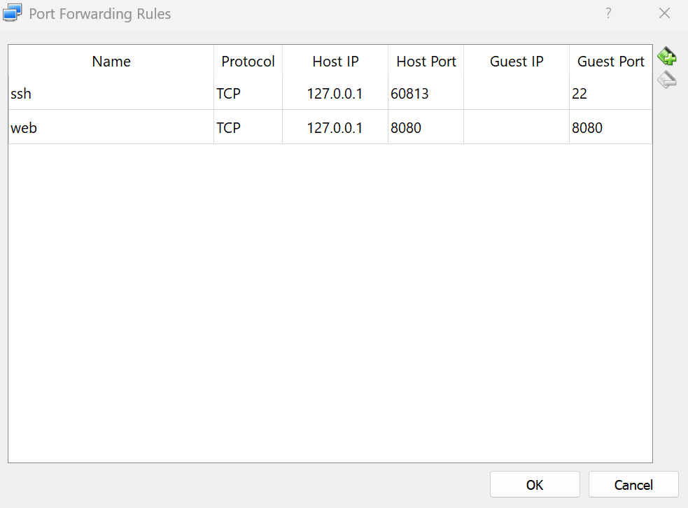
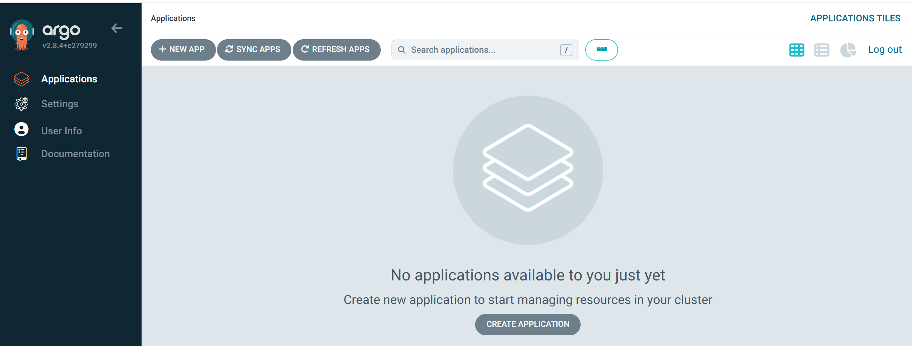
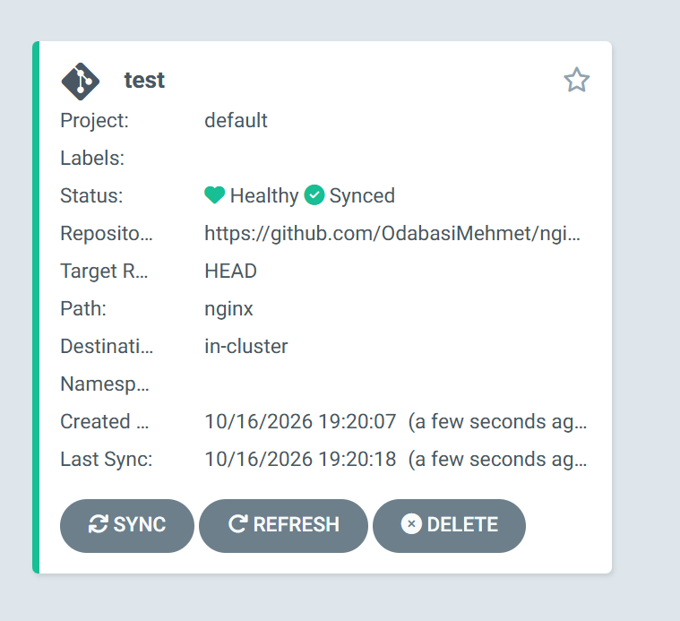
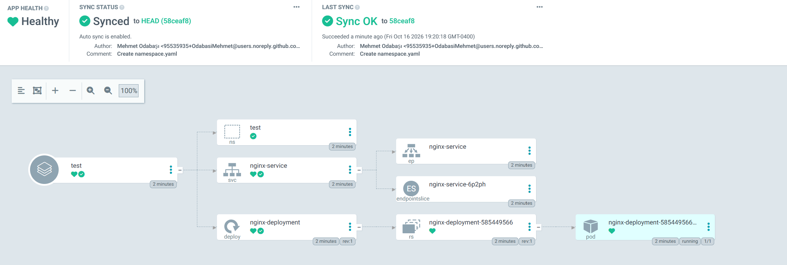
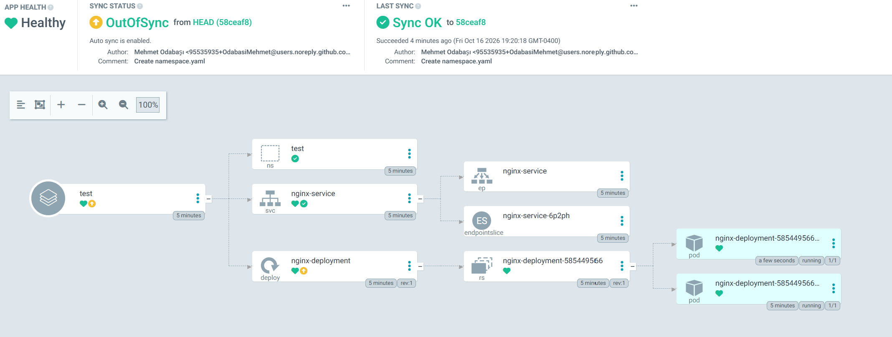
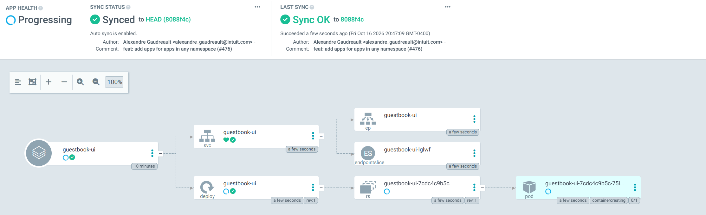
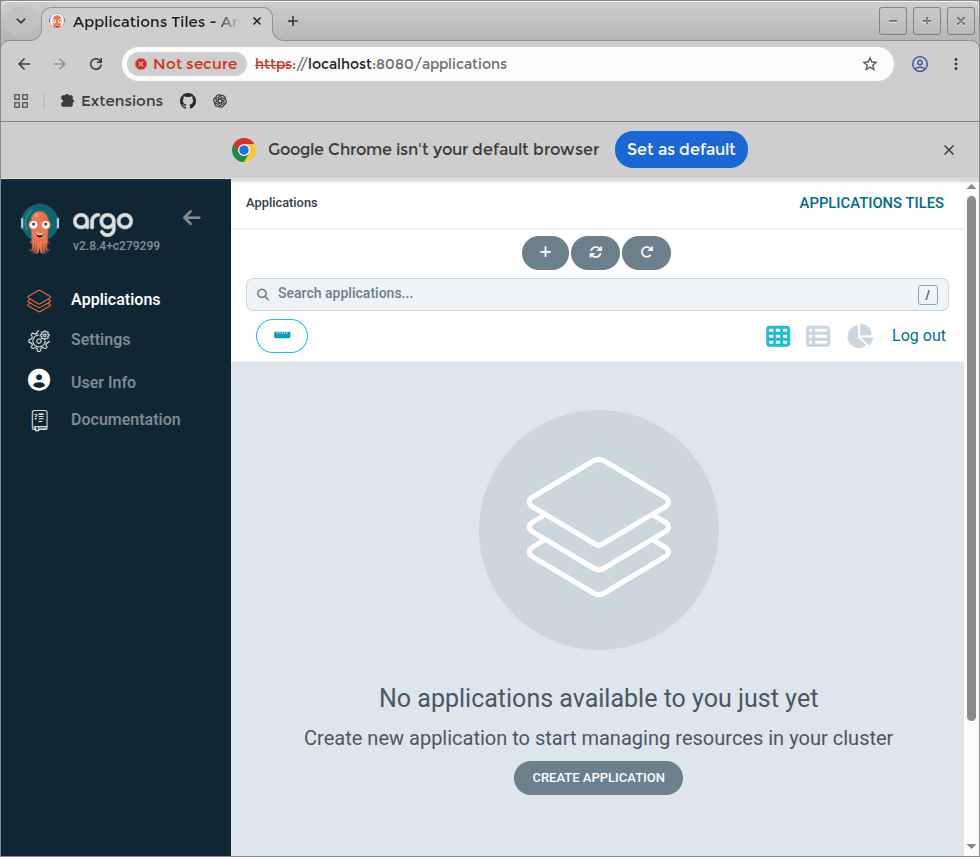
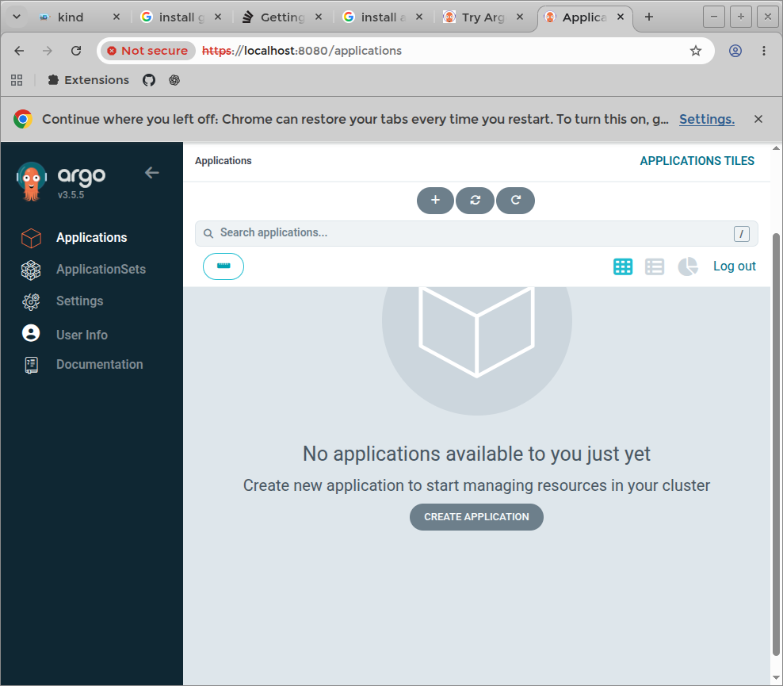

### Info

it is _not_ impossible to rewrite [GitHub Actions](https://docs.github.com/en/actions) completely on [Argo CD](https://argo-cd.readthedocs.io/en/stable/) and other way around.

but notably __GitHub Actions__ and __Argo CD__ are not two interchangeable implementations of the _same thing_

__GitHub Actions__
> Event-driven workflows and CI
>   - Compile, build, and test code.
>   - Run unit tests, Selenium tests, linters, and security scans.
>   - Package artifacts and publish container images.
>   - Trigger deployments and automate repository operations.


__Argo CD__:
> Kubernetes GitOps and reconciliation
>   - Observe desired Kubernetes configuration stored in Git.
>   - Compare the desired state with the live cluster.
>   - Apply changes and report synchronization and health status.
>   - Detect configuration drift and, when configured, correct it.


|Characteristic|__Puppet__|__Argo CD__|
|--------------|----------|-----------|
|Desired state|Declarative configuration and resource manifests|Declarative Kubernetes manifests, Helm charts, Kustomize, etc.|
|Actual state|Managed machine configuration|Live Kubernetes resources|
|Reconciliation|Agent or server periodically enforces configuration, depending on setup|Controller continuously compares desired and live application state|
|Drift correction|Corrects configuration drift|Can correct application drift<br/>through self-healing|
|Primary domain|Operating-system and<br/>infrastructure configuration|Kubernetes application delivery|
|Source of truth|Puppet code and data|Git repository, typically|


The key similarity is declarative desired-state management backed by reconciliation.
__Puppet__ was already doing that long before __Argo CD__ appeared.
There is also a meaningful difference: Puppet traditionally manages resources on machines — __packages__, __files__, __services__, __users__ and __configuration__.
__Argo CD__ narrows this to delivering applications into __Kubernetes__ and
tracking their health and synchronization state.
So I would characterize __Argo CD__ as an __GitOps__-oriented descendant of the same architectural idea,
rather than literally a replacement for __Puppet__.
And this connects directly to your earlier __GitHub Actions__ question:
- __GitHub Actions__ says: execute this workflow when an event occurs.
- __Puppet__ says: make the managed machine conform to this configuration.
- __Argo CD__ says: make the __Kubernetes__ application conform to the desired state in __Git__.

The last two share a fundamental model. The first has a different execution model.
The historical irony: __GitOps__ didn't invent declarative reconciliation.
It applied that established configuration-management idea to a __Kubernetes__-centric, __Git__-driven application-delivery workflow.
__Argo CD__ feels like __Puppet__ reborn because, at the level of control-loop architecture, there really is a family resemblance.


__Argo CD__ narrows __Puppet__ resource-management domain to __Kubernetes__ application delivery,
but it does not merely replace __Puppet__ operation dictionary with __kubectl__ and __Helm__ commands.


The distinction is between reducing the managed resource model and reducing the execution vocabulary.

|Dimension|Puppet|Argo CD|
|---------|------|-------|
|Resource domain|OS configuration, packages, files, services, users, and more|Kubernetes resources and applications|
|Desired-state description|Puppet DSL and resource types/providers|Kubernetes manifests, Helm, Kustomize, and supported config-management plugins|
|Execution model|Resource providers and agent/server enforcement|Kubernetes controller and reconciliation|
|Source of truth|Puppet code and data, among other configurations|Git, typically|
|Extension mechanism|Custom resource types and providers|Config-management plugins and integrations, alongside Kubernetes extensibility|


The subtlety is that __Helm__ is not simply another set of imperative operations. __Argo CD__ can render a __Helm__ chart into Kubernetes manifests and then reconcile the resulting resources.
Likewise, __Kustomize__ and plain __YAML__ are supported; __Argo CD__ is not limited to __Helm__

__Argo CD__ is conceptually a simplified and specialized declarative configuration-management controller:
it takes the broad resource-management problem and concentrates on reconciling __Kubernetes__
application state from __Git__.


__Argo CD__ understands __Kubernetes__ __Jobs__ and lifecycle hooks, so you can make it execute certain procedural tasks. That does not turn it into a general-purpose workflow engine; hooks run within the lifecycle of a synchronization operation.


Argo CD is a massively simplified, domain-specific configuration-management system because Kubernetes gives it a standardized subject model. Puppet must deal with a much broader and more heterogeneous world of managed resources; Argo CD can rely on Kubernetes APIs, resource schemas, controllers, and a well-defined reconciliation boundary.
The interesting engineering challenge is therefore the reverse: emulate Argo CD's behavior using GitHub Actions, while keeping the reconciliation logic outside the Kubernetes cluster being managed.
That last constraint changes the design substantially. You are not merely replacing one deployment tool with another. You are rebuilding a control loop using an event-driven workflow engine that does not inherently provide that control loop.

|Responsibility|GitHub Actions implementation|Complexity|Importance|
|--------------|-----------------------------|----------|----------|
|Discover desired state|Checkout repository; render manifests with Helm or Kustomize|⭐⭐💀|⭐|
|Observe live state|Query remote Kubernetes API|⭐⭐💀|⭐⭐|
|Detect differences|Compare desired vs. live state, accounting for defaults and server-side mutations|⭐⭐⭐⭐⭐💀💀|⭐⭐⭐⭐⭐|
|Reconcile|Apply desired manifests using kubectl apply or server-side apply|⭐⭐⭐💀|⭐⭐⭐⭐|
|Verify convergence|Inspect resource status, rollout conditions and health; report failures or retry|⭐⭐⭐⭐💀|⭐⭐⭐|

#### Components

__API Server__: Handles the Web UI, CLI commands, and manages Role-Based Access Control (RBAC).
__Repository Server__: Communicates with Git repositories, maintains a local cache, and renders manifests from tools like Helm, Kustomize, or Jsonnet.
__Application Controller__: Acts as the reconciliation engine, continuously comparing live cluster states against the target Git state and detecting configuration drift (OutOfSync).
__Redis Cache__: state cache

### Usage

Initial setup based on [gist](https://gist.github.com/bhimsur/b6c575916883ff7712861beacbe1ff0b)

The install on Windows MiniKube (relatively old version - update suggested):

#### Windows 11 Host

```cmd
minikube.exe start --driver=virtualbox
```
```cmd
minikube.exe status
```
```
minikube
type: Control Plane
host: Running
kubelet: Running
apiserver: Running
kubeconfig: Configured
```

#### Ubuntu Host

```
minikube start --driver=virtualbox
```
```text
😄  minikube v1.36.0 on Ubuntu 18.04
✨  Using the virtualbox driver based on existing profile
👍  Starting "minikube" primary control-plane node in "minikube" cluster
🔄  Restarting existing virtualbox VM for "minikube" ...
🎉  minikube 1.39.0 is available! Download it: https://github.com/kubernetes/minikube/releases/tag/v1.39.0
💡  To disable this notice, run: 'minikube config set WantUpdateNotification false'

❗  Image was not built for the current minikube version. To resolve this you can delete and recreate your minikube cluster using the latest images. Expected minikube version: v1.35.0 -> Actual minikube version: v1.36.0
🐳  Preparing Kubernetes v1.33.1 on Docker 28.0.4 ...
❗  kubeadm certificates have expired. Generating new ones...
🔗  Configuring bridge CNI (Container Networking Interface) ...
🔎  Verifying Kubernetes components...
   n ▪ Using image gcr.io/k8s-minikube/storage-provisioner:v5
🌟  Enabled addons: storage-provisioner, default-storageclass
💡  kubectl not found. If you need it, try: 'minikube kubectl -- get pods -A'
🏄  Done! kubectl is now configured to use "minikube" cluster and "default" namespace by default

```
```sh
minikube status
```
```text
minikube
type: Control Plane
host: Running
kubelet: Running
apiserver: Running
kubeconfig: Configured

```
```cmd
minikube.exe kubectl create namespace argocd
```
> NOTE in first (e.g. if recycled prior ) will show downloads
```text
    > kubectl.exe.sha256: 64 B / 64 B [----------------------] 100.00% ? p/s 0s
    > kubectl.exe: 39.52 MiB / 39.52 MiB [----------] 100.00% 4.91 MiB p/s 8.2s
namespace/argocd created
```
download __CRD__ to examine and /or customize:

```sh
curl -skLO https://raw.githubusercontent.com/argoproj/argo-cd/v2.8.4/manifests/install.yaml
```
feed to kubectl (it will deal with direcrory
```cmd
minikube.exe kubectl -- apply --namespace argocd -f install.yaml
```
```text
customresourcedefinition.apiextensions.k8s.io/applications.argoproj.io created
customresourcedefinition.apiextensions.k8s.io/applicationsets.argoproj.io created
customresourcedefinition.apiextensions.k8s.io/appprojects.argoproj.io created
serviceaccount/argocd-application-controller created
serviceaccount/argocd-applicationset-controller created
serviceaccount/argocd-dex-server created
serviceaccount/argocd-notifications-controller created
serviceaccount/argocd-redis created
serviceaccount/argocd-repo-server created
serviceaccount/argocd-server created
role.rbac.authorization.k8s.io/argocd-application-controller created
role.rbac.authorization.k8s.io/argocd-applicationset-controller created
role.rbac.authorization.k8s.io/argocd-dex-server created
role.rbac.authorization.k8s.io/argocd-notifications-controller created
role.rbac.authorization.k8s.io/argocd-server created
clusterrole.rbac.authorization.k8s.io/argocd-application-controller created
clusterrole.rbac.authorization.k8s.io/argocd-server created
rolebinding.rbac.authorization.k8s.io/argocd-application-controller created
rolebinding.rbac.authorization.k8s.io/argocd-applicationset-controller created
rolebinding.rbac.authorization.k8s.io/argocd-dex-server created
rolebinding.rbac.authorization.k8s.io/argocd-notifications-controller created
rolebinding.rbac.authorization.k8s.io/argocd-server created
clusterrolebinding.rbac.authorization.k8s.io/argocd-application-controller created
clusterrolebinding.rbac.authorization.k8s.io/argocd-server created
configmap/argocd-cm created
configmap/argocd-cmd-params-cm created
configmap/argocd-gpg-keys-cm created
configmap/argocd-notifications-cm created
configmap/argocd-rbac-cm created
configmap/argocd-ssh-known-hosts-cm created
configmap/argocd-tls-certs-cm created
secret/argocd-notifications-secret created
secret/argocd-secret created
service/argocd-applicationset-controller created
service/argocd-dex-server created
service/argocd-metrics created
service/argocd-notifications-controller-metrics created
service/argocd-redis created
service/argocd-repo-server created
service/argocd-server created
service/argocd-server-metrics created
deployment.apps/argocd-applicationset-controller created
deployment.apps/argocd-dex-server created
deployment.apps/argocd-notifications-controller created
deployment.apps/argocd-redis created
deployment.apps/argocd-repo-server created
deployment.apps/argocd-server created
statefulset.apps/argocd-application-controller created
networkpolicy.networking.k8s.io/argocd-application-controller-network-policy created
networkpolicy.networking.k8s.io/argocd-applicationset-controller-network-policy created
networkpolicy.networking.k8s.io/argocd-dex-server-network-policy created
networkpolicy.networking.k8s.io/argocd-notifications-controller-network-policy created
networkpolicy.networking.k8s.io/argocd-redis-network-policy created
networkpolicy.networking.k8s.io/argocd-repo-server-network-policy created
networkpolicy.networking.k8s.io/argocd-server-network-policy created
```

Verify the installation by getting all the objects in the ArgoCD namespace.
```cmd
minikube.exe kubectl -- get all -n argocd
```
(wait till all pods in that namespace running)

```text
NAME                                                    READY   STATUS    RESTARTS   AGE
pod/argocd-application-controller-0                     1/1     Running   0          7m3s
pod/argocd-applicationset-controller-5cf484b59d-7cxc5   1/1     Running   0          7m4s
pod/argocd-dex-server-857455bcbd-7kf7f                  1/1     Running   0          7m4s
pod/argocd-notifications-controller-66bfff8745-965bb    1/1     Running   0          7m4s
pod/argocd-redis-8698676ff6-6htqt                       1/1     Running   0          7m4s
pod/argocd-repo-server-7c8d87478b-msk8d                 1/1     Running   0          7m4s
pod/argocd-server-6bf47d79b4-lxg72                      1/1     Running   0          7m3s

NAME                                              TYPE        CLUSTER-IP       EXTERNAL-IP   PORT(S)                      AGE
service/argocd-applicationset-controller          ClusterIP   10.104.43.83     <none>        7000/TCP,8080/TCP            7m5s
service/argocd-dex-server                         ClusterIP   10.110.168.213   <none>        5556/TCP,5557/TCP,5558/TCP   7m5s
service/argocd-metrics                            ClusterIP   10.96.43.118     <none>        8082/TCP                     7m5s
service/argocd-notifications-controller-metrics   ClusterIP   10.102.211.96    <none>        9001/TCP                     7m5s
service/argocd-redis                              ClusterIP   10.101.13.81     <none>        6379/TCP                     7m5s
service/argocd-repo-server                        ClusterIP   10.110.108.169   <none>        8081/TCP,8084/TCP            7m5s
service/argocd-server                             ClusterIP   10.97.251.21     <none>        80/TCP,443/TCP               7m5s
service/argocd-server-metrics                     ClusterIP   10.103.229.52    <none>        8083/TCP                     7m5s

NAME                                               READY   UP-TO-DATE   AVAILABLE   AGE
deployment.apps/argocd-applicationset-controller   1/1     1            1           7m5s
deployment.apps/argocd-dex-server                  1/1     1            1           7m4s
deployment.apps/argocd-notifications-controller    1/1     1            1           7m4s
deployment.apps/argocd-redis                       1/1     1            1           7m4s
deployment.apps/argocd-repo-server                 1/1     1            1           7m4s
deployment.apps/argocd-server                      1/1     1            1           7m3s

NAME                                                          DESIRED   CURRENT   READY   AGE
replicaset.apps/argocd-applicationset-controller-5cf484b59d   1         1         1       7m5s
replicaset.apps/argocd-dex-server-857455bcbd                  1         1         1       7m4s
replicaset.apps/argocd-notifications-controller-66bfff8745    1         1         1       7m4s
replicaset.apps/argocd-redis-8698676ff6                       1         1         1       7m4s
replicaset.apps/argocd-repo-server-7c8d87478b                 1         1         1       7m4s
replicaset.apps/argocd-server-6bf47d79b4                      1         1         1       7m3s

NAME                                             READY   AGE
statefulset.apps/argocd-application-controller   1/1     7m3s
```
```cmd
minikube.exe kubectl -- port-forward svc/argocd-server --namespace argocd 8080:443
```

```text
Forwarding from 127.0.0.1:8080 -> 8080
Forwarding from [::1]:8080 -> 8080
```
let remain running

```cmd
VBoxManage.exe list runningvms
```
```cmd
"minikube" {e8e61b40-c769-4c5c-ae19-51e35b9c8bde}
```
```cmd
VBoxManage.exe guestproperty get "e8e61b40-c769-4c5c-ae19-51e35b9c8bde" "/VirtualBox/GuestInfo/Net/0/V4/IP"
```
```text
Value: 10.0.2.15
```
```
SET VM="{e8e61b40-c769-4c5c-ae19-51e35b9c8bde}"
VBoxManage.exe modifyvm "%VM%" --nat-pf1 "web,tcp,,8080,10.0.2.15,8080"
```

```text
VBoxManage.exe: error: The machine 'minikube' is already locked for a session (or being unlocked)
VBoxManage.exe: error: Details: code VBOX_E_INVALID_OBJECT_STATE (0x80bb0007), component MachineWrap, interface IMachine, callee IUnknown
VBoxManage.exe: error: Context: "LockMachine(a->session, LockType_Write)" at line 529 of file VBoxManageModifyVM.cpp
```
VBoxManage `modifyvm` will only change the VM which is stoppped.
When VM is running, use `controlvm` instead:

```poweshell
$VM='{e8e61b40-c769-4c5c-ae19-51e35b9c8bde}'
pushd 'C:\Program Files\Oracle\VirtualBox'
./VBoxManage.exe showvminfo $VM --details

```
```text
Name:            minikube
Groups:          /
Guest OS:        Linux 2.6 / 3.x / 4.x (64-bit)
UUID:            e8e61b40-c769-4c5c-ae19-51e35b9c8bde
Config file:     C:\Users\kouzm\.minikube\machines\minikube\minikube\minikube.vbox
Snapshot folder: C:\Users\kouzm\.minikube\machines\minikube\minikube\Snapshots
Log folder:      C:\Users\kouzm\.minikube\machines\minikube\minikube\Logs
Hardware UUID:   e8e61b40-c769-4c5c-ae19-51e35b9c8bde
Memory size:     4000MB
Page Fusion:     off
VRAM size:       8MB
CPU exec cap:    100%
HPET:            on
Chipset:         piix3
Firmware:        BIOS
Number of CPUs:  2
PAE:             on
Long Mode:       on
Triple Fault Reset: off
APIC:            on
X2APIC:          off
CPUID Portability Level: 0
CPUID overrides: None
Boot menu mode:  disabled
Boot Device (1): DVD
Boot Device (2): DVD
Boot Device (3): HardDisk
Boot Device (4): Not Assigned
ACPI:            on
IOAPIC:          on
BIOS APIC mode:  APIC
Time offset:     0ms
RTC:             UTC
Hardw. virt.ext: on
Nested Paging:   on
Large Pages:     on
VT-x VPID:       on
VT-x unr. exec.: on
Paravirt. Provider: Default
Effective Paravirt. Provider: KVM
State:           running (since 2026-10-16T21:38:28.851000000)
Monitor count:   1
3D Acceleration: off
2D Video Acceleration: off
Teleporter Enabled: off
Teleporter Port: 0
Teleporter Address:
Teleporter Password:
Tracing Enabled: off
Allow Tracing to Access VM: off
Tracing Configuration:
Autostart Enabled: off
Autostart Delay: 0
Default Frontend:
Storage Controller Name (0):            SATA
Storage Controller Type (0):            IntelAhci
Storage Controller Instance Number (0): 0
Storage Controller Max Port Count (0):  30
Storage Controller Port Count (0):      30
Storage Controller Bootable (0):        on
SATA (0, 0): C:\Users\kouzm\.minikube\machines\minikube\boot2docker.iso (UUID: 47c9cbf8-fa66-46f0-ad86-427f59cb1229)
SATA (1, 0): C:\Users\kouzm\.minikube\machines\minikube\disk.vmdk (UUID: f7c31550-964e-4d68-8272-da382605480e)
NIC 1:           MAC: 080027A84198, Attachment: NAT, Cable connected: on, Trace: off (file: none), Type: virtio, Reported speed: 0 Mbps, Boot priority: 0, Promisc Policy: deny, Bandwidth group: none
NIC 1 Settings:  MTU: 0, Socket (send: 64, receive: 64), TCP Window (send:64, receive: 64)
NIC 1 Rule(0):   name = ssh, protocol = tcp, host ip = 127.0.0.1, host port = 60813, guest ip = , guest port = 22
NIC 1 Rule(1):   name = web, protocol = tcp, host ip = 127.0.0.1, host port = 8080, guest ip = , guest port = 8080
NIC 2:           MAC: 08002744027E, Attachment: Host-only Interface 'VirtualBox Host-Only Ethernet Adapter #5', Cable connected: on, Trace: off (file: none), Type: virtio, Reported speed: 0 Mbps, Boot priority: 0, Promisc Policy: deny, Bandwidth group: none
NIC 3:           disabled
NIC 4:           disabled
NIC 5:           disabled
NIC 6:           disabled
NIC 7:           disabled
NIC 8:           disabled
Pointing Device: PS/2 Mouse
Keyboard Device: PS/2 Keyboard
UART 1:          disabled
UART 2:          disabled
UART 3:          disabled
UART 4:          disabled
LPT 1:           disabled
LPT 2:           disabled
Audio:           enabled (Driver: DSOUND, Controller: AC97, Codec: STAC9700)
Audio playback:  disabled
Audio capture: disabled
Clipboard Mode:  disabled
Drag and drop Mode: disabled
Session name:    headless
Video mode:      720x400x0 at 0,0 enabled
VRDE:            disabled
USB:             disabled
EHCI:            disabled
XHCI:            disabled

USB Device Filters:

<none>

Available remote USB devices:

<none>

Currently Attached USB Devices:

<none>

Bandwidth groups:  <none>

Shared folders:

Name: 'c/Users', Host path: '\\?\c:\Users' (machine mapping), writable

VRDE Connection:    not active
Clients so far:     0

Capturing:          not active
Capture audio:      not active
Capture screens:    0
Capture file:       C:\Users\kouzm\.minikube\machines\minikube\minikube\minikube.webm
Capture dimensions: 1024x768
Capture rate:       512 kbps
Capture FPS:        25
Capture options:

Guest:

Configured memory balloon size:      0 MB
OS type:                             Linux26_64
Additions run level:                 2
Additions version:                   5.2.42 r137960


Guest Facilities:

Facility "VirtualBox Base Driver": active/running (last update: 2026/10/16 21:39:05 UTC)
Facility "VirtualBox System Service": active/running (last update: 2026/10/16 21:39:06 UTC)
Facility "Seamless Mode": not active (last update: 2026/10/16 21:39:05 UTC)
Facility "Graphics Mode": not active (last update: 2026/10/16 21:39:05 UTC)
```
```powershell
$VM='{e8e61b40-c769-4c5c-ae19-51e35b9c8bde}'
pushd 'C:\Program Files\Oracle\VirtualBox'
./VBoxManage.exe controlvm $VM natpf1 "web,tcp,,8080,,8080"
```
```text
VBoxManage.exe: error: A NAT rule of this name already exists
VBoxManage.exe: error: Details: code E_INVALIDARG (0x80070057), component NATEngineWrap, interface INATEngine, callee IUnknown
VBoxManage.exe: error: Context: "AddRedirect(Bstr(strName).raw(), proto, Bstr(strHostIp).raw(), RTStrToUInt16(strHostPort), Bstr(strGuestIp).raw(), RTStrToUInt16(strGuestPort))" at line 952 of file VBoxManageControlVM.cpp
```

```powershell
./VBoxManage.exe controlvm $VM natpf1 delete web
```
```powershell
./VBoxManage.exe controlvm $VM natpf1 "web,tcp,,8080,,8080"
```

one will have to interctively confirm the network settings change.

```cmd
./VBoxManage.exe showvminfo $VM --machinereadable
```
```text
name="minikube"
groups="/"
ostype="Linux 2.6 / 3.x / 4.x (64-bit)"
UUID="e8e61b40-c769-4c5c-ae19-51e35b9c8bde"
CfgFile="C:\\Users\\kouzm\\.minikube\\machines\\minikube\\minikube\\minikube.vbox"
SnapFldr="C:\\Users\\kouzm\\.minikube\\machines\\minikube\\minikube\\Snapshots"
LogFldr="C:\\Users\\kouzm\\.minikube\\machines\\minikube\\minikube\\Logs"
hardwareuuid="e8e61b40-c769-4c5c-ae19-51e35b9c8bde"
memory=4000
pagefusion="off"
vram=8
cpuexecutioncap=100
hpet="on"
chipset="piix3"
firmware="BIOS"
cpus=2
pae="on"
longmode="on"
triplefaultreset="off"
apic="on"
x2apic="off"
cpuid-portability-level=0
bootmenu="disabled"
boot1="dvd"
boot2="dvd"
boot3="disk"
boot4="none"
acpi="on"
ioapic="on"
biosapic="apic"
biossystemtimeoffset=0
rtcuseutc="on"
hwvirtex="on"
nestedpaging="on"
largepages="on"
vtxvpid="on"
vtxux="on"
paravirtprovider="default"
effparavirtprovider="kvm"
VMState="running"
VMStateChangeTime="2026-10-16T21:38:28.851000000"
monitorcount=1
accelerate3d="off"
accelerate2dvideo="off"
teleporterenabled="off"
teleporterport=0
teleporteraddress=""
teleporterpassword=""
tracing-enabled="off"
tracing-allow-vm-access="off"
tracing-config=""
autostart-enabled="off"
autostart-delay=0
defaultfrontend=""
storagecontrollername0="SATA"
storagecontrollertype0="IntelAhci"
storagecontrollerinstance0="0"
storagecontrollermaxportcount0="30"
storagecontrollerportcount0="30"
storagecontrollerbootable0="on"
"SATA-0-0"="C:\Users\kouzm\.minikube\machines\minikube\boot2docker.iso"
"SATA-ImageUUID-0-0"="47c9cbf8-fa66-46f0-ad86-427f59cb1229"
"SATA-tempeject"="off"
"SATA-IsEjected"="off"
"SATA-1-0"="C:\Users\kouzm\.minikube\machines\minikube\disk.vmdk"
"SATA-ImageUUID-1-0"="f7c31550-964e-4d68-8272-da382605480e"
"SATA-2-0"="none"
"SATA-3-0"="none"
"SATA-4-0"="none"
"SATA-5-0"="none"
"SATA-6-0"="none"
"SATA-7-0"="none"
"SATA-8-0"="none"
"SATA-9-0"="none"
"SATA-10-0"="none"
"SATA-11-0"="none"
"SATA-12-0"="none"
"SATA-13-0"="none"
"SATA-14-0"="none"
"SATA-15-0"="none"
"SATA-16-0"="none"
"SATA-17-0"="none"
"SATA-18-0"="none"
"SATA-19-0"="none"
"SATA-20-0"="none"
"SATA-21-0"="none"
"SATA-22-0"="none"
"SATA-23-0"="none"
"SATA-24-0"="none"
"SATA-25-0"="none"
"SATA-26-0"="none"
"SATA-27-0"="none"
"SATA-28-0"="none"
"SATA-29-0"="none"
natnet1="nat"
macaddress1="080027A84198"
cableconnected1="on"
nic1="nat"
nictype1="virtio"
nicspeed1="0"
mtu="0"
sockSnd="64"
sockRcv="64"
tcpWndSnd="64"
tcpWndRcv="64"
Forwarding(0)="ssh,tcp,127.0.0.1,60813,,22"
Forwarding(1)="web,tcp,,8080,,8080"
hostonlyadapter2="VirtualBox Host-Only Ethernet Adapter #5"
macaddress2="08002744027E"
cableconnected2="on"
nic2="hostonly"
nictype2="virtio"
nicspeed2="0"
nic3="none"
nic4="none"
nic5="none"
nic6="none"
nic7="none"
nic8="none"
hidpointing="ps2mouse"
hidkeyboard="ps2kbd"
uart1="off"
uart2="off"
uart3="off"
uart4="off"
lpt1="off"
lpt2="off"
audio="dsound"
audio_in="false"
audio_out="false"
clipboard="disabled"
draganddrop="disabled"
SessionName="headless"
VideoMode="720,400,0"@0,0 1
vrde="off"
usb="off"
ehci="off"
xhci="off"
SharedFolderNameMachineMapping1="c/Users"
SharedFolderPathMachineMapping1="\\?\c:\Users"
VRDEActiveConnection="off"
VRDEClients=0
videocap="off"
videocap_audio="off"
videocapscreens=0
videocapfile="C:\Users\kouzm\.minikube\machines\minikube\minikube\minikube.webm"
videocapres=1024x768
videocaprate=512
videocapfps=25
videocapopts=
GuestMemoryBalloon=0
GuestOSType="Linux26_64"
GuestAdditionsRunLevel=2
GuestAdditionsVersion="5.2.42 r137960"
GuestAdditionsFacility_VirtualBox Base Driver=50,1792186745798
GuestAdditionsFacility_VirtualBox System Service=50,1792186746243
GuestAdditionsFacility_Seamless Mode=0,1792186745797
GuestAdditionsFacility_Graphics Mode=0,1792186745797
```
```powershell
./VBoxManage.exe showvminfo $VM --machinereadable | select-string -pattern 'Forwarding\(.\)'
```
```text

Forwarding(0)="ssh,tcp,127.0.0.1,60813,,22"
Forwarding(1)="web,tcp,,8080,,8080"
```
For testing sake do the same interactively through Virtualbox Manager:



acknowledge `net::ERR_CERT_AUTHORITY_INVALID`


* retrieve
```cmd
minikube.exe kubectl -- --namespace argocd get secret argocd-initial-admin-secret -o jsonpath="{.data.password}"
```
```text
eEQ1cDRJbzJiOU9FMTBTcw==
```
```powershell
$data = 'eEQ1cDRJbzJiOU9FMTBTcw=='
$bytes = [System.Convert]::FromBase64String($data)
[System.Text.Encoding]::UTF8.GetString($bytes)
```
```text
xD5p4Io2b9OE10Ss
```


if run from bash

```sh
minikube.exe kubectl -- -n argocd get secret argocd-initial-admin-secret -o jsonpath="{.data.password}" | base64 -d; echo
```
login as `admin`, will be redirected to initial dashboard:



connect to demo repository `https://github.com/OdabasiMehmet/nginx-kubernetes.git` and



create application  as explained.





```cmd
minikube.exe kubectl -- scale deployment -n test nginx-deployment --replicas=2
```
```text
deployment.apps/nginx-deployment scaled
```



Destroy the `nginx` example application and disconnect from the repository.

Connect to [Example Apps to Demonstrate Argo CD](https://github.com/argoproj/argocd-example-apps)

Create separate `guestbook` namespace for the guestbook application:

```cmd
minikube.exe kubectl get namespaces
```
```text
NAME              STATUS   AGE
argocd            Active   167m
default           Active   3h3m
guestbook         Active   1s
kube-node-lease   Active   3h3m
kube-public       Active   3h3m
kube-system       Active   3h3m
```
Examine deployment YAML - will use the same `app` to __ArgoCD__:

```yaml
apiVersion: apps/v1
kind: Deployment
metadata:
  name: guestbook-ui
spec:
  replicas: 1
  revisionHistoryLimit: 3
  selector:
    matchLabels:
      app: guestbook-ui
  template:
    metadata:
      labels:
        app: guestbook-ui
    spec:
      containers:
        - image: gcr.io/google-samples/gb-frontend:v5
          name: guestbook-ui
          ports:
            - containerPort: 80
```

Choose Automatic sync when filling the application inputs. You will need to force sync if any error made and corrected in application configuration




#### Ubuntu Host
```sh
VERSION=v2.8.4
minikube kubectl -- apply --namespace argocd -f  https://raw.githubusercontent.com/argoproj/argo-cd/$VERSION/manifests/install.yaml
```
```text
customresourcedefinition.apiextensions.k8s.io/applications.argoproj.io created
customresourcedefinition.apiextensions.k8s.io/applicationsets.argoproj.io created
customresourcedefinition.apiextensions.k8s.io/appprojects.argoproj.io created
serviceaccount/argocd-application-controller created
serviceaccount/argocd-applicationset-controller created
serviceaccount/argocd-dex-server created
serviceaccount/argocd-notifications-controller created
serviceaccount/argocd-redis created
serviceaccount/argocd-repo-server created
serviceaccount/argocd-server created
role.rbac.authorization.k8s.io/argocd-application-controller created
role.rbac.authorization.k8s.io/argocd-applicationset-controller created
role.rbac.authorization.k8s.io/argocd-dex-server created
role.rbac.authorization.k8s.io/argocd-notifications-controller created
role.rbac.authorization.k8s.io/argocd-server created
clusterrole.rbac.authorization.k8s.io/argocd-application-controller created
clusterrole.rbac.authorization.k8s.io/argocd-server created
rolebinding.rbac.authorization.k8s.io/argocd-application-controller created
rolebinding.rbac.authorization.k8s.io/argocd-applicationset-controller created
rolebinding.rbac.authorization.k8s.io/argocd-dex-server created
rolebinding.rbac.authorization.k8s.io/argocd-notifications-controller created
rolebinding.rbac.authorization.k8s.io/argocd-server created
clusterrolebinding.rbac.authorization.k8s.io/argocd-application-controller created
clusterrolebinding.rbac.authorization.k8s.io/argocd-server created
configmap/argocd-cm created
configmap/argocd-cmd-params-cm created
configmap/argocd-gpg-keys-cm created
configmap/argocd-notifications-cm created
configmap/argocd-rbac-cm created
configmap/argocd-ssh-known-hosts-cm created
configmap/argocd-tls-certs-cm created
secret/argocd-notifications-secret created
secret/argocd-secret created
service/argocd-applicationset-controller created
service/argocd-dex-server created
service/argocd-metrics created
service/argocd-notifications-controller-metrics created
service/argocd-redis created
service/argocd-repo-server created
service/argocd-server created
service/argocd-server-metrics created
deployment.apps/argocd-applicationset-controller created
deployment.apps/argocd-dex-server created
deployment.apps/argocd-notifications-controller created
deployment.apps/argocd-redis created
deployment.apps/argocd-repo-server created
deployment.apps/argocd-server created
statefulset.apps/argocd-application-controller created
networkpolicy.networking.k8s.io/argocd-application-controller-network-policy created
networkpolicy.networking.k8s.io/argocd-applicationset-controller-network-policy created
networkpolicy.networking.k8s.io/argocd-dex-server-network-policy created
networkpolicy.networking.k8s.io/argocd-notifications-controller-network-policy created
networkpolicy.networking.k8s.io/argocd-redis-network-policy created
networkpolicy.networking.k8s.io/argocd-repo-server-network-policy created
networkpolicy.networking.k8s.io/argocd-server-network-policy created
```

```sh
minikube kubectl port-forward svc/argocd-server --namespace argocd 8080:443
```
```text
Forwarding from 127.0.0.1:8080 -> 8080
Forwarding from [::1]:8080 -> 8080

```
```sh>
minikube kubectl -- get all -n argocd

```
> NOTE may need to interrupt wth `Ctrl^C`
```
NAME                                                    READY   STATUS    RESTARTS   AGE
pod/argocd-application-controller-0                     1/1     Running   0          4m12s
pod/argocd-applicationset-controller-77594b7754-dqw5z   1/1     Running   0          4m12s
pod/argocd-dex-server-55cdd54ccb-wjx2d                  1/1     Running   0          4m12s
pod/argocd-notifications-controller-7765c495c7-c585v    1/1     Running   0          4m12s
pod/argocd-redis-5d849fc6db-78kzd                       1/1     Running   0          4m12s
pod/argocd-repo-server-5477d857fc-rh4p9                 1/1     Running   0          4m12s
pod/argocd-server-dcdcd9f88-xrz4l                       1/1     Running   0          4m12s

NAME                                              TYPE        CLUSTER-IP       EXTERNAL-IP   PORT(S)                      AGE
service/argocd-applicationset-controller          ClusterIP   10.101.152.106   <none>        7000/TCP,8080/TCP            4m13s
service/argocd-dex-server                         ClusterIP   10.105.149.193   <none>        5556/TCP,5557/TCP,5558/TCP   4m13s
service/argocd-metrics                            ClusterIP   10.105.115.22    <none>        8082/TCP                     4m13s
service/argocd-notifications-controller-metrics   ClusterIP   10.96.32.232     <none>        9001/TCP                     4m13s
service/argocd-redis                              ClusterIP   10.111.188.213   <none>        6379/TCP                     4m13s
service/argocd-repo-server                        ClusterIP   10.96.77.212     <none>        8081/TCP,8084/TCP            4m12s
service/argocd-server                             ClusterIP   10.105.219.66    <none>        80/TCP,443/TCP               4m12s
service/argocd-server-metrics                     ClusterIP   10.109.42.160    <none>        8083/TCP                     4m12s

NAME                                               READY   UP-TO-DATE   AVAILABLE   AGE
deployment.apps/argocd-applicationset-controller   1/1     1            1           4m12s
deployment.apps/argocd-dex-server                  1/1     1            1           4m12s
deployment.apps/argocd-notifications-controller    1/1     1            1           4m12s
deployment.apps/argocd-redis                       1/1     1            1           4m12s
deployment.apps/argocd-repo-server                 1/1     1            1           4m12s
deployment.apps/argocd-server                      1/1     1            1           4m12s

NAME                                                          DESIRED   CURRENT   READY   AGE
replicaset.apps/argocd-applicationset-controller-77594b7754   1         1         1       4m12s
replicaset.apps/argocd-dex-server-55cdd54ccb                  1         1         1       4m12s
replicaset.apps/argocd-notifications-controller-7765c495c7    1         1         1       4m12s
replicaset.apps/argocd-redis-5d849fc6db                       1         1         1       4m12s
replicaset.apps/argocd-repo-server-5477d857fc                 1         1         1       4m12s
replicaset.apps/argocd-server-dcdcd9f88                       1         1         1       4m12s

NAME                                             READY   AGE
statefulset.apps/argocd-application-controller   1/1     4m12s

```
```text
et
```
```text
"minikube" {c89f1689-bc57-4cc3-86a9-b3a6afb63538}
```

```sh
VM='c89f1689-bc57-4cc3-86a9-b3a6afb63538';VBoxManage controlvm $VM natpf1 "web,tcp,,8080,,8080"
```

```sh
minikube kubectl -- --namespace argocd get secret argocd-initial-admin-secret -o jsonpath="{.data.password}"  |base64 -d -
```


### Backgound


| Period|Phase | What happen |
|-------|------|-------------|
|2000 |Borg: Google's internal | Google developed and operated Borg to schedule and manage workloads across enormous clusters. This infrastructure helped run services such as Search and Gmail:<br/>internal system, not a public product|
|2013|The realization|Engineers including Joe Beda, Brendan Burns and Craig McLuckie began pushing for a public container-orchestration platform informed by Google's internal experience<br/>Leadership initially worried about giving away a competitive advantage|
|2014..15|Kubernetes go public| Kubernetes was announced in June 2014 and reached version 1.0 in July 2015. It borrowed lessons and design ideas from Borg but<br/>was a new, open-source system—not simply Borg's source code released to everyone|
|2015 onward|An ecosystem, not longer Google's product|Google donated Kubernetes as seed technology for the Cloud Native Computing Foundation.<br/> Contributions from other companies helped turn it into a portable, broadly adopted platform|


> AWS had the first-mover advantage, Microsoft had an enormous enterprise distribution channel,
> Google had world-class infrastructure technology but a weaker position in the cloud market.
> Open-sourcing Kubernetes helped Google turn a private engineering advantage into a standard that competing cloud providers would also adopt.

__GCP__ recognize that technical superiority and cloud-market adoption are different problems:
  - __AWS__ had accumulated customers, services, operational experience and ecosystem momentum.
  - __Microsoft__ could build on enterprise relationships and its existing software business.
  - __Google__ had solid distributed-systems expertise, but persuading customers to make __CGP__ their primary cloud provider was a separate challenge


### Historical Background: What *Really* Happened — Google, Kubernetes, and the Cloud Wars

#### 1. Google had the technology before Kubernetes existed

During the 2000s, Google developed **Borg**, an internal cluster-management and workload-scheduling system. It helped Google operate enormous fleets of machines running services such as Search and Gmail.

Borg was a substantial engineering advantage, but it remained an internal system. Google did not simply publish Borg's source code and rename it Kubernetes.

In 2013, engineers including Joe Beda, Brendan Burns, and Craig McLuckie began pushing for a public container-orchestration platform informed by Google's experience. The idea was controversial: why give competitors access to concepts developed through years of Google's engineering investment?

#### 2. Meanwhile, the cloud market was developing into a two-horse race

By the mid-2010s, AWS had a substantial first-mover advantage. It had accumulated customers, services, operational experience, and a growing ecosystem.

Microsoft had another powerful advantage: its established enterprise relationships, software business, and distribution channels.

Google possessed formidable distributed-systems expertise, but technical excellence did not automatically translate into cloud-market leadership. Google Cloud was competing against two companies with different, but substantial, commercial advantages.

The problem was therefore not simply that Google needed a better scheduler. It needed a way to make its technology relevant to a much broader market.

#### 3. The industry was at risk of fragmenting into competing proprietary ecosystems

Docker made container packaging substantially more accessible, but packaging an application into a container did not solve the larger operational problems:

- Which machine should run a workload?
- How should failed workloads be restarted?
- How should applications scale?
- How should services discover and communicate with one another?
- How should deployments be updated without manually coordinating every machine?

Cloud providers and technology companies could build their own answers. AWS had ECS and its own service interfaces; other vendors developed competing orchestration and deployment systems.

These solutions could work well individually, but differences in APIs, operational models, tooling, and required skills increased the cost of moving between platforms.

Customers faced the prospect of learning one provider's ecosystem and becoming increasingly dependent on it. A container image alone did not guarantee portability.

#### 4. Google made a strategic bet on an open orchestration platform

Google announced **Kubernetes in June 2014**. Version 1.0 followed in July 2015, when Kubernetes was donated as seed technology for the newly established Cloud Native Computing Foundation.

Kubernetes drew on lessons from Borg and Google's distributed-systems experience, but it was a new, open-source system rather than a public release of Borg itself.

The strategic significance was that Google could make a broadly useful orchestration platform available to developers without requiring them to adopt Google's entire proprietary infrastructure.

This helped create a common interface around which other cloud providers, enterprises, software vendors, and independent developers could build.

#### 5. The strategic inversion: Google could benefit even when customers chose competitors

The interesting commercial mechanism was this:

Google did not need to win every infrastructure sale for Kubernetes to become valuable to Google.

If Kubernetes became the common platform developers used to deploy containerized workloads, Google could offer a managed Kubernetes service, contribute to the ecosystem, and compete on the surrounding infrastructure and services.

Customers could use Kubernetes on Google Cloud, AWS, Azure, or their own infrastructure. That reduced the need to choose a provider solely because of its proprietary orchestration technology.

AWS eventually introduced its managed Kubernetes service, Amazon EKS, which became generally available in 2018. AWS continued to offer ECS as well.

The result was not the disappearance of proprietary cloud services. It was the emergence of a shared orchestration layer alongside those services.

#### 6. Portability became a competitive advantage — but not a universal escape from lock-in

Kubernetes standardized many important aspects of workload deployment and management. A workload based on ordinary Kubernetes APIs and portable container images can often be moved between local clusters, on-premises installations, and managed cloud Kubernetes services with relatively little change.

However, a Kubernetes application can still depend heavily on provider-specific services:

- Identity and access management
- Databases and managed messaging
- Storage classes and persistent-volume behavior
- Networking, load balancers, and ingress
- Cloud-specific APIs and proprietary integrations

Kubernetes therefore reduces certain forms of lock-in; it does not eliminate them. Portability depends on the application's architecture, dependencies, and operational requirements.

#### 7. Why this matters for a local Minikube and Argo CD lab

Minikube provides a local Kubernetes environment. Argo CD adds a GitOps control loop that continuously compares the desired application configuration stored in Git with the state observed in Kubernetes.

This makes a useful distinction visible:

- **Kubernetes** provides the orchestration API and control plane.
- **Argo CD** provides Git-driven application delivery and reconciliation.
- **Helm** packages and renders Kubernetes resources into deployable manifests.
- **Minikube** provides a local cluster in which to experiment with these mechanisms.

None of these requires adopting a particular cloud provider for a basic lab.

A local experiment can therefore help distinguish Kubernetes-native behavior from cloud-specific services, without requiring Google's infrastructure, a production cluster, or a catalog of sample applications.

#### Conclusion

The historical story is not that Google secretly developed Kubernetes for decades and then gave away the same product. Google operated Borg internally for years, then developed and released Kubernetes as a new open-source platform informed by that experience.

The larger strategic story is that Google helped establish an open orchestration standard in a market where AWS had a major first-mover advantage and Microsoft had powerful enterprise distribution.

**The central insight:** Google could turn an internal engineering advantage into an industry-wide platform, allowing it to compete not only through proprietary technology but also through the adoption of a common standard.

That interpretation is consistent with the history, although it would be too strong to claim that avoiding vendor lock-in was the single decisive reason Google open-sourced Kubernetes. The move also served engineering, ecosystem-building, and commercial objectives.

##### Historical references

- Kubernetes project history: https://kubernetes.io/blog/2015/04/borg-predecessor-to-kubernetes/
- Kubernetes announcement and project background: https://kubernetes.io/blog/2014/06/introducing-kubernetes/
- Cloud Native Computing Foundation: https://www.cncf.io/
- Amazon EKS: https://aws.amazon.com/eks/
- Google Kubernetes Engine: https://cloud.google.com/kubernetes-engine


### ArgoCD on Kind
> NOTE: on __Ubuntu__ __18.04__ go is very old

```sh
apt-get remove golang-go]
``` 

```
VERSION='1.14.1'
wget https://dl.google.com/go/go${VERSION}.linux-amd64.tar.gz

sudo rm -rf /usr/local/go && sudo tar -C /usr/local -xzf go${VERSION}.linux-amd64.tar.gz
```

export GO111MODULE=on
```
```
go install sigs.k8s.io/kind@v0.33.0 
```
```
can't load package: package sigs.k8s.io/kind@v0.33.0: 
can only use path@version syntax with 'go get'
```
```sh
export GOROOT=/usr/local/go
export GOPATH=$HOME/go
export PATH=$PATH:$GOROOT/bin:$GOPATH/bin
export GO111MODULE=on
```

```
go get sigs.k8s.io/kind@v0.33.0 
```
```txt
go: downloading sigs.k8s.io/kind v0.33.0
go: downloading al.essio.dev/pkg/shellescape v1.5.1
go: downloading github.com/spf13/pflag v1.0.5
go: downloading github.com/pkg/errors v0.9.1
go: downloading github.com/mattn/go-isatty v0.0.20
go: downloading github.com/spf13/cobra v1.8.0
go: downloading github.com/pelletier/go-toml v1.9.5
go: downloading github.com/evanphx/json-patch/v5 v5.6.0
go: downloading go.yaml.in/yaml/v3 v3.0.4
go: downloading github.com/BurntSushi/toml v1.4.0
go: downloading golang.org/x/sys v0.6.0
go: downloading sigs.k8s.io/yaml v1.4.0
go: downloading github.com/inconshreveable/mousetrap v1.1.0
../../../go/pkg/mod/github.com/!burnt!sushi/toml@v1.4.0/decode.go:9:2: package io/fs is not in GOROOT (/usr/local/go/src/io/fs)
```
update to `16.1` but `module requires Go 1.18`

```sh
go install sigs.k8s.io/kind@v0.22.0 
```
```text
go: downloading sigs.k8s.io/kind v0.22.0
go: downloading github.com/spf13/cobra v1.4.0
go: downloading github.com/alessio/shellescape v1.4.1
go: downloading github.com/mattn/go-isatty v0.0.14
go: downloading github.com/pelletier/go-toml v1.9.4
go: downloading github.com/BurntSushi/toml v1.0.0
go: downloading gopkg.in/yaml.v3 v3.0.1
go: downloading sigs.k8s.io/yaml v1.3.0
go: downloading golang.org/x/sys v0.0.0-20210630005230-0f9fa26af87c
go: downloading github.com/google/safetext v0.0.0-20220905092116-b49f7bc46da2
go: downloading gopkg.in/yaml.v2 v2.4.0

```

```sh
kind version
```
```text
kind v0.22.0 go1.16.1 linux/amd64
```
#### Create a Kind Cluster
```sh
cat <<EOF > kind-config.yaml
kind: Cluster
apiVersion: kind.x-k8s.io/v1alpha4
nodes:
- role: control-plane
  extraPortMappings:
  - containerPort: 30443
    hostPort: 8443
    protocol: TCP
EOF
```

* Create the cluster using the configuration
```sh
kind create cluster --name argocd-cluster --config kind-config.yaml
```

```text
Creating cluster "argocd-cluster" ...
 ✓ Ensuring node image (kindest/node:v1.29.2) 🖼 
 ✓ Preparing nodes 📦  
 ✓ Writing configuration 📜 
 ✓ Starting control-plane 🕹️ 
 ✓ Installing CNI 🔌 
 ✓ Installing StorageClass 💾 
Set kubectl context to "kind-argocd-cluster"
You can now use your cluster with:

kubectl cluster-info --context kind-argocd-cluster

Have a nice day! 👋

```

```sh
docker image ls
```
```text
NAME                                              TYPE        CLUSTER-IP       EXTERNAL-IP   PORT(S)                      AGE
service/argocd-applicationset-controller          ClusterIP   10.101.152.106   <none>        7000/TCP,8080/TCP            4m13s
service/argocd-dex-server                         ClusterIP   10.105.149.193   <none>        5556/TCP,5557/TCP,5558/TCP   4m13s
service/argocd-metrics                            ClusterIP   10.105.115.22    <none>        8082/TCP                     4m13s
service/argocd-notifications-controller-metrics   ClusterIP   10.96.32.232     <none>        9001/TCP                     4m13s
service/argocd-redis                              ClusterIP   10.111.188.213   <none>        6379/TCP                     4m13s
service/argocd-repo-server                        ClusterIP   10.96.77.212     <none>        8081/TCP,8084/TCP            4m12s
service/argocd-server                             ClusterIP   10.105.219.66    <none>        80/TCP,443/TCP               4m12s
service/argocd-server-metrics                     ClusterIP   10.109.42.160    <none>        8083/TCP             
service/argocd-server-metrics                     ClusterIP   10.109.42.160    <none>        8083/TCP                     4m12s

NAME                                               READY   UP-TO-DATE   AVAILABLE   AGE
deployment.apps/argocd-applicationset-controller   1/1     1            1           4m12s
deployment.apps/argocd-dex-server                  1/1     1            1           4m12s
deployment.apps/argocd-notifications-controller    1/1     1            1           4m12s
deployment.apps/argocd-redis                       1/1     1            1           4m12s
deployment.apps/argocd-repo-server                 1/1     1            1           4m12s
deployment.apps/argocd-server                      1/1     1            1           4m12s

NAME                                                          DESIRED   CURRENT   READY   AGE
replicaset.apps/argocd-applicationset-controller-77594b7754   1         1         1       4m12s
replicaset.apps/argocd-dex-server-55cdd54ccb                  1         1         1       4m12s
replicaset.apps/argocd-notifications-controller-7765c495c7    1         1         1       4m12s
replicaset.apps/argocd-redis-5d849fc6db                       1         1         1       4m12s
replicaset.apps/argocd-repo-server-5477d857fc                 1         1         1       4m12s


```

```sh
kubectl cluster-info --context kind-argocd-cluster
```
```text
Kubernetes control plane is running at https://127.0.0.1:36977
CoreDNS is running at https://127.0.0.1:36977/api/v1/namespaces/kube-system/services/kube-dns:dns/proxy

```

```sh
kubectl create namespace argocd
```
```text
namespace/argocd created
```
```sh
kubectl apply -n argocd --server-side --force-conflicts -f https://raw.githubusercontent.com/argoproj/argo-cd/stable/manifests/install.yaml
```
```text

customresourcedefinition.apiextensions.k8s.io/applications.argoproj.io serverside-applied
customresourcedefinition.apiextensions.k8s.io/applicationsets.argoproj.io serverside-applied
customresourcedefinition.apiextensions.k8s.io/appprojects.argoproj.io serverside-applied
serviceaccount/argocd-application-controller serverside-applied
serviceaccount/argocd-applicationset-controller serverside-applied
serviceaccount/argocd-dex-server serverside-applied
serviceaccount/argocd-notifications-controller serverside-applied
serviceaccount/argocd-redis serverside-applied
serviceaccount/argocd-repo-server serverside-applied
serviceaccount/argocd-server serverside-applied
role.rbac.authorization.k8s.io/argocd-application-controller serverside-applied
role.rbac.authorization.k8s.io/argocd-applicationset-controller serverside-applied
role.rbac.authorization.k8s.io/argocd-dex-server serverside-applied
role.rbac.authorization.k8s.io/argocd-notifications-controller serverside-applied
role.rbac.authorization.k8s.io/argocd-redis serverside-applied
role.rbac.authorization.k8s.io/argocd-server serverside-applied
clusterrole.rbac.authorization.k8s.io/argocd-application-controller serverside-applied
clusterrole.rbac.authorization.k8s.io/argocd-applicationset-controller serverside-applied
clusterrole.rbac.authorization.k8s.io/argocd-server serverside-applied
rolebinding.rbac.authorization.k8s.io/argocd-application-controller serverside-applied
rolebinding.rbac.authorization.k8s.io/argocd-applicationset-controller serverside-applied
rolebinding.rbac.authorization.k8s.io/argocd-dex-server serverside-applied
rolebinding.rbac.authorization.k8s.io/argocd-notifications-controller serverside-applied
rolebinding.rbac.authorization.k8s.io/argocd-redis serverside-applied
rolebinding.rbac.authorization.k8s.io/argocd-server serverside-applied
clusterrolebinding.rbac.authorization.k8s.io/argocd-application-controller serverside-applied
clusterrolebinding.rbac.authorization.k8s.io/argocd-applicationset-controller serverside-applied
clusterrolebinding.rbac.authorization.k8s.io/argocd-server serverside-applied
configmap/argocd-cm serverside-applied
configmap/argocd-cmd-params-cm serverside-applied
configmap/argocd-gpg-keys-cm serverside-applied
configmap/argocd-notifications-cm serverside-applied
configmap/argocd-rbac-cm serverside-applied
configmap/argocd-ssh-known-hosts-cm serverside-applied
configmap/argocd-tls-certs-cm serverside-applied
secret/argocd-notifications-secret serverside-applied
secret/argocd-secret serverside-applied
service/argocd-applicationset-controller serverside-applied
service/argocd-dex-server serverside-applied
service/argocd-metrics serverside-applied
service/argocd-notifications-controller-metrics serverside-applied
service/argocd-redis serverside-applied
service/argocd-repo-server serverside-applied
service/argocd-server serverside-applied
service/argocd-server-metrics serverside-applied
deployment.apps/argocd-applicationset-controller serverside-applied
deployment.apps/argocd-dex-server serverside-applied
deployment.apps/argocd-notifications-controller serverside-applied
deployment.apps/argocd-redis serverside-applied
deployment.apps/argocd-repo-server serverside-applied
deployment.apps/argocd-server serverside-applied
statefulset.apps/argocd-application-controller serverside-applied
networkpolicy.networking.k8s.io/argocd-application-controller-network-policy serverside-applied
networkpolicy.networking.k8s.io/argocd-applicationset-controller-network-policy serverside-applied
networkpolicy.networking.k8s.io/argocd-dex-server-network-policy serverside-applied
networkpolicy.networking.k8s.io/argocd-notifications-controller-network-policy serverside-applied
networkpolicy.networking.k8s.io/argocd-redis-network-policy serverside-applied
networkpolicy.networking.k8s.io/argocd-repo-server-network-policy serverside-applied
networkpolicy.networking.k8s.io/argocd-server-network-policy serverside-applied
```
```sh
docker container ls 
```
```text
CONTAINER ID   IMAGE                  COMMAND                  CREATED          STATUS          PORTS                                                NAMES
ff285934790c   kindest/node:v1.29.2   "/usr/local/bin/entr…"   46 minutes ago   Up 40 minutes   127.0.0.1:36977->6443/tcp, 0.0.0.0:8443->30443/tcp   argocd-cluster-control-plane
```
```sh
docker image ls 
```
```text
REPOSITORY     TAG       IMAGE ID       CREATED       SIZE
kindest/node   <none>    09c50567d34e   2 years ago   956MB
```

```sh
kubectl port-forward svc/argocd-server -n argocd 8080:443
```
```sh
kubectl -n argocd get secret argocd-initial-admin-secret -o jsonpath='{.data.password}' | base64 -d
```



### See Also


   * [docker hub](https://hub.docker.com/r/argoproj/argocd)
   * collection of [Example Apps to Demonstrate Argo CD](https://github.com/argoproj/argocd-example-apps) and related [video](https://www.youtube.com/watch?v=0WAm0y2vLIo)
   * [simple nginx application to demonstarte working with argocd](https://github.com/OdabasiMehmet/nginx-kubernetes)
   * [ArgoCD In One Shot](https://github.com/LondheShubham153/argocd-in-one-shot)
   * [Demos of arogcd one shot video project sources](https://github.com/LondheShubham153/argocd-demos)
   * [installing ArgoCD on Minikube and deploying a test application](https://medium.com/@mehmetodabashi/installing-argocd-on-minikube-and-deploying-a-test-application-caa68ec55fbf)
   * [Setting Up ArgoCD on Kubernetes CLuster](https://dev.to/durrello/setting-up-argocd-on-minikube-for-a-local-dev-environment-5637)
   * [hands-on introduction to Argo CD : Kubernetes DevOps CI/CD](https://www.youtube.com/watch?v=2WSJF7d8dUg)
   * another [self Managed Argo CD - App of Everything](https://github.com/bukurt/argocd)
   * [kind](https://kind.sigs.k8s.io/)
   * https://argo-cd.readthedocs.io/en/latest/try_argo_cd_locally/   
---
### Author
[Serguei Kouzmine](kouzmine_serguei@yahoo.com)
