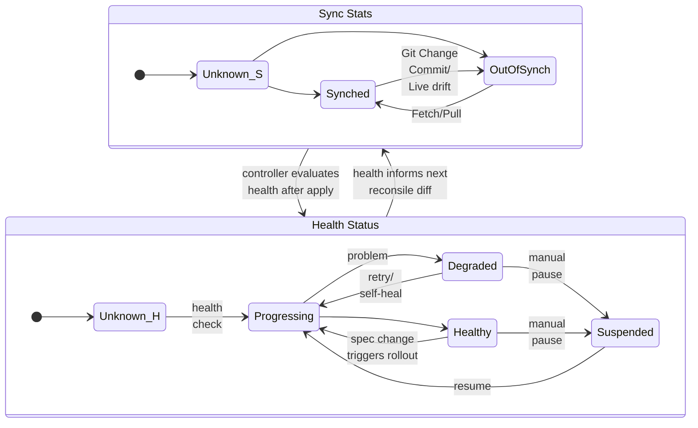
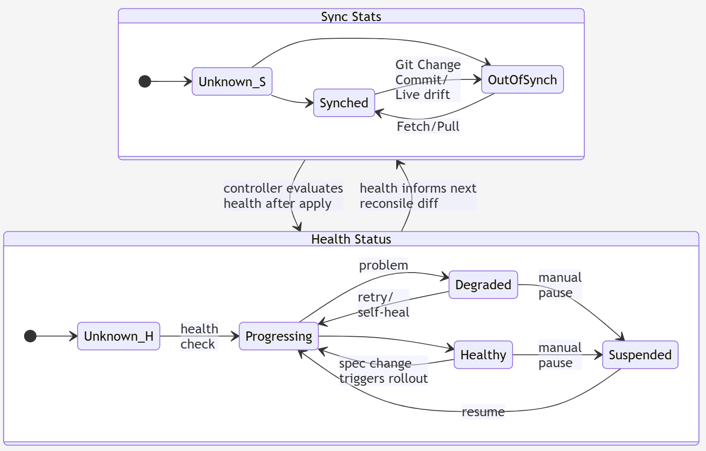
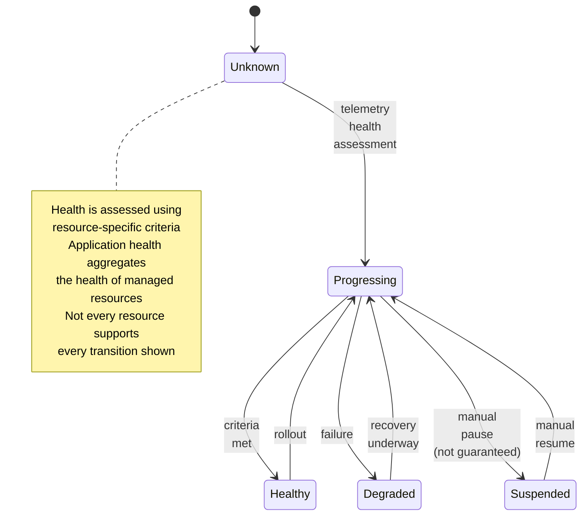
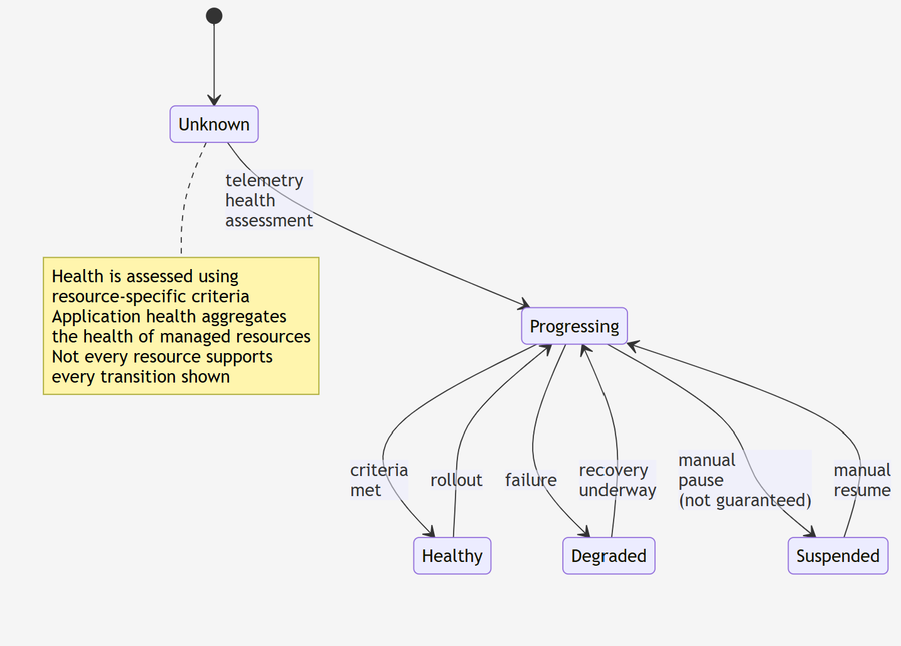
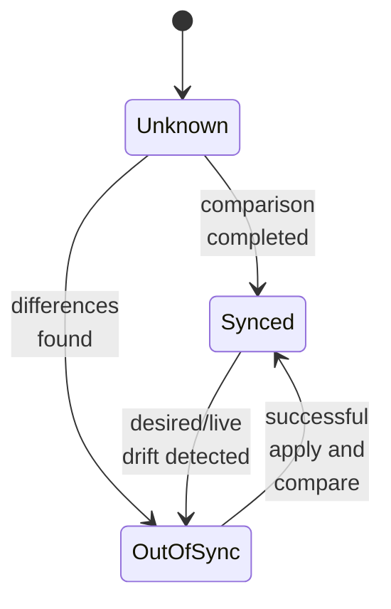
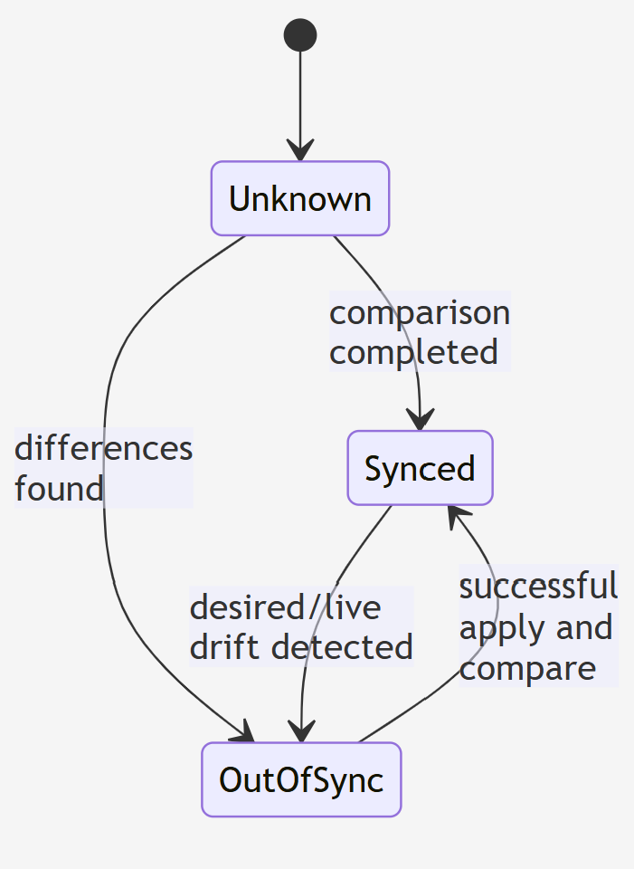

### Info

it is _not_ impossible to rewrite [GitHub Actions](https://docs.github.com/en/actions) completely on [Argo CD](https://argo-cd.readthedocs.io/en/stable/) and other way around.

but notably __GitHub Actions__ and __Argo CD__ are not two interchangeable implementations of the _same thing_

__GitHub Actions__
> Event-driven workflows and CI
>   - Compile, build, and test code.
>   - Run unit tests, Selenium tests, linters, and security scans.
>   - Package artifacts and publish container images.
>   - Trigger deployments and automate repository operations.


__Argo CD__:
> Kubernetes GitOps and reconciliation
>   - Observe desired Kubernetes configuration stored in Git.
>   - Compare the desired state with the live cluster.
>   - Apply changes and report synchronization and health status.
>   - Detect configuration drift and, when configured, correct it.


|Characteristic|__Puppet__|__Argo CD__|
|--------------|----------|-----------|
|Desired state|Declarative configuration and resource manifests|Declarative Kubernetes manifests, Helm charts, Kustomize, etc.|
|Actual state|Managed machine configuration|Live Kubernetes resources|
|Reconciliation|Agent or server periodically enforces configuration, depending on setup|Controller continuously compares desired and live application state|
|Drift correction|Corrects configuration drift|Can correct application drift<br/>through self-healing|
|Primary domain|Operating-system and<br/>infrastructure configuration|Kubernetes application delivery|
|Source of truth|Puppet code and data|Git repository, typically|





technically the two operate in parallel

__Health Status__:



__Sync Status__




The key similarity is declarative desired-state management backed by reconciliation.
__Puppet__ was already doing that long before __Argo CD__ appeared.
There is also a meaningful difference: Puppet traditionally manages resources on machines — __packages__, __files__, __services__, __users__ and __configuration__.
__Argo CD__ narrows this to delivering applications into __Kubernetes__ and
tracking their health and synchronization state.
So I would characterize __Argo CD__ as an __GitOps__-oriented descendant of the same architectural idea,
rather than literally a replacement for __Puppet__.
And this connects directly to your earlier __GitHub Actions__ question:
- __GitHub Actions__ says: execute this workflow when an event occurs.
- __Puppet__ says: make the managed machine conform to this configuration.
- __Argo CD__ says: make the __Kubernetes__ application conform to the desired state in __Git__.

The last two share a fundamental model. The first has a different execution model.
The historical irony: __GitOps__ didn't invent declarative reconciliation.
It applied that established configuration-management idea to a __Kubernetes__-centric, __Git__-driven application-delivery workflow.
__Argo CD__ feels like __Puppet__ reborn because, at the level of control-loop architecture, there really is a family resemblance.


__Argo CD__ narrows __Puppet__ resource-management domain to __Kubernetes__ application delivery,
but it does not merely replace __Puppet__ operation dictionary with __kubectl__ and __Helm__ commands.


The distinction is between reducing the managed resource model and reducing the execution vocabulary.

|Dimension|Puppet|Argo CD|
|---------|------|-------|
|Resource domain|OS configuration, packages, files, services, users, and more|Kubernetes resources and applications|
|Desired-state description|Puppet DSL and resource types/providers|Kubernetes manifests, Helm, Kustomize, and supported config-management plugins|
|Execution model|Resource providers and agent/server enforcement|Kubernetes controller and reconciliation|
|Source of truth|Puppet code and data, among other configurations|Git, typically|
|Extension mechanism|Custom resource types and providers|Config-management plugins and integrations, alongside Kubernetes extensibility|


The subtlety is that __Helm__ is not simply another set of imperative operations. __Argo CD__ can render a __Helm__ chart into Kubernetes manifests and then reconcile the resulting resources.
Likewise, __Kustomize__ and plain __YAML__ are supported; __Argo CD__ is not limited to __Helm__

__Argo CD__ is conceptually a simplified and specialized declarative configuration-management controller:
it takes the broad resource-management problem and concentrates on reconciling __Kubernetes__
application state from __Git__.


__Argo CD__ understands __Kubernetes__ __Jobs__ and lifecycle hooks, so you can make it execute certain procedural tasks. That does not turn it into a general-purpose workflow engine; hooks run within the lifecycle of a synchronization operation.


Argo CD is a massively simplified, domain-specific configuration-management system because Kubernetes gives it a standardized subject model. Puppet must deal with a much broader and more heterogeneous world of managed resources; Argo CD can rely on Kubernetes APIs, resource schemas, controllers, and a well-defined reconciliation boundary.
The interesting engineering challenge is therefore the reverse: emulate Argo CD's behavior using GitHub Actions, while keeping the reconciliation logic outside the Kubernetes cluster being managed.
That last constraint changes the design substantially. You are not merely replacing one deployment tool with another. You are rebuilding a control loop using an event-driven workflow engine that does not inherently provide that control loop.

|Responsibility|GitHub Actions implementation|Complexity|Importance|
|--------------|-----------------------------|----------|----------|
|Discover desired state|Checkout repository; render manifests with Helm or Kustomize|⭐⭐💀|⭐|
|Observe live state|Query remote Kubernetes API|⭐⭐💀|⭐⭐|
|Detect differences|Compare desired vs. live state, accounting for defaults and server-side mutations|⭐⭐⭐⭐⭐💀💀|⭐⭐⭐⭐⭐|
|Reconcile|Apply desired manifests using kubectl apply or server-side apply|⭐⭐⭐💀|⭐⭐⭐⭐|
|Verify convergence|Inspect resource status, rollout conditions and health; report failures or retry|⭐⭐⭐⭐💀|⭐⭐⭐|

#### Components

__API Server__: Handles the Web UI, CLI commands, and manages Role-Based Access Control (RBAC).
__Repository Server__: Communicates with Git repositories, maintains a local cache, and renders manifests from tools like Helm, Kustomize, or Jsonnet.
__Application Controller__: Acts as the reconciliation engine, continuously comparing live cluster states against the target Git state and detecting configuration drift (OutOfSync).
__Redis Cache__: state cache

### Usage

Initial setup based on [gist](https://gist.github.com/bhimsur/b6c575916883ff7712861beacbe1ff0b)

The install on Windows __MiniKube__ (relatively old version - update suggested):

#### Windows 11 Host

```cmd
minikube.exe start --driver=virtualbox
```
```cmd
minikube.exe status
```
```
minikube
type: Control Plane
host: Running
kubelet: Running
apiserver: Running
kubeconfig: Configured
```

#### Ubuntu Host

```
minikube start --driver=virtualbox
```
```text
😄  minikube v1.36.0 on Ubuntu 18.04
✨  Using the virtualbox driver based on existing profile
👍  Starting "minikube" primary control-plane node in "minikube" cluster
🔄  Restarting existing virtualbox VM for "minikube" ...
🎉  minikube 1.39.0 is available! Download it: https://github.com/kubernetes/minikube/releases/tag/v1.39.0
💡  To disable this notice, run: 'minikube config set WantUpdateNotification false'

❗  Image was not built for the current minikube version. To resolve this you can delete and recreate your minikube cluster using the latest images. Expected minikube version: v1.35.0 -> Actual minikube version: v1.36.0
🐳  Preparing Kubernetes v1.33.1 on Docker 28.0.4 ...
❗  kubeadm certificates have expired. Generating new ones...
🔗  Configuring bridge CNI (Container Networking Interface) ...
🔎  Verifying Kubernetes components...
   n ▪ Using image gcr.io/k8s-minikube/storage-provisioner:v5
🌟  Enabled addons: storage-provisioner, default-storageclass
💡  kubectl not found. If you need it, try: 'minikube kubectl -- get pods -A'
🏄  Done! kubectl is now configured to use "minikube" cluster and "default" namespace by default

```
```sh
minikube status
```
```text
minikube
type: Control Plane
host: Running
kubelet: Running
apiserver: Running
kubeconfig: Configured
```

```cmd
minikube.exe kubectl create namespace argocd
```
> NOTE in first run (e.g. if application recycled prior ) will show downloads
```text
    > kubectl.exe.sha256: 64 B / 64 B [----------------------] 100.00% ? p/s 0s
    > kubectl.exe: 39.52 MiB / 39.52 MiB [----------] 100.00% 4.91 MiB p/s 8.2s
namespace/argocd created
```

```cmd
minikub.exe kubectl -- apply --namespace argocd -f https://raw.githubusercontent.com/argoproj/argo-cd/v2.8.4/manifests/install.yaml
```

alternatively download __CRD__ to examine and /or customize:

```sh
curl -skLO https://raw.githubusercontent.com/argoproj/argo-cd/v2.8.4/manifests/install.yaml
```
feed to kubectl (it will deal with directory
```cmd
minikube.exe kubectl -- apply --namespace argocd -f install.yaml
```
```text
customresourcedefinition.apiextensions.k8s.io/applications.argoproj.io created
customresourcedefinition.apiextensions.k8s.io/applicationsets.argoproj.io created
customresourcedefinition.apiextensions.k8s.io/appprojects.argoproj.io created
serviceaccount/argocd-application-controller created
serviceaccount/argocd-applicationset-controller created
serviceaccount/argocd-dex-server created
serviceaccount/argocd-notifications-controller created
serviceaccount/argocd-redis created
serviceaccount/argocd-repo-server created
serviceaccount/argocd-server created
role.rbac.authorization.k8s.io/argocd-application-controller created
role.rbac.authorization.k8s.io/argocd-applicationset-controller created
role.rbac.authorization.k8s.io/argocd-dex-server created
role.rbac.authorization.k8s.io/argocd-notifications-controller created
role.rbac.authorization.k8s.io/argocd-server created
clusterrole.rbac.authorization.k8s.io/argocd-application-controller created
clusterrole.rbac.authorization.k8s.io/argocd-server created
rolebinding.rbac.authorization.k8s.io/argocd-application-controller created
rolebinding.rbac.authorization.k8s.io/argocd-applicationset-controller created
rolebinding.rbac.authorization.k8s.io/argocd-dex-server created
rolebinding.rbac.authorization.k8s.io/argocd-notifications-controller created
rolebinding.rbac.authorization.k8s.io/argocd-server created
clusterrolebinding.rbac.authorization.k8s.io/argocd-application-controller created
clusterrolebinding.rbac.authorization.k8s.io/argocd-server created
configmap/argocd-cm created
configmap/argocd-cmd-params-cm created
configmap/argocd-gpg-keys-cm created
configmap/argocd-notifications-cm created
configmap/argocd-rbac-cm created
configmap/argocd-ssh-known-hosts-cm created
configmap/argocd-tls-certs-cm created
secret/argocd-notifications-secret created
secret/argocd-secret created
service/argocd-applicationset-controller created
service/argocd-dex-server created
service/argocd-metrics created
service/argocd-notifications-controller-metrics created
service/argocd-redis created
service/argocd-repo-server created
service/argocd-server created
service/argocd-server-metrics created
deployment.apps/argocd-applicationset-controller created
deployment.apps/argocd-dex-server created
deployment.apps/argocd-notifications-controller created
deployment.apps/argocd-redis created
deployment.apps/argocd-repo-server created
deployment.apps/argocd-server created
statefulset.apps/argocd-application-controller created
networkpolicy.networking.k8s.io/argocd-application-controller-network-policy created
networkpolicy.networking.k8s.io/argocd-applicationset-controller-network-policy created
networkpolicy.networking.k8s.io/argocd-dex-server-network-policy created
networkpolicy.networking.k8s.io/argocd-notifications-controller-network-policy created
networkpolicy.networking.k8s.io/argocd-redis-network-policy created
networkpolicy.networking.k8s.io/argocd-repo-server-network-policy created
networkpolicy.networking.k8s.io/argocd-server-network-policy created
```

Verify the installation by getting all the objects in the ArgoCD namespace.
```cmd
minikube.exe kubectl -- get all --namespace argocd
```
(wait till all pods in that namespace running)

```text
NAME                                                    READY   STATUS    RESTARTS   AGE
pod/argocd-application-controller-0                     1/1     Running   0          7m3s
pod/argocd-applicationset-controller-5cf484b59d-7cxc5   1/1     Running   0          7m4s
pod/argocd-dex-server-857455bcbd-7kf7f                  1/1     Running   0          7m4s
pod/argocd-notifications-controller-66bfff8745-965bb    1/1     Running   0          7m4s
pod/argocd-redis-8698676ff6-6htqt                       1/1     Running   0          7m4s
pod/argocd-repo-server-7c8d87478b-msk8d                 1/1     Running   0          7m4s
pod/argocd-server-6bf47d79b4-lxg72                      1/1     Running   0          7m3s

NAME                                              TYPE        CLUSTER-IP       EXTERNAL-IP   PORT(S)                      AGE
service/argocd-applicationset-controller          ClusterIP   10.104.43.83     <none>        7000/TCP,8080/TCP            7m5s
service/argocd-dex-server                         ClusterIP   10.110.168.213   <none>        5556/TCP,5557/TCP,5558/TCP   7m5s
service/argocd-metrics                            ClusterIP   10.96.43.118     <none>        8082/TCP                     7m5s
service/argocd-notifications-controller-metrics   ClusterIP   10.102.211.96    <none>        9001/TCP                     7m5s
service/argocd-redis                              ClusterIP   10.101.13.81     <none>        6379/TCP                     7m5s
service/argocd-repo-server                        ClusterIP   10.110.108.169   <none>        8081/TCP,8084/TCP            7m5s
service/argocd-server                             ClusterIP   10.97.251.21     <none>        80/TCP,443/TCP               7m5s
service/argocd-server-metrics                     ClusterIP   10.103.229.52    <none>        8083/TCP                     7m5s

NAME                                               READY   UP-TO-DATE   AVAILABLE   AGE
deployment.apps/argocd-applicationset-controller   1/1     1            1           7m5s
deployment.apps/argocd-dex-server                  1/1     1            1           7m4s
deployment.apps/argocd-notifications-controller    1/1     1            1           7m4s
deployment.apps/argocd-redis                       1/1     1            1           7m4s
deployment.apps/argocd-repo-server                 1/1     1            1           7m4s
deployment.apps/argocd-server                      1/1     1            1           7m3s

NAME                                                          DESIRED   CURRENT   READY   AGE
replicaset.apps/argocd-applicationset-controller-5cf484b59d   1         1         1       7m5s
replicaset.apps/argocd-dex-server-857455bcbd                  1         1         1       7m4s
replicaset.apps/argocd-notifications-controller-66bfff8745    1         1         1       7m4s
replicaset.apps/argocd-redis-8698676ff6                       1         1         1       7m4s
replicaset.apps/argocd-repo-server-7c8d87478b                 1         1         1       7m4s
replicaset.apps/argocd-server-6bf47d79b4                      1         1         1       7m3s

NAME                                             READY   AGE
statefulset.apps/argocd-application-controller   1/1     7m3s
```
```cmd
minikube.exe kubectl -- port-forward svc/argocd-server --namespace argocd 8080:443
```

after the minikube was stopped and started, argoCD installed earlier, will launch

```cmd
minikube.exe kubectl -- get all --namespace argocd
```
```text
NAME                                                    READY   STATUS    RESTARTS   AGE
pod/argocd-application-controller-0                     1/1     Running   1          4d18h
pod/argocd-applicationset-controller-5cf484b59d-7cxc5   1/1     Running   1          4d18h
pod/argocd-dex-server-857455bcbd-7kf7f                  1/1     Running   1          4d18h
pod/argocd-notifications-controller-66bfff8745-965bb    1/1     Running   1          4d18h
pod/argocd-redis-8698676ff6-6htqt                       1/1     Running   1          4d18h
pod/argocd-repo-server-7c8d87478b-msk8d                 1/1     Running   3          4d18h
pod/argocd-server-6bf47d79b4-lxg72                      1/1     Running   4          4d18h

NAME                                              TYPE        CLUSTER-IP       EXTERNAL-IP   PORT(S)                      AGE
service/argocd-applicationset-controller          ClusterIP   10.104.43.83     <none>        7000/TCP,8080/TCP            4d18h
service/argocd-dex-server                         ClusterIP   10.110.168.213   <none>        5556/TCP,5557/TCP,5558/TCP   4d18h
service/argocd-metrics                            ClusterIP   10.96.43.118     <none>        8082/TCP                     4d18h
service/argocd-notifications-controller-metrics   ClusterIP   10.102.211.96    <none>        9001/TCP                     4d18h
service/argocd-redis                              ClusterIP   10.101.13.81     <none>        6379/TCP                     4d18h
service/argocd-repo-server                        ClusterIP   10.110.108.169   <none>        8081/TCP,8084/TCP            4d18h
service/argocd-server                             ClusterIP   10.97.251.21     <none>        80/TCP,443/TCP               4d18h
service/argocd-server-metrics                     ClusterIP   10.103.229.52    <none>        8083/TCP                     4d18h

NAME                                               READY   UP-TO-DATE   AVAILABLE   AGE
deployment.apps/argocd-applicationset-controller   1/1     1            1           4d18h
deployment.apps/argocd-dex-server                  1/1     1            1           4d18h
deployment.apps/argocd-notifications-controller    1/1     1            1           4d18h
deployment.apps/argocd-redis                       1/1     1            1           4d18h
deployment.apps/argocd-repo-server                 1/1     1            1           4d18h
deployment.apps/argocd-server                      1/1     1            1           4d18h

NAME                                                          DESIRED   CURRENT   READY   AGE
replicaset.apps/argocd-applicationset-controller-5cf484b59d   1         1         1       4d18h
replicaset.apps/argocd-dex-server-857455bcbd                  1         1         1       4d18h
replicaset.apps/argocd-notifications-controller-66bfff8745    1         1         1       4d18h
replicaset.apps/argocd-redis-8698676ff6                       1         1         1       4d18h
replicaset.apps/argocd-repo-server-7c8d87478b                 1         1         1       4d18h
replicaset.apps/argocd-server-6bf47d79b4                      1         1         1       4d18h

NAME                                             READY   AGE
statefulset.apps/argocd-application-controller   1/1     4d18h
```

One will have to explicitly port-forward:

```cmd
minikube.exe kubectl -- port-forward svc/argocd-server --namespace argocd 8080:443
```
```text
Forwarding from 127.0.0.1:8080 -> 8080
Forwarding from [::1]:8080 -> 8080
```
let remain running

```cmd
VBoxManage.exe list runningvms
```
```cmd
"minikube" {e8e61b40-c769-4c5c-ae19-51e35b9c8bde}
```
```cmd
VBoxManage.exe guestproperty get "e8e61b40-c769-4c5c-ae19-51e35b9c8bde" "/VirtualBox/GuestInfo/Net/0/V4/IP"
```
```text
Value: 10.0.2.15
```
```
SET VM="{e8e61b40-c769-4c5c-ae19-51e35b9c8bde}"
VBoxManage.exe modifyvm "%VM%" --nat-pf1 "web,tcp,,8080,10.0.2.15,8080"
```

```text
VBoxManage.exe: error: The machine 'minikube' is already locked for a session (or being unlocked)
VBoxManage.exe: error: Details: code VBOX_E_INVALID_OBJECT_STATE (0x80bb0007), component MachineWrap, interface IMachine, callee IUnknown
VBoxManage.exe: error: Context: "LockMachine(a->session, LockType_Write)" at line 529 of file VBoxManageModifyVM.cpp
```
VBoxManage `modifyvm` will only change the VM which is stoppped.
When VM is running, use `controlvm` instead:

```poweshell
$VM='{e8e61b40-c769-4c5c-ae19-51e35b9c8bde}'
pushd 'C:\Program Files\Oracle\VirtualBox'
./VBoxManage.exe showvminfo $VM --details

```
```text
Name:            minikube
Groups:          /
Guest OS:        Linux 2.6 / 3.x / 4.x (64-bit)
UUID:            e8e61b40-c769-4c5c-ae19-51e35b9c8bde
Config file:     C:\Users\kouzm\.minikube\machines\minikube\minikube\minikube.vbox
Snapshot folder: C:\Users\kouzm\.minikube\machines\minikube\minikube\Snapshots
Log folder:      C:\Users\kouzm\.minikube\machines\minikube\minikube\Logs
Hardware UUID:   e8e61b40-c769-4c5c-ae19-51e35b9c8bde
Memory size:     4000MB
Page Fusion:     off
VRAM size:       8MB
CPU exec cap:    100%
HPET:            on
Chipset:         piix3
Firmware:        BIOS
Number of CPUs:  2
PAE:             on
Long Mode:       on
Triple Fault Reset: off
APIC:            on
X2APIC:          off
CPUID Portability Level: 0
CPUID overrides: None
Boot menu mode:  disabled
Boot Device (1): DVD
Boot Device (2): DVD
Boot Device (3): HardDisk
Boot Device (4): Not Assigned
ACPI:            on
IOAPIC:          on
BIOS APIC mode:  APIC
Time offset:     0ms
RTC:             UTC
Hardw. virt.ext: on
Nested Paging:   on
Large Pages:     on
VT-x VPID:       on
VT-x unr. exec.: on
Paravirt. Provider: Default
Effective Paravirt. Provider: KVM
State:           running (since 2026-10-16T21:38:28.851000000)
Monitor count:   1
3D Acceleration: off
2D Video Acceleration: off
Teleporter Enabled: off
Teleporter Port: 0
Teleporter Address:
Teleporter Password:
Tracing Enabled: off
Allow Tracing to Access VM: off
Tracing Configuration:
Autostart Enabled: off
Autostart Delay: 0
Default Frontend:
Storage Controller Name (0):            SATA
Storage Controller Type (0):            IntelAhci
Storage Controller Instance Number (0): 0
Storage Controller Max Port Count (0):  30
Storage Controller Port Count (0):      30
Storage Controller Bootable (0):        on
SATA (0, 0): C:\Users\kouzm\.minikube\machines\minikube\boot2docker.iso (UUID: 47c9cbf8-fa66-46f0-ad86-427f59cb1229)
SATA (1, 0): C:\Users\kouzm\.minikube\machines\minikube\disk.vmdk (UUID: f7c31550-964e-4d68-8272-da382605480e)
NIC 1:           MAC: 080027A84198, Attachment: NAT, Cable connected: on, Trace: off (file: none), Type: virtio, Reported speed: 0 Mbps, Boot priority: 0, Promisc Policy: deny, Bandwidth group: none
NIC 1 Settings:  MTU: 0, Socket (send: 64, receive: 64), TCP Window (send:64, receive: 64)
NIC 1 Rule(0):   name = ssh, protocol = tcp, host ip = 127.0.0.1, host port = 60813, guest ip = , guest port = 22
NIC 1 Rule(1):   name = web, protocol = tcp, host ip = 127.0.0.1, host port = 8080, guest ip = , guest port = 8080
NIC 2:           MAC: 08002744027E, Attachment: Host-only Interface 'VirtualBox Host-Only Ethernet Adapter #5', Cable connected: on, Trace: off (file: none), Type: virtio, Reported speed: 0 Mbps, Boot priority: 0, Promisc Policy: deny, Bandwidth group: none
NIC 3:           disabled
NIC 4:           disabled
NIC 5:           disabled
NIC 6:           disabled
NIC 7:           disabled
NIC 8:           disabled
Pointing Device: PS/2 Mouse
Keyboard Device: PS/2 Keyboard
UART 1:          disabled
UART 2:          disabled
UART 3:          disabled
UART 4:          disabled
LPT 1:           disabled
LPT 2:           disabled
Audio:           enabled (Driver: DSOUND, Controller: AC97, Codec: STAC9700)
Audio playback:  disabled
Audio capture: disabled
Clipboard Mode:  disabled
Drag and drop Mode: disabled
Session name:    headless
Video mode:      720x400x0 at 0,0 enabled
VRDE:            disabled
USB:             disabled
EHCI:            disabled
XHCI:            disabled

USB Device Filters:

<none>

Available remote USB devices:

<none>

Currently Attached USB Devices:

<none>

Bandwidth groups:  <none>

Shared folders:

Name: 'c/Users', Host path: '\\?\c:\Users' (machine mapping), writable

VRDE Connection:    not active
Clients so far:     0

Capturing:          not active
Capture audio:      not active
Capture screens:    0
Capture file:       C:\Users\kouzm\.minikube\machines\minikube\minikube\minikube.webm
Capture dimensions: 1024x768
Capture rate:       512 kbps
Capture FPS:        25
Capture options:

Guest:

Configured memory balloon size:      0 MB
OS type:                             Linux26_64
Additions run level:                 2
Additions version:                   5.2.42 r137960


Guest Facilities:

Facility "VirtualBox Base Driver": active/running (last update: 2026/10/16 21:39:05 UTC)
Facility "VirtualBox System Service": active/running (last update: 2026/10/16 21:39:06 UTC)
Facility "Seamless Mode": not active (last update: 2026/10/16 21:39:05 UTC)
Facility "Graphics Mode": not active (last update: 2026/10/16 21:39:05 UTC)
```
```powershell
$VM='{e8e61b40-c769-4c5c-ae19-51e35b9c8bde}'
pushd 'C:\Program Files\Oracle\VirtualBox'
./VBoxManage.exe controlvm $VM natpf1 "web,tcp,,8080,,8080"
```
```text
VBoxManage.exe: error: A NAT rule of this name already exists
VBoxManage.exe: error: Details: code E_INVALIDARG (0x80070057), component NATEngineWrap, interface INATEngine, callee IUnknown
VBoxManage.exe: error: Context: "AddRedirect(Bstr(strName).raw(), proto, Bstr(strHostIp).raw(), RTStrToUInt16(strHostPort), Bstr(strGuestIp).raw(), RTStrToUInt16(strGuestPort))" at line 952 of file VBoxManageControlVM.cpp
```

```powershell
./VBoxManage.exe controlvm $VM natpf1 delete web
```
```powershell
./VBoxManage.exe controlvm $VM natpf1 "web,tcp,,8080,,8080"
```

one will have to interctively confirm the network settings change.

```cmd
./VBoxManage.exe showvminfo $VM --machinereadable
```
```text
name="minikube"
groups="/"
ostype="Linux 2.6 / 3.x / 4.x (64-bit)"
UUID="e8e61b40-c769-4c5c-ae19-51e35b9c8bde"
CfgFile="C:\\Users\\kouzm\\.minikube\\machines\\minikube\\minikube\\minikube.vbox"
SnapFldr="C:\\Users\\kouzm\\.minikube\\machines\\minikube\\minikube\\Snapshots"
LogFldr="C:\\Users\\kouzm\\.minikube\\machines\\minikube\\minikube\\Logs"
hardwareuuid="e8e61b40-c769-4c5c-ae19-51e35b9c8bde"
memory=4000
pagefusion="off"
vram=8
cpuexecutioncap=100
hpet="on"
chipset="piix3"
firmware="BIOS"
cpus=2
...
natnet1="nat"
macaddress1="080027A84198"
cableconnected1="on"
nic1="nat"
nictype1="virtio"
nicspeed1="0"
mtu="0"
sockSnd="64"
sockRcv="64"
tcpWndSnd="64"
tcpWndRcv="64"
Forwarding(0)="ssh,tcp,127.0.0.1,60813,,22"
Forwarding(1)="web,tcp,,8080,,8080"
hostonlyadapter2="VirtualBox Host-Only Ethernet Adapter #5"
macaddress2="08002744027E"
cableconnected2="on"
nic2="hostonly"
nictype2="virtio"
nicspeed2="0"
nic3="none"
nic4="none"
nic5="none"
nic6="none"
nic7="none"
nic8="none"
...
SharedFolderNameMachineMapping1="c/Users"
SharedFolderPathMachineMapping1="\\?\c:\Users"
VRDEActiveConnection="off"
VRDEClients=0
videocap="off"
videocap_audio="off"
videocapscreens=0
videocapfile="C:\Users\kouzm\.minikube\machines\minikube\minikube\minikube.webm"
videocapres=1024x768
videocaprate=512
videocapfps=25
videocapopts=
GuestMemoryBalloon=0
GuestOSType="Linux26_64"
GuestAdditionsRunLevel=2
GuestAdditionsVersion="5.2.42 r137960"
GuestAdditionsFacility_VirtualBox Base Driver=50,1792186745798
GuestAdditionsFacility_VirtualBox System Service=50,1792186746243
GuestAdditionsFacility_Seamless Mode=0,1792186745797
GuestAdditionsFacility_Graphics Mode=0,1792186745797
```
```powershell
./VBoxManage.exe showvminfo $VM --machinereadable | select-string -pattern 'Forwarding\(.\)'
```
```text
Forwarding(0)="ssh,tcp,127.0.0.1,60813,,22"
Forwarding(1)="web,tcp,,8080,,8080"
```
For testing sake do the same interactively through Virtualbox Manager:


acknowledge `net::ERR_CERT_AUTHORITY_INVALID`


* retrieve
```cmd
minikube.exe kubectl -- --namespace argocd get secret argocd-initial-admin-secret -o jsonpath="{.data.password}"
```

```text
eEQ1cDRJbzJiOU9FMTBTcw==
```
then
```cmd
"c:\Program Files\Git\usr\bin\echo.exe" "eEQ1cDRJbzJiOU9FMTBTcw==" | "c:\Program Files\Git\usr\bin\base64.exe" -d -
```
```text
xD5p4Io2b9OE10Ss
```
alterntively

```powershell
$data = 'eEQ1cDRJbzJiOU9FMTBTcw=='
$bytes = [System.Convert]::FromBase64String($data)
[System.Text.Encoding]::UTF8.GetString($bytes)
```
```text
xD5p4Io2b9OE10Ss
```

> NOTE: Do __NOT__ use the CMD's ECHO command:
> ```cmd
> echo eEQ1cDRJbzJiOU9FMTBTcw== | "c:\Program Files\Git\usr\bin\base64.exe" -d -
> ```
> ```text
> xD5p4Io2b9OE10Ss/usr/bin/base64: invalid input
> ```


if run from bash

```sh
minikube.exe kubectl -- -n argocd get secret argocd-initial-admin-secret -o jsonpath="{.data.password}" | base64 -d; echo
```

#### Install the ArgoCD CLI

```sh
VERSION_TAG=latest
curl -sSL -o argocd-linux-amd64 https://github.com/argoproj/argo-cd/releases/$VERSION_TAG/download/argocd-linux-amd64
sudo install -m 555 argocd-linux-amd64 /usr/local/bin/argocd
rm argocd-linux-amd64
```

On Windows inspect the version shown in dashboard, `v2.8.4+c279299`, confirm asset is available


```
curl -skI https://github.com/argoproj/argo-cd/releases?q=2.8.4
```
```text
HTTP/1.1 200 OK
```
or browse through releases to `https://github.com/argoproj/argo-cd/releases?expanded=true&page=4&q=2.8.4#release-v2.8.4`
> NOTE: the "find the release" button likely will not work

and download the installer
```powershell
invoke-webrequest -usebasicparsing -outfile 'argocd.exe' -uri 'https://github.com/argoproj/argo-cd/releases/download/v2.8.4/argocd-windows-amd64.exe'
```
The `argocd.exe` is an actual  executable - not an installer
```powershell
move-item -literalpath argocd.exe -destination c:\tools
```

Optionally, log in console

```sh
PASSWORD=xD5p4Io2b9OE10Ss
argocd login localhost:8080 --username admin --password "$PASSWORD" --insecure
```
or
```cmd
set PASSWORD=xD5p4Io2b9OE10Ss
argocd.exe login localhost:8080 --username admin --password "%PASSWORD%" --insecure
```
the console will respond with

```text
'admin:login' logged in successfully
Context 'localhost:8080' updated
```
the port forward console will log:

```txt
Handling connection for 8080
E1022 08:55:56.985069   15796 portforward.go:385] error copying from local connection to remote stream: read tcp6 [::1]:8080->[::1]:52195: wsarecv: An existing connection was forcibly closed by the remote host.
E1022 08:55:56.988379   15796 portforward.go:372] error copying from remote stream to local connection: readfrom tcp6 [::1]:8080->[::1]:52195: write tcp6 [::1]:8080->[::1]:52195: wsasend: An existing connection was forcibly closed by the remote host.
```

change the current user password
```sh
argocd account update-password --current-password $PASSWORD --new-password $NEW_PASSWORD
```
login as `admin`, will be redirected to initial empty dashboard:


connect to demo repository `https://github.com/OdabasiMehmet/nginx-kubernetes.git` and


create application  as explained.


Alternatively, create in console
```sh
argocd app create guestbook --repo https://github.com/argoproj/argocd-example-apps.git --path guestbook --dest-server https://kubernetes.default.svc --dest-namespace default --sync-policy automated --auto-prune --self-heal
```
```cmd
minikube.exe kubectl -- scale deployment -n test nginx-deployment --replicas=2
```
```text
deployment.apps/nginx-deployment scaled
```


Destroy the `nginx` example application and disconnect from the repository.

Connect to [Example Apps to Demonstrate Argo CD](https://github.com/argoproj/argocd-example-apps)

Create separate `guestbook` namespace for the guestbook application:

```cmd
minikube.exe kubectl get namespaces
```
```text
NAME              STATUS   AGE
argocd            Active   167m
default           Active   3h3m
guestbook         Active   1s
kube-node-lease   Active   3h3m
kube-public       Active   3h3m
kube-system       Active   3h3m
```
Examine deployment YAML - will use the same `app` to __ArgoCD__:

```yaml
apiVersion: apps/v1
kind: Deployment
metadata:
  name: guestbook-ui
spec:
  replicas: 1
  revisionHistoryLimit: 3
  selector:
    matchLabels:
      app: guestbook-ui
  template:
    metadata:
      labels:
        app: guestbook-ui
    spec:
      containers:
        - image: gcr.io/google-samples/gb-frontend:v5
          name: guestbook-ui
          ports:
            - containerPort: 80
```

Choose Automatic sync when filling the application inputs. You will need to force sync if any error made and corrected in application configuration


#### Ubuntu Host
```sh
VERSION=v2.8.4
minikube kubectl -- apply --namespace argocd -f  https://raw.githubusercontent.com/argoproj/argo-cd/$VERSION/manifests/install.yaml
```
```text
customresourcedefinition.apiextensions.k8s.io/applications.argoproj.io created
customresourcedefinition.apiextensions.k8s.io/applicationsets.argoproj.io created
customresourcedefinition.apiextensions.k8s.io/appprojects.argoproj.io created
serviceaccount/argocd-application-controller created
serviceaccount/argocd-applicationset-controller created
serviceaccount/argocd-dex-server created
serviceaccount/argocd-notifications-controller created
serviceaccount/argocd-redis created
serviceaccount/argocd-repo-server created
serviceaccount/argocd-server created
role.rbac.authorization.k8s.io/argocd-application-controller created
role.rbac.authorization.k8s.io/argocd-applicationset-controller created
role.rbac.authorization.k8s.io/argocd-dex-server created
role.rbac.authorization.k8s.io/argocd-notifications-controller created
role.rbac.authorization.k8s.io/argocd-server created
clusterrole.rbac.authorization.k8s.io/argocd-application-controller created
clusterrole.rbac.authorization.k8s.io/argocd-server created
rolebinding.rbac.authorization.k8s.io/argocd-application-controller created
rolebinding.rbac.authorization.k8s.io/argocd-applicationset-controller created
rolebinding.rbac.authorization.k8s.io/argocd-dex-server created
rolebinding.rbac.authorization.k8s.io/argocd-notifications-controller created
rolebinding.rbac.authorization.k8s.io/argocd-server created
clusterrolebinding.rbac.authorization.k8s.io/argocd-application-controller created
clusterrolebinding.rbac.authorization.k8s.io/argocd-server created
configmap/argocd-cm created
configmap/argocd-cmd-params-cm created
configmap/argocd-gpg-keys-cm created
configmap/argocd-notifications-cm created
configmap/argocd-rbac-cm created
configmap/argocd-ssh-known-hosts-cm created
configmap/argocd-tls-certs-cm created
secret/argocd-notifications-secret created
secret/argocd-secret created
service/argocd-applicationset-controller created
service/argocd-dex-server created
service/argocd-metrics created
service/argocd-notifications-controller-metrics created
service/argocd-redis created
service/argocd-repo-server created
service/argocd-server created
service/argocd-server-metrics created
deployment.apps/argocd-applicationset-controller created
deployment.apps/argocd-dex-server created
deployment.apps/argocd-notifications-controller created
deployment.apps/argocd-redis created
deployment.apps/argocd-repo-server created
deployment.apps/argocd-server created
statefulset.apps/argocd-application-controller created
networkpolicy.networking.k8s.io/argocd-application-controller-network-policy created
networkpolicy.networking.k8s.io/argocd-applicationset-controller-network-policy created
networkpolicy.networking.k8s.io/argocd-dex-server-network-policy created
networkpolicy.networking.k8s.io/argocd-notifications-controller-network-policy created
networkpolicy.networking.k8s.io/argocd-redis-network-policy created
networkpolicy.networking.k8s.io/argocd-repo-server-network-policy created
networkpolicy.networking.k8s.io/argocd-server-network-policy created
```

```sh
minikube kubectl port-forward svc/argocd-server --namespace argocd 8080:443
```
```text
Forwarding from 127.0.0.1:8080 -> 8080
Forwarding from [::1]:8080 -> 8080

```
```sh>
minikube kubectl -- get all -n argocd

```
> NOTE may need to interrupt wth `Ctrl^C`
```
NAME                                                    READY   STATUS    RESTARTS   AGE
pod/argocd-application-controller-0                     1/1     Running   0          4m12s
pod/argocd-applicationset-controller-77594b7754-dqw5z   1/1     Running   0          4m12s
pod/argocd-dex-server-55cdd54ccb-wjx2d                  1/1     Running   0          4m12s
pod/argocd-notifications-controller-7765c495c7-c585v    1/1     Running   0          4m12s
pod/argocd-redis-5d849fc6db-78kzd                       1/1     Running   0          4m12s
pod/argocd-repo-server-5477d857fc-rh4p9                 1/1     Running   0          4m12s
pod/argocd-server-dcdcd9f88-xrz4l                       1/1     Running   0          4m12s

NAME                                              TYPE        CLUSTER-IP       EXTERNAL-IP   PORT(S)                      AGE
service/argocd-applicationset-controller          ClusterIP   10.101.152.106   <none>        7000/TCP,8080/TCP            4m13s
service/argocd-dex-server                         ClusterIP   10.105.149.193   <none>        5556/TCP,5557/TCP,5558/TCP   4m13s
service/argocd-metrics                            ClusterIP   10.105.115.22    <none>        8082/TCP                     4m13s
service/argocd-notifications-controller-metrics   ClusterIP   10.96.32.232     <none>        9001/TCP                     4m13s
service/argocd-redis                              ClusterIP   10.111.188.213   <none>        6379/TCP                     4m13s
service/argocd-repo-server                        ClusterIP   10.96.77.212     <none>        8081/TCP,8084/TCP            4m12s
service/argocd-server                             ClusterIP   10.105.219.66    <none>        80/TCP,443/TCP               4m12s
service/argocd-server-metrics                     ClusterIP   10.109.42.160    <none>        8083/TCP                     4m12s

NAME                                               READY   UP-TO-DATE   AVAILABLE   AGE
deployment.apps/argocd-applicationset-controller   1/1     1            1           4m12s
deployment.apps/argocd-dex-server                  1/1     1            1           4m12s
deployment.apps/argocd-notifications-controller    1/1     1            1           4m12s
deployment.apps/argocd-redis                       1/1     1            1           4m12s
deployment.apps/argocd-repo-server                 1/1     1            1           4m12s
deployment.apps/argocd-server                      1/1     1            1           4m12s

NAME                                                          DESIRED   CURRENT   READY   AGE
replicaset.apps/argocd-applicationset-controller-77594b7754   1         1         1       4m12s
replicaset.apps/argocd-dex-server-55cdd54ccb                  1         1         1       4m12s
replicaset.apps/argocd-notifications-controller-7765c495c7    1         1         1       4m12s
replicaset.apps/argocd-redis-5d849fc6db                       1         1         1       4m12s
replicaset.apps/argocd-repo-server-5477d857fc                 1         1         1       4m12s
replicaset.apps/argocd-server-dcdcd9f88                       1         1         1       4m12s

NAME                                             READY   AGE
statefulset.apps/argocd-application-controller   1/1     4m12s

```

```sh
VboxManage list runningvms
```
```text
"minikube" {c89f1689-bc57-4cc3-86a9-b3a6afb63538}
```

```sh
VM='c89f1689-bc57-4cc3-86a9-b3a6afb63538';VBoxManage controlvm $VM natpf1 "web,tcp,,8080,,8080"
```

```sh
minikube kubectl -- --namespace argocd get secret argocd-initial-admin-secret -o jsonpath="{.data.password}"  |base64 -d -
```


### Backgound


| Period|Phase | What happen |
|-------|------|-------------|
|2000 |Borg: Google's internal | Google developed and operated Borg to schedule and manage workloads across enormous clusters. This infrastructure helped run services such as Search and Gmail:<br/>internal system, not a public product|
|2013|The realization|Engineers including Joe Beda, Brendan Burns and Craig McLuckie began pushing for a public container-orchestration platform informed by Google's internal experience<br/>Leadership initially worried about giving away a competitive advantage|
|2014..15|Kubernetes go public| Kubernetes was announced in June 2014 and reached version 1.0 in July 2015. It borrowed lessons and design ideas from Borg but<br/>was a new, open-source system—not simply Borg's source code released to everyone|
|2015 onward|An ecosystem, not longer Google's product|Google donated Kubernetes as seed technology for the Cloud Native Computing Foundation.<br/> Contributions from other companies helped turn it into a portable, broadly adopted platform|


> AWS had the first-mover advantage, Microsoft had an enormous enterprise distribution channel,
> Google had world-class infrastructure technology but a weaker position in the cloud market.
> Open-sourcing Kubernetes helped Google turn a private engineering advantage into a standard that competing cloud providers would also adopt.

__GCP__ recognize that technical superiority and cloud-market adoption are different problems:
  - __AWS__ had accumulated customers, services, operational experience and ecosystem momentum.
  - __Microsoft__ could build on enterprise relationships and its existing software business.
  - __Google__ had solid distributed-systems expertise, but persuading customers to make __CGP__ their primary cloud provider was a separate challenge


### Historical Background: What *Really* Happened — Google, Kubernetes, and the Cloud Wars

#### 1. Google had the technology before Kubernetes existed

During the 2000s, Google developed **Borg**, an internal cluster-management and workload-scheduling system. It helped Google operate enormous fleets of machines running services such as Search and Gmail.

Borg was a substantial engineering advantage, but it remained an internal system. Google did not simply publish Borg's source code and rename it Kubernetes.

In 2013, engineers including Joe Beda, Brendan Burns, and Craig McLuckie began pushing for a public container-orchestration platform informed by Google's experience. The idea was controversial: why give competitors access to concepts developed through years of Google's engineering investment?

#### 2. Meanwhile, the cloud market was developing into a two-horse race

By the mid-2010s, AWS had a substantial first-mover advantage. It had accumulated customers, services, operational experience, and a growing ecosystem.

Microsoft had another powerful advantage: its established enterprise relationships, software business, and distribution channels.

Google possessed formidable distributed-systems expertise, but technical excellence did not automatically translate into cloud-market leadership. Google Cloud was competing against two companies with different, but substantial, commercial advantages.

The problem was therefore not simply that Google needed a better scheduler. It needed a way to make its technology relevant to a much broader market.

#### 3. The industry was at risk of fragmenting into competing proprietary ecosystems

Docker made container packaging substantially more accessible, but packaging an application into a container did not solve the larger operational problems:

- Which machine should run a workload?
- How should failed workloads be restarted?
- How should applications scale?
- How should services discover and communicate with one another?
- How should deployments be updated without manually coordinating every machine?

Cloud providers and technology companies could build their own answers. AWS had ECS and its own service interfaces; other vendors developed competing orchestration and deployment systems.

These solutions could work well individually, but differences in APIs, operational models, tooling, and required skills increased the cost of moving between platforms.

Customers faced the prospect of learning one provider's ecosystem and becoming increasingly dependent on it. A container image alone did not guarantee portability.

#### 4. Google made a strategic bet on an open orchestration platform

Google announced **Kubernetes in June 2014**. Version 1.0 followed in July 2015, when Kubernetes was donated as seed technology for the newly established Cloud Native Computing Foundation.

Kubernetes drew on lessons from Borg and Google's distributed-systems experience, but it was a new, open-source system rather than a public release of Borg itself.

The strategic significance was that Google could make a broadly useful orchestration platform available to developers without requiring them to adopt Google's entire proprietary infrastructure.

This helped create a common interface around which other cloud providers, enterprises, software vendors, and independent developers could build.

#### 5. The strategic inversion: Google could benefit even when customers chose competitors

The interesting commercial mechanism was this:

Google did not need to win every infrastructure sale for Kubernetes to become valuable to Google.

If Kubernetes became the common platform developers used to deploy containerized workloads, Google could offer a managed Kubernetes service, contribute to the ecosystem, and compete on the surrounding infrastructure and services.

Customers could use Kubernetes on Google Cloud, AWS, Azure, or their own infrastructure. That reduced the need to choose a provider solely because of its proprietary orchestration technology.

AWS eventually introduced its managed Kubernetes service, Amazon EKS, which became generally available in 2018. AWS continued to offer ECS as well.

The result was not the disappearance of proprietary cloud services. It was the emergence of a shared orchestration layer alongside those services.

#### 6. Portability became a competitive advantage — but not a universal escape from lock-in

Kubernetes standardized many important aspects of workload deployment and management. A workload based on ordinary Kubernetes APIs and portable container images can often be moved between local clusters, on-premises installations, and managed cloud Kubernetes services with relatively little change.

However, a Kubernetes application can still depend heavily on provider-specific services:

- Identity and access management
- Databases and managed messaging
- Storage classes and persistent-volume behavior
- Networking, load balancers, and ingress
- Cloud-specific APIs and proprietary integrations

Kubernetes therefore reduces certain forms of lock-in; it does not eliminate them. Portability depends on the application's architecture, dependencies, and operational requirements.

#### 7. Why this matters for a local Minikube and Argo CD lab

Minikube provides a local Kubernetes environment. Argo CD adds a GitOps control loop that continuously compares the desired application configuration stored in Git with the state observed in Kubernetes.

This makes a useful distinction visible:

- **Kubernetes** provides the orchestration API and control plane.
- **Argo CD** provides Git-driven application delivery and reconciliation.
- **Helm** packages and renders Kubernetes resources into deployable manifests.
- **Minikube** provides a local cluster in which to experiment with these mechanisms.

None of these requires adopting a particular cloud provider for a basic lab.

A local experiment can therefore help distinguish Kubernetes-native behavior from cloud-specific services, without requiring Google's infrastructure, a production cluster, or a catalog of sample applications.

#### Conclusion

The historical story is not that Google secretly developed Kubernetes for decades and then gave away the same product. Google operated Borg internally for years, then developed and released Kubernetes as a new open-source platform informed by that experience.

The larger strategic story is that Google helped establish an open orchestration standard in a market where AWS had a major first-mover advantage and Microsoft had powerful enterprise distribution.

**The central insight:** Google could turn an internal engineering advantage into an industry-wide platform, allowing it to compete not only through proprietary technology but also through the adoption of a common standard.

That interpretation is consistent with the history, although it would be too strong to claim that avoiding vendor lock-in was the single decisive reason Google open-sourced Kubernetes. The move also served engineering, ecosystem-building, and commercial objectives.

##### Historical references

- Kubernetes project history: https://kubernetes.io/blog/2015/04/borg-predecessor-to-kubernetes/
- Kubernetes announcement and project background: https://kubernetes.io/blog/2014/06/introducing-kubernetes/
- Cloud Native Computing Foundation: https://www.cncf.io/
- Amazon EKS: https://aws.amazon.com/eks/
- Google Kubernetes Engine: https://cloud.google.com/kubernetes-engine


### ArgoCD on Kind

#### Install Recent Go
> NOTE: on __Ubuntu__ __18.04__ / __22.04__  Go is very old. But it is always a good practice to avoid "latest" Go.

```sh
sudo apt-get remove golang-go
```

```
VERSION='1.16.1'
wget https://dl.google.com/go/go${VERSION}.linux-amd64.tar.gz
sudo rm -rf /usr/local/go && sudo tar -C /usr/local -xzf go${VERSION}.linux-amd64.tar.gz
```
#### Compile and Install Pinned Kind

```sh
export GOROOT=/usr/local/go
export GOPATH=$HOME/go
export PATH=$PATH:$GOROOT/bin:$GOPATH/bin
export GO111MODULE=on
```
```sh
VERSION=v0.22.0
go install sigs.k8s.io/kind@$VERSION
```
```text
go: downloading sigs.k8s.io/kind v0.22.0
go: downloading github.com/spf13/cobra v1.4.0
go: downloading github.com/alessio/shellescape v1.4.1
go: downloading github.com/mattn/go-isatty v0.0.14
go: downloading github.com/pelletier/go-toml v1.9.4
go: downloading github.com/BurntSushi/toml v1.0.0
go: downloading gopkg.in/yaml.v3 v3.0.1
go: downloading sigs.k8s.io/yaml v1.3.0
go: downloading golang.org/x/sys v0.0.0-20210630005230-0f9fa26af87c
go: downloading github.com/google/safetext v0.0.0-20220905092116-b49f7bc46da2
go: downloading gopkg.in/yaml.v2 v2.4.0
```
```sh
which kind
```
```text
/home/sergueik/go/bin/kind
```

```sh
echo $PATH | grep $GOPATH
```
```text
/home/sergueik/bin:/home/sergueik/.local/bin:/usr/local/sbin:/usr/local/bin:/usr/sbin:/usr/bin:/sbin:/bin:/usr/games:/usr/local/games:/snap/bin:/usr/local/go/bin:/home/sergueik/go/bin
```
```sh
kind version
```
```text
kind v0.22.0 go1.16.1 linux/amd64
```

> NOTE: cannot install latest versions of kind with older Go:
> ```
> go install sigs.k8s.io/kind@v0.33.0
> ```
> ```text
> can't load package: package sigs.k8s.io/kind@v0.33.0:
> can only use path@version syntax with 'go get'
> ```
>
> ```sh
> go get sigs.k8s.io/kind@v0.33.0
> ```
> ```txt
> go: downloading sigs.k8s.io/kind v0.33.0
> go: downloading al.essio.dev/pkg/shellescape v1.5.1
> go: downloading github.com/spf13/pflag v1.0.5
> go: downloading github.com/pkg/errors v0.9.1
> go: downloading github.com/mattn/go-isatty v0.0.20
> go: downloading github.com/spf13/cobra v1.8.0
> go: downloading github.com/pelletier/go-toml v1.9.5
> go: downloading github.com/evanphx/json-patch/v5 v5.6.0
> go: downloading go.yaml.in/yaml/v3 v3.0.4
> go: downloading github.com/BurntSushi/toml v1.4.0
> go: downloading golang.org/x/sys v0.6.0
> go: downloading sigs.k8s.io/yaml v1.4.0
> go: downloading github.com/inconshreveable/mousetrap v1.1.0
> ../../../go/pkg/mod/github.com/!burnt!sushi/toml@v1.4.0/decode.go:9:2: package io/fs is not in GOROOT (/usr/local/go/src/io/fs)
> ```
> can update to go `16.1` but `module requires Go 1.18`

#### Create a Kind Cluster

```sh
cat <<EOF > kind-config.yaml
kind: Cluster
apiVersion: kind.x-k8s.io/v1alpha4
nodes:
- role: control-plane
  extraPortMappings:
  - containerPort: 30443
    hostPort: 8443
    protocol: TCP
EOF
```

```sh
kind create cluster --name argocd-cluster --config kind-config.yaml
```

```text
Creating cluster "argocd-cluster" ...
 ✓ Ensuring node image (kindest/node:v1.29.2) 🖼
 ✓ Preparing nodes 📦
 ✓ Writing configuration 📜
 ✓ Starting control-plane 🕹️
 ✓ Installing CNI 🔌
 ✓ Installing StorageClass 💾
Set kubectl context to "kind-argocd-cluster"
You can now use your cluster with:

kubectl cluster-info --context kind-argocd-cluster

Have a nice day! 👋
```

#### Install Kubectl on Development Node

```sh
curl -LO "https://dl.k8s.io/release/$(curl -L -s https://dl.k8s.io/release/stable.txt)/bin/linux/amd64/kubectl"
chmod +x ./kubectl
sudo mv ./kubectl /usr/local/bin/kubectl
```
```sh
kubectl version --client
```
```text
Client Version: v1.37.1
Kustomize Version: v5.8.1
```

```sh
kubectl cluster-info --context kind-argocd-cluster
```
```text
Kubernetes control plane is running at https://127.0.0.1:44057
CoreDNS is running at https://127.0.0.1:44057/api/v1/namespaces/kube-system/services/kube-dns:dns/proxy
```
> NOTE: need the command producing the below output:

```text
NAME                                              TYPE        CLUSTER-IP       EXTERNAL-IP   PORT(S)                      AGE
service/argocd-applicationset-controller          ClusterIP   10.101.152.106   <none>        7000/TCP,8080/TCP            4m13s
service/argocd-dex-server                         ClusterIP   10.105.149.193   <none>        5556/TCP,5557/TCP,5558/TCP   4m13s
service/argocd-metrics                            ClusterIP   10.105.115.22    <none>        8082/TCP                     4m13s
service/argocd-notifications-controller-metrics   ClusterIP   10.96.32.232     <none>        9001/TCP                     4m13s
service/argocd-redis                              ClusterIP   10.111.188.213   <none>        6379/TCP                     4m13s
service/argocd-repo-server                        ClusterIP   10.96.77.212     <none>        8081/TCP,8084/TCP            4m12s
service/argocd-server                             ClusterIP   10.105.219.66    <none>        80/TCP,443/TCP               4m12s
service/argocd-server-metrics                     ClusterIP   10.109.42.160    <none>        8083/TCP
service/argocd-server-metrics                     ClusterIP   10.109.42.160    <none>        8083/TCP                     4m12s

NAME                                               READY   UP-TO-DATE   AVAILABLE   AGE
deployment.apps/argocd-applicationset-controller   1/1     1            1           4m12s
deployment.apps/argocd-dex-server                  1/1     1            1           4m12s
deployment.apps/argocd-notifications-controller    1/1     1            1           4m12s
deployment.apps/argocd-redis                       1/1     1            1           4m12s
deployment.apps/argocd-repo-server                 1/1     1            1           4m12s
deployment.apps/argocd-server                      1/1     1            1           4m12s

NAME                                                          DESIRED   CURRENT   READY   AGE
replicaset.apps/argocd-applicationset-controller-77594b7754   1         1         1       4m12s
replicaset.apps/argocd-dex-server-55cdd54ccb                  1         1         1       4m12s
replicaset.apps/argocd-notifications-controller-7765c495c7    1         1         1       4m12s
replicaset.apps/argocd-redis-5d849fc6db                       1         1         1       4m12s
replicaset.apps/argocd-repo-server-5477d857fc                 1         1         1       4m12s
```

```sh
kubectl create namespace argocd
```
```text
namespace/argocd created
```
```sh
kubectl apply -n argocd --server-side --force-conflicts -f https://raw.githubusercontent.com/argoproj/argo-cd/stable/manifests/install.yaml
```
```text
customresourcedefinition.apiextensions.k8s.io/applications.argoproj.io serverside-applied
customresourcedefinition.apiextensions.k8s.io/applicationsets.argoproj.io serverside-applied
customresourcedefinition.apiextensions.k8s.io/appprojects.argoproj.io serverside-applied
serviceaccount/argocd-application-controller serverside-applied
serviceaccount/argocd-applicationset-controller serverside-applied
serviceaccount/argocd-dex-server serverside-applied
serviceaccount/argocd-notifications-controller serverside-applied
serviceaccount/argocd-redis serverside-applied
serviceaccount/argocd-repo-server serverside-applied
serviceaccount/argocd-server serverside-applied
role.rbac.authorization.k8s.io/argocd-application-controller serverside-applied
role.rbac.authorization.k8s.io/argocd-applicationset-controller serverside-applied
role.rbac.authorization.k8s.io/argocd-dex-server serverside-applied
role.rbac.authorization.k8s.io/argocd-notifications-controller serverside-applied
role.rbac.authorization.k8s.io/argocd-redis serverside-applied
role.rbac.authorization.k8s.io/argocd-server serverside-applied
clusterrole.rbac.authorization.k8s.io/argocd-application-controller serverside-applied
clusterrole.rbac.authorization.k8s.io/argocd-applicationset-controller serverside-applied
clusterrole.rbac.authorization.k8s.io/argocd-server serverside-applied
rolebinding.rbac.authorization.k8s.io/argocd-application-controller serverside-applied
rolebinding.rbac.authorization.k8s.io/argocd-applicationset-controller serverside-applied
rolebinding.rbac.authorization.k8s.io/argocd-dex-server serverside-applied
rolebinding.rbac.authorization.k8s.io/argocd-notifications-controller serverside-applied
rolebinding.rbac.authorization.k8s.io/argocd-redis serverside-applied
rolebinding.rbac.authorization.k8s.io/argocd-server serverside-applied
clusterrolebinding.rbac.authorization.k8s.io/argocd-application-controller serverside-applied
clusterrolebinding.rbac.authorization.k8s.io/argocd-applicationset-controller serverside-applied
clusterrolebinding.rbac.authorization.k8s.io/argocd-server serverside-applied
configmap/argocd-cm serverside-applied
configmap/argocd-cmd-params-cm serverside-applied
configmap/argocd-gpg-keys-cm serverside-applied
configmap/argocd-notifications-cm serverside-applied
configmap/argocd-rbac-cm serverside-applied
configmap/argocd-ssh-known-hosts-cm serverside-applied
configmap/argocd-tls-certs-cm serverside-applied
secret/argocd-notifications-secret serverside-applied
secret/argocd-secret serverside-applied
service/argocd-applicationset-controller serverside-applied
service/argocd-dex-server serverside-applied
service/argocd-metrics serverside-applied
service/argocd-notifications-controller-metrics serverside-applied
service/argocd-redis serverside-applied
service/argocd-repo-server serverside-applied
service/argocd-server serverside-applied
service/argocd-server-metrics serverside-applied
deployment.apps/argocd-applicationset-controller serverside-applied
deployment.apps/argocd-dex-server serverside-applied
deployment.apps/argocd-notifications-controller serverside-applied
deployment.apps/argocd-redis serverside-applied
deployment.apps/argocd-repo-server serverside-applied
deployment.apps/argocd-server serverside-applied
statefulset.apps/argocd-application-controller serverside-applied
networkpolicy.networking.k8s.io/argocd-application-controller-network-policy serverside-applied
networkpolicy.networking.k8s.io/argocd-applicationset-controller-network-policy serverside-applied
networkpolicy.networking.k8s.io/argocd-dex-server-network-policy serverside-applied
networkpolicy.networking.k8s.io/argocd-notifications-controller-network-policy serverside-applied
networkpolicy.networking.k8s.io/argocd-redis-network-policy serverside-applied
networkpolicy.networking.k8s.io/argocd-repo-server-network-policy serverside-applied
networkpolicy.networking.k8s.io/argocd-server-network-policy serverside-applied
```
```sh
docker container ls
```
```text
CONTAINER ID   IMAGE                  COMMAND                  CREATED          STATUS          PORTS                                                NAMES
ebd255c6282f   kindest/node:v1.29.2   "/usr/local/bin/entr…"   19 minutes ago   Up 19 minutes   127.0.0.1:44057->6443/tcp, 0.0.0.0:8443->30443/tcp   argocd-cluster-control-plane
```
```sh
docker images |grep kindest/node
```
```text
kindest/node                                    <none>                  09c50567d34e   2 years ago   956MB
```
```sh
docker image ls
```
```text
REPOSITORY                        TAG       IMAGE ID       CREATED       SIZE
kindest/node                      <none>    09c50567d34e   2 years ago   956MB
```
> NOTE there may be many more images

#### Pin The Image

```sh
docker inspect 09c5 |jq '.[].RepoDigests'
```
```json
[
  "kindest/node@sha256:51a1434a5397193442f0be2a297b488b6c919ce8a3931be0ce822606ea5ca245"
]
```
```sh
docker inspect 09c5 |jq -r '.[].Id'
```
```text
sha256:09c50567d34e79e369b18002f0807a76af33a7570a285d382497d573d70b0ca1
```
```sh
docker image inspect 09c5 --format '{{json .Config.Labels}}' | jq '.'
```
> NOTE: may be empty


```sh
docker inspect 09c5 |jq -r '.[].RepoDigests[]' | awk -F@ '{print $2}'
```
```text
sha256:51a1434a5397193442f0be2a297b488b6c919ce8a3931be0ce822606ea5ca245
```

```sh
DIGEST='sha256:51a1434a5397193442f0be2a297b488b6c919ce8a3931be0ce822606ea5ca245'
curl -s 'https://docker.com' | jq -r --arg dig "$DIGEST" '.results[] | select(.digest == $dig) | .name'
```
> NOTE: may be empty

```sh
kubectl port-forward svc/argocd-server -n argocd 8080:443
```
```sh
kubectl -n argocd get secret argocd-initial-admin-secret -o jsonpath='{.data.password}' | base64 -d
```

```
kubectl -n argocd get secret argocd-initial-admin-secret -o jsonpath='{.data.password}' | base64 -d |xclip -sel clip
```


### Next Step

__Argo CD__ is no longer the thing you need to learn to install.
You need to learn how to diagnose a deployment that __Argo CD__ cannot successfully reconcile.

The electricity analogy is apt. Once the supply is available, one stops caring whether it comes through a wall socket or a power bank.
Likewise, after establishing that __Argo CD__ works on __Windows__ __11__ in __VirtualBox__,
__Ubuntu__ __18.04__ with __VirtualBox__, and __kind__ with a pinned node image,
the infrastructure is mostly a laboratory prerequisite.

Your next step should be to treat __Argo CD__ as a small operational control system and deliberately introduce faults into the applications it manages.

### Install Custom Images into Kind Container to make

### Troubleshooting


Underpowered machine

```sh
kind create cluster --name argocd-cluster --config kind-config.yaml
```
```text
Creating cluster "argocd-cluster" ...
 ✓ Ensuring node image (kindest/node:v1.29.2) 🖼
 ✓ Preparing nodes 📦
 ✓ Writing configuration 📜
 ✗ Starting control-plane 🕹️
Deleted nodes: ["argocd-cluster-control-plane"]
ERROR: failed to create cluster: failed to init node with kubeadm:
command
"docker exec --privileged argocd-cluster-control-plane kubeadm init --skip-phases=preflight --config=/kind/kubeadm.conf --skip-token-print --v=6"
failed with error: exit status 137

```
The Exit status __137__ means the process was killed by the __Out-Of-Memory__ (__OOM__) __Killer__.
The attempt to recrate swap does not help:

```sh
 ls -hl /swapfile
 sudo swapoff -a
 sudo rm -f /swapfile
 sudo dd if=/dev/zero of=/swapfile bs=1M count=4096
 sudo chmod 600 /swapfile
 sudo mkswap /swapfile
 sudo swapon /swapfile
```

free shows is barely used:

```sh
free
```
```text
              total        used        free      shared  buff/cache   available
Mem:        3901312     1088960      792364       10744     2019988     2557720
Swap:       4194300         524     4193776
```

nor the custom `kind-config.yaml` yaml:

```yaml

kind: Cluster
apiVersion: kind.x-k8s.io/v1alpha4
nodes:
- role: control-plane
  extraPortMappings:
  - containerPort: 30443
    hostPort: 8443
    protocol: TCP
kubeadmConfigPatches:
- |
  apiVersion: kubeadm.k8s.io/v1beta3
  kind: ClusterConfiguration
  apiServer:
    extraArgs:
      max-requests-inflight: "50"
```
On Ubuntu 18.04, the default kernel configuration allows for a mechanism called Linux Memory Overcommit, paired with system-level Cgroup memory limits. Because your host has 3.9 GB of RAM, Docker’s underlying container storage or the host Linux kernel is killing kubeadm early to prevent a system lockup, even if free shows you have headroom right before execution

Since changing the vm.overcommit_memory setting didn't bypass the error, this confirms that the memory ceiling is a hard, physical constraint enforced at the container runtime level, or your 4GB of physical RAM is genuinely maxing out during the intensive kubeadm init phase.
Because kubeadm init spins up multiple control plane components simultaneously (etcd, kube-apiserver, kube-controller-manager, and kube-scheduler), it briefly spikes past your available memory, forcing the container to crash.
To successfully get this cluster running on your system, implement these specific adjustments:

Solution 1: Use an Older, Lower-Footprint Kubernetes Version

The absolute latest versions of Kubernetes require significantly more base RAM to initialize. Dropping down to an optimized, lighter-weight version (like v1.26 or v1.27) reduces the initial memory footprint during setup by nearly 40%, allowing it to comfortably fit within your 4GB system.
Run the creation command targeting a highly stable, lower-overhead image:
bash
kind create cluster --name argocd-cluster --image kindest/node:v1.27.3@sha256:3966d76aeacab6f5626651da4210d7a96efdc257321ee2524fe08d4b3abce063
Use code with caution.

Solution 2: Explicitly Force the Container to Use Your Swap Space

Even though your system has 4GB of swap space available, Docker containers default to a memory-swap value that restricts them from utilizing it. You can pass runtime flags directly to the container through kind to forcefully allow it to spill over into your swap file.
1. Save the following configuration as kind-swap-override.yaml:yaml
kind: Cluster
apiVersion: kind.x-k8s.io/v1alpha4
nodes:
- role: control-plane
  extraContainerRuntimeArgs:
  - "--memory=3g"
  - "--memory-swap=6g" # Allows 3GB of RAM + 3GB of your Swap file
Use code with caution.
2. Spin up the cluster using this profile:bash
kind create cluster --name argocd-cluster --config kind-swap-override.yaml
Use code with caution.

Solution 3: Free Host System Cached Memory Before Running

Your free command showed that 2.0 GB of your 4GB RAM is tied up in buff/cache. While the Linux kernel theoretically frees cached memory when needed, it sometimes reacts too slowly during a sudden kubeadm spike, triggering the OOM killer anyway.
Manually flush your system's memory cache right before creating the cluster:
bash
# Clear pagecache, dentries, and inodes
sudo sync && echo 3 | sudo tee /proc/sys/vm/drop_caches

# Immediately run the cluster creation
kind create cluster --name argocd-cluster
Use code with caution.
If the exit status 137 persists, run sudo dmesg -T | tail -n 30 immediately after the failure. What exact text does it display regarding the killed process? (This will show the exact memory cgroup or process causing the hard stop).

kind create cluster --name argocd-cluster --image kindest/node:v1.27.3@sha256:3966d76aeacab6f5626651da4210d7a96efdc257321ee2524fe08d4b3abce063

RROR: failed to create cluster: failed to pull image "kindest/node:v1.27.3@sha256:3966d76aeacab6f5626651da4210d7a96efdc257321ee2524fe08d4b3abce063": command "docker pull kindest/node:v1.27.3@sha256:3966d76aeacab6f5626651da4210d7a96efdc257321ee2524fe08d4b3abce063" failed with error: exit status 1
Command Output: Error response from daemon: manifest for kindest/node@sha256:3966d76aeacab6f5626651da4210d7a96efdc257321ee2524fe08d4b3abce063 not found: manifest unknown: manifest unknown


 kind create cluster --name argocd-cluster --image kindest/node:v1.27.3

```
 kind create cluster --name argocd-cluster --image kindest/node:v1.27.3
```
```text
Creating cluster "argocd-cluster" ...
 ✓ Ensuring node image (kindest/node:v1.27.3) 🖼
 ✓ Preparing nodes 📦
 ✓ Writing configuration 📜
 ✗ Starting control-plane 🕹️
ERROR: failed to create cluster: failed to init node with kubeadm: command "docker exec --privileged argocd-cluster-control-plane kubeadm init --skip-phases=preflight --config=/kind/kubeadm.conf --skip-token-print --v=6" failed with error: exit status 1
Command Output: I1021 21:45:58.469740     104 initconfiguration.go:255] loading configuration from "/kind/kubeadm.conf"
W1021 21:45:58.473076     104 initconfiguration.go:332] [config] WARNING: Ignored YAML document with GroupVersionKind kubeadm.k8s.io/v1beta3, Kind=JoinConfiguration
[init] Using Kubernetes version: v1.27.3
[certs] Using certificateDir folder "/etc/kubernetes/pki"
I1021 21:45:58.841196     104 certs.go:112] creating a new certificate authority for ca
[certs] Generating "ca" certificate and key
I1021 21:45:59.138241     104 certs.go:519] validating certificate period for ca certificate
[certs] Generating "apiserver" certificate and key
[certs] apiserver serving cert is signed for DNS names [argocd-cluster-control-plane kubernetes kubernetes.default kubernetes.default.svc kubernetes.default.svc.cluster.local localhost] and IPs [10.96.0.1 172.19.0.2 127.0.0.1]
[certs] Generating "apiserver-kubelet-client" certificate and key
I1021 21:46:00.264969     104 certs.go:112] creating a new certificate authority for front-proxy-ca
[certs] Generating "front-proxy-ca" certificate and key
I1021 21:46:01.261984     104 certs.go:519] validating certificate period for front-proxy-ca certificate
[certs] Generating "front-proxy-client" certificate and key
I1021 21:46:01.867720     104 certs.go:112] creating a new certificate authority for etcd-ca
[certs] Generating "etcd/ca" certificate and key
I1021 21:46:02.647093     104 certs.go:519] validating certificate period for etcd/ca certificate
[certs] Generating "etcd/server" certificate and key
[certs] etcd/server serving cert is signed for DNS names [argocd-cluster-control-plane localhost] and IPs [172.19.0.2 127.0.0.1 ::1]
[certs] Generating "etcd/peer" certificate and key
[certs] etcd/peer serving cert is signed for DNS names [argocd-cluster-control-plane localhost] and IPs [172.19.0.2 127.0.0.1 ::1]
[certs] Generating "etcd/healthcheck-client" certificate and key
[certs] Generating "apiserver-etcd-client" certificate and key
I1021 21:46:04.232892     104 certs.go:78] creating new public/private key files for signing service account users
[certs] Generating "sa" key and public key
I1021 21:46:04.826325     104 kubeconfig.go:103] creating kubeconfig file for admin.conf
[kubeconfig] Using kubeconfig folder "/etc/kubernetes"
[kubeconfig] Writing "admin.conf" kubeconfig file
I1021 21:46:05.176716     104 kubeconfig.go:103] creating kubeconfig file for kubelet.conf
[kubeconfig] Writing "kubelet.conf" kubeconfig file
I1021 21:46:05.524229     104 kubeconfig.go:103] creating kubeconfig file for controller-manager.conf
[kubeconfig] Writing "controller-manager.conf" kubeconfig file
I1021 21:46:05.667915     104 kubeconfig.go:103] creating kubeconfig file for scheduler.conf
[kubeconfig] Writing "scheduler.conf" kubeconfig file
I1021 21:46:05.808205     104 kubelet.go:67] Stopping the kubelet
[kubelet-start] Writing kubelet environment file with flags to file "/var/lib/kubelet/kubeadm-flags.env"
[kubelet-start] Writing kubelet configuration to file "/var/lib/kubelet/config.yaml"
[kubelet-start] Starting the kubelet
I1021 21:46:06.660912     104 manifests.go:99] [control-plane] getting StaticPodSpecs
I1021 21:46:06.661458     104 certs.go:519] validating certificate period for CA certificate
I1021 21:46:06.661595     104 manifests.go:125] [control-plane] adding volume "ca-certs" for component "kube-apiserver"
I1021 21:46:06.661608     104 manifests.go:125] [control-plane] adding volume "etc-ca-certificates" for component "kube-apiserver"
I1021 21:46:06.661620     104 manifests.go:125] [control-plane] adding volume "k8s-certs" for component "kube-apiserver"
I1021 21:46:06.661630     104 manifests.go:125] [control-plane] adding volume "usr-local-share-ca-certificates" for component "kube-apiserver"
I1021 21:46:06.661640     104 manifests.go:125] [control-plane] adding volume "usr-share-ca-certificates" for component "kube-apiserver"
[control-plane] Using manifest folder "/etc/kubernetes/manifests"
[control-plane] Creating static Pod manifest for "kube-apiserver"
I1021 21:46:06.710599     104 manifests.go:154] [control-plane] wrote static Pod manifest for component "kube-apiserver" to "/etc/kubernetes/manifests/kube-apiserver.yaml"
[control-plane] Creating static Pod manifest for "kube-controller-manager"
I1021 21:46:06.710845     104 manifests.go:99] [control-plane] getting StaticPodSpecs
I1021 21:46:06.711722     104 manifests.go:125] [control-plane] adding volume "ca-certs" for component "kube-controller-manager"
I1021 21:46:06.711938     104 manifests.go:125] [control-plane] adding volume "etc-ca-certificates" for component "kube-controller-manager"
I1021 21:46:06.712006     104 manifests.go:125] [control-plane] adding volume "flexvolume-dir" for component "kube-controller-manager"
I1021 21:46:06.712079     104 manifests.go:125] [control-plane] adding volume "k8s-certs" for component "kube-controller-manager"
I1021 21:46:06.712157     104 manifests.go:125] [control-plane] adding volume "kubeconfig" for component "kube-controller-manager"
I1021 21:46:06.712209     104 manifests.go:125] [control-plane] adding volume "usr-local-share-ca-certificates" for component "kube-controller-manager"
I1021 21:46:06.712278     104 manifests.go:125] [control-plane] adding volume "usr-share-ca-certificates" for component "kube-controller-manager"
I1021 21:46:06.723235     104 manifests.go:154] [control-plane] wrote static Pod manifest for component "kube-controller-manager" to "/etc/kubernetes/manifests/kube-controller-manager.yaml"
I1021 21:46:06.723508     104 manifests.go:99] [control-plane] getting StaticPodSpecs
[control-plane] Creating static Pod manifest for "kube-scheduler"
I1021 21:46:06.724220     104 manifests.go:125] [control-plane] adding volume "kubeconfig" for component "kube-scheduler"
I1021 21:46:06.728518     104 manifests.go:154] [control-plane] wrote static Pod manifest for component "kube-scheduler" to "/etc/kubernetes/manifests/kube-scheduler.yaml"
[etcd] Creating static Pod manifest for local etcd in "/etc/kubernetes/manifests"
I1021 21:46:06.731465     104 local.go:65] [etcd] wrote Static Pod manifest for a local etcd member to "/etc/kubernetes/manifests/etcd.yaml"
I1021 21:46:06.732066     104 waitcontrolplane.go:83] [wait-control-plane] Waiting for the API server to be healthy
I1021 21:46:06.733976     104 loader.go:373] Config loaded from file:  /etc/kubernetes/admin.conf
[wait-control-plane] Waiting for the kubelet to boot up the control plane as static Pods from directory "/etc/kubernetes/manifests". This can take up to 4m0s
I1021 21:46:06.745932     104 round_trippers.go:553] GET https://argocd-cluster-control-plane:6443/healthz?timeout=10s  in 7 milliseconds
... repeated 70 times
I1021 21:46:46.248193     104 round_trippers.go:553] GET https://argocd-cluster-control-plane:6443/healthz?timeout=10s  in 0 milliseconds
[kubelet-check] Initial timeout of 40s passed.
I1021 21:46:46.747559     104 round_trippers.go:553] GET https://argocd-cluster-control-plane:6443/healthz?timeout=10s  in 0 milliseconds
... repeated 150 times
Unfortunately, an error has occurred:
	timed out waiting for the condition

This error is likely caused by:
	- The kubelet is not running
	- The kubelet is unhealthy due to a misconfiguration of the node in some way (required cgroups disabled)

If you are on a systemd-powered system, you can try to troubleshoot the error with the following commands:
	- 'systemctl status kubelet'
	- 'journalctl -xeu kubelet'

Additionally, a control plane component may have crashed or exited when started by the container runtime.
To troubleshoot, list all containers using your preferred container runtimes CLI.
Here is one example how you may list all running Kubernetes containers by using crictl:
	- 'crictl --runtime-endpoint unix:///run/containerd/containerd.sock ps -a | grep kube | grep -v pause'
	Once you have found the failing container, you can inspect its logs with:
	- 'crictl --runtime-endpoint unix:///run/containerd/containerd.sock logs CONTAINERID'
couldn't initialize a Kubernetes cluster
k8s.io/kubernetes/cmd/kubeadm/app/cmd/phases/init.runWaitControlPlanePhase
	cmd/kubeadm/app/cmd/phases/init/waitcontrolplane.go:108
k8s.io/kubernetes/cmd/kubeadm/app/cmd/phases/workflow.(*Runner).Run.func1
	cmd/kubeadm/app/cmd/phases/workflow/runner.go:259
k8s.io/kubernetes/cmd/kubeadm/app/cmd/phases/workflow.(*Runner).visitAll
	cmd/kubeadm/app/cmd/phases/workflow/runner.go:446
k8s.io/kubernetes/cmd/kubeadm/app/cmd/phases/workflow.(*Runner).Run
	cmd/kubeadm/app/cmd/phases/workflow/runner.go:232
k8s.io/kubernetes/cmd/kubeadm/app/cmd.newCmdInit.func1
	cmd/kubeadm/app/cmd/init.go:111
github.com/spf13/cobra.(*Command).execute
	vendor/github.com/spf13/cobra/command.go:916
github.com/spf13/cobra.(*Command).ExecuteC
	vendor/github.com/spf13/cobra/command.go:1040
github.com/spf13/cobra.(*Command).Execute
	vendor/github.com/spf13/cobra/command.go:968
k8s.io/kubernetes/cmd/kubeadm/app.Run
	cmd/kubeadm/app/kubeadm.go:50
main.main
	cmd/kubeadm/kubeadm.go:25
runtime.main
	/usr/local/go/src/runtime/proc.go:250
runtime.goexit
	/usr/local/go/src/runtime/asm_amd64.s:1598
error execution phase wait-control-plane
k8s.io/kubernetes/cmd/kubeadm/app/cmd/phases/workflow.(*Runner).Run.func1
	cmd/kubeadm/app/cmd/phases/workflow/runner.go:260
k8s.io/kubernetes/cmd/kubeadm/app/cmd/phases/workflow.(*Runner).visitAll
	cmd/kubeadm/app/cmd/phases/workflow/runner.go:446
k8s.io/kubernetes/cmd/kubeadm/app/cmd/phases/workflow.(*Runner).Run
	cmd/kubeadm/app/cmd/phases/workflow/runner.go:232
k8s.io/kubernetes/cmd/kubeadm/app/cmd.newCmdInit.func1
	cmd/kubeadm/app/cmd/init.go:111
github.com/spf13/cobra.(*Command).execute
	vendor/github.com/spf13/cobra/command.go:916
github.com/spf13/cobra.(*Command).ExecuteC
	vendor/github.com/spf13/cobra/command.go:1040
github.com/spf13/cobra.(*Command).Execute
	vendor/github.com/spf13/cobra/command.go:968
k8s.io/kubernetes/cmd/kubeadm/app.Run
	cmd/kubeadm/app/kubeadm.go:50
main.main
	cmd/kubeadm/kubeadm.go:25
runtime.main
	/usr/local/go/src/runtime/proc.go:250
runtime.goexit
	/usr/local/go/src/runtime/asm_amd64.s:1598
```

running alone
```sh
docker exec --privileged argocd-cluster-control-plane kubeadm init --skip-phases=preflight --config=/kind/kubeadm.conf --skip-token-print --v=6
```
```text
I1021 22:00:44.859666     191 initconfiguration.go:255] loading configuration from "/kind/kubeadm.conf"
W1021 22:00:44.864574     191 initconfiguration.go:332] [config] WARNING: Ignored YAML document with GroupVersionKind kubeadm.k8s.io/v1beta3, Kind=JoinConfiguration
I1021 22:00:44.886675     191 certs.go:519] validating certificate period for CA certificate
I1021 22:00:44.887382     191 certs.go:519] validating certificate period for front-proxy CA certificate
[init] Using Kubernetes version: v1.27.3
[certs] Using certificateDir folder "/etc/kubernetes/pki"
I1021 22:00:44.888251     191 certs.go:519] validating certificate period for ca certificate
[certs] Using existing ca certificate authority
I1021 22:00:44.891741     191 certs.go:519] validating certificate period for apiserver certificate
[certs] Using existing apiserver certificate and key on disk
I1021 22:00:44.894598     191 certs.go:519] validating certificate period for apiserver-kubelet-client certificate
[certs] Using existing apiserver-kubelet-client certificate and key on disk
I1021 22:00:44.896201     191 certs.go:519] validating certificate period for front-proxy-ca certificate
[certs] Using existing front-proxy-ca certificate authority
I1021 22:00:44.897238     191 certs.go:519] validating certificate period for front-proxy-client certificate
[certs] Using existing front-proxy-client certificate and key on disk
I1021 22:00:44.898293     191 certs.go:519] validating certificate period for etcd/ca certificate
[certs] Using existing etcd/ca certificate authority
I1021 22:00:44.899345     191 certs.go:519] validating certificate period for etcd/server certificate
[certs] Using existing etcd/server certificate and key on disk
I1021 22:00:44.900547     191 certs.go:519] validating certificate period for etcd/peer certificate
I1021 22:00:44.901577     191 certs.go:519] validating certificate period for etcd/healthcheck-client certificate
[certs] Using existing etcd/peer certificate and key on disk
[certs] Using existing etcd/healthcheck-client certificate and key on disk
I1021 22:00:44.903067     191 certs.go:519] validating certificate period for apiserver-etcd-client certificate
[certs] Using existing apiserver-etcd-client certificate and key on disk
I1021 22:00:44.904021     191 certs.go:78] creating new public/private key files for signing service account users
[certs] Using the existing "sa" key
[kubeconfig] Using kubeconfig folder "/etc/kubernetes"
I1021 22:00:44.904827     191 kubeconfig.go:103] creating kubeconfig file for admin.conf
I1021 22:00:45.259431     191 loader.go:373] Config loaded from file:  /etc/kubernetes/admin.conf
[kubeconfig] Using existing kubeconfig file: "/etc/kubernetes/admin.conf"
I1021 22:00:45.259568     191 kubeconfig.go:103] creating kubeconfig file for kubelet.conf
[kubeconfig] Using existing kubeconfig file: "/etc/kubernetes/kubelet.conf"
I1021 22:00:45.638410     191 loader.go:373] Config loaded from file:  /etc/kubernetes/kubelet.conf
I1021 22:00:45.638460     191 kubeconfig.go:103] creating kubeconfig file for controller-manager.conf
[kubeconfig] Using existing kubeconfig file: "/etc/kubernetes/controller-manager.conf"
I1021 22:00:46.011259     191 loader.go:373] Config loaded from file:  /etc/kubernetes/controller-manager.conf
I1021 22:00:46.011307     191 kubeconfig.go:103] creating kubeconfig file for scheduler.conf
I1021 22:00:46.526680     191 loader.go:373] Config loaded from file:  /etc/kubernetes/scheduler.conf
[kubeconfig] Using existing kubeconfig file: "/etc/kubernetes/scheduler.conf"
I1021 22:00:46.527377     191 kubelet.go:67] Stopping the kubelet
[kubelet-start] Writing kubelet environment file with flags to file "/var/lib/kubelet/kubeadm-flags.env"
[kubelet-start] Writing kubelet configuration to file "/var/lib/kubelet/config.yaml"
[kubelet-start] Starting the kubelet
[control-plane] Using manifest folder "/etc/kubernetes/manifests"
[control-plane] Creating static Pod manifest for "kube-apiserver"
I1021 22:00:47.231378     191 manifests.go:99] [control-plane] getting StaticPodSpecs
...
I1021 22:00:47.254076     191 manifests.go:125] [control-plane] adding volume "usr-share-ca-certificates" for component "kube-controller-manager"
[control-plane] Creating static Pod manifest for "kube-controller-manager"
I1021 22:00:47.268718     191 manifests.go:154] [control-plane] wrote static Pod manifest for component "kube-controller-manager" to "/etc/kubernetes/manifests/kube-controller-manager.yaml"
I1021 22:00:47.276135     191 manifests.go:99] [control-plane] getting StaticPodSpecs
I1021 22:00:47.276911     191 manifests.go:125] [control-plane] adding volume "kubeconfig" for component "kube-scheduler"
[control-plane] Creating static Pod manifest for "kube-scheduler"
[etcd] Creating static Pod manifest for local etcd in "/etc/kubernetes/manifests"
I1021 22:00:47.288695     191 manifests.go:154] [control-plane] wrote static Pod manifest for component "kube-scheduler" to "/etc/kubernetes/manifests/kube-scheduler.yaml"
I1021 22:00:47.298568     191 local.go:65] [etcd] wrote Static Pod manifest for a local etcd member to "/etc/kubernetes/manifests/etcd.yaml"
I1021 22:00:47.298621     191 waitcontrolplane.go:83] [wait-control-plane] Waiting for the API server to be healthy
I1021 22:00:47.307952     191 loader.go:373] Config loaded from file:  /etc/kubernetes/admin.conf
[wait-control-plane] Waiting for the kubelet to boot up the control plane as static Pods from directory "/etc/kubernetes/manifests". This can take up to 4m0s
I1021 22:00:47.322210     191 round_trippers.go:553] GET https://argocd-cluster-control-plane:6443/healthz?timeout=10s  in 4 milliseconds
...
I1021 22:00:58.325975     191 round_trippers.go:553] GET https://argocd-cluster-control-plane:6443/healthz?timeout=10s 200 OK in 2 milliseconds
[apiclient] All control plane components are healthy after 11.009545 seconds
I1021 22:00:58.326923     191 uploadconfig.go:112] [upload-config] Uploading the kubeadm ClusterConfiguration to a ConfigMap
[upload-config] Storing the configuration used in ConfigMap "kubeadm-config" in the "kube-system" Namespace
I1021 22:00:58.346635     191 round_trippers.go:553] POST https://argocd-cluster-control-plane:6443/api/v1/namespaces/kube-system/configmaps?timeout=10s 201 Created in 12 milliseconds
...
I1021 22:00:58.375128     191 uploadconfig.go:126] [upload-config] Uploading the kubelet component config to a ConfigMap
[kubelet] Creating a ConfigMap "kubelet-config" in namespace kube-system with the configuration for the kubelets in the cluster
I1021 22:00:58.404528     191 round_trippers.go:553] POST https://argocd-cluster-control-plane:6443/api/v1/namespaces/kube-system/configmaps?timeout=10s 201 Created in 27 milliseconds
I1021 22:00:58.424460     191 round_trippers.go:553] POST https://argocd-cluster-control-plane:6443/apis/rbac.authorization.k8s.io/v1/namespaces/kube-system/roles?timeout=10s 201 Created in 16 milliseconds
I1021 22:00:58.442640     191 round_trippers.go:553] POST https://argocd-cluster-control-plane:6443/apis/rbac.authorization.k8s.io/v1/namespaces/kube-system/rolebindings?timeout=10s 201 Created in 16 milliseconds
I1021 22:00:58.443566     191 uploadconfig.go:131] [upload-config] Preserving the CRISocket information for the control-plane node
I1021 22:00:58.444091     191 patchnode.go:31] [patchnode] Uploading the CRI Socket information "unix:///run/containerd/containerd.sock" to the Node API object "argocd-cluster-control-plane" as an annotation
I1021 22:00:58.952004     191 round_trippers.go:553] GET https://argocd-cluster-control-plane:6443/api/v1/nodes/argocd-cluster-control-plane?timeout=10s 200 OK in 6 milliseconds
I1021 22:00:58.979586     191 round_trippers.go:553] PATCH https://argocd-cluster-control-plane:6443/api/v1/nodes/argocd-cluster-control-plane?timeout=10s 200 OK in 17 milliseconds
[upload-certs] Skipping phase. Please see --upload-certs
[mark-control-plane] Marking the node argocd-cluster-control-plane as control-plane by adding the labels: [node-role.kubernetes.io/control-plane node.kubernetes.io/exclude-from-external-load-balancers]
[mark-control-plane] Marking the node argocd-cluster-control-plane as control-plane by adding the taints [node-role.kubernetes.io/control-plane:NoSchedule]
I1021 22:00:59.490215     191 round_trippers.go:553] GET https://argocd-cluster-control-plane:6443/api/v1/nodes/argocd-cluster-control-plane?timeout=10s 200 OK in 7 milliseconds
I1021 22:00:59.506294     191 round_trippers.go:553] PATCH https://argocd-cluster-control-plane:6443/api/v1/nodes/argocd-cluster-control-plane?timeout=10s 200 OK in 12 milliseconds
[bootstrap-token] Configuring bootstrap tokens, cluster-info ConfigMap, RBAC Roles
I1021 22:00:59.511713     191 round_trippers.go:553] GET https://argocd-cluster-control-plane:6443/api/v1/namespaces/kube-system/secrets/bootstrap-token-abcdef?timeout=10s 404 Not Found in 3 milliseconds
I1021 22:00:59.524519     191 round_trippers.go:553] POST https://argocd-cluster-control-plane:6443/api/v1/namespaces/kube-system/secrets?timeout=10s 201 Created in 11 milliseconds
[bootstrap-token] Configured RBAC rules to allow Node Bootstrap tokens to get nodes
I1021 22:00:59.534188     191 round_trippers.go:553] POST https://argocd-cluster-control-plane:6443/apis/rbac.authorization.k8s.io/v1/clusterroles?timeout=10s 201 Created in 7 milliseconds
I1021 22:00:59.543036     191 round_trippers.go:553] POST https://argocd-cluster-control-plane:6443/apis/rbac.authorization.k8s.io/v1/clusterrolebindings?timeout=10s 201 Created in 7 milliseconds
[bootstrap-token] Configured RBAC rules to allow Node Bootstrap tokens to post CSRs in order for nodes to get long term certificate credentials
I1021 22:00:59.551543     191 round_trippers.go:553] POST https://argocd-cluster-control-plane:6443/apis/rbac.authorization.k8s.io/v1/clusterrolebindings?timeout=10s 201 Created in 7 milliseconds
[bootstrap-token] Configured RBAC rules to allow the csrapprover controller automatically approve CSRs from a Node Bootstrap Token
I1021 22:00:59.563181     191 round_trippers.go:553] POST https://argocd-cluster-control-plane:6443/apis/rbac.authorization.k8s.io/v1/clusterrolebindings?timeout=10s 201 Created in 11 milliseconds
[bootstrap-token] Configured RBAC rules to allow certificate rotation for all node client certificates in the cluster
I1021 22:00:59.574423     191 round_trippers.go:553] POST https://argocd-cluster-control-plane:6443/apis/rbac.authorization.k8s.io/v1/clusterrolebindings?timeout=10s 201 Created in 6 milliseconds
I1021 22:00:59.575251     191 clusterinfo.go:47] [bootstrap-token] loading admin kubeconfig
[bootstrap-token] Creating the "cluster-info" ConfigMap in the "kube-public" namespace
I1021 22:00:59.576189     191 loader.go:373] Config loaded from file:  /etc/kubernetes/admin.conf
I1021 22:00:59.576274     191 clusterinfo.go:58] [bootstrap-token] copying the cluster from admin.conf to the bootstrap kubeconfig
I1021 22:00:59.577084     191 clusterinfo.go:70] [bootstrap-token] creating/updating ConfigMap in kube-public namespace
I1021 22:00:59.586984     191 round_trippers.go:553] POST https://argocd-cluster-control-plane:6443/api/v1/namespaces/kube-public/configmaps?timeout=10s 201 Created in 9 milliseconds
I1021 22:00:59.587569     191 clusterinfo.go:84] creating the RBAC rules for exposing the cluster-info ConfigMap in the kube-public namespace
I1021 22:00:59.595183     191 round_trippers.go:553] POST https://argocd-cluster-control-plane:6443/apis/rbac.authorization.k8s.io/v1/namespaces/kube-public/roles?timeout=10s 201 Created in 7 milliseconds
I1021 22:00:59.606207     191 round_trippers.go:553] POST https://argocd-cluster-control-plane:6443/apis/rbac.authorization.k8s.io/v1/namespaces/kube-public/rolebindings?timeout=10s 201 Created in 10 milliseconds
[kubelet-finalize] Updating "/etc/kubernetes/kubelet.conf" to point to a rotatable kubelet client certificate and key
I1021 22:00:59.607183     191 kubeletfinalize.go:90] [kubelet-finalize] Assuming that kubelet client certificate rotation is enabled: found "/var/lib/kubelet/pki/kubelet-client-current.pem"
I1021 22:00:59.608204     191 loader.go:373] Config loaded from file:  /etc/kubernetes/kubelet.conf
I1021 22:00:59.609142     191 kubeletfinalize.go:134] [kubelet-finalize] Restarting the kubelet to enable client certificate rotation
I1021 22:01:00.002412     191 round_trippers.go:553] GET https://argocd-cluster-control-plane:6443/apis/apps/v1/namespaces/kube-system/deployments?labelSelector=k8s-app%3Dkube-dns 200 OK in 27 milliseconds
...
I1021 22:01:00.129729     191 round_trippers.go:553] POST https://argocd-cluster-control-plane:6443/api/v1/namespaces/kube-system/services?timeout=10s 201 Created in 16 milliseconds
[addons] Applied essential addon: CoreDNS
I1021 22:01:00.143270     191 round_trippers.go:553] POST https://argocd-cluster-control-plane:6443/api/v1/namespaces/kube-system/configmaps?timeout=10s 201 Created in 10 milliseconds
...
I1021 22:01:00.193211     191 round_trippers.go:553] POST https://argocd-cluster-control-plane:6443/apis/rbac.authorization.k8s.io/v1/namespaces/kube-system/roles?timeout=10s 201 Created in 9 milliseconds
I1021 22:01:00.203145     191 round_trippers.go:553] POST https://argocd-cluster-control-plane:6443/apis/rbac.authorization.k8s.io/v1/namespaces/kube-system/rolebindings?timeout=10s 201 Created in 8 milliseconds
[addons] Applied essential addon: kube-proxy
I1021 22:01:00.204963     191 loader.go:373] Config loaded from file:  /etc/kubernetes/admin.conf
I1021 22:01:00.206404     191 loader.go:373] Config loaded from file:  /etc/kubernetes/admin.conf
```

Your Kubernetes control-plane has initialized successfully!

To start using your cluster, you need to run the following as a regular user:

```sh
mkdir -p $HOME/.kube
sudo cp -i /etc/kubernetes/admin.conf $HOME/.kube/config
sudo chown $(id -u):$(id -g) $HOME/.kube/config
```

Alternatively, if you are the root user, you can run:

```sh
export KUBECONFIG=/etc/kubernetes/admin.conf
```

You should now deploy a pod network to the cluster.
Run `kubectl apply -f [podnetwork].yaml` with one of the options listed at:
  https://kubernetes.io/docs/concepts/cluster-administration/addons/

You can now join any number of control-plane nodes by copying certificate authorities
and service account keys on each node and then running the following as root:
```sh
kubeadm join argocd-cluster-control-plane:6443 --token <value withheld>  --discovery-token-ca-cert-hash sha256:7497ea858ced55655874d7b6a266edb7a8b4c0caab632bd18103710e03929708 --control-plane
```

Then you can join any number of worker nodes by running the following on each as root:
```sh
kubeadm join argocd-cluster-control-plane:6443 --token <value withheld> --discovery-token-ca-cert-hash sha256:7497ea858ced55655874d7b6a266edb7a8b4c0caab632bd18103710e03929708
```

```sh
 kind get kubeconfig --name argocd-cluster
```
```yaml
apiVersion: v1
clusters:
- cluster:
    certificate-authority-data: LS0tLS1CRUdJTiBDRVJUSUZJQ0FURS0tLS0tCk1JSUMvakNDQWVhZ0F3SUJBZ0lCQURBTkJna3Foa2lHOXcwQkFRc0ZBREFWTVJNd0VRWURWUVFERXdwcmRXSmwKY201bGRHVnpNQjRYRFRJMk1UQXlNVEl4TkRVMU9Wb1hEVE0yTVRBeE9ESXhORFUxT1Zvd0ZURVRNQkVHQTFVRQpBeE1LYTNWaVpYSnVaWFJsY3pDQ0FTSXdEUVlKS29aSWh2Y05BUUVCQlFBRGdnRVBBRENDQVFvQ2dnRUJBTXFsCjAveWI0NDQxRkRGUGlVUlBvNW9oakNQS2E4MlFrRFNKTExjc0pDS0wyVjJoVHlZY2luNFlZa1BQbTNIM1hGa2IKWnY3SHhMRkZLdStGR0xRWmFRZXFzbnlXQncxdW5WUld6bjFwVGlLVFFHRnphcWlrNTQxSDBmZkY2NnkwSnFOSApCblJKWDdoQndINWM1bGFGRlQ4SDZIVERla05lVEFXRXAwcGFENDFlTUx2a3ZyaXZMSFA1aE1tajg5WFZxSWRmCllHdWREUkxrN252NjZpcWk1bVJFRlBrOE15V2l1U0dvUTZ5UkdSUVM4ejJnYjN3WHkrMFNBSmlrY0JPT29YTVEKK3lJTUNRWmpCKzRpYWc2bGF1b2NvdEw5aDdwNmI1TGZGQkd2QUdjbnRpUkpONlFqbGVRd1RlUUZYT3hhZDBBQwplYzBqazEyUms2c2VrM2NIcGdzQ0F3RUFBYU5aTUZjd0RnWURWUjBQQVFIL0JBUURBZ0trTUE4R0ExVWRFd0VCCi93UUZNQU1CQWY4d0hRWURWUjBPQkJZRUZCVlMrc3V2UmZ4dk82M1k1YXRHNHZyd2swcGpNQlVHQTFVZEVRUU8KTUF5Q0NtdDFZbVZ5Ym1WMFpYTXdEUVlKS29aSWh2Y05BUUVMQlFBRGdnRUJBTUF2NngxRkpsYXc1RWYzaVVDQwpsRktjN2FsZm1WR2J5eGFxUzc3MXZxK095YmdLaWptV3lIK2k0OFBKUTlha0pqVGZ4aXRsblpUTnpuVkpBTVlNCnV4a0JmdUNyUlBzWXU2V2hzRG11cXFKdXVqL0FnOUl1L3E3TFY5cDQ0b0R3cDFmWEQ1QzhCZld1RjV1NzFPdngKTjhkcW1Oa2lyZW1UYmlyV0RCZkNwbXVPY3pqZTFVUXpWY0JldFk2M3F2MVZBMnExbnkxdHhKbS9hV0d6a3NHegpVNXBLKzJuRjkzbW9OenVOSUlIeWV4aVhzZDMrY0xFMU0rQzhKS0VCOHVzTW1DTEZBMFhRM3pBeWhtVFVWSTZxCk1TUkFhOHpjRXBDM0daRS8vdW9Db2E1WUlidTBBNm93NkN0eGphMGxUckMrMnFrQWJnT0FZYWM4RE1kbi9tWUYKQldjPQotLS0tLUVORCBDRVJUSUZJQ0FURS0tLS0tCg==
    server: https://127.0.0.1:45543
  name: kind-argocd-cluster
contexts:
- context:
    cluster: kind-argocd-cluster
    user: kind-argocd-cluster
  name: kind-argocd-cluster
current-context: kind-argocd-cluster
kind: Config
preferences: {}
users:
- name: kind-argocd-cluster
  user:
    client-certificate-data: LS0tLS1CRUdJTiBDRVJUSUZJQ0FURS0tLS0tCk1JSURJVENDQWdtZ0F3SUJBZ0lJV2kxREdNMHUzbGt3RFFZSktvWklodmNOQVFFTEJRQXdGVEVUTUJFR0ExVUUKQXhNS2EzVmlaWEp1WlhSbGN6QWVGdzB5TmpFd01qRXlNVFExTlRsYUZ3MHlOekV3TWpFeU1UUTJNRFZhTURReApGekFWQmdOVkJBb1REbk41YzNSbGJUcHRZWE4wWlhKek1Sa3dGd1lEVlFRREV4QnJkV0psY201bGRHVnpMV0ZrCmJXbHVNSUlCSWpBTkJna3Foa2lHOXcwQkFRRUZBQU9DQVE4QU1JSUJDZ0tDQVFFQXU5OHdyZzBpRVg4Q1R6d0EKOWh2bjV1T3FrRWJpVjV6KzhUYzNNL280c01mNFRvSkNpVEorVU13MkU0cVk0dDJXV2JuSmNMTlIyR3ppTm9wOQpKUWgyS2c3RkJaSDJqeXMxRWRvQTYwTklWRTQrTFQ0K0l5NUYyK2FpcUQ1YnFWNFdOZGszZ3lqclBDRkRMaVRDCkQ3M3JDcVNlcjI1SDV1b0x0Z3RxdkEwcTU2Z0F4dDZrbEpWYkNCV3YrV3VUaXFVMDE0Y0dtUTNkRU5mRFg4d3EKbi9sZEdJZVZNRmxlZ0d4T1pVd095OFljSk5CUkVOVW13M2t2a0UxWWwyMG5lRlFPTk1TYXNueE5MRmJRSDBmVQpTc3BlSFVRZm0vRUxmWSsyUitFTVQ0K3FoVHNqMzg1c2pnSXAwVm9qMkxzK1dhclg4eTBkeVFTNStXWFlWeTU5CnI2TXFqd0lEQVFBQm8xWXdWREFPQmdOVkhROEJBZjhFQkFNQ0JhQXdFd1lEVlIwbEJBd3dDZ1lJS3dZQkJRVUgKQXdJd0RBWURWUjBUQVFIL0JBSXdBREFmQmdOVkhTTUVHREFXZ0JRVlV2ckxyMFg4Ynp1dDJPV3JSdUw2OEpOSwpZekFOQmdrcWhraUc5dzBCQVFzRkFBT0NBUUVBVHpGSTFJZmtHR0V2QmFiWlhwYy9NR1dpMXI3MFVSei9FcmpwCmZzcjVQVEhHWDVic01OV0FkTWFwazNDYmxiaFllT3JWWFI3djUwcHZNN21VOEdiS254cDlRN3JkTER0WmQrUk0KZi9pbVhwb29jSnlZYWd3OWo2Z3RoSkNCZ0xmR0o3M0p2YS9hbW9tZlZ1R0xFNHBNNUsremdMaXN1RCsyZ1IyNQpxdmlYOFQ4b3l4THRZY3k5NEwxY1IrZGhad1F6VlREeXNEdVNaVUVSa1lwQncwWnorSGF5RGpJbTdHOWVGSTY4CkpqVHM2dFM0eDlzWm1wYU16WVBJSnM1YXA4Y2NlUkN2MDVnMjM5UGV5STBNckVMUVF5MnVoMjBvWVpkWHJCM1AKTWVpSEZjQ3NJRXpuclkreVZoV0JjZjFZVVN3V3J3czc4YjFjNENLdU8rVFpac0FLc2c9PQotLS0tLUVORCBDRVJUSUZJQ0FURS0tLS0tCg==
    client-key-data: LS0tLS1CRUdJTiBSU0EgUFJJVkFURSBLRVktLS0tLQpNSUlFcFFJQkFBS0NBUUVBdTk4d3JnMGlFWDhDVHp3QTlodm41dU9xa0ViaVY1eis4VGMzTS9vNHNNZjRUb0pDCmlUSitVTXcyRTRxWTR0MldXYm5KY0xOUjJHemlOb3A5SlFoMktnN0ZCWkgyanlzMUVkb0E2ME5JVkU0K0xUNCsKSXk1RjIrYWlxRDVicVY0V05kazNneWpyUENGRExpVENENzNyQ3FTZXIyNUg1dW9MdGd0cXZBMHE1NmdBeHQ2awpsSlZiQ0JXditXdVRpcVUwMTRjR21RM2RFTmZEWDh3cW4vbGRHSWVWTUZsZWdHeE9aVXdPeThZY0pOQlJFTlVtCncza3ZrRTFZbDIwbmVGUU9OTVNhc254TkxGYlFIMGZVU3NwZUhVUWZtL0VMZlkrMlIrRU1UNCtxaFRzajM4NXMKamdJcDBWb2oyTHMrV2FyWDh5MGR5UVM1K1dYWVZ5NTlyNk1xandJREFRQUJBb0lCQUdCeTAzMzNWZzhmWWlNbApUZVVMTElHM1RZQW1NOXNBeVUweXFJOXhuUnI4ZmpobjNScXNKbmI2YjZTV21haVdVN0thazVUZEtsNXVmNis2ClowYlUwajBET2hpQzk4NUdRMGQzNE5MbXhzSXBMUGh6Sk5sUXp5SjJnL2pWa3A4Zm8wMWZ4NFQ1UTlLcHpPQnEKbElvYVdRa3N2QjZhQWlYRTcrQTBla1l5aUYxR1hISEd0d2lPZ25HdWYwNWJ6SG94V3F2SWFQSTFzL1d0cVlrQgpVMFpBZDdwVmg2bWprQUY1blJCRVoyWXBYS28xZW1hM0F5K2pEN3UySURZWGUyOWJubjNRSnRSN0FxSlZBdWRBCmpCTFVlVGgvUS9Id3RIQyt6VmYxQzhacDFpZmMwSC9OVGJnTFhnMm9SMXQwbDBsYnppZDlNUXNiTnZ1OU1PRWQKMUpXd29Ia0NnWUVBM3piZEVJUlBTbjVoNHl1ZGZhOVFQSzlpVHN5a2tuN3orN0sxV0t4V3ZscGRuRUxyMHpmagplQTlxU1gybWpiQVlLQ0lSTnN1eHJTMGpCQ01XZC8xNEdldWdxNzF2U1l0NHJjcmV1RkdSOHhkSjZCZXBzK1pLCjRqWjhKanNFOTFDOC90V0tpSDMzN3FKV25SQXZSRldmQm02V2NyTWtTZDhKSWpkVzdRNFpBOTBDZ1lFQTEzZG4Kei9zelhLMmpzVEZHV2l0TlltWHpGbU1YbC95eXUwNkJKdHJEaXpSdExIKyttS2pQOGc0eUFFVCtsTHlMdi8xbQoxQnRmSnFvUTFVMGFJVk1wMHczMkhaZy9MNlNkTE8xRzFpVG9BZHlQQnd2MlpXK0N2NlBXdnBncHF1UVBTODF5CitIT2xtSCtjbzdFRFV0RzBqRzFnLzcxRkJNbTYwaGVhbHdEV3gxc0NnWUVBaEgyWU1kbVhCdXlGUmNYNXNVU0MKSjhNaVl3dHRFOWR2RXBNOHVPbHlnNEkzMWl5U3RjaVNxQXplVmNqVE4zNnlsLy9Bbi9tLytMNjE3aHExbDN0SAo4bnE5MzdLTmYrWGRONnNYRCtpNjdNT0NCdFVrMGJkNzgxSEwxeFZwR1RNL096T2RDdTlhWHJiVkdsMGs4VGF4Ck1hd3FlT0tFUTZTelV5L3QxTDl0Y2JFQ2dZRUFza1R4Mkd0ZkNJd0Z4bUlkY2hjbnRJVGpSaCtBY3RpNXpDMWMKd0JmNTk5L05nQ2JGUEN0WHVVNnpZZk96cXI0QTVqMHphY1NueWlhbFBNWEpHODloNkdSQndDU3FDcklvOVBYdwpTTmRLT2RnUlltUXNYYXFRUkJ5N1hRQXFZV0RGb3hMOXo4Qm5QekErR2xVbmljdEZsWFlkN2huYjArVlFNK2toCmwxUXpYOGNDZ1lFQTNJN0p5ZENGV0dqK1JsbFVVN3JrQit0N0Q5alVoUEw5WWg0Z1NFZ0xKdEhmY291MFFXNHoKZ1hCU0kwVUF2V0JBaHMvTzNicmM5Q080d254S1lDb2tua0x2Y25uVVNtdE41eFZZajZUZ2xWZWtXZkxLVGw1OQppc3ZzbkpONDdHYkVkd2pCbkw5N2dyUXB0cExtUlBxQndVQmRnYTJoeDBGZ3pWazV0VlBubnFZPQotLS0tLUVORCBSU0EgUFJJVkFURSBLRVktLS0tLQo=

```

It proves that kubeadm init actually completely succeeds in booting the core API server, etcd, and registering the node [apiclient]. It only crashes at the very end when it attempts to add the control-plane labels to the node API object.
The reason your kind cluster creation still fails with exit status 137 right at this exact moment is a known conflict between older host operating systems (Ubuntu 18.04) and newer container workloads running systemd inside the container.
The issue isn't a lack of physical system RAM; rather, the container runtime (containerd inside the kind node) is hitting a kernel cgroup memory leak or an incompatibility with Ubuntu 18.04's older cgroups v1 implementation. When kubeadm modifies the node labels, it causes a sharp context-switching burst that forces the underlying Linux kernel to instantly kill the executor

```sh
kind delete cluster --name argocd-cluster
kind create cluster --name argocd-cluster --image kindest/node:v1.24.15
```
```text
Creating cluster "argocd-cluster" ...
 ✓ Ensuring node image (kindest/node:v1.24.15) 🖼
 ✓ Preparing nodes 📦
 ✓ Writing configuration 📜
 ✓ Starting control-plane 🕹️
 ✓ Installing CNI 🔌
 ✓ Installing StorageClass 💾
Set kubectl context to "kind-argocd-cluster"
You can now use your cluster with:

kubectl cluster-info --context kind-argocd-cluster

Thanks for using kind! 😊
```
```sh
kubectl cluster-info --context kind-argocd-cluster
```
```text
Kubernetes control plane is running at https://127.0.0.1:41665
CoreDNS is running at https://127.0.0.1:41665/api/v1/namespaces/k
```

```sh
kubectl apply -n argocd --server-side --force-conflicts -f https://raw.githubusercontent.com/argoproj/argo-cd/stable/manifests/install.yaml
```
```text
customresourcedefinition.apiextensions.k8s.io/applications.argoproj.io serverside-applied
customresourcedefinition.apiextensions.k8s.io/applicationsets.argoproj.io serverside-applied
customresourcedefinition.apiextensions.k8s.io/appprojects.argoproj.io serverside-applied
serviceaccount/argocd-application-controller serverside-applied
serviceaccount/argocd-applicationset-controller serverside-applied
serviceaccount/argocd-dex-server serverside-applied
serviceaccount/argocd-notifications-controller serverside-applied
serviceaccount/argocd-redis serverside-applied
serviceaccount/argocd-repo-server serverside-applied
serviceaccount/argocd-server serverside-applied
role.rbac.authorization.k8s.io/argocd-application-controller serverside-applied
role.rbac.authorization.k8s.io/argocd-applicationset-controller serverside-applied
role.rbac.authorization.k8s.io/argocd-dex-server serverside-applied
role.rbac.authorization.k8s.io/argocd-notifications-controller serverside-applied
role.rbac.authorization.k8s.io/argocd-redis serverside-applied
role.rbac.authorization.k8s.io/argocd-server serverside-applied
clusterrole.rbac.authorization.k8s.io/argocd-application-controller serverside-applied
clusterrole.rbac.authorization.k8s.io/argocd-applicationset-controller serverside-applied
clusterrole.rbac.authorization.k8s.io/argocd-server serverside-applied
rolebinding.rbac.authorization.k8s.io/argocd-application-controller serverside-applied
rolebinding.rbac.authorization.k8s.io/argocd-applicationset-controller serverside-applied
rolebinding.rbac.authorization.k8s.io/argocd-dex-server serverside-applied
rolebinding.rbac.authorization.k8s.io/argocd-notifications-controller serverside-applied
rolebinding.rbac.authorization.k8s.io/argocd-redis serverside-applied
rolebinding.rbac.authorization.k8s.io/argocd-server serverside-applied
clusterrolebinding.rbac.authorization.k8s.io/argocd-application-controller serverside-applied
clusterrolebinding.rbac.authorization.k8s.io/argocd-applicationset-controller serverside-applied
clusterrolebinding.rbac.authorization.k8s.io/argocd-server serverside-applied
configmap/argocd-cm serverside-applied
configmap/argocd-cmd-params-cm serverside-applied
configmap/argocd-gpg-keys-cm serverside-applied
configmap/argocd-notifications-cm serverside-applied
configmap/argocd-rbac-cm serverside-applied
configmap/argocd-ssh-known-hosts-cm serverside-applied
configmap/argocd-tls-certs-cm serverside-applied
secret/argocd-notifications-secret serverside-applied
secret/argocd-secret serverside-applied
service/argocd-applicationset-controller serverside-applied
service/argocd-dex-server serverside-applied
service/argocd-metrics serverside-applied
service/argocd-notifications-controller-metrics serverside-applied
service/argocd-redis serverside-applied
service/argocd-repo-server serverside-applied
service/argocd-server serverside-applied
service/argocd-server-metrics serverside-applied
deployment.apps/argocd-applicationset-controller serverside-applied
deployment.apps/argocd-dex-server serverside-applied
deployment.apps/argocd-notifications-controller serverside-applied
deployment.apps/argocd-redis serverside-applied
deployment.apps/argocd-repo-server serverside-applied
deployment.apps/argocd-server serverside-applied
statefulset.apps/argocd-application-controller serverside-applied
networkpolicy.networking.k8s.io/argocd-application-controller-network-policy serverside-applied
networkpolicy.networking.k8s.io/argocd-applicationset-controller-network-policy serverside-applied
networkpolicy.networking.k8s.io/argocd-dex-server-network-policy serverside-applied
networkpolicy.networking.k8s.io/argocd-notifications-controller-network-policy serverside-applied
networkpolicy.networking.k8s.io/argocd-redis-network-policy serverside-applied
networkpolicy.networking.k8s.io/argocd-repo-server-network-policy serverside-applied
networkpolicy.networking.k8s.io/argocd-server-network-policy serverside-applied
```

```sh
kubectl port-forward svc/argocd-server -n argocd 8080:443
```
```text
error: unable to forward port because pod is not running. Current status=Pending
```
wait a little time longer to let boot
```sh
kubectl port-forward svc/argocd-server -n argocd 8080:443
```
```text
Forwarding from 127.0.0.1:8080 -> 8080
Forwarding from [::1]:8080 -> 8080
```

```sh
kubectl --namespace argocd get sin-secret -o jsonpath="{.data.password}"  | base64 -d - | xclip -clip
8c2hAZqJp33IQ9a3
```

creating "bad commits" is an amazing way to see how ArgoCD isolates application failures without crashing your underlying kind control plane.
Here are a few highly educational "bad commit" scenarios you can intentionally introduce in your forked repo, what they teach you, and how to recover them.

#### Scenario 1: The Out-of-Resource Crash (Memory Limit Exhaustion)

Since your system has 4GB of RAM, this is the most realistic failure you'll face. You want to see what happens when a pod requests or limits more memory than your limited kind node can actually provide.
• The Bad Commit: In your plain YAML guestbook deployment, intentionally change the resources block to request a ridiculous amount of memory:y

```yaml
resources:
  limits:
    memory: "8Gi" # Way higher than your 4GB host!
  requests:
    memory: "6Gi"
```
• hat ArgoCD will show: ArgoCD will happily sync the manifest because the YAML syntax is valid (the App status will be Synced). However, the health status will flip to a `Degraded`,
looping `Progressing` state. If you click the Pod in the ArgoCD UI, you will see Status: `OOMKilled` or `CrashLoopBackOff`.
• The Recovery: Commit a fix lowering the memory to 64Mi, push it, and watch ArgoCD automatically terminate the broken pod and spin up a healthy one.


#### Scenario 2: The Invalid Schema Syntax/Typo Failure

This simulates a developer making a typo in a Kubernetes API field, which passes Git validation but fails when the Kubernetes API server tries to parse it.
• The Bad Commit: In a manifest, change a standard field name to a typo, like changing `replicas: 2` to `replicaz: 2`, or mess up the indentation under `spec`.
• What ArgoCD will show: ArgoCD will immediately block the deployment. The App status will switch to SyncFailed. If you open the App details, ArgoCD will explicitly print the exact error message returning from your cluster's API server (e.g., error unmarshaling JSON: unknown field "replicaaas").
• The Recovery: Fix the spelling mistake in Git, commit, and let ArgoCD auto-sync back to a healthy state.

#### Scenario 3: Missing Container Image Tag Ghost Image

This simulates a broken CI pipeline where code gets committed, but the corresponding Docker image fails to build or push to the registry.
• The Bad Commit: Change the container image tag in your deployment manifest to something non-existent, like `image: gcr.io/heptio-images/ks-guestbook-demo:does-not-exist`.
• What ArgoCD will show: The application will status as Synced but Degraded. Looking at the pod status tree in ArgoCD, you will visually see the pods turn red with an ErrImagePull or ImagePullBackOff error.
• The Recovery: Revert the image tag to a valid one (like 0.1), commit, and watch the visual tree instantly clear to green.

Pro-Tip: Experiment with ArgoCD "Self-Heal"

While testing these bad commits, toggle the Self-Heal and Automated Prune features in your ArgoCD Application settings:
1. Turn Self-Heal ON: Try manually deleting a pod or changing a service port using kubectl directly on your host. Watch how fast ArgoCD fights back and overwrites your manual changes to match Git.
2. Turn Automated Prune ON/OFF: See how ArgoCD behaves when you completely delete a configuration file from your Git repository.

• The Recovery: Fix the spelling mistake in Git, commit, and let ArgoCD auto-sync back to a healthy state.


the application reads HEALTH_MODE and returns:
- 200 OK from /startup, /live, and /ready when the mode is normal.
- 200 OK from /startup and /live, but 503 Service Unavailable from /ready when the mode is broken

### See Also


   * [docker hub](https://hub.docker.com/r/argoproj/argocd)
   * collection of [example apps to demonstrate ArgoCD](https://github.com/argoproj/argocd-example-apps) and related [video](https://www.youtube.com/watch?v=0WAm0y2vLIo)
   * collection of [example apps to demonstrate ArgoCD](https://github.com/sidd-harth/gitops-argocd)
   * [simple nginx application to demonstarte working with argocd](https://github.com/OdabasiMehmet/nginx-kubernetes)
   * [ArgoCD In One Shot](https://github.com/LondheShubham153/argocd-in-one-shot)
   * [Demos of arogcd one shot video project sources](https://github.com/LondheShubham153/argocd-demos)
   * [installing ArgoCD on Minikube and deploying a test application](https://medium.com/@mehmetodabashi/installing-argocd-on-minikube-and-deploying-a-test-application-caa68ec55fbf)
   * [Setting Up ArgoCD on Kubernetes CLuster](https://dev.to/durrello/setting-up-argocd-on-minikube-for-a-local-dev-environment-5637)
   * [hands-on introduction to Argo CD : Kubernetes DevOps CI/CD](https://www.youtube.com/watch?v=2WSJF7d8dUg)
   * another [self Managed Argo CD - App of Everything](https://github.com/bukurt/argocd)
   * [kind](https://kind.sigs.k8s.io/)
   * https://argo-cd.readthedocs.io/en/latest/try_argo_cd_locally/
   * [Argo CD cli](https://argo-cd.readthedocs.io/en/stable/cli_installation/)
   * https://github.com/argoproj/argo-cd/releases
   * https://kubernetes.io/docs/concepts/workloads/pods/probes/
   * https://kubernetes.io/docs/tasks/configure-pod-container/configure-liveness-readiness-startup-probes/
   * Local image workflow in Minikube https://minikube.sigs.k8s.io/docs/commands/image
   * [Argo CD Kubernetes](https://www.youtube.com/playlist?list=PL34sAs7_26wMW4bWKnMIfEd87aPuw75by)
      + [Argo CD continuous deployment to Kubernetes](https://www.youtube.com/watch?v=HX24uMKmJRw&list=PL34sAs7_26wMW4bWKnMIfEd87aPuw75by&index=1&pp=iAQB0gcJCSwMAYcqIYzv)
      + [Deploying Argo CD in Kubernetes | Creating your first App](https://www.youtube.com/watch?v=vSnVhJkyJBw&list=PL34sAs7_26wMW4bWKnMIfEd87aPuw75by&index=2&pp=iAQB)
      + [Argo CD Continuous Deployment from Helm Repo](https://www.youtube.com/watch?v=kke9ztMcC7g&list=PL34sAs7_26wMW4bWKnMIfEd87aPuw75by&index=3&pp=iAQB)
      + [Argo CD Creating app using custom resource definition](https://www.youtube.com/watch?v=gHFHMg8_rP8&list=PL34sAs7_26wMW4bWKnMIfEd87aPuw75by&index=4&pp=iAQB)
      + [Argo CD and Kustomize](https://www.youtube.com/watch?v=UzCacg8aPRQ&list=PL34sAs7_26wMW4bWKnMIfEd87aPuw75by&index=5&pp=iAQB)
      + [Argo CD CLI](https://www.youtube.com/watch?v=e9ci_ISVCeM&list=PL34sAs7_26wMW4bWKnMIfEd87aPuw75by&index=6&pp=iAQB)
      
--- 
### Author
[Serguei Kouzmine](kouzmine_serguei@yahoo.com)
