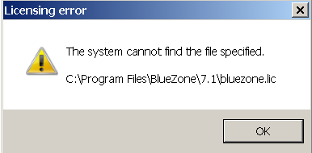
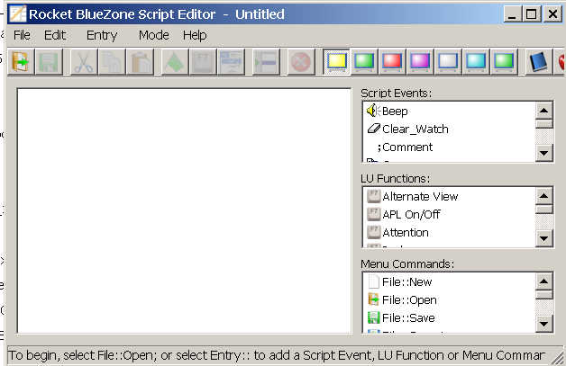
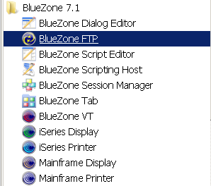

### Info

markets islelf and
> *robust and feature-rich Web-to-host and desktop terminal emulator for IBM mainframes, iSeries, DEC/VT UNIX and Unisys with FTP support apable of emulating 3270, 5250, VT 52/100/220/320/420, SCO-ANSI, HP Character and Block Mode, Unisys, IBM 3151, Linux, VAX/AIX, WYSE60, and Tandem/6530*

One can try to download the official __Rocket__ __Terminal Emulator__ __Free Trial__ directly from the vendor. 

The vendor of __BlueZone__, Rocket Software has rebranded the product to
__Rocket Terminal Emulator__, which provides a full-featured, 30-day evaluation period for secure access to 
IBM i (TN5250), IBM zSystems (TN3270), 
and UNIX (VT) systems.


Every release of the application is provided with the detailed Terminal Emulator documentation:

* Advanced Automation Developer Guide
* Desktop Administrator Guide
* Display and Printer User Guide
* License Manager Administrator Guide
* Secure FTP User Guide
* Security Server Administrator Guide
* Session Manager User Guide
* Web Deployment Manager Administrator Guide
* Web Edition Administrator Guide
* Web Edition User Guide
* Web Edition on Windows Quick Start Guide
* Release Notes

etc. in PDF. The documentation will be generated on demand
e.g. `https://docs-be.rocketsoftware.com/api/pdf/NDC2vPp762-0ol0qykMvGnTSUAu3nEiLpymS21i1fD7XypaX9awNTsTLs2xuGUfn-0r-W_0GXDU=/download?download_token=atqP8W2DLrZrUC0LSTxWBHadEun5tbA7FW6kqxCvZJpR8rjj`


in addition, Rocket TE Desktop offers web-based HTML help (for example, user workflows or reference topics).
By default, Rocket TE Desktop is configured to use the locally installed help file. However, to access and use the help
files,

>NOTE: To access all Rocket Software product documentation, visit the [Rocket Documentation Portal](https://docs.rocketsoftware.com/).


To practice app, one may run it on Windows VM, an tn3270 on Docker joined to same host network and connect on 
Trialware Gatekeeping that what it is - Rocket is not really interested in giving one a free 30 day trial
 

```text

Archive:  BlueZoneDesktop.zip
  Length      Date    Time    Name
---------  ---------- -----   ----
        0  2016-11-30 19:12   Assets/
    24085  2015-12-11 17:24   Assets/background_bluezone_swirl2.png
     3550  2015-12-14 17:45   Assets/rocket_logo_white2.png
        0  2016-11-30 21:35   License Agreements/
    27136  2014-07-17 17:31   License Agreements/Generic Click Terms.doc
     4961  2015-12-15 15:22   readme.htm
        0  2016-11-30 21:35   win32/
    25858  2014-10-01 11:40   win32/0x0407.ini
    22490  2014-10-01 11:41   win32/0x0409.ini
    26268  2014-10-01 11:41   win32/0x040c.ini
    14958  2014-10-01 11:41   win32/0x0411.ini
    24998  2014-10-01 11:43   win32/0x0413.ini
    73728  2017-04-28 11:21   win32/1031.mst
    20480  2017-04-28 11:21   win32/1033.mst
    73728  2017-04-28 11:21   win32/1036.mst
    73728  2017-04-28 11:21   win32/1041.mst
    73728  2017-04-28 11:21   win32/1043.mst
        0  2016-11-30 13:35   win32/API/
        0  2016-11-30 21:35   win32/API/COM/
   680043  2017-01-31 21:35   win32/API/COM/BZWhll.h
     5205  2017-01-31 21:35   win32/API/COM/BZWhll_i.c
        0  2016-11-30 21:35   win32/API/COM/Migration/
   216676  2017-01-31 21:34   win32/API/COM/Migration/BZExtr.h
     3895  2017-01-31 21:34   win32/API/COM/Migration/BZExtr_i.c
   200658  2017-01-31 21:35   win32/API/COM/Migration/BZPcom.h
     3479  2017-01-31 21:35   win32/API/COM/Migration/BZPcom_i.c
   593652  2017-01-31 21:35   win32/API/COM/Migration/BZRefl.h
     4596  2017-01-31 21:35   win32/API/COM/Migration/BZRefl_i.c
        0  2016-11-30 21:35   win32/API/DDE/
    22016  2014-07-11 09:40   win32/API/DDE/BZ_DDE_Samp.doc
    16778  2013-07-11 23:53   win32/API/DDE/BZDDE.H
        0  2016-11-30 21:35   win32/API/HLLAPI/
        0  2016-11-30 21:35   win32/API/HLLAPI/Enhanced/
      542  2014-07-10 23:06   win32/API/HLLAPI/Enhanced/pcshll32.def
    77968  2014-07-12 00:59   win32/API/HLLAPI/Enhanced/pcshll32.dll
    14390  2014-05-17 19:00   win32/API/HLLAPI/Enhanced/pcshll32.h
     4950  2014-07-12 00:59   win32/API/HLLAPI/Enhanced/pcshll32.lib
     6455  2014-11-11 13:18   win32/API/HLLAPI/Whlapi32.def
   167792  2015-11-12 21:07   win32/API/HLLAPI/Whlapi32.dll
    19086  2013-02-20 18:45   win32/API/HLLAPI/Whlapi32.h
    43570  2015-11-12 21:07   win32/API/HLLAPI/Whlapi32.lib
  1243136  2007-03-30 14:53   win32/API/HLLAPI/WOSA HLLAPI 1.1.doc
  3902464  2017-04-28 11:21   win32/BlueZone.msi
   680120  2017-04-28 11:21   win32/bz6530.cab
   849083  2017-04-28 11:21   win32/bzadp.cab
   404020  2017-04-28 11:21   win32/bzalc.cab
   172105  2017-04-28 11:21   win32/bzap.cab
   131639  2017-04-28 11:21   win32/bzextr.cab
   827698  2017-04-28 11:21   win32/bzftp.cab
    65922  2017-04-28 11:21   win32/bzftpext.cab
    98810  2017-04-28 11:21   win32/bzhllapi.cab
  2391419  2017-04-28 11:21   win32/bzkerb.cab
   733041  2017-04-28 11:21   win32/bzmdp.cab
   175145  2017-04-28 11:21   win32/bzmp.cab
   119867  2017-04-28 11:21   win32/bzpcom.cab
   213741  2017-04-28 11:21   win32/bzrefl.cab
  1386667  2017-04-28 11:21   win32/bzsc.cab
   217280  2017-04-28 11:21   win32/bzsm.cab
  1000797  2017-04-28 11:21   win32/bzt27.cab
   135194  2017-04-28 11:21   win32/bztcpip.cab
  1259627  2017-04-28 11:21   win32/bzuts.cab
   761176  2017-04-28 11:21   win32/bzvt.cab
   227960  2017-04-28 11:21   win32/bzwhll.cab
  1118281  2017-04-28 11:21   win32/common.cab
  3550285  2017-04-28 11:21   win32/common2.cab
        0  2016-11-30 21:35   win32/Docs/
  1554600  2017-04-27 16:12   win32/Docs/bluezone.chm
  3464981  2017-04-27 16:13   win32/Docs/bluezone.pdf
   482544  2017-04-27 16:14   win32/Docs/bzadmin.chm
  1793575  2017-04-27 16:15   win32/Docs/bzadmin.pdf
   200226  2017-04-27 16:16   win32/Docs/bzftp.chm
  1035287  2017-04-27 16:17   win32/Docs/bzftp.pdf
   634604  2017-04-27 16:23   win32/Docs/bzsh.chm
  2239853  2017-04-27 16:24   win32/Docs/bzsh.pdf
    70812  2017-04-27 16:15   win32/Docs/bzsm.chm
   696444  2017-04-27 16:16   win32/Docs/bzsm.pdf
     1313  2017-04-28 11:19   win32/global.ini
      159  2013-01-28 07:11   win32/language.ini
        0  2017-04-28 11:22   win32/Patches/
 14367688  2017-04-28 11:22   win32/Patches/BlueZone Patch 7.1.4.2796.exe
  1322536  2017-04-28 11:21   win32/setup.exe
     5593  2017-04-28 11:21   win32/setup.ini
   935127  2017-04-28 11:21   win32/unisys.cab
  1172062  2017-04-28 11:21   win32/web2host.cab
        0  2017-04-28 11:21   win32/Web2Host/
        0  2017-04-28 11:21   win32/Web2Host/msi/
  1635328  2017-04-28 11:20   win32/Web2Host/msi/Bzw2h-win32.msi
        0  2016-11-30 21:35   x64/
    25858  2014-10-01 11:40   x64/0x0407.ini
    22490  2014-10-01 11:41   x64/0x0409.ini
    26268  2014-10-01 11:41   x64/0x040c.ini
    14958  2014-10-01 11:41   x64/0x0411.ini
    24998  2014-10-01 11:43   x64/0x0413.ini
    73728  2017-04-28 11:03   x64/1031.mst
    20480  2017-04-28 11:03   x64/1033.mst
    73728  2017-04-28 11:03   x64/1036.mst
    73728  2017-04-28 11:03   x64/1041.mst
    73728  2017-04-28 11:03   x64/1043.mst
        0  2016-11-30 13:35   x64/API/
        0  2016-11-30 21:35   x64/API/COM/
   680045  2017-01-31 21:27   x64/API/COM/BZWhll.h
     5207  2017-01-31 21:27   x64/API/COM/BZWhll_i.c
        0  2016-11-30 21:35   x64/API/COM/Migration/
   216678  2017-01-31 21:26   x64/API/COM/Migration/BZExtr.h
     3897  2017-01-31 21:26   x64/API/COM/Migration/BZExtr_i.c
   200660  2017-01-31 21:27   x64/API/COM/Migration/BZPcom.h
     3481  2017-01-31 21:27   x64/API/COM/Migration/BZPcom_i.c
   593654  2017-01-31 21:27   x64/API/COM/Migration/BZRefl.h
     4598  2017-01-31 21:27   x64/API/COM/Migration/BZRefl_i.c
        0  2016-11-30 21:35   x64/API/DDE/
    22016  2014-07-11 09:40   x64/API/DDE/BZ_DDE_Samp.doc
    16778  2013-07-11 23:53   x64/API/DDE/BZDDE.H
        0  2016-11-30 21:35   x64/API/HLLAPI/
        0  2016-11-30 21:35   x64/API/HLLAPI/Enhanced/
      542  2014-07-10 23:06   x64/API/HLLAPI/Enhanced/pcshll64.def
    85136  2014-07-12 00:51   x64/API/HLLAPI/Enhanced/pcshll64.dll
    14390  2014-05-17 19:00   x64/API/HLLAPI/Enhanced/pcshll64.h
     4988  2014-07-12 00:51   x64/API/HLLAPI/Enhanced/pcshll64.lib
     6455  2014-11-11 13:18   x64/API/HLLAPI/Whlapi64.def
   164720  2015-11-12 21:03   x64/API/HLLAPI/Whlapi64.dll
    19086  2013-02-20 18:45   x64/API/HLLAPI/Whlapi64.h
    44678  2015-11-12 21:03   x64/API/HLLAPI/Whlapi64.lib
  1243136  2007-03-30 14:53   x64/API/HLLAPI/WOSA HLLAPI 1.1.doc
  3805696  2017-04-28 11:03   x64/BlueZone.msi
   791864  2017-04-28 11:03   x64/bz6530.cab
   993001  2017-04-28 11:03   x64/bzadp.cab
   471668  2017-04-28 11:03   x64/bzalc.cab
   191383  2017-04-28 11:03   x64/bzap.cab
   154157  2017-04-28 11:03   x64/bzextr.cab
   692511  2017-04-28 11:03   x64/bzftp.cab
    70176  2017-04-28 11:03   x64/bzftpext.cab
    92456  2017-04-28 11:03   x64/bzhllapi.cab
  2726341  2017-04-28 11:03   x64/bzkerb.cab
   845651  2017-04-28 11:03   x64/bzmdp.cab
   195151  2017-04-28 11:03   x64/bzmp.cab
   139775  2017-04-28 11:03   x64/bzpcom.cab
   240867  2017-04-28 11:03   x64/bzrefl.cab
  1440695  2017-04-28 11:03   x64/bzsc.cab
   221948  2017-04-28 11:03   x64/bzsm.cab
   145622  2017-04-28 11:03   x64/bztcpip.cab
   870830  2017-04-28 11:03   x64/bzvt.cab
   258532  2017-04-28 11:03   x64/bzwhll.cab
  1168625  2017-04-28 11:03   x64/common.cab
  3556233  2017-04-28 11:03   x64/common2.cab
        0  2016-11-30 21:35   x64/Docs/
  1554600  2017-04-27 16:12   x64/Docs/bluezone.chm
  3464981  2017-04-27 16:13   x64/Docs/bluezone.pdf
   482544  2017-04-27 16:14   x64/Docs/bzadmin.chm
  1793575  2017-04-27 16:15   x64/Docs/bzadmin.pdf
   200226  2017-04-27 16:16   x64/Docs/bzftp.chm
  1035287  2017-04-27 16:17   x64/Docs/bzftp.pdf
   634604  2017-04-27 16:23   x64/Docs/bzsh.chm
  2239853  2017-04-27 16:24   x64/Docs/bzsh.pdf
    70812  2017-04-27 16:15   x64/Docs/bzsm.chm
   696444  2017-04-27 16:16   x64/Docs/bzsm.pdf
     1313  2017-04-28 11:02   x64/global.ini
      159  2013-01-28 17:25   x64/language.ini
        0  2017-04-28 11:04   x64/Patches/
 13947672  2017-04-28 11:04   x64/Patches/BlueZone Patch 7.1.4.2796.exe
  1322536  2017-04-28 11:03   x64/setup.exe
     5608  2017-04-28 11:03   x64/setup.ini
  1436824  2017-04-28 11:03   x64/web2host.cab
        0  2017-04-28 11:03   x64/Web2Host/
        0  2017-04-28 11:03   x64/Web2Host/msi/
  2022400  2017-04-28 11:02   x64/Web2Host/msi/Bzw2h-x64.msi
---------                     -------
109592385                     165 files


```
```text
nzip -ql BlueZone.zip
  Length      Date    Time    Name
---------  ---------- -----   ----
    25860  2012-03-16 14:50   BlueZone Desktop/0x0407.ini
    22492  2010-03-23 16:44   BlueZone Desktop/0x0409.ini
    26270  2010-06-22 14:35   BlueZone Desktop/0x040c.ini
    14960  2012-03-16 12:55   BlueZone Desktop/0x0411.ini
    25000  2010-06-22 14:39   BlueZone Desktop/0x0413.ini
    73728  2014-02-03 20:04   BlueZone Desktop/1031.mst
    20480  2014-02-03 20:04   BlueZone Desktop/1033.mst
    73728  2014-02-03 20:04   BlueZone Desktop/1036.mst
    69632  2014-02-03 20:04   BlueZone Desktop/1041.mst
    69632  2014-02-03 20:04   BlueZone Desktop/1043.mst
        0  2014-02-13 13:16   BlueZone Desktop/Assets/
     3452  2012-02-09 14:00   BlueZone Desktop/Assets/rocket_bluezone_logo.png
     2104  2012-02-09 14:00   BlueZone Desktop/Assets/top_nav.gif
  3259392  2014-02-03 20:04   BlueZone Desktop/BlueZone.msi
   984676  2014-02-03 20:04   BlueZone Desktop/bzadp.cab
   160733  2014-02-03 20:04   BlueZone Desktop/bzap.cab
   834464  2014-02-03 20:04   BlueZone Desktop/bzftp.cab
   190608  2014-02-03 20:04   BlueZone Desktop/bzhllapi.cab
   380019  2014-02-03 20:04   BlueZone Desktop/bzicl.cab
   757967  2014-02-03 20:04   BlueZone Desktop/bzmdp.cab
   164807  2014-02-03 20:04   BlueZone Desktop/bzmp.cab
  1461866  2014-02-03 20:04   BlueZone Desktop/bzsc.cab
   226370  2014-02-03 20:04   BlueZone Desktop/bzsm.cab
   128439  2014-02-03 20:04   BlueZone Desktop/bztcpip.cab
   753139  2014-02-03 20:04   BlueZone Desktop/bzvt.cab
   235956  2014-02-03 20:04   BlueZone Desktop/bzwhll.cab
  1379392  2014-02-03 20:04   BlueZone Desktop/common.cab
  4101171  2014-02-03 20:04   BlueZone Desktop/common2.cab
        0  2014-02-13 13:16   BlueZone Desktop/Docs/
  1405792  2014-01-13 15:08   BlueZone Desktop/Docs/bluezone.chm
  7622527  2014-01-13 14:56   BlueZone Desktop/Docs/bluezone.pdf
   539893  2013-08-20 08:37   BlueZone Desktop/Docs/bzadmin.chm
  3112355  2013-08-08 10:00   BlueZone Desktop/Docs/bzadmin.pdf
   229245  2012-09-14 09:31   BlueZone Desktop/Docs/bzftp.chm
  1242707  2012-09-14 09:29   BlueZone Desktop/Docs/bzftp.pdf
   621173  2013-02-04 10:33   BlueZone Desktop/Docs/bzsh.chm
  3528188  2013-02-04 10:30   BlueZone Desktop/Docs/bzsh.pdf
    84867  2012-09-11 14:53   BlueZone Desktop/Docs/bzsm.chm
   576083  2012-09-11 14:53   BlueZone Desktop/Docs/bzsm.pdf
     1013  2014-02-03 20:03   BlueZone Desktop/global.ini
        0  2014-02-13 13:16   BlueZone Desktop/Kerberos/
  1617231  2014-02-03 20:04   BlueZone Desktop/Kerberos/bzkerb.cab
      159  2011-11-14 11:15   BlueZone Desktop/language.ini
        0  2014-02-13 13:16   BlueZone Desktop/Patches/
 19225232  2014-02-03 20:05   BlueZone Desktop/Patches/BlueZone Patch 6.1.5.2080.exe
     3008  2012-02-09 14:00   BlueZone Desktop/readme.htm
  1227912  2014-02-03 20:04   BlueZone Desktop/setup.exe
     5593  2014-02-03 20:04   BlueZone Desktop/setup.ini
        0  2014-02-13 13:16   BlueZone Desktop/Unisys/
  1447200  2014-02-03 20:04   BlueZone Desktop/Unisys/bzt27.cab
  1653436  2014-02-03 20:04   BlueZone Desktop/Unisys/bzuts.cab
  1073087  2014-02-03 20:04   BlueZone Desktop/Unisys/unisys.cab
        0  2014-02-13 13:16   BlueZone Desktop/Web2Host/
        0  2014-02-13 13:16   BlueZone Desktop/Web2Host/msi/
   957952  2014-02-03 20:03   BlueZone Desktop/Web2Host/msi/Web2Host.msi
   585053  2014-02-03 20:04   BlueZone Desktop/Web2Host/web2host.cab
---------                     -------
 62206043                     56 files


```
sample
```vb
' construct BlueZone Host Automation Object (BZHAO)
Set bzo = CreateObject("BZWhll.WhllObj")

SessName = bzo.NewSession("myProfile.zmd")
bzo.Connect SessName

bzo.SendKey "logon username<Enter>"
bzo.WaitReady 10, 0

bzo.ReadScreen myData, Length, Row, Column
MsgBox myData

```
```powershell

$progId = 'BZWhll.WhllObj'

$clsid = (Get-ItemProperty `
  "Registry::HKEY_CLASSES_ROOT\$progId\CLSID" `
  -ErrorAction Stop).'(default)'

$clsid

Get-ItemProperty `
  "Registry::HKEY_CLASSES_ROOT\CLSID\$clsid\InprocServer32" `
  -ErrorAction SilentlyContinue

Get-ItemProperty `
  "Registry::HKEY_CLASSES_ROOT\CLSID\$clsid\LocalServer32" `
  -ErrorAction SilentlyContinue
  
```
|Technology|Purpose|
|Host Automation Object (BZHAO)|COM API for controlling sessions and exchanging data with the host|
|BlueZone Basic|Vendor-provided scripting language, compatible with a substantial subset of VBA and VBScript|
|BlueZone Plus VBA|Optional integration of Microsoft's VBA development environment into the emulator|


Rocket's older BlueZone documentation explicitly identifies BlueZone VBA as an additional-cost installation option. Its newer Advanced Automation guide retains the distinction between the scripting environment and the COM automation object. 


There is also HLLAPI, a different integration mechanism commonly used by legacy terminal automation tools. BlueZone's documented HLLAPI DLL is WHLAPI32.dll, with hllapi as its entry point

### Installed

Windows 7 Registry entries added by installing (bulk, partial dump - see `Bluezone_reg.txt`):

```text
[HKEY_LOCAL_MACHINE\SOFTWARE\Classes\BlueZone.System]
@="WhllObj Class"

[HKEY_LOCAL_MACHINE\SOFTWARE\Classes\BlueZone.System\CLSID]
@="{4EB971C3-01D0-11D5-903D-00105AABADD3}"

[HKEY_LOCAL_MACHINE\SOFTWARE\Classes\BlueZone.System.7.1]
@="WhllObj Class"

[HKEY_LOCAL_MACHINE\SOFTWARE\Classes\BlueZone.System.7.1\CLSID]
@="{4EB971C3-01D0-11D5-903D-00105AABADD3}"

[HKEY_LOCAL_MACHINE\SOFTWARE\Classes\BlueZoneFTP.ShellExtension]
@="ShellExtension Class"

[HKEY_LOCAL_MACHINE\SOFTWARE\Classes\BlueZoneFTP.ShellExtension\CLSID]
@="{6C1A71B3-9F55-11D4-873F-00E0B816AA07}"

[HKEY_LOCAL_MACHINE\SOFTWARE\Classes\BlueZoneFTP.ShellExtension.7.1]
@="ShellExtension Class"

[HKEY_LOCAL_MACHINE\SOFTWARE\Classes\BlueZoneFTP.ShellExtension.7.1\CLSID]
@="{6C1A71B3-9F55-11D4-873F-00E0B816AA07}"

[HKEY_LOCAL_MACHINE\SOFTWARE\Classes\BZWhll.WhllObj]
@="WhllObj Class"

[HKEY_LOCAL_MACHINE\SOFTWARE\Classes\BZWhll.WhllObj\CLSID]
@="{4EB971C3-00D0-11D5-903D-00105AABADD3}"

[HKEY_LOCAL_MACHINE\SOFTWARE\Classes\BZWhll.WhllObj.7.1]
@="WhllObj Class"

[HKEY_LOCAL_MACHINE\SOFTWARE\Classes\BZWhll.WhllObj.7.1\CLSID]
@="{4EB971C3-00D0-11D5-903D-00105AABADD3}"

[HKEY_LOCAL_MACHINE\SOFTWARE\Classes\CLSID\{0d0871b4-00c9-4a21-85c5-b7d1e4ef8261}]
@="AutPS Class"

[HKEY_LOCAL_MACHINE\SOFTWARE\Classes\CLSID\{0d0871b4-00c9-4a21-85c5-b7d1e4ef8261}\InprocServer32]
@="C:\\Program Files\\BlueZone\\7.1\\bzwhll.dll"
"ThreadingModel"="both"

[HKEY_LOCAL_MACHINE\SOFTWARE\Classes\CLSID\{0d0871b4-03c9-4a21-85c5-b7d1e4ef8261}]
@="AutPS Class"

[HKEY_LOCAL_MACHINE\SOFTWARE\Classes\CLSID\{0d0871b4-03c9-4a21-85c5-b7d1e4ef8261}\InprocServer32]
@="C:\\Program Files\\BlueZone\\7.1\\BZPcom.dll"
"ThreadingModel"="both"

[HKEY_LOCAL_MACHINE\SOFTWARE\Classes\CLSID\{0EB971C3-A2D0-11D5-903D-10105AABADD3}]
@="LIPI Class"

[HKEY_LOCAL_MACHINE\SOFTWARE\Classes\CLSID\{0EB971C3-A2D0-11D5-903D-10105AABADD3}\InprocServer32]
@="C:\\Program Files\\BlueZone\\7.1\\bzlipiobj.dll"
"ThreadingModel"="both"

[HKEY_LOCAL_MACHINE\SOFTWARE\Classes\CLSID\{0EB971C3-A2D0-11D5-903D-10105AABADD3}\ProgID]
@="BlueZone.LIPI.7.1"

[HKEY_LOCAL_MACHINE\SOFTWARE\Classes\CLSID\{0EB971C3-A2D0-11D5-903D-10105AABADD3}\VersionIndependentProgID]
@="BlueZone.LIPI"

[HKEY_LOCAL_MACHINE\SOFTWARE\Classes\CLSID\{0EB971C3-A2D0-11D5-903D-20105AABADD3}]
@="Fields Class"

[HKEY_LOCAL_MACHINE\SOFTWARE\Classes\CLSID\{0EB971C3-A2D0-11D5-903D-20105AABADD3}\InprocServer32]
@="C:\\Program Files\\BlueZone\\7.1\\bzlipiobj.dll"
"ThreadingModel"="both"

[HKEY_LOCAL_MACHINE\SOFTWARE\Classes\CLSID\{0FB971C2-003C-11D5-903D-00105AABADD3}]
@="Field Class"

[HKEY_LOCAL_MACHINE\SOFTWARE\Classes\CLSID\{0FB971C2-003C-11D5-903D-00105AABADD3}\InprocServer32]
@="C:\\Program Files\\BlueZone\\7.1\\bzwhll.dll"
"ThreadingModel"="both"

[HKEY_LOCAL_MACHINE\SOFTWARE\Classes\CLSID\{0FB971C2-013C-11D5-903D-00105AABADD3}]
@="Field Class"

[HKEY_LOCAL_MACHINE\SOFTWARE\Classes\CLSID\{0FB971C2-013C-11D5-903D-00105AABADD3}\InprocServer32]
@="C:\\Program Files\\BlueZone\\7.1\\BZExtr.dll"
"ThreadingModel"="both"

[HKEY_LOCAL_MACHINE\SOFTWARE\Classes\CLSID\{0FB971C2-023C-11D5-903D-00105AABADD3}]
@="Field Class"

[HKEY_LOCAL_MACHINE\SOFTWARE\Classes\CLSID\{0FB971C2-023C-11D5-903D-00105AABADD3}\InprocServer32]
@="C:\\Program Files\\BlueZone\\7.1\\BZRefl.dll"
"ThreadingModel"="both"

[HKEY_LOCAL_MACHINE\SOFTWARE\Classes\CLSID\{0FB971C2-033C-11D5-903D-00105AABADD3}]
@="Field Class"

[HKEY_LOCAL_MACHINE\SOFTWARE\Classes\CLSID\{0FB971C2-033C-11D5-903D-00105AABADD3}\InprocServer32]
@="C:\\Program Files\\BlueZone\\7.1\\BZPcom.dll"
"ThreadingModel"="both"

[HKEY_LOCAL_MACHINE\SOFTWARE\Classes\CLSID\{128c7123-f37f-4034-b078-abe78f23e5c2}]
@="View Class"

[HKEY_LOCAL_MACHINE\SOFTWARE\Classes\CLSID\{128c7123-f37f-4034-b078-abe78f23e5c2}\InprocServer32]
@="C:\\Program Files\\BlueZone\\7.1\\BZRefl.dll"
"ThreadingModel"="both"

[HKEY_LOCAL_MACHINE\SOFTWARE\Classes\CLSID\{2d9971f9-978b-4ee3-8cdd-470f617509d8}]
@="IbmScreen Class"

[HKEY_LOCAL_MACHINE\SOFTWARE\Classes\CLSID\{2d9971f9-978b-4ee3-8cdd-470f617509d8}\InprocServer32]
@="C:\\Program Files\\BlueZone\\7.1\\BZRefl.dll"
"ThreadingModel"="both"

[HKEY_LOCAL_MACHINE\SOFTWARE\Classes\CLSID\{2F887196-0015-426D-A582-F3BCF749E9C1}]
@="Vector Class"

[HKEY_LOCAL_MACHINE\SOFTWARE\Classes\CLSID\{2F887196-0015-426D-A582-F3BCF749E9C1}\InprocServer32]
@="C:\\Program Files\\BlueZone\\7.1\\bzwhll.dll"
"ThreadingModel"="both"

[HKEY_LOCAL_MACHINE\SOFTWARE\Classes\CLSID\{2F887196-0215-426D-A582-F3BCF749E9C1}]
@="Vector Class"

[HKEY_LOCAL_MACHINE\SOFTWARE\Classes\CLSID\{2F887196-0215-426D-A582-F3BCF749E9C1}\InprocServer32]
@="C:\\Program Files\\BlueZone\\7.1\\BZRefl.dll"
"ThreadingModel"="both"

[HKEY_LOCAL_MACHINE\SOFTWARE\Classes\CLSID\{449B2A22-B7BF-4846-BEEA-4A00D610B75F}]
@="FtpSession Class"

[HKEY_LOCAL_MACHINE\SOFTWARE\Classes\CLSID\{449B2A22-B7BF-4846-BEEA-4A00D610B75F}\InprocServer32]
@="C:\\Program Files\\BlueZone\\7.1\\Ftpcom.dll"
"ThreadingModel"="Apartment"

[HKEY_LOCAL_MACHINE\SOFTWARE\Classes\CLSID\{449B2A22-B7BF-4846-BEEA-4A00D610B75F}\ProgID]
@="RocketFTP.FtpSession.1"

[HKEY_LOCAL_MACHINE\SOFTWARE\Classes\CLSID\{449B2A22-B7BF-4846-BEEA-4A00D610B75F}\Programmable]

[HKEY_LOCAL_MACHINE\SOFTWARE\Classes\CLSID\{449B2A22-B7BF-4846-BEEA-4A00D610B75F}\TypeLib]
@="{A382E7D7-7939-4077-ABA8-DEFB0B8466C4}"

[HKEY_LOCAL_MACHINE\SOFTWARE\Classes\CLSID\{449B2A22-B7BF-4846-BEEA-4A00D610B75F}\VersionIndependentProgID]
@="RocketFTP.FtpSession"

[HKEY_LOCAL_MACHINE\SOFTWARE\Classes\CLSID\{4EB971C3-00D0-11D5-903D-00105AABADD3}]
@="WhllObj Class"

[HKEY_LOCAL_MACHINE\SOFTWARE\Classes\CLSID\{4EB971C3-00D0-11D5-903D-00105AABADD3}\InprocServer32]
@="C:\\Program Files\\BlueZone\\7.1\\bzwhll.dll"
"ThreadingModel"="both"

[HKEY_LOCAL_MACHINE\SOFTWARE\Classes\CLSID\{4EB971C3-00D0-11D5-903D-00105AABADD3}\ProgID]
@="BZWhll.WhllObj.7.1"

[HKEY_LOCAL_MACHINE\SOFTWARE\Classes\CLSID\{4EB971C3-00D0-11D5-903D-00105AABADD3}\VersionIndependentProgID]
@="BZWhll.WhllObj"

[HKEY_LOCAL_MACHINE\SOFTWARE\Classes\CLSID\{4EB971C3-01D0-11D5-903D-00105AABADD3}]
@="WhllObj Class"

[HKEY_LOCAL_MACHINE\SOFTWARE\Classes\CLSID\{4EB971C3-01D0-11D5-903D-00105AABADD3}\InprocServer32]
@="C:\\Program Files\\BlueZone\\7.1\\BZExtr.dll"
"ThreadingModel"="both"

[HKEY_LOCAL_MACHINE\SOFTWARE\Classes\CLSID\{4EB971C3-01D0-11D5-903D-00105AABADD3}\ProgID]
@="BlueZone.System.7.1"

[HKEY_LOCAL_MACHINE\SOFTWARE\Classes\CLSID\{4EB971C3-01D0-11D5-903D-00105AABADD3}\VersionIndependentProgID]
@="BlueZone.System"

[HKEY_LOCAL_MACHINE\SOFTWARE\Classes\CLSID\{4EB971C3-02D0-11D5-903D-00105AABADD3}]
@="WhllObj Class"

[HKEY_LOCAL_MACHINE\SOFTWARE\Classes\CLSID\{4EB971C3-02D0-11D5-903D-00105AABADD3}\InprocServer32]
@="C:\\Program Files\\BlueZone\\7.1\\BZRefl.dll"
"ThreadingModel"="both"

[HKEY_LOCAL_MACHINE\SOFTWARE\Classes\CLSID\{4EB971C3-02D0-11D5-903D-00105AABADD3}\ProgID]
@="BlueZone.Application.7.1"

[HKEY_LOCAL_MACHINE\SOFTWARE\Classes\CLSID\{4EB971C3-02D0-11D5-903D-00105AABADD3}\VersionIndependentProgID]
@="BlueZone.Application"

[HKEY_LOCAL_MACHINE\SOFTWARE\Classes\CLSID\{4EB971C3-03D0-11D5-903D-00105AABADD3}]
@="WhllObj Class"

[HKEY_LOCAL_MACHINE\SOFTWARE\Classes\CLSID\{4EB971C3-03D0-11D5-903D-00105AABADD3}\InprocServer32]
@="C:\\Program Files\\BlueZone\\7.1\\BZPcom.dll"
"ThreadingModel"="both"

[HKEY_LOCAL_MACHINE\SOFTWARE\Classes\CLSID\{4EB971C3-03D0-11D5-903D-00105AABADD3}\ProgID]
@="BlueZone.autECL.7.1"

[HKEY_LOCAL_MACHINE\SOFTWARE\Classes\CLSID\{4EB971C3-03D0-11D5-903D-00105AABADD3}\VersionIndependentProgID]
@="BlueZone.autECL"

[HKEY_LOCAL_MACHINE\SOFTWARE\Classes\CLSID\{4F147161-00F0-11D6-903D-00105AABADD3}]
@="Sessions Class"

[HKEY_LOCAL_MACHINE\SOFTWARE\Classes\CLSID\{4F147161-00F0-11D6-903D-00105AABADD3}\InprocServer32]
@="C:\\Program Files\\BlueZone\\7.1\\bzwhll.dll"
"ThreadingModel"="both"

[HKEY_LOCAL_MACHINE\SOFTWARE\Classes\CLSID\{4F147161-01F0-11D6-903D-00105AABADD3}]
@="Sessions Class"

[HKEY_LOCAL_MACHINE\SOFTWARE\Classes\CLSID\{4F147161-01F0-11D6-903D-00105AABADD3}\InprocServer32]
@="C:\\Program Files\\BlueZone\\7.1\\BZExtr.dll"
"ThreadingModel"="both"

[HKEY_LOCAL_MACHINE\SOFTWARE\Classes\CLSID\{5061712a-00a5-45e2-90b8-4584b196c7dd}]
@="AutConnInfo Class"

[HKEY_LOCAL_MACHINE\SOFTWARE\Classes\CLSID\{5061712a-00a5-45e2-90b8-4584b196c7dd}\InprocServer32]
@="C:\\Program Files\\BlueZone\\7.1\\bzwhll.dll"
"ThreadingModel"="both"

[HKEY_LOCAL_MACHINE\SOFTWARE\Classes\CLSID\{5061712a-03a5-45e2-90b8-4584b196c7dd}]
@="AutConnInfo Class"

[HKEY_LOCAL_MACHINE\SOFTWARE\Classes\CLSID\{5061712a-03a5-45e2-90b8-4584b196c7dd}\InprocServer32]
@="C:\\Program Files\\BlueZone\\7.1\\BZPcom.dll"
"ThreadingModel"="both"

[HKEY_LOCAL_MACHINE\SOFTWARE\Classes\CLSID\{51A37181-00F0-11D6-903D-00105AABADD3}]
@="Session Class"

[HKEY_LOCAL_MACHINE\SOFTWARE\Classes\CLSID\{51A37181-00F0-11D6-903D-00105AABADD3}\InprocServer32]
@="C:\\Program Files\\BlueZone\\7.1\\bzwhll.dll"
"ThreadingModel"="both"

[HKEY_LOCAL_MACHINE\SOFTWARE\Classes\CLSID\{51A37181-01F0-11D6-903D-00105AABADD3}]
@="Session Class"

[HKEY_LOCAL_MACHINE\SOFTWARE\Classes\CLSID\{51A37181-01F0-11D6-903D-00105AABADD3}\InprocServer32]
@="C:\\Program Files\\BlueZone\\7.1\\BZExtr.dll"
"ThreadingModel"="both"

[HKEY_LOCAL_MACHINE\SOFTWARE\Classes\CLSID\{56B57161-00F0-11D6-903D-00105AABADD3}]
@="OIA Class"

[HKEY_LOCAL_MACHINE\SOFTWARE\Classes\CLSID\{56B57161-00F0-11D6-903D-00105AABADD3}\InprocServer32]
@="C:\\Program Files\\BlueZone\\7.1\\bzwhll.dll"
"ThreadingModel"="both"

[HKEY_LOCAL_MACHINE\SOFTWARE\Classes\CLSID\{56B57161-01F0-11D6-903D-00105AABADD3}]
@="OIA Class"

[HKEY_LOCAL_MACHINE\SOFTWARE\Classes\CLSID\{56B57161-01F0-11D6-903D-00105AABADD3}\InprocServer32]
@="C:\\Program Files\\BlueZone\\7.1\\BZExtr.dll"
"ThreadingModel"="both"

[HKEY_LOCAL_MACHINE\SOFTWARE\Classes\CLSID\{6C1A71B3-9F55-11D4-873F-00E0B816AA07}]
@="ShellExtension Class"

[HKEY_LOCAL_MACHINE\SOFTWARE\Classes\CLSID\{6C1A71B3-9F55-11D4-873F-00E0B816AA07}\InprocServer32]
@="C:\\Program Files\\BlueZone\\7.1\\bzftp.dll"
"ThreadingModel"="Apartment"

[HKEY_LOCAL_MACHINE\SOFTWARE\Classes\CLSID\{6C1A71B3-9F55-11D4-873F-00E0B816AA07}\ProgID]
@="BlueZoneFTP.ShellExtension.7.1"

[HKEY_LOCAL_MACHINE\SOFTWARE\Classes\CLSID\{6C1A71B3-9F55-11D4-873F-00E0B816AA07}\VersionIndependentProgID]
@="BlueZoneFTP.ShellExtension"

[HKEY_LOCAL_MACHINE\SOFTWARE\Classes\CLSID\{72227143-00F2-4CC7-938F-8B610DB93AB1}]
@="Area Class"

[HKEY_LOCAL_MACHINE\SOFTWARE\Classes\CLSID\{72227143-00F2-4CC7-938F-8B610DB93AB1}\InprocServer32]
@="C:\\Program Files\\BlueZone\\7.1\\bzwhll.dll"
"ThreadingModel"="both"

[HKEY_LOCAL_MACHINE\SOFTWARE\Classes\CLSID\{72227143-01F2-4CC7-938F-8B610DB93AB1}]
@="Area Class"

[HKEY_LOCAL_MACHINE\SOFTWARE\Classes\CLSID\{72227143-01F2-4CC7-938F-8B610DB93AB1}\InprocServer32]
@="C:\\Program Files\\BlueZone\\7.1\\BZExtr.dll"
"ThreadingModel"="both"

[HKEY_LOCAL_MACHINE\SOFTWARE\Classes\CLSID\{78A471A2-000D-11D5-903D-00105AABADD3}]
@="EmuWnd Class"

[HKEY_LOCAL_MACHINE\SOFTWARE\Classes\CLSID\{78A471A2-000D-11D5-903D-00105AABADD3}\InprocServer32]
@="C:\\Program Files\\BlueZone\\7.1\\bzwhll.dll"
"ThreadingModel"="both"

[HKEY_LOCAL_MACHINE\SOFTWARE\Classes\CLSID\{78A471A2-010D-11D5-903D-00105AABADD3}]
@="EmuWnd Class"

[HKEY_LOCAL_MACHINE\SOFTWARE\Classes\CLSID\{78A471A2-010D-11D5-903D-00105AABADD3}\InprocServer32]
@="C:\\Program Files\\BlueZone\\7.1\\BZExtr.dll"
"ThreadingModel"="both"

[HKEY_LOCAL_MACHINE\SOFTWARE\Classes\CLSID\{78A471A2-020D-11D5-903D-00105AABADD3}]
@="EmuWnd Class"

[HKEY_LOCAL_MACHINE\SOFTWARE\Classes\CLSID\{78A471A2-020D-11D5-903D-00105AABADD3}\InprocServer32]
@="C:\\Program Files\\BlueZone\\7.1\\BZRefl.dll"
"ThreadingModel"="both"

[HKEY_LOCAL_MACHINE\SOFTWARE\Classes\CLSID\{78A471A2-030D-11D5-903D-00105AABADD3}]
@="EmuWnd Class"

[HKEY_LOCAL_MACHINE\SOFTWARE\Classes\CLSID\{78A471A2-030D-11D5-903D-00105AABADD3}\InprocServer32]
@="C:\\Program Files\\BlueZone\\7.1\\BZPcom.dll"
"ThreadingModel"="both"

[HKEY_LOCAL_MACHINE\SOFTWARE\Classes\CLSID\{7d2371fb-7d16-44e3-9cfc-4800aa45daf8}]
@="Terminal Class"

[HKEY_LOCAL_MACHINE\SOFTWARE\Classes\CLSID\{7d2371fb-7d16-44e3-9cfc-4800aa45daf8}\InprocServer32]
@="C:\\Program Files\\BlueZone\\7.1\\BZRefl.dll"
"ThreadingModel"="both"

[HKEY_LOCAL_MACHINE\SOFTWARE\Classes\CLSID\{9a4571e5-599e-4f98-a494-989480d88b29}]
@="IbmTerminal Class"

[HKEY_LOCAL_MACHINE\SOFTWARE\Classes\CLSID\{9a4571e5-599e-4f98-a494-989480d88b29}\InprocServer32]
@="C:\\Program Files\\BlueZone\\7.1\\BZRefl.dll"
"ThreadingModel"="both"

[HKEY_LOCAL_MACHINE\SOFTWARE\Classes\CLSID\{b3d47113-003b-4d4a-be78-bbae5f55f6ff}]
@="AutConnList Class"

[HKEY_LOCAL_MACHINE\SOFTWARE\Classes\CLSID\{b3d47113-003b-4d4a-be78-bbae5f55f6ff}\InprocServer32]
@="C:\\Program Files\\BlueZone\\7.1\\bzwhll.dll"
"ThreadingModel"="both"

[HKEY_LOCAL_MACHINE\SOFTWARE\Classes\CLSID\{b3d47113-033b-4d4a-be78-bbae5f55f6ff}]
@="AutConnList Class"

[HKEY_LOCAL_MACHINE\SOFTWARE\Classes\CLSID\{b3d47113-033b-4d4a-be78-bbae5f55f6ff}\InprocServer32]
@="C:\\Program Files\\BlueZone\\7.1\\BZPcom.dll"
"ThreadingModel"="both"

[HKEY_LOCAL_MACHINE\SOFTWARE\Classes\CLSID\{b83471c9-0091-483b-96ab-4849e192d37c}]
@="AutSess Class"

[HKEY_LOCAL_MACHINE\SOFTWARE\Classes\CLSID\{b83471c9-0091-483b-96ab-4849e192d37c}\InprocServer32]
@="C:\\Program Files\\BlueZone\\7.1\\bzwhll.dll"
"ThreadingModel"="both"

[HKEY_LOCAL_MACHINE\SOFTWARE\Classes\CLSID\{b83471c9-0391-483b-96ab-4849e192d37c}]
@="AutSess Class"

[HKEY_LOCAL_MACHINE\SOFTWARE\Classes\CLSID\{b83471c9-0391-483b-96ab-4849e192d37c}\InprocServer32]
@="C:\\Program Files\\BlueZone\\7.1\\BZPcom.dll"
"ThreadingModel"="both"

[HKEY_LOCAL_MACHINE\SOFTWARE\Classes\CLSID\{B84271C1-0030-4DF7-B5B0-68E03729E24D}]
@="QuickPad Class"

[HKEY_LOCAL_MACHINE\SOFTWARE\Classes\CLSID\{B84271C1-0030-4DF7-B5B0-68E03729E24D}\InprocServer32]
@="C:\\Program Files\\BlueZone\\7.1\\bzwhll.dll"
"ThreadingModel"="both"

[HKEY_LOCAL_MACHINE\SOFTWARE\Classes\CLSID\{B84271C1-0130-4DF7-B5B0-68E03729E24D}]
@="QuickPad Class"

[HKEY_LOCAL_MACHINE\SOFTWARE\Classes\CLSID\{B84271C1-0130-4DF7-B5B0-68E03729E24D}\InprocServer32]
@="C:\\Program Files\\BlueZone\\7.1\\BZExtr.dll"
"ThreadingModel"="both"

[HKEY_LOCAL_MACHINE\SOFTWARE\Classes\CLSID\{BEAD717E-00E3-4EC0-AB7C-EB8D5166EEC8}]
@="QuickPads Class"

[HKEY_LOCAL_MACHINE\SOFTWARE\Classes\CLSID\{BEAD717E-00E3-4EC0-AB7C-EB8D5166EEC8}\InprocServer32]
@="C:\\Program Files\\BlueZone\\7.1\\bzwhll.dll"
"ThreadingModel"="both"

[HKEY_LOCAL_MACHINE\SOFTWARE\Classes\CLSID\{BEAD717E-01E3-4EC0-AB7C-EB8D5166EEC8}]
@="QuickPads Class"

[HKEY_LOCAL_MACHINE\SOFTWARE\Classes\CLSID\{BEAD717E-01E3-4EC0-AB7C-EB8D5166EEC8}\InprocServer32]
@="C:\\Program Files\\BlueZone\\7.1\\BZExtr.dll"
"ThreadingModel"="both"

[HKEY_LOCAL_MACHINE\SOFTWARE\Classes\CLSID\{c6aa7169-2323-4427-aca3-18afec1a890e}]
@="Screen Class"

[HKEY_LOCAL_MACHINE\SOFTWARE\Classes\CLSID\{c6aa7169-2323-4427-aca3-18afec1a890e}\InprocServer32]
@="C:\\Program Files\\BlueZone\\7.1\\BZRefl.dll"
"ThreadingModel"="both"

[HKEY_LOCAL_MACHINE\SOFTWARE\Classes\CLSID\{db0971c2-0019-4152-91cf-41f9d63dc8a9}]
@="AutOIA Class"

[HKEY_LOCAL_MACHINE\SOFTWARE\Classes\CLSID\{db0971c2-0019-4152-91cf-41f9d63dc8a9}\InprocServer32]
@="C:\\Program Files\\BlueZone\\7.1\\bzwhll.dll"
"ThreadingModel"="both"

[HKEY_LOCAL_MACHINE\SOFTWARE\Classes\CLSID\{db0971c2-0319-4152-91cf-41f9d63dc8a9}]
@="AutOIA Class"

[HKEY_LOCAL_MACHINE\SOFTWARE\Classes\CLSID\{db0971c2-0319-4152-91cf-41f9d63dc8a9}\InprocServer32]
@="C:\\Program Files\\BlueZone\\7.1\\BZPcom.dll"
"ThreadingModel"="both"

[HKEY_LOCAL_MACHINE\SOFTWARE\Classes\CLSID\{f526710f-55e4-4b20-aeab-df145198594f}]
@="Frame Class"

[HKEY_LOCAL_MACHINE\SOFTWARE\Classes\CLSID\{f526710f-55e4-4b20-aeab-df145198594f}\InprocServer32]
@="C:\\Program Files\\BlueZone\\7.1\\BZRefl.dll"
"ThreadingModel"="both"

[HKEY_LOCAL_MACHINE\SOFTWARE\Classes\Directory\shellex\ContextMenuHandlers\BlueZoneFTP.7.1]
@="{6C1A71B3-9F55-11D4-873F-00E0B816AA07}"
```
contents of compiled help file (500+ files and directories):
```cmd
/c/Program\ Files/7-Zip/7z.exe x BlueZone.chm
```
Files of interest:

|Help topic|What it may establish|
|----------|---------------------|
|`bzdp_hcon_bz-host-automation-object.htm`|The BlueZone Host Automation Object (BHAO/BZHAO) and its object model|
|`bzdp_hcon_ole-automation.htm`|The broader OLE Automation integration mechanism|
|`bzdp_hcon_bz-plus-vba.htm`|VBA integration and its prerequisites|
|`bzdp_href_api-properties-mainframe.htm`|API properties specific to mainframe sessions|
|`bzdp_href_api-properties-iseries.htm`|API properties specific to IBM i sessions|
|`bzdp_href_bz-scripts.htm`|The scripting interface and its capabilities|
|`bzdp_href_script-events.htm`|Events available to scripts|
|`bzdp_href_bz-hllapi-support-mainframe.htm`|HLLAPI support for mainframe sessions|
|`bzdp_hcon_bz-script-editor.htm`|The built-in script editor|

Technical Files( illustrating the specifics of package):
```text
asic-bluezone/bluezone_reg.txt
 create mode 100644 basic-bluezone/help/#IDXHDR
 create mode 100644 basic-bluezone/help/#ITBITS
 create mode 100644 basic-bluezone/help/#STRINGS
 create mode 100644 basic-bluezone/help/#SYSTEM
 create mode 100644 basic-bluezone/help/#TOPICS
 create mode 100644 basic-bluezone/help/#URLSTR
 create mode 100644 basic-bluezone/help/#URLTBL
 create mode 100644 basic-bluezone/help/#WINDOWS
 create mode 100644 basic-bluezone/help/$FIftiMain
 create mode 100644 basic-bluezone/help/$OBJINST
 create mode 100644 basic-bluezone/help/$WWAssociativeLinks/Property
 create mode 100644 basic-bluezone/help/$WWKeywordLinks/BTree
 create mode 100644 basic-bluezone/help/$WWKeywordLinks/Data
 create mode 100644 basic-bluezone/help/$WWKeywordLinks/Map
 create mode 100644 basic-bluezone/help/$WWKeywordLinks/Property
 create mode 100644 basic-bluezone/help/bluezone.hhc
 create mode 100644 basic-bluezone/help/bluezone.hhk
 create mode 100644 basic-bluezone/help/bzdp_hcon_batch-file-transfers.htm
 create mode 100644 basic-bluezone/help/bzdp_hcon_bluezone-6530.htm
 create mode 100644 basic-bluezone/help/bzdp_hcon_bluezone-alc.htm
 create mode 100644 basic-bluezone/help/bzdp_hcon_bz-6530-display-options.htm

``` 
BlueZone exposes a substantial in-process COM automation object model, not merely a terminal window that an external script clicks and types into.

A few findings stand out:
- Primary automation entry point: `BZWhll.WhllObj` maps to `CLSID` `{4EB971C3-00D0-11D5-903D-00105AABADD3}`, implemented by `bzwhll.dll`. The version-independent `ProgID` is explicitly registered.
- Multiple automation interfaces: the registrations include classes named `Session`, `Sessions`, `Field`, `Screen`, `OIA`, `IbmTerminal`, `IbmScreen`, `Terminal`, `Area`, `Frame`, and `Vector`. These names suggest a richer object model for interacting with terminal state and fields.
- Separate components: `BZExtr.dll`, `BZRefl.dll`, and `BZPcom.dll` register additional classes, including alternate implementations of similarly named objects. The dump fragment alone doesn't establish the precise differences between them.
- Additional integration surfaces: RocketFTP.FtpSession and the BlueZone FTP shell extension indicate that the installation includes FTP-related COM integration as well.
- The compiled help file is a different subsystem: Bzsm.Chm documents the BlueZone Session Manager—creating and launching sessions, arranging session layouts, filtering sessions, and changing the desktop appearance. Its contents do not, by themselves, document the COM automation API.
The strongest technical takeaway is that BlueZone appears to provide an automation abstraction over terminal sessions and their contents. That is more structured than raw keystroke injection, although it still doesn't establish that the host exposes business-level APIs.

One important distinction: the registry's `InprocServer32` entries mean these `COM` classes are registered as DLL-based, in-process components. They are not, based on these entries, standalone COM server processes.

The next useful artifact would be the COM type library or the `BZWhll.h` / `BZWhll_i.c` headers from the installation archive. Those can help establish the actual interfaces, method names, parameter types, and GUIDs, rather than inferring capabilities from class names. The `Bzsm.Chm` listing is mainly evidence about the session-manager UI, not the automation API.








  ### Summary

Technical debt as a problem of __time-to-understanding__, rather than simply old technology or expensive maintenance

The Conan Doyle __Dancing Men__ story supplies a memorable distinction: possessing the evidence is _not_
the same as being able to interpret it _before_ interpretation becomes useless

Powerful use of the API Spec comparen to bare hands learning the legacy BlueZone scripts. 
is a means to reduce the __apparent semantic distance between two pieces of code by learning the vocabulary of the API__ 
they use.

In Arthur Conan Doyle's The Adventure of the Dancing Men, the detective must discover the correspondence between unfamiliar symbols and their underlying message.
It turns out,
the symbols initially obscure an ordinary social human communication.


There  may exist two or more hypothetical BlueZone scripts that retrieve an account balance. 
Lexically very different, and even without being behaviorally equivalent they
may pursue the same business objective .

The API documentation helps distinguish genuine differences from differences in coding style, but it cannot alone establish equivalence of the complete business behavior.


Your Selenium analogy suggests a particularly useful analysis technique: separate the automation mechanism from the business-specific content.

When you first learn Selenium, every test can seem like a distinct program. Eventually, you recognize the recurring structure:
- Locate an element.
- Perform an action.
- Wait for a condition.
- Read a result.
- Verify an outcome.
- Handle an exception.
The test cases differ in their business inputs and expected results, but much of their technical structure is shared.


same distinction applies to __BlueZone__, with one important difference: terminal automation often exposes business workflows that are less explicit than modern web application interfaces.

### See Also


  * https://www.softpedia.com/get/Internet/Servers/WEB-Servers/BlueZone.shtml#download
  * https://softradar.com/bluezone/ - offers the broken 120K file which is not a full archive
  * https://ru.freedownloadmanager.org/Windows-PC/BlueZone.html?ysclid=mvkbgzz13g621978466
  * https://pcmac.download/ru/app/1616849310/bluezone?ysclid=mvkbh5vpqz428290987
  * https://softdeluxe.com/BlueZone-174257/download/
  * https://filehippo.com/download_bluezone/download/
  * https://shareapp.net/bluezone_download/?ysclid=mvkc1l5cvn619119562
  * "noname" https://bluezone.en.download.it/downloading/started
  * [RFC 2355 - TN3270 enhancement](https://www.rfc-editor.org/info/rfc2355)
  * [BlueZone Advanced Automation Developer's Guide](https://docs-be.rocketsoftware.com/bundle/TE_devguide_V10.1.0/raw/resource/enus/TE_devguide_V10.1.0.pdf) covering work with Rocket BlueZone had a COM automation object, a VBA integration option, and a separate Basic scripting environment 

--- 
### Author
[Serguei Kouzmine](kouzmine_serguei@yahoo.com)
