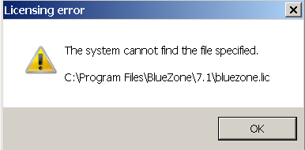
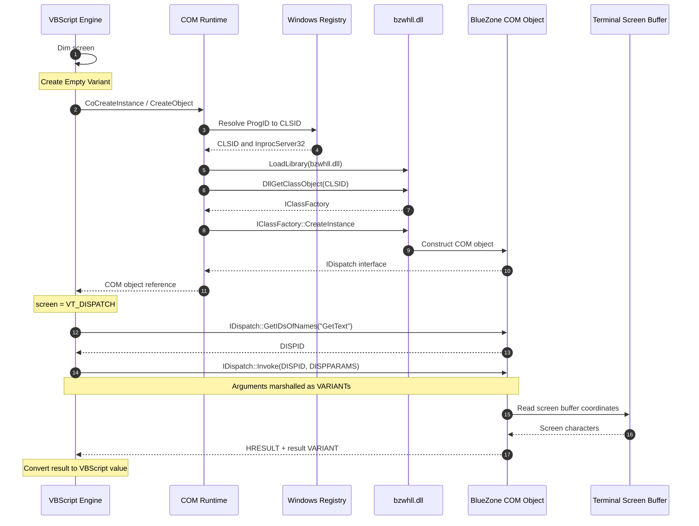
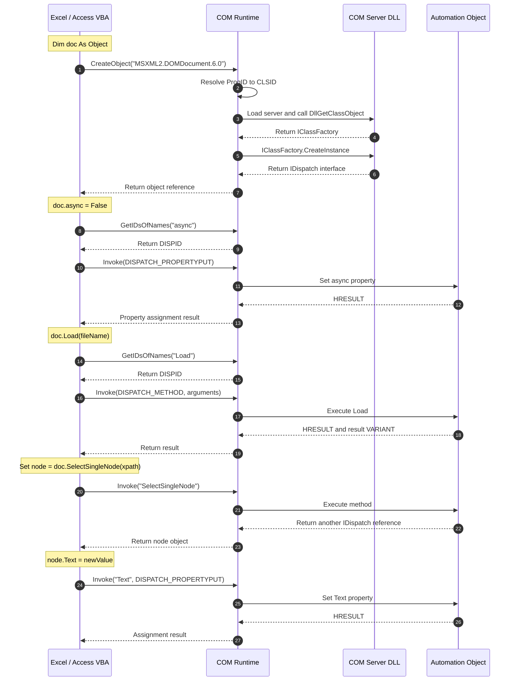
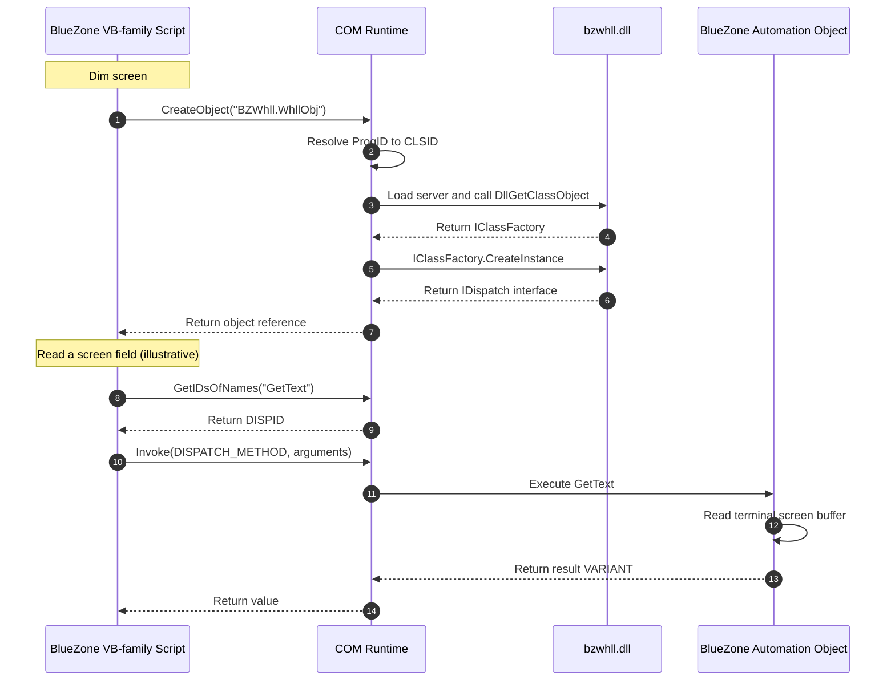
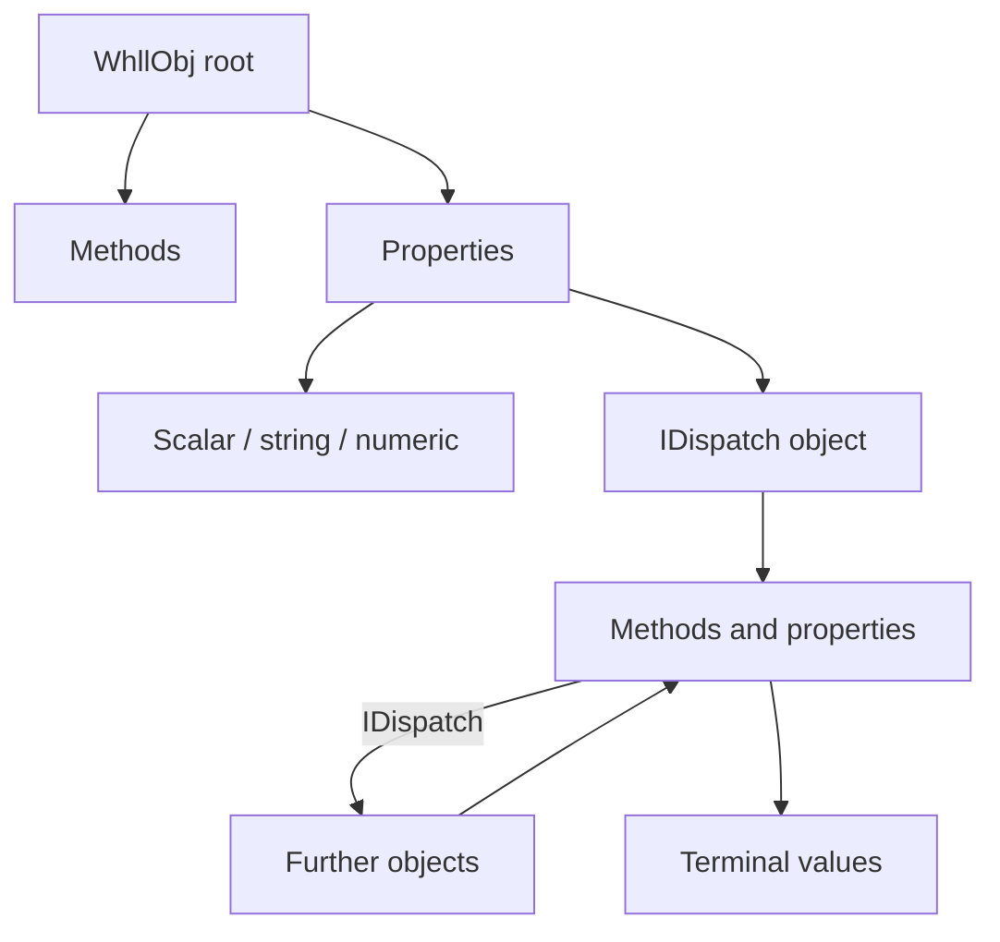

### Info

markets islelf and
> *robust and feature-rich Web-to-host and desktop terminal emulator for IBM mainframes, iSeries, DEC/VT UNIX and Unisys with FTP support apable of emulating 3270, 5250, VT 52/100/220/320/420, SCO-ANSI, HP Character and Block Mode, Unisys, IBM 3151, Linux, VAX/AIX, WYSE60, and Tandem/6530*

One can try to download the official __Rocket__ __Terminal Emulator__ __Free Trial__ directly from the vendor.

The vendor of __BlueZone__, Rocket Software has rebranded the product to
__Rocket Terminal Emulator__, which provides a full-featured, 30-day evaluation period for secure access to
IBM i (TN5250), IBM zSystems (TN3270),
and UNIX (VT) systems.


Every release of the application is provided with the detailed Terminal Emulator documentation:

* Advanced Automation Developer Guide
* Desktop Administrator Guide
* Display and Printer User Guide
* License Manager Administrator Guide
* Secure FTP User Guide
* Security Server Administrator Guide
* Session Manager User Guide
* Web Deployment Manager Administrator Guide
* Web Edition Administrator Guide
* Web Edition User Guide
* Web Edition on Windows Quick Start Guide
* Release Notes

etc. in PDF. The documentation will be generated on demand
e.g. `https://docs-be.rocketsoftware.com/api/pdf/NDC2vPp762-0ol0qykMvGnTSUAu3nEiLpymS21i1fD7XypaX9awNTsTLs2xuGUfn-0r-W_0GXDU=/download?download_token=atqP8W2DLrZrUC0LSTxWBHadEun5tbA7FW6kqxCvZJpR8rjj`


in addition, Rocket TE Desktop offers web-based HTML help (for example, user workflows or reference topics).
By default, Rocket TE Desktop is configured to use the locally installed help file. However, to access and use the help
files,

>NOTE: To access all Rocket Software product documentation, visit the [Rocket Documentation Portal](https://docs.rocketsoftware.com/).


To practice app, one may run it on Windows VM, an tn3270 on Docker joined to same host network and connect on
Trialware Gatekeeping that what it is - Rocket is not really interested in giving one a free 30 day trial


```text

Archive:  BlueZoneDesktop.zip
  Length      Date    Time    Name
---------  ---------- -----   ----
        0  2016-11-30 19:12   Assets/
    24085  2015-12-11 17:24   Assets/background_bluezone_swirl2.png
     3550  2015-12-14 17:45   Assets/rocket_logo_white2.png
        0  2016-11-30 21:35   License Agreements/
    27136  2014-07-17 17:31   License Agreements/Generic Click Terms.doc
     4961  2015-12-15 15:22   readme.htm
        0  2016-11-30 21:35   win32/
    25858  2014-10-01 11:40   win32/0x0407.ini
    22490  2014-10-01 11:41   win32/0x0409.ini
    26268  2014-10-01 11:41   win32/0x040c.ini
    14958  2014-10-01 11:41   win32/0x0411.ini
    24998  2014-10-01 11:43   win32/0x0413.ini
    73728  2017-04-28 11:21   win32/1031.mst
    20480  2017-04-28 11:21   win32/1033.mst
    73728  2017-04-28 11:21   win32/1036.mst
    73728  2017-04-28 11:21   win32/1041.mst
    73728  2017-04-28 11:21   win32/1043.mst
        0  2016-11-30 13:35   win32/API/
        0  2016-11-30 21:35   win32/API/COM/
   680043  2017-01-31 21:35   win32/API/COM/BZWhll.h
     5205  2017-01-31 21:35   win32/API/COM/BZWhll_i.c
        0  2016-11-30 21:35   win32/API/COM/Migration/
   216676  2017-01-31 21:34   win32/API/COM/Migration/BZExtr.h
     3895  2017-01-31 21:34   win32/API/COM/Migration/BZExtr_i.c
   200658  2017-01-31 21:35   win32/API/COM/Migration/BZPcom.h
     3479  2017-01-31 21:35   win32/API/COM/Migration/BZPcom_i.c
   593652  2017-01-31 21:35   win32/API/COM/Migration/BZRefl.h
     4596  2017-01-31 21:35   win32/API/COM/Migration/BZRefl_i.c
        0  2016-11-30 21:35   win32/API/DDE/
    22016  2014-07-11 09:40   win32/API/DDE/BZ_DDE_Samp.doc
    16778  2013-07-11 23:53   win32/API/DDE/BZDDE.H
        0  2016-11-30 21:35   win32/API/HLLAPI/
        0  2016-11-30 21:35   win32/API/HLLAPI/Enhanced/
      542  2014-07-10 23:06   win32/API/HLLAPI/Enhanced/pcshll32.def
    77968  2014-07-12 00:59   win32/API/HLLAPI/Enhanced/pcshll32.dll
    14390  2014-05-17 19:00   win32/API/HLLAPI/Enhanced/pcshll32.h
     4950  2014-07-12 00:59   win32/API/HLLAPI/Enhanced/pcshll32.lib
     6455  2014-11-11 13:18   win32/API/HLLAPI/Whlapi32.def
   167792  2015-11-12 21:07   win32/API/HLLAPI/Whlapi32.dll
    19086  2013-02-20 18:45   win32/API/HLLAPI/Whlapi32.h
    43570  2015-11-12 21:07   win32/API/HLLAPI/Whlapi32.lib
  1243136  2007-03-30 14:53   win32/API/HLLAPI/WOSA HLLAPI 1.1.doc
  3902464  2017-04-28 11:21   win32/BlueZone.msi
   680120  2017-04-28 11:21   win32/bz6530.cab
   849083  2017-04-28 11:21   win32/bzadp.cab
   404020  2017-04-28 11:21   win32/bzalc.cab
   172105  2017-04-28 11:21   win32/bzap.cab
   131639  2017-04-28 11:21   win32/bzextr.cab
   827698  2017-04-28 11:21   win32/bzftp.cab
    65922  2017-04-28 11:21   win32/bzftpext.cab
    98810  2017-04-28 11:21   win32/bzhllapi.cab
  2391419  2017-04-28 11:21   win32/bzkerb.cab
   733041  2017-04-28 11:21   win32/bzmdp.cab
   175145  2017-04-28 11:21   win32/bzmp.cab
   119867  2017-04-28 11:21   win32/bzpcom.cab
   213741  2017-04-28 11:21   win32/bzrefl.cab
  1386667  2017-04-28 11:21   win32/bzsc.cab
   217280  2017-04-28 11:21   win32/bzsm.cab
  1000797  2017-04-28 11:21   win32/bzt27.cab
   135194  2017-04-28 11:21   win32/bztcpip.cab
  1259627  2017-04-28 11:21   win32/bzuts.cab
   761176  2017-04-28 11:21   win32/bzvt.cab
   227960  2017-04-28 11:21   win32/bzwhll.cab
  1118281  2017-04-28 11:21   win32/common.cab
  3550285  2017-04-28 11:21   win32/common2.cab
        0  2016-11-30 21:35   win32/Docs/
  1554600  2017-04-27 16:12   win32/Docs/bluezone.chm
  3464981  2017-04-27 16:13   win32/Docs/bluezone.pdf
   482544  2017-04-27 16:14   win32/Docs/bzadmin.chm
  1793575  2017-04-27 16:15   win32/Docs/bzadmin.pdf
   200226  2017-04-27 16:16   win32/Docs/bzftp.chm
  1035287  2017-04-27 16:17   win32/Docs/bzftp.pdf
   634604  2017-04-27 16:23   win32/Docs/bzsh.chm
  2239853  2017-04-27 16:24   win32/Docs/bzsh.pdf
    70812  2017-04-27 16:15   win32/Docs/bzsm.chm
   696444  2017-04-27 16:16   win32/Docs/bzsm.pdf
     1313  2017-04-28 11:19   win32/global.ini
      159  2013-01-28 07:11   win32/language.ini
        0  2017-04-28 11:22   win32/Patches/
 14367688  2017-04-28 11:22   win32/Patches/BlueZone Patch 7.1.4.2796.exe
  1322536  2017-04-28 11:21   win32/setup.exe
     5593  2017-04-28 11:21   win32/setup.ini
   935127  2017-04-28 11:21   win32/unisys.cab
  1172062  2017-04-28 11:21   win32/web2host.cab
        0  2017-04-28 11:21   win32/Web2Host/
        0  2017-04-28 11:21   win32/Web2Host/msi/
  1635328  2017-04-28 11:20   win32/Web2Host/msi/Bzw2h-win32.msi
        0  2016-11-30 21:35   x64/
    25858  2014-10-01 11:40   x64/0x0407.ini
    22490  2014-10-01 11:41   x64/0x0409.ini
    26268  2014-10-01 11:41   x64/0x040c.ini
    14958  2014-10-01 11:41   x64/0x0411.ini
    24998  2014-10-01 11:43   x64/0x0413.ini
    73728  2017-04-28 11:03   x64/1031.mst
    20480  2017-04-28 11:03   x64/1033.mst
    73728  2017-04-28 11:03   x64/1036.mst
    73728  2017-04-28 11:03   x64/1041.mst
    73728  2017-04-28 11:03   x64/1043.mst
        0  2016-11-30 13:35   x64/API/
        0  2016-11-30 21:35   x64/API/COM/
   680045  2017-01-31 21:27   x64/API/COM/BZWhll.h
     5207  2017-01-31 21:27   x64/API/COM/BZWhll_i.c
        0  2016-11-30 21:35   x64/API/COM/Migration/
   216678  2017-01-31 21:26   x64/API/COM/Migration/BZExtr.h
     3897  2017-01-31 21:26   x64/API/COM/Migration/BZExtr_i.c
   200660  2017-01-31 21:27   x64/API/COM/Migration/BZPcom.h
     3481  2017-01-31 21:27   x64/API/COM/Migration/BZPcom_i.c
   593654  2017-01-31 21:27   x64/API/COM/Migration/BZRefl.h
     4598  2017-01-31 21:27   x64/API/COM/Migration/BZRefl_i.c
        0  2016-11-30 21:35   x64/API/DDE/
    22016  2014-07-11 09:40   x64/API/DDE/BZ_DDE_Samp.doc
    16778  2013-07-11 23:53   x64/API/DDE/BZDDE.H
        0  2016-11-30 21:35   x64/API/HLLAPI/
        0  2016-11-30 21:35   x64/API/HLLAPI/Enhanced/
      542  2014-07-10 23:06   x64/API/HLLAPI/Enhanced/pcshll64.def
    85136  2014-07-12 00:51   x64/API/HLLAPI/Enhanced/pcshll64.dll
    14390  2014-05-17 19:00   x64/API/HLLAPI/Enhanced/pcshll64.h
     4988  2014-07-12 00:51   x64/API/HLLAPI/Enhanced/pcshll64.lib
     6455  2014-11-11 13:18   x64/API/HLLAPI/Whlapi64.def
   164720  2015-11-12 21:03   x64/API/HLLAPI/Whlapi64.dll
    19086  2013-02-20 18:45   x64/API/HLLAPI/Whlapi64.h
    44678  2015-11-12 21:03   x64/API/HLLAPI/Whlapi64.lib
  1243136  2007-03-30 14:53   x64/API/HLLAPI/WOSA HLLAPI 1.1.doc
  3805696  2017-04-28 11:03   x64/BlueZone.msi
   791864  2017-04-28 11:03   x64/bz6530.cab
   993001  2017-04-28 11:03   x64/bzadp.cab
   471668  2017-04-28 11:03   x64/bzalc.cab
   191383  2017-04-28 11:03   x64/bzap.cab
   154157  2017-04-28 11:03   x64/bzextr.cab
   692511  2017-04-28 11:03   x64/bzftp.cab
    70176  2017-04-28 11:03   x64/bzftpext.cab
    92456  2017-04-28 11:03   x64/bzhllapi.cab
  2726341  2017-04-28 11:03   x64/bzkerb.cab
   845651  2017-04-28 11:03   x64/bzmdp.cab
   195151  2017-04-28 11:03   x64/bzmp.cab
   139775  2017-04-28 11:03   x64/bzpcom.cab
   240867  2017-04-28 11:03   x64/bzrefl.cab
  1440695  2017-04-28 11:03   x64/bzsc.cab
   221948  2017-04-28 11:03   x64/bzsm.cab
   145622  2017-04-28 11:03   x64/bztcpip.cab
   870830  2017-04-28 11:03   x64/bzvt.cab
   258532  2017-04-28 11:03   x64/bzwhll.cab
  1168625  2017-04-28 11:03   x64/common.cab
  3556233  2017-04-28 11:03   x64/common2.cab
        0  2016-11-30 21:35   x64/Docs/
  1554600  2017-04-27 16:12   x64/Docs/bluezone.chm
  3464981  2017-04-27 16:13   x64/Docs/bluezone.pdf
   482544  2017-04-27 16:14   x64/Docs/bzadmin.chm
  1793575  2017-04-27 16:15   x64/Docs/bzadmin.pdf
   200226  2017-04-27 16:16   x64/Docs/bzftp.chm
  1035287  2017-04-27 16:17   x64/Docs/bzftp.pdf
   634604  2017-04-27 16:23   x64/Docs/bzsh.chm
  2239853  2017-04-27 16:24   x64/Docs/bzsh.pdf
    70812  2017-04-27 16:15   x64/Docs/bzsm.chm
   696444  2017-04-27 16:16   x64/Docs/bzsm.pdf
     1313  2017-04-28 11:02   x64/global.ini
      159  2013-01-28 17:25   x64/language.ini
        0  2017-04-28 11:04   x64/Patches/
 13947672  2017-04-28 11:04   x64/Patches/BlueZone Patch 7.1.4.2796.exe
  1322536  2017-04-28 11:03   x64/setup.exe
     5608  2017-04-28 11:03   x64/setup.ini
  1436824  2017-04-28 11:03   x64/web2host.cab
        0  2017-04-28 11:03   x64/Web2Host/
        0  2017-04-28 11:03   x64/Web2Host/msi/
  2022400  2017-04-28 11:02   x64/Web2Host/msi/Bzw2h-x64.msi
---------                     -------
109592385                     165 files


```
```text
nzip -ql BlueZone.zip
  Length      Date    Time    Name
---------  ---------- -----   ----
    25860  2012-03-16 14:50   BlueZone Desktop/0x0407.ini
    22492  2010-03-23 16:44   BlueZone Desktop/0x0409.ini
    26270  2010-06-22 14:35   BlueZone Desktop/0x040c.ini
    14960  2012-03-16 12:55   BlueZone Desktop/0x0411.ini
    25000  2010-06-22 14:39   BlueZone Desktop/0x0413.ini
    73728  2014-02-03 20:04   BlueZone Desktop/1031.mst
    20480  2014-02-03 20:04   BlueZone Desktop/1033.mst
    73728  2014-02-03 20:04   BlueZone Desktop/1036.mst
    69632  2014-02-03 20:04   BlueZone Desktop/1041.mst
    69632  2014-02-03 20:04   BlueZone Desktop/1043.mst
        0  2014-02-13 13:16   BlueZone Desktop/Assets/
     3452  2012-02-09 14:00   BlueZone Desktop/Assets/rocket_bluezone_logo.png
     2104  2012-02-09 14:00   BlueZone Desktop/Assets/top_nav.gif
  3259392  2014-02-03 20:04   BlueZone Desktop/BlueZone.msi
   984676  2014-02-03 20:04   BlueZone Desktop/bzadp.cab
   160733  2014-02-03 20:04   BlueZone Desktop/bzap.cab
   834464  2014-02-03 20:04   BlueZone Desktop/bzftp.cab
   190608  2014-02-03 20:04   BlueZone Desktop/bzhllapi.cab
   380019  2014-02-03 20:04   BlueZone Desktop/bzicl.cab
   757967  2014-02-03 20:04   BlueZone Desktop/bzmdp.cab
   164807  2014-02-03 20:04   BlueZone Desktop/bzmp.cab
  1461866  2014-02-03 20:04   BlueZone Desktop/bzsc.cab
   226370  2014-02-03 20:04   BlueZone Desktop/bzsm.cab
   128439  2014-02-03 20:04   BlueZone Desktop/bztcpip.cab
   753139  2014-02-03 20:04   BlueZone Desktop/bzvt.cab
   235956  2014-02-03 20:04   BlueZone Desktop/bzwhll.cab
  1379392  2014-02-03 20:04   BlueZone Desktop/common.cab
  4101171  2014-02-03 20:04   BlueZone Desktop/common2.cab
        0  2014-02-13 13:16   BlueZone Desktop/Docs/
  1405792  2014-01-13 15:08   BlueZone Desktop/Docs/bluezone.chm
  7622527  2014-01-13 14:56   BlueZone Desktop/Docs/bluezone.pdf
   539893  2013-08-20 08:37   BlueZone Desktop/Docs/bzadmin.chm
  3112355  2013-08-08 10:00   BlueZone Desktop/Docs/bzadmin.pdf
   229245  2012-09-14 09:31   BlueZone Desktop/Docs/bzftp.chm
  1242707  2012-09-14 09:29   BlueZone Desktop/Docs/bzftp.pdf
   621173  2013-02-04 10:33   BlueZone Desktop/Docs/bzsh.chm
  3528188  2013-02-04 10:30   BlueZone Desktop/Docs/bzsh.pdf
    84867  2012-09-11 14:53   BlueZone Desktop/Docs/bzsm.chm
   576083  2012-09-11 14:53   BlueZone Desktop/Docs/bzsm.pdf
     1013  2014-02-03 20:03   BlueZone Desktop/global.ini
        0  2014-02-13 13:16   BlueZone Desktop/Kerberos/
  1617231  2014-02-03 20:04   BlueZone Desktop/Kerberos/bzkerb.cab
      159  2011-11-14 11:15   BlueZone Desktop/language.ini
        0  2014-02-13 13:16   BlueZone Desktop/Patches/
 19225232  2014-02-03 20:05   BlueZone Desktop/Patches/BlueZone Patch 6.1.5.2080.exe
     3008  2012-02-09 14:00   BlueZone Desktop/readme.htm
  1227912  2014-02-03 20:04   BlueZone Desktop/setup.exe
     5593  2014-02-03 20:04   BlueZone Desktop/setup.ini
        0  2014-02-13 13:16   BlueZone Desktop/Unisys/
  1447200  2014-02-03 20:04   BlueZone Desktop/Unisys/bzt27.cab
  1653436  2014-02-03 20:04   BlueZone Desktop/Unisys/bzuts.cab
  1073087  2014-02-03 20:04   BlueZone Desktop/Unisys/unisys.cab
        0  2014-02-13 13:16   BlueZone Desktop/Web2Host/
        0  2014-02-13 13:16   BlueZone Desktop/Web2Host/msi/
   957952  2014-02-03 20:03   BlueZone Desktop/Web2Host/msi/Web2Host.msi
   585053  2014-02-03 20:04   BlueZone Desktop/Web2Host/web2host.cab
---------                     -------
 62206043                     56 files


```
sample
```vb
' construct BlueZone Host Automation Object (BZHAO)
Set bzo = CreateObject("BZWhll.WhllObj")

SessName = bzo.NewSession("myProfile.zmd")
bzo.Connect SessName

bzo.SendKey "logon username<Enter>"
bzo.WaitReady 10, 0

bzo.ReadScreen myData, Length, Row, Column
MsgBox myData

```
```powershell

$progId = 'BZWhll.WhllObj'

$clsid = (Get-ItemProperty `
  "Registry::HKEY_CLASSES_ROOT\$progId\CLSID" `
  -ErrorAction Stop).'(default)'

$clsid

Get-ItemProperty `
  "Registry::HKEY_CLASSES_ROOT\CLSID\$clsid\InprocServer32" `
  -ErrorAction SilentlyContinue

Get-ItemProperty `
  "Registry::HKEY_CLASSES_ROOT\CLSID\$clsid\LocalServer32" `
  -ErrorAction SilentlyContinue

```
|Technology|Purpose|
|Host Automation Object (BZHAO)|COM API for controlling sessions and exchanging data with the host|
|BlueZone Basic|Vendor-provided scripting language, compatible with a substantial subset of VBA and VBScript|
|BlueZone Plus VBA|Optional integration of Microsoft's VBA development environment into the emulator|


Rocket's older BlueZone documentation explicitly identifies BlueZone VBA as an additional-cost installation option. Its newer Advanced Automation guide retains the distinction between the scripting environment and the COM automation object.


There is also HLLAPI, a different integration mechanism commonly used by legacy terminal automation tools. BlueZone's documented HLLAPI DLL is WHLAPI32.dll, with hllapi as its entry point

### Installed

Windows 7 Registry entries added by installing (bulk, partial dump - see `Bluezone_reg.txt`):

```text
[HKEY_LOCAL_MACHINE\SOFTWARE\Classes\BlueZone.System]
@="WhllObj Class"

[HKEY_LOCAL_MACHINE\SOFTWARE\Classes\BlueZone.System\CLSID]
@="{4EB971C3-01D0-11D5-903D-00105AABADD3}"

[HKEY_LOCAL_MACHINE\SOFTWARE\Classes\BlueZone.System.7.1]
@="WhllObj Class"

[HKEY_LOCAL_MACHINE\SOFTWARE\Classes\BlueZone.System.7.1\CLSID]
@="{4EB971C3-01D0-11D5-903D-00105AABADD3}"

[HKEY_LOCAL_MACHINE\SOFTWARE\Classes\BlueZoneFTP.ShellExtension]
@="ShellExtension Class"

[HKEY_LOCAL_MACHINE\SOFTWARE\Classes\BlueZoneFTP.ShellExtension\CLSID]
@="{6C1A71B3-9F55-11D4-873F-00E0B816AA07}"

[HKEY_LOCAL_MACHINE\SOFTWARE\Classes\BlueZoneFTP.ShellExtension.7.1]
@="ShellExtension Class"

[HKEY_LOCAL_MACHINE\SOFTWARE\Classes\BlueZoneFTP.ShellExtension.7.1\CLSID]
@="{6C1A71B3-9F55-11D4-873F-00E0B816AA07}"

[HKEY_LOCAL_MACHINE\SOFTWARE\Classes\BZWhll.WhllObj]
@="WhllObj Class"

[HKEY_LOCAL_MACHINE\SOFTWARE\Classes\BZWhll.WhllObj\CLSID]
@="{4EB971C3-00D0-11D5-903D-00105AABADD3}"

[HKEY_LOCAL_MACHINE\SOFTWARE\Classes\BZWhll.WhllObj.7.1]
@="WhllObj Class"

[HKEY_LOCAL_MACHINE\SOFTWARE\Classes\BZWhll.WhllObj.7.1\CLSID]
@="{4EB971C3-00D0-11D5-903D-00105AABADD3}"

[HKEY_LOCAL_MACHINE\SOFTWARE\Classes\CLSID\{0d0871b4-00c9-4a21-85c5-b7d1e4ef8261}]
@="AutPS Class"

[HKEY_LOCAL_MACHINE\SOFTWARE\Classes\CLSID\{0d0871b4-00c9-4a21-85c5-b7d1e4ef8261}\InprocServer32]
@="C:\\Program Files\\BlueZone\\7.1\\bzwhll.dll"
"ThreadingModel"="both"

[HKEY_LOCAL_MACHINE\SOFTWARE\Classes\CLSID\{0d0871b4-03c9-4a21-85c5-b7d1e4ef8261}]
@="AutPS Class"

[HKEY_LOCAL_MACHINE\SOFTWARE\Classes\CLSID\{0d0871b4-03c9-4a21-85c5-b7d1e4ef8261}\InprocServer32]
@="C:\\Program Files\\BlueZone\\7.1\\BZPcom.dll"
"ThreadingModel"="both"

[HKEY_LOCAL_MACHINE\SOFTWARE\Classes\CLSID\{0EB971C3-A2D0-11D5-903D-10105AABADD3}]
@="LIPI Class"

[HKEY_LOCAL_MACHINE\SOFTWARE\Classes\CLSID\{0EB971C3-A2D0-11D5-903D-10105AABADD3}\InprocServer32]
@="C:\\Program Files\\BlueZone\\7.1\\bzlipiobj.dll"
"ThreadingModel"="both"

[HKEY_LOCAL_MACHINE\SOFTWARE\Classes\CLSID\{0EB971C3-A2D0-11D5-903D-10105AABADD3}\ProgID]
@="BlueZone.LIPI.7.1"

[HKEY_LOCAL_MACHINE\SOFTWARE\Classes\CLSID\{0EB971C3-A2D0-11D5-903D-10105AABADD3}\VersionIndependentProgID]
@="BlueZone.LIPI"

[HKEY_LOCAL_MACHINE\SOFTWARE\Classes\CLSID\{0EB971C3-A2D0-11D5-903D-20105AABADD3}]
@="Fields Class"

[HKEY_LOCAL_MACHINE\SOFTWARE\Classes\CLSID\{0EB971C3-A2D0-11D5-903D-20105AABADD3}\InprocServer32]
@="C:\\Program Files\\BlueZone\\7.1\\bzlipiobj.dll"
"ThreadingModel"="both"

[HKEY_LOCAL_MACHINE\SOFTWARE\Classes\CLSID\{0FB971C2-003C-11D5-903D-00105AABADD3}]
@="Field Class"

[HKEY_LOCAL_MACHINE\SOFTWARE\Classes\CLSID\{0FB971C2-003C-11D5-903D-00105AABADD3}\InprocServer32]
@="C:\\Program Files\\BlueZone\\7.1\\bzwhll.dll"
"ThreadingModel"="both"

[HKEY_LOCAL_MACHINE\SOFTWARE\Classes\CLSID\{0FB971C2-013C-11D5-903D-00105AABADD3}]
@="Field Class"

[HKEY_LOCAL_MACHINE\SOFTWARE\Classes\CLSID\{0FB971C2-013C-11D5-903D-00105AABADD3}\InprocServer32]
@="C:\\Program Files\\BlueZone\\7.1\\BZExtr.dll"
"ThreadingModel"="both"

[HKEY_LOCAL_MACHINE\SOFTWARE\Classes\CLSID\{0FB971C2-023C-11D5-903D-00105AABADD3}]
@="Field Class"

[HKEY_LOCAL_MACHINE\SOFTWARE\Classes\CLSID\{0FB971C2-023C-11D5-903D-00105AABADD3}\InprocServer32]
@="C:\\Program Files\\BlueZone\\7.1\\BZRefl.dll"
"ThreadingModel"="both"

[HKEY_LOCAL_MACHINE\SOFTWARE\Classes\CLSID\{0FB971C2-033C-11D5-903D-00105AABADD3}]
@="Field Class"

[HKEY_LOCAL_MACHINE\SOFTWARE\Classes\CLSID\{0FB971C2-033C-11D5-903D-00105AABADD3}\InprocServer32]
@="C:\\Program Files\\BlueZone\\7.1\\BZPcom.dll"
"ThreadingModel"="both"

[HKEY_LOCAL_MACHINE\SOFTWARE\Classes\CLSID\{128c7123-f37f-4034-b078-abe78f23e5c2}]
@="View Class"

[HKEY_LOCAL_MACHINE\SOFTWARE\Classes\CLSID\{128c7123-f37f-4034-b078-abe78f23e5c2}\InprocServer32]
@="C:\\Program Files\\BlueZone\\7.1\\BZRefl.dll"
"ThreadingModel"="both"

[HKEY_LOCAL_MACHINE\SOFTWARE\Classes\CLSID\{2d9971f9-978b-4ee3-8cdd-470f617509d8}]
@="IbmScreen Class"

[HKEY_LOCAL_MACHINE\SOFTWARE\Classes\CLSID\{2d9971f9-978b-4ee3-8cdd-470f617509d8}\InprocServer32]
@="C:\\Program Files\\BlueZone\\7.1\\BZRefl.dll"
"ThreadingModel"="both"

[HKEY_LOCAL_MACHINE\SOFTWARE\Classes\CLSID\{2F887196-0015-426D-A582-F3BCF749E9C1}]
@="Vector Class"

[HKEY_LOCAL_MACHINE\SOFTWARE\Classes\CLSID\{2F887196-0015-426D-A582-F3BCF749E9C1}\InprocServer32]
@="C:\\Program Files\\BlueZone\\7.1\\bzwhll.dll"
"ThreadingModel"="both"

[HKEY_LOCAL_MACHINE\SOFTWARE\Classes\CLSID\{2F887196-0215-426D-A582-F3BCF749E9C1}]
@="Vector Class"

[HKEY_LOCAL_MACHINE\SOFTWARE\Classes\CLSID\{2F887196-0215-426D-A582-F3BCF749E9C1}\InprocServer32]
@="C:\\Program Files\\BlueZone\\7.1\\BZRefl.dll"
"ThreadingModel"="both"

[HKEY_LOCAL_MACHINE\SOFTWARE\Classes\CLSID\{449B2A22-B7BF-4846-BEEA-4A00D610B75F}]
@="FtpSession Class"

[HKEY_LOCAL_MACHINE\SOFTWARE\Classes\CLSID\{449B2A22-B7BF-4846-BEEA-4A00D610B75F}\InprocServer32]
@="C:\\Program Files\\BlueZone\\7.1\\Ftpcom.dll"
"ThreadingModel"="Apartment"

[HKEY_LOCAL_MACHINE\SOFTWARE\Classes\CLSID\{449B2A22-B7BF-4846-BEEA-4A00D610B75F}\ProgID]
@="RocketFTP.FtpSession.1"

[HKEY_LOCAL_MACHINE\SOFTWARE\Classes\CLSID\{449B2A22-B7BF-4846-BEEA-4A00D610B75F}\Programmable]

[HKEY_LOCAL_MACHINE\SOFTWARE\Classes\CLSID\{449B2A22-B7BF-4846-BEEA-4A00D610B75F}\TypeLib]
@="{A382E7D7-7939-4077-ABA8-DEFB0B8466C4}"

[HKEY_LOCAL_MACHINE\SOFTWARE\Classes\CLSID\{449B2A22-B7BF-4846-BEEA-4A00D610B75F}\VersionIndependentProgID]
@="RocketFTP.FtpSession"

[HKEY_LOCAL_MACHINE\SOFTWARE\Classes\CLSID\{4EB971C3-00D0-11D5-903D-00105AABADD3}]
@="WhllObj Class"

[HKEY_LOCAL_MACHINE\SOFTWARE\Classes\CLSID\{4EB971C3-00D0-11D5-903D-00105AABADD3}\InprocServer32]
@="C:\\Program Files\\BlueZone\\7.1\\bzwhll.dll"
"ThreadingModel"="both"

[HKEY_LOCAL_MACHINE\SOFTWARE\Classes\CLSID\{4EB971C3-00D0-11D5-903D-00105AABADD3}\ProgID]
@="BZWhll.WhllObj.7.1"

[HKEY_LOCAL_MACHINE\SOFTWARE\Classes\CLSID\{4EB971C3-00D0-11D5-903D-00105AABADD3}\VersionIndependentProgID]
@="BZWhll.WhllObj"

[HKEY_LOCAL_MACHINE\SOFTWARE\Classes\CLSID\{4EB971C3-01D0-11D5-903D-00105AABADD3}]
@="WhllObj Class"

[HKEY_LOCAL_MACHINE\SOFTWARE\Classes\CLSID\{4EB971C3-01D0-11D5-903D-00105AABADD3}\InprocServer32]
@="C:\\Program Files\\BlueZone\\7.1\\BZExtr.dll"
"ThreadingModel"="both"

[HKEY_LOCAL_MACHINE\SOFTWARE\Classes\CLSID\{4EB971C3-01D0-11D5-903D-00105AABADD3}\ProgID]
@="BlueZone.System.7.1"

[HKEY_LOCAL_MACHINE\SOFTWARE\Classes\CLSID\{4EB971C3-01D0-11D5-903D-00105AABADD3}\VersionIndependentProgID]
@="BlueZone.System"

[HKEY_LOCAL_MACHINE\SOFTWARE\Classes\CLSID\{4EB971C3-02D0-11D5-903D-00105AABADD3}]
@="WhllObj Class"

[HKEY_LOCAL_MACHINE\SOFTWARE\Classes\CLSID\{4EB971C3-02D0-11D5-903D-00105AABADD3}\InprocServer32]
@="C:\\Program Files\\BlueZone\\7.1\\BZRefl.dll"
"ThreadingModel"="both"

[HKEY_LOCAL_MACHINE\SOFTWARE\Classes\CLSID\{4EB971C3-02D0-11D5-903D-00105AABADD3}\ProgID]
@="BlueZone.Application.7.1"

[HKEY_LOCAL_MACHINE\SOFTWARE\Classes\CLSID\{4EB971C3-02D0-11D5-903D-00105AABADD3}\VersionIndependentProgID]
@="BlueZone.Application"

[HKEY_LOCAL_MACHINE\SOFTWARE\Classes\CLSID\{4EB971C3-03D0-11D5-903D-00105AABADD3}]
@="WhllObj Class"

[HKEY_LOCAL_MACHINE\SOFTWARE\Classes\CLSID\{4EB971C3-03D0-11D5-903D-00105AABADD3}\InprocServer32]
@="C:\\Program Files\\BlueZone\\7.1\\BZPcom.dll"
"ThreadingModel"="both"

[HKEY_LOCAL_MACHINE\SOFTWARE\Classes\CLSID\{4EB971C3-03D0-11D5-903D-00105AABADD3}\ProgID]
@="BlueZone.autECL.7.1"

[HKEY_LOCAL_MACHINE\SOFTWARE\Classes\CLSID\{4EB971C3-03D0-11D5-903D-00105AABADD3}\VersionIndependentProgID]
@="BlueZone.autECL"

[HKEY_LOCAL_MACHINE\SOFTWARE\Classes\CLSID\{4F147161-00F0-11D6-903D-00105AABADD3}]
@="Sessions Class"

[HKEY_LOCAL_MACHINE\SOFTWARE\Classes\CLSID\{4F147161-00F0-11D6-903D-00105AABADD3}\InprocServer32]
@="C:\\Program Files\\BlueZone\\7.1\\bzwhll.dll"
"ThreadingModel"="both"

[HKEY_LOCAL_MACHINE\SOFTWARE\Classes\CLSID\{4F147161-01F0-11D6-903D-00105AABADD3}]
@="Sessions Class"

[HKEY_LOCAL_MACHINE\SOFTWARE\Classes\CLSID\{4F147161-01F0-11D6-903D-00105AABADD3}\InprocServer32]
@="C:\\Program Files\\BlueZone\\7.1\\BZExtr.dll"
"ThreadingModel"="both"

[HKEY_LOCAL_MACHINE\SOFTWARE\Classes\CLSID\{5061712a-00a5-45e2-90b8-4584b196c7dd}]
@="AutConnInfo Class"

[HKEY_LOCAL_MACHINE\SOFTWARE\Classes\CLSID\{5061712a-00a5-45e2-90b8-4584b196c7dd}\InprocServer32]
@="C:\\Program Files\\BlueZone\\7.1\\bzwhll.dll"
"ThreadingModel"="both"

[HKEY_LOCAL_MACHINE\SOFTWARE\Classes\CLSID\{5061712a-03a5-45e2-90b8-4584b196c7dd}]
@="AutConnInfo Class"

[HKEY_LOCAL_MACHINE\SOFTWARE\Classes\CLSID\{5061712a-03a5-45e2-90b8-4584b196c7dd}\InprocServer32]
@="C:\\Program Files\\BlueZone\\7.1\\BZPcom.dll"
"ThreadingModel"="both"

[HKEY_LOCAL_MACHINE\SOFTWARE\Classes\CLSID\{51A37181-00F0-11D6-903D-00105AABADD3}]
@="Session Class"

[HKEY_LOCAL_MACHINE\SOFTWARE\Classes\CLSID\{51A37181-00F0-11D6-903D-00105AABADD3}\InprocServer32]
@="C:\\Program Files\\BlueZone\\7.1\\bzwhll.dll"
"ThreadingModel"="both"

[HKEY_LOCAL_MACHINE\SOFTWARE\Classes\CLSID\{51A37181-01F0-11D6-903D-00105AABADD3}]
@="Session Class"

[HKEY_LOCAL_MACHINE\SOFTWARE\Classes\CLSID\{51A37181-01F0-11D6-903D-00105AABADD3}\InprocServer32]
@="C:\\Program Files\\BlueZone\\7.1\\BZExtr.dll"
"ThreadingModel"="both"

[HKEY_LOCAL_MACHINE\SOFTWARE\Classes\CLSID\{56B57161-00F0-11D6-903D-00105AABADD3}]
@="OIA Class"

[HKEY_LOCAL_MACHINE\SOFTWARE\Classes\CLSID\{56B57161-00F0-11D6-903D-00105AABADD3}\InprocServer32]
@="C:\\Program Files\\BlueZone\\7.1\\bzwhll.dll"
"ThreadingModel"="both"

[HKEY_LOCAL_MACHINE\SOFTWARE\Classes\CLSID\{56B57161-01F0-11D6-903D-00105AABADD3}]
@="OIA Class"

[HKEY_LOCAL_MACHINE\SOFTWARE\Classes\CLSID\{56B57161-01F0-11D6-903D-00105AABADD3}\InprocServer32]
@="C:\\Program Files\\BlueZone\\7.1\\BZExtr.dll"
"ThreadingModel"="both"

[HKEY_LOCAL_MACHINE\SOFTWARE\Classes\CLSID\{6C1A71B3-9F55-11D4-873F-00E0B816AA07}]
@="ShellExtension Class"

[HKEY_LOCAL_MACHINE\SOFTWARE\Classes\CLSID\{6C1A71B3-9F55-11D4-873F-00E0B816AA07}\InprocServer32]
@="C:\\Program Files\\BlueZone\\7.1\\bzftp.dll"
"ThreadingModel"="Apartment"

[HKEY_LOCAL_MACHINE\SOFTWARE\Classes\CLSID\{6C1A71B3-9F55-11D4-873F-00E0B816AA07}\ProgID]
@="BlueZoneFTP.ShellExtension.7.1"

[HKEY_LOCAL_MACHINE\SOFTWARE\Classes\CLSID\{6C1A71B3-9F55-11D4-873F-00E0B816AA07}\VersionIndependentProgID]
@="BlueZoneFTP.ShellExtension"

[HKEY_LOCAL_MACHINE\SOFTWARE\Classes\CLSID\{72227143-00F2-4CC7-938F-8B610DB93AB1}]
@="Area Class"

[HKEY_LOCAL_MACHINE\SOFTWARE\Classes\CLSID\{72227143-00F2-4CC7-938F-8B610DB93AB1}\InprocServer32]
@="C:\\Program Files\\BlueZone\\7.1\\bzwhll.dll"
"ThreadingModel"="both"

[HKEY_LOCAL_MACHINE\SOFTWARE\Classes\CLSID\{72227143-01F2-4CC7-938F-8B610DB93AB1}]
@="Area Class"

[HKEY_LOCAL_MACHINE\SOFTWARE\Classes\CLSID\{72227143-01F2-4CC7-938F-8B610DB93AB1}\InprocServer32]
@="C:\\Program Files\\BlueZone\\7.1\\BZExtr.dll"
"ThreadingModel"="both"

[HKEY_LOCAL_MACHINE\SOFTWARE\Classes\CLSID\{78A471A2-000D-11D5-903D-00105AABADD3}]
@="EmuWnd Class"

[HKEY_LOCAL_MACHINE\SOFTWARE\Classes\CLSID\{78A471A2-000D-11D5-903D-00105AABADD3}\InprocServer32]
@="C:\\Program Files\\BlueZone\\7.1\\bzwhll.dll"
"ThreadingModel"="both"

[HKEY_LOCAL_MACHINE\SOFTWARE\Classes\CLSID\{78A471A2-010D-11D5-903D-00105AABADD3}]
@="EmuWnd Class"

[HKEY_LOCAL_MACHINE\SOFTWARE\Classes\CLSID\{78A471A2-010D-11D5-903D-00105AABADD3}\InprocServer32]
@="C:\\Program Files\\BlueZone\\7.1\\BZExtr.dll"
"ThreadingModel"="both"

[HKEY_LOCAL_MACHINE\SOFTWARE\Classes\CLSID\{78A471A2-020D-11D5-903D-00105AABADD3}]
@="EmuWnd Class"

[HKEY_LOCAL_MACHINE\SOFTWARE\Classes\CLSID\{78A471A2-020D-11D5-903D-00105AABADD3}\InprocServer32]
@="C:\\Program Files\\BlueZone\\7.1\\BZRefl.dll"
"ThreadingModel"="both"

[HKEY_LOCAL_MACHINE\SOFTWARE\Classes\CLSID\{78A471A2-030D-11D5-903D-00105AABADD3}]
@="EmuWnd Class"

[HKEY_LOCAL_MACHINE\SOFTWARE\Classes\CLSID\{78A471A2-030D-11D5-903D-00105AABADD3}\InprocServer32]
@="C:\\Program Files\\BlueZone\\7.1\\BZPcom.dll"
"ThreadingModel"="both"

[HKEY_LOCAL_MACHINE\SOFTWARE\Classes\CLSID\{7d2371fb-7d16-44e3-9cfc-4800aa45daf8}]
@="Terminal Class"

[HKEY_LOCAL_MACHINE\SOFTWARE\Classes\CLSID\{7d2371fb-7d16-44e3-9cfc-4800aa45daf8}\InprocServer32]
@="C:\\Program Files\\BlueZone\\7.1\\BZRefl.dll"
"ThreadingModel"="both"

[HKEY_LOCAL_MACHINE\SOFTWARE\Classes\CLSID\{9a4571e5-599e-4f98-a494-989480d88b29}]
@="IbmTerminal Class"

[HKEY_LOCAL_MACHINE\SOFTWARE\Classes\CLSID\{9a4571e5-599e-4f98-a494-989480d88b29}\InprocServer32]
@="C:\\Program Files\\BlueZone\\7.1\\BZRefl.dll"
"ThreadingModel"="both"

[HKEY_LOCAL_MACHINE\SOFTWARE\Classes\CLSID\{b3d47113-003b-4d4a-be78-bbae5f55f6ff}]
@="AutConnList Class"

[HKEY_LOCAL_MACHINE\SOFTWARE\Classes\CLSID\{b3d47113-003b-4d4a-be78-bbae5f55f6ff}\InprocServer32]
@="C:\\Program Files\\BlueZone\\7.1\\bzwhll.dll"
"ThreadingModel"="both"

[HKEY_LOCAL_MACHINE\SOFTWARE\Classes\CLSID\{b3d47113-033b-4d4a-be78-bbae5f55f6ff}]
@="AutConnList Class"

[HKEY_LOCAL_MACHINE\SOFTWARE\Classes\CLSID\{b3d47113-033b-4d4a-be78-bbae5f55f6ff}\InprocServer32]
@="C:\\Program Files\\BlueZone\\7.1\\BZPcom.dll"
"ThreadingModel"="both"

[HKEY_LOCAL_MACHINE\SOFTWARE\Classes\CLSID\{b83471c9-0091-483b-96ab-4849e192d37c}]
@="AutSess Class"

[HKEY_LOCAL_MACHINE\SOFTWARE\Classes\CLSID\{b83471c9-0091-483b-96ab-4849e192d37c}\InprocServer32]
@="C:\\Program Files\\BlueZone\\7.1\\bzwhll.dll"
"ThreadingModel"="both"

[HKEY_LOCAL_MACHINE\SOFTWARE\Classes\CLSID\{b83471c9-0391-483b-96ab-4849e192d37c}]
@="AutSess Class"

[HKEY_LOCAL_MACHINE\SOFTWARE\Classes\CLSID\{b83471c9-0391-483b-96ab-4849e192d37c}\InprocServer32]
@="C:\\Program Files\\BlueZone\\7.1\\BZPcom.dll"
"ThreadingModel"="both"

[HKEY_LOCAL_MACHINE\SOFTWARE\Classes\CLSID\{B84271C1-0030-4DF7-B5B0-68E03729E24D}]
@="QuickPad Class"

[HKEY_LOCAL_MACHINE\SOFTWARE\Classes\CLSID\{B84271C1-0030-4DF7-B5B0-68E03729E24D}\InprocServer32]
@="C:\\Program Files\\BlueZone\\7.1\\bzwhll.dll"
"ThreadingModel"="both"

[HKEY_LOCAL_MACHINE\SOFTWARE\Classes\CLSID\{B84271C1-0130-4DF7-B5B0-68E03729E24D}]
@="QuickPad Class"

[HKEY_LOCAL_MACHINE\SOFTWARE\Classes\CLSID\{B84271C1-0130-4DF7-B5B0-68E03729E24D}\InprocServer32]
@="C:\\Program Files\\BlueZone\\7.1\\BZExtr.dll"
"ThreadingModel"="both"

[HKEY_LOCAL_MACHINE\SOFTWARE\Classes\CLSID\{BEAD717E-00E3-4EC0-AB7C-EB8D5166EEC8}]
@="QuickPads Class"

[HKEY_LOCAL_MACHINE\SOFTWARE\Classes\CLSID\{BEAD717E-00E3-4EC0-AB7C-EB8D5166EEC8}\InprocServer32]
@="C:\\Program Files\\BlueZone\\7.1\\bzwhll.dll"
"ThreadingModel"="both"

[HKEY_LOCAL_MACHINE\SOFTWARE\Classes\CLSID\{BEAD717E-01E3-4EC0-AB7C-EB8D5166EEC8}]
@="QuickPads Class"

[HKEY_LOCAL_MACHINE\SOFTWARE\Classes\CLSID\{BEAD717E-01E3-4EC0-AB7C-EB8D5166EEC8}\InprocServer32]
@="C:\\Program Files\\BlueZone\\7.1\\BZExtr.dll"
"ThreadingModel"="both"

[HKEY_LOCAL_MACHINE\SOFTWARE\Classes\CLSID\{c6aa7169-2323-4427-aca3-18afec1a890e}]
@="Screen Class"

[HKEY_LOCAL_MACHINE\SOFTWARE\Classes\CLSID\{c6aa7169-2323-4427-aca3-18afec1a890e}\InprocServer32]
@="C:\\Program Files\\BlueZone\\7.1\\BZRefl.dll"
"ThreadingModel"="both"

[HKEY_LOCAL_MACHINE\SOFTWARE\Classes\CLSID\{db0971c2-0019-4152-91cf-41f9d63dc8a9}]
@="AutOIA Class"

[HKEY_LOCAL_MACHINE\SOFTWARE\Classes\CLSID\{db0971c2-0019-4152-91cf-41f9d63dc8a9}\InprocServer32]
@="C:\\Program Files\\BlueZone\\7.1\\bzwhll.dll"
"ThreadingModel"="both"

[HKEY_LOCAL_MACHINE\SOFTWARE\Classes\CLSID\{db0971c2-0319-4152-91cf-41f9d63dc8a9}]
@="AutOIA Class"

[HKEY_LOCAL_MACHINE\SOFTWARE\Classes\CLSID\{db0971c2-0319-4152-91cf-41f9d63dc8a9}\InprocServer32]
@="C:\\Program Files\\BlueZone\\7.1\\BZPcom.dll"
"ThreadingModel"="both"

[HKEY_LOCAL_MACHINE\SOFTWARE\Classes\CLSID\{f526710f-55e4-4b20-aeab-df145198594f}]
@="Frame Class"

[HKEY_LOCAL_MACHINE\SOFTWARE\Classes\CLSID\{f526710f-55e4-4b20-aeab-df145198594f}\InprocServer32]
@="C:\\Program Files\\BlueZone\\7.1\\BZRefl.dll"
"ThreadingModel"="both"

[HKEY_LOCAL_MACHINE\SOFTWARE\Classes\Directory\shellex\ContextMenuHandlers\BlueZoneFTP.7.1]
@="{6C1A71B3-9F55-11D4-873F-00E0B816AA07}"
```
contents of compiled help file (500+ files and directories):
```cmd
/c/Program\ Files/7-Zip/7z.exe x BlueZone.chm
```
Files of interest:

|Help topic|What it may establish|
|----------|---------------------|
|`bzdp_hcon_bz-host-automation-object.htm`|The BlueZone Host Automation Object (BHAO/BZHAO) and its object model|
|`bzdp_hcon_ole-automation.htm`|The broader OLE Automation integration mechanism|
|`bzdp_hcon_bz-plus-vba.htm`|VBA integration and its prerequisites|
|`bzdp_href_api-properties-mainframe.htm`|API properties specific to mainframe sessions|
|`bzdp_href_api-properties-iseries.htm`|API properties specific to IBM i sessions|
|`bzdp_href_bz-scripts.htm`|The scripting interface and its capabilities|
|`bzdp_href_script-events.htm`|Events available to scripts|
|`bzdp_href_bz-hllapi-support-mainframe.htm`|HLLAPI support for mainframe sessions|
|`bzdp_hcon_bz-script-editor.htm`|The built-in script editor|

Technical Files( illustrating the specifics of package):
```text
asic-bluezone/bluezone_reg.txt
 create mode 100644 basic-bluezone/help/#IDXHDR
 create mode 100644 basic-bluezone/help/#ITBITS
 create mode 100644 basic-bluezone/help/#STRINGS
 create mode 100644 basic-bluezone/help/#SYSTEM
 create mode 100644 basic-bluezone/help/#TOPICS
 create mode 100644 basic-bluezone/help/#URLSTR
 create mode 100644 basic-bluezone/help/#URLTBL
 create mode 100644 basic-bluezone/help/#WINDOWS
 create mode 100644 basic-bluezone/help/$FIftiMain
 create mode 100644 basic-bluezone/help/$OBJINST
 create mode 100644 basic-bluezone/help/$WWAssociativeLinks/Property
 create mode 100644 basic-bluezone/help/$WWKeywordLinks/BTree
 create mode 100644 basic-bluezone/help/$WWKeywordLinks/Data
 create mode 100644 basic-bluezone/help/$WWKeywordLinks/Map
 create mode 100644 basic-bluezone/help/$WWKeywordLinks/Property
 create mode 100644 basic-bluezone/help/bluezone.hhc
 create mode 100644 basic-bluezone/help/bluezone.hhk
 create mode 100644 basic-bluezone/help/bzdp_hcon_batch-file-transfers.htm
 create mode 100644 basic-bluezone/help/bzdp_hcon_bluezone-6530.htm
 create mode 100644 basic-bluezone/help/bzdp_hcon_bluezone-alc.htm
 create mode 100644 basic-bluezone/help/bzdp_hcon_bz-6530-display-options.htm

```
BlueZone exposes a substantial in-process COM automation object model, not merely a terminal window that an external script clicks and types into.

A few findings stand out:
- Primary automation entry point: `BZWhll.WhllObj` maps to `CLSID` `{4EB971C3-00D0-11D5-903D-00105AABADD3}`, implemented by `bzwhll.dll`. The version-independent `ProgID` is explicitly registered.
- Multiple automation interfaces: the registrations include classes named `Session`, `Sessions`, `Field`, `Screen`, `OIA`, `IbmTerminal`, `IbmScreen`, `Terminal`, `Area`, `Frame`, and `Vector`. These names suggest a richer object model for interacting with terminal state and fields.
- Separate components: `BZExtr.dll`, `BZRefl.dll`, and `BZPcom.dll` register additional classes, including alternate implementations of similarly named objects. The dump fragment alone doesn't establish the precise differences between them.
- Additional integration surfaces: RocketFTP.FtpSession and the BlueZone FTP shell extension indicate that the installation includes FTP-related COM integration as well.
- The compiled help file is a different subsystem: Bzsm.Chm documents the BlueZone Session Manager—creating and launching sessions, arranging session layouts, filtering sessions, and changing the desktop appearance. Its contents do not, by themselves, document the COM automation API.
The strongest technical takeaway is that BlueZone appears to provide an automation abstraction over terminal sessions and their contents. That is more structured than raw keystroke injection, although it still doesn't establish that the host exposes business-level APIs.

One important distinction: the registry's `InprocServer32` entries mean these `COM` classes are registered as DLL-based, in-process components. They are not, based on these entries, standalone COM server processes.

The next useful artifact would be the COM type library or the `BZWhll.h` / `BZWhll_i.c` headers from the installation archive. Those can help establish the actual interfaces, method names, parameter types, and GUIDs, rather than inferring capabilities from class names. The `Bzsm.Chm` listing is mainly evidence about the session-manager UI, not the automation API.





  ### Summary

Technical debt as a problem of __time-to-understanding__, rather than simply old technology or expensive maintenance

The Conan Doyle __Dancing Men__ story supplies a memorable distinction: possessing the evidence is _not_
the same as being able to interpret it _before_ interpretation becomes useless

Powerful use of the API Spec comparen to bare hands learning the legacy BlueZone scripts.
is a means to reduce the __apparent semantic distance between two pieces of code by learning the vocabulary of the API__
they use.

In Arthur Conan Doyle's The Adventure of the Dancing Men, the detective must discover the correspondence between unfamiliar symbols and their underlying message.
It turns out,
the symbols initially obscure an ordinary social human communication.


There  may exist two or more hypothetical BlueZone scripts that retrieve an account balance.
Lexically very different, and even without being behaviorally equivalent they
may pursue the same business objective .

The API documentation helps distinguish genuine differences from differences in coding style, but it cannot alone establish equivalence of the complete business behavior.


Your Selenium analogy suggests a particularly useful analysis technique: separate the automation mechanism from the business-specific content.

When you first learn Selenium, every test can seem like a distinct program. Eventually, you recognize the recurring structure:
- Locate an element.
- Perform an action.
- Wait for a condition.
- Read a result.
- Verify an outcome.
- Handle an exception.
The test cases differ in their business inputs and expected results, but much of their technical structure is shared.


same distinction applies to __BlueZone__, with one important difference: terminal automation often exposes business workflows that are less explicit than modern web application interfaces.

### Lexer

|Mechanism|What it can discover:|
|---------|------------|
|`IUnknown::QueryInterface(IID)`|Whether a particular known interface is supported|
|`IDispatch::GetIDsOfNames()`|Whether a named member can be resolved|
|`IDispatch::GetTypeInfo()`|Type information, when implemented|
|`ITypeLib`|Registered or otherwise available type-library descriptions|
|`ITypeInfo`|Methods, properties, parameter types and __DISPID__s|


Static inspection — no Wine COM runtime required

can inspect `bzwhll.dll` directly from Linux.

|Tool|Purpose|Requires Wine?|
|----|-------|--------------|
|file|Identify PE architecture|No|
|objdump|PE headers and exports|No|
|wrestool|Extract Windows resources|No|
|7z|Inspect PE resources in some cases|No|
|strings|Find interface names, GUIDs and ProgIDs|No|
|llvm-readobj|Inspect PE structures|No|

```sh
cd ~/Desktop/
/c/Program\ Files/7-Zip/7z.exe  l ~/Desktop/bzwhll.cab
```
```text
Path = C:\Users\sergueik\Desktop\bzwhll.cab
Type = Cab
WARNINGS:
There are data after the end of archive
Physical Size = 216576
Tail Size = 11384
Method = LZX:21
Blocks = 1
Volumes = 1
Volume Index = 0
ID = 1111

   Date      Time    Attr         Size   Compressed  Name
------------------- ----- ------------ ------------  ------------------------
2017-01-31 21:35:44 ....A       691776               bzwhll.dll1
------------------- ----- ------------ ------------  ------------------------
2017-01-31 21:35:44             691776       227960  1 files
```
```sh
/c/Program\ Files/7-Zip/7z.exe  x ~/Desktop/bzwhll.cab
file bzwhll.dll1
```
```text
bzwhll.dll: PE32 executable (DLL) (GUI) Intel 80386, for MS Windows
```
```sh
mv bzwhll.dll1 bzwhll.dll
```
> NOTE: can install `msi` if this iis not good enough

```sh
strings -el bzwhll.dll | tee a.log
```
```sh
objdump -p bzwhll.dll | tee -a a.log
```

```text
trings -el bzwhll.dll

bzwhll.dll:     file format pei-i386
bzwhll.dll
architecture: i386, flags 0x0000012f:
HAS_RELOC, EXEC_P, HAS_LINENO, HAS_DEBUG, HAS_LOCALS, D_PAGED
start address 0x1003d629

Characteristics 0x2102
|executable
|32 bit words
|DLL

Time/Date||Tue Jan 31 17:35:41 2017
Magic|||010b|(PE32)
MajorLinkerVersion|10
MinorLinkerVersion|0
SizeOfCode||0003d600
SizeOfInitializedData|00069600
SizeOfUninitializedData|00000000
AddressOfEntryPoint|0003d629
BaseOfCode||00001000
BaseOfData||0003f000
ImageBase||10000000
SectionAlignment|00001000
FileAlignment||00000200
MajorOSystemVersion|5
MinorOSystemVersion|1
MajorImageVersion|0
MinorImageVersion|0
MajorSubsystemVersion|5
MinorSubsystemVersion|1
Win32Version||00000000
SizeOfImage||000a9000
SizeOfHeaders||00000400
CheckSum||000b1245
Subsystem||00000002|(Windows GUI)
DllCharacteristics|00000140
SizeOfStackReserve|00100000
SizeOfStackCommit|00001000
SizeOfHeapReserve|00100000
SizeOfHeapCommit|00001000
LoaderFlags||00000000
NumberOfRvaAndSizes|00000010

The Data Directory
Entry 0 00053c90 000000a3 Export Directory [.edata (or where ever we found it)]
Entry 1 00052564 00000118 Import Directory [parts of .idata]
Entry 2 0005e000 00042cd0 Resource Directory [.rsrc]
Entry 3 00000000 00000000 Exception Directory [.pdata]
Entry 4 000a6200 00002c40 Security Directory
Entry 5 000a1000 0000732c Base Relocation Directory [.reloc]
Entry 6 0003f490 0000001c Debug Directory
Entry 7 00000000 00000000 Description Directory
Entry 8 00000000 00000000 Special Directory
Entry 9 00000000 00000000 Thread Storage Directory [.tls]
Entry a 0004dba8 00000040 Load Configuration Directory
Entry b 00000000 00000000 Bound Import Directory
Entry c 0003f000 00000460 Import Address Table Directory
Entry d 00000000 00000000 Delay Import Directory
Entry e 00000000 00000000 CLR Runtime Header
Entry f 00000000 00000000 Reserved

There is an import table in .rdata at 0x10052564

The Import Tables (interpreted .rdata section contents)
 vma:            Hint    Time      Forward  DLL       First
                 Table   Stamp     Chain    Name      Thunk
 00052564|000526cc 00000000 00000000 00052af4 0003f050
...

There is an export table in .rdata at 0x10053c90

The Export Tables (interpreted .rdata section contents)

Export Flags |||0
Time/Date stamp ||58913b6d
Major/Minor |||0/0
Name ||||00053ce0 BZWhll.DLL
Ordinal Base |||1
Number in:
|Export Address Table ||00000004
|[Name Pointer/Ordinal] Table|00000004
Table Addresses
|Export Address Table ||00053cb8
|Name Pointer Table ||00053cc8
|Ordinal Table |||00053cd8

Export Address Table -- Ordinal Base 1
|[   0] +base[   1] 5d76 Export RVA
|[   1] +base[   2] cc8e Export RVA
|[   2] +base[   3] 5d85 Export RVA
|[   3] +base[   4] 6fa5 Export RVA

[Ordinal/Name Pointer] Table
|[   0] DllCanUnloadNow
|[   1] DllGetClassObject
|[   2] DllRegisterServer
|[   3] DllUnregisterServer


PE File Base Relocations (interpreted .reloc section contents)

Virtual Address: 00001000 Chunk size 212 (0xd4) Number of fixups 102
|reloc    0 offset   34 [1034] HIGHLOW
|reloc    1 offset   44 [1044] HIGHLOW
|reloc    2 offset   73 [1073] HIGHLOW
...

Sections:
Idx Name          Size      VMA       LMA       File off  Algn
  0 .text         0003d4ac  10001000  10001000  00000400  2**2
                  CONTENTS, ALLOC, LOAD, READONLY, CODE
  1 .rdata        00014d33  1003f000  1003f000  0003da00  2**2
                  CONTENTS, ALLOC, LOAD, READONLY, DATA
  2 .data         00009000  10054000  10054000  00052800  2**2
                  CONTENTS, ALLOC, LOAD, DATA
  3 .rsrc         00042cd0  1005e000  1005e000  0005b800  2**2
                  CONTENTS, ALLOC, LOAD, READONLY, DATA
  4 .reloc        00007b2a  100a1000  100a1000  0009e600  2**2
                  CONTENTS, ALLOC, LOAD, READONLY, DATA
SYMBOL TABLE:
no symbols

```

`bzwhll.dll` is a native 32-bit __COM__ in-process server, not a .NET assembly.
It exports the four conventional __COM__ server entry points:

|Export|Usage  |
|------|-------|
|`DllCanUnloadNow`|Whether the COM server can unload|
|`DllGetClassObject`|Obtain a class factory|
|`DllRegisterServer`|Register COM classes and associated metadata|
|`DllUnregisterServer`|Remove COM registration|

One can write a small Windows executable that:

  1. Loads `bzwhll.dll` as a type library
  2. Calls `ITypeLib::GetTypeInfoCount`
  3. Enumerates each `ITypeInfo`
  4. Extracts interfaces, coclasses, methods, properties and parameter types
  5. Prints reconstructed IDL-like declarations
```cpp
LoadTypeLibEx(
    L"bzwhll.dll",
    REGKIND_NONE,
    &typeLib
);

UINT count = typeLib->GetTypeInfoCount();

for (UINT i = 0; i < count; i++) {
    ITypeInfo *typeInfo = NULL;
    typeLib->GetTypeInfo(i, &typeInfo);

    // GetTypeAttr()
    // GetDocumentation()
    // GetFuncDesc()
    // GetNames()
}

```

```vb
Dim screen
Set screen = CreateObject("BZWhll.WhllObj")
value = screen.GetText(10, 5, 12)
```

 * The VBScript variable screen, initially an Empty Variant.
 * The COM object referenced by that Variant after CreateObject.
 * The terminal screen buffer maintained by BlueZone internally.

the underlying call sequence is substantially deeper:


```jscript

xml = 'file.xml'
arg = WSH.arguments(0).split(':')
x = WSH.CreateObject('MSXML2.DOMDocument.6.0')
x.async = 0; x.load(xml)
x.selectSingleNode('//Address').text = arg[0]
x.selectSingleNode('//Port').text = arg[1]
x.save(xml); x = null; CollectGarbage()
```



```vbscript

Option Explicit

Dim obj
Dim typeInfo
Dim typeAttr

Set obj = CreateObject("BZWhll.WhllObj")

WScript.Echo "Object created: " & TypeName(obj)

On Error Resume Next

Set typeInfo = obj.GetTypeInfo(0, 0)

If Err.Number <> 0 Then
    WScript.Echo "GetTypeInfo unavailable: " & Err.Description
    Err.Clear
Else
    WScript.Echo "Type information obtained"
End If

On Error GoTo 0
```
```vbscript

Option Explicit

Dim target
Dim tli
Dim interfaceInfo
Dim member
Dim param
Dim fso
Dim output
Dim obj

target = "BZWhll.WhllObj"

Set fso = CreateObject("Scripting.FileSystemObject")
Set output = fso.CreateTextFile("bluezone-api.txt", True)

output.WriteLine "ProgID: " & target
output.WriteLine String(70, "-")

' Create the COM object being inspected.
Set obj = CreateObject(target)

' Create the TypeLib Information inspector.
' Requires TLBINF32.DLL / TLI.TLIApplication.
Set tli = CreateObject("TLI.TLIApplication")

' Obtain type information for the object's Automation interface.
Set interfaceInfo = tli.InterfaceInfoFromObject(obj)

output.WriteLine "Interface: " & interfaceInfo.Name
output.WriteLine "GUID: " & interfaceInfo.GUID
output.WriteLine ""

For Each member In interfaceInfo.Members

    output.WriteLine "Member: " & member.Name
    output.WriteLine "Member ID: " & member.MemberId
    output.WriteLine "Invoke kind: " & member.InvokeKind

    On Error Resume Next
    output.WriteLine "Return VARTYPE: " & member.ReturnType.VarType
    Err.Clear
    On Error GoTo 0

    output.WriteLine "Parameters:"

    For Each param In member.Parameters
        output.WriteLine "  Name: " & param.Name
        output.WriteLine "  VARTYPE: " & param.VarTypeInfo.VarType
        output.WriteLine "  Flags: " & param.Flags
    Next

    output.WriteLine String(50, "-")

Next

output.Close

WScript.Echo "Inventory written to bluezone-api.txt"


```
> NOTE: `TLBINF32.DLL` is not a standard component of every Windows installation.

JScript can enumerate the properties exposed through an object's Automation dispatch interface, but that does not mean it can enumerate every method and interface implemented by the underlying COM class.
For example, using the MSXML object as a familiar reference:
```jscript
var doc = WScript.CreateObject("MSXML2.DOMDocument.6.0");

WScript.Echo("Object: " + doc);

for (var name in doc) {
    WScript.Echo(name);
}
```
```jscript
var obj = WScript.CreateObject("BZWhll.WhllObj");

for (var name in obj) {
    try {
        WScript.Echo(
            name + " = " + obj[name]
        );
    } catch (e) {
        WScript.Echo(
            name + " : " + e.description
        );
    }
}
```
### Why VBA and COM Automation matter

The ancestry of Visual Basic begins with Alan Cooper's **Ruby**, a visual shell and form-construction system demonstrated to Microsoft in 1988. Microsoft acquired it and combined its visual interface technology with a BASIC language engine, producing Visual Basic 1.0 in 1991. Ruby was not the BASIC language itself; it supplied much of the visual programming environment. <https://computerhistory.org/blog/2017-chm-fellow-alan-cooper-father-of-visual-basic/>

Microsoft subsequently pursued a common embedded programming environment for its application products. VBA first appeared in Excel 5 in 1993 and was incorporated into Access in 1995, replacing Access Basic. This gave users a substantially consistent programming language across applications rather than a collection of unrelated macro languages.

The larger architectural idea was interoperability. Through OLE Automation and COM, an application could expose objects, properties and methods to VBA without requiring the application developer to implement an entirely separate scripting language. Third-party vendors could expose their own Automation objects in the same programming environment.

This is the important connection to BlueZone: Rocket did not need to make its terminal emulator part of Microsoft Office. It needed to expose a COM Automation object model that an existing VBA or VBScript client could consume.

Consequently, the same general programming model could automate an Excel workbook, an Access application, an XML document, or a 3270 terminal session. The language remained familiar; the underlying COM server supplied the application-specific functionality.


1. Instantiate the root object.
2. Enumerate its methods.
3. Enumerate its properties.
4. Identify properties returning objects/interfaces rather than scalar values.
5. Instantiate or retrieve those objects through legitimate access paths.
6. Enumerate the next object's exposed methods and properties.
7. Repeat until you reach leaf objects, scalars, primitive types,  or non-explorable members.

This is effectively object graph traversal, with COM Automation objects acting as the nodes.


```powershell
$o = new-object -com 'BZWhll.WhllObj'

$o | get-member -membertype method | select-object -first 1 | select-object -property Name,Definition |format-list
$o | get-member -membertype property | where-object {$_.Definition -match 'IDispatch'} | select-object -first 1 | select-object -property Name,Definition |format-list
[System.Runtime.Interopservices.Marshal]::ReleaseComObject($o) | out-null
Remove-Variable o
```

```powershell
$o = New-Object -ComObject 'BZWhll.WhllObj'

$catalog = New-Object System.Collections.ArrayList

# Dump methods
$o | Get-Member -MemberType Method | ForEach-Object {
    $entry = New-Object PSObject -Property @{
        Object    = 'WhllObj'
        Category  = 'Method'
        Name     = $_.Name
        Definition = $_.Definition
    }
    [void]$catalog.Add($entry)
}

# Dump properties
$o | Get-Member -MemberType Property | ForEach-Object {
    $entry = New-Object PSObject -Property @{
        Object    = 'WhllObj'
        Category  = 'Property'
        Name     = $_.Name
        Definition = $_.Definition
    }
    [void]$catalog.Add($entry)
}

# Console examination
$catalog | Format-Table -AutoSize

# CSV export
$catalog | Export-Csv -NoTypeInformation -Path 'bluezone-root.csv'

# Markdown export
$catalog | ForEach-Object {
    '| ' + $_.Object + ' | ' + $_.Category + ' | ' + $_.Name + ' | ' +
    ($_.Definition -replace '\|','\|' -replace "`r?`n",' ') + ' |'
} | Out-File 'bluezone-root.md' -Encoding UTF8

# Release COM object
[System.Runtime.Interopservices.Marshal]::ReleaseComObject($o) | Out-Null
Remove-Variable o

```
| type       |  name      | definition                             |
|------------|------------|----------------------------------------|
| Method | addConnectionCallback | int addConnectionCallback (int, int, string) |
| Method | AddKeyMapping | int AddKeyMapping (string, string, Variant) |
| Method | AppendSelection | void AppendSelection () |
| Method | BackgroundColor | int BackgroundColor (int) |
| Method | CancelSelection | int CancelSelection () |
| Method | CheckEvent | int CheckEvent () |
| Method | CheckEventNumber | int CheckEventNumber (int) |
| Method | Clear | void Clear (int) |
| Method | ClearEvents | void ClearEvents () |
| Method | ClearSelection | int ClearSelection () |
| Method | CloseAllConnections | void CloseAllConnections () |
| Method | ClosePrinter | void ClosePrinter () |
| Method | CloseSession | int CloseSession (int, int) |
| Method | CloseStatusBox | void CloseStatusBox () |
| Method | Connect | int Connect (Variant, Variant) |
| Method | connectToHost | int connectToHost (byte, byte) |
| Method | Copy | void Copy (int, Variant) |
| Method | CopySelection | string CopySelection () |
| Method | CurrentHost | IDispatch CurrentHost () |
| Method | CursorRC | void CursorRC (int, int) |
| Method | CutSelection | void CutSelection () |
| Method | DefineEvent | void DefineEvent (int, int, Variant, Variant, Variant, Variant, Variant) |
| Method | DefineToolbarButton | void DefineToolbarButton (string, int, int, string, int, string, int, string, string, string, Variant, Variant, Variant) |
| Method | DeleteSession | int DeleteSession (string) |
| Method | DFTSetParameters | int DFTSetParameters (int) |
| Method | Disconnect | int Disconnect () |
| Method | disconnectFromHost | int disconnectFromHost (byte, byte) |
| Method | display | int display (string, bool) |
| Method | EABGetColor | int EABGetColor (int, int) |
| Method | EABIsBlinking | bool EABIsBlinking (int, int) |
| Method | EABIsReversed | bool EABIsReversed (int, int) |
| Method | EABIsSeparator | bool EABIsSeparator (int, int) |
| Method | EABIsUnderlined | bool EABIsUnderlined (int, int) |
| Method | EABQuery | int EABQuery () |
| Method | EditMacro | void EditMacro (string) |
| Method | EnableOnEvent | int EnableOnEvent (int, int) |
| Method | Exit | void Exit () |
| Method | ExtendSelection | void ExtendSelection (int, int) |
| Method | ExtendSelectionLine | void ExtendSelectionLine (int) |
| Method | ExtendSelectionPage | void ExtendSelectionPage (int) |
| Method | ExtendSelectionRect | void ExtendSelectionRect (int, int) |
| Method | ExtendSelectionWord | void ExtendSelectionWord (int) |
| Method | Field | IField Field () |
| Method | Fields | IField Fields (Variant) |
| Method | findText | bool findText (string, int, int, Variant) |
| Method | FlushPrinter | void FlushPrinter () |
| Method | Focus | int Focus () |
| Method | ForegroundColor | int ForegroundColor (int) |
| Method | fromScreen | string fromScreen (int, int, int, bool, bool) |
| Method | FTPGetCurrentHostDirectory | string FTPGetCurrentHostDirectory () |
| Method | FTPReceiveFile | void FTPReceiveFile (string, string, Variant, Variant, Variant, Variant, Variant) |
| Method | FTPSendFile | void FTPSendFile (string, string, Variant, Variant, Variant, Variant, Variant) |
| Method | FTPSetCurrentHostDirectory | void FTPSetCurrentHostDirectory (string) |
| Method | FTPStartServer | void FTPStartServer (string, string, string, Variant) |
| Method | FTPStopServer | void FTPStopServer () |
| Method | GetBrowserWnd | int GetBrowserWnd () |
| Method | GetClipboardText | string GetClipboardText () |
| Method | GetCursor | int GetCursor (Variant, Variant) |
| Method | getCursorColumn | int getCursorColumn () |
| Method | getCursorRow | int getCursorRow () |
| Method | getDisplayText | string getDisplayText (int, int, int, Variant, Variant, Variant) |
| Method | GetFieldColor | int GetFieldColor (int, int) |
| Method | GetFolderName | string GetFolderName (Variant, Variant, Variant) |
| Method | getInteger | int getInteger (string) |
| Method | GetOpenFilename | string GetOpenFilename (Variant, Variant, Variant, Variant) |
| Method | GetPassword | string GetPassword (Variant, Variant, Variant, Variant) |
| Method | GetSaveAsFilename | string GetSaveAsFilename (Variant, Variant, Variant, Variant, Variant) |
| Method | GetSessionId | int GetSessionId () |
| Method | GetSessionName | string GetSessionName () |
| Method | getString | string getString (byte, byte, string) |
| Method | GetStringFromCurrentSession | string GetStringFromCurrentSession (int) |
| Method | GetText | string GetText (int, int, int, int, Variant) |
| Method | GraphicsMouse | void GraphicsMouse (int, int, int) |
| Method | Help | void Help (Variant, Variant) |
| Method | HighlightText | string HighlightText (int) |
| Method | HostFromProfile | IDispatch HostFromProfile (string) |
| Method | InputBox | string InputBox (string, string) |
| Method | isConnected | bool isConnected (byte, byte) |
| Method | isHostConnected | bool isHostConnected () |
| Method | KermitReceiveFile | void KermitReceiveFile (string, string, Variant, Variant) |
| Method | KermitSendFile | void KermitSendFile (string, string, Variant) |
| Method | KermitStartServer | void KermitStartServer () |
| Method | KermitStopServer | void KermitStopServer (Variant) |
| Method | KeyboardMapSetupDlg | void KeyboardMapSetupDlg () |
| Method | Keys | void Keys (string) |
| Method | LicenseManager | int LicenseManager (string, string) |
| Method | LoadSchemeFile | int LoadSchemeFile (string) |
| Method | LockKeyboard | int LockKeyboard (bool) |
| Method | makeVector | IVector makeVector () |
| Method | MoveCursor | void MoveCursor (int, int) |
| Method | MsgBeep | int MsgBeep (int) |
| Method | MsgBox | int MsgBox (string, Variant, Variant) |
| Method | NewSession | string NewSession (Variant, Variant, Variant) |
| Method | NewToolBar | void NewToolBar (string) |
| Method | OIAGetSymbol | int OIAGetSymbol (int) |
| Method | OIAQueryImage | int OIAQueryImage () |
| Method | OnEvent | int OnEvent (int, int, string, int, int, string, int, int) |
| Method | OpenSession | int OpenSession (int, int, string, int, int) |
| Method | OpenSettings | void OpenSettings (Variant, Variant) |
| Method | OpenSettingsExtended | void OpenSettingsExtended (string, Variant, Variant) |
| Method | PasswordBox | string PasswordBox (string, Variant, Variant) |
| Method | Paste | void Paste () |
| Method | Pause | int Pause (int) |
| Method | PCSSetParameters | int PCSSetParameters (string, string) |
| Method | Print | void Print (int, Variant) |
| Method | PrintControl | void PrintControl (int) |
| Method | PrintScreen | int PrintScreen (Variant, Variant) |
| Method | PrintSelection | void PrintSelection () |
| Method | PrintString | void PrintString (string) |
| Method | PSGetText | string PSGetText (int, int) |
| Method | PSSearch | int PSSearch (string, Variant) |
| Method | PSSetText | int PSSetText (string, int) |
| Method | PutStringToCurrentSession | void PutStringToCurrentSession (int, string, int) |
| Method | PutText | int PutText (string, int, int) |
| Method | QueryFieldAttribute | short QueryFieldAttribute (int) |
| Method | QueryHostUpdate | int QueryHostUpdate (Variant) |
| Method | Quit | void Quit () |
| Method | RDE_SendKeys_Hsynch | int RDE_SendKeys_Hsynch (string, bool, int, int, string, int, int) |
| Method | ReadChars | string ReadChars (int, Variant, Variant) |
| Method | ReadLine | string ReadLine (Variant, Variant, Variant) |
| Method | ReadScreen | int ReadScreen (Variant, int, int, int) |
| Method | ReadUntil | string ReadUntil (string, Variant, Variant, Variant) |
| Method | ReceiveFile | int ReceiveFile (string) |
| Method | RemoveAllToolbars | void RemoveAllToolbars () |
| Method | removeConnectionCallback | int removeConnectionCallback (int, int) |
| Method | RemoveEvent | void RemoveEvent (int) |
| Method | RemoveKeyMapping | int RemoveKeyMapping (string) |
| Method | requestDisplayFocus | int requestDisplayFocus () |
| Method | ResetEvent | void ResetEvent (int) |
| Method | Run | int Run (string) |
| Method | RunCmd | void RunCmd (string) |
| Method | RunExternalMacro | void RunExternalMacro (string, string, Variant) |
| Method | RunMacro | void RunMacro (string, Variant) |
| Method | RunScript | void RunScript (string, Variant) |
| Method | SaveDisplay | void SaveDisplay (int, int, string, int, int) |
| Method | SaveSettings | int SaveSettings (Variant, Variant, Variant) |
| Method | Search | int Search (string, Variant, Variant) |
| Method | SelectAll | void SelectAll () |
| Method | SelectCancel | void SelectCancel () |
| Method | SelectDown | void SelectDown () |
| Method | SelectionRect | void SelectionRect (int, int, int, int) |
| Method | SelectLeft | void SelectLeft () |
| Method | SelectLine | void SelectLine (int) |
| Method | SelectRight | void SelectRight () |
| Method | SelectText | int SelectText (int, int, int, int, Variant) |
| Method | SelectUp | void SelectUp () |
| Method | SelectWord | void SelectWord (int, int) |
| Method | SendFile | int SendFile (string) |
| Method | SendKey | int SendKey (string) |
| Method | SendKeys | int SendKeys (string) |
| Method | SetBrowserWnd | int SetBrowserWnd (Variant) |
| Method | SetCfgFile | int SetCfgFile (string, string) |
| Method | SetClipboardText | void SetClipboardText (string) |
| Method | SetColorMap | void SetColorMap (int, int, int) |
| Method | SetConnectionType | int SetConnectionType (ConTypeConstants) |
| Method | SetCursor | int SetCursor (int, int) |
| Method | setCursorBase | int setCursorBase (byte) |
| Method | setCursorColumn | int setCursorColumn (int) |
| Method | setCursorRow | int setCursorRow (int) |
| Method | SetDLLName | int SetDLLName (string) |
| Method | setFocus | int setFocus () |
| Method | SetFormWnd | int SetFormWnd (Variant) |
| Method | setHostPort | int setHostPort (byte, byte, int) |
| Method | setHostURL | int setHostURL (byte, byte, string) |
| Method | SetKeyMap | void SetKeyMap (int, string, Variant, Variant, Variant) |
| Method | SetMousePos | void SetMousePos (int, int) |
| Method | SetProfile | int SetProfile (string, string) |
| Method | SetSelectionStartPos | void SetSelectionStartPos (int, int) |
| Method | SetSessionParameters | int SetSessionParameters (string) |
| Method | setString | bool setString (byte, byte, string, string) |
| Method | SetToolbarMode | void SetToolbarMode (string, int) |
| Method | SetupSession | void SetupSession (int, int, int) |
| Method | SetWindowPos | void SetWindowPos (int, int, int, int) |
| Method | Shell | int Shell (string, Variant, Variant, Variant) |
| Method | ShowToolbar | void ShowToolbar (string, int, Variant) |
| Method | SNASetParameters | int SNASetParameters (string) |
| Method | StartHostNotification | int StartHostNotification (HostNotifyConstants, Variant) |
| Method | StartTrace | int StartTrace (Variant) |
| Method | StatusBox | void StatusBox (string, Variant) |
| Method | StopHostNotification | int StopHostNotification (Variant) |
| Method | StopTrace | int StopTrace () |
| Method | Str | string Str (double) |
| Method | TCPSetParameters | int TCPSetParameters (string, Variant, Variant) |
| Method | TerminalMouse | void TerminalMouse (int, int, int) |
| Method | TextRC | string TextRC (int, int, int) |
| Method | toScreen | int toScreen (string, int, int) |
| Method | Transmit | void Transmit (string, Variant) |
| Method | TransmitAnsi | void TransmitAnsi (string) |
| Method | transmitString | int transmitString (string) |
| Method | TransmitTerminalKey | void TransmitTerminalKey (int) |
| Method | TypePassword | int TypePassword (Variant) |
| Method | TypeUserName | int TypeUserName (Variant) |
| Method | Val | double Val (string) |
| Method | ViewStatus | void ViewStatus () |
| Method | Wait | void Wait (string, Variant) |
| Method | WaitCursor | int WaitCursor (int, int, int, int) |
| Method | WaitEvent | int WaitEvent (string, Variant) |
| Method | waitForCursorEntered | bool waitForCursorEntered (int, int, int) |
| Method | waitForDisplayString | bool waitForDisplayString (string, Variant, Variant, Variant) |
| Method | waitForDisplayStrings | int waitForDisplayStrings (IVector, int) |
| Method | WaitForEvent | bool WaitForEvent (int, string, string, int, int, Variant, Variant) |
| Method | WaitForIncomingData | bool WaitForIncomingData (Variant, Variant) |
| Method | WaitForKeys | string WaitForKeys (Variant, Variant) |
| Method | WaitForReady | int WaitForReady () |
| Method | WaitForSilence | bool WaitForSilence (string, Variant, Variant) |
| Method | WaitForString | bool WaitForString (string, Variant, Variant, Variant) |
| Method | WaitForStringRC | int WaitForStringRC (string, int, int, Variant, Variant, Variant) |
| Method | WaitForStrings | int WaitForStrings (SAFEARRAY(string), Variant, Variant) |
| Method | WaitForText | int WaitForText (string, Variant, Variant, Variant) |
| Method | WaitIdle | void WaitIdle (int) |
| Method | WaitPSUpdated | int WaitPSUpdated (int, Variant) |
| Method | WaitReady | int WaitReady (int, int) |
| Method | WaitUntil | void WaitUntil (string, Variant) |
| Method | Window | IEmuWnd Window () |
| Method | WriteScreen | int WriteScreen (string, int, int) |
| Property | ActiveSession | IDispatch ActiveSession () {get}  |
| Property | AppInst | byte AppInst () {get} {set}  |
| Property | Application | IDispatch Application () {get}  |
| Property | autECLConnList | IDispatch autECLConnList () {get}  |
| Property | autECLOIA | IDispatch autECLOIA () {get}  |
| Property | autECLPS | IDispatch autECLPS () {get}  |
| Property | autECLSession | IDispatch autECLSession () {get}  |
| Property | AutoConnect | bool AutoConnect () {get} {set}  |
| Property | AutoFontSize | int AutoFontSize () {get} {set}  |
| Property | AutoFormfeed | int AutoFormfeed () {get} {set}  |
| Property | AutoStartTelnetTrace | bool AutoStartTelnetTrace () {get} {set}  |
| Property | BackgndColor | int BackgndColor () {get} {set}  |
| Property | BaudRate | int BaudRate () {get} {set}  |
| Property | BDTIgnoreScrollLock | bool BDTIgnoreScrollLock () {get} {set}  |
| Property | Bell | bool Bell () {get} {set}  |
| Property | BkColor | int BkColor () {get}  |
| Property | Blink | bool Blink () {get}  |
| Property | BypassWindowsPrinting | bool BypassWindowsPrinting () {get} {set}  |
| Property | CapsLock | bool CapsLock () {get} {set}  |
| Property | CapsLockState | bool CapsLockState () {get} {set}  |
| Property | Caption | string Caption () {get} {set}  |
| Property | CharacterDelay | int CharacterDelay () {get} {set}  |
| Property | ClosePrinterManually | bool ClosePrinterManually () {get} {set}  |
| Property | Color | int Color () {get}  |
| Property | Columns | int Columns () {get} {set}  |
| Property | CommandLineSwitches | string CommandLineSwitches () {get}  |
| Property | COMPort | string COMPort () {get} {set}  |
| Property | Connected | bool Connected () {get}  |
| Property | ConnectionSettings | string ConnectionSettings () {get} {set}  |
| Property | ConnectionType | string ConnectionType () {get} {set}  |
| Property | ConnectMacro | string ConnectMacro () {get} {set}  |
| Property | ConnectMacroData | string ConnectMacroData () {get} {set}  |
| Property | Cursor | int Cursor () {get} {set}  |
| Property | CursorColumn | int CursorColumn () {get}  |
| Property | CursorRow | int CursorRow () {get}  |
| Property | DataBits | int DataBits () {get} {set}  |
| Property | DefaultFilePath | string DefaultFilePath () {get} {set}  |
| Property | DefaultPrinter | string DefaultPrinter () {get} {set}  |
| Property | DeviceName | string DeviceName () {get} {set}  |
| Property | DfltPrintCopies | int DfltPrintCopies () {get} {set}  |
| Property | DisplayColumns | int DisplayColumns () {get} {set}  |
| Property | DisplayEnabled | bool DisplayEnabled () {get} {set}  |
| Property | DisplayMemoryTopRow | int DisplayMemoryTopRow () {get}  |
| Property | DisplayRows | int DisplayRows () {get} {set}  |
| Property | EABCharPos | int EABCharPos () {get} {set}  |
| Property | EndOfLineWrap | bool EndOfLineWrap () {get} {set}  |
| Property | ErrorHandling | bool ErrorHandling () {get} {set}  |
| Property | EventDefined | int EventDefined () {get}  |
| Property | ExitOnDisconnect | bool ExitOnDisconnect () {get} {set}  |
| Property | FlowControl | string FlowControl () {get} {set}  |
| Property | FontName | string FontName () {get} {set}  |
| Property | FontSize | int FontSize () {get} {set}  |
| Property | FontStyle | int FontStyle () {get} {set}  |
| Property | FoundTextColumn | int FoundTextColumn () {get}  |
| Property | FoundTextRow | int FoundTextRow () {get}  |
| Property | FullName | string FullName () {get}  |
| Property | GraphicsEnabled | bool GraphicsEnabled () {get} {set}  |
| Property | HostCommTimeout | int HostCommTimeout () {get} {set}  |
| Property | HostName | string HostName () {get} {set}  |
| Property | IfLogExists | int IfLogExists () {get} {set}  |
| Property | InactivityEventsIgnoreKeyboardMouse | int InactivityEventsIgnoreKeyboardMouse () {get} {set}  |
| Property | KermitAutomaticServer | bool KermitAutomaticServer () {get} {set}  |
| Property | KermitChecksum | int KermitChecksum () {get} {set}  |
| Property | KermitPacketSize | int KermitPacketSize () {get} {set}  |
| Property | KermitReceiveStartupCommand | string KermitReceiveStartupCommand () {get} {set}  |
| Property | KermitSendStartupCommand | string KermitSendStartupCommand () {get} {set}  |
| Property | KermitServerStartupCommand | string KermitServerStartupCommand () {get} {set}  |
| Property | KermitTransferType | int KermitTransferType () {get} {set}  |
| Property | KermitWindowSize | int KermitWindowSize () {get} {set}  |
| Property | KeyboardLocked | bool KeyboardLocked () {get}  |
| Property | LastError | int LastError () {get} {set}  |
| Property | LineDelay | int LineDelay () {get} {set}  |
| Property | LogToSerialDevice | bool LogToSerialDevice () {get} {set}  |
| Property | MacroData | string MacroData () {get} {set}  |
| Property | ModemName | string ModemName () {get} {set}  |
| Property | Name | string Name () {get}  |
| Property | NumLock | bool NumLock () {get} {set}  |
| Property | NumLockState | int NumLockState () {get} {set}  |
| Property | OLEServerName | string OLEServerName () {get} {set}  |
| Property | Parent | IDispatch Parent () {get}  |
| Property | Parity | string Parity () {get} {set}  |
| Property | Password | string Password () {get} {set}  |
| Property | Path | string Path () {get}  |
| Property | PCUserName | string PCUserName () {get}  |
| Property | PhoneNumber | string PhoneNumber () {get} {set}  |
| Property | PrintDuplex | int PrintDuplex () {get} {set}  |
| Property | PrinterAutoRowSize | bool PrinterAutoRowSize () {get} {set}  |
| Property | PrinterBottomMargin | int PrinterBottomMargin () {get} {set}  |
| Property | PrinterColumns | int PrinterColumns () {get} {set}  |
| Property | PrinterColumnsSetOrientation | bool PrinterColumnsSetOrientation () {get} {set}  |
| Property | PrinterColumnsTiedToDisplay | bool PrinterColumnsTiedToDisplay () {get} {set}  |
| Property | PrinterFitFontToPage | bool PrinterFitFontToPage () {get} {set}  |
| Property | PrinterFontName | string PrinterFontName () {get} {set}  |
| Property | PrinterInverseFont | bool PrinterInverseFont () {get} {set}  |
| Property | PrinterLogging | bool PrinterLogging () {get} {set}  |
| Property | PrinterLogTop | bool PrinterLogTop () {get} {set}  |
| Property | PrinterMarginBottom | int PrinterMarginBottom () {get} {set}  |
| Property | PrinterMarginLeft | int PrinterMarginLeft () {get} {set}  |
| Property | PrinterMarginRight | int PrinterMarginRight () {get} {set}  |
| Property | PrinterMarginTop | int PrinterMarginTop () {get} {set}  |
| Property | PrinterOrientation | int PrinterOrientation () {get} {set}  |
| Property | PrinterPaperSize | int PrinterPaperSize () {get} {set}  |
| Property | PrinterPaperSource | int PrinterPaperSource () {get} {set}  |
| Property | PrinterPassEscape | bool PrinterPassEscape () {get} {set}  |
| Property | PrinterPassThroughConversion | bool PrinterPassThroughConversion () {get} {set}  |
| Property | PrinterRows | int PrinterRows () {get} {set}  |
| Property | PrinterTimeout | int PrinterTimeout () {get} {set}  |
| Property | PrintFileExistsAction | int PrintFileExistsAction () {get} {set}  |
| Property | PrintFileName | string PrintFileName () {get} {set}  |
| Property | PrintGraphicsBackground | bool PrintGraphicsBackground () {get} {set}  |
| Property | PrintGraphicsColor | int PrintGraphicsColor () {get} {set}  |
| Property | PrintGraphicsColorSpecification | int PrintGraphicsColorSpecification () {get} {set}  |
| Property | PrintToFile | Variant PrintToFile () {get} {set}  |
| Property | PSCursorPos | int PSCursorPos () {get} {set}  |
| Property | PSText | string PSText () {get}  |
| Property | Reverse | bool Reverse () {get}  |
| Property | SaveChanges | int SaveChanges () {get} {set}  |
| Property | ScreenTopRow | int ScreenTopRow () {get}  |
| Property | ScriptFolder | string ScriptFolder () {get} {set}  |
| Property | ScrollLockState | bool ScrollLockState () {get} {set}  |
| Property | SelectionEndColumn | int SelectionEndColumn () {get}  |
| Property | SelectionEndRow | int SelectionEndRow () {get}  |
| Property | SelectionStartColumn | int SelectionStartColumn () {get}  |
| Property | SelectionStartRow | int SelectionStartRow () {get}  |
| Property | SelectionType | int SelectionType () {get}  |
| Property | Separator | bool Separator () {get}  |
| Property | SerialDevicePort | string SerialDevicePort () {get} {set}  |
| Property | SerialDeviceSettings | string SerialDeviceSettings () {get} {set}  |
| Property | SerialDeviceToHost | bool SerialDeviceToHost () {get} {set}  |
| Property | Sessions | IDispatch Sessions () {get}  |
| Property | SessionType | byte SessionType () {get} {set}  |
| Property | SettingsFile | string SettingsFile () {get}  |
| Property | SettingsTitle | string SettingsTitle () {get} {set}  |
| Property | ShowMenuBar | bool ShowMenuBar () {get} {set}  |
| Property | ShowStatusBar | bool ShowStatusBar () {get} {set}  |
| Property | SingleSignOn | bool SingleSignOn () {get} {set}  |
| Property | SLPDirectoryAgents | string SLPDirectoryAgents () {get} {set}  |
| Property | SLPScope | string SLPScope () {get} {set}  |
| Property | SLPScopedServicesOnly | bool SLPScopedServicesOnly () {get} {set}  |
| Property | SLPUseLoadBalancing | bool SLPUseLoadBalancing () {get} {set}  |
| Property | SSHPassword | string SSHPassword () {set}  |
| Property | Status | int Status () {get}  |
| Property | StatusBar | string StatusBar () {get} {set}  |
| Property | StatusBarText | string StatusBarText () {get} {set}  |
| Property | StatusLineText | string StatusLineText () {get} {set}  |
| Property | StopBits | string StopBits () {get} {set}  |
| Property | TelnetEncryption | int TelnetEncryption () {get} {set}  |
| Property | TelnetEncryptionStrength | int TelnetEncryptionStrength () {get} {set}  |
| Property | TelnetKeepAlive | int TelnetKeepAlive () {get} {set}  |
| Property | TelnetKeepAliveTimeout | int TelnetKeepAliveTimeout () {get} {set}  |
| Property | TelnetLocation | string TelnetLocation () {get} {set}  |
| Property | TelnetPort | int TelnetPort () {get} {set}  |
| Property | TelnetResponseMode | bool TelnetResponseMode () {get} {set}  |
| Property | TelnetTerminalID | string TelnetTerminalID () {get} {set}  |
| Property | TelnetUseSocks | bool TelnetUseSocks () {get} {set}  |
| Property | Text | string Text () {get} {set}  |
| Property | TimeoutValue | int TimeoutValue () {get} {set}  |
| Property | TN3270EnableExtensions | bool TN3270EnableExtensions () {get} {set}  |
| Property | TNAssociation | string TNAssociation () {get} {set}  |
| Property | TransferDownLoadDirectory | string TransferDownLoadDirectory () {get} {set}  |
| Property | Underline | bool Underline () {get}  |
| Property | UserData | string UserData () {get} {set}  |
| Property | UserName | string UserName () {get} {set}  |
| Property | UseServiceLocation | bool UseServiceLocation () {get} {set}  |
| Property | UseTableFormat | bool UseTableFormat () {get} {set}  |
| Property | Version | string Version () {get}  |
| Property | VersionMajor | int VersionMajor () {get}  |
| Property | VersionMinor | int VersionMinor () {get}  |
| Property | VersionString | string VersionString () {get}  |
| Property | Visible | bool Visible () {get} {set}  |
| Property | VTBackspaceSends | int VTBackspaceSends () {get} {set}  |
| Property | VTCursorKeyMode | int VTCursorKeyMode () {get} {set}  |
| Property | VTKeypadMode | int VTKeypadMode () {get} {set}  |
| Property | WindowHandle | int WindowHandle () {get}  |
| Property | WindowState | int WindowState () {get} {set}  |
| Property | WriteCtrlZAsEOF | bool WriteCtrlZAsEOF () {get} {set}  |


### See Also


  * https://www.softpedia.com/get/Internet/Servers/WEB-Servers/BlueZone.shtml#download
  * https://softradar.com/bluezone/ - offers the broken 120K file which is not a full archive
  * https://ru.freedownloadmanager.org/Windows-PC/BlueZone.html?ysclid=mvkbgzz13g621978466
  * https://pcmac.download/ru/app/1616849310/bluezone?ysclid=mvkbh5vpqz428290987
  * https://softdeluxe.com/BlueZone-174257/download/
  * https://filehippo.com/download_bluezone/download/
  * https://shareapp.net/bluezone_download/?ysclid=mvkc1l5cvn619119562
  * "noname" https://bluezone.en.download.it/downloading/started
  * [RFC 2355 - TN3270 enhancement](https://www.rfc-editor.org/info/rfc2355)
  * [BlueZone Advanced Automation Developer's Guide](https://docs-be.rocketsoftware.com/bundle/TE_devguide_V10.1.0/raw/resource/enus/TE_devguide_V10.1.0.pdf) covering work with Rocket BlueZone had a COM automation object, a VBA integration option, and a separate Basic scripting environment

---
### Author
[Serguei Kouzmine](kouzmine_serguei@yahoo.com)
