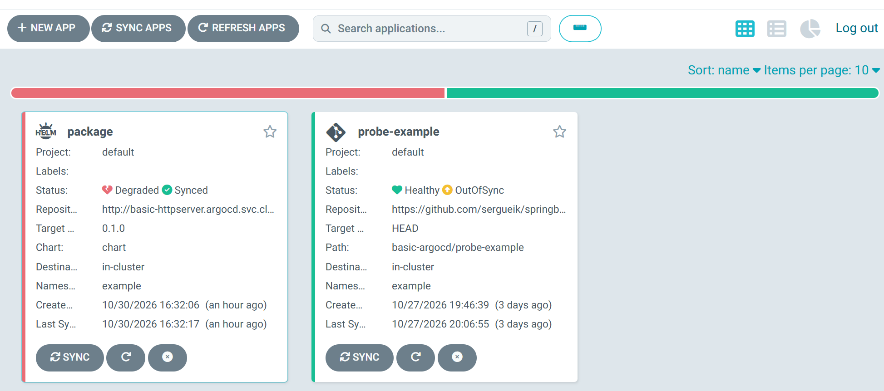
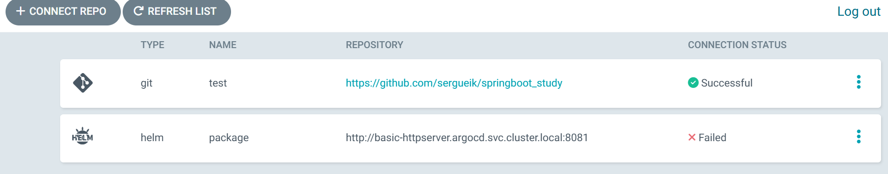
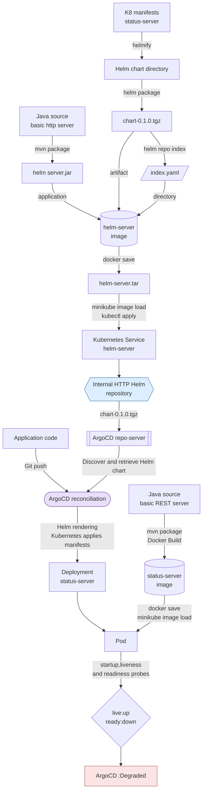
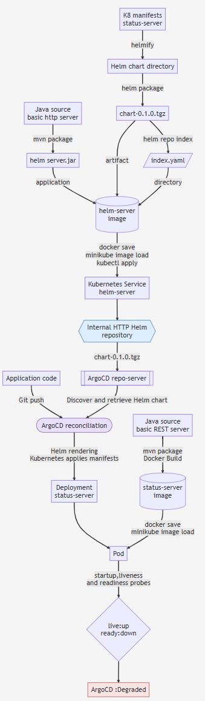
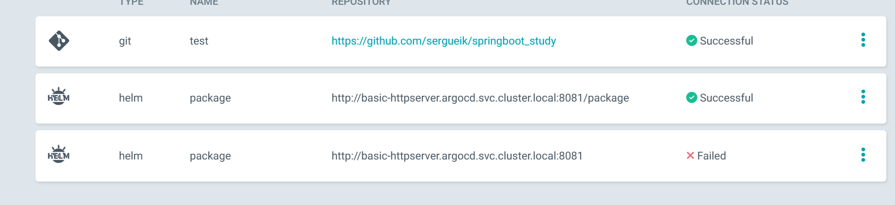

### Info

Tiny HTTP server in pure Java for [layered Dockerfile](https://www.baeldung.com/docker-layers-spring-boot) unpublished snapshot dependency.

### Usage

* put snapshot dependency in custom location

```sh
pushd ..\..\commandline-parser
mkdir %TEMP%/repo
mvn clean deploy -DaltDeploymentRepository=local::default::file:%TEMP%/repo
popd
```
* observe a number of messages like below

```text
Uploaded to local: file:C:\Users\kouzm\AppData\Local\Temp/repo/example/commandline-parser/0.12.1-SNAPSHOT/commandline-parser-0.12.1-20260315.204541-1.jar (26 kB at 980 kB/s)
Uploading to local: file:C:\Users\kouzm\AppData\Local\Temp/repo/example/commandline-parser/0.12.1-SNAPSHOT/commandline-parser-0.12.1-20260315.204541-1.pom
Uploaded to local: file:C:\Users\kouzm\AppData\Local\Temp/repo/example/commandline-parser/0.12.1-SNAPSHOT/commandline-parser-0.12.1-20260315.204541-1.pom (6.5 kB at 1.3 MB/s)
Downloading from local: file:C:\Users\kouzm\AppData\Local\Temp/repo/example/commandline-parser/maven-metadata.xml
Uploading to local: file:C:\Users\kouzm\AppData\Local\Temp/repo/example/commandline-parser/0.12.1-SNAPSHOT/maven-metadata.xml
Uploaded to local: file:C:\Users\kouzm\AppData\Local\Temp/repo/example/commandline-parser/0.12.1-SNAPSHOT/maven-metadata.xml (778 B at 18 kB/s)
Uploading to local: file:C:\Users\kouzm\AppData\Local\Temp/repo/example/commandline-parser/maven-metadata.xml
Uploaded to local: file:C:\Users\kouzm\AppData\Local\Temp/repo/example/commandline-parser/maven-metadata.xml (286 B at 9.9 kB/s)
```

```cmd
dir %temp%\repo\example\commandline-parser
```
```text
 Directory of C:\Users\kouzm\AppData\Local\Temp\repo\example\commandline-parser

10/25/2026  03:31 PM    <DIR>          .
10/25/2026  03:31 PM    <DIR>          ..
10/25/2026  03:31 PM    <DIR>          0.12.1-SNAPSHOT
10/25/2026  03:31 PM               286 maven-metadata.xml
10/25/2026  03:31 PM                32 maven-metadata.xml.md5
10/25/2026  03:31 PM                40 maven-metadata.xml.sha1
```

 * spin http server serving the repository

```sh
push basic-httpserver
mvn package
java -cp  target\example.httpserver.jar;target\lib\* example.App -port 8081 -root %temp%\repo
popd
```

 * add the repository to subject project `pom.xml` `<repositories>`:

```xml
    <repository>
      <id>local-repository</id>
      <name>not really a repo</name>
      <url>https://localhost:8081</url>
    </repository>
```

 * pin and add the dependency to subject project `pom.xml` `<dependencies>`:

```xml
<commandline-parser.version>0.12.1-SNAPSHOT</commandline-parser.version>
```

```xml
 <groupId>example</groupId>
  <artifactId>commandline-parser</artifactId>
  <version>${commandline-parser.version}</version>
  <exclusions>
    <exclusion>
      <groupId>com.google.guava</groupId>
      <artifactId>guava</artifactId>
    </exclusion>
    <exclusion>
      <groupId>org.json</groupId>
      <artifactId>json</artifactId>
    </exclusion>
    <exclusion>
      <groupId>com.google.code.gson</groupId>
      <artifactId>gson</artifactId>
    </exclusion>
  </exclusions>
</dependency>
```

 > NOTE: the application does not really use the API from the dependency

 * make sure the `commandline-parser` of the desired version is not cached in `.m2`

```xml
pushd \~/.m2/repository/example/
rm -fr commandline-parser/0.12.1-SNAPSHOT
popd
```

```
INFO] --------------------------< example:layered >---------------------------
[INFO] Building example:layered 0.2.0-SNAPSHOT
[INFO]   from pom.xml
[INFO] --------------------------------\[ jar ]---------------------------------
Downloading from local-repository: https://localhost:8081/example/commandline-parser/0.12.0-SNAPSHOT/maven-metadata.xm
...
Downloaded from local-repository: http://localhost:8081/example/commandline-parser/0.12.1-SNAPSHOT/commandline-parser-0.12.1-20260315.204541-1.jar (26 kB at 1.6 MB/s)
```

### Docker Toolbox

Try to add to hostonly-repository with hostname: `192.168.99.1` in '<repository>`

```xml
<repository>
  <id>hostonly-repository</id>
  <name>not really a repo</name>
  <!-- NOTE: not https -->
  <url>http://192.168.99.1:8081</url>
    <releases>
    <enabled>true</enabled>
  </releases>
  <snapshots>
    <enabled>true</enabled>
  </snapshots>
  <layout>default</layout>
</repository>
```
package the app with external dependency
```sh
mvn -Dmaven.wagon.http.ssl.insecure=true -Dmaven.wagon.http.ssl.allowall=true -U clean package
```

but if it errors:

```text
[ERROR] Failed to execute goal on project layered: Could not resolve dependencies for project example:layered:jar:0.3.0-SNAPSHOT:
Failed to collect dependencies at example:commandline-parser:jar:0.12.1-SNAPSHOT:
Failed to read artifact descriptor for example:commandline-parser:jar:0.12.1-SNAPSHOT:
Could not transfer artifact example:commandline-parser:pom:0.12.1-SNAPSHOT from/to maven-default-http-blocker (http://0.0.0.0/):
Blocked mirror for repositories: [hostonly-repository (http://192.168.99.1:8081, default, releases+snapshots)]
```
the only canonical option is through tweaking `~/.m2/settings.xml` in certain way:

```xml
<settings>
  <mirrors>
    <mirror>
      <id>allow-http</id>
      <mirrorOf>*</mirrorOf>
      <url>http://192.168.99.1:8081</url>
      <blocked>false</blocked>
    </mirror>
  </mirrors>
 <profiles>
    <profile>
      <id>allow-insecure-http</id>
      <repositories>
        <repository>
          <id>hostonly-repository</id>
          <url>http://192.168.99.1:8081</url>
          <releases><enabled>true</enabled></releases>
          <snapshots><enabled>true</enabled></snapshots>
        </repository>
      </repositories>
    </profile>
  </profiles>
  <activeProfiles>
    <activeProfile>allow-insecure-http</activeProfile>
  </activeProfiles>
</settings>
```
The other altrnative is to downgrade the docker build container to pre-__3.81__ version of Maven

### Background Information

During the experimentation with a tiny local HTTP server to serve an unpublished SNAPSHOT dependency for a layered Spring Boot Docker build, several key points were observed:

1. __Local SNAPSHOT deployment__
   - The `commandline-parser` project was deployed to a temporary file-based Maven repository using:
```sh
mvn clean deploy -DaltDeploymentRepository=local::default::file:%TEMP%/repo
```
   - This created a repository layout with `.jar`, `.pom`, and `maven-metadata.xml` files.

2. __Tiny HTTP server in Java__
   - A minimal Java HTTP server (`com.sun.net.httpserver.HttpServer`) was used to serve the repository on the host at port 8081.
   - From the host machine, accessing the repository via `http://localhost:8081` worked as expected, with successful artifact downloads.

3. __Maven HTTP blocker behavior (3.8+)__
   - Maven version 3.8 and later enforces the __`maven-default-http-blocker`__, which blocks plain HTTP repositories by default to encourage HTTPS usage.
   - Attempting to access the repository using any hostname other than `localhost` (e.g., `http://192.168.99.1:8081`) results in a blocked mirror error:
```
Blocked mirror for repositories: [hostonly-repository (http://192.168.99.1:8081, default, releases+snapshots)]
```
   - This is a policy issue in Maven, not a network connectivity problem. The host-only gateway IP (`192.168.99.1`) is reachable from Docker Machine containers, as confirmed with `nc` tests.

4. __Workarounds for local experimentation__
   - For host-side builds, using `http://localhost:8081` is the simplest approach.
   - To allow HTTP on a non-localhost repository, Maven can be configured via `~/.m2/settings.xml`:
     - Create a mirror with `<blocked>false</blocked>`
     - Define a profile that enables releases and snapshots from the repository
     - Activate the profile globally
   - Quick command-line flags are also possible for temporary bypass:
```sh
mvn -Dmaven.wagon.http.ssl.insecure=true -Dmaven.wagon.http.ssl.allowall=true -U clean package
```

5. __Docker Machine / host-only networking__
   - In a Docker Toolbox / Docker Machine setup, `host.docker.internal` is __not automatically available__.
   - Containers can access services on the Windows host via the host-only gateway IP (usually `192.168.99.1`), but Maven may block HTTP requests to that IP unless configured explicitly.

6. __Key learning points__
   - Maven __3.8__+ enforces HTTPS and will block otherwise reachable HTTP repositories.
   - Host-only networking via Docker Machine allows containers to reach host services, but special handling is required to avoid Maven HTTP-blocker errors.
   - Using `localhost` on the host is the most straightforward approach for local SNAPSHOT experiments, avoiding the need for advanced Maven settings tweaks.


### Testing with Curl
```cmd
java -jar target\example.httpserver.jar  -root %temp%\repo\example\commandline-parser -dir example/commandline-parser
```
```text
Repo server on 0.0.0.0:8081 with document root: C:\Users\kouzm\AppData\Local\Temp\repo\example\commandline-parser directory /example/commandline-parser
```
```
curl http://localhost:8081/example/commandline-parser/maven-metadata.xml
```

```text
<?xml version="1.0" encoding="UTF-8"?>
<metadata>
  <groupId>example</groupId>
  <artifactId>commandline-parser</artifactId>
  <versioning>
    <versions>
      <version>0.12.1-SNAPSHOT</version>
    </versions>
    <lastUpdated>20261025193144</lastUpdated>
  </versioning>
</metadata>
```


```shcurl -s -o /dev/null -w "%{http_code}\n" http://localhost:8081/example/commandline-parser/
```
```text
404
```
```shcurl -s -o /dev/null -w "%{http_code}\n"   http://localhost:8081/example/commandline-parser/0.12.1-SNAPSHOT/
```
```text
404
```
```shcurl -s -o /dev/null -w "%{http_code}\n" http://localhost:8081/example/commandline-parser/dummmy
```
```text
404

```
```sh
curl -s -o /dev/null -w "%{http_code}\n" http://localhost:8081/example//commandline-parser/../../../../../..
```
```text
404
```
### Hosting Helm Chart




|Concern|Maven repository|Helm HTTP chart repository|
|-------|----------------|--------------------------|
|Artifact lookup|Convention-based paths, coordinates and metadata|index.yaml, chart name and version|
|Artifact format|JAR, POM and related files|Packaged chart .tgz|
|Metadata|POMs, Maven metadata and checksums, depending on client and repository|index.yaml maps chart versions to archive URLs|
|Rendering|Maven resolves dependencies and builds projects|Helm renders templates into Kubernetes manifests|

#### Usage

```sh
cp ~/test/package/chart-0.1.0.tgz .
```
 
```sh
touch index.yaml
```
```yaml
apiVersion: v1
entries:
  chart:
    - apiVersion: v2
      appVersion: 1.16.0
      created: "2026-10-30T11:31:00Z"
      description: A Helm chart for Kubernetes
      digest: 1234567890abcdef1234567890abcdef1234567890abcdef1234567890abcdef
      name: chart
      urls:
        - chart-0.1.0.tgz
      version: 0.1.0
generated: "2026-10-30T11:31:00Z"
```
```sh
mvn clean package
```

```cmd
java -cp target\example.httpserver.jar example.App
```
```cmd
java -jar target\example.httpserver.jar -root $(pwd) -dir myapp
```

```sh
curl -v http://localhost:8081/myapp/index.yaml
```
```text
*   Trying 127.0.0.1...
* TCP_NODELAY set
* Connected to localhost (127.0.0.1) port 8081 (#0)
> GET /myapp/index.yaml HTTP/1.1
> Host: localhost:8081
> User-Agent: curl/7.58.0
> Accept: */*
> 
< HTTP/1.1 200 OK
< Date: Fri, 30 Oct 2026 16:24:01 GMT
< Transfer-encoding: chunked
< 
* Connection #0 to host localhost left intact
```
```
docker build -t basic-httpserver -f Dockefile . 
```

```sh
curl -v http://localhost:8081/package/index.yaml
```
```text
*   Trying 127.0.0.1...
* TCP_NODELAY set
* Connected to localhost (127.0.0.1) port 8081 (#0)
> GET /package/index.yaml HTTP/1.1
> Host: localhost:8081
> User-Agent: curl/7.58.0
> Accept: */*
>
< HTTP/1.1 200 OK
< Date: Fri, 30 Oct 2026 16:45:06 GMT
< Transfer-encoding: chunked
<
* Connection #0 to host localhost left intact

```

```sh
NAME=basic-httpserver
docker save --output ${NAME}.tar ${NAME}
```
```cmd
set NAME=basic-httpserver
minikube.exe image load -v 4 %NAME%.tar
minikube.exe -- kubectl load image-archive %NAME%.tar --name %NAME%
```

create a basic deployment to expose the helm server under the name of `basic-httpserver`:
```yaml
---
apiVersion: apps/v1
kind: Deployment
metadata:
  name: basic-httpserver
  namespace: argocd
spec:
  replicas: 1
  selector:
    matchLabels:
      app: basic-httpserver
  template:
    metadata:
      labels:
        app: basic-httpserver
    spec:
      containers:
        - name: basic-httpserver
          image: docker.io/library/basic-httpserver:latest
          imagePullPolicy: Never
          ports:
            - name: http
              containerPort: 8080
              protocol: TCP
---
apiVersion: v1
kind: Service
metadata:
  name: basic-httpserver
  namespace: argocd
spec:
  type: ClusterIP
  selector:
    app: basic-httpserver
  ports:
    - name: http
      port: 8080
      targetPort: http
      protocol: TCP
```

and deploy

```sh
minikube.exe kubectl -- apply -f basic-httpserver.yaml
```
```text
deployment.apps/basic-httpserver created
service/basic-httpserver created
```

```
minikube.exe kubectl --  --namespace argocd delete service basic-httpserver
```
```text
service "basic-httpserver" deleted
```
```
minikube.exe kubectl --  --namespace argocd delete deployment basic-httpserver
```
```text
deployment.apps "basic-httpserver" deleted
```
```
minikube.exe kubectl -- apply -f basic-httpserver.yaml
```
```text
deployment.apps/basic-httpserver created
service/basic-httpserver created
```
```sh
minikube.exe kubectl -- --namespace argocd get svc basic-httpserver
```
```text
NAME               TYPE        CLUSTER-IP       EXTERNAL-IP   PORT(S)    AGE
basic-httpserver   ClusterIP   10.100.192.114   <none>        8081/TCP   6m
```
```cmd
minikube.exe kubectl -- -n argocd port-forward svc/basic-httpserver 8081:8081
```
```text
Forwarding from 127.0.0.1:8081 -> 8081
Forwarding from [::1]:8081 -> 8081
```
```sh
curl -s http://localhost:8081/package/index.yaml
```
```yaml
---
apiVersion: v1
entries:
  chart:
    - apiVersion: v2
      appVersion: 1.16.0
      created: "2026-10-30T11:31:00Z"
      description: A Helm chart for Kubernetes
      digest: 1234567890abcdef1234567890abcdef1234567890abcdef1234567890abcdef
      name: chart
      urls:
        - chart-0.1.0.tgz
      version: 0.1.0
generated: "2026-10-30T11:31:00Z"

```
```cmd
argocd.exe repo add http://basic-httpserver.argocd.svc.cluster.local:8081/package
```
```text
time="2026-10-30T15:57:37-04:00" level=fatal msg="rpc error: code = Unknown desc = error testing repository connectivity: repository not found"
```



```cmd
argocd.exe repo add http://basic-httpserver.argocd.svc.cluster.local:8081/package
```
```text
time="2026-10-30T16:09:53-04:00" level=fatal msg="rpc error: code = Unknown desc = error testing repository connectivity: repository not found"
```
```cmd
minikube.exe kubectl -- logs --namespace argocd basic-httpserver-787668c5b9-wl7j2
```
```text
Repo server on 0.0.0.0:8081 with document root: /tmp directory /package
Exception java.nio.file.NoSuchFileException: /tmp/info/refs from
```


```

C:\developer\sergueik\springboot_study\basic-httpserver>argocd.exe repo add http://basic-httpserver.argocd.svc.cluster.local:8081/package --type helm --name package
Repository 'http://basic-httpserver.argocd.svc.cluster.local:8081/package' added

```


```
Unable to create application: application spec for package is invalid: InvalidSpecError: Unable to generate manifests in : rpc error: code = Unknown desc = `helm pull --destination /tmp/e768ba8d-4589-49a5-9b08-160bf1d3bac3 --version 0.1.0 --repo http://basic-httpserver.argocd.svc.cluster.local:8081/package chart` failed exit status 1: Error: failed to fetch http://basic-httpserver.argocd.svc.cluster.local:8081/package/chart-0.1.0.tgz : 404 Not Found
```


```
curl -v -o /dev/null http://localhost:8081/package/chart-0.1.0.tgz
* Uses proxy env variable no_proxy == '192.168.99.100,192.168.99.103,192.168.99.104,192.168.99.102,192.168.99.101,192.168.99.105,192.168.99.106'
* Host localhost:8081 was resolved.
* IPv6: ::1
* IPv4: 127.0.0.1
  % Total    % Received % Xferd  Average Speed   Time    Time     Time  Current
                                 Dload  Upload   Total   Spent    Left  Speed
  0     0    0     0    0     0      0      0 --:--:-- --:--:-- --:--:--     0*   Trying [::1]:8081...
* Connected to localhost (::1) port 8081
* using HTTP/1.x
> GET /package/chart-0.1.0.tgz HTTP/1.1
> Host: localhost:8081
> User-Agent: curl/8.12.1
> Accept: */*
>
* Request completely sent off
< HTTP/1.1 404 Not Found
< Date: Fri, 30 Oct 2026 20:22:28 GMT
< Content-length: 0
<
  0     0    0     0    0     0      0      0 --:--:-- --:--:-- --:--:--     0
* Connection #0 to host localhost left intact

```

```sh
docker run -it --entrypoint '' basic-httpserver sh
/tmp # ls
app.jar  chart  hsperfdata_root  index.yaml
/tmp # ls chart/
Chart.yaml  templates  values.yaml

```



#### Troubleshootng

* wrong path
```sh
curl -v http://localhost:8081/myapp/index.yaml
```
```text
*   Trying 127.0.0.1...
* TCP_NODELAY set
* Connected to localhost (127.0.0.1) port 8081 (#0)
> GET /myapp/index.yaml HTTP/1.1
> Host: localhost:8081
> User-Agent: curl/7.58.0
> Accept: */*
>
< HTTP/1.1 404 Not Found
< Content-Length: 50
< Content-Type: text/html
<
* Connection #0 to host localhost left intact
<h1>404 Not Found</h1>No context found for request
```

```sh
docker container ls
ID=docker container ls|grep basic-httpserver |awk '{print $1}'
```
```text
CONTAINER ID   IMAGE                   COMMAND                  CREATED         STATUS         PORTS                                                 NAMES
30663603f869   basic-httpserver        "/bin/sh -c 'java -c…"   3 minutes ago   Up 3 minutes   8080/tcp, 0.0.0.0:8081->8081/tcp, :::8081->8081/tcp   magical_hugle
```
```sh
docker exec -it $ID sh
```
```sh
/tmp # ls
```
```text
app.jar  chart  hsperfdata_root  index.yaml
```
```sh
/tmp # ps
```
```text
PID   USER     TIME  COMMAND
    1 root      0:01 java -cp app.jar example.App -root /tmp -dir package
   25 root      0:00 sh
   32 root      0:00 ps
```
![Failed Connection])(screenshots/capture-argocd-helm-connection-error.png)

* empty YAML.

![Failed Connection])(screenshots/capture-argocd-helm-pull-error.png)




* bad `Dockerfile`:

```sh
ADD chart-0.1.0.tgz index.yaml ./
```
has to be 
```sh
COPY chart-0.1.0.tgz index.yaml ./
```
proof
```sh
docker run -it --entrypoint '' basic-httpserver sh
```
```sh
/tmp # ls
```

```text
app.jar  chart  hsperfdata_root  index.yaml
/tmp # ls chart/
Chart.yaml  templates  values.yaml
```
the container contains an unpacked Helm chart directory, not the packaged archive.

### See Also

  * Maven versions __3.8.1__ and later blocking all external repository connections over plain HTTP by default for security reasons [release notes](https://maven.apache.org/docs/3.8.1/release-notes.html#cve-2021-26291)
  * Maven __3.8.1__ mirror blocking "fix" [gist](https://gist.github.com/vegaasen/1d545aafeda867fcb48ae3f6cd8fd7c7)

---
### Author
[Serguei Kouzmine](kouzmine_serguei@yahoo.com)

