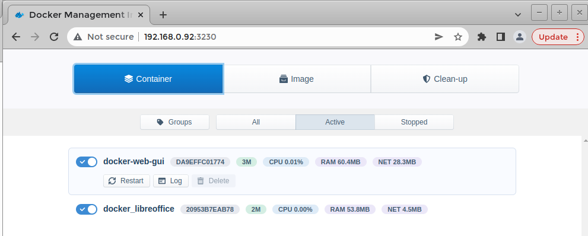
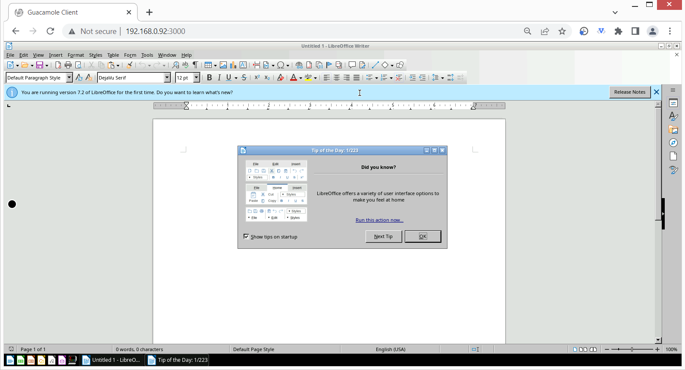

### Info

This directory contains a replica of alpine based
[alpine based libreoffice container](https://github.com/woahbase/alpine-libreoffice) with fixes.

This container can be used to run `libreoffice` in batch mode, headlessly. 
The modified `Dockerfile` from the original project is provided,
with fixes to `ENTRYPOINT` and `DISPLAY`
in order the container to be long running server and have the headless libreoffice conversion runs be triggered from the Springboot app

### History

[Libreoffice](https://documentation.libreoffice.org/en/english-documentation/) recognizes the `--headless` option, 
which lets its process without requiring an X windows otherwise needed
to render the graphical user interface.
This is often used in combination with other switches when converting files between formats, including PDF, HTML, DOC, DOCX, EPUB, plain text, etc.

### Usage

* pull the external custom image
```sh
export BASE_IMAGE=woahbase/alpine-libreoffice:x86_64
docker pull $BASE_IMAGE
```
this image will take a whopping 700 Mb of disk space

```sh
docker images $BASE_IMAGE
```
```text
woahbase/alpine-libreoffice            x86_64                 1136a70e3a54   21 months ago   708MB
```


so if runing on __Docker Toolbox__ on downlevel Windows make sure to back up the VM first:
```sh
cd ~/.docker/machine/machines/default/
ls -hl disk.vmdk*
``
```text
-rw-r--r-- 1 Serguei 197609 5.0G Apr 13 12:26 disk.vmdk
-rw-r--r-- 1 Serguei 197609 3.1G Jan  2 10:33 disk.vmdk.SAVED
``` 
The VM is configured has dynamic VDI which does not shrink after purging the image

* execute in batch mode
   + the command 
```sh
export BASE_IMAGE=woahbase/alpine-libreoffice:x86_64
export NAME=docker_libreoffice
docker run --rm -it --name $NAME --hostname libreoffice -e PGID=1000 -e PUID=1000 -c 512 -m 2096m --headless -v /usr/share/fonts:/usr/share/fonts:ro -v data:/home/alpine\ --convert-to pdf /home/alpine/test.doc $BASE_IMAGE
```

would fail because it has the LibreOffice arguments in the wrong place

  + the command
```sh
export BASE_IMAGE=woahbase/alpine-libreoffice:x86_64
export NAME=docker_libreoffice
docker run --rm -it --name $NAME --hostname libreoffice -e PGID=1000 -e PUID=1000 -c 512 -m 2096m -v /usr/share/fonts:/usr/share/fonts:ro -v data:/home/alpine $BASE_IMAGE /usr/bin/libreoffice --headless --convert-to pdf /home/alpine/test.doc
```
will fail complaining
```text
Error: source file could not be loaded
```
  
  + the command
```sh
export NAME=docker_libreoffice
export BASE_IMAGE=woahbase/alpine-libreoffice:x86_64
docker run --rm --entrypoint sh -it --name $NAME --hostname libreoffice -e PGID=1000 -e PUID=1000 -c 512 -m 2096m -v /usr/share/fonts:/usr/share/fonts:ro -v data:/home/alpine $BASE_IMAGE
```
this will open shell in the container

* continue inside the container
```sh
/usr/bin/libreoffice --headless --convert-to pdf /home/alpine/test.doc
```

this will succeed

```text
convert /home/alpine/test.doc -> /home/alpine/test.pdf using filter : writer_pdf_Export
```
   + the fixed command, running from Linux host using directory mappings for `fonts`

```sh
export NAME=docker_libreoffice
export BASE_IMAGE=woahbase/alpine-libreoffice:x86_64
docker run --rm -it --name $NAME --hostname libreoffice -e PGID=1000 -e PUID=1000 -c 512 -m 2096m -v /usr/share/fonts:/usr/share/fonts:ro -v $(pwd)/data:/home/alpine $BASE_IMAGE /usr/bin/libreoffice --headless --convert-to pdf /home/alpine/test.doc
```
works but the Libreoffice process does not terminate after conversion is  complete - one can copy the result file into the host and terminate container


  + the fixed command
```sh
export NAME=docker_libreoffice
export BASE_IMAGE=woahbase/alpine-libreoffice:x86_64
docker run --entrypoint sh --rm -it --name $NAME --hostname libreoffice -e PGID=1000 -e PUID=1000 -c 512 -m 2096m -v /usr/share/fonts:/usr/share/fonts:ro -v $(pwd)/data:/home/alpine $BASE_IMAGE /usr/bin/libreoffice --headless --convert-to pdf /home/alpine/test.doc
```
works successtully and does not suffer from this defect

### Building Container

use the stock alpine JRE image, temporarily skip certain fonts by commenting the line
```sh
RUN apk add --no-cache -U ttf-font-awesome ttf-mononoki ttf-hack
```
```sh
docker pull alpine/java:11-jre
```
```sh
export IMAGE=basic-libreoffice
docker build -f Dockerfile -t $IMAGE .
```
this wll create image of slightly smaller size
```sh
docker images $IMAGE
```
```text
basic-libreoffice   latest              95cfde060d48        About a minute ago   816MB
```
```sh
export NAME=docker_libreoffice
export IMAGE=basic-libreoffice

docker run --entrypoint sh --rm -it --name $NAME --hostname libreoffice -e PGID=1000 -e PUID=1000 -c 512 -m 2096m -v /usr/share/fonts:/usr/share/fonts:ro -v $(pwd)/data:/home/alpine $IMAGE /usr/bin/libreoffice --headless --convert-to pdf /home/alpine/test.doc
```
> NOTE: on Windows Docker Toolbox use a local directory under `$USERPROFILE` for bind volume map instead of current: 
currently prints few errors but completes the task:

```sh
mkdir -p ~/data; cp ./WordFileTool/Test/sample-simple.docx ~/data
export NAME=docker_libreoffice
export IMAGE=basic-libreoffice

docker run --entrypoint sh --rm -it --name $NAME --hostname libreoffice -e PGID=1000 -e PUID=1000 -c 512 -m 2096m -v /c/Users/${USERNAME}/data:/home/alpine $IMAGE /usr/bin/libreoffice --headless --convert-to pdf /home/alpine/sample-simple.docx
```
```text
convert /home/alpine/sample-simple.docx as a Writer document -> /home/alpine/sample-simple.pdf using filter : writer_pdf_Export
```
```text
WARNING: Your kernel does not support swap limit capabilities or the cgroup is not mounted. Memory limited without swap.
javaldx: Could not find a Java Runtime Environment!
Warning: failed to read path from javaldx
convert /home/alpine/test.doc -> /home/alpine/test.pdf using filter : writer_pdf_Export
```

```sh
pushd ~/data/
file sample-simple.pdf
```
```text
sample-simple.pdf: PDF document, version 1.7, 5 page(s)
```


```sh
docker-machine ssh
```
```text
   ( '>')
  /) TC (\   Core is distributed with ABSOLUTELY NO WARRANTY.
 (/-_--_-\)           www.tinycorelinux.net
docker@default:~$
```
```sh
df -h
```
```text
Filesystem                Size      Used Available Use% Mounted on
tmpfs                   886.9M    274.8M    612.0M  31% /
tmpfs                   492.7M         0    492.7M   0% /dev/shm
/dev/sda1                17.8G      1.5G     15.4G   9% /mnt/sda1
cgroup                  492.7M         0    492.7M   0% /sys/fs/cgroup
/c/Users                437.1G    389.6G     47.5G  89% /c/Users
/dev/sda1                17.8G      1.5G     15.4G   9% /mnt/sda1/var/lib/docker
```
after pulling those heavy images:

```
Filesystem                Size      Used Available Use% Mounted on
Filesystem                Size      Used Available Use% Mounted on
tmpfs                   886.9M    274.8M    612.0M  31% /
tmpfs                   492.7M         0    492.7M   0% /dev/shm
/dev/sda1                17.8G      3.7G     13.2G  22% /mnt/sda1
cgroup                  492.7M         0    492.7M   0% /sys/fs/cgroup
/c/Users                437.1G    394.6G     42.5G  90% /c/Users
/dev/sda1                17.8G      3.7G     13.2G  22% /mnt/sda1/var/lib/docker
```

```
```sh
docker image rm  ad35bb55199c
```
```text
Untagged: lscr.io/linuxserver/libreoffice:amd64-7.3.7
Untagged: lscr.io/linuxserver/libreoffice@sha256:ff724cc03ca3806f0e67209c83404d5
04d5a4e12644d1ad5eb5f20b8808341ff
Deleted: sha256:ad35bb55199c332504e11e32fd2ccddd5779ce8015cb6529612092f0d9f36e32
Deleted: sha256:71c6bf08c6cbb86f69a04d1d1e89d90b279ac106c7240b0dee98dcd35c8944ce
Deleted: sha256:286380aa63581fdfbacd504fa0708b1c1e6c0f7a214912a80d031ed96d70c376
Deleted: sha256:ef3039586665a8a9da14ca05282913bb8a1e4a00c3c62468456aed2b2244565c
Deleted: sha256:020d206031c63d8ab7da0b09198b979869c6c7e4a84f7b51f772738219bc678c
Deleted: sha256:06aa7adf2c0486e35bd78be60c0ade39498544172b6b3f54a605e96d843bc5dc
Deleted: sha256:c04cb7bce0c866ccebf0048415ec61b640bd8ed9308cb8c548ff864546808abe
Deleted: sha256:0e37facecb34ef0e0a3a997d8829b365926a010dfd24438f0103af6cae0bf0fa
Deleted: sha256:14d4b19237890b36b4a12c1e2181aacb6a1bbd3c20d39af6745f93785d0e6366
Deleted: sha256:79230efc626bc15103d7af95480abde8c940e87c85eb1a32adaa3de448c4405d
Deleted: sha256:20babedeaba158d7b452dc272424d7423a3237671a81b4226f103b4c7fbf7f3f
```
```sh
docker image rm  1136a70e3a54
```
```text
Untagged: woahbase/alpine-libreoffice:x86_64
Untagged: woahbase/alpine-libreoffice@sha256:2b6a58f32991c5911b329a946effd6142be
2bab8db6f739fb9c6531536dfdaa9
Deleted: sha256:1136a70e3a547070249d952c65c39b7b0d1e8f8c3c0b0ca2c18045dbef36f62b
Deleted: sha256:a54b1ea5ddcee9ba4ea554aa57c188cd60c5b7ddd654e49495464b7654d72fa9
Deleted: sha256:77af0313ebfa763d88ac4e188ebb6b4b34295caf4db259d21bd7fb855a328f4c
Deleted: sha256:ab0b4e33219fb35521f7b67d6210233960f41e75d142569880dac0be1ae7fd1b
Deleted: sha256:41faffcae32f0e289369c33af284701c59e7f5d4a0912e871c9749ae5c0e85a7
Deleted: sha256:b33ce8f780a175f77fe863de867677bcc548ae4609679cb427f1adbd8bd18bf3
Deleted: sha256:c31851344fefb51e359457cb8f7cd8426aa1be95121a9816220dfd80622e1d0d
Deleted: sha256:1bfeebd65323b8ddf5bd6a51cc7097b72788bc982e9ab3280d53d3c613adffa7
```


the disk usage observed on Docker Machine Linux host will go back but the VDI  disk size observed on Windows Machine host will not
Furthermore if the image is pulled, removed and pulled again, the VDI size grows both times:

```sh
ls -hl disk.vmdk*
```
```text
-rw-r--r-- 1 Serguei 197609 6.2G Apr 13 12:26 disk.vmdk
-rw-r--r-- 1 Serguei 197609 3.1G Jan  2 10:33 disk.vmdk.SAVED

```
### Pre-built Web UI LibreOffice Container

The Libreoffice container with Web UI `lscr.io/linuxserver/libreoffice` is already Alpine based. It is also quite heavy, so pin of some specific past release version is recommended over `latest`
```sh
docker images $BASE_IMAGE
```
```text
lscr.io/linuxserver/libreoffice   amd64-7.3.7         ad35bb55199c        11 months ago       1.52GB
```


https://hub.docker.com/r/linuxserver/libreoffice/tags


* pull the external vendor old stable release image
```sh
export VERSION=amd64-7.3.7
export BASE_IMAGE=lscr.io/linuxserver/libreoffice:$VERSION
docker pull $BASE_IMAGE
```
```sh
docker run -d -p 3000:3000 $BASE_IMAGE
```

the link `http://localhost:3000/` 
or 

```sh
http://$(docker-machine ip):3000/
```
will display the desktop





### Building a Web UI

* keep the container running and build the application
```sh
mvn spring-boot:run
```

### Posting Upload via curl

* the correct way
```sh
curl -s -XPOST -F 'operation=send' -F 'param=data' -F "file=@$(pwd)/data.txt" http://localhost:8085/basic/upload
```
* NOTE: cannot combine request parameters in `-F`:
```sh
curl -s -XPOST -F "operation=send&param=data&file=@$(pwd)/data.txt" http://localhost:8085/basic/upload
```
```JSON
{
  "timestamp": "2023-01-19T00:36:10.177+00:00",
  "status": 400,
  "error": "Bad Request",
  "message": "",
  "path": "/basic/upload"
}
```
with application console log saying:
```text
ParameterException: Required String parameter 'param' is not present
```
* NOTE: cannot issue both `-d` and  `-F`:


```sh
curl -s -X POST -F "file=$(pwd)/data.txt" http://localhost:8085/basic/upload -d "operation=send"
```
```text
Warning: You can only select one HTTP request method! You asked for both POST
Warning: (-d, --data) and multipart formpost (-F, --form).
```
with request not being sent

* download binary file, instruct the server to encode it when logging
```sh
base64 1x1.png
```
```text
iVBORw0KGgoAAAANSUhEUgAAAAEAAAABAQMAAAAl21bKAAAAA1BMVEUAAACnej3aAAAAAXRSTlMAQObYZgAAAApJREFUCNdjYAAAAAIAAeIhvDMAAAAASUVORK5CYII=
```
invoke as
```sh
 curl -XPOST -F "operation=send" -F "param=data" -F "encode=true" -F "file=@$(pwd)/1x1.png" http://localhost:8085/basic/upload
```
on the server end see
```text
herServlet        : Complet
Processing 1x1.png
size:95/95
raw data(base64 encoded):
[B@45e171a6
```
 - not quite right, but close enough

### Windows Automation

* using Libreoffics in headless mode is popular on Windows for PDF conversion is practically the same:

```cmd
"c:\Program Files\LibreOffice\program\soffice.exe" --headless --convert-to pdf --outdir "%USERPROFILE%\Downloads"  "%USERPROFILE%\downloads\a.docx"
```
* the background run and / user ACL is a bit of a challenge

* interop is a [popular](https://www.cyberforum.ru/powershell/thread3166872.html#post17301582) alternative

```powershell
  pushd $shared_assemblies_path

  @(
'Spire.Doc.dll',
'Spire.Pdf.dll'

) | foreach-object {
    if ($host.Version.Major -gt 2) {
      unblock-file -Path $_
    }
    write-debug $_
    add-type -Path $_
  }

popd
$doc = new-object Spire.Doc.Document
$doc.LoadFromFile("${env:USERPROFILE}\a.doc")
$doc.SaveToFile("a.pdf",[Spire.Doc.FileFormat]::PDF )
```

### Uno API Server
```

../basic-microservice/micro-gateway-service/Dockerfile:FROM openjdk:8-jre-alpine3.9
../basic-microservice/micro-item-service/Dockerfile:FROM openjdk:8-jre-alpine3.9
../basic-microservice/micro-sales-service/Dockerfile:FROM openjdk:8-jre-alpine3.9
../basic-multiport/Dockerfile:FROM openjdk:8-jre-alpine3.9
../basic-mvc-broken/Dockerfile:FROM openjdk:8-jre-alpine3.9
../basic-mysql/Dockerfile:FROM openjdk:8-jre-alpine3.9
../basic-mysql/Dockerfile.delayed_start:# NOTE: switch to jre-alpine3.9 to allow JDBC and other domain content-specific probes
../basic-mysql/Dockerfile.new_wait_for:# NOTE: switch to jre-alpine3.9 to allow JDBC and other domain content-specific probes
../basic-mysql/Dockerfile.wait_for:# NOTE: switch to jre-alpine3.9 to allow JDBC and other domain content-specific probes
../basic-mysql/Dockerfile.with_delayed_start:FROM openjdk:8-jre-alpine3.9
../basic-mysql-docker-compose/Dockerfile.delayed_start:# NOTE: switch to jre-alpine3.9 to allow JDBC and other domain content-specific probes
../basic-nginx/app/Dockerfile:FROM openjdk:8-jre-alpine3.9
../basic-nginx-static/app/Dockerfile:FROM openjdk:8-jre-alpine3.9
../basic-perl-cgi-java/Dockerfile:FROM openjdk:8-jre-alpine3.9
../basic-plugin/src/main/docker/Dockerfile:FROM openjdk:8-jre-alpine3.9
../basic-postgresql/Dockerfile:# FROM openjdk:8-jre-alpine3.9
../basic-postgresql/Dockerfile:FROM eclipse-temurin:11-jre-alpine
../basic-postgresql/Dockerfile:# FROM eclipse-temurin:8u492-b09-jre-alpine
../basic-proguard/Dockerfile:FROM eclipse-temurin:11-jre-alpine
../basic-proguard-elk-cluster/app1/Dockerfile:FROM eclipse-temurin:11-jre-alpine
../basic-proguard-elk-cluster/app2/Dockerfile:FROM eclipse-temurin:11-jre-alpine
../basic-prometheus-counter/Dockerfile:FROM openjdk:8-jre-alpine3.9
../basic-prometheus-counter-jpa/Dockerfile:FROM openjdk:8-jre-alpine3.9
../basic-prometheus-counter-labels/app/Dockerfile:FROM eclipse-temurin:11-jre-alpine
../basic-properties/Dockerfile:FROM openjdk:8-jre-alpine3.9
../basic-properties-location/Dockerfile:FROM openjdk:8-jre-alpine3.9
../basic-python-jenkins/Dockerfile:RUN apk add --no-cache openjdk8-jre coreutils zip git wget su-exec
../basic-quarkus/Dockerfile.jvm:#   contain the necessary JRE command-line options to specify the required GC, which
../basic-r2dbc/Dockerfile:FROM openjdk:8-jre-alpine3.9
../basic-r2dbc2/Dockerfile.mvn:# NOTE: The openjdk:17-alpine3.14 does not have a separate JRE variant, it is a full JDK image and is deprecated old, early access (EA) build
../basic-r2dbc2/Dockerfile.mvn:# FROM openjre:17-alpine3.14
../basic-r2dbc2/Dockerfile.mvn:FROM eclipse-temurin:17-jre-alpine
../basic-r2dbc2/Dockerfile.vanilla:# NOTE: The openjdk:17-alpine3.14 does not have a separate JRE variant, it is a full JDK image and is deprecated old, early access (EA) build
../basic-r2dbc2/Dockerfile.vanilla:# FROM openjre:17-alpine3.14
../basic-r2dbc2/Dockerfile.vanilla:FROM eclipse-temurin:17-jre-alpine
../basic-reactive/Dockerfile.app:FROM openjdk:8-jre-alpine3.9
../basic-reloadable-properties/Dockerfile:FROM openjdk:8-jre-alpine3.9
../basic-remote-debug/Dockerfile:FROM openjdk:8-jre-alpine3.9
../basic-rpm/Dockerfile.rpm-agent:FROM openjdk:8-jre-alpine3.9
../basic-selenium-java11/Dockerfile.alpine-jdk8-maven-chromium:FROM openjdk:8-jre-alpine3.9
../basic-selenium-java11/Dockerfile.alpine-jre8-chromium:FROM openjdk:8-jre-alpine3.9
../basic-soap3/soap-server/Dockerfile:FROM openjdk:8-jre-alpine3.9
../basic-socket/Dockerfile:FROM openjdk:8-jre-alpine3.9
../basic-springboot-environment/Dockerfile:FROM openjdk:8-jre-alpine3.9
../basic-springboot-layers/Dockerfile.jre:FROM eclipse-temurin:11-jre-alpine as jre
../basic-springboot-react/Dockerfile:        openjdk8-jre \
../basic-spring-poi/Dockerfile:FROM openjdk:8-jre-alpine3.9
../basic-spring-vault/Dockerfile:FROM openjdk:8-jre-alpine3.9
../basic-startup/Dockerfile:FROM openjdk:8-jre-alpine3.9
../basic-status-server/Dockerfile:FROM openjdk:8u191-jre-alpine3.9
../basic-tcserver/Dockerfile:FROM openjdk:8-jre-alpine3.9
../basic-tcserver/Dockerfile:# NOTE: without own ENTRYPOINT still inherit one from base docker image (openjdk:8-jre-alpine3.9), which will break the container run
../basic-tcserver/Dockerfile.orig:ENV JAVA_HOME /usr/lib/jvm/jre
../basic-tcserver/Dockerfile.orig:# if /etc/alternatives/jre is broken for some reason create the link ourselves
../basic-testinfra/Dockerfile:FROM openjdk:8-jre-alpine3.9
../basic-tests/Dockerfile:FROM openjdk:8-jre-alpine3.9
../basic-todolist/Dockerfile:FROM openjdk:8-jre-alpine3.9
../basic-tomcat-exporter/Dockerfile:FROM tomcat:8.5.27-jre8-alpine
../basic-tomcat-filter/Dockerfile:FROM tomcat_8.5.61_jre8_alpine39
../basic-tomcat-filter/Dockerfile.build:FROM openjdk:8-jre-alpine3.9
../basic-tomcat-staticpage/Dockerfile:FROM tomcat:8.5.27-jre8-alpine
../basic-ucd/Dockerfile:FROM openjdk:8-jre-alpine3.9
../basic-uppy-react/Dockerfile:FROM eclipse-temurin:11-jre-alpine as run
../basic-uppy-tus-react/Dockerfile:FROM eclipse-temurin:11-jre-alpine as run
../basic-uppy-tus-react/Dockerfile.backend:FROM eclipse-temurin:11-jre-alpine as run
../basic-uppy-tus-react/Dockerfile.spa:FROM eclipse-temurin:11-jre-alpine as run
../basic-vault-plain/Dockerfile:FROM openjdk:8-jre-alpine3.9
../basic-webflux-static-content/Dockerfile:FROM openjdk:8u151-jre-alpine
../basic-websockets/Dockerfile:FROM openjdk:8-jre-alpine3.9
../basic-websockets2/Dockerfile:FROM tomcat:8.0.20-jre8
../basic-xml/Dockerfile:FROM openjdk:8-jre-alpine3.9
../basic-xml/Dockerfile.noargs:FROM openjdk:8-jre-alpine3.9
../basic-xml/Dockerfile.processargs:FROM openjdk:8-jre-alpine3.9
../basic-zookeeper/Dockerfile:FROM openjdk:8-jre-alpine3.9
../sqlite_hibernate/Dockerfile:FROM openjdk:8-jre-alpine3.9
../sqlite_hibernate2/Dockerfile:FROM openjdk:8-jre-alpine3.9
../sqlite_jdbc/Dockerfile.jdbc:FROM openjdk:8-jre-alpine3.9

kouzm@sergueik23 MINGW64 /c/developer/sergueik/springboot_study/basic-libreoffice (master)
$ grep -ir jre ../* --include 'Dockerfile*' |grep -v alpi
../basic-avro/Dockerfile:FROM eclipse-temurin:11-jre
../basic-cobol2json-cb2xml-jrecord-build/Dockerfile:ARG REPO=https://github.com/bmTas/JRecord
../basic-cobol2json-cb2xml-jrecord-build/Dockerfile:RUN git clone ${REPO} jrecord \
../basic-cobol2json-cb2xml-jrecord-build/Dockerfile: && cd jrecord \
../basic-cobol2json-cb2xml-jrecord-build/Dockerfile:WORKDIR /jrecord
../basic-cobol2json-cb2xml-jrecord-build/Dockerfile:COPY pom.jrecord.xml pom.xml
../basic-cobol2json-cb2xml-jrecord-build/Dockerfile:COPY --from=jrecord /root/.m2 /root/.m2
../basic-cobol2json-cb2xml-jrecord-build/Dockerfile.BUILD-APP:RUN mkdir -p /root/.m2/repository/net/sf/jrecord/JRecord/0.93.3/ \
../basic-cobol2json-cb2xml-jrecord-build/Dockerfile.BUILD-APP:COPY --from=jrecord /build/.m2-repo/net/sf/jrecord/JRecord/0.93.3/JRecord-0.93.3.* /root/.m2/repository/net/sf/jrecord/JRecord/0.93.3/
../basic-cobol2json-cb2xml-jrecord-build/Dockerfile.BUILD-DEPENDENCY2:ADD pom.jrecord.xml /build/src/
../basic-cobol2json-cb2xml-jrecord-build/Dockerfile.BUILD-DEPENDENCY2:RUN cd /build/src && mvn -f pom.jrecord.xml -DskipTests clean install -Dmaven.repo.local=$LOCAL_REPO -ntp
../basic-docker-latex/Dockerfile.base:  make fontconfig perl default-jre libgetopt-long-descriptive-perl \
../basic-dynatrace-managed/Dynatrace-Agent/Dockerfile:ENV DT_INSTALL_DEPS=curl\ openjdk8-jre-base
../basic-dynatrace-managed/Dynatrace-Agent/Dockerfile-debian:ENV DT_INSTALL_DEPS=curl\ default-jre-headless
../basic-dynatrace-managed/Dynatrace-Collector/Dockerfile:ENV DT_INSTALL_DEPS=curl\ openjdk8-jre-base
../basic-dynatrace-managed/Dynatrace-Collector/Dockerfile-debian:ENV DT_INSTALL_DEPS=openjdk-8-jre-headless
../basic-dynatrace-managed/Dynatrace-Server/Dockerfile:ENV DT_INSTALL_DEPS=openjdk8-jre-base
../basic-dynatrace-managed/Dynatrace-Server/Dockerfile-debian:ENV DT_INSTALL_DEPS=openjdk-8-jre-headless
../basic-echo/Dockerfile:# NO javac in openjdk-jre image
../basic-elk-kafka-cluster/app2/Dockerfile:# FROM eclipse-temurin:11-jre-jammy
../basic-elk-kafka-cluster/app2/Dockerfile:# With eclipse-temurin:11-jre
../basic-elk-kafka-cluster/app3/Dockerfile:# FROM eclipse-temurin:11-jre-jammy
../basic-elk-kafka-cluster/app3/Dockerfile:# With eclipse-temurin:11-jre
../basic-graphviz-server.SAVED/Dockerfile:FROM eclipse-temurin:17-jre-jammy
../basic-harness/delegate/Dockerfile:COPY --from=eclipse-temurin:17.0.7_7-jre /opt/java/openjdk/ /opt/java/openjdk/
../basic-kafka/Dockerfile:RUN apk add --no-cache openjdk8-jre bash docker coreutils su-exec
../basic-libreoffice/Dockerfile:# FROM eclipse-temurin:11-jre
../basic-libreoffice/Dockerfile.uno:FROM openjdk:11-jre-slim
../basic-python-jenkins/Dockerfile:RUN apk add --no-cache openjdk8-jre coreutils zip git wget su-exec
../basic-quarkus/Dockerfile.jvm:#   contain the necessary JRE command-line options to specify the required GC, which
../basic-springboot-react/Dockerfile:        openjdk8-jre \
../basic-tcserver/Dockerfile.orig:ENV JAVA_HOME /usr/lib/jvm/jre
../basic-tcserver/Dockerfile.orig:# if /etc/alternatives/jre is broken for some reason create the link ourselves
../basic-websockets2/Dockerfile:FROM tomcat:8.0.20-jre8

kouzm@sergueik23 MINGW64 /c/developer/sergueik/springboot_study/basic-libreoffice (master)
$ docker pull eclipse-temurin:11-jre
11-jre: Pulling from library/eclipse-temurin
517b871c26ea: Pull complete
96aae9022e0e: Pull complete
950b2aeef945: Pull complete
5808675b5417: Pull complete
29ee03f6f38b: Pull complete
ebef907b3564: Pull complete
Digest: sha256:7db5776af2396377c8aae2aa124712da7b72a5b6b014c17d77ae37eb5276f37b
Status: Downloaded newer image for eclipse-temurin:11-jre
docker.io/library/eclipse-temurin:11-jre

kouzm@sergueik23 MINGW64 /c/developer/sergueik/springboot_study/basic-libreoffice (master)
$ : docker build -t libreoffice-uno -f Dockerfile.uno  .

kouzm@sergueik23 MINGW64 /c/developer/sergueik/springboot_study/basic-libreoffice (master)
$ vi Dockerfile.uno

kouzm@sergueik23 MINGW64 /c/developer/sergueik/springboot_study/basic-libreoffice (master)
$  docker build -t libreoffice-uno -f Dockerfile.uno  .
Sending build context to Docker daemon  480.3kB
Step 1/4 : FROM eclipse-temurin:11-jre
 ---> 1592dcf24252
Step 2/4 : RUN DEBIAN_FRONTEND=noninteractive apt-get update && apt-get -y install   libreoffice-common   unoconv   hyphen-af hyphen-en-us   fonts-dejavu fonts-dejavu-core fonts-dejavu-extra   fonts-droid-fallback fonts-dustin fonts-f500 fonts-fanwood fonts-freefont-ttf fonts-liberation   fonts-lmodern fonts-lyx fonts-sil-gentium fonts-texgyre fonts-tlwg-purisa fonts-opensymbol &&   rm -rf /var/lib/apt/lists/*
 ---> Running in eb7f005438c0
Get:1 http://security.ubuntu.com/ubuntu resolute-security InRelease [137 kB]
Get:2 http://archive.ubuntu.com/ubuntu resolute InRelease [136 kB]
Get:3 http://archive.ubuntu.com/ubuntu resolute-updates InRelease [137 kB]
Get:4 http://archive.ubuntu.com/ubuntu resolute-backports InRelease [137 kB]
Get:5 http://archive.ubuntu.com/ubuntu resolute/restricted amd64 Packages [189 kB]
Get:6 http://archive.ubuntu.com/ubuntu resolute/multiverse amd64 Packages [352 kB]
Get:7 http://archive.ubuntu.com/ubuntu resolute/universe amd64 Packages [20.1 MB]
Get:8 http://security.ubuntu.com/ubuntu resolute-security/main amd64 Packages [885 kB]
Get:9 http://security.ubuntu.com/ubuntu resolute-security/multiverse amd64 Packages [24.6 kB]
Get:10 http://security.ubuntu.com/ubuntu resolute-security/restricted amd64 Packages [723 kB]
Get:11 http://security.ubuntu.com/ubuntu resolute-security/universe amd64 Packages [278 kB]
Get:12 http://archive.ubuntu.com/ubuntu resolute/main amd64 Packages [1,874 kB]
Get:13 http://archive.ubuntu.com/ubuntu resolute-updates/universe amd64 Packages [497 kB]
Get:14 http://archive.ubuntu.com/ubuntu resolute-updates/multiverse amd64 Packages [26.1 kB]
Get:15 http://archive.ubuntu.com/ubuntu resolute-updates/main amd64 Packages [1,110 kB]
Get:16 http://archive.ubuntu.com/ubuntu resolute-updates/restricted amd64 Packages [773 kB]
Get:17 http://archive.ubuntu.com/ubuntu resolute-backports/universe amd64 Packages [3,308 B]
Fetched 27.4 MB in 6s (4,910 kB/s)
Reading package lists...
E: Problem executing scripts APT::Update::Post-Invoke 'rm -f /var/cache/apt/archives/*.deb /var/cache/apt/archives/partial/*.deb /var/cache/apt/*.bin || true'
E: Sub-process returned an error code
The command '/bin/sh -c DEBIAN_FRONTEND=noninteractive apt-get update && apt-get -y install   libreoffice-common   unoconv   hyphen-af hyphen-en-us   fonts-dejavu fonts-dejavu-core fonts-dejavu-extra   fonts-droid-fallback fonts-dustin fonts-f500 fonts-fanwood fonts-freefont-ttf fonts-liberation   fonts-lmodern fonts-lyx fonts-sil-gentium fonts-texgyre fonts-tlwg-purisa fonts-opensymbol &&   rm -rf /var/lib/apt/lists/*' returned a non-zero code: 100

kouzm@sergueik23 MINGW64 /c/developer/sergueik/springboot_study/basic-libreoffice (master)
$ vi Dockerfile.uno

[1]+  Stopped                 vi Dockerfile.uno

kouzm@sergueik23 MINGW64 /c/developer/sergueik/springboot_study/basic-libreoffice (master)
$  docker build -t libreoffice-uno -f Dockerfile.uno  .
Sending build context to Docker daemon  493.1kB
Step 1/4 : FROM eclipse-temurin:11-jre
 ---> 1592dcf24252
Step 2/4 : RUN DEBIAN_FRONTEND=noninteractive apt-get update && apt-get -qqy install   libreoffice-common   unoconv   hyphen-af hyphen-en-us   fonts-dejavu fonts-dejavu-core fonts-dejavu-extra   fonts-droid-fallback fonts-dustin fonts-f500 fonts-fanwood fonts-freefont-ttf fonts-liberation   fonts-lmodern fonts-lyx fonts-sil-gentium fonts-texgyre fonts-tlwg-purisa fonts-opensymbol
 ---> Running in eb1d1f2e5fd3
Get:1 http://archive.ubuntu.com/ubuntu resolute InRelease [136 kB]
Get:2 http://security.ubuntu.com/ubuntu resolute-security InRelease [137 kB]
Get:3 http://archive.ubuntu.com/ubuntu resolute-updates InRelease [137 kB]
Get:4 http://security.ubuntu.com/ubuntu resolute-security/universe amd64 Packages [278 kB]
Get:5 http://archive.ubuntu.com/ubuntu resolute-backports InRelease [137 kB]
Get:6 http://archive.ubuntu.com/ubuntu resolute/multiverse amd64 Packages [352 kB]
Get:7 http://archive.ubuntu.com/ubuntu resolute/main amd64 Packages [1,874 kB]
Get:8 http://archive.ubuntu.com/ubuntu resolute/universe amd64 Packages [20.1 MB]
Get:9 http://security.ubuntu.com/ubuntu resolute-security/main amd64 Packages [885 kB]
Get:10 http://security.ubuntu.com/ubuntu resolute-security/multiverse amd64 Packages [24.6 kB]
Get:11 http://security.ubuntu.com/ubuntu resolute-security/restricted amd64 Packages [723 kB]
Get:12 http://archive.ubuntu.com/ubuntu resolute/restricted amd64 Packages [189 kB]
Get:13 http://archive.ubuntu.com/ubuntu resolute-updates/main amd64 Packages [1,110 kB]
Get:14 http://archive.ubuntu.com/ubuntu resolute-updates/multiverse amd64 Packages [26.1 kB]
Get:15 http://archive.ubuntu.com/ubuntu resolute-updates/universe amd64 Packages [497 kB]
Get:16 http://archive.ubuntu.com/ubuntu resolute-updates/restricted amd64 Packages [773 kB]
Get:17 http://archive.ubuntu.com/ubuntu resolute-backports/universe amd64 Packages [3,308 B]
Fetched 27.4 MB in 6s (4,771 kB/s)
Reading package lists...
E: Problem executing scripts APT::Update::Post-Invoke 'rm -f /var/cache/apt/archives/*.deb /var/cache/apt/archives/partial/*.deb /var/cache/apt/*.bin || true'
E: Sub-process returned an error code
The command '/bin/sh -c DEBIAN_FRONTEND=noninteractive apt-get update && apt-get -qqy install   libreoffice-common   unoconv   hyphen-af hyphen-en-us   fonts-dejavu fonts-dejavu-core fonts-dejavu-extra   fonts-droid-fallback fonts-dustin fonts-f500 fonts-fanwood fonts-freefont-ttf fonts-liberation   fonts-lmodern fonts-lyx fonts-sil-gentium fonts-texgyre fonts-tlwg-purisa fonts-opensymbol' returned a non-zero code: 100

kouzm@sergueik23 MINGW64 /c/developer/sergueik/springboot_study/basic-libreoffice (master)
$ fg
vi Dockerfile.uno

[1]+  Stopped                 vi Dockerfile.uno

kouzm@sergueik23 MINGW64 /c/developer/sergueik/springboot_study/basic-libreoffice (master)
$  docker build -t libreoffice-uno -f Dockerfile.uno  .
Sending build context to Docker daemon  493.1kB
Step 1/4 : FROM eclipse-temurin:11-jre
 ---> 1592dcf24252
Step 2/4 : RUN DEBIAN_FRONTEND=noninteractive apt-get update && apt-get -y install   libreoffice-common   unoconv   hyphen-af hyphen-en-us   fonts-dejavu fonts-dejavu-core fonts-dejavu-extra   fonts-droid-fallback fonts-dustin fonts-f500 fonts-fanwood fonts-freefont-ttf fonts-liberation   fonts-lmodern fonts-lyx fonts-sil-gentium fonts-texgyre fonts-tlwg-purisa fonts-opensymbol
 ---> Running in 283682b3157e
Get:1 http://security.ubuntu.com/ubuntu resolute-security InRelease [137 kB]
Get:2 http://archive.ubuntu.com/ubuntu resolute InRelease [136 kB]
Get:3 http://archive.ubuntu.com/ubuntu resolute-updates InRelease [137 kB]
Get:4 http://security.ubuntu.com/ubuntu resolute-security/universe amd64 Packages [278 kB]
Get:5 http://archive.ubuntu.com/ubuntu resolute-backports InRelease [137 kB]
Get:6 http://archive.ubuntu.com/ubuntu resolute/universe amd64 Packages [20.1 MB]
Get:7 http://security.ubuntu.com/ubuntu resolute-security/restricted amd64 Packages [723 kB]
Get:8 http://security.ubuntu.com/ubuntu resolute-security/multiverse amd64 Packages [24.6 kB]
Get:9 http://security.ubuntu.com/ubuntu resolute-security/main amd64 Packages [885 kB]
Get:10 http://archive.ubuntu.com/ubuntu resolute/multiverse amd64 Packages [352 kB]
Get:11 http://archive.ubuntu.com/ubuntu resolute/main amd64 Packages [1,874 kB]
Get:12 http://archive.ubuntu.com/ubuntu resolute/restricted amd64 Packages [189 kB]
Get:13 http://archive.ubuntu.com/ubuntu resolute-updates/main amd64 Packages [1,110 kB]
Get:14 http://archive.ubuntu.com/ubuntu resolute-updates/restricted amd64 Packages [773 kB]
Get:15 http://archive.ubuntu.com/ubuntu resolute-updates/multiverse amd64 Packages [26.1 kB]
Get:16 http://archive.ubuntu.com/ubuntu resolute-updates/universe amd64 Packages [497 kB]
Get:17 http://archive.ubuntu.com/ubuntu resolute-backports/universe amd64 Packages [3,308 B]
Fetched 27.4 MB in 5s (5,393 kB/s)
Reading package lists...
E: Problem executing scripts APT::Update::Post-Invoke 'rm -f /var/cache/apt/archives/*.deb /var/cache/apt/archives/partial/*.deb /var/cache/apt/*.bin || true'
E: Sub-process returned an error code
The command '/bin/sh -c DEBIAN_FRONTEND=noninteractive apt-get update && apt-get -y install   libreoffice-common   unoconv   hyphen-af hyphen-en-us   fonts-dejavu fonts-dejavu-core fonts-dejavu-extra   fonts-droid-fallback fonts-dustin fonts-f500 fonts-fanwood fonts-freefont-ttf fonts-liberation   fonts-lmodern fonts-lyx fonts-sil-gentium fonts-texgyre fonts-tlwg-purisa fonts-opensymbol' returned a non-zero code: 100

kouzm@sergueik23 MINGW64 /c/developer/sergueik/springboot_study/basic-libreoffice (master)
$ fg
vi Dockerfile.uno

[1]+  Stopped                 vi Dockerfile.uno

kouzm@sergueik23 MINGW64 /c/developer/sergueik/springboot_study/basic-libreoffice (master)
$  docker build -t libreoffice-uno -f Dockerfile.uno  .
Sending build context to Docker daemon  493.1kB
Step 1/6 : FROM eclipse-temurin:11-jre
 ---> 1592dcf24252
Step 2/6 : ENV DEBIAN_FRONTEND=noninteractive
 ---> Running in 780c654c29be
Removing intermediate container 780c654c29be
 ---> da74af1e1e1d
Step 3/6 : RUN apt-get update
 ---> Running in b5a12de0b073
Get:1 http://security.ubuntu.com/ubuntu resolute-security InRelease [137 kB]
Get:2 http://archive.ubuntu.com/ubuntu resolute InRelease [136 kB]
Get:3 http://security.ubuntu.com/ubuntu resolute-security/restricted amd64 Packages [723 kB]
Get:4 http://archive.ubuntu.com/ubuntu resolute-updates InRelease [137 kB]
Get:5 http://archive.ubuntu.com/ubuntu resolute-backports InRelease [137 kB]
Get:6 http://archive.ubuntu.com/ubuntu resolute/multiverse amd64 Packages [352 kB]
Get:7 http://archive.ubuntu.com/ubuntu resolute/universe amd64 Packages [20.1 MB]
Get:8 http://security.ubuntu.com/ubuntu resolute-security/main amd64 Packages [885 kB]
Get:9 http://archive.ubuntu.com/ubuntu resolute/main amd64 Packages [1,874 kB]
Get:10 http://archive.ubuntu.com/ubuntu resolute/restricted amd64 Packages [189 kB]
Get:11 http://archive.ubuntu.com/ubuntu resolute-updates/universe amd64 Packages [497 kB]
Get:12 http://archive.ubuntu.com/ubuntu resolute-updates/multiverse amd64 Packages [26.1 kB]
Get:13 http://archive.ubuntu.com/ubuntu resolute-updates/main amd64 Packages [1,110 kB]
Get:14 http://archive.ubuntu.com/ubuntu resolute-updates/restricted amd64 Packages [773 kB]
Get:15 http://archive.ubuntu.com/ubuntu resolute-backports/universe amd64 Packages [3,308 B]
Get:16 http://security.ubuntu.com/ubuntu resolute-security/universe amd64 Packages [278 kB]
Get:17 http://security.ubuntu.com/ubuntu resolute-security/multiverse amd64 Packages [24.6 kB]
Fetched 27.4 MB in 7s (4,135 kB/s)
Reading package lists...
E: Problem executing scripts APT::Update::Post-Invoke 'rm -f /var/cache/apt/archives/*.deb /var/cache/apt/archives/partial/*.deb /var/cache/apt/*.bin || true'
E: Sub-process returned an error code
The command '/bin/sh -c apt-get update' returned a non-zero code: 100

kouzm@sergueik23 MINGW64 /c/developer/sergueik/springboot_study/basic-libreoffice (master)
$ fg
vi Dockerfile.uno

[1]+  Stopped                 vi Dockerfile.uno

kouzm@sergueik23 MINGW64 /c/developer/sergueik/springboot_study/basic-libreoffice (master)
$  docker build -t libreoffice-uno -f Dockerfile.uno  .
Sending build context to Docker daemon  493.1kB
Step 1/6 : FROM eclipse-temurin:11-jre:jammy
invalid reference format

kouzm@sergueik23 MINGW64 /c/developer/sergueik/springboot_study/basic-libreoffice (master)
$ grep -ir jre ../* --include 'Dockerfile*' |grep -v alpi |grep jam
../basic-elk-kafka-cluster/app2/Dockerfile:# FROM eclipse-temurin:11-jre-jammy
../basic-elk-kafka-cluster/app3/Dockerfile:# FROM eclipse-temurin:11-jre-jammy
../basic-graphviz-server.SAVED/Dockerfile:FROM eclipse-temurin:17-jre-jammy
../basic-libreoffice/Dockerfile.uno:FROM eclipse-temurin:11-jre:jammy

kouzm@sergueik23 MINGW64 /c/developer/sergueik/springboot_study/basic-libreoffice (master)
$ fg
vi Dockerfile.uno

[1]+  Stopped                 vi Dockerfile.uno

kouzm@sergueik23 MINGW64 /c/developer/sergueik/springboot_study/basic-libreoffice (master)
$  docker build -t libreoffice-uno -f Dockerfile.uno  .
Sending build context to Docker daemon  493.1kB
Step 1/6 : FROM eclipse-temurin:11-jre-jammy
11-jre-jammy: Pulling from library/eclipse-temurin
ba082564e660: Pull complete
adc6e050bb1b: Pull complete
ad775e07f465: Pull complete
e929dde435be: Pull complete
082692722d29: Pull complete
Digest: sha256:22a7a164657075683c69d83e55183586b1f0e72106cb11bbb96c77e32d4c92f4
Status: Downloaded newer image for eclipse-temurin:11-jre-jammy
 ---> 356a752adfea
Step 2/6 : ENV DEBIAN_FRONTEND=noninteractive
 ---> Running in b9d647d51e03
Removing intermediate container b9d647d51e03
 ---> f658530ba7f5
Step 3/6 : RUN apt-get update
 ---> Running in a495cda211a2
Get:1 http://security.ubuntu.com/ubuntu jammy-security InRelease [129 kB]
Get:2 http://archive.ubuntu.com/ubuntu jammy InRelease [270 kB]
Get:3 http://archive.ubuntu.com/ubuntu jammy-updates InRelease [128 kB]
Err:2 http://archive.ubuntu.com/ubuntu jammy InRelease
  The following signatures couldn't be verified because the public key is not available: NO_PUBKEY 871920D1991BC93C
Get:4 http://archive.ubuntu.com/ubuntu jammy-backports InRelease [127 kB]
Err:1 http://security.ubuntu.com/ubuntu jammy-security InRelease
  The following signatures couldn't be verified because the public key is not available: NO_PUBKEY 871920D1991BC93C
Err:3 http://archive.ubuntu.com/ubuntu jammy-updates InRelease
  The following signatures couldn't be verified because the public key is not available: NO_PUBKEY 871920D1991BC93C
Err:4 http://archive.ubuntu.com/ubuntu jammy-backports InRelease
  The following signatures couldn't be verified because the public key is not available: NO_PUBKEY 871920D1991BC93C
Reading package lists...
W: http://archive.ubuntu.com/ubuntu/dists/jammy/InRelease: The key(s) in the keyring /etc/apt/trusted.gpg.d/ubuntu-keyring-2012-cdimage.gpg are ignored as the file is not readable by user '_apt' executing apt-key.
W: http://archive.ubuntu.com/ubuntu/dists/jammy/InRelease: The key(s) in the keyring /etc/apt/trusted.gpg.d/ubuntu-keyring-2018-archive.gpg are ignored as the file is not readable by user '_apt' executing apt-key.
W: GPG error: http://archive.ubuntu.com/ubuntu jammy InRelease: The following signatures couldn't be verified because the public key is not available: NO_PUBKEY 871920D1991BC93C
E: The repository 'http://archive.ubuntu.com/ubuntu jammy InRelease' is not signed.
W: http://security.ubuntu.com/ubuntu/dists/jammy-security/InRelease: The key(s) in the keyring /etc/apt/trusted.gpg.d/ubuntu-keyring-2012-cdimage.gpg are ignored as the file is not readable by user '_apt' executing apt-key.
W: http://security.ubuntu.com/ubuntu/dists/jammy-security/InRelease: The key(s) in the keyring /etc/apt/trusted.gpg.d/ubuntu-keyring-2018-archive.gpg are ignored as the file is not readable by user '_apt' executing apt-key.
W: GPG error: http://security.ubuntu.com/ubuntu jammy-security InRelease: The following signatures couldn't be verified because the public key is not available: NO_PUBKEY 871920D1991BC93C
E: The repository 'http://security.ubuntu.com/ubuntu jammy-security InRelease' is not signed.
W: http://archive.ubuntu.com/ubuntu/dists/jammy-updates/InRelease: The key(s) in the keyring /etc/apt/trusted.gpg.d/ubuntu-keyring-2012-cdimage.gpg are ignored as the file is not readable by user '_apt' executing apt-key.
W: http://archive.ubuntu.com/ubuntu/dists/jammy-updates/InRelease: The key(s) in the keyring /etc/apt/trusted.gpg.d/ubuntu-keyring-2018-archive.gpg are ignored as the file is not readable by user '_apt' executing apt-key.
W: GPG error: http://archive.ubuntu.com/ubuntu jammy-updates InRelease: The following signatures couldn't be verified because the public key is not available: NO_PUBKEY 871920D1991BC93C
E: The repository 'http://archive.ubuntu.com/ubuntu jammy-updates InRelease' is not signed.
W: http://archive.ubuntu.com/ubuntu/dists/jammy-backports/InRelease: The key(s) in the keyring /etc/apt/trusted.gpg.d/ubuntu-keyring-2012-cdimage.gpg are ignored as the file is not readable by user '_apt' executing apt-key.
W: http://archive.ubuntu.com/ubuntu/dists/jammy-backports/InRelease: The key(s) in the keyring /etc/apt/trusted.gpg.d/ubuntu-keyring-2018-archive.gpg are ignored as the file is not readable by user '_apt' executing apt-key.
W: GPG error: http://archive.ubuntu.com/ubuntu jammy-backports InRelease: The following signatures couldn't be verified because the public key is not available: NO_PUBKEY 871920D1991BC93C
E: The repository 'http://archive.ubuntu.com/ubuntu jammy-backports InRelease' is not signed.
E: Problem executing scripts APT::Update::Post-Invoke 'rm -f /var/cache/apt/archives/*.deb /var/cache/apt/archives/partial/*.deb /var/cache/apt/*.bin || true'
E: Sub-process returned an error code
The command '/bin/sh -c apt-get update' returned a non-zero code: 100

kouzm@sergueik23 MINGW64 /c/developer/sergueik/springboot_study/basic-libreoffice (master)
$ fg
vi Dockerfile.uno

[1]+  Stopped                 vi Dockerfile.uno

kouzm@sergueik23 MINGW64 /c/developer/sergueik/springboot_study/basic-libreoffice (master)
$  docker build -t libreoffice-uno -f Dockerfile.uno  .
Sending build context to Docker daemon  493.1kB
Step 1/6 : FROM eclipse-temurin:11-jre
 ---> 1592dcf24252
Step 2/6 : ENV DEBIAN_FRONTEND=noninteractive
 ---> Using cache
 ---> da74af1e1e1d
Step 3/6 : RUN apt-get update
 ---> Running in 6acc690e2a31
Get:1 http://archive.ubuntu.com/ubuntu resolute InRelease [136 kB]
Get:2 http://security.ubuntu.com/ubuntu resolute-security InRelease [137 kB]
Get:3 http://archive.ubuntu.com/ubuntu resolute-updates InRelease [137 kB]
Get:4 http://archive.ubuntu.com/ubuntu resolute-backports InRelease [137 kB]
Get:5 http://archive.ubuntu.com/ubuntu resolute/multiverse amd64 Packages [352 kB]
Get:6 http://archive.ubuntu.com/ubuntu resolute/main amd64 Packages [1,874 kB]
Get:7 http://security.ubuntu.com/ubuntu resolute-security/multiverse amd64 Packages [24.6 kB]
Get:8 http://archive.ubuntu.com/ubuntu resolute/restricted amd64 Packages [189 kB]
Get:9 http://archive.ubuntu.com/ubuntu resolute/universe amd64 Packages [20.1 MB]
Get:10 http://security.ubuntu.com/ubuntu resolute-security/restricted amd64 Packages [723 kB]
Get:11 http://security.ubuntu.com/ubuntu resolute-security/universe amd64 Packages [278 kB]
Get:12 http://security.ubuntu.com/ubuntu resolute-security/main amd64 Packages [885 kB]
Get:13 http://archive.ubuntu.com/ubuntu resolute-updates/universe amd64 Packages [497 kB]
Get:14 http://archive.ubuntu.com/ubuntu resolute-updates/main amd64 Packages [1,110 kB]
Get:15 http://archive.ubuntu.com/ubuntu resolute-updates/restricted amd64 Packages [773 kB]
Get:16 http://archive.ubuntu.com/ubuntu resolute-updates/multiverse amd64 Packages [26.1 kB]
Get:17 http://archive.ubuntu.com/ubuntu resolute-backports/universe amd64 Packages [3,308 B]
Fetched 27.4 MB in 6s (4,944 kB/s)
Reading package lists...
E: Problem executing scripts APT::Update::Post-Invoke 'rm -f /var/cache/apt/archives/*.deb /var/cache/apt/archives/partial/*.deb /var/cache/apt/*.bin || true'
E: Sub-process returned an error code
The command '/bin/sh -c apt-get update' returned a non-zero code: 100

kouzm@sergueik23 MINGW64 /c/developer/sergueik/springboot_study/basic-libreoffice (master)
$ fg
vi Dockerfile.uno

[1]+  Stopped                 vi Dockerfile.uno

kouzm@sergueik23 MINGW64 /c/developer/sergueik/springboot_study/basic-libreoffice (master)
$  docker build -t libreoffice-uno -f Dockerfile.uno  .
Sending build context to Docker daemon  493.1kB
Step 1/6 : FROM eclipse-temurin:11-jre
 ---> 1592dcf24252
Step 2/6 : ENV DEBIAN_FRONTEND=noninteractive
 ---> Using cache
 ---> da74af1e1e1d
Step 3/6 : RUN mkdir -p /var/cache/apt/archives/partial && apt-get update
 ---> Running in 18f87d35793b
Get:1 http://security.ubuntu.com/ubuntu resolute-security InRelease [137 kB]
Get:2 http://archive.ubuntu.com/ubuntu resolute InRelease [136 kB]
Get:3 http://security.ubuntu.com/ubuntu resolute-security/universe amd64 Packages [278 kB]
Get:4 http://security.ubuntu.com/ubuntu resolute-security/restricted amd64 Packages [723 kB]
Get:5 http://security.ubuntu.com/ubuntu resolute-security/main amd64 Packages [885 kB]
Get:6 http://security.ubuntu.com/ubuntu resolute-security/multiverse amd64 Packages [24.6 kB]
Get:7 http://archive.ubuntu.com/ubuntu resolute-updates InRelease [137 kB]
Get:8 http://archive.ubuntu.com/ubuntu resolute-backports InRelease [137 kB]
Get:9 http://archive.ubuntu.com/ubuntu resolute/main amd64 Packages [1,874 kB]
Get:10 http://archive.ubuntu.com/ubuntu resolute/universe amd64 Packages [20.1 MB]
Get:11 http://archive.ubuntu.com/ubuntu resolute/restricted amd64 Packages [189 kB]
Get:12 http://archive.ubuntu.com/ubuntu resolute/multiverse amd64 Packages [352 kB]
Get:13 http://archive.ubuntu.com/ubuntu resolute-updates/main amd64 Packages [1,110 kB]
Get:14 http://archive.ubuntu.com/ubuntu resolute-updates/multiverse amd64 Packages [26.1 kB]
Get:15 http://archive.ubuntu.com/ubuntu resolute-updates/restricted amd64 Packages [773 kB]
Get:16 http://archive.ubuntu.com/ubuntu resolute-updates/universe amd64 Packages [497 kB]
Get:17 http://archive.ubuntu.com/ubuntu resolute-backports/universe amd64 Packages [3,308 B]
Fetched 27.4 MB in 7s (3,797 kB/s)
Reading package lists...
E: Problem executing scripts APT::Update::Post-Invoke 'rm -f /var/cache/apt/archives/*.deb /var/cache/apt/archives/partial/*.deb /var/cache/apt/*.bin || true'
E: Sub-process returned an error code
The command '/bin/sh -c mkdir -p /var/cache/apt/archives/partial && apt-get update' returned a non-zero code: 100

kouzm@sergueik23 MINGW64 /c/developer/sergueik/springboot_study/basic-libreoffice (master)
$ fg
vi Dockerfile.uno

[1]+  Stopped                 vi Dockerfile.uno

kouzm@sergueik23 MINGW64 /c/developer/sergueik/springboot_study/basic-libreoffice (master)
$  docker build -t libreoffice-uno -f Dockerfile.uno  .
Sending build context to Docker daemon  493.1kB
Step 1/6 : FROM eclipse-temurin:11-jre
 ---> 1592dcf24252
Step 2/6 : ENV DEBIAN_FRONTEND=noninteractive
 ---> Using cache
 ---> da74af1e1e1d
Step 3/6 : RUN  rm /var/cache/apt && mkdir -p /var/cache/apt/archives/partial && apt-get update
 ---> Running in 1ece9f5f33c8
rm: cannot remove '/var/cache/apt': Is a directory
The command '/bin/sh -c rm /var/cache/apt && mkdir -p /var/cache/apt/archives/partial && apt-get update' returned a non-zero code: 1

kouzm@sergueik23 MINGW64 /c/developer/sergueik/springboot_study/basic-libreoffice (master)
$ fg
vi Dockerfile.uno

[1]+  Stopped                 vi Dockerfile.uno

kouzm@sergueik23 MINGW64 /c/developer/sergueik/springboot_study/basic-libreoffice (master)
$  docker build -t libreoffice-uno -f Dockerfile.uno  .
Sending build context to Docker daemon  493.1kB
Step 1/6 : FROM eclipse-temurin:11-jre
 ---> 1592dcf24252
Step 2/6 : ENV DEBIAN_FRONTEND=noninteractive
 ---> Using cache
 ---> da74af1e1e1d
Step 3/6 : RUN  rm -rf /var/cache/apt && mkdir -p /var/cache/apt/archives/partial && apt-get update
 ---> Running in 6e2a83816685
Get:1 http://security.ubuntu.com/ubuntu resolute-security InRelease [137 kB]
Get:2 http://security.ubuntu.com/ubuntu resolute-security/main amd64 Packages [885 kB]
Get:3 http://security.ubuntu.com/ubuntu resolute-security/restricted amd64 Packages [723 kB]
Get:4 http://security.ubuntu.com/ubuntu resolute-security/multiverse amd64 Packages [24.6 kB]
Get:5 http://security.ubuntu.com/ubuntu resolute-security/universe amd64 Packages [278 kB]
Get:6 http://archive.ubuntu.com/ubuntu resolute InRelease [136 kB]
Get:7 http://archive.ubuntu.com/ubuntu resolute-updates InRelease [137 kB]
Get:8 http://archive.ubuntu.com/ubuntu resolute-backports InRelease [137 kB]
Get:9 http://archive.ubuntu.com/ubuntu resolute/multiverse amd64 Packages [352 kB]
Get:10 http://archive.ubuntu.com/ubuntu resolute/main amd64 Packages [1,874 kB]
Get:11 http://archive.ubuntu.com/ubuntu resolute/universe amd64 Packages [20.1 MB]
Get:12 http://archive.ubuntu.com/ubuntu resolute/restricted amd64 Packages [189 kB]
Get:13 http://archive.ubuntu.com/ubuntu resolute-updates/main amd64 Packages [1,110 kB]
Get:14 http://archive.ubuntu.com/ubuntu resolute-updates/restricted amd64 Packages [773 kB]
Get:15 http://archive.ubuntu.com/ubuntu resolute-updates/universe amd64 Packages [497 kB]
Get:16 http://archive.ubuntu.com/ubuntu resolute-updates/multiverse amd64 Packages [26.1 kB]
Get:17 http://archive.ubuntu.com/ubuntu resolute-backports/universe amd64 Packages [3,308 B]
Fetched 27.4 MB in 10s (2,853 kB/s)
Reading package lists...
E: Problem executing scripts APT::Update::Post-Invoke 'rm -f /var/cache/apt/archives/*.deb /var/cache/apt/archives/partial/*.deb /var/cache/apt/*.bin || true'
E: Sub-process returned an error code
The command '/bin/sh -c rm -rf /var/cache/apt && mkdir -p /var/cache/apt/archives/partial && apt-get update' returned a non-zero code: 100

kouzm@sergueik23 MINGW64 /c/developer/sergueik/springboot_study/basic-libreoffice (master)
$ fg
vi Dockerfile.uno

[1]+  Stopped                 vi Dockerfile.uno

kouzm@sergueik23 MINGW64 /c/developer/sergueik/springboot_study/basic-libreoffice (master)
$  docker build -t libreoffice-uno -f Dockerfile.uno  .
Sending build context to Docker daemon  493.1kB
Step 1/6 : FROM eclipse-temurin:11-jre
 ---> 1592dcf24252
Step 2/6 : ENV DEBIAN_FRONTEND=noninteractive
 ---> Using cache
 ---> da74af1e1e1d
Step 3/6 : RUN  rm -rf /var/cache/apt && mkdir -p /var/cache/apt/archives/partial && apt clean && apt-get update && apt install ca-certificates
 ---> Running in f0436a7de7fa

WARNING: apt does not have a stable CLI interface. Use with caution in scripts.

Get:1 http://security.ubuntu.com/ubuntu resolute-security InRelease [137 kB]
Get:2 http://archive.ubuntu.com/ubuntu resolute InRelease [136 kB]
Get:3 http://security.ubuntu.com/ubuntu resolute-security/universe amd64 Packages [278 kB]
Get:4 http://archive.ubuntu.com/ubuntu resolute-updates InRelease [137 kB]
Get:5 http://security.ubuntu.com/ubuntu resolute-security/main amd64 Packages [885 kB]
Get:6 http://archive.ubuntu.com/ubuntu resolute-backports InRelease [137 kB]
Get:7 http://security.ubuntu.com/ubuntu resolute-security/restricted amd64 Packages [723 kB]
Get:8 http://security.ubuntu.com/ubuntu resolute-security/multiverse amd64 Packages [24.6 kB]
Get:9 http://archive.ubuntu.com/ubuntu resolute/restricted amd64 Packages [189 kB]
Get:10 http://archive.ubuntu.com/ubuntu resolute/universe amd64 Packages [20.1 MB]
Get:11 http://archive.ubuntu.com/ubuntu resolute/multiverse amd64 Packages [352 kB]
Get:12 http://archive.ubuntu.com/ubuntu resolute/main amd64 Packages [1,874 kB]
Get:13 http://archive.ubuntu.com/ubuntu resolute-updates/restricted amd64 Packages [773 kB]
Get:14 http://archive.ubuntu.com/ubuntu resolute-updates/main amd64 Packages [1,110 kB]
Get:15 http://archive.ubuntu.com/ubuntu resolute-updates/multiverse amd64 Packages [26.1 kB]
Get:16 http://archive.ubuntu.com/ubuntu resolute-updates/universe amd64 Packages [497 kB]
Get:17 http://archive.ubuntu.com/ubuntu resolute-backports/universe amd64 Packages [3,308 B]
Fetched 27.4 MB in 7s (3,868 kB/s)
Reading package lists...
E: Problem executing scripts APT::Update::Post-Invoke 'rm -f /var/cache/apt/archives/*.deb /var/cache/apt/archives/partial/*.deb /var/cache/apt/*.bin || true'
E: Sub-process returned an error code
The command '/bin/sh -c rm -rf /var/cache/apt && mkdir -p /var/cache/apt/archives/partial && apt clean && apt-get update && apt install ca-certificates' returned a non-zero code: 100

kouzm@sergueik23 MINGW64 /c/developer/sergueik/springboot_study/basic-libreoffice (master)
$ fg
vi Dockerfile.uno

[1]+  Stopped                 vi Dockerfile.uno

kouzm@sergueik23 MINGW64 /c/developer/sergueik/springboot_study/basic-libreoffice (master)
$  docker build -t libreoffice-uno -f Dockerfile.uno  .
Sending build context to Docker daemon  493.1kB
Step 1/6 : FROM eclipse-temurin:11-jre
 ---> 1592dcf24252
Step 2/6 : ENV DEBIAN_FRONTEND=noninteractive
 ---> Using cache
 ---> da74af1e1e1d
Step 3/6 : RUN  rm -rf /var/cache/apt && mkdir -p /var/cache/apt/archives/partial && apt clean && apt-get update || true
 ---> Running in fb08b85b2133

WARNING: apt does not have a stable CLI interface. Use with caution in scripts.

Get:1 http://archive.ubuntu.com/ubuntu resolute InRelease [136 kB]
Get:2 http://security.ubuntu.com/ubuntu resolute-security InRelease [137 kB]
Get:3 http://archive.ubuntu.com/ubuntu resolute-updates InRelease [137 kB]
Get:4 http://archive.ubuntu.com/ubuntu resolute-backports InRelease [137 kB]
Get:5 http://security.ubuntu.com/ubuntu resolute-security/main amd64 Packages [885 kB]
Get:6 http://archive.ubuntu.com/ubuntu resolute/main amd64 Packages [1,874 kB]
Get:7 http://archive.ubuntu.com/ubuntu resolute/restricted amd64 Packages [189 kB]
Get:8 http://archive.ubuntu.com/ubuntu resolute/universe amd64 Packages [20.1 MB]
Get:9 http://security.ubuntu.com/ubuntu resolute-security/universe amd64 Packages [278 kB]
Get:10 http://security.ubuntu.com/ubuntu resolute-security/multiverse amd64 Packages [24.6 kB]
Get:11 http://security.ubuntu.com/ubuntu resolute-security/restricted amd64 Packages [723 kB]
Get:12 http://archive.ubuntu.com/ubuntu resolute/multiverse amd64 Packages [352 kB]
Get:13 http://archive.ubuntu.com/ubuntu resolute-updates/universe amd64 Packages [497 kB]
Get:14 http://archive.ubuntu.com/ubuntu resolute-updates/main amd64 Packages [1,110 kB]
Get:15 http://archive.ubuntu.com/ubuntu resolute-updates/multiverse amd64 Packages [26.1 kB]
Get:16 http://archive.ubuntu.com/ubuntu resolute-updates/restricted amd64 Packages [773 kB]
Get:17 http://archive.ubuntu.com/ubuntu resolute-backports/universe amd64 Packages [3,308 B]
Fetched 27.4 MB in 6s (4,326 kB/s)
Reading package lists...
E: Problem executing scripts APT::Update::Post-Invoke 'rm -f /var/cache/apt/archives/*.deb /var/cache/apt/archives/partial/*.deb /var/cache/apt/*.bin || true'
E: Sub-process returned an error code
Removing intermediate container fb08b85b2133
 ---> ed9910135f36
Step 4/6 : RUN apt-get -y install   libreoffice-common   unoconv   hyphen-af hyphen-en-us   fonts-dejavu fonts-dejavu-core fonts-dejavu-extra   fonts-droid-fallback fonts-dustin fonts-f500 fonts-fanwood fonts-freefont-ttf fonts-liberation   fonts-lmodern fonts-lyx fonts-sil-gentium fonts-texgyre fonts-tlwg-purisa fonts-opensymbol
 ---> Running in c6c879024696
Reading package lists...
Building dependency tree...
Reading state information...
fonts-dejavu-core is already the newest version (2.37-8build1).
fonts-dejavu-core set to manually installed.
Solving dependencies...
The following additional packages will be installed:
  apparmor cpp cpp-15 cpp-15-x86-64-linux-gnu cpp-x86-64-linux-gnu dbus
  dbus-bin dbus-daemon dbus-session-bus-common dbus-system-bus-common
  dictionaries-common emacsen-common fonts-liberation-sans-narrow
  fonts-noto-mono fonts-texgyre-math fonts-tlwg-purisa-ttf gcc-15-base
  gpg-wks-client gstreamer1.0-plugins-base hunspell-en-us iso-codes
  libabsl20260107 libabw-0.1-1 libapparmor1 libargon2-1 libatomic1
  libavahi-client3 libavahi-common-data libavahi-common3
  libboost-iostreams1.90.0 libboost-locale1.90.0 libboost-thread1.90.0
  libcairo2 libcap2 libcap2-bin libcdparanoia0 libcdr-0.1-1
  libclucene-contribs1t64 libclucene-core1t64 libcolamd3 libcups2t64
  libcurl3t64-gnutls libdbus-1-3 libdconf1 libdeflate0 libdisplay-info3
  libdrm-amdgpu1 libdrm-common libdrm-intel1 libdrm2 libe-book-0.1-1 libedit2
  libelf1t64 libeot0 libepoxy0 libepubgen-0.1-1 libetonyek-0.1-1
  libexttextcat-2.0-0 libexttextcat-data libfreehand-0.1-1 libgbm1 libgl1
  libgl1-mesa-dri libglib2.0-0t64 libglib2.0-data libglvnd0 libglx-mesa0
  libglx0 libgomp1 libgpgme45 libgpgmepp7 libgraphite2-3
  libgstreamer-plugins-base1.0-0 libgstreamer1.0-0 libharfbuzz-icu0
  libharfbuzz0b libhunspell-1.7-0 libhyphen0 libice6 libicu78 libisl23
  libjbig0 libjpeg-turbo8 libjpeg8 liblangtag-common liblangtag1 liblcms2-2
  liblerc4 libllvm21 libltdl7 libmhash2 libmpc3 libmpfr6 libmspub-0.1-1
  libmwaw-0.3-3 libmythes-1.2-0 libnspr4 libnss3 libodfgen-0.1-1 libogg0
  libopenjp2-7 libopus0 liborc-0.4-0t64 liborcus-0.21-0 liborcus-parser-0.21-0
  libpagemaker-0.0-0 libpam-cap libpaper-utils libpaper2 libpciaccess0
  libpixman-1-0 libpoppler156 libpython3-stdlib libpython3.14
  libpython3.14-minimal libpython3.14-stdlib libraptor2-0 librasqal3t64
  librdf0t64 libreoffice-base-core libreoffice-calc libreoffice-core
  libreoffice-draw libreoffice-impress libreoffice-math
  libreoffice-style-colibre libreoffice-uiconfig-calc
  libreoffice-uiconfig-common libreoffice-uiconfig-draw
  libreoffice-uiconfig-impress libreoffice-uiconfig-math
  libreoffice-uiconfig-writer libreoffice-writer librevenge-0.0-0
  libsensors-config libsensors5 libsharpyuv0 libsm6 libsuitesparseconfig7
  libtext-charwidth-perl libtext-iconv-perl libtext-wrapi18n-perl
  libtheoradec2 libtheoraenc2 libtiff6 libuno-cppu3t64
  libuno-cppuhelpergcc3-3t64 libuno-purpenvhelpergcc3-3t64 libuno-sal3t64
  libuno-salhelpergcc3-3t64 libvisio-0.1-1 libvisual-0.4-0 libvorbis0a
  libvorbisenc2 libvulkan1 libwayland-client0 libwebp7 libwpd-0.10-10
  libwpg-0.3-3 libwps-0.4-4 libx11-6 libx11-data libx11-xcb1 libxau6 libxaw7
  libxcb-dri3-0 libxcb-glx0 libxcb-present0 libxcb-randr0 libxcb-render0
  libxcb-shape0 libxcb-shm0 libxcb-sync1 libxcb-xfixes0 libxcb1 libxcomposite1
  libxcursor1 libxdmcp6 libxext6 libxfixes3 libxft2 libxi6 libxinerama1
  libxkbfile1 libxml2-16 libxmlsec1-1 libxmlsec1-nss1 libxmu6 libxmuu1 libxpm4
  libxrandr2 libxrender1 libxshmfence1 libxslt1.1 libxt6t64 libxtst6 libxv1
  libxxf86dga1 libxxf86vm1 libyajl2 luit media-types mesa-libgallium
  mesa-vulkan-drivers netbase poppler-data python3 python3-minimal python3-uno
  python3.14 python3.14-minimal shared-mime-info ucf uno-libs-private ure
  x11-common x11-utils x11-xserver-utils xdg-user-dirs xdg-utils
Suggested packages:
  apparmor-profiles-extra apparmor-utils cpp-doc gcc-15-locales cpp-15-doc
  default-dbus-session-bus | dbus-session-bus ispell | aspell | hunspell
  wordlist fonts-noto gvfs hunspell openoffice.org-hunspell
  | openoffice.org-core isoquery cups-common low-memory-monitor
  libvisual-0.4-plugins gstreamer1.0-tools liblcms2-utils opus-tools pciutils
  raptor2-utils rasqal-utils librdf-storage-mysql librdf-storage-postgresql
  librdf-storage-sqlite librdf-storage-virtuoso redland-utils libreoffice-base
  ocl-icd-libopencl1 | mesa-opencl-icd | beignet-opencl-icd
  python3-scriptforge gstreamer1.0-plugins-good gstreamer1.0-plugins-ugly
  gstreamer1.0-plugins-bad gstreamer1.0-libav bluez fonts-crosextra-caladea
  fonts-crosextra-carlito libreoffice-java-common default-jre | java-runtime
  | java8-runtime | jre lm-sensors poppler-utils ghostscript
  fonts-japanese-mincho | fonts-ipafont-mincho fonts-japanese-gothic
  | fonts-ipafont-gothic fonts-arphic-ukai fonts-arphic-uming fonts-nanum
  python3-doc python3-tk python3-venv python3.14-venv python3.14-doc binutils
  binfmt-support mesa-utils nickle cairo-5c xorg-docs-core
Recommended packages:
  libfile-mimeinfo-perl libnet-dbus-perl libx11-protocol-perl
The following NEW packages will be installed:
  apparmor cpp cpp-15 cpp-15-x86-64-linux-gnu cpp-x86-64-linux-gnu dbus
  dbus-bin dbus-daemon dbus-session-bus-common dbus-system-bus-common
  dictionaries-common emacsen-common fonts-dejavu fonts-dejavu-extra
  fonts-droid-fallback fonts-dustin fonts-f500 fonts-fanwood
  fonts-freefont-ttf fonts-liberation fonts-liberation-sans-narrow
  fonts-lmodern fonts-lyx fonts-noto-mono fonts-opensymbol fonts-sil-gentium
  fonts-texgyre fonts-texgyre-math fonts-tlwg-purisa fonts-tlwg-purisa-ttf
  gcc-15-base gpg-wks-client gstreamer1.0-plugins-base hunspell-en-us
  hyphen-af hyphen-en-us iso-codes libabsl20260107 libabw-0.1-1 libapparmor1
  libargon2-1 libatomic1 libavahi-client3 libavahi-common-data
  libavahi-common3 libboost-iostreams1.90.0 libboost-locale1.90.0
  libboost-thread1.90.0 libcairo2 libcap2 libcap2-bin libcdparanoia0
  libcdr-0.1-1 libclucene-contribs1t64 libclucene-core1t64 libcolamd3
  libcups2t64 libcurl3t64-gnutls libdbus-1-3 libdconf1 libdeflate0
  libdisplay-info3 libdrm-amdgpu1 libdrm-common libdrm-intel1 libdrm2
  libe-book-0.1-1 libedit2 libelf1t64 libeot0 libepoxy0 libepubgen-0.1-1
  libetonyek-0.1-1 libexttextcat-2.0-0 libexttextcat-data libfreehand-0.1-1
  libgbm1 libgl1 libgl1-mesa-dri libglib2.0-0t64 libglib2.0-data libglvnd0
  libglx-mesa0 libglx0 libgomp1 libgpgme45 libgpgmepp7 libgraphite2-3
  libgstreamer-plugins-base1.0-0 libgstreamer1.0-0 libharfbuzz-icu0
  libharfbuzz0b libhunspell-1.7-0 libhyphen0 libice6 libicu78 libisl23
  libjbig0 libjpeg-turbo8 libjpeg8 liblangtag-common liblangtag1 liblcms2-2
  liblerc4 libllvm21 libltdl7 libmhash2 libmpc3 libmpfr6 libmspub-0.1-1
  libmwaw-0.3-3 libmythes-1.2-0 libnspr4 libnss3 libodfgen-0.1-1 libogg0
  libopenjp2-7 libopus0 liborc-0.4-0t64 liborcus-0.21-0 liborcus-parser-0.21-0
  libpagemaker-0.0-0 libpam-cap libpaper-utils libpaper2 libpciaccess0
  libpixman-1-0 libpoppler156 libpython3-stdlib libpython3.14
  libpython3.14-minimal libpython3.14-stdlib libraptor2-0 librasqal3t64
  librdf0t64 libreoffice-base-core libreoffice-calc libreoffice-common
  libreoffice-core libreoffice-draw libreoffice-impress libreoffice-math
  libreoffice-style-colibre libreoffice-uiconfig-calc
  libreoffice-uiconfig-common libreoffice-uiconfig-draw
  libreoffice-uiconfig-impress libreoffice-uiconfig-math
  libreoffice-uiconfig-writer libreoffice-writer librevenge-0.0-0
  libsensors-config libsensors5 libsharpyuv0 libsm6 libsuitesparseconfig7
  libtext-charwidth-perl libtext-iconv-perl libtext-wrapi18n-perl
  libtheoradec2 libtheoraenc2 libtiff6 libuno-cppu3t64
  libuno-cppuhelpergcc3-3t64 libuno-purpenvhelpergcc3-3t64 libuno-sal3t64
  libuno-salhelpergcc3-3t64 libvisio-0.1-1 libvisual-0.4-0 libvorbis0a
  libvorbisenc2 libvulkan1 libwayland-client0 libwebp7 libwpd-0.10-10
  libwpg-0.3-3 libwps-0.4-4 libx11-6 libx11-data libx11-xcb1 libxau6 libxaw7
  libxcb-dri3-0 libxcb-glx0 libxcb-present0 libxcb-randr0 libxcb-render0
  libxcb-shape0 libxcb-shm0 libxcb-sync1 libxcb-xfixes0 libxcb1 libxcomposite1
  libxcursor1 libxdmcp6 libxext6 libxfixes3 libxft2 libxi6 libxinerama1
  libxkbfile1 libxml2-16 libxmlsec1-1 libxmlsec1-nss1 libxmu6 libxmuu1 libxpm4
  libxrandr2 libxrender1 libxshmfence1 libxslt1.1 libxt6t64 libxtst6 libxv1
  libxxf86dga1 libxxf86vm1 libyajl2 luit media-types mesa-libgallium
  mesa-vulkan-drivers netbase poppler-data python3 python3-minimal python3-uno
  python3.14 python3.14-minimal shared-mime-info ucf uno-libs-private unoconv
  ure x11-common x11-utils x11-xserver-utils xdg-user-dirs xdg-utils
0 upgraded, 238 newly installed, 0 to remove and 5 not upgraded.
Need to get 268 MB of archives.
After this operation, 984 MB of additional disk space will be used.
Get:1 http://archive.ubuntu.com/ubuntu resolute-updates/main amd64 libpython3.14-minimal amd64 3.14.4-1ubuntu0.2 [916 kB]
Get:2 http://archive.ubuntu.com/ubuntu resolute-updates/main amd64 python3.14-minimal amd64 3.14.4-1ubuntu0.2 [2,579 kB]
Get:3 http://archive.ubuntu.com/ubuntu resolute/main amd64 python3-minimal amd64 3.14.3-0ubuntu2 [25.8 kB]
Get:4 http://archive.ubuntu.com/ubuntu resolute/main amd64 media-types all 14.0.0build1 [31.4 kB]
Get:5 http://archive.ubuntu.com/ubuntu resolute/main amd64 netbase all 6.5build1 [13.0 kB]
Get:6 http://archive.ubuntu.com/ubuntu resolute-updates/main amd64 libpython3.14-stdlib amd64 3.14.4-1ubuntu0.2 [2,415 kB]
Get:7 http://archive.ubuntu.com/ubuntu resolute-updates/main amd64 python3.14 amd64 3.14.4-1ubuntu0.2 [830 kB]
Get:8 http://archive.ubuntu.com/ubuntu resolute/main amd64 libpython3-stdlib amd64 3.14.3-0ubuntu2 [8,476 B]
Get:9 http://archive.ubuntu.com/ubuntu resolute/main amd64 python3 amd64 3.14.3-0ubuntu2 [22.9 kB]
Get:10 http://archive.ubuntu.com/ubuntu resolute/main amd64 libtext-charwidth-perl amd64 0.04-11build4 [9,530 B]
Get:11 http://archive.ubuntu.com/ubuntu resolute/main amd64 libtext-wrapi18n-perl all 0.06-10 [7,694 B]
Get:12 http://archive.ubuntu.com/ubuntu resolute/main amd64 ucf all 3.0052ubuntu1 [44.3 kB]
Get:13 http://archive.ubuntu.com/ubuntu resolute-updates/main amd64 libreoffice-style-colibre all 4:26.2.6.3-0ubuntu0.26.04.2 [7,361 kB]
Get:14 http://archive.ubuntu.com/ubuntu resolute-updates/main amd64 libreoffice-uiconfig-common all 4:26.2.6.3-0ubuntu0.26.04.2 [329 kB]
Get:15 http://archive.ubuntu.com/ubuntu resolute-updates/main amd64 libuno-sal3t64 amd64 4:26.2.6.3-0ubuntu0.26.04.2 [222 kB]
Get:16 http://archive.ubuntu.com/ubuntu resolute-updates/main amd64 libuno-salhelpergcc3-3t64 amd64 4:26.2.6.3-0ubuntu0.26.04.2 [21.0 kB]
Get:17 http://archive.ubuntu.com/ubuntu resolute-updates/main amd64 libuno-cppu3t64 amd64 4:26.2.6.3-0ubuntu0.26.04.2 [92.8 kB]
Get:18 http://archive.ubuntu.com/ubuntu resolute-updates/main amd64 uno-libs-private amd64 4:26.2.6.3-0ubuntu0.26.04.2 [237 kB]
Get:19 http://archive.ubuntu.com/ubuntu resolute/main amd64 libicu78 amd64 78.2-2ubuntu1 [11.5 MB]
Get:20 http://archive.ubuntu.com/ubuntu resolute-updates/main amd64 libxml2-16 amd64 2.15.2+dfsg-0.1ubuntu0.3 [607 kB]
Get:21 http://archive.ubuntu.com/ubuntu resolute/main amd64 liblangtag-common all 0.6.8-2 [210 kB]
Get:22 http://archive.ubuntu.com/ubuntu resolute/main amd64 liblangtag1 amd64 0.6.8-2 [53.0 kB]
Get:23 http://archive.ubuntu.com/ubuntu resolute-updates/main amd64 libuno-cppuhelpergcc3-3t64 amd64 4:26.2.6.3-0ubuntu0.26.04.2 [370 kB]
Get:24 http://archive.ubuntu.com/ubuntu resolute-updates/main amd64 libuno-purpenvhelpergcc3-3t64 amd64 4:26.2.6.3-0ubuntu0.26.04.2 [17.3 kB]
Get:25 http://archive.ubuntu.com/ubuntu resolute-updates/main amd64 ure amd64 4:26.2.6.3-0ubuntu0.26.04.2 [1,438 kB]
Get:26 http://archive.ubuntu.com/ubuntu resolute-updates/main amd64 libreoffice-common all 4:26.2.6.3-0ubuntu0.26.04.2 [20.9 MB]
Get:27 http://archive.ubuntu.com/ubuntu resolute-updates/main amd64 fonts-opensymbol all 4:102.12+LibO26.2.6.3-0ubuntu0.26.04.2 [121 kB]
Get:28 http://archive.ubuntu.com/ubuntu resolute/main amd64 libabsl20260107 amd64 20260107.0-4 [588 kB]
Get:29 http://archive.ubuntu.com/ubuntu resolute/main amd64 libargon2-1 amd64 0~20190702+dfsg-5 [21.3 kB]
Get:30 http://archive.ubuntu.com/ubuntu resolute/main amd64 libboost-thread1.90.0 amd64 1.90.0-6ubuntu1 [264 kB]
Get:31 http://archive.ubuntu.com/ubuntu resolute/main amd64 libboost-locale1.90.0 amd64 1.90.0-6ubuntu1 [423 kB]
Get:32 http://archive.ubuntu.com/ubuntu resolute/main amd64 libpixman-1-0 amd64 0.46.4-1 [287 kB]
Get:33 http://archive.ubuntu.com/ubuntu resolute/main amd64 libxau6 amd64 1:1.0.11-1build2 [7,502 B]
Get:34 http://archive.ubuntu.com/ubuntu resolute/main amd64 libxdmcp6 amd64 1:1.1.5-2 [10.8 kB]
Get:35 http://archive.ubuntu.com/ubuntu resolute/main amd64 libxcb1 amd64 1.17.0-2ubuntu1 [49.0 kB]
Get:36 http://archive.ubuntu.com/ubuntu resolute-updates/main amd64 libx11-data all 2:1.8.13-1ubuntu0.1 [115 kB]
Get:37 http://archive.ubuntu.com/ubuntu resolute-updates/main amd64 libx11-6 amd64 2:1.8.13-1ubuntu0.1 [658 kB]
Get:38 http://archive.ubuntu.com/ubuntu resolute/main amd64 libxcb-render0 amd64 1.17.0-2ubuntu1 [16.2 kB]
Get:39 http://archive.ubuntu.com/ubuntu resolute/main amd64 libxcb-shm0 amd64 1.17.0-2ubuntu1 [5,808 B]
Get:40 http://archive.ubuntu.com/ubuntu resolute/main amd64 libxext6 amd64 2:1.3.4-1build3 [30.8 kB]
Get:41 http://archive.ubuntu.com/ubuntu resolute/main amd64 libxrender1 amd64 1:0.9.12-1build1 [19.2 kB]
Get:42 http://archive.ubuntu.com/ubuntu resolute/main amd64 libcairo2 amd64 1.18.4-3 [579 kB]
Get:43 http://archive.ubuntu.com/ubuntu resolute/main amd64 libclucene-core1t64 amd64 2.3.3.4+dfsg-1.3 [532 kB]
Get:44 http://archive.ubuntu.com/ubuntu resolute/main amd64 libclucene-contribs1t64 amd64 2.3.3.4+dfsg-1.3 [91.1 kB]
Get:45 http://archive.ubuntu.com/ubuntu resolute-updates/main amd64 libavahi-common-data amd64 0.8-18ubuntu1.1 [27.2 kB]
Get:46 http://archive.ubuntu.com/ubuntu resolute-updates/main amd64 libavahi-common3 amd64 0.8-18ubuntu1.1 [23.6 kB]
Get:47 http://archive.ubuntu.com/ubuntu resolute/main amd64 libdbus-1-3 amd64 1.16.2-2ubuntu4 [186 kB]
Get:48 http://archive.ubuntu.com/ubuntu resolute-updates/main amd64 libavahi-client3 amd64 0.8-18ubuntu1.1 [27.2 kB]
Get:49 http://archive.ubuntu.com/ubuntu resolute-updates/main amd64 libcups2t64 amd64 2.4.16-1ubuntu1.3 [269 kB]
Get:50 http://archive.ubuntu.com/ubuntu resolute/main amd64 libatomic1 amd64 16-20260322-1ubuntu1 [11.4 kB]
Get:51 http://archive.ubuntu.com/ubuntu resolute-updates/main amd64 libglib2.0-0t64 amd64 2.88.0-1ubuntu0.1 [1,598 kB]
Get:52 http://archive.ubuntu.com/ubuntu resolute/main amd64 libdconf1 amd64 0.49.0-4 [40.5 kB]
Get:53 http://archive.ubuntu.com/ubuntu resolute/main amd64 libeot0 amd64 0.01-5build4 [28.7 kB]
Get:54 http://archive.ubuntu.com/ubuntu resolute/main amd64 libepoxy0 amd64 1.5.10-2build1 [226 kB]
Get:55 http://archive.ubuntu.com/ubuntu resolute/main amd64 libexttextcat-data all 3.4.7-2 [191 kB]
Get:56 http://archive.ubuntu.com/ubuntu resolute/main amd64 libexttextcat-2.0-0 amd64 3.4.7-2 [13.6 kB]
Get:57 http://archive.ubuntu.com/ubuntu resolute/main amd64 libgpgme45 amd64 2.0.1-2build1 [140 kB]
Get:58 http://archive.ubuntu.com/ubuntu resolute/main amd64 libgpgmepp7 amd64 2.0.0-2 [131 kB]
Get:59 http://archive.ubuntu.com/ubuntu resolute-updates/main amd64 libgraphite2-3 amd64 1.3.14-11ubuntu1.1 [72.9 kB]
Get:60 http://archive.ubuntu.com/ubuntu resolute/main amd64 libdrm-common all 2.4.131-1 [9,774 B]
Get:61 http://archive.ubuntu.com/ubuntu resolute/main amd64 libdrm2 amd64 2.4.131-1 [42.3 kB]
Get:62 http://archive.ubuntu.com/ubuntu resolute/main amd64 libcap2 amd64 1:2.75-10ubuntu2 [29.3 kB]
Get:63 http://archive.ubuntu.com/ubuntu resolute/main amd64 libcap2-bin amd64 1:2.75-10ubuntu2 [33.5 kB]
Get:64 http://archive.ubuntu.com/ubuntu resolute-updates/main amd64 libgstreamer1.0-0 amd64 1.28.2-1ubuntu0.1 [1,218 kB]
Get:65 http://archive.ubuntu.com/ubuntu resolute/main amd64 liborc-0.4-0t64 amd64 1:0.4.42-2 [283 kB]
Get:66 http://archive.ubuntu.com/ubuntu resolute/main amd64 iso-codes all 4.20.1-1 [3,899 kB]
Get:67 http://archive.ubuntu.com/ubuntu resolute-updates/main amd64 libgstreamer-plugins-base1.0-0 amd64 1.28.2-1ubuntu0.3 [922 kB]
Get:68 http://archive.ubuntu.com/ubuntu resolute/main amd64 libharfbuzz0b amd64 12.3.2-2 [519 kB]
Get:69 http://archive.ubuntu.com/ubuntu resolute/main amd64 libharfbuzz-icu0 amd64 12.3.2-2 [11.8 kB]
Get:70 http://archive.ubuntu.com/ubuntu resolute/main amd64 libhunspell-1.7-0 amd64 1.7.2+really1.7.2-11 [316 kB]
Get:71 http://archive.ubuntu.com/ubuntu resolute/main amd64 libhyphen0 amd64 2.8.8-7build4 [26.7 kB]
Get:72 http://archive.ubuntu.com/ubuntu resolute/main amd64 x11-common all 1:7.7+26ubuntu1 [22.5 kB]
Get:73 http://archive.ubuntu.com/ubuntu resolute/main amd64 libice6 amd64 2:1.1.1-1build1 [44.0 kB]
Get:74 http://archive.ubuntu.com/ubuntu resolute/main amd64 libjpeg-turbo8 amd64 2.1.5-4ubuntu4 [153 kB]
Get:75 http://archive.ubuntu.com/ubuntu resolute/main amd64 libjpeg8 amd64 8c-2ubuntu12 [2,142 B]
Get:76 http://archive.ubuntu.com/ubuntu resolute-updates/main amd64 liblcms2-2 amd64 2.17-1ubuntu0.2 [169 kB]
Get:77 http://archive.ubuntu.com/ubuntu resolute/main amd64 libmythes-1.2-0 amd64 2:1.2.5-2build1 [8,544 B]
Get:78 http://archive.ubuntu.com/ubuntu resolute/main amd64 libnspr4 amd64 2:4.38.2-1ubuntu1 [118 kB]
Get:79 http://archive.ubuntu.com/ubuntu resolute-updates/main amd64 libnss3 amd64 2:3.120-1ubuntu2.2 [1,514 kB]
Get:80 http://archive.ubuntu.com/ubuntu resolute-updates/main amd64 libopenjp2-7 amd64 2.5.4-1ubuntu0.1 [187 kB]
Get:81 http://archive.ubuntu.com/ubuntu resolute/main amd64 libboost-iostreams1.90.0 amd64 1.90.0-6ubuntu1 [253 kB]
Get:82 http://archive.ubuntu.com/ubuntu resolute/main amd64 liborcus-parser-0.21-0 amd64 0.21.0-4 [115 kB]
Get:83 http://archive.ubuntu.com/ubuntu resolute/main amd64 liborcus-0.21-0 amd64 0.21.0-4 [483 kB]
Get:84 http://archive.ubuntu.com/ubuntu resolute-updates/main amd64 libcurl3t64-gnutls amd64 8.18.0-1ubuntu2.8 [421 kB]
Get:85 http://archive.ubuntu.com/ubuntu resolute/main amd64 libdeflate0 amd64 1.23-2ubuntu1 [51.7 kB]
Get:86 http://archive.ubuntu.com/ubuntu resolute/main amd64 libjbig0 amd64 2.1-6.1ubuntu3 [30.0 kB]
Get:87 http://archive.ubuntu.com/ubuntu resolute/main amd64 liblerc4 amd64 4.0.0+ds-5ubuntu2 [207 kB]
Get:88 http://archive.ubuntu.com/ubuntu resolute/main amd64 libsharpyuv0 amd64 1.5.0-0.1build1 [17.6 kB]
Get:89 http://archive.ubuntu.com/ubuntu resolute/main amd64 libwebp7 amd64 1.5.0-0.1build1 [264 kB]
Get:90 http://archive.ubuntu.com/ubuntu resolute-updates/main amd64 libtiff6 amd64 4.7.0-3ubuntu5 [206 kB]
Get:91 http://archive.ubuntu.com/ubuntu resolute-updates/main amd64 libpoppler156 amd64 26.01.0-2ubuntu0.3 [1,238 kB]
Get:92 http://archive.ubuntu.com/ubuntu resolute/main amd64 libxslt1.1 amd64 1.1.45-0.1 [165 kB]
Get:93 http://archive.ubuntu.com/ubuntu resolute/main amd64 libyajl2 amd64 2.1.0-5.1 [20.9 kB]
Get:94 http://archive.ubuntu.com/ubuntu resolute/main amd64 libraptor2-0 amd64 2.0.16-6build1 [167 kB]
Get:95 http://archive.ubuntu.com/ubuntu resolute/main amd64 libltdl7 amd64 2.5.4-9 [43.7 kB]
Get:96 http://archive.ubuntu.com/ubuntu resolute/main amd64 libmhash2 amd64 0.9.9.9-11 [94.8 kB]
Get:97 http://archive.ubuntu.com/ubuntu resolute/main amd64 librasqal3t64 amd64 0.9.33-3 [188 kB]
Get:98 http://archive.ubuntu.com/ubuntu resolute/main amd64 librdf0t64 amd64 1.0.17-8 [89.8 kB]
Get:99 http://archive.ubuntu.com/ubuntu resolute/main amd64 librevenge-0.0-0 amd64 0.0.5-3build2 [216 kB]
Get:100 http://archive.ubuntu.com/ubuntu resolute/main amd64 libsm6 amd64 2:1.2.6-1build1 [16.9 kB]
Get:101 http://archive.ubuntu.com/ubuntu resolute-updates/main amd64 libx11-xcb1 amd64 2:1.8.13-1ubuntu0.1 [7,980 B]
Get:102 http://archive.ubuntu.com/ubuntu resolute/main amd64 libxinerama1 amd64 2:1.1.4-3build2 [6,472 B]
Get:103 http://archive.ubuntu.com/ubuntu resolute/main amd64 libxmlsec1-1 amd64 1.3.9-1 [161 kB]
Get:104 http://archive.ubuntu.com/ubuntu resolute/main amd64 libxmlsec1-nss1 amd64 1.3.9-1 [77.0 kB]
Get:105 http://archive.ubuntu.com/ubuntu resolute/main amd64 libxrandr2 amd64 2:1.5.4-1build1 [19.6 kB]
Get:106 http://archive.ubuntu.com/ubuntu resolute-updates/main amd64 libreoffice-core amd64 4:26.2.6.3-0ubuntu0.26.04.2 [44.3 MB]
Get:107 http://archive.ubuntu.com/ubuntu resolute-updates/main amd64 libreoffice-base-core amd64 4:26.2.6.3-0ubuntu0.26.04.2 [975 kB]
Get:108 http://archive.ubuntu.com/ubuntu resolute-updates/main amd64 libreoffice-uiconfig-calc all 4:26.2.6.3-0ubuntu0.26.04.2 [178 kB]
Get:109 http://archive.ubuntu.com/ubuntu resolute/main amd64 libgomp1 amd64 16-20260322-1ubuntu1 [162 kB]
Get:110 http://archive.ubuntu.com/ubuntu resolute/main amd64 libsuitesparseconfig7 amd64 1:7.12.2+dfsg-1ubuntu1 [22.2 kB]
Get:111 http://archive.ubuntu.com/ubuntu resolute/main amd64 libcolamd3 amd64 1:7.12.2+dfsg-1ubuntu1 [27.4 kB]
Get:112 http://archive.ubuntu.com/ubuntu resolute/main amd64 libetonyek-0.1-1 amd64 0.1.13-2 [674 kB]
Get:113 http://archive.ubuntu.com/ubuntu resolute/main amd64 libmwaw-0.3-3 amd64 0.3.22-2 [2,553 kB]
Get:114 http://archive.ubuntu.com/ubuntu resolute/main amd64 libodfgen-0.1-1 amd64 0.1.8-3build1 [254 kB]
Get:115 http://archive.ubuntu.com/ubuntu resolute/main amd64 libwps-0.4-4 amd64 0.4.14-2build2 [834 kB]
Get:116 http://archive.ubuntu.com/ubuntu resolute-updates/main amd64 libreoffice-calc amd64 4:26.2.6.3-0ubuntu0.26.04.2 [9,561 kB]
Get:117 http://archive.ubuntu.com/ubuntu resolute-updates/main amd64 libreoffice-uiconfig-draw all 4:26.2.6.3-0ubuntu0.26.04.2 [95.0 kB]
Get:118 http://archive.ubuntu.com/ubuntu resolute-updates/main amd64 libreoffice-uiconfig-impress all 4:26.2.6.3-0ubuntu0.26.04.2 [148 kB]
Get:119 http://archive.ubuntu.com/ubuntu resolute/main amd64 libcdr-0.1-1 amd64 0.1.7-1build4 [394 kB]
Get:120 http://archive.ubuntu.com/ubuntu resolute/main amd64 libfreehand-0.1-1 amd64 0.1.2-3build4 [273 kB]
Get:121 http://archive.ubuntu.com/ubuntu resolute/main amd64 libmspub-0.1-1 amd64 0.1.4-4build1 [143 kB]
Get:122 http://archive.ubuntu.com/ubuntu resolute/main amd64 libpagemaker-0.0-0 amd64 0.0.4-1build5 [55.5 kB]
Get:123 http://archive.ubuntu.com/ubuntu resolute/main amd64 libvisio-0.1-1 amd64 0.1.10-1build1 [244 kB]
Get:124 http://archive.ubuntu.com/ubuntu resolute/main amd64 libwpd-0.10-10 amd64 0.10.3-2build3 [210 kB]
Get:125 http://archive.ubuntu.com/ubuntu resolute/main amd64 libwpg-0.3-3 amd64 0.3.4-3build2 [52.1 kB]
Get:126 http://archive.ubuntu.com/ubuntu resolute-updates/main amd64 libreoffice-draw amd64 4:26.2.6.3-0ubuntu0.26.04.2 [3,747 kB]
Get:127 http://archive.ubuntu.com/ubuntu resolute-updates/main amd64 libreoffice-impress amd64 4:26.2.6.3-0ubuntu0.26.04.2 [912 kB]
Get:128 http://archive.ubuntu.com/ubuntu resolute-updates/main amd64 libreoffice-uiconfig-math all 4:26.2.6.3-0ubuntu0.26.04.2 [43.5 kB]
Get:129 http://archive.ubuntu.com/ubuntu resolute-updates/main amd64 libreoffice-math amd64 4:26.2.6.3-0ubuntu0.26.04.2 [581 kB]
Get:130 http://archive.ubuntu.com/ubuntu resolute-updates/main amd64 libreoffice-uiconfig-writer all 4:26.2.6.3-0ubuntu0.26.04.2 [252 kB]
Get:131 http://archive.ubuntu.com/ubuntu resolute/main amd64 libabw-0.1-1 amd64 0.1.3-1build6 [104 kB]
Get:132 http://archive.ubuntu.com/ubuntu resolute/main amd64 libe-book-0.1-1 amd64 0.1.3-2build9 [151 kB]
Get:133 http://archive.ubuntu.com/ubuntu resolute/main amd64 libepubgen-0.1-1 amd64 0.1.1-1ubuntu8 [124 kB]
Get:134 http://archive.ubuntu.com/ubuntu resolute-updates/main amd64 libreoffice-writer amd64 4:26.2.6.3-0ubuntu0.26.04.2 [11.4 MB]
Get:135 http://archive.ubuntu.com/ubuntu resolute/main amd64 poppler-data all 0.4.12-1build1 [2,000 kB]
Get:136 http://archive.ubuntu.com/ubuntu resolute-updates/main amd64 libpython3.14 amd64 3.14.4-1ubuntu0.2 [2,579 kB]
Get:137 http://archive.ubuntu.com/ubuntu resolute-updates/main amd64 python3-uno amd64 4:26.2.6.3-0ubuntu0.26.04.2 [149 kB]
Get:138 http://archive.ubuntu.com/ubuntu resolute/main amd64 dbus-bin amd64 1.16.2-2ubuntu4 [40.1 kB]
Get:139 http://archive.ubuntu.com/ubuntu resolute/main amd64 dbus-session-bus-common all 1.16.2-2ubuntu4 [54.5 kB]
Get:140 http://archive.ubuntu.com/ubuntu resolute-updates/main amd64 libapparmor1 amd64 5.0.2-0ubuntu1~26.04.1 [51.3 kB]
Get:141 http://archive.ubuntu.com/ubuntu resolute/main amd64 dbus-daemon amd64 1.16.2-2ubuntu4 [119 kB]
Get:142 http://archive.ubuntu.com/ubuntu resolute/main amd64 dbus-system-bus-common all 1.16.2-2ubuntu4 [55.9 kB]
Get:143 http://archive.ubuntu.com/ubuntu resolute/main amd64 dbus amd64 1.16.2-2ubuntu4 [24.2 kB]
Get:144 http://archive.ubuntu.com/ubuntu resolute/main amd64 libedit2 amd64 3.1-20251016-1 [96.9 kB]
Get:145 http://archive.ubuntu.com/ubuntu resolute/main amd64 libelf1t64 amd64 0.194-4 [57.1 kB]
Get:146 http://archive.ubuntu.com/ubuntu resolute-updates/main amd64 libglib2.0-data all 2.88.0-1ubuntu0.1 [38.5 kB]
Get:147 http://archive.ubuntu.com/ubuntu resolute/main amd64 libpam-cap amd64 1:2.75-10ubuntu2 [12.7 kB]
Get:148 http://archive.ubuntu.com/ubuntu resolute/main amd64 libtext-iconv-perl amd64 1.7-8.1 [13.6 kB]
Get:149 http://archive.ubuntu.com/ubuntu resolute/main amd64 shared-mime-info amd64 2.4-5build3 [476 kB]
Get:150 http://archive.ubuntu.com/ubuntu resolute/main amd64 xdg-user-dirs amd64 0.19-1 [19.3 kB]
Get:151 http://archive.ubuntu.com/ubuntu resolute-updates/main amd64 apparmor amd64 5.0.2-0ubuntu1~26.04.1 [380 kB]
Get:152 http://archive.ubuntu.com/ubuntu resolute/main amd64 libsensors-config all 1:3.6.2-2build1 [6,862 B]
Get:153 http://archive.ubuntu.com/ubuntu resolute/main amd64 libsensors5 amd64 1:3.6.2-2build1 [28.9 kB]
Get:154 http://archive.ubuntu.com/ubuntu resolute/main amd64 libxmuu1 amd64 2:1.1.3-4 [9,450 B]
Get:155 http://archive.ubuntu.com/ubuntu resolute/main amd64 gcc-15-base amd64 15.2.0-16ubuntu1 [39.0 kB]
Get:156 http://archive.ubuntu.com/ubuntu resolute/main amd64 libisl23 amd64 0.27-1build1 [691 kB]
Get:157 http://archive.ubuntu.com/ubuntu resolute/main amd64 libmpfr6 amd64 4.2.2-3 [361 kB]
Get:158 http://archive.ubuntu.com/ubuntu resolute/main amd64 libmpc3 amd64 1.3.1-3 [54.6 kB]
Get:159 http://archive.ubuntu.com/ubuntu resolute/main amd64 cpp-15-x86-64-linux-gnu amd64 15.2.0-16ubuntu1 [12.9 MB]
Get:160 http://archive.ubuntu.com/ubuntu resolute/main amd64 cpp-15 amd64 15.2.0-16ubuntu1 [1,030 B]
Get:161 http://archive.ubuntu.com/ubuntu resolute/main amd64 cpp-x86-64-linux-gnu amd64 4:15.2.0-5ubuntu1 [5,840 B]
Get:162 http://archive.ubuntu.com/ubuntu resolute/main amd64 cpp amd64 4:15.2.0-5ubuntu1 [22.4 kB]
Get:163 http://archive.ubuntu.com/ubuntu resolute/main amd64 emacsen-common all 3.0.8build1 [14.0 kB]
Get:164 http://archive.ubuntu.com/ubuntu resolute/main amd64 dictionaries-common all 1.31.4 [177 kB]
Get:165 http://archive.ubuntu.com/ubuntu resolute/main amd64 fonts-dejavu-extra all 2.37-8build1 [1,944 kB]
Get:166 http://archive.ubuntu.com/ubuntu resolute/universe amd64 fonts-dejavu all 2.37-8build1 [3,024 B]
Get:167 http://archive.ubuntu.com/ubuntu resolute/main amd64 fonts-droid-fallback all 1:8.1.0r7-1~1.gbp36536bbuild1 [2,011 kB]
Get:168 http://archive.ubuntu.com/ubuntu resolute/universe amd64 fonts-dustin all 20030517-14build1 [475 kB]
Get:169 http://archive.ubuntu.com/ubuntu resolute/universe amd64 fonts-f500 all 1.0-12 [8,474 B]
Get:170 http://archive.ubuntu.com/ubuntu resolute/universe amd64 fonts-fanwood all 1.1-8 [178 kB]
Get:171 http://archive.ubuntu.com/ubuntu resolute/main amd64 fonts-freefont-ttf all 20211204+svn4273-4build1 [5,656 kB]
Get:172 http://archive.ubuntu.com/ubuntu resolute/main amd64 fonts-liberation all 1:2.1.5-3build1 [1,605 kB]
Get:173 http://archive.ubuntu.com/ubuntu resolute/main amd64 fonts-liberation-sans-narrow all 1:1.07.6-4build1 [196 kB]
Get:174 http://archive.ubuntu.com/ubuntu resolute/universe amd64 fonts-lmodern all 2.005-1build1 [4,788 kB]
Get:175 http://archive.ubuntu.com/ubuntu resolute/universe amd64 fonts-lyx all 2.5.0-1 [172 kB]
Get:176 http://archive.ubuntu.com/ubuntu resolute/main amd64 fonts-noto-mono all 20201225-2build1 [434 kB]
Get:177 http://archive.ubuntu.com/ubuntu resolute/universe amd64 fonts-sil-gentium all 20081126:1.03-4build1 [271 kB]
Get:178 http://archive.ubuntu.com/ubuntu resolute/universe amd64 fonts-texgyre all 20180621-7 [8,348 kB]
Get:179 http://archive.ubuntu.com/ubuntu resolute/universe amd64 fonts-texgyre-math all 20180621-7 [2,372 kB]
Get:180 http://archive.ubuntu.com/ubuntu resolute/main amd64 fonts-tlwg-purisa-ttf all 1:0.7.3-1build1 [312 kB]
Get:181 http://archive.ubuntu.com/ubuntu resolute/main amd64 fonts-tlwg-purisa all 1:0.7.3-1build1 [3,584 B]
Get:182 http://archive.ubuntu.com/ubuntu resolute-updates/main amd64 gpg-wks-client amd64 2.4.8-4ubuntu3.1 [71.9 kB]
Get:183 http://archive.ubuntu.com/ubuntu resolute/main amd64 libcdparanoia0 amd64 3.10.2+debian-14ubuntu2 [48.3 kB]
Get:184 http://archive.ubuntu.com/ubuntu resolute/main amd64 libogg0 amd64 1.3.6-2 [23.4 kB]
Get:185 http://archive.ubuntu.com/ubuntu resolute/main amd64 libopus0 amd64 1.6.1-1 [3,564 kB]
Get:186 http://archive.ubuntu.com/ubuntu resolute/main amd64 libtheoradec2 amd64 1.2.0+dfsg-6 [55.6 kB]
Get:187 http://archive.ubuntu.com/ubuntu resolute/main amd64 libtheoraenc2 amd64 1.2.0+dfsg-6 [106 kB]
Get:188 http://archive.ubuntu.com/ubuntu resolute/main amd64 libvisual-0.4-0 amd64 0.4.2-4 [117 kB]
Get:189 http://archive.ubuntu.com/ubuntu resolute/main amd64 libvorbis0a amd64 1.3.7-3build2 [101 kB]
Get:190 http://archive.ubuntu.com/ubuntu resolute/main amd64 libvorbisenc2 amd64 1.3.7-3build2 [79.6 kB]
Get:191 http://archive.ubuntu.com/ubuntu resolute-updates/main amd64 gstreamer1.0-plugins-base amd64 1.28.2-1ubuntu0.3 [750 kB]
Get:192 http://archive.ubuntu.com/ubuntu resolute/main amd64 hunspell-en-us all 1:2020.12.07-4build1 [585 kB]
Get:193 http://archive.ubuntu.com/ubuntu resolute/main amd64 hyphen-af all 1:25.2.3-1build1 [69.4 kB]
Get:194 http://archive.ubuntu.com/ubuntu resolute/main amd64 hyphen-en-us all 2.8.8-7build4 [49.5 kB]
Get:195 http://archive.ubuntu.com/ubuntu resolute/main amd64 libdisplay-info3 amd64 0.3.0-1 [87.8 kB]
Get:196 http://archive.ubuntu.com/ubuntu resolute/main amd64 libdrm-amdgpu1 amd64 2.4.131-1 [23.2 kB]
Get:197 http://archive.ubuntu.com/ubuntu resolute-updates/main amd64 libpciaccess0 amd64 0.18.1-1ubuntu4.1 [19.0 kB]
Get:198 http://archive.ubuntu.com/ubuntu resolute/main amd64 libdrm-intel1 amd64 2.4.131-1 [66.7 kB]
Get:199 http://archive.ubuntu.com/ubuntu resolute/main amd64 libllvm21 amd64 1:21.1.8-6ubuntu1 [30.7 MB]
Get:200 http://archive.ubuntu.com/ubuntu resolute/main amd64 libxcb-dri3-0 amd64 1.17.0-2ubuntu1 [7,540 B]
Get:201 http://archive.ubuntu.com/ubuntu resolute/main amd64 libxcb-present0 amd64 1.17.0-2ubuntu1 [6,112 B]
Get:202 http://archive.ubuntu.com/ubuntu resolute/main amd64 libxcb-randr0 amd64 1.17.0-2ubuntu1 [17.9 kB]
Get:203 http://archive.ubuntu.com/ubuntu resolute/main amd64 libxcb-sync1 amd64 1.17.0-2ubuntu1 [9,348 B]
Get:204 http://archive.ubuntu.com/ubuntu resolute/main amd64 libxcb-xfixes0 amd64 1.17.0-2ubuntu1 [10.2 kB]
Get:205 http://archive.ubuntu.com/ubuntu resolute/main amd64 libxshmfence1 amd64 1.3.3-1build1 [5,284 B]
Get:206 http://archive.ubuntu.com/ubuntu resolute-updates/main amd64 mesa-libgallium amd64 26.0.8-1ubuntu0.3 [11.2 MB]
Get:207 http://archive.ubuntu.com/ubuntu resolute-updates/main amd64 libgbm1 amd64 26.0.8-1ubuntu0.3 [49.2 kB]
Get:208 http://archive.ubuntu.com/ubuntu resolute/main amd64 libvulkan1 amd64 1.4.341.0-1 [157 kB]
Get:209 http://archive.ubuntu.com/ubuntu resolute-updates/main amd64 libgl1-mesa-dri amd64 26.0.8-1ubuntu0.3 [38.2 kB]
Get:210 http://archive.ubuntu.com/ubuntu resolute/main amd64 libxcb-glx0 amd64 1.17.0-2ubuntu1 [24.7 kB]
Get:211 http://archive.ubuntu.com/ubuntu resolute/main amd64 libxxf86vm1 amd64 1:1.1.4-2 [10.6 kB]
Get:212 http://archive.ubuntu.com/ubuntu resolute-updates/main amd64 libglx-mesa0 amd64 26.0.8-1ubuntu0.3 [126 kB]
Get:213 http://archive.ubuntu.com/ubuntu resolute/main amd64 libpaper2 amd64 2.2.5-0.3maysync1 [17.2 kB]
Get:214 http://archive.ubuntu.com/ubuntu resolute/main amd64 libpaper-utils amd64 2.2.5-0.3maysync1 [15.6 kB]
Get:215 http://archive.ubuntu.com/ubuntu resolute/main amd64 libwayland-client0 amd64 1.24.0-2 [28.5 kB]
Get:216 http://archive.ubuntu.com/ubuntu resolute/main amd64 libxt6t64 amd64 1:1.2.1-1.3build1 [173 kB]
Get:217 http://archive.ubuntu.com/ubuntu resolute/main amd64 libxmu6 amd64 2:1.1.3-4 [48.9 kB]
Get:218 http://archive.ubuntu.com/ubuntu resolute-updates/main amd64 libxpm4 amd64 1:3.5.17-1ubuntu0.26.04.2 [37.2 kB]
Get:219 http://archive.ubuntu.com/ubuntu resolute/main amd64 libxaw7 amd64 2:1.0.16-1build1 [190 kB]
Get:220 http://archive.ubuntu.com/ubuntu resolute/main amd64 libxcb-shape0 amd64 1.17.0-2ubuntu1 [6,172 B]
Get:221 http://archive.ubuntu.com/ubuntu resolute/main amd64 libxcomposite1 amd64 1:0.4.6-1build1 [6,664 B]
Get:222 http://archive.ubuntu.com/ubuntu resolute/main amd64 libxfixes3 amd64 1:6.0.0-2build2 [11.1 kB]
Get:223 http://archive.ubuntu.com/ubuntu resolute/main amd64 libxcursor1 amd64 1:1.2.3-1build1 [22.1 kB]
Get:224 http://archive.ubuntu.com/ubuntu resolute/main amd64 libxft2 amd64 2.3.6-1build2 [45.1 kB]
Get:225 http://archive.ubuntu.com/ubuntu resolute/main amd64 libxi6 amd64 2:1.8.2-2 [33.1 kB]
Get:226 http://archive.ubuntu.com/ubuntu resolute/main amd64 libxkbfile1 amd64 1:1.1.0-1build5 [70.1 kB]
Get:227 http://archive.ubuntu.com/ubuntu resolute-updates/main amd64 libxtst6 amd64 2:1.2.5-1ubuntu0.1 [13.2 kB]
Get:228 http://archive.ubuntu.com/ubuntu resolute/main amd64 libxv1 amd64 2:1.0.13-1 [10.8 kB]
Get:229 http://archive.ubuntu.com/ubuntu resolute/main amd64 libxxf86dga1 amd64 2:1.1.5-1build2 [11.9 kB]
Get:230 http://archive.ubuntu.com/ubuntu resolute/main amd64 luit amd64 2.0.20250912-1 [41.6 kB]
Get:231 http://archive.ubuntu.com/ubuntu resolute-updates/main amd64 mesa-vulkan-drivers amd64 26.0.8-1ubuntu0.3 [19.1 MB]
Get:232 http://archive.ubuntu.com/ubuntu resolute/main amd64 libglvnd0 amd64 1.7.0-3 [64.1 kB]
Get:233 http://archive.ubuntu.com/ubuntu resolute/main amd64 libglx0 amd64 1.7.0-3 [38.9 kB]
Get:234 http://archive.ubuntu.com/ubuntu resolute/main amd64 libgl1 amd64 1.7.0-3 [98.3 kB]
Get:235 http://archive.ubuntu.com/ubuntu resolute/main amd64 x11-utils amd64 7.7+7build1 [191 kB]
Get:236 http://archive.ubuntu.com/ubuntu resolute/main amd64 x11-xserver-utils amd64 7.7+11build1 [171 kB]
Get:237 http://archive.ubuntu.com/ubuntu resolute/main amd64 xdg-utils all 1.2.1-2ubuntu2 [66.1 kB]
Get:238 http://archive.ubuntu.com/ubuntu resolute/universe amd64 unoconv all 0.7-2ubuntu2 [47.1 kB]
Preconfiguring packages ...
/var/cache/debconf/tmp.ci/libreoffice-calc.config.fAfx3o: 44: /usr/share/debconf/confmodule: 5: Bad file descriptor
libreoffice-calc failed to preconfigure, with exit status 2
/var/cache/debconf/tmp.ci/apparmor.config.MHx8uH: 44: /usr/share/debconf/confmodule: 5: Bad file descriptor
apparmor failed to preconfigure, with exit status 2
/var/cache/debconf/tmp.ci/libpaper2.config.uDLjnS: 44: /usr/share/debconf/confmodule: 5: Bad file descriptor
libpaper2 failed to preconfigure, with exit status 2
Fetched 268 MB in 33s (8,168 kB/s)
Selecting previously unselected package libpython3.14-minimal:amd64.
(Reading database ... 10147 files and directories currently installed.)
Preparing to unpack .../libpython3.14-minimal_3.14.4-1ubuntu0.2_amd64.deb ...
Unpacking libpython3.14-minimal:amd64 (3.14.4-1ubuntu0.2) ...
Selecting previously unselected package python3.14-minimal.
Preparing to unpack .../python3.14-minimal_3.14.4-1ubuntu0.2_amd64.deb ...
Unpacking python3.14-minimal (3.14.4-1ubuntu0.2) ...
Setting up libpython3.14-minimal:amd64 (3.14.4-1ubuntu0.2) ...
Setting up python3.14-minimal (3.14.4-1ubuntu0.2) ...
Selecting previously unselected package python3-minimal.
(Reading database ... 10493 files and directories currently installed.)
Preparing to unpack .../0-python3-minimal_3.14.3-0ubuntu2_amd64.deb ...
Unpacking python3-minimal (3.14.3-0ubuntu2) ...
Selecting previously unselected package media-types.
Preparing to unpack .../1-media-types_14.0.0build1_all.deb ...
Unpacking media-types (14.0.0build1) ...
Selecting previously unselected package netbase.
Preparing to unpack .../2-netbase_6.5build1_all.deb ...
Unpacking netbase (6.5build1) ...
Selecting previously unselected package libpython3.14-stdlib:amd64.
Preparing to unpack .../3-libpython3.14-stdlib_3.14.4-1ubuntu0.2_amd64.deb ...
Unpacking libpython3.14-stdlib:amd64 (3.14.4-1ubuntu0.2) ...
Selecting previously unselected package python3.14.
Preparing to unpack .../4-python3.14_3.14.4-1ubuntu0.2_amd64.deb ...
Unpacking python3.14 (3.14.4-1ubuntu0.2) ...
Selecting previously unselected package libpython3-stdlib:amd64.
Preparing to unpack .../5-libpython3-stdlib_3.14.3-0ubuntu2_amd64.deb ...
Unpacking libpython3-stdlib:amd64 (3.14.3-0ubuntu2) ...
Setting up python3-minimal (3.14.3-0ubuntu2) ...
Selecting previously unselected package python3.
(Reading database ... 10967 files and directories currently installed.)
Preparing to unpack .../00-python3_3.14.3-0ubuntu2_amd64.deb ...
Unpacking python3 (3.14.3-0ubuntu2) ...
Selecting previously unselected package libtext-charwidth-perl:amd64.
Preparing to unpack .../01-libtext-charwidth-perl_0.04-11build4_amd64.deb ...
Unpacking libtext-charwidth-perl:amd64 (0.04-11build4) ...
Selecting previously unselected package libtext-wrapi18n-perl.
Preparing to unpack .../02-libtext-wrapi18n-perl_0.06-10_all.deb ...
Unpacking libtext-wrapi18n-perl (0.06-10) ...
Selecting previously unselected package ucf.
Preparing to unpack .../03-ucf_3.0052ubuntu1_all.deb ...
Moving old data out of the way
Unpacking ucf (3.0052ubuntu1) ...
Selecting previously unselected package libreoffice-style-colibre.
Preparing to unpack .../04-libreoffice-style-colibre_4%3a26.2.6.3-0ubuntu0.26.04.2_all.deb ...
Unpacking libreoffice-style-colibre (4:26.2.6.3-0ubuntu0.26.04.2) ...
Selecting previously unselected package libreoffice-uiconfig-common.
Preparing to unpack .../05-libreoffice-uiconfig-common_4%3a26.2.6.3-0ubuntu0.26.04.2_all.deb ...
Unpacking libreoffice-uiconfig-common (4:26.2.6.3-0ubuntu0.26.04.2) ...
Selecting previously unselected package libuno-sal3t64.
Preparing to unpack .../06-libuno-sal3t64_4%3a26.2.6.3-0ubuntu0.26.04.2_amd64.deb ...
Unpacking libuno-sal3t64 (4:26.2.6.3-0ubuntu0.26.04.2) ...
Selecting previously unselected package libuno-salhelpergcc3-3t64.
Preparing to unpack .../07-libuno-salhelpergcc3-3t64_4%3a26.2.6.3-0ubuntu0.26.04.2_amd64.deb ...
Unpacking libuno-salhelpergcc3-3t64 (4:26.2.6.3-0ubuntu0.26.04.2) ...
Selecting previously unselected package libuno-cppu3t64.
Preparing to unpack .../08-libuno-cppu3t64_4%3a26.2.6.3-0ubuntu0.26.04.2_amd64.deb ...
Unpacking libuno-cppu3t64 (4:26.2.6.3-0ubuntu0.26.04.2) ...
Selecting previously unselected package uno-libs-private.
Preparing to unpack .../09-uno-libs-private_4%3a26.2.6.3-0ubuntu0.26.04.2_amd64.deb ...
Unpacking uno-libs-private (4:26.2.6.3-0ubuntu0.26.04.2) ...
Selecting previously unselected package libicu78:amd64.
Preparing to unpack .../10-libicu78_78.2-2ubuntu1_amd64.deb ...
Unpacking libicu78:amd64 (78.2-2ubuntu1) ...
Selecting previously unselected package libxml2-16:amd64.
Preparing to unpack .../11-libxml2-16_2.15.2+dfsg-0.1ubuntu0.3_amd64.deb ...
Unpacking libxml2-16:amd64 (2.15.2+dfsg-0.1ubuntu0.3) ...
Selecting previously unselected package liblangtag-common.
Preparing to unpack .../12-liblangtag-common_0.6.8-2_all.deb ...
Unpacking liblangtag-common (0.6.8-2) ...
Selecting previously unselected package liblangtag1:amd64.
Preparing to unpack .../13-liblangtag1_0.6.8-2_amd64.deb ...
Unpacking liblangtag1:amd64 (0.6.8-2) ...
Selecting previously unselected package libuno-cppuhelpergcc3-3t64.
Preparing to unpack .../14-libuno-cppuhelpergcc3-3t64_4%3a26.2.6.3-0ubuntu0.26.04.2_amd64.deb ...
Unpacking libuno-cppuhelpergcc3-3t64 (4:26.2.6.3-0ubuntu0.26.04.2) ...
Selecting previously unselected package libuno-purpenvhelpergcc3-3t64.
Preparing to unpack .../15-libuno-purpenvhelpergcc3-3t64_4%3a26.2.6.3-0ubuntu0.26.04.2_amd64.deb ...
Unpacking libuno-purpenvhelpergcc3-3t64 (4:26.2.6.3-0ubuntu0.26.04.2) ...
Selecting previously unselected package ure.
Preparing to unpack .../16-ure_4%3a26.2.6.3-0ubuntu0.26.04.2_amd64.deb ...
Unpacking ure (4:26.2.6.3-0ubuntu0.26.04.2) ...
Setting up libtext-charwidth-perl:amd64 (0.04-11build4) ...
Setting up libtext-wrapi18n-perl (0.06-10) ...
Setting up ucf (3.0052ubuntu1) ...
Selecting previously unselected package libreoffice-common.
(Reading database ... 11922 files and directories currently installed.)
Preparing to unpack .../00-libreoffice-common_4%3a26.2.6.3-0ubuntu0.26.04.2_all.deb ...
Unpacking libreoffice-common (4:26.2.6.3-0ubuntu0.26.04.2) ...
Selecting previously unselected package fonts-opensymbol.
Preparing to unpack .../01-fonts-opensymbol_4%3a102.12+LibO26.2.6.3-0ubuntu0.26.04.2_all.deb ...
Unpacking fonts-opensymbol (4:102.12+LibO26.2.6.3-0ubuntu0.26.04.2) ...
Selecting previously unselected package libabsl20260107:amd64.
Preparing to unpack .../02-libabsl20260107_20260107.0-4_amd64.deb ...
Unpacking libabsl20260107:amd64 (20260107.0-4) ...
Selecting previously unselected package libargon2-1:amd64.
Preparing to unpack .../03-libargon2-1_0~20190702+dfsg-5_amd64.deb ...
Unpacking libargon2-1:amd64 (0~20190702+dfsg-5) ...
Selecting previously unselected package libboost-thread1.90.0:amd64.
Preparing to unpack .../04-libboost-thread1.90.0_1.90.0-6ubuntu1_amd64.deb ...
Unpacking libboost-thread1.90.0:amd64 (1.90.0-6ubuntu1) ...
Selecting previously unselected package libboost-locale1.90.0:amd64.
Preparing to unpack .../05-libboost-locale1.90.0_1.90.0-6ubuntu1_amd64.deb ...
Unpacking libboost-locale1.90.0:amd64 (1.90.0-6ubuntu1) ...
Selecting previously unselected package libpixman-1-0:amd64.
Preparing to unpack .../06-libpixman-1-0_0.46.4-1_amd64.deb ...
Unpacking libpixman-1-0:amd64 (0.46.4-1) ...
Selecting previously unselected package libxau6:amd64.
Preparing to unpack .../07-libxau6_1%3a1.0.11-1build2_amd64.deb ...
Unpacking libxau6:amd64 (1:1.0.11-1build2) ...
Selecting previously unselected package libxdmcp6:amd64.
Preparing to unpack .../08-libxdmcp6_1%3a1.1.5-2_amd64.deb ...
Unpacking libxdmcp6:amd64 (1:1.1.5-2) ...
Selecting previously unselected package libxcb1:amd64.
Preparing to unpack .../09-libxcb1_1.17.0-2ubuntu1_amd64.deb ...
Unpacking libxcb1:amd64 (1.17.0-2ubuntu1) ...
Selecting previously unselected package libx11-data.
Preparing to unpack .../10-libx11-data_2%3a1.8.13-1ubuntu0.1_all.deb ...
Unpacking libx11-data (2:1.8.13-1ubuntu0.1) ...
Selecting previously unselected package libx11-6:amd64.
Preparing to unpack .../11-libx11-6_2%3a1.8.13-1ubuntu0.1_amd64.deb ...
Unpacking libx11-6:amd64 (2:1.8.13-1ubuntu0.1) ...
Selecting previously unselected package libxcb-render0:amd64.
Preparing to unpack .../12-libxcb-render0_1.17.0-2ubuntu1_amd64.deb ...
Unpacking libxcb-render0:amd64 (1.17.0-2ubuntu1) ...
Selecting previously unselected package libxcb-shm0:amd64.
Preparing to unpack .../13-libxcb-shm0_1.17.0-2ubuntu1_amd64.deb ...
Unpacking libxcb-shm0:amd64 (1.17.0-2ubuntu1) ...
Selecting previously unselected package libxext6:amd64.
Preparing to unpack .../14-libxext6_2%3a1.3.4-1build3_amd64.deb ...
Unpacking libxext6:amd64 (2:1.3.4-1build3) ...
Selecting previously unselected package libxrender1:amd64.
Preparing to unpack .../15-libxrender1_1%3a0.9.12-1build1_amd64.deb ...
Unpacking libxrender1:amd64 (1:0.9.12-1build1) ...
Selecting previously unselected package libcairo2:amd64.
Preparing to unpack .../16-libcairo2_1.18.4-3_amd64.deb ...
Unpacking libcairo2:amd64 (1.18.4-3) ...
Selecting previously unselected package libclucene-core1t64:amd64.
Preparing to unpack .../17-libclucene-core1t64_2.3.3.4+dfsg-1.3_amd64.deb ...
Unpacking libclucene-core1t64:amd64 (2.3.3.4+dfsg-1.3) ...
Selecting previously unselected package libclucene-contribs1t64:amd64.
Preparing to unpack .../18-libclucene-contribs1t64_2.3.3.4+dfsg-1.3_amd64.deb ...
Unpacking libclucene-contribs1t64:amd64 (2.3.3.4+dfsg-1.3) ...
Selecting previously unselected package libavahi-common-data:amd64.
Preparing to unpack .../19-libavahi-common-data_0.8-18ubuntu1.1_amd64.deb ...
Unpacking libavahi-common-data:amd64 (0.8-18ubuntu1.1) ...
Selecting previously unselected package libavahi-common3:amd64.
Preparing to unpack .../20-libavahi-common3_0.8-18ubuntu1.1_amd64.deb ...
Unpacking libavahi-common3:amd64 (0.8-18ubuntu1.1) ...
Selecting previously unselected package libdbus-1-3:amd64.
Preparing to unpack .../21-libdbus-1-3_1.16.2-2ubuntu4_amd64.deb ...
Unpacking libdbus-1-3:amd64 (1.16.2-2ubuntu4) ...
Selecting previously unselected package libavahi-client3:amd64.
Preparing to unpack .../22-libavahi-client3_0.8-18ubuntu1.1_amd64.deb ...
Unpacking libavahi-client3:amd64 (0.8-18ubuntu1.1) ...
Selecting previously unselected package libcups2t64:amd64.
Preparing to unpack .../23-libcups2t64_2.4.16-1ubuntu1.3_amd64.deb ...
Unpacking libcups2t64:amd64 (2.4.16-1ubuntu1.3) ...
Selecting previously unselected package libatomic1:amd64.
Preparing to unpack .../24-libatomic1_16-20260322-1ubuntu1_amd64.deb ...
Unpacking libatomic1:amd64 (16-20260322-1ubuntu1) ...
Selecting previously unselected package libglib2.0-0t64:amd64.
Preparing to unpack .../25-libglib2.0-0t64_2.88.0-1ubuntu0.1_amd64.deb ...
Unpacking libglib2.0-0t64:amd64 (2.88.0-1ubuntu0.1) ...
Selecting previously unselected package libdconf1:amd64.
Preparing to unpack .../26-libdconf1_0.49.0-4_amd64.deb ...
Unpacking libdconf1:amd64 (0.49.0-4) ...
Selecting previously unselected package libeot0:amd64.
Preparing to unpack .../27-libeot0_0.01-5build4_amd64.deb ...
Unpacking libeot0:amd64 (0.01-5build4) ...
Selecting previously unselected package libepoxy0:amd64.
Preparing to unpack .../28-libepoxy0_1.5.10-2build1_amd64.deb ...
Unpacking libepoxy0:amd64 (1.5.10-2build1) ...
Selecting previously unselected package libexttextcat-data.
Preparing to unpack .../29-libexttextcat-data_3.4.7-2_all.deb ...
Unpacking libexttextcat-data (3.4.7-2) ...
Selecting previously unselected package libexttextcat-2.0-0:amd64.
Preparing to unpack .../30-libexttextcat-2.0-0_3.4.7-2_amd64.deb ...
Unpacking libexttextcat-2.0-0:amd64 (3.4.7-2) ...
Selecting previously unselected package libgpgme45:amd64.
Preparing to unpack .../31-libgpgme45_2.0.1-2build1_amd64.deb ...
Unpacking libgpgme45:amd64 (2.0.1-2build1) ...
Selecting previously unselected package libgpgmepp7:amd64.
Preparing to unpack .../32-libgpgmepp7_2.0.0-2_amd64.deb ...
Unpacking libgpgmepp7:amd64 (2.0.0-2) ...
Selecting previously unselected package libgraphite2-3:amd64.
Preparing to unpack .../33-libgraphite2-3_1.3.14-11ubuntu1.1_amd64.deb ...
Unpacking libgraphite2-3:amd64 (1.3.14-11ubuntu1.1) ...
Selecting previously unselected package libdrm-common.
Preparing to unpack .../34-libdrm-common_2.4.131-1_all.deb ...
Unpacking libdrm-common (2.4.131-1) ...
Selecting previously unselected package libdrm2:amd64.
Preparing to unpack .../35-libdrm2_2.4.131-1_amd64.deb ...
Unpacking libdrm2:amd64 (2.4.131-1) ...
Selecting previously unselected package libcap2:amd64.
Preparing to unpack .../36-libcap2_1%3a2.75-10ubuntu2_amd64.deb ...
Unpacking libcap2:amd64 (1:2.75-10ubuntu2) ...
Selecting previously unselected package libcap2-bin.
Preparing to unpack .../37-libcap2-bin_1%3a2.75-10ubuntu2_amd64.deb ...
Unpacking libcap2-bin (1:2.75-10ubuntu2) ...
Selecting previously unselected package libgstreamer1.0-0:amd64.
Preparing to unpack .../38-libgstreamer1.0-0_1.28.2-1ubuntu0.1_amd64.deb ...
Unpacking libgstreamer1.0-0:amd64 (1.28.2-1ubuntu0.1) ...
Selecting previously unselected package liborc-0.4-0t64:amd64.
Preparing to unpack .../39-liborc-0.4-0t64_1%3a0.4.42-2_amd64.deb ...
Unpacking liborc-0.4-0t64:amd64 (1:0.4.42-2) ...
Selecting previously unselected package iso-codes.
Preparing to unpack .../40-iso-codes_4.20.1-1_all.deb ...
Unpacking iso-codes (4.20.1-1) ...
Selecting previously unselected package libgstreamer-plugins-base1.0-0:amd64.
Preparing to unpack .../41-libgstreamer-plugins-base1.0-0_1.28.2-1ubuntu0.3_amd64.deb ...
Unpacking libgstreamer-plugins-base1.0-0:amd64 (1.28.2-1ubuntu0.3) ...
Selecting previously unselected package libharfbuzz0b:amd64.
Preparing to unpack .../42-libharfbuzz0b_12.3.2-2_amd64.deb ...
Unpacking libharfbuzz0b:amd64 (12.3.2-2) ...
Selecting previously unselected package libharfbuzz-icu0:amd64.
Preparing to unpack .../43-libharfbuzz-icu0_12.3.2-2_amd64.deb ...
Unpacking libharfbuzz-icu0:amd64 (12.3.2-2) ...
Selecting previously unselected package libhunspell-1.7-0:amd64.
Preparing to unpack .../44-libhunspell-1.7-0_1.7.2+really1.7.2-11_amd64.deb ...
Unpacking libhunspell-1.7-0:amd64 (1.7.2+really1.7.2-11) ...
Selecting previously unselected package libhyphen0:amd64.
Preparing to unpack .../45-libhyphen0_2.8.8-7build4_amd64.deb ...
Unpacking libhyphen0:amd64 (2.8.8-7build4) ...
Selecting previously unselected package x11-common.
Preparing to unpack .../46-x11-common_1%3a7.7+26ubuntu1_all.deb ...
Unpacking x11-common (1:7.7+26ubuntu1) ...
Selecting previously unselected package libice6:amd64.
Preparing to unpack .../47-libice6_2%3a1.1.1-1build1_amd64.deb ...
Unpacking libice6:amd64 (2:1.1.1-1build1) ...
Selecting previously unselected package libjpeg-turbo8:amd64.
Preparing to unpack .../48-libjpeg-turbo8_2.1.5-4ubuntu4_amd64.deb ...
Unpacking libjpeg-turbo8:amd64 (2.1.5-4ubuntu4) ...
Selecting previously unselected package libjpeg8:amd64.
Preparing to unpack .../49-libjpeg8_8c-2ubuntu12_amd64.deb ...
Unpacking libjpeg8:amd64 (8c-2ubuntu12) ...
Selecting previously unselected package liblcms2-2:amd64.
Preparing to unpack .../50-liblcms2-2_2.17-1ubuntu0.2_amd64.deb ...
Unpacking liblcms2-2:amd64 (2.17-1ubuntu0.2) ...
Selecting previously unselected package libmythes-1.2-0:amd64.
Preparing to unpack .../51-libmythes-1.2-0_2%3a1.2.5-2build1_amd64.deb ...
Unpacking libmythes-1.2-0:amd64 (2:1.2.5-2build1) ...
Selecting previously unselected package libnspr4:amd64.
Preparing to unpack .../52-libnspr4_2%3a4.38.2-1ubuntu1_amd64.deb ...
Unpacking libnspr4:amd64 (2:4.38.2-1ubuntu1) ...
Selecting previously unselected package libnss3:amd64.
Preparing to unpack .../53-libnss3_2%3a3.120-1ubuntu2.2_amd64.deb ...
Unpacking libnss3:amd64 (2:3.120-1ubuntu2.2) ...
Selecting previously unselected package libopenjp2-7:amd64.
Preparing to unpack .../54-libopenjp2-7_2.5.4-1ubuntu0.1_amd64.deb ...
Unpacking libopenjp2-7:amd64 (2.5.4-1ubuntu0.1) ...
Selecting previously unselected package libboost-iostreams1.90.0:amd64.
Preparing to unpack .../55-libboost-iostreams1.90.0_1.90.0-6ubuntu1_amd64.deb ...
Unpacking libboost-iostreams1.90.0:amd64 (1.90.0-6ubuntu1) ...
Selecting previously unselected package liborcus-parser-0.21-0:amd64.
Preparing to unpack .../56-liborcus-parser-0.21-0_0.21.0-4_amd64.deb ...
Unpacking liborcus-parser-0.21-0:amd64 (0.21.0-4) ...
Selecting previously unselected package liborcus-0.21-0:amd64.
Preparing to unpack .../57-liborcus-0.21-0_0.21.0-4_amd64.deb ...
Unpacking liborcus-0.21-0:amd64 (0.21.0-4) ...
Selecting previously unselected package libcurl3t64-gnutls:amd64.
Preparing to unpack .../58-libcurl3t64-gnutls_8.18.0-1ubuntu2.8_amd64.deb ...
Unpacking libcurl3t64-gnutls:amd64 (8.18.0-1ubuntu2.8) ...
Selecting previously unselected package libdeflate0:amd64.
Preparing to unpack .../59-libdeflate0_1.23-2ubuntu1_amd64.deb ...
Unpacking libdeflate0:amd64 (1.23-2ubuntu1) ...
Selecting previously unselected package libjbig0:amd64.
Preparing to unpack .../60-libjbig0_2.1-6.1ubuntu3_amd64.deb ...
Unpacking libjbig0:amd64 (2.1-6.1ubuntu3) ...
Selecting previously unselected package liblerc4:amd64.
Preparing to unpack .../61-liblerc4_4.0.0+ds-5ubuntu2_amd64.deb ...
Unpacking liblerc4:amd64 (4.0.0+ds-5ubuntu2) ...
Selecting previously unselected package libsharpyuv0:amd64.
Preparing to unpack .../62-libsharpyuv0_1.5.0-0.1build1_amd64.deb ...
Unpacking libsharpyuv0:amd64 (1.5.0-0.1build1) ...
Selecting previously unselected package libwebp7:amd64.
Preparing to unpack .../63-libwebp7_1.5.0-0.1build1_amd64.deb ...
Unpacking libwebp7:amd64 (1.5.0-0.1build1) ...
Selecting previously unselected package libtiff6:amd64.
Preparing to unpack .../64-libtiff6_4.7.0-3ubuntu5_amd64.deb ...
Unpacking libtiff6:amd64 (4.7.0-3ubuntu5) ...
Selecting previously unselected package libpoppler156:amd64.
Preparing to unpack .../65-libpoppler156_26.01.0-2ubuntu0.3_amd64.deb ...
Unpacking libpoppler156:amd64 (26.01.0-2ubuntu0.3) ...
Selecting previously unselected package libxslt1.1:amd64.
Preparing to unpack .../66-libxslt1.1_1.1.45-0.1_amd64.deb ...
Unpacking libxslt1.1:amd64 (1.1.45-0.1) ...
Selecting previously unselected package libyajl2:amd64.
Preparing to unpack .../67-libyajl2_2.1.0-5.1_amd64.deb ...
Unpacking libyajl2:amd64 (2.1.0-5.1) ...
Selecting previously unselected package libraptor2-0:amd64.
Preparing to unpack .../68-libraptor2-0_2.0.16-6build1_amd64.deb ...
Unpacking libraptor2-0:amd64 (2.0.16-6build1) ...
Selecting previously unselected package libltdl7:amd64.
Preparing to unpack .../69-libltdl7_2.5.4-9_amd64.deb ...
Unpacking libltdl7:amd64 (2.5.4-9) ...
Selecting previously unselected package libmhash2:amd64.
Preparing to unpack .../70-libmhash2_0.9.9.9-11_amd64.deb ...
Unpacking libmhash2:amd64 (0.9.9.9-11) ...
Selecting previously unselected package librasqal3t64:amd64.
Preparing to unpack .../71-librasqal3t64_0.9.33-3_amd64.deb ...
Unpacking librasqal3t64:amd64 (0.9.33-3) ...
Selecting previously unselected package librdf0t64:amd64.
Preparing to unpack .../72-librdf0t64_1.0.17-8_amd64.deb ...
Unpacking librdf0t64:amd64 (1.0.17-8) ...
Selecting previously unselected package librevenge-0.0-0:amd64.
Preparing to unpack .../73-librevenge-0.0-0_0.0.5-3build2_amd64.deb ...
Unpacking librevenge-0.0-0:amd64 (0.0.5-3build2) ...
Selecting previously unselected package libsm6:amd64.
Preparing to unpack .../74-libsm6_2%3a1.2.6-1build1_amd64.deb ...
Unpacking libsm6:amd64 (2:1.2.6-1build1) ...
Selecting previously unselected package libx11-xcb1:amd64.
Preparing to unpack .../75-libx11-xcb1_2%3a1.8.13-1ubuntu0.1_amd64.deb ...
Unpacking libx11-xcb1:amd64 (2:1.8.13-1ubuntu0.1) ...
Selecting previously unselected package libxinerama1:amd64.
Preparing to unpack .../76-libxinerama1_2%3a1.1.4-3build2_amd64.deb ...
Unpacking libxinerama1:amd64 (2:1.1.4-3build2) ...
Selecting previously unselected package libxmlsec1-1:amd64.
Preparing to unpack .../77-libxmlsec1-1_1.3.9-1_amd64.deb ...
Unpacking libxmlsec1-1:amd64 (1.3.9-1) ...
Selecting previously unselected package libxmlsec1-nss1:amd64.
Preparing to unpack .../78-libxmlsec1-nss1_1.3.9-1_amd64.deb ...
Unpacking libxmlsec1-nss1:amd64 (1.3.9-1) ...
Selecting previously unselected package libxrandr2:amd64.
Preparing to unpack .../79-libxrandr2_2%3a1.5.4-1build1_amd64.deb ...
Unpacking libxrandr2:amd64 (2:1.5.4-1build1) ...
Selecting previously unselected package libreoffice-core.
Preparing to unpack .../80-libreoffice-core_4%3a26.2.6.3-0ubuntu0.26.04.2_amd64.deb ...
Unpacking libreoffice-core (4:26.2.6.3-0ubuntu0.26.04.2) ...
Selecting previously unselected package libreoffice-base-core.
Preparing to unpack .../81-libreoffice-base-core_4%3a26.2.6.3-0ubuntu0.26.04.2_amd64.deb ...
Unpacking libreoffice-base-core (4:26.2.6.3-0ubuntu0.26.04.2) ...
Selecting previously unselected package libreoffice-uiconfig-calc.
Preparing to unpack .../82-libreoffice-uiconfig-calc_4%3a26.2.6.3-0ubuntu0.26.04.2_all.deb ...
Unpacking libreoffice-uiconfig-calc (4:26.2.6.3-0ubuntu0.26.04.2) ...
Selecting previously unselected package libgomp1:amd64.
Preparing to unpack .../83-libgomp1_16-20260322-1ubuntu1_amd64.deb ...
Unpacking libgomp1:amd64 (16-20260322-1ubuntu1) ...
Selecting previously unselected package libsuitesparseconfig7:amd64.
Preparing to unpack .../84-libsuitesparseconfig7_1%3a7.12.2+dfsg-1ubuntu1_amd64.deb ...
Unpacking libsuitesparseconfig7:amd64 (1:7.12.2+dfsg-1ubuntu1) ...
Selecting previously unselected package libcolamd3:amd64.
Preparing to unpack .../85-libcolamd3_1%3a7.12.2+dfsg-1ubuntu1_amd64.deb ...
Unpacking libcolamd3:amd64 (1:7.12.2+dfsg-1ubuntu1) ...
Selecting previously unselected package libetonyek-0.1-1:amd64.
Preparing to unpack .../86-libetonyek-0.1-1_0.1.13-2_amd64.deb ...
Unpacking libetonyek-0.1-1:amd64 (0.1.13-2) ...
Selecting previously unselected package libmwaw-0.3-3:amd64.
Preparing to unpack .../87-libmwaw-0.3-3_0.3.22-2_amd64.deb ...
Unpacking libmwaw-0.3-3:amd64 (0.3.22-2) ...
Selecting previously unselected package libodfgen-0.1-1:amd64.
Preparing to unpack .../88-libodfgen-0.1-1_0.1.8-3build1_amd64.deb ...
Unpacking libodfgen-0.1-1:amd64 (0.1.8-3build1) ...
Selecting previously unselected package libwps-0.4-4:amd64.
Preparing to unpack .../89-libwps-0.4-4_0.4.14-2build2_amd64.deb ...
Unpacking libwps-0.4-4:amd64 (0.4.14-2build2) ...
Setting up libreoffice-style-colibre (4:26.2.6.3-0ubuntu0.26.04.2) ...
Setting up libreoffice-uiconfig-common (4:26.2.6.3-0ubuntu0.26.04.2) ...
Setting up libuno-sal3t64 (4:26.2.6.3-0ubuntu0.26.04.2) ...
Setting up libuno-salhelpergcc3-3t64 (4:26.2.6.3-0ubuntu0.26.04.2) ...
Setting up libuno-cppu3t64 (4:26.2.6.3-0ubuntu0.26.04.2) ...
Setting up uno-libs-private (4:26.2.6.3-0ubuntu0.26.04.2) ...
Setting up libicu78:amd64 (78.2-2ubuntu1) ...
Setting up libxml2-16:amd64 (2.15.2+dfsg-0.1ubuntu0.3) ...
Setting up liblangtag-common (0.6.8-2) ...
Setting up liblangtag1:amd64 (0.6.8-2) ...
Setting up libuno-cppuhelpergcc3-3t64 (4:26.2.6.3-0ubuntu0.26.04.2) ...
Setting up libuno-purpenvhelpergcc3-3t64 (4:26.2.6.3-0ubuntu0.26.04.2) ...
Setting up ure (4:26.2.6.3-0ubuntu0.26.04.2) ...
Setting up libreoffice-common (4:26.2.6.3-0ubuntu0.26.04.2) ...
ucf: do not have write privilege to the state data
dpkg: error processing package libreoffice-common (--configure):
 old libreoffice-common package postinst maintainer script subprocess failed with exit status 1
Errors were encountered while processing:
 libreoffice-common
E: Sub-process /usr/bin/dpkg returned an error code (1)
E: Problem executing scripts DPkg::Post-Invoke 'rm -f /var/cache/apt/archives/*.deb /var/cache/apt/archives/partial/*.deb /var/cache/apt/*.bin || true'
E: Sub-process returned an error code
The command '/bin/sh -c apt-get -y install   libreoffice-common   unoconv   hyphen-af hyphen-en-us   fonts-dejavu fonts-dejavu-core fonts-dejavu-extra   fonts-droid-fallback fonts-dustin fonts-f500 fonts-fanwood fonts-freefont-ttf fonts-liberation   fonts-lmodern fonts-lyx fonts-sil-gentium fonts-texgyre fonts-tlwg-purisa fonts-opensymbol' returned a non-zero code: 100
```
### Troubleshooting
 
 
> NOTE: the `ttf-ubuntu-font-family` package was removed from __Alpine Linux__ in __Alpine 3.13__ because it became unmaintained, so 
```sh
apk add ttf-ubuntu-font-family
```
will fail
```sh
apk add --no-cache fontconfig curl unzip

curl -skLo /tmp/ubuntu-font.zip https://ubuntu.com

mkdir -p /usr/local/share/fonts/ubuntu
unzip -j /tmp/ubuntu-font.zip "*.ttf" -d /usr/local/share/fonts/ubuntu

rm /tmp/ubuntu-font.zip
fc-cache -f -v
```
### See Also


  * https://stackoverflow.com/questions/50982064/converting-docx-to-pdf-with-pure-python-on-linux-without-libreoffice
  * https://stackoverflow.com/questions/72434000/running-libreoffice-converter-on-docker  

  * https://docs.linuxserver.io/images/docker-libreoffice
  * https://medium.com/codex/libreoffice-on-docker-1a64245468c
  * [known bug](https://bugs.documentfoundation.org/show_bug.cgi?id=37531&redirected_from=fdo) of Libreoffice will not run in "batch mode" when there is another instance open
  * [document](https://www.baeldung.com/spring-file-upload) and [source](https://github.com/eugenp/tutorials/tree/master/spring-web-modules/spring-mvc-java) on Spring App file Upoad - too many projects in the same umbrella
  * [upload files through curl](https://medium.com/@petehouston/upload-files-with-curl-93064dcccc76)
  * [spring uloading files getting started](https://spring.io/guides/gs/uploading-files/)
  * [1 pixel png used as spacer](https://commons.wikimedia.org/wiki/File:1x1.png)
  * https://stackoverflow.com/questions/35406213/how-to-copy-data-from-docker-volume-to-host
  * [standalone Office Development Suites for .Net](https://www.e-iceblue.com/Introduce/spire-office-for-net-free.html)
  * https://github.com/linuxserver/docker-libreoffice/blob/master/Dockerfile
  * https://github.com/hannesdejager/docker-libreoffice-api/blob/master/Dockerfile - an headless LibreOffice in Docker listening for API requests on port 8100
  * https://hub.docker.com/r/libreofficedocker/alpine
  *  https://github.com/ipunkt/docker-libreoffice-headless
---
### Author
[Serguei Kouzmine](kouzmine_serguei@yahoo.com)

docker build -t libreoffice-uno -f Dockerfile.uno  .
docker run -d --name libreoffice-uno -p 8100:8100 libreoffice-uno
cp  /c/Users/$USERNAME/data/sample-simple.docx .
docker cp sample-simple.docx libreoffice-uno:/tmp/sample-simple.docx
docker exec -ti libreoffice-uno unoconv   --connection 'socket,host=127.0.0.1,port=8100,tcpNoDelay=1;urp;StarOffice.ComponentContext'   -f pdf /tmp/sample-simple.docx
docker exec -ti libreoffice-uno unoconv   --connection 'socket,host=127.0.0.1,port=8100,tcpNoDelay=1;urp;StarOffice.ComponentContext'   -f pdf /tmp/sample-simple.docx

  
  docker cp libreoffice-uno:/tmp/sample-simple.pdf .
  
javaldx failed!
Warning: failed to read path from javaldx
LibreOffice 7.6 - Fatal Error: The application cannot be started.
User installation could not be completed.  