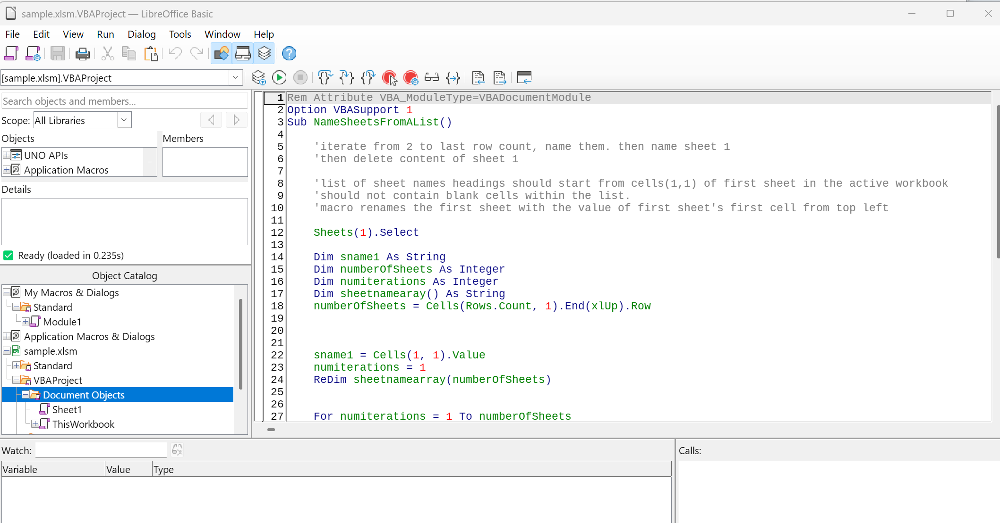
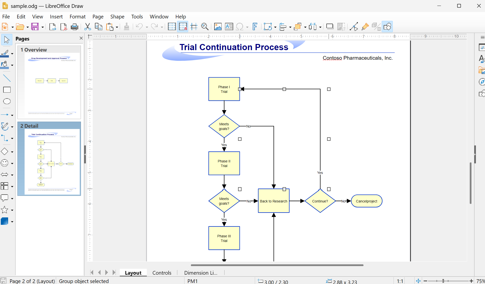
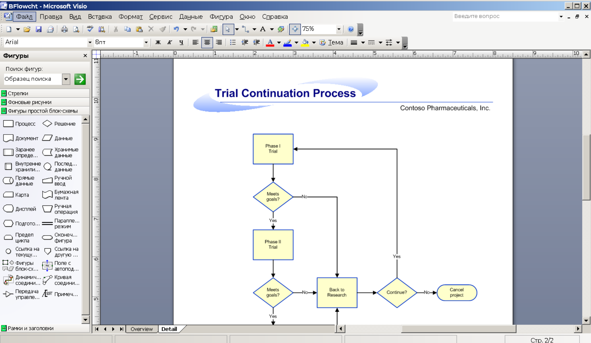
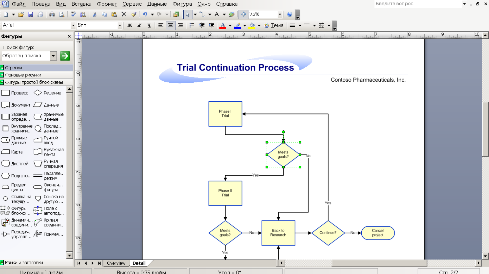
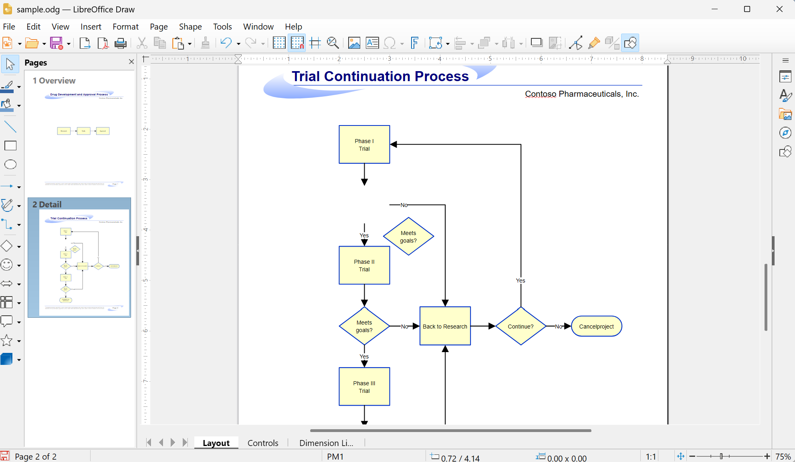

### Info

This directory contains a replica of alpine based
[alpine based libreoffice container](https://github.com/woahbase/alpine-libreoffice) with fixes

For binary Microsoft Office `.xlsx`/`.xls` files, to extract the VB  sceipt / macros one first converts the subject to OpenDocument format via
using [Libreoffice](https://documentation.libreoffice.org/en/english-documentation/) in `--headless` mode in particular for converting files between formats, including PDF, HTML, DOC, DOCX, EPUB, plain text, etc.
using various built-in filters

### Visio Support

__LibreOffice__ first added support for opening [Microsoft Visio] files in 3.5 - released in February 2012 -
with full support for newer `.vsdx` OpenDoc Visio combined semantics files arriving in LibreOffice 4.0 -
Release [timeline](https://www.libreoffice.org/media/OOo-major-derivatives.png) lists expanded coverage to support all existing Visio file formats, spanning from original __Visio__ __1.0__ (1992) up through the OpenDoc XML-based `.vsdx`
format introduced in __Microsoft Visio__ __2013__.

LibreOffice Desktop application features input only for Visio:  can read/import .vsdx (and other Visio formats), but not write/export Visio formats.
• Native drawing formats: Save as OpenDocument Drawing (.odg) or OpenDocument Drawing Template (.otg) to keep editable diagram layers and objects in LibreOffice Draw.
• Document & vector export: Export or convert to PDF (.pdf), Scalable Vector Graphics (.svg), Encapsulated PostScript (.eps), Enhanced Metafile (.emf), or Windows Metafile (.wmf).
• Raster image export: Export to PNG (.png), JPEG (.jpg/.jpeg), BMP (.bmp), TIFF (.tif/.tiff), or GIF (.gif).


### Samle Data

One can find the early format of Visio x.y  released in 1992 by __Shapeware Corporation__ (later __Visio Corporation__)
and acquired by Microsoft in 2000 samples known as
[20 Visio 2003 Sample Diagrams](https://legacyupdate.net/download-center/download/24023/visio-2003-sample-20-sample-diagrams)
from Microsoft Download Center Archive:

|Description | Filename|
|------------|---------|
|Active Directory diagram | ActvDir.vsd|
|Basic Flowchart | Bflowcht.vsd|
|Block Diagram - BlkDiagm.vsd|
|Building Floor Plan | BldgPlan.vsd|
|Basic Network diagram | Bnetwork.vsd|
|Brainstorming/Mind map | Brainstm.vsd|
|Calendar | Calendar.vsd|
|Database diagram | Database.vsd|
|Detailed Network diagram | Dnetwork.vsd|
|Electrical Engineering Control diagram | EECtrl.vsd|
|Fluid Power diagram | FluidPwr.vsd|
|Meeting Room layout | MeetRoom.vsd|
|Organization Chart | OrgChart.vsd|
|Process Engineering diagram | ProcEng.vsd|
|IT Rack diagram | Rack.vsd|
|Timeline diagram | Timeline.vsd|
|UML diagram | UML.vsd|
|Web Design diagram | WebDsgn.vsd|
|Web Site diagram | WebSite.vsd|
|Window UI diagram | WinUI.vsd |


|Filename|Description| Comment |
|----|-----|------|
|`ActvDir.vsd`|Active Directory diagram||
|`Bflowcht.vsd`|Basic Flowchart|Two pages, used as `sample.vsd`|
|`BlkDiagm.vsd`|Block Diagram||
|`BldgPlan.vsd`|Building Floor Plan||
|`Bnetwork.vsd`|Basic Network diagram||
|`Brainstm.vsd`|Brainstorming/Mind map||
|`Calendar.vsd`|Calendar||
|`Database.vsd`|Database diagram||
|`Dnetwork.vsd`|Detailed Network diagram||
|`EECtrl.vsd`|Electrical Engineering Control diagram||
|`FluidPwr.vsd`|Fluid Power diagram||
|`MeetRoom.vsd`|Meeting Room layout||
|`OrgChart.vsd`|Organization Chart||
|`ProcEng.vsd`|Process Engineering diagram||
|`Rack.vsd`|IT Rack diagram||
|`Timeline.vsd`|Timeline diagram||
|`UML.vsd`|UML diagram||
|`WebDsgn.vsd`|Web Design diagram||
|`WebSite.vsd`|Web Site diagram||
|`WinUI.vsd`|Window UI diagram||

packaged as `VisioSam.exe`

> NOTE: This download is no longer available on microsoft.com.
The downloads below links provided by the Internet Archive Wayback Machine from the Microsoft Download Center are also not workig,
Link listed on https://www.visiocafe.com/microsoft.htm is no longer available.
The https://download.cnet.com/visio-2003-sample-20-sample-diagrams has the non expired __Visio 2003 Sample: 20 Sample Diagrams for Windows__ copy.

One can get a [Open Packaging Conventions](https://en.wikipedia.org/wiki/Open_Packaging_Conventions) __OPC__ Visio 365 [Microsoft Visio VSDX Files Download](https://www.howtoanalyzedata.net/microsoft-visio-vsdx-files-download)
and from  [featured Visio templates and diagrams](https://support.microsoft.com/en-us/visio/featured-visio-templates-and-diagrams)

```text
'BPMN cross-functional chart tf16393606.vstx'
'Bank Account database tf22876660.vsdx'
'Basic UML communication tf22725921.vsdx'
'Basic UML component tf33765020.vsdx'
'Basic UML deployment tf22667440.vsdx'
'Basic UML use case tf11670301.vsdx'
'Basic flowchart tf11712902.vstx'
'Basic home network tf78855695.vstx'
'Computer block diagram tf16403437.vsdx'
'Cross-functional flowchart tf56636647.vstx'
'Detailed network tf33958593.vstx'
'Ethernet LAN diagram tf16393633.vstx'
'Login-registry activity tf56142499.vsdx'
'Office network plan tf16403889.vsdx'
'Property buying flow tf16403429.vsdx'
'Star network diagram tf16403888.vsdx'
'UML database for employees tf33998165.vsdx'
'UML state ATM tf11406762.vsdx'
```
### Usage

```sh
docker pull alpine:3.22
```
```sh
export IMAGE=basic-libreoffice
docker build -f Dockerfile -t $IMAGE .
```

```sh
export IMAGE=basic-libreoffice
export NAME=$IMAGE
mkdir -p ~/data; cp sample.xlsm ~/data
docker run --entrypoint sh --rm -it --name $NAME --hostname libreoffice -e PGID=1000 -e PUID=1000 -c 512 -m 2096m -v /c/Users/${USERNAME}/data:/home/alpine $IMAGE /usr/bin/libreoffice --headless --convert-to ods:"calc8" sample.xlsm
docker container prune -f
```
```text
convert /home/alpine/sample.xlsm as a Calc document -> /home/alpine/sample.ods using filter: calc8
Overwriting: /home/alpine/sample.ods
```
```sh
pushd ~/data/
file sample.ods
```
```text
sample.ods: OpenDocument Spreadsheet
```
"wird es interessanter und sogar  höchst interessant":

```sh
unzip -ql sample.ods
```
```text
  Length      Date    Time    Name
---------  ---------- -----   ----
       46  2026-11-21 22:55   mimetype
     2018  2026-11-21 22:55   Basic/VBAProject/ThisWorkbook.xml
      405  2026-11-21 22:55   Basic/VBAProject/Sheet1 (Sheetname1).xml
...
     2491  2026-11-21 22:55   Thumbnails/thumbnail.png
     1707  2026-11-21 22:55   META-INF/manifest.xml
---------                     -------
    50364                     21 files
```
> NOTE: the original VBA project is not necessarily preserved "byte-for-byte" - it is LibreOffice's representation of the imported project.
```sh
unzip -uo sample.ods  Basic/VBAProject/ThisWorkbook.xml
```
```text
Archive:  sample.ods
  inflating: Basic/VBAProject/ThisWorkbook.xml
```
```sh
file Basic/VBAProject/ThisWorkbook.xml
```
```text
Basic/VBAProject/ThisWorkbook.xml: XML 1.0 document, ASCII text
```
```sh
xmlstarlet fo -D Basic/VBAProject/ThisWorkbook.xml | xmlstarlet sel -t -v "//script:module" -| head -40
```
> NOTE: on Windows xmlstarlet binary is called `xml.exe`
on RHEL based system use
```sh
xmllint --format Basic/VBAProject/ThisWorkbook.xml | sed -n '/<script:module/,/<\/script:module>/p' | head -40
```

this will yield extract the raw  VB-like content:
```text
Rem Attribute VBA_ModuleType=VBADocumentModule
Option VBASupport 1
Sub NameSheetsFromAList()

    'iterate from 2 to last row count, name them. then name sheet 1
    'then delete content of sheet 1

    'list of sheet names headings should start from cells(1,1) of first sheet in the active workbook
    'should not contain blank cells within the list.
    'macro renames the first sheet with the value of first sheet's first cell from top left

    Sheets(1).Select

    Dim sname1 As String
    Dim numberOfSheets As Integer
    Dim numiterations As Integer
    Dim sheetnamearay() As String
    numberOfSheets = Cells(Rows.Count, 1).End(xlUp).Row


    sname1 = Cells(1, 1).Value
    numiterations = 1
    ReDim sheetnamearray(numberOfSheets)


    For numiterations = 1 To numberOfSheets
        sheetnamearray(numiterations - 1) = Cells(numiterations, 1).Value
    Next numiterations

    For numiterations = 2 To numberOfSheets
        'add number of elements in array - 1 sheets. name them.
        ActiveWorkbook.Sheets.Add(After:=ActiveWorkbook.Sheets(ActiveWorkbook.Sheets.Count)).Name = sheetnamearray(numiterations - 1)
    Next numiterations

    Sheets(1).Name = sheetnamearray(0)
    Sheets(1).Select

    For numiterations = 1 To numberOfSheets
        Cells(numiterations, 1).Value = ""
```

which matches quite close to what one find in the desktop application or Microsoft Office Excel.



### Using Uno Conv

The `unoconv` implementation is not merely another way to run the same command:
it introduces a persistent UNO service, allowing multiple clients to submit conversion requests without repeatedly launching LibreOffice.
```sh
export IMAGE=basic-libreoffice-uno
docker build -t $IMAGE -f Dockerfile.uno .
```
```sh
export IMAGE=basic-libreoffice-uno
export NAME=$IMAGE
docker run -d --name $NAME -p 8100:8100 $IMAGE
```
```sh
docker cp sample.xlsm $NAME:/tmp/
```

```sh
docker exec -ti $NAME unoconv --connection 'socket,host=127.0.0.1,port=8100,tcpNoDelay=1;urp;StarOffice.ComponentContext' -f ods /tmp/sample.xlsm
```
```sh
docker cp $NAME:/tmp/sample.ods .
```
```sh
unzip -ql sample.ods
```
```text
  Length      Date    Time    Name
---------  ---------- -----   ----
       46  2026-11-22 02:59   mimetype
     2018  2026-11-22 02:59   Basic/VBAProject/ThisWorkbook.xml
      405  2026-11-22 02:59   Thumbnails/thumbnail.png
...
     1707  2026-11-22 02:59   META-INF/manifest.xml
---------                     -------
    50364                     21 files
```

### Visio to LibreOffice Draw Conversion (Lossy?)

```sh
export IMAGE=basic-libreoffice-uno
docker build -t $IMAGE -f Dockerfile.uno .
```
```sh
export IMAGE=basic-libreoffice-uno
export NAME=$IMAGE
docker run -d --name $NAME -p 8100:8100 $IMAGE
```

```sh
docker cp sample.vsd $NAME:/tmp/
```
```sh
docker exec -ti $NAME unoconv --connection 'socket,host=127.0.0.1,port=8100,tcpNoDelay=1;urp;StarOffice.ComponentContext' -f odg /tmp/sample.vsd
```
```text
if product.ooName not in ('LibreOffice', 'LOdev') or LooseVersion(product.ooSetupVersion) <= LooseVersion('3.3'):
```
```sh
docker cp $NAME:/tmp/sample.odg .
```
```sh
file sample.odg
```
```text
sample.odg: OpenDocument Drawing
```

The result



looks very well match to the original



and the edges/nodes selectable individually

However the Semantic fidelity is not preserved:
As this becomes immediately apparent when trying to
__move a connected node around and inspect whether its connectors remain attached__

While native __Visio__ retains the connector attachments:



__LibreOffice__ does not:




One can download individual templates and diagram examples from from  [featured Visio templates and diagrams](https://support.microsoft.com/en-us/visio/featured-visio-templates-and-diagrams)
 using curl command / `Invoke-WebRequest` Powershell cmdlet / `[System.Net.Http.HttpClient]` with resource URLs
`https://createcatalog.public.onecdn.static.microsoft/support/templates/en-us/tf33958593.vstx` and similar or download in the browser
 - for some files download will be made pending the approval.


#### Data augmentation through controlled perturbation of the original diagrams


Bar analogy is good:

- Same person.
- Same underlying identity.
- Same driver ID.
- Progressively different appearance after each shot.
- Eventually, identifying the person from the observed appearance becomes increasingly difficult


|Term|Meaning in Visio Conversion experiment|
|----|--------------------------|
|Data augmentation|Generate additional examples from existing diagrams|
|Controlled perturbation|Change geometry while preserving diagram semantics|
|Invariant representation|Identify the same logical relationships despite geometric changes|
|Domain randomization|Expose the model to many variations of the same underlying structure|
|Ground-truth labeling|Retain the original Visio connection graph as the correct answer|


### Automation Exercise
```powershell

# CreateFlowchart.ps1
# based on:
# https://dellenny.com/approaches-to-automatically-generate-visio-diagrams-from-text/
# https://www.visguy.com/2006/09/13/create-visio-flowcharts-programmatically
# Visio COM Automation
# Compatible with Windows PowerShell 2.0 / Visio 2007

$ErrorActionPreference = "Stop"

# --------------------------------------------------
# Step 1: Get the flowchart template and stencil
# --------------------------------------------------

$flowchartTemplateName = "C:\Program Files\Microsoft Office\Office12\1049\BASFLO_M.VST"
$flowchartStencilName = "BASFLO_M.VSS"

$masterProcessName = "Process"
$masterDecisionName = "Decision"

$visApp = $null
$docFlowTemplate = $null
$docFlowStencil = $null

try {

    # Start Visio

    $visApp = New-Object -ComObject Visio.Application
    $visApp.Visible = $true

    # Open a new document using the flowchart template

    $docFlowTemplate = $visApp.Documents.Add(
        $flowchartTemplateName
    )

    # Search open documents for the flowchart stencil

    foreach ($doc in $visApp.Documents) {

        Write-Host "Document:" $doc.Name

        if ($doc.Name -eq $flowchartStencilName) {
            $docFlowStencil = $doc
            break
        }
    }

    # Fallback: open stencil explicitly if not found
    
    if ($null -eq $docFlowStencil) {

        # NOTE: system ACP locale is used in Office application resource path and name attributes 
        # en-us 0x409 1033
        # ru-ru 0x419 1049
        $stencilPath = "C:\Program Files\Microsoft Office\Office12\1049\BASFLO_M.VSS"

        $docFlowStencil = $visApp.Documents.OpenEx(
            $stencilPath,
            4
        )
    }

    # --------------------------------------------------
    # Step 2: Get masters and connector
    # --------------------------------------------------

    $mstProcess = $docFlowStencil.Masters.ItemU(
        $masterProcessName
    )

    $mstDecision = $docFlowStencil.Masters.ItemU(
        $masterDecisionName
    )

    # Built-in connector object (not a Master)

    $conn = $visApp.ConnectorToolDataObject

    # --------------------------------------------------
    # Step 3: Drop the masters
    # --------------------------------------------------

    $numShapes = 7
    $decisionStepNumber = 3

    $dx = 1.5
    $dy = 1.0

    # First page of the document

    $pg = $docFlowTemplate.Pages.Item(1)

    # Get center and top of page

    $x = $pg.PageSheet.CellsU(
        "PageWidth"
    ).ResultIU / 2

    $y = $pg.PageSheet.CellsU(
        "PageHeight"
    ).ResultIU - 1

    $shpLast = $null
    $shpDec = $null
    $shpConn = $null

    for ($i = 1; $i -le $numShapes; $i++) {

        # Drop Process or Decision shape

        if ($i -eq $decisionStepNumber) {

            $shpNew = $pg.Drop(
                $mstDecision,
                $x,
                $y
            )

            $shpNew.Text = "$i?"

            # Remember decision shape

            $shpDec = $shpNew
        }
        else {

            $shpNew = $pg.Drop(
                $mstProcess,
                $x,
                $y
            )

            $shpNew.Text = "Do Step $i"
        }

        # Set custom properties

        $shpNew.CellsU(
            "Prop.Cost"
        ).ResultIU = $i

        # Duration expressed in elapsed hours
<#
        $shpNew.CellsU(
            "Prop.Duration"
        ).FormulaU = ("$i h")
		#>
<# Exception setting "FormulaU": "
#NAME?"

- this is ShapeSheet formula parsing issue
#>
        # Connect shapes

        if ($i -ne 1) {

            # Drop connector

            $shpConn = $pg.Drop(
                $conn,
                0,
                0
            )

            # Glue BeginX

            if ($i -eq ($decisionStepNumber + 1)) {

                # Glue to right-side decision connection

                $shpConn.CellsU(
                    "BeginX"
                ).GlueTo(
                    $shpDec.CellsU("Connections.X2")
                )
            }
            else {

                # Dynamic glue to previous shape

                $shpConn.CellsU(
                    "BeginX"
                ).GlueTo(
                    $shpLast.CellsU("PinX")
                )
            }

            # Glue EndX to new shape

            $shpConn.CellsU(
                "EndX"
            ).GlueTo(
                $shpNew.CellsU("PinX")
            )
        }

        # Prepare for next iteration

        $shpLast = $shpNew

        # Adjust coordinates according to branch

        if ($i -eq $decisionStepNumber) {

            $x = $x + $dx
        }
        elseif ($i -eq ($decisionStepNumber + 1)) {

            $x = $x - $dx
            $y = $y - $dy

            # Label decision branch

            $shpConn.Text = "No"

            # Next connector starts at decision shape

            $shpLast = $shpDec
        }
        else {

            $y = $y - $dy
        }
    }

    # --------------------------------------------------
    # Step 4: Layout and deselect
    # --------------------------------------------------

    # Original example leaves automatic layout disabled.
    # Uncomment to experiment:
    #
    # $pg.Layout()

    # Deselect all shapes

    $visApp.ActiveWindow.DeselectAll()

    # Original example:
    #
    # Visio.Windows.Arrange(
    #     Visio.visArrangeTileVertical
    # )
    #
    # This requires resolving the Visio enum value
    # or using the installed Visio interop assembly.

    Write-Host "Flowchart created successfully."

}
finally {

    # Close documents and quit Visio

    if ($null -ne $docFlowTemplate) {
		$docFlowTemplate.Layout
		$docFlowTemplate.SaveAs( "C:\DOCUME~1\Admin\LOCALS~1\Temp\AutomatedFlowchart.vsd")
		$docFlowTemplate.Saved = $true
        $docFlowTemplate.Close()
    }

    if ($null -ne $docFlowStencil) {
      try {
        $docFlowStencil.Close()
      } catch [Exception] { 
        # System.Reflection.TargetInvocationException: Exception has been thrown by the target of an invocation. ---> System.Runtime.InteropServices.COMException (0x86DB0898):
        # the stencil is a shared document, already owned or managed by the template/document session. Closing it independently may be rejected by Visio
        write-host $_.Exception
      }
    }

    if ($null -ne $visApp) {
      $visApp.Quit()
    }
}
	
```
```powershell
. .\create_flowchart.ps1
```
```text
Document: Документ1
Document: ARROWS_M.VSS
Document: BACKGR_M.VSS
Document: BASFLO_M.VSS
Flowchart created successfully.
0
System.Reflection.TargetInvocationException: Exception has been thrown by the target of an invocation. ---> System.Runtime.InteropServices.COMException (0x86DB0898):
Возникло исключение.
   --- End of inner exception stack trace ---
   at System.RuntimeType.InvokeDispMethod(String name, BindingFlags invokeAttr,Object target, Object[] args, Boolean[] byrefModifiers, Int32 culture, String[]namedParameters)
```
```text
 Directory of C:\DOCUME~1\Admin\LOCALS~1\Temp

11/22/2026  03:49 PM    <DIR>          WPDNSE
11/22/2026  05:34 PM                81 dw.log
11/22/2026  05:42 PM            38,400 AutomatedFlowchart.vsd
11/22/2026  05:42 PM    <DIR>          ..
11/22/2026  05:42 PM    <DIR>          .
               2 File(s)         38,481 bytes
```


### See Also

  * https://stackoverflow.com/questions/50982064/converting-docx-to-pdf-with-pure-python-on-linux-without-libreoffice
  * https://stackoverflow.com/questions/72434000/running-libreoffice-converter-on-docker

  * https://docs.linuxserver.io/images/docker-libreoffice
  * https://medium.com/codex/libreoffice-on-docker-1a64245468c
  * [known bug](https://bugs.documentfoundation.org/show_bug.cgi?id=37531&redirected_from=fdo) of Libreoffice will not run in "batch mode" when there is another instance open
  * [document](https://www.baeldung.com/spring-file-upload) and [source](https://github.com/eugenp/tutorials/tree/master/spring-web-modules/spring-mvc-java) on Spring App file Upoad - too many projects in the same umbrella
  * [upload files through curl](https://medium.com/@petehouston/upload-files-with-curl-93064dcccc76)
  * [spring uloading files getting started](https://spring.io/guides/gs/uploading-files/)
  * [1 pixel png used as spacer](https://commons.wikimedia.org/wiki/File:1x1.png)
  * https://stackoverflow.com/questions/35406213/how-to-copy-data-from-docker-volume-to-host
  * [standalone Office Development Suites for .Net](https://www.e-iceblue.com/Introduce/spire-office-for-net-free.html)
  * https://github.com/linuxserver/docker-libreoffice/blob/master/Dockerfile
  * https://github.com/hannesdejager/docker-libreoffice-api/blob/master/Dockerfile - an headless LibreOffice in Docker listening for API requests on port 8100
  * https://hub.docker.com/r/libreofficedocker/alpine
  * https://github.com/ipunkt/docker-libreoffice-headless
  * [converting doc/docx Format to PDF With Help of LibreOffice and LaTeX](https://www.baeldung.com/linux/latex-doc-docx-pdf-conversion)
  * [converting PDF to Word Documents in Linux](https://www.baeldung.com/linux/pdf-word-conversion)
  * [conversion of a PowerPoint PPT File to PDF From the Command Line](https://www.baeldung.com/linux/convert-powerpoint-ppt-to-pdf)
  * [convert CSV to XLS or XSLX in Linux](https://www.baeldung.com/linux/csv-xls-xslx)
---

### Author
[Serguei Kouzmine](kouzmine_serguei@yahoo.com)

