### Info

Latest [Mermaid](https://github.com/mermaid-js/mermaid)
bundled with [React (software)](https://en.wikipedia.org/wiki/React_(software)) library for web and native user interfaces and [Vite](https://github.com/vitejs/vite) fast next generation frontend tooling in order to run dist as a static resource (partial success)

### TL; DR

To run the application, one needs to open the console to run the command line:
```cmd
pushd dist
"C:\Program Files\Google\Chrome\Application\chrome.exe" --user-data-dir=C:\temp\chrome-file-test --allow-file-access-from-files file:///%CD%\index.html
```
or equivalent command engaging the [create-shortcut.ps1](https://github.com/gangstanthony/PowerShell/blob/master/Create-Shortcut.ps1) call. See Puppetized version of the same in [create_simple_shortcut_ps1.erb](https://github.com/sergueik/puppetmaster_vagrant/blob/master/modules/custom_command/templates/create_simple_shortcut_ps1.erb)

e.g. in powershell console

```powershell

$scriptCode = (get-content -path (resolve-path -path 'link_generator.ps1').path ) -join [char]10
$scriptBlock = [scriptblock]::Create($scriptCode)
$filepath = (resolve-path -path 'dist\index.html').path
[Uri] $fileUri = new-object Uri($filepath)
new-item -path 'launch.lnk' -itemtype file -erroraction silentlycontinue
$destination = (resolve-path -path 'launch.lnk').path
$arguments =  ('--user-data-dir=C:\temp\chrome-file-test --allow-file-access-from-files {0}' -f $fileUri.AbsoluteUri)
$key = 'HKLM:\SOFTWARE\Classes\ChromeHTML\shell\open\command'
$source =  (Get-Item -Path $key).GetValue('') -replace ' *--.*', ''
& $scriptBlock -Source $source -Arguments "$arguments" -DestinationLnk "$destination" -Verbose

```
> NOTE: `Invoke-Expression` does not recognize `ArgumentList` nor `Parameter` parameter

> NOTE: For a GitHub blob URL, `System.UriBuilder` is the way. The mapping is:

|Component|Browser URL|Raw URL|
|---------|-----------|-------|
|Host|`github.com`|`raw.githubusercontent.com`|
|Repository path|`/gangstanthony/PowerShell`|same|
|Branch|`/blob/master/`|`/refs/heads/master/`<br/>the `/refs/heads/` part is unnecessary|
|File path|`Create-Shortcut.ps1`|same|


On Ubuntu, create or edit the desktop launcher `mermaid-local.desktop`:

```text
[Desktop Entry]
Version=1.0
Name=Mermaid Local
GenericName=Mermaid Local on Web Browser
Comment=Render the Mermaid Content
Exec=/usr/bin/google-chrome-stable --user-data-dir=/tmp/chrome-file-test --allow-file-access-from-files file://[PROJECT_DIR]/dist/index.html
Terminal=false
Icon=[PROJECT_DIR]/icons8-workflow-80.png
Type=Application
Categories=Network;WebBrowser;
MimeType=text/html;text/xml;application/xhtml_xml;image/webp;x-scheme-handler/http;x-scheme-handler/https;x-scheme-handler/ftp;
Actions=new-window;

Name[en_US]=Mermaid Local

[Desktop Action new-window]
Name=New Window
Exec=/usr/bin/google-chrome-stable --user-data-dir=/tmp/chrome-file-test --allow-file-access-from-files file://[PROJECT_DIR]/dist/index.html

```
```sh
sed -i "s|\[PROJECT_DIR\]|$(pwd)|g" mermaid-local.desktop
```
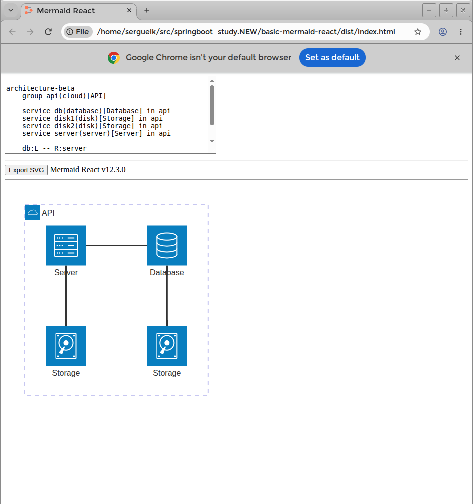

> NOTE: in the very first launch one will have to confirm few Chrome welcome dialogs.

### Background

The __Mermaid Live Editor__ is an _simplify documentation and avoid heavy tools_ open source __Visio Alternative__
it is available locally and can run from file.


`Mermaid.js` is a JavaScript library that allows users to create different types of diagrams, using a simple syntax. It supports a variety of diagram types, including [Swimlane flowcharts](https://en.wikipedia.org/wiki/Swimlane), [Sequence Diagrams](https://en.wikipedia.org/wiki/Sequence_diagram), [Gantt charts](https://en.wikipedia.org/wiki/Gantt_chart), [Entiy Relationship](https://en.wikipedia.org/wiki/Entity%E2%80%93relationship_model),  and [UML](https://en.wikipedia.org/wiki/Unified_Modeling_Language) class diagrams
Latest versions of Mermaid require [React](https://github.com/react/react)

__Mermaid__ diagrams can be easily embedded in websites, blogs, and documentation, making them a popular choice for technical writers, software developers, and other professionals who need to visualize complex information

[Mermaid](https://en.wikipedia.org/wiki/Mermaid_(software)) is open-source and can be integrated in both personal and commercial projects, making it a versatile tool for a variety of applications

Like many other WYSIWYG alternatives Mermaid Diagrams are authored in plain Text and possible to design
im a plain text editor (Syntax-aware editors can provide IntelliSense typcally vis extensions and plugins)
which makes it easier to version, review, and maintain compared to graphical design tools like

* [Blue Prism](https://en.wikipedia.org/wiki/Blue_Prism)
* [UiPath](https://en.wikipedia.org/wiki/UiPath)
* [Windows Workfllow Foundation](https://en.wikipedia.org/wiki/Windows_Workflow_Foundation)
* [Mule AnyPoint Design Studio Flows](https://www.mulesoft.com/platform/studio),
* Eclipse extensions and plugins for visual designing flows
* [Microsoft Visio](https://en.wikipedia.org/wiki/Microsoft_Visio)

and others.

these are very different kinds of development systems, but they share a graphical/WYSIWYG authoring model,
whereas __Mermaid__ deliberately makes the diagram itself source text.


```text
Traditional visual authoring
        │
        ▼
   Office / Visio
        │
        ▼
binary / structured document
        │
        ├── application required for editing
        ├── awkward textual diff
        ├── difficult merge semantics
        └── visual inspection
```
              versus
```
textual authoring
        │
        ▼
   Markdown + Mermaid
        │
        ▼
       source
        │
        ├── plain text
        ├── Git-friendly
        ├── diffable
        ├── mergeable
        ├── scriptable
        └── rendered when needed
```

A 2007-era .docx can effectively become a container of historical debris:
```code
10-page document
│
├── 🧾 current prose - visible content
├── 🖼 thumbnails of current diagrams
├── 📦 embedd  ed Visio
├── 📦 embedded Excel
├── 📦 embedded Word 97/2003
├── obsolete revisions
├── pasted copies
├── OLE objects
├── backup-ish material
└── 200 historical remnants ?
```
suddenly discoverred hundreds of embedded objects,
the mere fact that they are physically present tells you almost nothing about their current semantic relevance.

That's a fundamentally different problem from a Markdown/Mermaid source tree:
```code
README.md
diagram.md
    └── Mermaid source
```
With the Office/OLE case, you first have to perform archaeology:

  * *Is this object referenced by the document?*
  * *Is it visible?*
  * *Is it current?*
  * *Is it an alternate version?*
  * *Is it an old OLE embedding that somebody forgot to remove?*
  * *Is it merely a copied object from an earlier revision?*


But:

"Sorry, there's only one Korben Dallas — and he already boarded."

Microsoft's own development of [MarkItDown](https://markitdown.online)
 is an interesting acknowledgment of the value of extracting information from rich document formats into a more portable, text-oriented representation. The goal is not necessarily to replace Office documents, but to make their contents accessible to downstream tooling, search, automation, and AI systems.

### Usage

```sh
docker pull node:22.12.0-alpine
docker pull nginx:1.30.3-alpine3.23
```
```sh
IMAGE=mermaid-react
docker ps -aq --filter ancestor=%IMAGE|xargs -r docker rm -f
```
```sh
IMAGE=mermaid-react
docker build -t $IMAGE -f Dockerfile .
```
> NOTE: the log will vary with precence of `package-lock.json` that only kept to workaround enterprise `%2f` trouble in certain commits (e.g. `1ebe810ae82df4b22ad13bdd0f7e90b9e34decf6`):

```text
Sending build context to Docker daemon  15.59MB
Step 1/15 : FROM node:22.12.0-alpine AS builder
 ---> 3448d7ddbc59
Step 2/15 : WORKDIR /app
 ---> Using cache
 ---> 53cfdb8bb677
Step 3/15 : COPY package*.json /app/
 ---> Using cache
 ---> 631799504f66
Step 4/15 : ARG NPM_REGISTRY
 ---> Using cache
 ---> 9c569fb31141
Step 5/15 : RUN if [ -n "$NPM_REGISTRY" ]; then npm config set registry "$NPM_REGISTRY"; fi
 ---> Using cache
 ---> a21cd7941b65
Step 6/15 : RUN npm install || { cat /root/.npm/_logs/*.log; exit 1; }
 ---> Running in 1f6870e0451e

added 140 packages, and audited 141 packages in 1m

11 packages are looking for funding
  run `npm fund` for details

found 0 vulnerabilities
npm notice
npm notice New major version of npm available! 10.9.0 -> 12.2.2
npm notice Changelog: https://github.com/npm/cli/releases/tag/v12.2.2
npm notice To update run: npm install -g npm@12.2.2
npm notice
Removing intermediate container 1f6870e0451e
 ---> b43e574b198c
Step 7/15 : COPY index.html vite.config.js favicon.png /app/
 ---> 7a46485ae33c
Step 8/15 : ADD src /app/src
 ---> ed46526a5ffd
Step 9/15 : RUN npm run build
 ---> Running in 7a771ad51d88

> mermaid-react@0.2.0 build
> vite build

vite v8.3.8 building client environment for production...
transforming...
[plugin rolldown:vite-resolve] Module "util" has been externalized for browser compatibility, imported by "/app/node_modules/blob-stream/index.js". See https://vite.dev/guide/troubleshooting.html#module-externalized-for-browser-compatibility for more details.
[plugin rolldown:vite-resolve] Module "stream" has been externalized for browser compatibility, imported by "/app/node_modules/blob-stream/index.js". See https://vite.dev/guide/troubleshooting.html#module-externalized-for-browser-compatibility for more details.
✓ 1569 modules transformed.
rendering chunks...
computing gzip size...
dist/assets/favicon-Zy_Yp00f.png                                                         0.66 kB
dist/index.html                                                                          1.36 kB │ gzip:   0.46 kB
dist/assets/pie-XZMESJXO-BkOyCedx.js                                                     0.10 kB │ gzip:   0.12 kB
dist/assets/info-OHQRW6UA-D3f9en0a.js                                                    0.10 kB │ gzip:   0.12 kB
dist/assets/radar-ABXABTNO-CfxPUqgx.js                                                   0.10 kB │ gzip:   0.12 kB
dist/assets/packet-JDAUHWVQ-BPtF6PPI.js                                                  0.11 kB │ gzip:   0.12 kB
dist/assets/cynefin-EF2NZ3EQ-BoCGwdk4.js                                                 0.11 kB │ gzip:   0.12 kB
dist/assets/treemap-SAJKECNS-DIm4KacE.js                                                 0.11 kB │ gzip:   0.12 kB
dist/assets/wardley-7MLQ67FV-ZJCQVSPx.js                                                 0.11 kB │ gzip:   0.12 kB
dist/assets/gitGraph-VSP46ZUC-CF3RSxCv.js                                                0.11 kB │ gzip:   0.12 kB
dist/assets/railroad-I3PHUGI6-C7pKS08o.js                                                0.11 kB │ gzip:   0.12 kB
dist/assets/treeView-D4JQ5SDB-Dr_ne_22.js                                                0.11 kB │ gzip:   0.12 kB
dist/assets/railroad-peg-JR7BVNR7-D_Us9wAk.js                                            0.11 kB │ gzip:   0.13 kB
dist/assets/architecture-WOLXFQ4H-BVmOKT6g.js                                            0.11 kB │ gzip:   0.13 kB
dist/assets/railroad-abnf-LNEFI6M7-ChrckDFx.js                                           0.11 kB │ gzip:   0.13 kB
dist/assets/railroad-ebnf-DWYD2UWJ-29s4hWqg.js                                           0.11 kB │ gzip:   0.13 kB
dist/assets/eventmodeling-K75KTNOO-BII2i0MJ.js                                           0.11 kB │ gzip:   0.13 kB
dist/assets/__vite-optional-peer-dep_canvg_svg-exportjs-browser-mNUDxd_4.js              0.12 kB │ gzip:   0.12 kB
dist/assets/__vite-optional-peer-dep_pdfkit_svg-exportjs-browser-N1KX9UJ0.js             0.12 kB │ gzip:   0.12 kB
dist/assets/__vite-optional-peer-dep_svg-to-pdfkit_svg-exportjs-browser-va1HP462.js      0.13 kB │ gzip:   0.13 kB
dist/assets/chunk-Y2CYZVJY-DsF7k-Jl.js                                                   0.15 kB │ gzip:   0.14 kB
dist/assets/chunk-2Q5K7J3B-C1jixKkw.js                                                   0.19 kB │ gzip:   0.16 kB
dist/assets/chunk-JWPE2WC7-DVXcaiue.js                                                   0.22 kB │ gzip:   0.17 kB
dist/assets/chunk-XXDRQBXY-i7MKP1NY.js                                                   0.26 kB │ gzip:   0.22 kB
dist/assets/chunk-5VM5RSS4-ZNzvKenW.js                                                   0.36 kB │ gzip:   0.27 kB
dist/assets/flowDiagram-MALGAFMO-DZPsClzt.js                                             0.45 kB │ gzip:   0.26 kB
dist/assets/chunk-TU62E6Q5-vp5xeYd1.js                                                   0.57 kB │ gzip:   0.40 kB
dist/assets/chunk-J5ZVWO5B-oDCd-gWO.js                                                   0.63 kB │ gzip:   0.43 kB
dist/assets/infoDiagram-KBXO4MBG-cMfV9Cfe.js                                             0.65 kB │ gzip:   0.42 kB
dist/assets/swimlanesDiagram-OMPLPG4O-tjaOqoKA.js                                        0.71 kB │ gzip:   0.43 kB
dist/assets/sizeCapture-INFHLROL-3uHXrFqA.js                                             0.87 kB │ gzip:   0.51 kB
dist/assets/rolldown-runtime-COiEfhsA.js                                                 1.11 kB │ gzip:   0.62 kB
dist/assets/chunk-LEVMRMFU-aarFh5Aq.js                                                   1.42 kB │ gzip:   0.79 kB
dist/assets/blob-stream-CvQ_hpSk.js                                                      1.55 kB │ gzip:   0.70 kB
dist/assets/railroadDiagram-MRQ6NCDL-BSSrokUV.js                                         1.67 kB │ gzip:   0.78 kB
dist/assets/abnfDiagram-S7VZAUFO-Dg0bp650.js                                             1.85 kB │ gzip:   0.90 kB
dist/assets/chunk-X4PVCEUW-DlehkGvG.js                                                   1.95 kB │ gzip:   0.95 kB
dist/assets/chunk-HFQBQIA3-DM7z7zhg.js                                                   1.98 kB │ gzip:   0.90 kB
dist/assets/pegDiagram-FD4XPPHP-DKCKRHKE.js                                              2.01 kB │ gzip:   0.94 kB
dist/assets/ebnfDiagram-UZSYDL2S-B_rHXYQ6.js                                             2.07 kB │ gzip:   0.89 kB
dist/assets/diagram-DNEMPZML-CUdiLG4-.js                                                 4.34 kB │ gzip:   1.90 kB
dist/assets/pieDiagram-J4AKIIQI-tCsE-HwC.js                                              5.00 kB │ gzip:   2.12 kB
dist/assets/bpmnIcons-APHXDYXF-C0jbCElo.js                                               5.21 kB │ gzip:   1.15 kB
dist/assets/chunk-KS47KZWR-B-Y-fHLo.js                                                   5.43 kB │ gzip:   2.49 kB
dist/assets/chunk-R3KSYZAL-C-y1wYKj.js                                                   5.89 kB │ gzip:   2.71 kB
dist/assets/diagram-L3MUGCDN-DlB7lfFQ.js                                                 6.07 kB │ gzip:   2.57 kB
dist/assets/diagram-XPFHEONP-BIlQamyb.js                                                 8.12 kB │ gzip:   3.63 kB
dist/assets/cynefinDiagram-L36ESFBY-DGl8i2Iv.js                                          9.94 kB │ gzip:   3.51 kB
dist/assets/chunk-KQLB2F66-mjbj8J5J.js                                                  10.32 kB │ gzip:   4.29 kB
dist/assets/diagram-MHCOC4E2-_7J2qqho.js                                                10.94 kB │ gzip:   4.24 kB
dist/assets/chunk-6MUBBAK2-B2a72OhG.js                                                  15.39 kB │ gzip:   6.10 kB
dist/assets/chunk-OY52VR5R-C2JfAhOt.js                                                  15.64 kB │ gzip:   4.35 kB
dist/assets/diagram-LA4NIPWU-CzR8X1f_.js                                                16.12 kB │ gzip:   5.65 kB
dist/assets/mermaid-parser.core-Ct0f9kDv.js                                             16.61 kB │ gzip:   3.93 kB
dist/assets/ishikawaDiagram-M35NCXHK-RkxjP3-6.js                                        17.30 kB │ gzip:   6.53 kB
dist/assets/kanban-definition-BZKZHSQY-I1LVVxL0.js                                      20.22 kB │ gzip:   7.14 kB
dist/assets/d3-selection-COWvaQNI.js                                                    20.94 kB │ gzip:   7.36 kB
dist/assets/mindmap-definition-I2QAS2VK-zU8nJO8L.js                                     22.80 kB │ gzip:   7.63 kB
dist/assets/journeyDiagram-OPLOXDXO-DiTZE0ce.js                                         23.17 kB │ gzip:   8.15 kB
dist/assets/graphlib-DS17s2tU.js                                                        23.90 kB │ gzip:   8.31 kB
dist/assets/wardleyDiagram-S7YFUSEH-Cvek152z.js                                         25.20 kB │ gzip:   6.55 kB
dist/assets/d3-shape-D-5p59x6.js                                                        25.62 kB │ gzip:   6.39 kB
dist/assets/rough.esm-Dy-Kn_BL.js                                                       27.10 kB │ gzip:   8.85 kB
dist/assets/gitGraphDiagram-STJD7YCW-DrH9CAO5.js                                        29.00 kB │ gzip:   8.53 kB
dist/assets/timeline-definition-SEUHKTQE-DPT5UTuj.js                                    30.46 kB │ gzip:  10.02 kB
dist/assets/erDiagram-EYBAPDEH-BGFwQB9_.js                                              30.54 kB │ gzip:  10.53 kB
dist/assets/requirementDiagram-Y7LWUY3S-Dxxhnbw7.js                                     30.98 kB │ gzip:   9.79 kB
dist/assets/quadrantDiagram-XTYBLID2-GkyZRPGg.js                                        33.52 kB │ gzip:   9.74 kB
dist/assets/sankeyDiagram-WGJFYUXA-WAUgPgbH.js                                          38.82 kB │ gzip:  14.66 kB
dist/assets/d3-scale-CElPUUud.js                                                        40.67 kB │ gzip:  14.78 kB
dist/assets/vennDiagram-NNMJR3RB-B8MEIBUb.js                                            41.18 kB │ gzip:  15.11 kB
dist/assets/stateDiagram-v2-FJ4FJNEA-BWuTj7OJ.js                                        41.45 kB │ gzip:  13.83 kB
dist/assets/blockDiagram-APKKGZFW-Ds6g4tse.js                                           42.35 kB │ gzip:  13.85 kB
dist/assets/xychartDiagram-GGNKY7IX-Bx85A-Rz.js                                         43.21 kB │ gzip:  11.86 kB
dist/assets/dagre-SPEB5RXH-C5QlJ7aq.js                                                  47.80 kB │ gzip:  17.07 kB
dist/assets/classDiagram-v2-L25IHNXF-BgmgHTL9.js                                        49.63 kB │ gzip:  16.12 kB
dist/assets/chunk-STOXU5M4-lNwrFBkV.js                                                  51.23 kB │ gzip:  16.63 kB
dist/assets/ganttDiagram-23REXITY-oLeJwOkW.js                                           53.01 kB │ gzip:  17.63 kB
dist/assets/chunk-QB3YPZ4I-DfeRDiex.js                                                  64.35 kB │ gzip:  20.87 kB
dist/assets/c4Diagram-KJ2TOQU5-CvLRT6AC.js                                              65.09 kB │ gzip:  18.63 kB
dist/assets/diagram-3B7GL73J-Bi_MOWIz.js                                                80.37 kB │ gzip:  25.13 kB
dist/assets/cose-bilkent-JH36ORCC-C6J2IoHg.js                                           81.23 kB │ gzip:  21.53 kB
dist/assets/sequenceDiagram-5NDRBG5M-Bncegqtd.js                                       117.68 kB │ gzip:  31.28 kB
dist/assets/swimlanes-UMQ2AFYF-kYNojH_t.js                                             117.80 kB │ gzip:  40.48 kB
dist/assets/chunk-AXFCVDMN-XL0kFDxy.js                                                 122.74 kB │ gzip:  31.43 kB
dist/assets/architectureDiagram-YGSQEFNW-B-UDOd8v.js                                   148.87 kB │ gzip:  41.11 kB
dist/assets/usecaseDiagram-AFA6YXN4-Bqy9s3qI.js                                        187.82 kB │ gzip:  49.22 kB
dist/assets/chunk-BG4553SI-Di8yMrb5.js                                                 243.02 kB │ gzip:  41.01 kB
dist/assets/katex-MEuSR36T.js                                                          258.78 kB │ gzip:  77.66 kB
dist/assets/cytoscape.esm-nTrd5EVq.js                                                  441.71 kB │ gzip: 139.68 kB
dist/assets/index-Cmi_YQ-f.js                                                          459.13 kB │ gzip: 139.95 kB
dist/assets/chunk-NGNAAXSQ-DI_UYJZ4.js                                                 629.04 kB │ gzip: 127.32 kB
dist/assets/elk-XV6XMXQE-B-GY9hV0.js                                                 1,498.89 kB │ gzip: 465.88 kB

[plugin builtin:vite-reporter]
(!) Some chunks are larger than 500 kB after minification. Consider:
- Using dynamic import() to code-split the application
- Use build.rolldownOptions.output.codeSplitting to improve chunking: https://rolldown.rs/reference/OutputOptions.codeSplitting
- Adjust chunk size limit for this warning via build.chunkSizeWarningLimit.
✓ built in 7.78s
Removing intermediate container 7a771ad51d88
 ---> 4a0b3bb79659
Step 10/15 : FROM nginx:1.30.3-alpine3.23
 ---> d0701bd41f82
Step 11/15 : WORKDIR /usr/share/nginx/html
 ---> Running in 9f4a939bfc7f
Removing intermediate container 9f4a939bfc7f
 ---> 7e90ca262b7a
Step 12/15 : COPY --from=builder /app/dist ./
 ---> e407f2da0349
Step 13/15 : COPY default.conf /etc/nginx/conf.d/
 ---> 45b136166dd6
Step 14/15 : EXPOSE 80
 ---> Running in 3a176938b07d
Removing intermediate container 3a176938b07d
 ---> 62de0178b407
Step 15/15 : CMD ["nginx", "-g", "daemon off;"]
 ---> Running in 2c8bda964166
Removing intermediate container 2c8bda964166
 ---> b8851ecce844
Successfully built b8851ecce844
Successfully tagged mermaid-react:latest
```
Save the web root into `dist`:

```sh
NAME=mermaid-react
docker container stop $NAME
docker container rm $NAME
docker create --name $NAME $IMAGE
NAME=mermaid-react
rm -fr dist
if test -d dist ; then echo "cannot continue"; else
docker cp $NAME:/usr/share/nginx/html dist
fi
docker container rm $NAME
```
```text
Successfully copied 5.56MB to /home/sergueik/src/springboot_study/basic-mermaid-react/dist
```
> NOTE: if `dist` is under source control it will be difficult to track the drift since all filenames will change.

if need to run the container
```sh
NAME=mermaid-react
docker container stop $NAME
docker container rm $NAME
docker run --name $NAME -d -p 8080:80 $IMAGE
```
```sh
curl -I http://$(docker-machine ip):8080
```
or
```sh
curl -I http://localhost:8080
```
```text
HTTP/1.1 200 OK
Server: nginx/1.30.3
Date: Wed, 11 Nov 2026 20:31:24 GMT
Content-Type: text/html
Content-Length: 1346
Last-Modified: Wed, 11 Nov 2026 20:30:41 GMT
Connection: keep-alive
ETag: "6af4d071-542"
Accept-Ranges: bytes
```

open in the regular browser
```sh
echo http://$(docker-machine ip):8080/ | clip
```

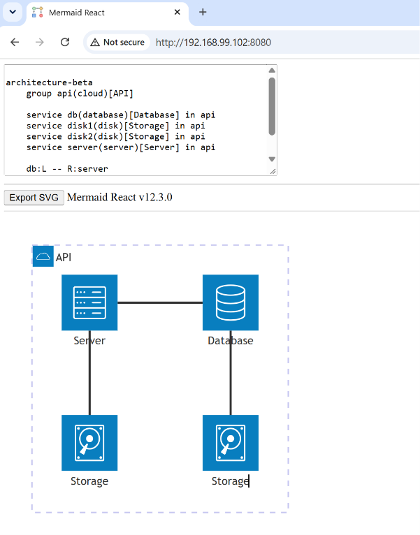


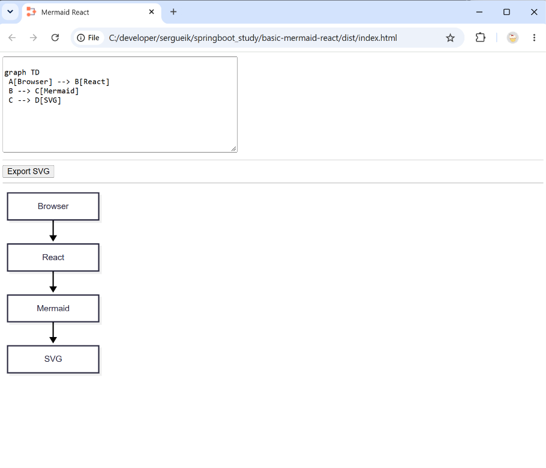

Copy-Paste some of the recent Mermaid shapes, e.g. [Architecture Diagrams](https://mermaid.ai/open-source/syntax/architecture.html) into editor.
If the version is too old it will not be rendering (the contents of `Diagram` tab will stay blank or a hand grenade will be rendered

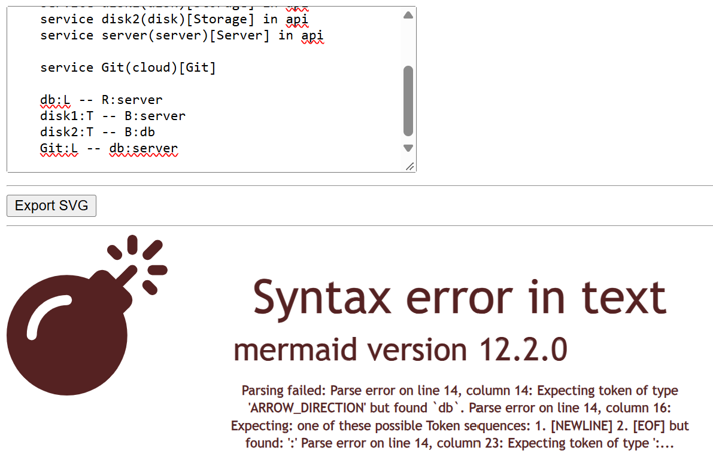

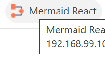

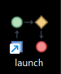

> NOTE: the following command expects the `dist` directory be deleted

if need to run web server on Windows (You may need to switch to Windows environment shell)
```cmd
pushd dist
python.exe -m http.server
```
```text
Serving HTTP on :: port 8000 (http://[::]:8000/) ...
```
then open the site in the browser `http://localhost:8000`

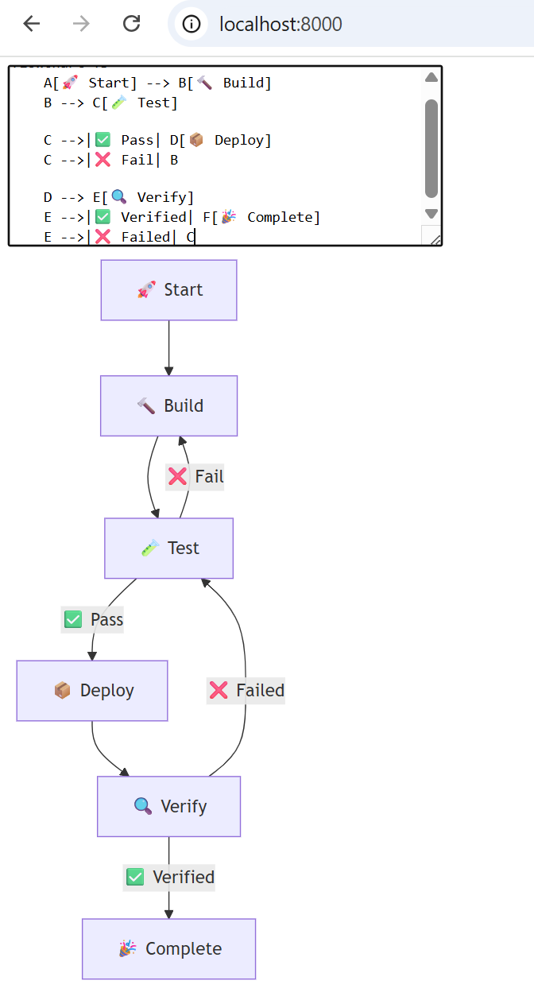

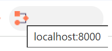

### Local File

Cannot open in the browser via `file://` when using the real DOS Drive letters:

when launched with

```cmd
"C:\Program Files\Google\Chrome\Application\chrome.exe" --user-data-dir=C:\temp\chrome-file-test --allow-file-access-from-files file:///%CD%\index.html
```
and not
```cmd
subst.exe E: /d
subst.exe E: %CD%
cd /d E:
"C:\Program Files\Google\Chrome\Application\chrome.exe" --user-data-dir=C:\temp\chrome-file-test --allow-file-access-from-files file:///%CD%/index.html
```
or
```cmd
subst.exe E: /d
subst.exe E: %CD%
"C:\Program Files\Google\Chrome\Application\chrome.exe" --user-data-dir=C:\temp\chrome-file-test --allow-file-access-from-files file:///E:/index.html
```
it fails with `net::ERR_FILE_NOT_FOUND` error for multiple asset:

```text
Failed to load resource: net::ERR_FILE_NOT_FOUND index-BGiIaHVw.js:1
Failed to load resource: net::ERR_FILE_NOT_FOUND chunk-Y2CYZVJY-DsF7k-Jl.js:1
Failed to load resource: net::ERR_FILE_NOT_FOUND src-BMa7vLb8.js:1
Failed to load resource: net::ERR_FILE_NOT_FOUND chunk-WYO6CB5R-C36byBU-.js:1
Failed to load resource: net::ERR_FILE_NOT_FOUND dist-Q9n2Bb2K.js:1
Failed to load resource: net::ERR_FILE_NOT_FOUND chunk-ICXQ74PX-_B4UKQEp.js:1
Failed to load resource: net::ERR_FILE_NOT_FOUND path-BWPyau1x.js:1
Failed to load resource: net::ERR_FILE_NOT_FOUND array-BifhSqXX.js:1
Failed to load resource: net::ERR_FILE_NOT_FOUND line-BjeXKALW.js:1
Failed to load resource: net::ERR_FILE_NOT_FOUND chunk-C7G6YPKG-WgqYOC9I.js:1
Failed to load resource: net::ERR_FILE_NOT_FOUND chunk-OGEWGWER-q1FVTapY.js:1
Failed to load resource: net::ERR_FILE_NOT_FOUND chunk-HOUHSVGY-BrlsNa-I.js:1
Failed to load resource: net::ERR_FILE_NOT_FOUND chunk-Q4XR5HBZ-DuMv4AAJ.js:1
Failed to load resource: net::ERR_FILE_NOT_FOUND rough.esm-CSKSodPl.js:1
Failed to load resource: net::ERR_FILE_NOT_FOUND chunk-ZGVPDNZ5-7E3CyR1q.js:1
Failed to load resource: net::ERR_FILE_NOT_FOUND chunk-7BUUIJ7U-Bb538aSH.js:1
```

all files are present:
```cmd
dir /b/s /a-d assets | findstr -i "index-BGiIaHVw.js chunk-Y2CYZVJY-DsF7k-Jl.js src-BMa7vLb8.js  chunk-WYO6CB5R-C36byBU-.js dist-Q9n2Bb2K.js chunk-ICXQ74PX-_B4UKQEp.js  path-BWPyau1x.js array-BifhSqXX.js line-BjeXKALW.js chunk-C7G6YPKG-WgqYOC9I.js  chunk-OGEWGWER-q1FVTapY.jschunk-OGEWGWER-q1FVTapY.js chunk-HOUHSVGY-BrlsNa-I.js chunk-Q4XR5HBZ-DuMv4AAJ.js rough.esm-CSKSodPl.js chunk-ZGVPDNZ5-7E3CyR1q.js chunk-7BUUIJ7U-Bb538aSH.js"
```
```text
..\dist\assets\array-BifhSqXX.js
..\dist\assets\chunk-7BUUIJ7U-Bb538aSH.js
..\dist\assets\chunk-C7G6YPKG-WgqYOC9I.js
..\dist\assets\chunk-HOUHSVGY-BrlsNa-I.js
..\dist\assets\chunk-ICXQ74PX-_B4UKQEp.js
..\dist\assets\chunk-Q4XR5HBZ-DuMv4AAJ.js
..\dist\assets\chunk-WYO6CB5R-C36byBU-.js
..\dist\assets\chunk-Y2CYZVJY-DsF7k-Jl.js
..\dist\assets\chunk-ZGVPDNZ5-7E3CyR1q.js
..\dist\assets\dist-Q9n2Bb2K.js
..\dist\assets\index-BGiIaHVw.js
..\dist\assets\line-BjeXKALW.js
..\dist\assets\path-BWPyau1x.js
..\dist\assets\rough.esm-CSKSodPl.js
..\dist\assets\src-BMa7vLb8.js
```
> NOTE: moving the files around does not help:

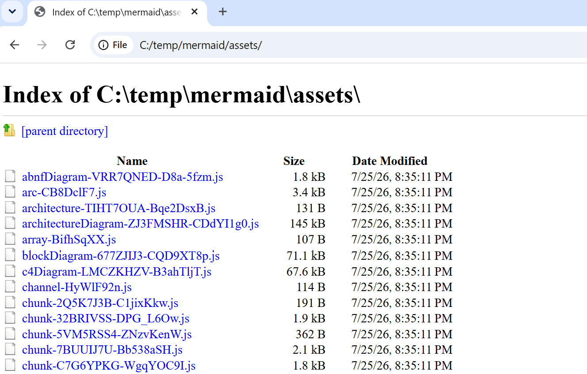


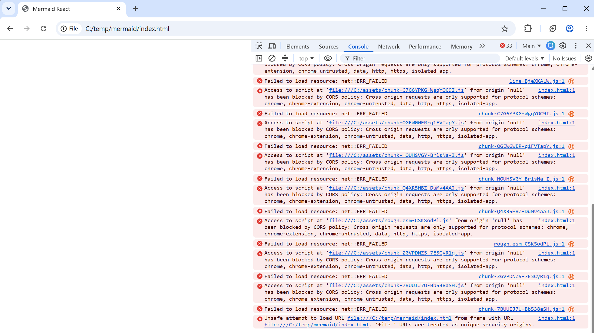

However it works successfully with new instance launched with option  --allow-file-access-from-files from e: drive.

```cmd
cd dist
subst.exe E: /d
subst.exe E: %CD%
"C:\Program Files\Google\Chrome\Application\chrome.exe" --user-data-dir=C:\temp\chrome-file-test --allow-file-access-from-files file:///E:/index.html
```
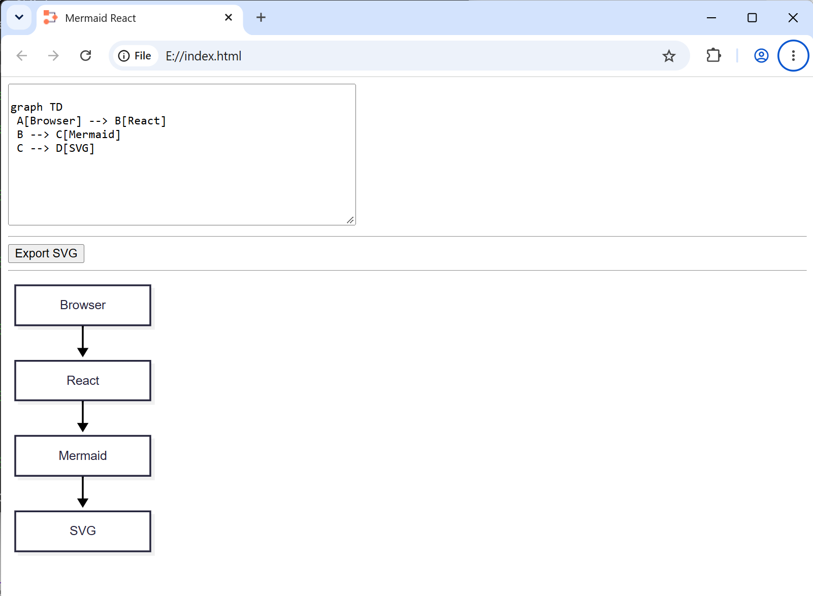

Copy-Paste some of the recent Mermaid shapes, e.g. [Architecture Diagrams](https://mermaid.ai/open-source/syntax/architecture.html) into editor.
If the version is too old it will not be rendering (the contents of `Diagram` tab will stay blank or a hand grenade will be rendered


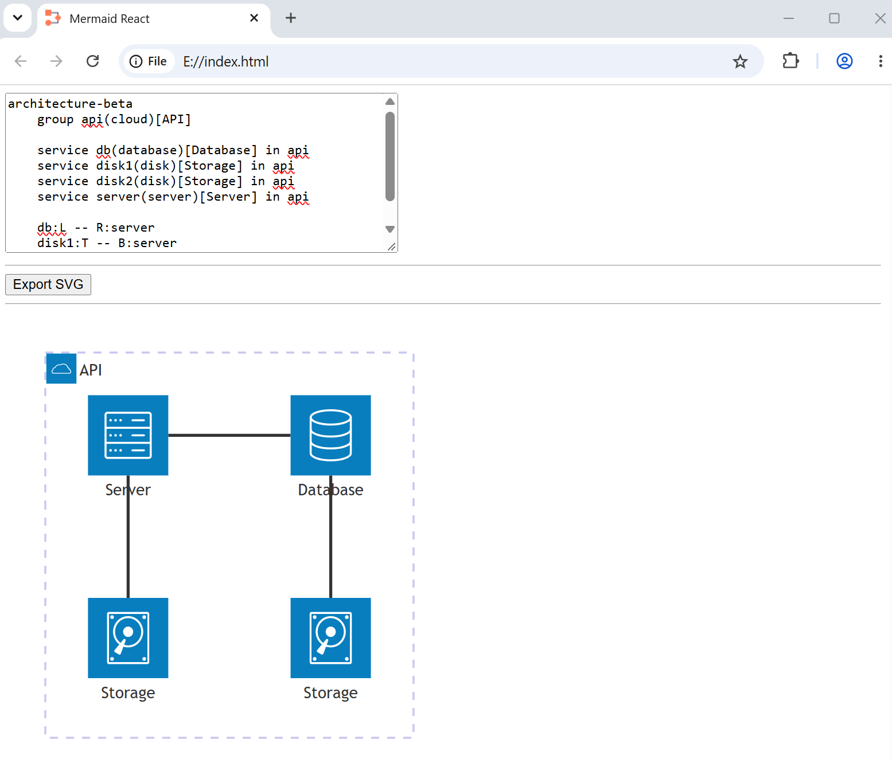


> NOTE: without the Chrome option `--allow-file-access-from-files` the error becomes:

```text
Access to script at 'file:///C:/assets/index-BGiIaHVw.js' from origin 'null' has been blocked by CORS policy: Cross origin requests are only supported for protocol schemes: chrome, chrome-extension, chrome-untrusted, data, http, https, isolated-app.
```
(repeated for other resources)

For option to have effect one has to close all running instances of Chrome browser, otherwise the new url will be served by the already launched instance.

### Cleanup

```sh
docker stop $NAME
docker container prune -f
docker image prune -f
docker image rm $IMAGE node:22.12.0-alpine nginx:1.30.3-alpine3.23
```
### TODO: Investigate `file://` behavior on Windows by drive type / drive letter

### Exporting SVG

* add misc. dependencies in `package.json`:
```json
"blob-stream": "^0.1.3",
"blob-stream-browserify": "^0.1.3",
"svg-exportjs-browser": "^2.1.0",
"umd": "^3.0.1"
```

and initializations:

```js

import umd from "umd";
import blobStreamBrowserify from "blob-stream-browserify";
import * as svgExport from "svg-exportjs-browser";
```

confirm split the build stage

```sh
docker build --target builder -f Dockerfile .
```
```text
Sending build context to Docker daemon  6.413MB
Step 1/9 : FROM node:22.12.0-alpine AS builder
 ---> 3448d7ddbc59
Step 2/9 : WORKDIR /app
 ---> Using cache
 ---> 79c6f9b18150
Step 3/9 : COPY package*.json /app/
 ---> efb5f9416710
Step 4/9 : ARG NPM_REGISTRY
 ---> Running in 665a8d409034
Removing intermediate container 665a8d409034
 ---> 02c90b694244
Step 5/9 : RUN if [ -n "$NPM_REGISTRY" ]; then npm config set registry "$NPM_REGISTRY"; fi
 ---> Running in 0d02267f0d73
Removing intermediate container 0d02267f0d73
 ---> 68d2c2f1414f
Step 6/9 : RUN npm install || { cat /root/.npm/_logs/*.log; exit 1; }
 ---> Running in 69738a216106
npm warn deprecated crypto-js@4.2.0: Active development of CryptoJS has been discontinued. This library is no longer maintained.
npm warn deprecated jpeg-exif@1.1.4: Package no longer supported. Contact Support at https://www.npmjs.com/support for more info.

added 159 packages, and audited 160 packages in 48s

13 packages are looking for funding
  run `npm fund` for details

2 low severity vulnerabilities

To address all issues (including breaking changes), run:
  npm audit fix --force

Run `npm audit` for details.
npm notice
npm notice New major version of npm available! 10.9.0 -> 12.2.0
npm notice Changelog: https://github.com/npm/cli/releases/tag/v12.2.0
npm notice To update run: npm install -g npm@12.2.0
npm notice
Removing intermediate container 69738a216106
 ---> e93e82eb53a5
Step 7/9 : COPY index.html vite.config.js favicon.png /app/
 ---> 256a97fc226c
Step 8/9 : ADD src /app/src
 ---> 053dec1a3230
Step 9/9 : RUN npm run build
 ---> Running in 638793a0e52b

> mermaid-react@0.1.0 build
> vite build

vite v8.3.4 building client environment for production...
transforming...
[plugin rolldown:vite-resolve] Module "stream" has been externalized for browser compatibility, imported by "/app/node_modules/pdfkit/js/pdfkit.es.js". See https://vite.dev/guide/troubleshooting.html#module-externalized-for-browser-compatibility for more details.
[plugin rolldown:vite-resolve] Module "events" has been externalized for browser compatibility, imported by "/app/node_modules/pdfkit/js/pdfkit.es.js". See https://vite.dev/guide/troubleshooting.html#module-externalized-for-browser-compatibility for more details.
[plugin rolldown:vite-resolve] Module "zlib" has been externalized for browser compatibility, imported by "/app/node_modules/pdfkit/js/pdfkit.es.js". See https://vite.dev/guide/troubleshooting.html#module-externalized-for-browser-compatibility for more details.
[plugin rolldown:vite-resolve] Module "fs" has been externalized for browser compatibility, imported by "/app/node_modules/pdfkit/js/pdfkit.es.js". See https://vite.dev/guide/troubleshooting.html#module-externalized-for-browser-compatibility for more details.
[plugin rolldown:vite-resolve] Module "util" has been externalized for browser compatibility, imported by "/app/node_modules/blob-stream/index.js". See https://vite.dev/guide/troubleshooting.html#module-externalized-for-browser-compatibility for more details.
[plugin rolldown:vite-resolve] Module "stream" has been externalized for browser compatibility, imported by "/app/node_modules/blob-stream/index.js". See https://vite.dev/guide/troubleshooting.html#module-externalized-for-browser-compatibility for more details.
[plugin rolldown:vite-resolve] Module "util" has been externalized for browser compatibility, imported by "/app/node_modules/browserify-zlib/lib/index.js". See https://vite.dev/guide/troubleshooting.html#module-externalized-for-browser-compatibility for more details.
[plugin rolldown:vite-resolve] Module "stream" has been externalized for browser compatibility, imported by "/app/node_modules/browserify-zlib/lib/index.js". See https://vite.dev/guide/troubleshooting.html#module-externalized-for-browser-compatibility for more details.
[plugin rolldown:vite-resolve] Module "assert" has been externalized for browser compatibility, imported by "/app/node_modules/browserify-zlib/lib/index.js". See https://vite.dev/guide/troubleshooting.html#module-externalized-for-browser-compatibility for more details.
[plugin rolldown:vite-resolve] Module "buffer" has been externalized for browser compatibility, imported by "/app/node_modules/browserify-zlib/lib/index.js". See https://vite.dev/guide/troubleshooting.html#module-externalized-for-browser-compatibility for more details.
[plugin rolldown:vite-resolve] Module "assert" has been externalized for browser compatibility, imported by "/app/node_modules/browserify-zlib/lib/binding.js". See https://vite.dev/guide/troubleshooting.html#module-externalized-for-browser-compatibility for more details.
[plugin rolldown:vite-resolve] Module "fs" has been externalized for browser compatibility, imported by "/app/node_modules/jpeg-exif/lib/index.js". See https://vite.dev/guide/troubleshooting.html#module-externalized-for-browser-compatibility for more details.
✓ 2177 modules transformed.
rendering chunks...
computing gzip size...
dist/assets/favicon-BzgZYuLl.png                                                 0.27 kB
dist/index.html                                                                  1.47 kB │ gzip:   0.47 kB
dist/assets/array-BifhSqXX.js                                                    0.10 kB │ gzip:   0.11 kB
dist/assets/pie-WAS4IAKB-2BdD3iSy.js                                             0.10 kB │ gzip:   0.12 kB
dist/assets/info-A6RAGUB7-BDZVuLg3.js                                            0.10 kB │ gzip:   0.12 kB
dist/assets/radar-RG4KPBEZ-BaClNgBM.js                                           0.10 kB │ gzip:   0.12 kB
dist/assets/packet-AYTQ26CC-CnRp1HXF.js                                          0.11 kB │ gzip:   0.12 kB
dist/assets/cynefin-OW5HDTMX-D4EpsGpO.js                                         0.11 kB │ gzip:   0.12 kB
dist/assets/treemap-WGGIJYW6-B0ur1uVq.js                                         0.11 kB │ gzip:   0.12 kB
dist/assets/wardley-WFR3VGLG-DR41n5Wc.js                                         0.11 kB │ gzip:   0.12 kB
dist/assets/gitGraph-4MIJSDKK-_1wigWod.js                                        0.11 kB │ gzip:   0.12 kB
dist/assets/railroad-74A4TZTK-Big9YdWc.js                                        0.11 kB │ gzip:   0.12 kB
dist/assets/treeView-Q6P3EWNA-DLqMm3Ux.js                                        0.11 kB │ gzip:   0.12 kB
dist/assets/channel-CRuHTDTD.js                                                  0.11 kB │ gzip:   0.12 kB
dist/assets/railroad-peg-WCYAUIDC-2kTm3RFN.js                                    0.11 kB │ gzip:   0.12 kB
dist/assets/architecture-7GRP2DOG-c0XBdozv.js                                    0.11 kB │ gzip:   0.12 kB
dist/assets/railroad-abnf-HS5TGJTU-BkW4x2iF.js                                   0.11 kB │ gzip:   0.12 kB
dist/assets/railroad-ebnf-LZEXJU2U-3q4WjP-A.js                                   0.11 kB │ gzip:   0.12 kB
dist/assets/eventmodeling-NTZA5JFV-CeQW0V6G.js                                   0.11 kB │ gzip:   0.13 kB
dist/assets/__vite-optional-peer-dep_canvg_svg-exportjs-browser-mNUDxd_4.js      0.12 kB │ gzip:   0.12 kB
dist/assets/init-C-OQMol4.js                                                     0.14 kB │ gzip:   0.12 kB
dist/assets/chunk-Y2CYZVJY-DsF7k-Jl.js                                           0.15 kB │ gzip:   0.14 kB
dist/assets/chunk-2Q5K7J3B-C1jixKkw.js                                           0.19 kB │ gzip:   0.16 kB
dist/assets/chunk-JWPE2WC7-DVXcaiue.js                                           0.22 kB │ gzip:   0.17 kB
dist/assets/chunk-XXDRQBXY-BakWylwG.js                                           0.26 kB │ gzip:   0.22 kB
dist/assets/chunk-5VM5RSS4-ZNzvKenW.js                                           0.36 kB │ gzip:   0.27 kB
dist/assets/flowDiagram-HODETNUW-COUONpRO.js                                     0.47 kB │ gzip:   0.27 kB
dist/assets/chunk-POPQ4Y6H-BbjG91Jw.js                                           0.57 kB │ gzip:   0.40 kB
dist/assets/infoDiagram-27XIBGKW-CGLau5zi.js                                     0.65 kB │ gzip:   0.42 kB
dist/assets/classDiagram-ZZMXUADV-xB7uLrsJ.js                                    0.69 kB │ gzip:   0.41 kB
dist/assets/classDiagram-v2-VYDZK3BY-xB7uLrsJ.js                                 0.69 kB │ gzip:   0.41 kB
dist/assets/stateDiagram-v2-MP3YSRHH-kW01-n_v.js                                 0.70 kB │ gzip:   0.41 kB
dist/assets/swimlanesDiagram-VR7AAH4N-BYpUyh4S.js                                0.75 kB │ gzip:   0.44 kB
dist/assets/sizeCapture-INFHLROL-3uHXrFqA.js                                     0.87 kB │ gzip:   0.51 kB
dist/assets/line-DwXbLlg9.js                                                     0.94 kB │ gzip:   0.47 kB
dist/assets/ordinal-BDEzSJ7C.js                                                  1.17 kB │ gzip:   0.56 kB
dist/assets/rolldown-runtime-BCiCTKAo.js                                         1.30 kB │ gzip:   0.71 kB
dist/assets/chunk-GVQU2GXP-DzUe2A8w.js                                           1.41 kB │ gzip:   0.79 kB
dist/assets/railroadDiagram-O6MQD6OU-Dgy2YrMC.js                                 1.66 kB │ gzip:   0.77 kB
dist/assets/abnfDiagram-VCTEODGH-CVxeA9wy.js                                     1.84 kB │ gzip:   0.89 kB
dist/assets/chunk-P2QGCYS3-DD7DGpVJ.js                                           1.94 kB │ gzip:   0.95 kB
dist/assets/chunk-F27PBJKO-Bd_pVafX.js                                           1.97 kB │ gzip:   0.88 kB
dist/assets/pegDiagram-XKGWAZYB-ScZzzM8a.js                                      2.00 kB │ gzip:   0.94 kB
dist/assets/ebnfDiagram-PWID7BFC-CljrsrHN.js                                     2.06 kB │ gzip:   0.89 kB
dist/assets/dist-DGs_yUrP.js                                                     2.17 kB │ gzip:   0.97 kB
dist/assets/path-fybaL0A-.js                                                     2.27 kB │ gzip:   0.98 kB
dist/assets/arc-Bw7m-cfu.js                                                      3.47 kB │ gzip:   1.46 kB
dist/assets/diagram-Z3DM3KII-BW-KI6hi.js                                         4.27 kB │ gzip:   1.85 kB
dist/assets/defaultLocale-BFoDCU3G.js                                            4.63 kB │ gzip:   2.12 kB
dist/assets/linear-BXgYrK5n.js                                                   5.51 kB │ gzip:   2.25 kB
dist/assets/chunk-PWAF6VOD-B254sQkl.js                                           5.83 kB │ gzip:   2.68 kB
dist/assets/diagram-UQ7AKVKN-jjozXjqQ.js                                         6.06 kB │ gzip:   2.56 kB
dist/assets/pieDiagram-E7YTZNPT-C5QyXu3f.js                                      6.21 kB │ gzip:   2.59 kB
dist/assets/diagram-S7CK7UJ4-Uwrjvyoa.js                                         8.11 kB │ gzip:   3.65 kB
dist/assets/cynefinDiagram-5FMLGOSQ-DLlyoGxK.js                                  9.93 kB │ gzip:   3.51 kB
dist/assets/stateDiagram-D77RDMKH-Bo_1KI7m.js                                   10.53 kB │ gzip:   3.68 kB
dist/assets/diagram-VSXAHHWV-6aZpSUC5.js                                        10.66 kB │ gzip:   4.12 kB
dist/assets/dagre-GXQ25YYZ-DuxoeNpV.js                                          10.85 kB │ gzip:   4.10 kB
dist/assets/chunk-SVP7TREG-BNsM4Qov.js                                          15.63 kB │ gzip:   4.35 kB
dist/assets/diagram-VX7I27RA-BG9vlaye.js                                        15.74 kB │ gzip:   5.52 kB
dist/assets/mermaid-parser.core-Cpib-OZd.js                                     16.58 kB │ gzip:   3.93 kB
dist/assets/ishikawaDiagram-5VMMS53U-yRi_6-Kz.js                                17.30 kB │ gzip:   6.53 kB
dist/assets/kanban-definition-UXKFOSKX-Li_Tvq6c.js                              20.21 kB │ gzip:   7.12 kB
dist/assets/sankeyDiagram-P5KCCOFB-DHU_dWow.js                                  22.79 kB │ gzip:   8.25 kB
dist/assets/journeyDiagram-3NMN7TZE-CCh5jV98.js                                 23.15 kB │ gzip:   8.16 kB
dist/assets/mindmap-definition-YA3MSWOX-CDJWvb82.js                             23.36 kB │ gzip:   7.95 kB
dist/assets/wardleyDiagram-VM6X3IG4-CnwOD1rt.js                                 25.19 kB │ gzip:   6.55 kB
dist/assets/rough.esm-Dy-Kn_BL.js                                               27.10 kB │ gzip:   8.85 kB
dist/assets/gitGraphDiagram-WWUBYQGX-BqAZiW-U.js                                29.01 kB │ gzip:   8.57 kB
dist/assets/timeline-definition-24CTP7MA-DdpAldlS.js                            30.36 kB │ gzip:   9.96 kB
dist/assets/erDiagram-RLTQ6QDP-m5kjZ0ju.js                                      30.60 kB │ gzip:  10.53 kB
dist/assets/chunk-75Z2AOVW-DRXKjQv2.js                                          30.75 kB │ gzip:   8.50 kB
dist/assets/requirementDiagram-BXWQKSXE-Dd7HUel7.js                             30.91 kB │ gzip:   9.73 kB
dist/assets/quadrantDiagram-AXDQQJYC-BUbfGmN2.js                                33.51 kB │ gzip:   9.74 kB
dist/assets/dagre-C6JJLb6i.js                                                   36.85 kB │ gzip:  13.21 kB
dist/assets/chunk-IMKFNOWR-5DaSBqDd.js                                          37.63 kB │ gzip:  12.26 kB
dist/assets/vennDiagram-4TSXK5OY-CotdWYJg.js                                    41.15 kB │ gzip:  15.11 kB
dist/assets/blockDiagram-I7D4REHJ-BQ7cerZm.js                                   41.38 kB │ gzip:  13.34 kB
dist/assets/xychartDiagram-S5SC5T6Z-Bvg8JWAU.js                                 44.14 kB │ gzip:  12.21 kB
dist/assets/src-Bc_iCBZR.js                                                     45.66 kB │ gzip:  16.00 kB
dist/assets/chunk-TICWLB2K-CDMO7uvr.js                                          48.77 kB │ gzip:  15.74 kB
dist/assets/chunk-GMAD6QVW-DXXDaxv9.js                                          51.20 kB │ gzip:  16.68 kB
dist/assets/chunk-SHT3W25Y-Bb16uRWI.js                                          61.19 kB │ gzip:  19.82 kB
dist/assets/c4Diagram-7LVT6UL2-BTVkQOE9.js                                      64.74 kB │ gzip:  18.52 kB
dist/assets/ganttDiagram-EL5Y4UJY-DEwoREEa.js                                   69.36 kB │ gzip:  22.74 kB
dist/assets/cose-bilkent-JH36ORCC-d1jJRUaj.js                                   81.22 kB │ gzip:  21.52 kB
dist/assets/chunk-4HAMMTFA-yGvg_REc.js                                         104.85 kB │ gzip:  25.62 kB
dist/assets/swimlanes-42K2YHIH-C4i2U8jr.js                                     110.98 kB │ gzip:  37.95 kB
dist/assets/sequenceDiagram-WJ2MYXX4-LBEm59n7.js                               115.73 kB │ gzip:  30.58 kB
dist/assets/architectureDiagram-5GKGNRK7-CnCgy-w7.js                           148.87 kB │ gzip:  41.10 kB
dist/assets/chunk-DU6HZSFF-B6IZsRR5.js                                         239.21 kB │ gzip:  39.55 kB
dist/assets/katex-DJhrJSbw.js                                                  258.59 kB │ gzip:  77.43 kB
dist/assets/cytoscape.esm-BegBNzOV.js                                          434.75 kB │ gzip: 137.75 kB
dist/assets/chunk-FOHPRMQF-DD4dKubD.js                                         662.08 kB │ gzip: 143.15 kB
dist/assets/index-CZgYOn_E.js                                                1,130.74 kB │ gzip: 394.89 kB

[plugin builtin:vite-reporter]
(!) Some chunks are larger than 500 kB after minification. Consider:
- Using dynamic import() to code-split the application
- Use build.rolldownOptions.output.codeSplitting to improve chunking: https://rolldown.rs/reference/OutputOptions.codeSplitting
- Adjust chunk size limit for this warning via build.chunkSizeWarningLimit.
✓ built in 4.65s
Removing intermediate container 638793a0e52b
 ---> 947fcc748d02
Successfully built 947fcc748d02
```

confirm the export works calling from Dev Tools:
```js
window.exportSvg()
```
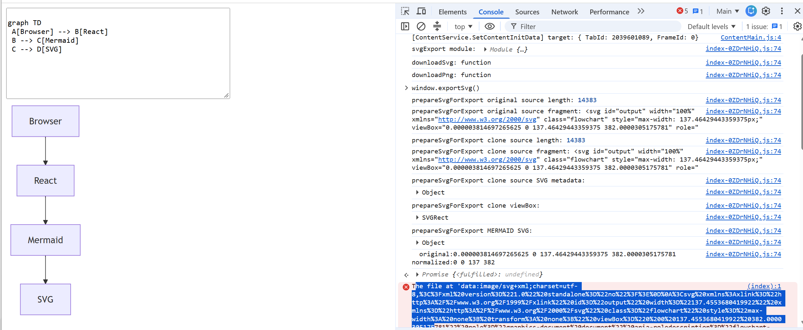

* align with the Mermaid renderer using React states
```js
  const [rendered, setRendered] = useState(false);
...
    mermaid.render(
      "output",
      diagram
    ).then(result => {
      setSvg(result.svg);
      setRendered(true);
    });
...
  <button
      disabled={!rendered}
      onClick={() => window.exportSvg()} >
    Export SVG
  </button>

```
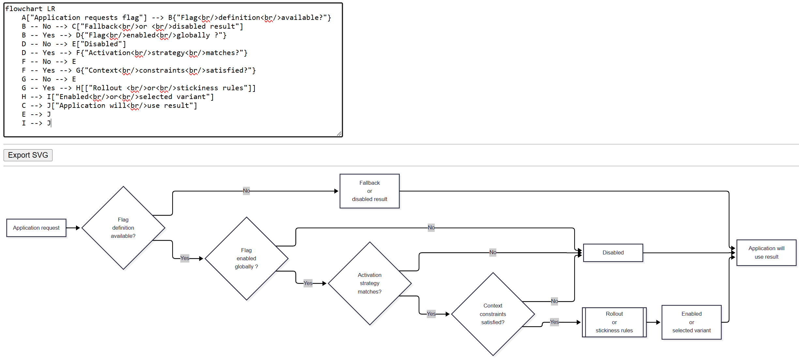

#### Observation

The generated Vite/React/Mermaid application is fully static and works correctly when served over HTTP (nginx).

When opened directly via `file://`, Chrome exhibits inconsistent behavior depending on the underlying Windows drive.

#### Current results

| Location | Result |
|----------|--------|
| `file:///E:/index.html` (`subst E: <dist>`) | ✅ Works |
| `file:///E:/newdir/index.html` | ✅ Works |
| `file:///C:/temp/dist/index.html` | ❌ Requests `file:///C:/assets/...` |
| `file:///C:/developer/.../dist/index.html` | ❌ Same behavior |

The generated JavaScript contains **relative** module imports, e.g.

```js
import "./chunk-XXXX.js";
```

The referenced files are present and individually accessible via `file://`.

#### Unsolved Questions

- Is this a Chromium/Chrome `file://` module loader issue?
- Is Windows treating `subst` drives differently from physical NTFS volumes?
- Does Chrome classify different drive types (physical, `subst`, network, removable, virtual) differently for security/origin purposes?
- Is the behavior related to the native NT object namespace (`\GLOBAL??`, `\Device\...`)?
- Does Microsoft expose different metadata for `subst` drives through Win32 or shell APIs?
- Is the issue specific to ES module resolution, rather than ordinary file I/O?

#### Future experiments

- Test on a clean Windows installation.
- Test without `--allow-file-access-from-files`.
- Compare:
  - physical NTFS (`C:`)
  - `subst` drive
  - mapped network drive
  - removable USB drive
  - VHD/VHDX mounted volume
- Compare Chrome, Edge, and Firefox.
- Capture Process Monitor (ProcMon) traces to compare actual file opens.
- Inspect the generated HTML and module graph for absolute vs. relative URL resolution.
- Determine whether this is a browser issue, a Windows filesystem abstraction issue, or an interaction between the two.


## Project observations

### Enterprise portability

The current Mermaid package is available from the enterprise Artifactory repository (multiple package variants were found).

This means the project can be built entirely from enterprise package repositories without depending on the public npm registry.

### Industry adoption

Mermaid is no longer just a standalone diagramming library.

It has become part of the modern software engineering toolchain, including:

- GitHub Markdown rendering
- GitHub Copilot and Agent workflows
- VS Code preview/presentation features
- GitLab documentation
- various CI/CD platforms and documentation generators
- developer portals and knowledge bases

Mermaid diagrams are increasingly becoming a common interchange format for lightweight architecture and workflow documentation.

### Enterprise Toolbox candidate

A small standalone Mermaid viewer/editor remains valuable even when IDE integrations exist.

Potential users include:

- developers without VS Code or Copilot
- QA engineers
- release engineers
- documentation authors
- project managers
- support engineers
- users on locked-down enterprise desktops

A portable static application avoids IDE dependencies while providing a simple way to preview and validate Mermaid diagrams.

#### Troubleshooting
a slightly older release `9.4.5` is unable to render flowcharts containing [emoji]()

```code
flowchart TD
    A[🚀 Start] --> B[🔨 Build]
    B --> C[🧪 Test]

    C -->|✅ Pass| D[📦 Deploy]
    C -->|❌ Fail| B

    D --> E[🔍 Verify]
    E -->|✅ Verified| F[🎉 Complete]
    E -->|❌ Failed| C
```
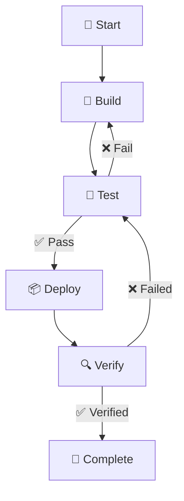
there are actually *two* errors
```text


Error
  {str: 'Lexical error on line 2. Unrecognized text.\nflowch… TD    A[🚀 Start] --> B[🔨 B\n------------------^', hash: {…}}

Uncaught Error: Cannot read properties of undefined (reading 'first_line')

TypeError: Cannot read properties of undefined (reading 'first_line')
    at Rn.S (edit.svelte-cf77660e.js:109:13637)
    at index-3ccfa173.js:4:906
    at Array.forEach (<anonymous>)
    at index-3ccfa173.js:4:892
    at edit.svelte-cf77660e.js:14:1891
    at i.invoke (event.ts:554:17)
    at o.fire (event.ts:721:15)
    at codeEditorWidget.ts:1472:88
    at textModel.ts:201:79
    at i.invoke (event.ts:554:17)
    at Rn.S (edit.svelte-cf77660e.js:109:13637)
    at index-3ccfa173.js:4:906
    at Array.forEach (<anonymous>)
    at index-3ccfa173.js:4:892
    at edit.svelte-cf77660e.js:14:1891
    at i.invoke (event.ts:554:17)
    at o.fire (event.ts:721:15)
    at codeEditorWidget.ts:1472:88
    at textModel.ts:201:79
    at i.invoke (event.ts:554:17)
    at errors.ts:22:12
```

|Variant|Runtime / packaging|Mermaid|Main advantage|Main nuisance / caveat|Best use|
|-------|-------------------|-------|--------------|----------------------|--------|
|1. Docker + nginx + Svelte + Mermaid|Container serves the Svelte dist through nginx|Mermaid bundled into the application|Cleanest and most reproducible; browser sees an ordinary HTTP application; no file:// restrictions|Requires Docker/container lifecycle; image rebuild when dependencies change|Primary development/test environment and closest to a deployable application|
|2. Python local server + dist|Python HTTP server serves the locally built dist directory|Mermaid bundled in dist|Extremely lightweight; no nginx/Docker required; behaves like a normal web application|Smart cache cleanup is important, particularly after power-down/reboot or when changing Mermaid bundles; stale JS/assets can make debugging deceptively confusing|Fast local development / experimentation|
|3. file:// + Z: drive trick|Browser opens the generated dist/index.html directly; Z: is a subst/mapped-style convenience rather than a physical/network drive|Mermaid bundled in dist|No server at all; convenient for examining the finished artifact|Browser file:// security/CORS behavior; Chrome may require --allow-file-access-from-files and a separate --user-data-dir; not a faithful HTTP deployment environment|Pre-render / inspect the final artifact before publishing, especially when a server is undesirable|

### Current status

- ✅ Modern Mermaid successfully builds as a static application.
- ✅ Build can be performed in a disposable Docker environment.
- ✅ Resulting artifact is static.
- ⚠ Browser `file://` behavior still requires additional investigation.
- ✅ HTTP deployment (nginx or any static web server) works correctly.

### Patching Dist

* a standard mermaid dist is 100 files, some of which are spiled with absoute resolution paths:

```sh
find dist/ -type f |wc -l
```
```text
101
```
```sh
grep -E -irl '"/[a-z]' dist
```
```text
dist/assets/chunk-NGNAAXSQ-C2Wy9Xmz.js
dist/assets/chunk-YZO67HFG-C3JoPMiI.js
dist/assets/classDiagram-v2-4MYWR3UA-BV0a6Jhm.js
dist/assets/erDiagram-KYQIGQAA-DbbGunAj.js
dist/assets/index-BRr-X6hH.js
dist/assets/mermaid-parser.core-DEw4vXfS.js
dist/index.html

```

```sh
grep -E -ir '"/[a-z]' dist |wc -l
```
```text
26
```

```sh
grep -E -irl '"/[a-z]' dist  | xargs -IX  sed -i 's|href="/assets|href="./assets|g' X
grep -E -irl '"/[a-z]' dist  | xargs -IX  sed -i 's|src="/assets|src="./assets|g' X
```

```sh
grep -E -lir '"/[a-z]' dist|wc -l
```
```text
6
```

and then
```cmd
"C:\Program Files\Google\Chrome\Application\chrome.exe" --user-data-dir=C:\temp\chrome-file-test --allow-file-access-from-files file:///%CD%/index.html
```

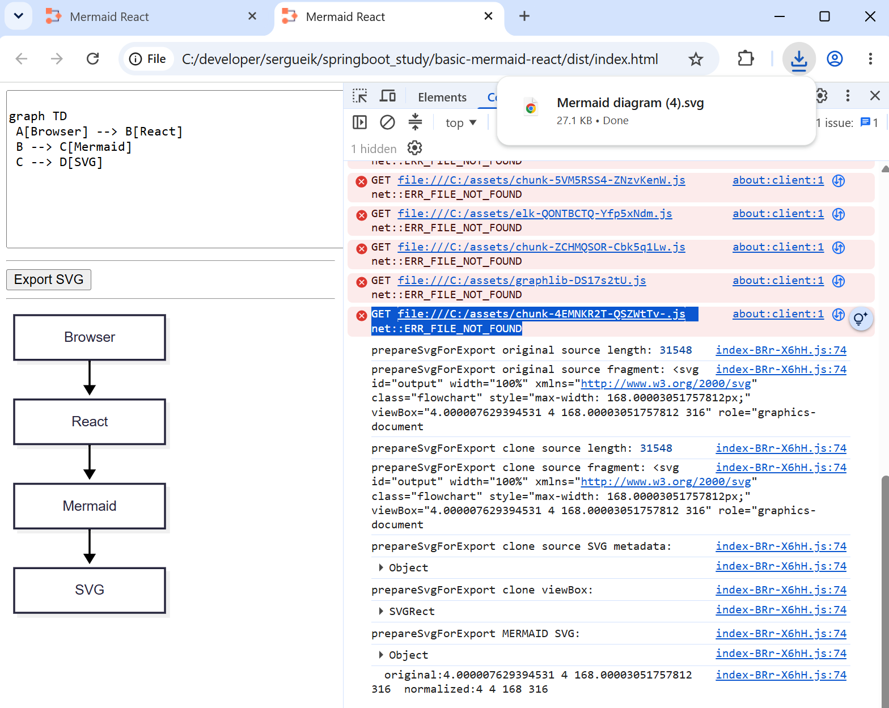

> NOTE:  the DevTools console  still shows plenty of
```text
GET file:///C:/assets/chunk-4EMNKR2T-QSZWtTv-.js net::ERR_FILE_NOT_FOUND
```
with varying names, but it does not block it from.

confirmed with "Microsoft Edge":

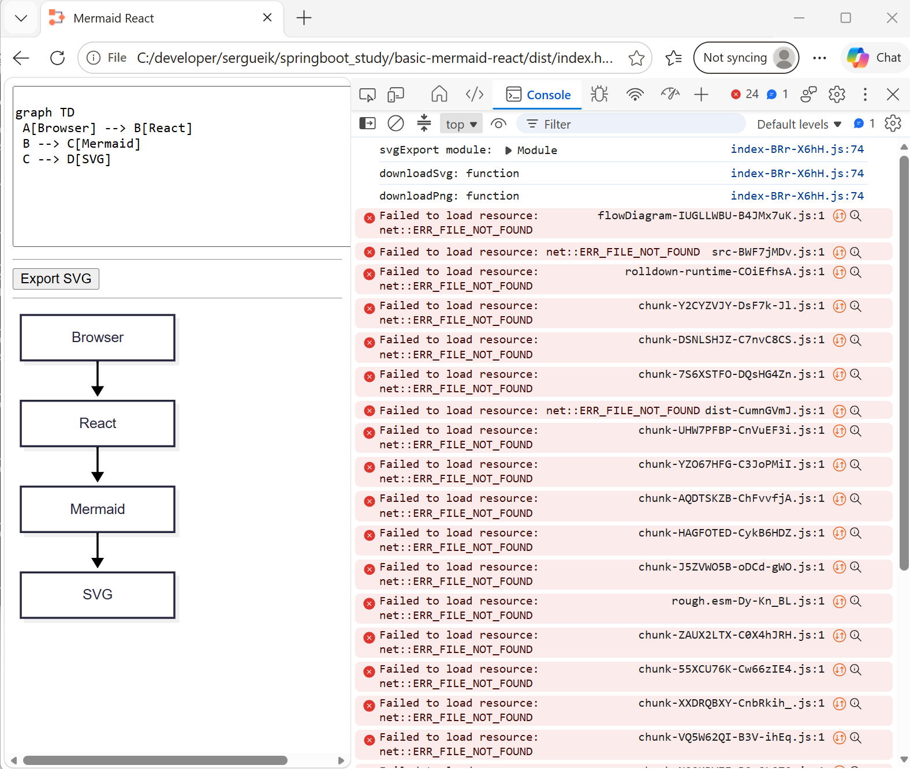

and then

```sh
env google-chrome --user-data-dir=/tmp --allow-file-access-from-files file://$(pwd)/dist/index.html
```
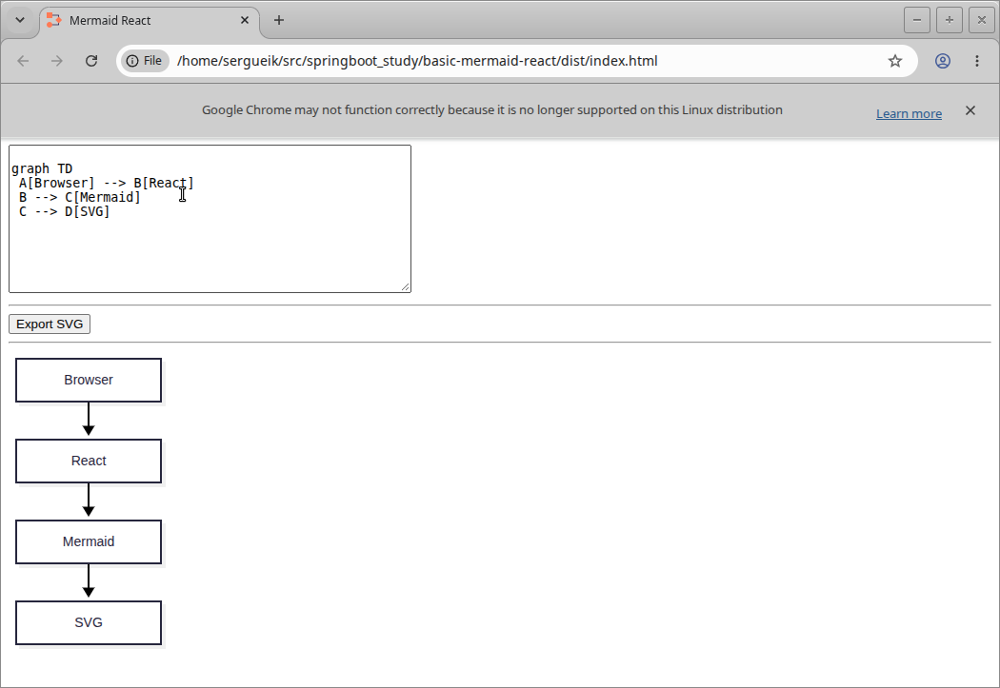

### Where I Draw the Line

(image: an absurdly thick, gold-plated, silk-wrapped $30,000 audiophile cable)

This is where I burn my money.

* Five-nines oxygen-free copper.
* Gold-plated screws.
* Silk insulation.
* One-inch diameter.
* Handcrafted signal pathways.

The signal travels through it in complete silence.

And unlike containers, Kubernetes, serverless architecture, browser runtimes, or deployment pipelines...

Here, I don't care about reality.

I care about sound myths.

#### Destination

  * *Information aggregation junkyard confused for information organization wizard*
  * *Today Anybody Can Accomplish Their Aims With The Push Of The Button Part __2__* [reddit](https://www.reddit.com/r/musicsuggestions/comments/16uucfk/songs_with_hilariously_long_titles_almost_to_the/)
  * *Everything everywhere, all at once, whether you asked for it or not*
  * *Your documents are here. Or there. Or available on demand*
  * *Known Folder Redirection*

 Microsoft explicitly distinguishes the logical `Desktop` from `DesktopDirectory`,
 which is the physical filesystem location. `GetFolderPath()` also accounts for user-configured special-folder locations.

|Enum value|Explanation|Suitable as  file destination|
|----------|-------|-----------------------------|
|`Desktop`|Logical, virtual Windows Desktop|No|
|`DesktopDirectory`|Physical filesystem directory for the current user's desktop objects|Yes|
|`CommonDesktopDirectory`|Shared desktop for all users (Public Desktop)|No|


A fallback such as:
```powershell
$desktop_directory = Join-Path $env:USERPROFILE 'Desktop'
```
is not recommended - a disconnected network share should produce an error, not cause deployment to fall back to a local Desktop that the user might not even see


For OneDrive, there are several possible states:

|Status|Meaning|
|------|-------|
|Stored locally|Folder is on the local filesystem, not necessarily redirected into OneDrive|
|OneDrive - Company|Folder is associated with the organization's OneDrive|
|Available on this device|File has a local copy, but OneDrive may remove it|
|Always available on this device|Local copy is pinned and retained|

Microsoft [Files On-Demand](https://learn.microsoft.com/en-us/answers/questions/5988140/difference-in-the-storage-of-locally-available-fil)
distinguishes between local availability and permanent local retention.

* Home is an aggregation view, not a filesystem directory. It can combine locations, recent files, favorites and activity.
* Individual document histories are surfaced as recent or recommended items. They can originate from different locations, including SharePoint and OneDrive.
* The cloud-status column provides synchronization/availability information. A cloud icon generally indicates an online-only OneDrive file; other icons distinguish locally available or synchronized files.

### Enterprise WAF Challenge


### npm Is Not Maven: Dependency Management and Offline Reproducibility

An enterprise build environment that successfully supports Maven repositories cannot automatically be assumed to provide equivalent support for npm.

Although both ecosystems support dependency declarations, transitive dependency resolution, local caching, and repository managers, their operational models differ considerably.

Several distinctions are worth remembering:

- **Repository semantics:** Maven uses relatively predictable artifact coordinates and repository layouts. npm relies on registry metadata, package names, versions, and tarball references.
- **Scoped packages:** npm package names such as `@vitejs/plugin-react` introduce URL-encoded path separators (`%2F`). Reverse proxies and WAF configurations may reject, decode, or rewrite these separators, breaking otherwise valid package-resolution requests.
- **Lockfiles:** `package-lock.json` records the resolved dependency tree and integrity information. It is not a self-contained package repository.
- **Local caches:** npm's offline mode can use previously cached data, but a lockfile alone does not guarantee that all required package contents are available.
- **Transitive dependencies:** Manually downloading a direct dependency does not eliminate the need to resolve and retrieve its own dependencies.
- **Lifecycle scripts:** Even a complete collection of package tarballs does not necessarily guarantee an offline build. Installation scripts may invoke external tools or retrieve additional resources.

#### Practical lesson

A successful Maven integration is not evidence of a successful npm integration.

Enterprise readiness should include an explicit test of dependency provisioning and reproducibility:

1. Resolve a representative dependency tree through the internal npm registry.
2. Preserve the resulting `package-lock.json`.
3. Verify that all package artifacts are available internally.
4. Perform a clean installation using `npm ci --offline` with an isolated, pre-populated cache.
5. Verify whether the subsequent build requires any external network access.

The objective is not merely to make `npm install` succeed. It is to establish a reproducible dependency supply chain that does not depend on public Internet availability.

**A lockfile describes what to install; it does not guarantee that everything needed to install it is available.**

#### An additional observation: developer environment versus enterprise build environment

The initial assumption was that `mermaid-react` represented a relatively conventional npm dependency tree, rather than an unusually demanding or bleeding-edge package selection.

The unusually large number of unresolved package requests raised another question: are local developer environments actually traversing the same registry and network-security path as enterprise builds?

If local installations succeed consistently while enterprise installations encounter cascading failures involving encoded URL separators and unavailable package versions, the difference may be attributable to network topology, registry configuration, existing caches, or WAF policy rather than package compatibility.

This remains a hypothesis pending confirmation. Nevertheless, it suggests an important diagnostic question:

**Are developers and enterprise build agents consuming dependencies through equivalent infrastructure, or are they operating against materially different package-resolution environments?**

The investigation also identified a missing package version, which is now being tested independently. Testing against an unrestricted external network provides a useful control experiment, although it does not by itself establish that the internal registry or firewall configuration is correct.

```sh
curl -skLI https://registry.npmjs.org/@types/d3/-/d3-7.4.3.tgz
```
```text
HTTP/1.1 200 OK
Date: Fri, 13 Nov 2026 16:32:47 GMT
Content-Type: application/octet-stream
Connection: keep-alive
CF-Ray: a59f2caa6e85c53a-MIA
CF-Cache-Status: HIT
Accept-Ranges: bytes
Access-Control-Allow-Origin: *
Age: 1401343
Cache-Control: public, must-revalidate, max-age=31557600
ETag: "e0e6cf569417dca59a6fee6dccf6f71c"
Last-Modified: Tue, 07 Nov 2023 19:52:31 GMT
Server: cloudflare
set-cookie: __cf_bm=NxGORy.celnAZusZOae39Nr9QknVb6M3k.F9RoZQ1oE-1794587567.7468243-1.0.1.1-P8RM2zSjn3KjMQHBMqahMfNrvU9V7ZmTsvcB8TsIYfavxo2LZsIgwhj0GLhLsrQCwtRmVOprPWknTor9YC4HbaLpV7uDrNJnW.blzE1NSF9yI6qV2ou0UF6QBuPozJnG; HttpOnly; SameSite=None; Partitioned; Secure; Path=/; Domain=npmjs.org; Expires=Fri, 13 Nov 2026 17:02:47 GMT
```
equivalent

```sh
curl -fsSI https://registry.npmjs.org/@types/d3/-/d3-7.4.3.tgz
```
```text
HTTP/1.1 200 OK
Date: Fri, 13 Nov 2026 16:34:05 GMT
Content-Type: application/octet-stream
Connection: keep-alive
CF-Ray: a59f2e913c2db805-MIA
CF-Cache-Status: HIT
Accept-Ranges: bytes
Access-Control-Allow-Origin: *
Age: 1401421
Cache-Control: public, must-revalidate, max-age=31557600
ETag: "e0e6cf569417dca59a6fee6dccf6f71c"
Last-Modified: Tue, 07 Nov 2023 19:52:31 GMT
Server: cloudflare
set-cookie: __cf_bm=C9KR1pGdqY8VwYdUCnKNQgm9OzyYEHDpYZajgWq_.UM-1794587645.6364202-1.0.1.1-v1nGv11i50ndBgOtWOA_M9x7X1ksvo8sgHmgJnfuWVkF3Ndeh2gdsv4gwhuKM3RH3fitJi5RRL_72FRp_ZYsOkVaIRyf4kGMI0aQQ9pDJEucW3a9wDoUDFemleEFZyVy; HttpOnly; SameSite=None; Partitioned; Secure; Path=/; Domain=npmjs.org; Expires=Fri, 13 Nov 2026 17:04:05 GMT
```

```sh
sudo apt-get install -qqy npm
```
```sh
npm view '@types/d3@>=7.4.3 <8.0.0' version --registry='https://registry.npmjs.org/'
```
```text
7.4.3
```
```sh
npm view '@types/d3@=7.4.3'
```
```text
@types/d3@7.4.3 | MIT | deps: 30 | versions: 110
TypeScript definitions for d3
https://github.com/DefinitelyTyped/DefinitelyTyped/tree/master/types/d3

dist
.tarball: https://registry.npmjs.org/@types/d3/-/d3-7.4.3.tgz
.shasum: d4550a85d08f4978faf0a4c36b848c61eaac07e2
.integrity: sha512-lZXZ9ckh5R8uiFVt8ogUNf+pIrK4EsWrx2Np75WvF/eTpJ0FMHNhjXk8CKEx/+gpHbNQyJWehbFaTvqmHWB3ww==
.unpackedSize: 8.4 kB

dependencies:
@types/d3-array: *    @types/d3-drag: *     @types/d3-polygon: *
@types/d3-axis: *     @types/d3-dsv: *      @types/d3-quadtree: *
@types/d3-brush: *    @types/d3-ease: *     @types/d3-random: *
@types/d3-chord: *    @types/d3-fetch: *    @types/d3-scale: *
@types/d3-color: *    @types/d3-force: *    @types/d3-shape: *
@types/d3-contour: *  @types/d3-format: *   @types/d3-time: *
@types/d3-delaunay: * @types/d3-geo: *      @types/d3-timer: *
@types/d3-dispatch: * @types/d3-path: *     @types/d3-zoom: *
(...and 6 more.)

maintainers:
- types <ts-npm-types@microsoft.com>

dist-tags:
latest: 7.4.3  ts2.8: 5.7.2   ts3.7: 7.1.0   ts4.6: 7.4.3   ts5.5: 7.4.3
ts2.0: 4.11.0  ts2.9: 5.7.2   ts3.8: 7.1.0   ts4.7: 7.4.3   ts5.6: 7.4.3
ts2.1: 4.11.0  ts3.0: 5.7.2   ts3.9: 7.4.0   ts4.8: 7.4.3   ts5.7: 7.4.3
ts2.2: 4.11.0  ts3.1: 5.7.2   ts4.0: 7.4.0   ts4.9: 7.4.3   ts5.8: 7.4.3
ts2.3: 5.7.2   ts3.2: 6.2.0   ts4.1: 7.4.0   ts5.0: 7.4.3   ts5.9: 7.4.3
ts2.4: 5.7.2   ts3.3: 6.2.0   ts4.2: 7.4.0   ts5.1: 7.4.3   ts6.0: 7.4.3
ts2.5: 5.7.2   ts3.4: 6.3.0   ts4.3: 7.4.0   ts5.2: 7.4.3   ts7.0: 7.4.3
ts2.6: 5.7.2   ts3.5: 6.7.0   ts4.4: 7.4.0   ts5.3: 7.4.3   ts7.1: 7.4.3
ts2.7: 5.7.2   ts3.6: 7.0.0   ts4.5: 7.4.3   ts5.4: 7.4.3

published over a year ago by types <ts-npm-types@microsoft.com>

```
```sh
npm view '@types/d3@7.4.3' dependencies --json
```
```json
{
  "@types/d3-dsv": "*",
  "@types/d3-geo": "*",
  "@types/d3-axis": "*",
  "@types/d3-drag": "*",
  "@types/d3-ease": "*",
  "@types/d3-path": "*",
  "@types/d3-time": "*",
  "@types/d3-zoom": "*",
  "@types/d3-array": "*",
  "@types/d3-brush": "*",
  "@types/d3-chord": "*",
  "@types/d3-color": "*",
  "@types/d3-fetch": "*",
  "@types/d3-force": "*",
  "@types/d3-scale": "*",
  "@types/d3-shape": "*",
  "@types/d3-timer": "*",
  "@types/d3-format": "*",
  "@types/d3-random": "*",
  "@types/d3-contour": "*",
  "@types/d3-polygon": "*",
  "@types/d3-delaunay": "*",
  "@types/d3-dispatch": "*",
  "@types/d3-quadtree": "*",
  "@types/d3-hierarchy": "*",
  "@types/d3-selection": "*",
  "@types/d3-transition": "*",
  "@types/d3-interpolate": "*",
  "@types/d3-time-format": "*",
  "@types/d3-scale-chromatic": "*"
}

```
On your unrestricted machine, create a clean working copy containing exactly the original project `package.json`.

Then run:

```sh
docker pull node:22.12.0-alpine
```
```sh
docker run -it -w /tmp  node:22.12.0-alpine sh
```
copy the `package.json` through clipboard
```json
{
  "name": "mermaid-react",
  "private": true,
  "version": "0.2.0",
  "type": "module",
  "scripts": {
    "dev": "vite",
    "build": "vite build"
  },
  "dependencies": {
    "blob-stream": "^0.1.3",
    "blob-stream-browserify": "^0.1.3",
    "mermaid": "^12.2.0",
    "react": "^19.0.0",
    "react-dom": "^19.0.0",
    "svg-exportjs-browser": "^2.1.0",
    "umd": "^3.0.1"
  },
  "devDependencies": {
    "@vitejs/plugin-react": "6.0.4",
    "vite": "^8.0.0"
  }
}

```   
```sh
npm install --registry=https://registry.npmjs.org/ --ignore-scripts --verbose
```

```text

added 140 packages, and audited 141 packages in 57s

11 packages are looking for funding
  run `npm fund` for details

found 0 vulnerabilities
npm verbose cwd /tmp
npm verbose os Linux 5.4.0-150-generic
npm verbose node v22.12.0
npm verbose npm  v10.9.0
npm notice
npm notice New major version of npm available! 10.9.0 -> 12.2.2
npm notice Changelog: https://github.com/npm/cli/releases/tag/v12.2.2
npm notice To update run: npm install -g npm@12.2.2
npm notice
npm verbose exit 0
npm info ok
```
```sh
docker cp $ID:/tmp/package-lock.json .
```
```text
Successfully copied 79.4kB to /home/sergueik/.
```
```sh
npm ls --all | tee npmls.log
```
```sh
docker cp $ID:/tmp/npmls.log .
```
```text
Successfully copied 10.8kB to /home/sergueik/src/springboot_study/basic-mermaid-react/.
```
doing this direclty will fail if / when the npm is old. it is alsways the case.

save `package-lock.json`. discard the container and locally installed ancient npm.

#### Note
```sh
/c/Program\ Files/7-Zip/7z.exe a p.zip package-lock.json
```
```sh
 base64 p.zip  > p.zip.64
```
```text
-rw-r--r-- 1 kouzm 197609 25670 Nov 13 12:23 p.zip.64
-rw-r--r-- 1 kouzm 197609 77518 Nov 13 12:18 package-lock.json
```

### Windows Subtle 

The two .NET `Environment.SpecialFolder` enum values are:

  - __Desktop__ — the *logical* Shell Desktop. A Shell namespace object, not necessarily a filesystem directory.
  - __DesktopDirectory__ — the physical filesystem directory where desktop file objects are stored.

This is a surprisingly fundamental Windows distinction: the Shell namespace is *not* the filesystem namespace.
The __Desktop__ is a *virtual* *aggregation* *point*. It can expose objects from multiple locations, including the user's desktop and the Public (Common) Desktop. It is not simply a directory containing everything the user sees on the screen.

In other words, what Explorer calls a folder is not necessarily a directory as understood by the filesystem.

### See Also:
  * https://github.com/mermaid-js/mermaid
  * [Mermaid Live Editor](https://mermaid.live/edit): Online FlowChart & Diagrams Editor
  * [Diagram as Code: Comparing the Major Tools](https://diagrams.so/learn/diagram-as-code-comparison)
  * [top 6 Mermaid.js alternatives](https://swimm.io/learn/mermaid-js/top-6-mermaid-js-alternatives)
  * [MermaidJS and Graphviz side by side](https://www.devtoolsdaily.com/diagrams/graphviz_vs_mermaid/)
  * [Python MarkItDown: Convert Documents Into LLM-Ready Markdown](https://realpython.com/python-markitdown/)
  * [Complete markdown syntax guide and cheat sheet](https://dillinger.io/guide)
  * [Svelte](https://en.wikipedia.org/wiki/Svelte)
---

### Author
[Serguei Kouzmine](kouzmine_serguei@yahoo.com)
