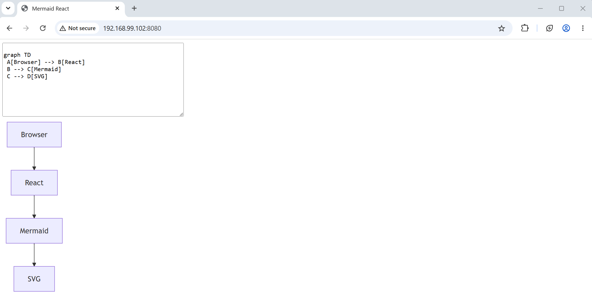
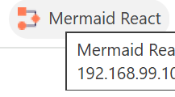
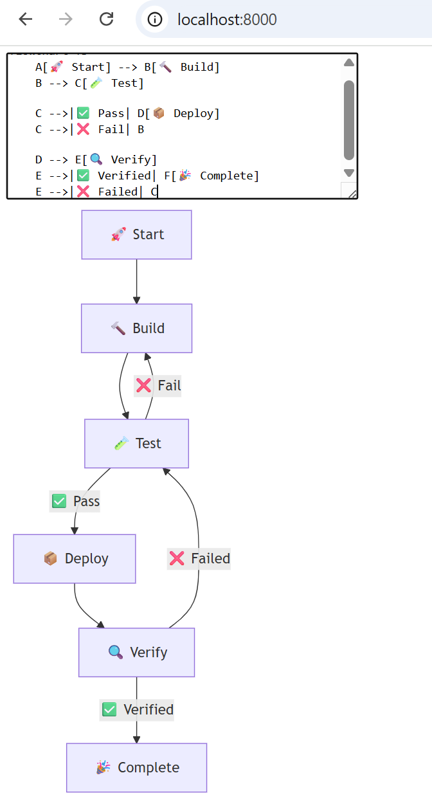
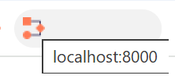
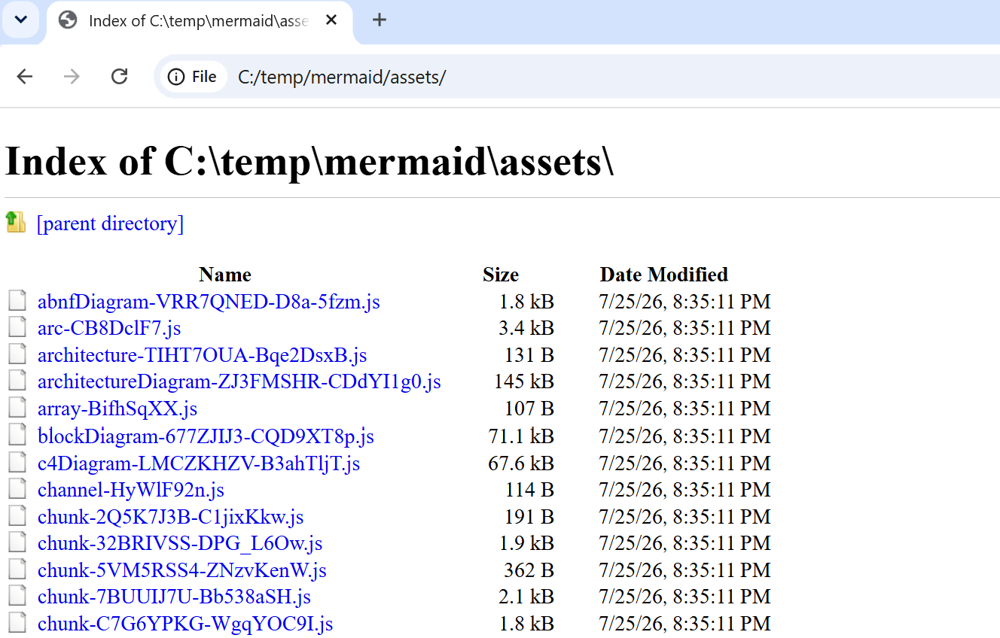
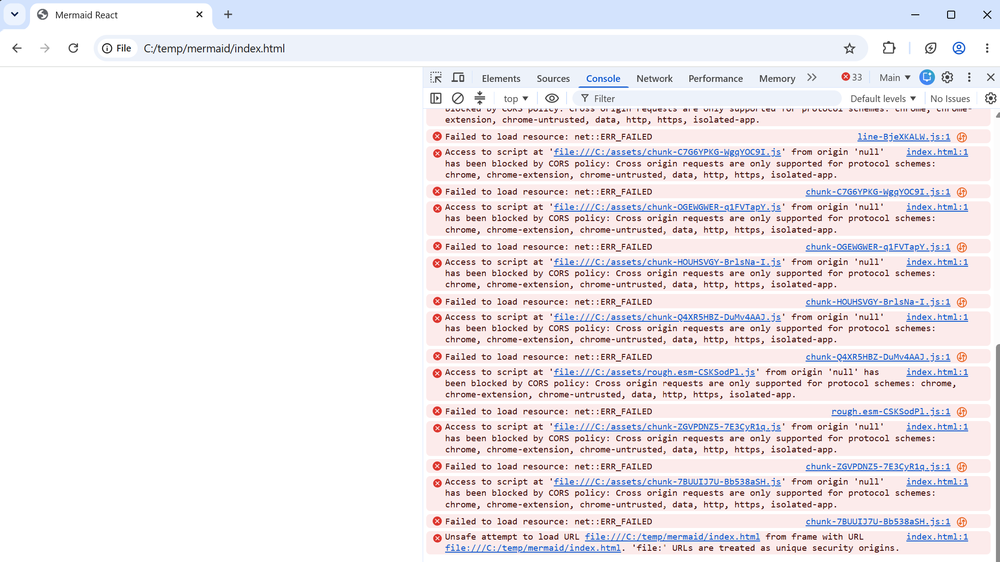
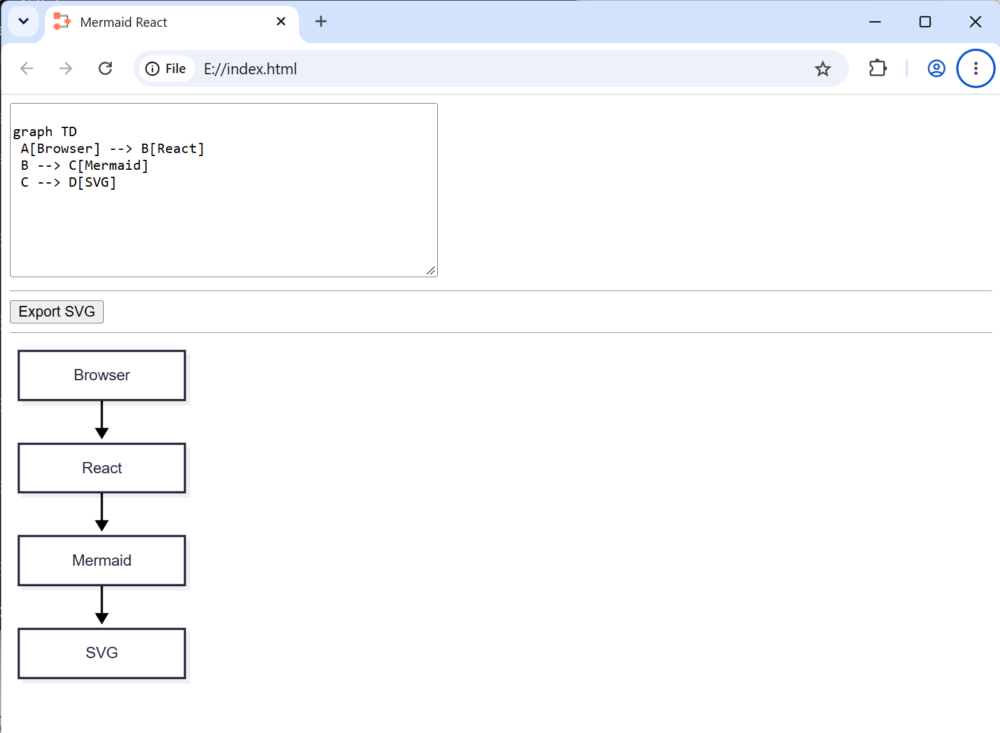
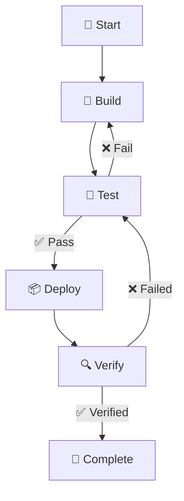

### Info

Latest [Mermaid](https://github.com/mermaid-js/mermaid) bundled with [React](https://github.com/react/react) library for web and native user interfaces and [Vite](https://github.com/vitejs/vite) fast next generation frontend tooling in order to run dist as a static resource (partial success)


### Background

`Mermaid.js` is a JavaScript library that allows users to create different types of diagrams, using a simple syntax. It supports a variety of diagram types, including [Swimlane flowcharts](https://en.wikipedia.org/wiki/Swimlane), [Sequence Diagrams](https://en.wikipedia.org/wiki/Sequence_diagram), [Gantt charts](https://en.wikipedia.org/wiki/Gantt_chart), [Entiy Relationship](https://en.wikipedia.org/wiki/Entity%E2%80%93relationship_model),  and [UML](https://en.wikipedia.org/wiki/Unified_Modeling_Language) class diagrams

__Mermaid__ diagrams can be easily embedded in websites, blogs, and documentation, making them a popular choice for technical writers, software developers, and other professionals who need to visualize complex information

[Mermaid](https://en.wikipedia.org/wiki/Mermaid_(software)) is open-source and can be integrated in both personal and commercial projects, making it a versatile tool for a variety of applications

Like many other WYSIWYG alternatives Mermaid Diagrams are authored in plain Text and possible to design
im a plain text editor (Syntax-aware editors can provide IntelliSense typcally vis extensions and plugins)
which makes it easier to version, review, and maintain compared to graphical design tools like

* [Blue Prism](https://en.wikipedia.org/wiki/Blue_Prism) 
* [UiPath](https://en.wikipedia.org/wiki/UiPath) 
* [Windows Workfllow Foundation](https://en.wikipedia.org/wiki/Windows_Workflow_Foundation) 
* [Mule AnyPoint Design Studio Flows](https://www.mulesoft.com/platform/studio), 
* Eclipse extensions and plugins for visual designing flows 
* [Microsoft Visio](https://en.wikipedia.org/wiki/Microsoft_Visio)

and others.

these are very different kinds of development systems, but they share a graphical/WYSIWYG authoring model, 
whereas __Mermaid__ deliberately makes the diagram itself source text.
```text
Traditional visual authoring
        │
        ▼
   Office / Visio
        │
        ▼
binary / structured document
        │
        ├── application required for editing
        ├── awkward textual diff
        ├── difficult merge semantics
        └── visual inspection
```
              versus
```
textual authoring
        │
        ▼
   Markdown + Mermaid
        │
        ▼
       source
        │
        ├── plain text
        ├── Git-friendly
        ├── diffable
        ├── mergeable
        ├── scriptable
        └── rendered when needed
```

A 2007-era .docx can effectively become a container of historical debris:
```code
10-page document
│
├── 🧾 current prose - visible content
├── 🖼 thumbnails of current diagrams
├── 📦 embedd  ed Visio
├── 📦 embedded Excel
├── 📦 embedded Word 97/2003
├── obsolete revisions
├── pasted copies
├── OLE objects
├── backup-ish material
└── 200 historical remnants ?
```
suddenly discoverred hundreds of embedded objects, 
the mere fact that they are physically present tells you almost nothing about their current semantic relevance.

That's a fundamentally different problem from a Markdown/Mermaid source tree:
```code
README.md
diagram.md
    └── Mermaid source
``` 
With the Office/OLE case, you first have to perform archaeology:

  * *Is this object referenced by the document?*
  * *Is it visible?*
  * *Is it current?*
  * *Is it an alternate version?*
  * *Is it an old OLE embedding that somebody forgot to remove?*
  * *Is it merely a copied object from an earlier revision?*


But:

"Sorry, there's only one Korben Dallas — and he already boarded."

Microsoft's own development of [MarkItDown](https://markitdown.online)
 is an interesting acknowledgment of the value of extracting information from rich document formats into a more portable, text-oriented representation. The goal is not necessarily to replace Office documents, but to make their contents accessible to downstream tooling, search, automation, and AI systems.

### Usage

```sh
docker pull node:22.12.0-alpine
docker pull nginx:1.30.3-alpine3.23
```
```sh
IMAGE=mermaid-react
docker build -t $IMAGE -f Dockerfile .
```
```text
Step 1/15 : FROM node:22.12.0-alpine AS builder
 ---> 3448d7ddbc59
Step 2/15 : WORKDIR /app
 ---> Running in b8dff4eb8b95
Removing intermediate container b8dff4eb8b95
 ---> 68d6f41e2a11
Step 3/15 : COPY package*.json /app/
 ---> 1d416b30ac12
Step 4/15 : ARG NPM_REGISTRY
 ---> Running in e02c9cf90644
Removing intermediate container e02c9cf90644
 ---> 943dd5119d13
Step 5/15 : RUN if [ -n "$NPM_REGISTRY" ]; then         npm config set registry "$NPM_REGISTRY";     fi
 ---> Running in 73a4113eb1bc
Removing intermediate container 73a4113eb1bc
 ---> a053af262af4
Step 6/15 : RUN npm install  || { cat /root/.npm/_logs/*.log; exit 1; }
 ---> Running in 406120150a40

added 130 packages, and audited 131 packages in 1m

12 packages are looking for funding
  run `npm fund` for details

found 0 vulnerabilities
npm notice
npm notice New major version of npm available! 10.9.0 -> 12.0.1
npm notice Changelog: https://github.com/npm/cli/releases/tag/v12.0.1
npm notice To update run: npm install -g npm@12.0.1
npm notice
Removing intermediate container 406120150a40
 ---> db89988ca84e
Step 7/15 : COPY index.html vite.config.js /app/
 ---> aae14ba29fd7
Step 8/15 : ADD src /app/src
 ---> a1a4f3980586
Step 9/15 : RUN npm run build
 ---> Running in 0cc0c3c39900

> mermaid-react@0.1.0 build
> vite build

vite v8.1.5 building client environment for production...
transforming...✓ 2069 modules transformed.
rendering chunks...
computing gzip size...
dist/index.html                                         1.39 kB │ gzip:   0.43 kB
...
dist/assets/chunk-KEIR6QF5-Dj-OpFgW.js                662.68 kB │ gzip: 143.23 kB


✓ built in 7.38s
[plugin builtin:vite-reporter]
(!) Some chunks are larger than 500 kB after minification. Consider:
- Using dynamic import() to code-split the application
- Use build.rolldownOptions.output.codeSplitting to improve chunking: https://rolldown.rs/reference/OutputOptions.codeSplitting
- Adjust chunk size limit for this warning via build.chunkSizeWarningLimit.
Removing intermediate container 0cc0c3c39900
 ---> c3aa8487e083
Step 10/15 : FROM nginx:1.30.3-alpine3.23
 ---> d0701bd41f82
Step 11/15 : WORKDIR /usr/share/nginx/html
 ---> Running in 9a6efd166a84
Removing intermediate container 9a6efd166a84
 ---> 1a83951c10b0
Step 12/15 : COPY --from=builder /app/dist ./
 ---> 6560afb6ca74
Step 13/15 : COPY default.conf /etc/nginx/conf.d/
 ---> 3ee0e88e7508
Step 14/15 : EXPOSE 80
 ---> Running in fc895ac4db98
Removing intermediate container fc895ac4db98
 ---> 4da50624fffb
Step 15/15 : CMD ["nginx", "-g", "daemon off;"]
 ---> Running in 53523509582f
Removing intermediate container 53523509582f
 ---> 94885df73b62
Successfully built 94885df73b62
Successfully tagged mermaid-react:latest
```
```sh    
NAME=mermaid-react
docker run --name $NAME -d -p 8080:80 $IMAGE
```





> NOTE: the following command expects the `dist` directory be deleted

```sh
NAME=mermaid-react
rm -fr dist
if test -d dist ; then echo "cannot continue"; else 
docker cp $NAME:/usr/share/nginx/html dist
fi
```
(You may need to switch to Windows environment shell)
```cmd
pushd dist
python.exe -m http.server
```
```text
Serving HTTP on :: port 8000 (http://[::]:8000/) ...
```
then open the site in the browser `http://localhost:8000`





### Local File

Cannot open in the browser via `file://` when using the real DOS Drive letters:

when launched with 

```cmd
"C:\Program Files\Google\Chrome\Application\chrome.exe" --user-data-dir=C:\temp\chrome-file-test --allow-file-access-from-files file:///..\dist\index.html
```
or
```cmd

"C:\Program Files\Google\Chrome\Application\chrome.exe" --user-data-dir=C:\temp\chrome-file-test --allow-file-access-from-files file:///C:/developer/sergueik/springboot_study/basic-mermaid-react/dist/index.html
```
it fails with `net::ERR_FILE_NOT_FOUND` error for multiple asset:

```text
Failed to load resource: net::ERR_FILE_NOT_FOUND index-BGiIaHVw.js:1 
Failed to load resource: net::ERR_FILE_NOT_FOUND chunk-Y2CYZVJY-DsF7k-Jl.js:1  
Failed to load resource: net::ERR_FILE_NOT_FOUND src-BMa7vLb8.js:1  
Failed to load resource: net::ERR_FILE_NOT_FOUND chunk-WYO6CB5R-C36byBU-.js:1  
Failed to load resource: net::ERR_FILE_NOT_FOUND dist-Q9n2Bb2K.js:1  
Failed to load resource: net::ERR_FILE_NOT_FOUND chunk-ICXQ74PX-_B4UKQEp.js:1  
Failed to load resource: net::ERR_FILE_NOT_FOUND path-BWPyau1x.js:1  
Failed to load resource: net::ERR_FILE_NOT_FOUND array-BifhSqXX.js:1  
Failed to load resource: net::ERR_FILE_NOT_FOUND line-BjeXKALW.js:1  
Failed to load resource: net::ERR_FILE_NOT_FOUND chunk-C7G6YPKG-WgqYOC9I.js:1  
Failed to load resource: net::ERR_FILE_NOT_FOUND chunk-OGEWGWER-q1FVTapY.js:1  
Failed to load resource: net::ERR_FILE_NOT_FOUND chunk-HOUHSVGY-BrlsNa-I.js:1  
Failed to load resource: net::ERR_FILE_NOT_FOUND chunk-Q4XR5HBZ-DuMv4AAJ.js:1  
Failed to load resource: net::ERR_FILE_NOT_FOUND rough.esm-CSKSodPl.js:1  
Failed to load resource: net::ERR_FILE_NOT_FOUND chunk-ZGVPDNZ5-7E3CyR1q.js:1  
Failed to load resource: net::ERR_FILE_NOT_FOUND chunk-7BUUIJ7U-Bb538aSH.js:1  
```

all files are present:
```cmd
dir /b/s /a-d assets | findstr -i "index-BGiIaHVw.js chunk-Y2CYZVJY-DsF7k-Jl.js src-BMa7vLb8.js  chunk-WYO6CB5R-C36byBU-.js dist-Q9n2Bb2K.js chunk-ICXQ74PX-_B4UKQEp.js  path-BWPyau1x.js array-BifhSqXX.js line-BjeXKALW.js chunk-C7G6YPKG-WgqYOC9I.js  chunk-OGEWGWER-q1FVTapY.jschunk-OGEWGWER-q1FVTapY.js chunk-HOUHSVGY-BrlsNa-I.js chunk-Q4XR5HBZ-DuMv4AAJ.js rough.esm-CSKSodPl.js chunk-ZGVPDNZ5-7E3CyR1q.js chunk-7BUUIJ7U-Bb538aSH.js"
```
```text
..\dist\assets\array-BifhSqXX.js
..\dist\assets\chunk-7BUUIJ7U-Bb538aSH.js
..\dist\assets\chunk-C7G6YPKG-WgqYOC9I.js
..\dist\assets\chunk-HOUHSVGY-BrlsNa-I.js
..\dist\assets\chunk-ICXQ74PX-_B4UKQEp.js
..\dist\assets\chunk-Q4XR5HBZ-DuMv4AAJ.js
..\dist\assets\chunk-WYO6CB5R-C36byBU-.js
..\dist\assets\chunk-Y2CYZVJY-DsF7k-Jl.js
..\dist\assets\chunk-ZGVPDNZ5-7E3CyR1q.js
..\dist\assets\dist-Q9n2Bb2K.js
..\dist\assets\index-BGiIaHVw.js
..\dist\assets\line-BjeXKALW.js
..\dist\assets\path-BWPyau1x.js
..\dist\assets\rough.esm-CSKSodPl.js
..\dist\assets\src-BMa7vLb8.js
```
> NOTE: moving the files around does not help:






However it works successfully with new instance launched with option  --allow-file-access-from-files from e: drive. 

```cmd
cd dist
subst E: %CD%
"C:\Program Files\Google\Chrome\Application\chrome.exe" --user-data-dir=C:\temp\chrome-file-test --allow-file-access-from-files file:///E:/index.html
```


> NOTE: without the Chrome option `--allow-file-access-from-files` the error becomes:

```text
Access to script at 'file:///C:/assets/index-BGiIaHVw.js' from origin 'null' has been blocked by CORS policy: Cross origin requests are only supported for protocol schemes: chrome, chrome-extension, chrome-untrusted, data, http, https, isolated-app.
```
(repeated for other resources)

For option to have effect one has to close all running instances of Chrome browser, otherwise the new url will be served by the already launched instance.

### Cleanup

```sh
docker stop $NAME
docker container prune -f
docker image prune -f
docker image rm $IMAGE node:22.12.0-alpine nginx:1.30.3-alpine3.23
```
### TODO: Investigate `file://` behavior on Windows by drive type / drive letter

### Work In Progress

* add misc. dependencies in `package.json`:
```json
"blob-stream": "^0.1.3",
"blob-stream-browserify": "^0.1.3",
"pdfkit": "^0.16.0",
"svg-exportjs-browser": "^2.1.0",
"svg-to-pdfkit": "^0.1.8",
"umd": "^3.0.1"
```

and iniitializations:

```js

import pdfkit from "pdfkit";
import umd from "umd";
import blobStream from "blob-stream";
import blobStreamBrowserify from "blob-stream-browserify";
import * as svgExport from "svg-exportjs-browser";
import svgPdfkit from "svg-to-pdfkit";
```
without actually interacting with any of the added classes from the code

split the build stages  `Dockerfile`
```sh
docker build -f Dockerfile.build  -t x .
```
alternatively 

```sh
docker build --target builder -f Dockerfile .
```
```text
Sending build context to Docker daemon  6.413MB
Step 1/9 : FROM node:22.12.0-alpine AS builder
 ---> 3448d7ddbc59
Step 2/9 : WORKDIR /app
 ---> Using cache
 ---> 79c6f9b18150
Step 3/9 : COPY package*.json /app/
 ---> efb5f9416710
Step 4/9 : ARG NPM_REGISTRY
 ---> Running in 665a8d409034
Removing intermediate container 665a8d409034
 ---> 02c90b694244
Step 5/9 : RUN if [ -n "$NPM_REGISTRY" ]; then npm config set registry "$NPM_REGISTRY"; fi
 ---> Running in 0d02267f0d73
Removing intermediate container 0d02267f0d73
 ---> 68d2c2f1414f
Step 6/9 : RUN npm install || { cat /root/.npm/_logs/*.log; exit 1; }
 ---> Running in 69738a216106
npm warn deprecated crypto-js@4.2.0: Active development of CryptoJS has been discontinued. This library is no longer maintained.
npm warn deprecated jpeg-exif@1.1.4: Package no longer supported. Contact Support at https://www.npmjs.com/support for more info.

added 159 packages, and audited 160 packages in 48s

13 packages are looking for funding
  run `npm fund` for details

2 low severity vulnerabilities

To address all issues (including breaking changes), run:
  npm audit fix --force

Run `npm audit` for details.
npm notice
npm notice New major version of npm available! 10.9.0 -> 12.2.0
npm notice Changelog: https://github.com/npm/cli/releases/tag/v12.2.0
npm notice To update run: npm install -g npm@12.2.0
npm notice
Removing intermediate container 69738a216106
 ---> e93e82eb53a5
Step 7/9 : COPY index.html vite.config.js favicon.png /app/
 ---> 256a97fc226c
Step 8/9 : ADD src /app/src
 ---> 053dec1a3230
Step 9/9 : RUN npm run build
 ---> Running in 638793a0e52b

> mermaid-react@0.1.0 build
> vite build

vite v8.3.4 building client environment for production...
transforming...
[plugin rolldown:vite-resolve] Module "stream" has been externalized for browser compatibility, imported by "/app/node_modules/pdfkit/js/pdfkit.es.js". See https://vite.dev/guide/troubleshooting.html#module-externalized-for-browser-compatibility for more details.
[plugin rolldown:vite-resolve] Module "events" has been externalized for browser compatibility, imported by "/app/node_modules/pdfkit/js/pdfkit.es.js". See https://vite.dev/guide/troubleshooting.html#module-externalized-for-browser-compatibility for more details.
[plugin rolldown:vite-resolve] Module "zlib" has been externalized for browser compatibility, imported by "/app/node_modules/pdfkit/js/pdfkit.es.js". See https://vite.dev/guide/troubleshooting.html#module-externalized-for-browser-compatibility for more details.
[plugin rolldown:vite-resolve] Module "fs" has been externalized for browser compatibility, imported by "/app/node_modules/pdfkit/js/pdfkit.es.js". See https://vite.dev/guide/troubleshooting.html#module-externalized-for-browser-compatibility for more details.
[plugin rolldown:vite-resolve] Module "util" has been externalized for browser compatibility, imported by "/app/node_modules/blob-stream/index.js". See https://vite.dev/guide/troubleshooting.html#module-externalized-for-browser-compatibility for more details.
[plugin rolldown:vite-resolve] Module "stream" has been externalized for browser compatibility, imported by "/app/node_modules/blob-stream/index.js". See https://vite.dev/guide/troubleshooting.html#module-externalized-for-browser-compatibility for more details.
[plugin rolldown:vite-resolve] Module "util" has been externalized for browser compatibility, imported by "/app/node_modules/browserify-zlib/lib/index.js". See https://vite.dev/guide/troubleshooting.html#module-externalized-for-browser-compatibility for more details.
[plugin rolldown:vite-resolve] Module "stream" has been externalized for browser compatibility, imported by "/app/node_modules/browserify-zlib/lib/index.js". See https://vite.dev/guide/troubleshooting.html#module-externalized-for-browser-compatibility for more details.
[plugin rolldown:vite-resolve] Module "assert" has been externalized for browser compatibility, imported by "/app/node_modules/browserify-zlib/lib/index.js". See https://vite.dev/guide/troubleshooting.html#module-externalized-for-browser-compatibility for more details.
[plugin rolldown:vite-resolve] Module "buffer" has been externalized for browser compatibility, imported by "/app/node_modules/browserify-zlib/lib/index.js". See https://vite.dev/guide/troubleshooting.html#module-externalized-for-browser-compatibility for more details.
[plugin rolldown:vite-resolve] Module "assert" has been externalized for browser compatibility, imported by "/app/node_modules/browserify-zlib/lib/binding.js". See https://vite.dev/guide/troubleshooting.html#module-externalized-for-browser-compatibility for more details.
[plugin rolldown:vite-resolve] Module "fs" has been externalized for browser compatibility, imported by "/app/node_modules/jpeg-exif/lib/index.js". See https://vite.dev/guide/troubleshooting.html#module-externalized-for-browser-compatibility for more details.
✓ 2177 modules transformed.
rendering chunks...
computing gzip size...
dist/assets/favicon-BzgZYuLl.png                                                 0.27 kB
dist/index.html                                                                  1.47 kB │ gzip:   0.47 kB
dist/assets/array-BifhSqXX.js                                                    0.10 kB │ gzip:   0.11 kB
dist/assets/pie-WAS4IAKB-2BdD3iSy.js                                             0.10 kB │ gzip:   0.12 kB
dist/assets/info-A6RAGUB7-BDZVuLg3.js                                            0.10 kB │ gzip:   0.12 kB
dist/assets/radar-RG4KPBEZ-BaClNgBM.js                                           0.10 kB │ gzip:   0.12 kB
dist/assets/packet-AYTQ26CC-CnRp1HXF.js                                          0.11 kB │ gzip:   0.12 kB
dist/assets/cynefin-OW5HDTMX-D4EpsGpO.js                                         0.11 kB │ gzip:   0.12 kB
dist/assets/treemap-WGGIJYW6-B0ur1uVq.js                                         0.11 kB │ gzip:   0.12 kB
dist/assets/wardley-WFR3VGLG-DR41n5Wc.js                                         0.11 kB │ gzip:   0.12 kB
dist/assets/gitGraph-4MIJSDKK-_1wigWod.js                                        0.11 kB │ gzip:   0.12 kB
dist/assets/railroad-74A4TZTK-Big9YdWc.js                                        0.11 kB │ gzip:   0.12 kB
dist/assets/treeView-Q6P3EWNA-DLqMm3Ux.js                                        0.11 kB │ gzip:   0.12 kB
dist/assets/channel-CRuHTDTD.js                                                  0.11 kB │ gzip:   0.12 kB
dist/assets/railroad-peg-WCYAUIDC-2kTm3RFN.js                                    0.11 kB │ gzip:   0.12 kB
dist/assets/architecture-7GRP2DOG-c0XBdozv.js                                    0.11 kB │ gzip:   0.12 kB
dist/assets/railroad-abnf-HS5TGJTU-BkW4x2iF.js                                   0.11 kB │ gzip:   0.12 kB
dist/assets/railroad-ebnf-LZEXJU2U-3q4WjP-A.js                                   0.11 kB │ gzip:   0.12 kB
dist/assets/eventmodeling-NTZA5JFV-CeQW0V6G.js                                   0.11 kB │ gzip:   0.13 kB
dist/assets/__vite-optional-peer-dep_canvg_svg-exportjs-browser-mNUDxd_4.js      0.12 kB │ gzip:   0.12 kB
dist/assets/init-C-OQMol4.js                                                     0.14 kB │ gzip:   0.12 kB
dist/assets/chunk-Y2CYZVJY-DsF7k-Jl.js                                           0.15 kB │ gzip:   0.14 kB
dist/assets/chunk-2Q5K7J3B-C1jixKkw.js                                           0.19 kB │ gzip:   0.16 kB
dist/assets/chunk-JWPE2WC7-DVXcaiue.js                                           0.22 kB │ gzip:   0.17 kB
dist/assets/chunk-XXDRQBXY-BakWylwG.js                                           0.26 kB │ gzip:   0.22 kB
dist/assets/chunk-5VM5RSS4-ZNzvKenW.js                                           0.36 kB │ gzip:   0.27 kB
dist/assets/flowDiagram-HODETNUW-COUONpRO.js                                     0.47 kB │ gzip:   0.27 kB
dist/assets/chunk-POPQ4Y6H-BbjG91Jw.js                                           0.57 kB │ gzip:   0.40 kB
dist/assets/infoDiagram-27XIBGKW-CGLau5zi.js                                     0.65 kB │ gzip:   0.42 kB
dist/assets/classDiagram-ZZMXUADV-xB7uLrsJ.js                                    0.69 kB │ gzip:   0.41 kB
dist/assets/classDiagram-v2-VYDZK3BY-xB7uLrsJ.js                                 0.69 kB │ gzip:   0.41 kB
dist/assets/stateDiagram-v2-MP3YSRHH-kW01-n_v.js                                 0.70 kB │ gzip:   0.41 kB
dist/assets/swimlanesDiagram-VR7AAH4N-BYpUyh4S.js                                0.75 kB │ gzip:   0.44 kB
dist/assets/sizeCapture-INFHLROL-3uHXrFqA.js                                     0.87 kB │ gzip:   0.51 kB
dist/assets/line-DwXbLlg9.js                                                     0.94 kB │ gzip:   0.47 kB
dist/assets/ordinal-BDEzSJ7C.js                                                  1.17 kB │ gzip:   0.56 kB
dist/assets/rolldown-runtime-BCiCTKAo.js                                         1.30 kB │ gzip:   0.71 kB
dist/assets/chunk-GVQU2GXP-DzUe2A8w.js                                           1.41 kB │ gzip:   0.79 kB
dist/assets/railroadDiagram-O6MQD6OU-Dgy2YrMC.js                                 1.66 kB │ gzip:   0.77 kB
dist/assets/abnfDiagram-VCTEODGH-CVxeA9wy.js                                     1.84 kB │ gzip:   0.89 kB
dist/assets/chunk-P2QGCYS3-DD7DGpVJ.js                                           1.94 kB │ gzip:   0.95 kB
dist/assets/chunk-F27PBJKO-Bd_pVafX.js                                           1.97 kB │ gzip:   0.88 kB
dist/assets/pegDiagram-XKGWAZYB-ScZzzM8a.js                                      2.00 kB │ gzip:   0.94 kB
dist/assets/ebnfDiagram-PWID7BFC-CljrsrHN.js                                     2.06 kB │ gzip:   0.89 kB
dist/assets/dist-DGs_yUrP.js                                                     2.17 kB │ gzip:   0.97 kB
dist/assets/path-fybaL0A-.js                                                     2.27 kB │ gzip:   0.98 kB
dist/assets/arc-Bw7m-cfu.js                                                      3.47 kB │ gzip:   1.46 kB
dist/assets/diagram-Z3DM3KII-BW-KI6hi.js                                         4.27 kB │ gzip:   1.85 kB
dist/assets/defaultLocale-BFoDCU3G.js                                            4.63 kB │ gzip:   2.12 kB
dist/assets/linear-BXgYrK5n.js                                                   5.51 kB │ gzip:   2.25 kB
dist/assets/chunk-PWAF6VOD-B254sQkl.js                                           5.83 kB │ gzip:   2.68 kB
dist/assets/diagram-UQ7AKVKN-jjozXjqQ.js                                         6.06 kB │ gzip:   2.56 kB
dist/assets/pieDiagram-E7YTZNPT-C5QyXu3f.js                                      6.21 kB │ gzip:   2.59 kB
dist/assets/diagram-S7CK7UJ4-Uwrjvyoa.js                                         8.11 kB │ gzip:   3.65 kB
dist/assets/cynefinDiagram-5FMLGOSQ-DLlyoGxK.js                                  9.93 kB │ gzip:   3.51 kB
dist/assets/stateDiagram-D77RDMKH-Bo_1KI7m.js                                   10.53 kB │ gzip:   3.68 kB
dist/assets/diagram-VSXAHHWV-6aZpSUC5.js                                        10.66 kB │ gzip:   4.12 kB
dist/assets/dagre-GXQ25YYZ-DuxoeNpV.js                                          10.85 kB │ gzip:   4.10 kB
dist/assets/chunk-SVP7TREG-BNsM4Qov.js                                          15.63 kB │ gzip:   4.35 kB
dist/assets/diagram-VX7I27RA-BG9vlaye.js                                        15.74 kB │ gzip:   5.52 kB
dist/assets/mermaid-parser.core-Cpib-OZd.js                                     16.58 kB │ gzip:   3.93 kB
dist/assets/ishikawaDiagram-5VMMS53U-yRi_6-Kz.js                                17.30 kB │ gzip:   6.53 kB
dist/assets/kanban-definition-UXKFOSKX-Li_Tvq6c.js                              20.21 kB │ gzip:   7.12 kB
dist/assets/sankeyDiagram-P5KCCOFB-DHU_dWow.js                                  22.79 kB │ gzip:   8.25 kB
dist/assets/journeyDiagram-3NMN7TZE-CCh5jV98.js                                 23.15 kB │ gzip:   8.16 kB
dist/assets/mindmap-definition-YA3MSWOX-CDJWvb82.js                             23.36 kB │ gzip:   7.95 kB
dist/assets/wardleyDiagram-VM6X3IG4-CnwOD1rt.js                                 25.19 kB │ gzip:   6.55 kB
dist/assets/rough.esm-Dy-Kn_BL.js                                               27.10 kB │ gzip:   8.85 kB
dist/assets/gitGraphDiagram-WWUBYQGX-BqAZiW-U.js                                29.01 kB │ gzip:   8.57 kB
dist/assets/timeline-definition-24CTP7MA-DdpAldlS.js                            30.36 kB │ gzip:   9.96 kB
dist/assets/erDiagram-RLTQ6QDP-m5kjZ0ju.js                                      30.60 kB │ gzip:  10.53 kB
dist/assets/chunk-75Z2AOVW-DRXKjQv2.js                                          30.75 kB │ gzip:   8.50 kB
dist/assets/requirementDiagram-BXWQKSXE-Dd7HUel7.js                             30.91 kB │ gzip:   9.73 kB
dist/assets/quadrantDiagram-AXDQQJYC-BUbfGmN2.js                                33.51 kB │ gzip:   9.74 kB
dist/assets/dagre-C6JJLb6i.js                                                   36.85 kB │ gzip:  13.21 kB
dist/assets/chunk-IMKFNOWR-5DaSBqDd.js                                          37.63 kB │ gzip:  12.26 kB
dist/assets/vennDiagram-4TSXK5OY-CotdWYJg.js                                    41.15 kB │ gzip:  15.11 kB
dist/assets/blockDiagram-I7D4REHJ-BQ7cerZm.js                                   41.38 kB │ gzip:  13.34 kB
dist/assets/xychartDiagram-S5SC5T6Z-Bvg8JWAU.js                                 44.14 kB │ gzip:  12.21 kB
dist/assets/src-Bc_iCBZR.js                                                     45.66 kB │ gzip:  16.00 kB
dist/assets/chunk-TICWLB2K-CDMO7uvr.js                                          48.77 kB │ gzip:  15.74 kB
dist/assets/chunk-GMAD6QVW-DXXDaxv9.js                                          51.20 kB │ gzip:  16.68 kB
dist/assets/chunk-SHT3W25Y-Bb16uRWI.js                                          61.19 kB │ gzip:  19.82 kB
dist/assets/c4Diagram-7LVT6UL2-BTVkQOE9.js                                      64.74 kB │ gzip:  18.52 kB
dist/assets/ganttDiagram-EL5Y4UJY-DEwoREEa.js                                   69.36 kB │ gzip:  22.74 kB
dist/assets/cose-bilkent-JH36ORCC-d1jJRUaj.js                                   81.22 kB │ gzip:  21.52 kB
dist/assets/chunk-4HAMMTFA-yGvg_REc.js                                         104.85 kB │ gzip:  25.62 kB
dist/assets/swimlanes-42K2YHIH-C4i2U8jr.js                                     110.98 kB │ gzip:  37.95 kB
dist/assets/sequenceDiagram-WJ2MYXX4-LBEm59n7.js                               115.73 kB │ gzip:  30.58 kB
dist/assets/architectureDiagram-5GKGNRK7-CnCgy-w7.js                           148.87 kB │ gzip:  41.10 kB
dist/assets/chunk-DU6HZSFF-B6IZsRR5.js                                         239.21 kB │ gzip:  39.55 kB
dist/assets/katex-DJhrJSbw.js                                                  258.59 kB │ gzip:  77.43 kB
dist/assets/cytoscape.esm-BegBNzOV.js                                          434.75 kB │ gzip: 137.75 kB
dist/assets/chunk-FOHPRMQF-DD4dKubD.js                                         662.08 kB │ gzip: 143.15 kB
dist/assets/index-CZgYOn_E.js                                                1,130.74 kB │ gzip: 394.89 kB

[plugin builtin:vite-reporter]
(!) Some chunks are larger than 500 kB after minification. Consider:
- Using dynamic import() to code-split the application
- Use build.rolldownOptions.output.codeSplitting to improve chunking: https://rolldown.rs/reference/OutputOptions.codeSplitting
- Adjust chunk size limit for this warning via build.chunkSizeWarningLimit.
✓ built in 4.65s
Removing intermediate container 638793a0e52b
 ---> 947fcc748d02
Successfully built 947fcc748d02
```


|Legacy function|Responsibility|Porting approach|
|---------------|--------------|----------------|
|`prepareSvgForExport()`|Clone SVG, normalize dimensions, inline computed styles, remove embedded CSS, replace foreignObject labels|Preserve initially; this contains important compatibility workarounds|
|`normalizeSvgViewBoxToIntegers()`|Round the SVG viewBox coordinates and dimensions|Preserve as a separately testable diagnostic workaround|
|`exportSvg()`|Prepare the rendered SVG and call svgExport.downloadSvg()|Preserve export logic; replace DOM lookup|
|`exportPng()`|Prepare the rendered SVG and call svgExport.downloadPng()|Same treatment|
|`renderMermaid()`|Render the Mermaid source and update the output|Replace with the head-version rendering path|
|`zoomIn()` / `zoomOut()`|Apply CSS transforms to the displayed SVG|Keep independent of export|


#### Challenges with Porting


|Issue|Consequence|
|-----|-----------|
|utility methods `prepareSvgForExport()` and `normalizeSvgViewBoxToIntegers()` are not defined in the supplied `App.jsx`.|`exportSvg()` will throw a `ReferenceError` when invoked unless those functions are defined elsewhere.|
|`#output` id attributed `<svg>` element does not exist in the `App.jsx`/`main.jsx`.|The fallback selector cannot find the diagram.|
|`window.exportSvg` is assigned inside the component body.|It is reassigned on every render. It is callable, but this is unnecessary and makes the integration less clean.|
|`svgExport` is imported as a module namespace.|This is valid only if `svg-exportjs-browser` exposes the expected named exports in the installed version.|
|`mermaid.render()` completes asynchronously.|Export must happen after the rendered SVG has been committed to the DOM, or it must use the SVG string returned directly by Mermaid.|
||
#### Observation

The generated Vite/React/Mermaid application is fully static and works correctly when served over HTTP (nginx).

When opened directly via `file://`, Chrome exhibits inconsistent behavior depending on the underlying Windows drive.

#### Current results

| Location | Result |
|----------|--------|
| `file:///E:/index.html` (`subst E: <dist>`) | ✅ Works |
| `file:///E:/newdir/index.html` | ✅ Works |
| `file:///C:/temp/dist/index.html` | ❌ Requests `file:///C:/assets/...` |
| `file:///C:/developer/.../dist/index.html` | ❌ Same behavior |

The generated JavaScript contains **relative** module imports, e.g.

```js
import "./chunk-XXXX.js";
```

The referenced files are present and individually accessible via `file://`.

#### Unsolved Questions

- Is this a Chromium/Chrome `file://` module loader issue?
- Is Windows treating `subst` drives differently from physical NTFS volumes?
- Does Chrome classify different drive types (physical, `subst`, network, removable, virtual) differently for security/origin purposes?
- Is the behavior related to the native NT object namespace (`\GLOBAL??`, `\Device\...`)?
- Does Microsoft expose different metadata for `subst` drives through Win32 or shell APIs?
- Is the issue specific to ES module resolution, rather than ordinary file I/O?

#### Future experiments

- Test on a clean Windows installation.
- Test without `--allow-file-access-from-files`.
- Compare:
  - physical NTFS (`C:`)
  - `subst` drive
  - mapped network drive
  - removable USB drive
  - VHD/VHDX mounted volume
- Compare Chrome, Edge, and Firefox.
- Capture Process Monitor (ProcMon) traces to compare actual file opens.
- Inspect the generated HTML and module graph for absolute vs. relative URL resolution.
- Determine whether this is a browser issue, a Windows filesystem abstraction issue, or an interaction between the two.


## Project observations

### Enterprise portability

The current Mermaid package is available from the enterprise Artifactory repository (multiple package variants were found).

This means the project can be built entirely from enterprise package repositories without depending on the public npm registry.

### Industry adoption

Mermaid is no longer just a standalone diagramming library.

It has become part of the modern software engineering toolchain, including:

- GitHub Markdown rendering
- GitHub Copilot and Agent workflows
- VS Code preview/presentation features
- GitLab documentation
- various CI/CD platforms and documentation generators
- developer portals and knowledge bases

Mermaid diagrams are increasingly becoming a common interchange format for lightweight architecture and workflow documentation.

### Enterprise Toolbox candidate

A small standalone Mermaid viewer/editor remains valuable even when IDE integrations exist.

Potential users include:

- developers without VS Code or Copilot
- QA engineers
- release engineers
- documentation authors
- project managers
- support engineers
- users on locked-down enterprise desktops

A portable static application avoids IDE dependencies while providing a simple way to preview and validate Mermaid diagrams.

#### Troubleshooting
a slightly older release `9.4.5` is unable to render flowcharts containing [emoji]()

```code
flowchart TD
    A[🚀 Start] --> B[🔨 Build]
    B --> C[🧪 Test]

    C -->|✅ Pass| D[📦 Deploy]
    C -->|❌ Fail| B

    D --> E[🔍 Verify]
    E -->|✅ Verified| F[🎉 Complete]
    E -->|❌ Failed| C
```

there are actually *two* errors
```text


Error
  {str: 'Lexical error on line 2. Unrecognized text.\nflowch… TD    A[🚀 Start] --> B[🔨 B\n------------------^', hash: {…}}
  
Uncaught Error: Cannot read properties of undefined (reading 'first_line')

TypeError: Cannot read properties of undefined (reading 'first_line')
    at Rn.S (edit.svelte-cf77660e.js:109:13637)
    at index-3ccfa173.js:4:906
    at Array.forEach (<anonymous>)
    at index-3ccfa173.js:4:892
    at edit.svelte-cf77660e.js:14:1891
    at i.invoke (event.ts:554:17)
    at o.fire (event.ts:721:15)
    at codeEditorWidget.ts:1472:88
    at textModel.ts:201:79
    at i.invoke (event.ts:554:17)
    at Rn.S (edit.svelte-cf77660e.js:109:13637)
    at index-3ccfa173.js:4:906
    at Array.forEach (<anonymous>)
    at index-3ccfa173.js:4:892
    at edit.svelte-cf77660e.js:14:1891
    at i.invoke (event.ts:554:17)
    at o.fire (event.ts:721:15)
    at codeEditorWidget.ts:1472:88
    at textModel.ts:201:79
    at i.invoke (event.ts:554:17)
    at errors.ts:22:12
```

|-------|-------------------|-------|--------------|----------------------|--------|
|Variant|Runtime / packaging|Mermaid|Main advantage|Main nuisance / caveat|Best use|
|1. Docker + nginx + Svelte + Mermaid|Container serves the Svelte dist through nginx|Mermaid bundled into the application|Cleanest and most reproducible; browser sees an ordinary HTTP application; no file:// restrictions|Requires Docker/container lifecycle; image rebuild when dependencies change|Primary development/test environment and closest to a deployable application|
|2. Python local server + dist|Python HTTP server serves the locally built dist directory|Mermaid bundled in dist|Extremely lightweight; no nginx/Docker required; behaves like a normal web application|Smart cache cleanup is important, particularly after power-down/reboot or when changing Mermaid bundles; stale JS/assets can make debugging deceptively confusing|Fast local development / experimentation|
|3. file:// + Z: drive trick|Browser opens the generated dist/index.html directly; Z: is a subst/mapped-style convenience rather than a physical/network drive|Mermaid bundled in dist|No server at all; convenient for examining the finished artifact|Browser file:// security/CORS behavior; Chrome may require --allow-file-access-from-files and a separate --user-data-dir; not a faithful HTTP deployment environment|Pre-render / inspect the final artifact before publishing, especially when a server is undesirable|
### Current status

- ✅ Modern Mermaid successfully builds as a static application.
- ✅ Build can be performed in a disposable Docker environment.
- ✅ Resulting artifact is static.
- ⚠ Browser `file://` behavior still requires additional investigation.
- ✅ HTTP deployment (nginx or any static web server) works correctly.


### Where I Draw the Line

(image: an absurdly thick, gold-plated, silk-wrapped $30,000 audiophile cable)

This is where I burn my money.

Five-nines oxygen-free copper.
Gold-plated screws.
Silk insulation.
One-inch diameter.
Handcrafted signal pathways.

The signal travels through it in complete silence.

And unlike containers, Kubernetes, serverless architecture, browser runtimes, or deployment pipelines...

Here, I don't care about reality.

I care about sound myths.

### See Also:
  * [Mermaid Live Editor](https://mermaid.live/edit): Online FlowChart & Diagrams Editor
  * [Diagram as Code: Comparing the Major Tools](https://diagrams.so/learn/diagram-as-code-comparison)
  * [top 6 Mermaid.js alternatives](https://swimm.io/learn/mermaid-js/top-6-mermaid-js-alternatives)
  * [MermaidJS and Graphviz side by side](https://www.devtoolsdaily.com/diagrams/graphviz_vs_mermaid/)
  * [Python MarkItDown: Convert Documents Into LLM-Ready Markdown](https://realpython.com/python-markitdown/)
  * [Complete markdown syntax guide and cheat sheet](https://dillinger.io/guide)
  * [Svelte](https://en.wikipedia.org/wiki/Svelte)
---

### Author
[Serguei Kouzmine](kouzmine_serguei@yahoo.com)
