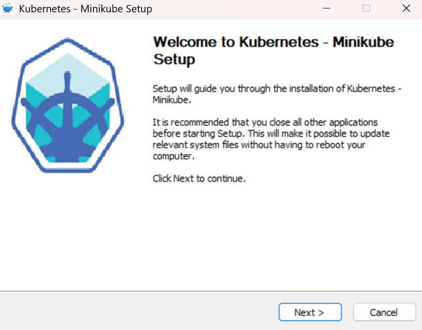

### Install

[Minikube](https://minikube.sigs.k8s.io/docs/start) is orchestrator of K8 configurations running on
LHC container driver directly or Hypervisor hosting the same 

```powershell
pushd "${env:USERPROFILE}\Downloads"
new-item -path .  -itemtype Directory -force -name 'minikube'
$progresspreference = 'SilentlyContinue'
$version = 'latest'
$version = 'v1.39.0'
$url = ('https://github.com/kubernetes/minikube/releases/{0}/download/minikube-windows-amd64.exe' -f $version)
$url = ('https://github.com/kubernetes/minikube/releases/download/{0}/minikube-installer.exe'  -f $version)
invoke-webrequest -usebasicparsing -outfile './minikube/minikube.exe' -uri $url 
```
```powershell
get-item .\minikube\minikube.exe | select-object  -property versioninfo,length|format-list
```
```text
VersionInfo : File:             C:\Users\kouzm\Downloads\minikube\minikube.exe
              InternalName:
              OriginalFilename:
              FileVersion:
              FileDescription:
              Product:
              ProductVersion:
              Debug:            False
              Patched:          False
              PreRelease:       False
              PrivateBuild:     False
              SpecialBuild:     False
              Language:

Length      : 54308621
```
```powershell
start .\minikube\minikube.exe
```

> NOTE : the "1. Installation Click on the buttons that describe your target platform..." [page](https://minikube.sigs.k8s.io/docs/start/?arch=%2Fwindows%2Fx86-64%2Fstable%2F.exe+download) link provided on is likely incorrect / outdated hanging :

> ```powershell
> invoke-webrequest -usebasicparsing -outfile './minikube/minikube.exe' -uri 'https://github.com/kubernetes/minikube/releases/v1.39.0/download/minikube-windows-amd64.exe'
> ```
> ```text
> invoke-webrequest : Not Found
> At line:1 char:1
> + invoke-webrequest -usebasicparsing -outfile './minikube/minikube.exe' ...
> + ~~~~~~~~~~~~~~~~~~~~~~~~~~~~~~~~~~~~~~~~~~~~~~~~~~~~~~~~~~~~~~~~~~~~~
>     + CategoryInfo          : InvalidOperation: (System.Net.HttpWebRequest:HttpWebRequest) [Invoke-WebRequest], WebException
>     + FullyQualifiedErrorId : WebCmdletWebResponseException,Microsoft.PowerShell.Commands.InvokeWebRequestCommand
> ```

> 🤓 The old binary is not simply gone from __v1.39.0__. 
> The appliction release still lists `minikube-windows-amd64.exe`. 
> However, a __Minikube__ issue [23770](https://github.com/kubernetes/minikube/issues/23770) from September 20, 2026, explicitly describes the asset-layout change planned for __v1.40.0__. 
> The new layout uses simplified asset names, and the issue states that the new URL scheme applies to __v1.40.0__ onward. 
  
> 😮 The blank VersionInfo fields are a separate issue. Your downloaded file is an installer, not necessarily the standalone CLI executable. 
> Windows version-resource metadata is optional; blank `FileVersion`,`ProductVersion`, and `OriginalFilename` fields do not mean the download is invalid. 
> The 54,308,621-byte length alone cannot establish its identity or integrity.
> The `minikube.exe` is an __Nullsoft Scriptable Install System__ ([NSIS](https://nsis.sourceforge.io/Main_Page)) package
> ```xml
>  <?xml version="1.0" encoding="UTF-8" standalone="yes"?>
>  <assembly xmlns="urn:schemas-microsoft-com:asm.v1" manifestVersion="1.0">
>    <assemblyIdentity version="1.0.0.0" processorArchitecture="*" name="Nullsoft.NSIS.exehead" type="win32"/>
>    <description>Nullsoft Install System v3.08-3+deb12u1</description>
>    <dependency>
>      <dependentAssembly>
>        <assemblyIdentity type="win32" name="Microsoft.Windows.Common-Controls" version="6.0.0.0" processorArchitecture="*" publicKeyToken="6595b64144ccf1df" language="*"/>
>      </dependentAssembly>
>    </dependency>
>    <trustInfo xmlns="urn:schemas-microsoft-com:asm.v3">
>      <security>
>        <requestedPrivileges>
>          <requestedExecutionLevel level="requireAdministrator" uiAccess="false"/>
>        </requestedPrivileges>
>      </security>
>    </trustInfo>
>    <compatibility xmlns="urn:schemas-microsoft-com:compatibility.v1">
>      <application>
>        <supportedOS Id="{8e0f7a12-bfb3-4fe8-b9a5-48fd50a15a9a}"/>
>        <supportedOS Id="{1f676c76-80e1-4239-95bb-83d0f6d0da78}"/>
>        <supportedOS Id="{4a2f28e3-53b9-4441-ba9c-d69d4a4a6e38}"/>
>        <supportedOS Id="{35138b9a-5d96-4fbd-8e2d-a2440225f93a}"/>
>      </application>
>    </compatibility>
>  </assembly>
>  ```
  

For Ubuntu Centos use binary doanload of debian package
```sh
curl -skLo /tmp/minikube_latest_amd64.deb https://storage.googleapis.com/minikube/releases/latest/minikube_latest_amd64.deb
sudo dpkg -i /tmp/minikube_latest_amd64.deb
```
or rpm:
```
curl -skLo /tmp/minikube-latest.x86_64.rpm https://storage.googleapis.com/minikube/releases/latest/minikube-latest.x86_64.rpm
sudo rpm -Uvh /tmp/minikube-latest.x86_64.rpm
```

Which drivers are ?

|Driver|Windows support|What to expect|
|------|---------------|--------------|
|VirtualBox|Supported|VM lifecycle, NAT, host-only networking|
|Docker|Supported|Container-based cluster, networking and runtime|
|Podman|Experimental|Daemonless container tooling, Podman machine and runtime integration|
|Hyper-V|Supported on eligible Windows editions|Native Windows virtualization|
|QEMU|Experimental|Alternative VM and device emulation|

it appears the catalog `https://storage.googleapis.com/minikube/` is still operational

```xml
<Contents>
  <Key>iso/minikube-v1.39.0-amd64.iso</Key>
  <Generation>1788305191125191</Generation>
  <MetaGeneration>1</MetaGeneration>
  <LastModified>2026-09-01T23:26:31.180Z</LastModified>
  <ETag>"50ada20a09b86a46a94f8444284a11b2"</ETag>
  <Size>414697472</Size>
</Contents>
<Contents>
  <Key>iso/minikube-v1.39.0-amd64.iso.sha256</Key>
  <Generation>1788305193439847</Generation>
  <MetaGeneration>1</MetaGeneration>
  <LastModified>2026-09-01T23:26:33.489Z</LastModified>
  <ETag>"39ec979cb04fcef18d0acfaa7969ea58"</ETag>
  <Size>65</Size>
</Contents>
<Contents>
  <Key>iso/minikube-v1.39.0-arm64.iso</Key>
  <Generation>1788305201051301</Generation>
  <MetaGeneration>1</MetaGeneration>
  <LastModified>2026-09-01T23:26:41.105Z</LastModified>
  <ETag>"9afe64ec4ba6d758cca5f2b2a2399918"</ETag>
  <Size>448708608</Size>
</Contents>
<Contents>
  <Key>iso/minikube-v1.39.0-arm64.iso.sha256</Key>
  <Generation>1788305203284225</Generation>
  <MetaGeneration>1</MetaGeneration>
  <LastModified>2026-09-01T23:26:43.333Z</LastModified>
  <ETag>"5f56478301177b2d3a6912e8d4c297c2"</ETag>
  <Size>65</Size>
</Contents>
```
      
```sh
curl -skLo ~/Downloads/minikube/a.iso https://storage.googleapis.com/minikube/iso/minikube-v1.39.0-amd64.iso
```
```
sha256sum ~/Downloads/minikube/a.iso 
```
> NOTE: does not appear to match the `sha256` in the release catalog...

```text
e034d26e27e03e37aab43cd3560c40f955a3476cc994e8964585523a1ba86b6a */c/Users/kouzm/Downloads/minikube/a.iso
```

but it is a valid iso:

```cmd
 /c/Program\ Files/7-Zip/7z.exe l ~/Downloads/minikube/a.iso
```
```text
7-Zip 21.07 (x64) : Copyright (c) 1999-2021 Igor Pavlov : 2021-12-26

Scanning the drive for archives:
1 file, 414697472 bytes (396 MiB)

Listing archive: C:\Users\kouzm\Downloads\minikube\a.iso

--
Path = C:\Users\kouzm\Downloads\minikube\a.iso
Type = Iso
Physical Size = 414697472
Created = 2026-09-01 19:26:02
Modified = 2026-09-01 19:26:02

   Date      Time    Attr         Size   Compressed  Name
------------------- ----- ------------ ------------  ------------------------
2026-09-01 19:26:01 D....                            boot
2026-09-01 19:26:01 .....     28320768     28320768  boot\bzImage
2026-09-01 19:26:02 .....    385841768    385841768  boot\initrd
2026-09-01 19:26:02 .....         2048         2048  boot.catalog
2026-09-01 19:26:02 D....                            isolinux
2026-09-01 19:26:00 .....        36864        36864  isolinux\isolinux.bin
2026-09-01 19:26:02 .....          247          247  isolinux\isolinux.cfg
2026-09-01 19:26:00 .....       114796       114796  isolinux\ldlinux.c32
                    .....         2048         2048  [BOOT]\Boot-NoEmul.img
------------------- ----- ------------ ------------  ------------------------

```

|File|Size|Role|
|----|----|----|
|`boot/bzImage`|28.3 MB|Linux kernel image|
|`boot/initrd`|385.8 MB|Initial RAM filesystem, likely containing most of the userspace and startup machinery|
|`isolinux/isolinux.bin`|36 KB|ISOLINUX bootloader|
|`isolinux/isolinux.cfg`|247 B|Bootloader configuration|
|`boot.catalog`|2 KB|El Torito boot catalog|

```sh
/c/Program\ Files/7-Zip/7z.exe e ~/Downloads/minikube/a.iso isolinux/isolinux.cfg -so
```

```text
default 1
label 1
      kernel /boot/bzImage
      initrd /boot/initrd
      append root=/dev/sr0 loglevel=3 console=ttyS0 noembed nomodeset norestore waitusb=10 random.trust_cpu=on hw_rng_model=virtio systemd.legacy_systemd_cgroup_controller=yes
```

```sh
mkdir -p ~/Downloads/minikube/initrd-inspect
/c/Program\ Files/7-Zip/7z.exe x "-o$HOME/Downloads/minikube/initrd-inspect" ~/Downloads/minikube/a.iso  'boot/initrd'
```
```text
7-Zip 21.07 (x64) : Copyright (c) 1999-2021 Igor Pavlov : 2021-12-26

Scanning the drive for archives:
1 file, 414697472 bytes (396 MiB)

Extracting archive: C:\Users\kouzm\Downloads\minikube\a.iso
--
Path = C:\Users\kouzm\Downloads\minikube\a.iso
Type = Iso
Physical Size = 414697472
Created = 2026-09-01 19:26:02
Modified = 2026-09-01 19:26:02

Everything is Ok

Size:       385841768
Compressed: 414697472

```
```sh
ls -l ~/Downloads/minikube/initrd-inspect/boot/initrd
```
```text 
-rw-r--r-- 1 kouzm 197609 385841768 Sep  1 19:26 /c/Users/kouzm/Downloads/minikube/initrd-inspect/boot/initrd
```
```
file  ~/Downloads/minikube/initrd-inspect/boot/initrd
```
```
/c/Users/kouzm/Downloads/minikube/initrd-inspect/boot/initrd: gzip compressed data, max compression, from Unix, original size modulo 2^32 1048390144 gzip compressed data, unknown method, extra field, encrypted, from FAT filesystem (MS-DOS, OS/2, NT), original size modulo 2^32 1048390144
```
```sh 
/c/Program\ Files/7-Zip/7z.exe l ~/Downloads/minikube/initrd-inspect/boot/initrd
```
```text
7-Zip 21.07 (x64) : Copyright (c) 1999-2021 Igor Pavlov : 2021-12-26

Scanning the drive for archives:
1 file, 385841768 bytes (368 MiB)

Listing archive: C:\Users\kouzm\Downloads\minikube\initrd-inspect\boot\initrd

--
Path = C:\Users\kouzm\Downloads\minikube\initrd-inspect\boot\initrd
Type = gzip
Headers Size = 10

   Date      Time    Attr         Size   Compressed  Name
------------------- ----- ------------ ------------  ------------------------
                    .....   1048390144    385841768  initrd~
------------------- ----- ------------ ------------  ------------------

```

```sh
gzip -l ~/Downloads/minikube/initrd-inspect/boot/initrd
```
```text
         compressed        uncompressed  ratio uncompressed_name
          385841768          1048390144  63.2% /c/Users/kouzm/Downloads/minikube/initrd-inspect/boot/initrd

```

```sh
/c/Program\ Files/7-Zip/7z.exe x ~/Downloads/minikube/initrd-inspect/boot/initrd -"o/c/users/$USERNAME/Downloads/minikube/initrd-inspect/"
```

```sh
file \~/Downloads/minikube/initrd-inspect/initrd~
```
```text
~/Downloads/minikube/initrd-inspect/initrd~: ASCII cpio archive (SVR4 with no CRC)
```
cannot extract on Windows:

```sh
/c/Program\ Files/7-Zip/7z.exe x ~/Downloads/minikube/initrd-inspect/initrd~ -"o/c/users/$USERNAME/Downloads/minikube/initrd-inspect/"
```
```text

7-Zip 21.07 (x64) : Copyright (c) 1999-2021 Igor Pavlov : 2021-12-26

Scanning the drive for archives:
1 file, 1048390144 bytes (1000 MiB)

Extracting archive: C:\Users\kouzm\Downloads\minikube\initrd-inspect\initrd~
--
Path = C:\Users\kouzm\Downloads\minikube\initrd-inspect\initrd~
Type = Cpio
Physical Size = 1048390144
SubType = New ASCII


Would you like to replace the existing file:
  Path:     C:\users\kouzm\Downloads\minikube\initrd-inspect\usr\lib\modules\6.6.152\kernel\net\netfilter\xt_DSCP.ko
  Size:     11808 bytes (12 KiB)
  Modified: 2026-09-01 19:17:54
with the file from archive:
  Path:     usr\lib\modules\6.6.152\kernel\net\netfilter\xt_dscp.ko
  Size:     9784 bytes (10 KiB)
  Modified: 2026-09-01 19:17:55
? (Y)es / (N)o / (A)lways / (S)kip all / A(u)to rename all / (Q)uit?
Archives with Errors: 1


```

```
/c/Program\ Files/7-Zip/7z.exe l ~/Downloads/minikube/initrd-inspect/initrd~  | awk '{print $NF}' | tee minikube.fs.log
```
```text
CHANGELOG
bin
boot
boot\bzImage
dev
dev\console
dev\fd
dev\stderr
dev\stdin
dev\stdout
etc
etc\VERSION
etc\X11
etc\X11\xinit
etc\X11\xinit\xinitrc.d
etc\X11\xinit\xinitrc.d\50-systemd-user.sh
etc\acpi
etc\acpi\events
etc\acpi\events\powerbtn
etc\bindresvport.blacklist
etc\buildkit
etc\buildkit\buildkitd.toml
etc\cni
etc\cni\net.d
etc\cni\net.d\.keep
etc\cni\net.d\87-podman-bridge.conflist
etc\containerd
etc\containerd\certs.d
etc\containerd\certs.d\docker.io
etc\containerd\certs.d\docker.io\hosts.toml
etc\containerd\config.toml
etc\containers
etc\containers\oci
etc\containers\oci\hooks.d
etc\containers\policy.json
etc\containers\registries.conf
etc\credstore
etc\credstore.encrypted
etc\crio
etc\crio\crio.conf
etc\crio\crio.conf.d
etc\crio\crio.conf.d\02-crio.conf
etc\dbus-1
etc\dbus-1\session.conf
etc\dbus-1\system.conf
etc\docker
etc\docker\.keep
etc\docker\daemon.json
etc\ethertypes
etc\exports
etc\fstab
etc\fuse.conf
etc\group
etc\hostname
etc\hosts
etc\init.d
etc\init.d\fuse3
etc\inputrc
etc\issue
etc\lfs-release
etc\locale.conf
etc\localtime
etc\lvm
etc\lvm\lvm.conf
etc\lvm\lvmlocal.conf
etc\lvm\profile
etc\lvm\profile\cache-mq.profile
etc\lvm\profile\cache-smq.profile
etc\lvm\profile\command_profile_template.profile
etc\lvm\profile\lvmdbusd.profile
etc\lvm\profile\metadata_profile_template.profile
etc\lvm\profile\thin-generic.profile
etc\lvm\profile\thin-performance.profile
etc\lvm\profile\vdo-small.profile
etc\machine-id
etc\mke2fs.conf
etc\modules-load.d
etc\motd
etc\mtab
etc\netconfig
etc\nfsmount.conf
etc\nsswitch.conf
etc\os-release
etc\pam.d
etc\pam.d\vmtoolsd
etc\passwd
etc\profile
etc\profile.d
etc\profile.d\umask.sh
etc\protocols
etc\resolv.conf
etc\services
etc\shadow
etc\shells
etc\ssh
etc\ssh\moduli
etc\ssh\ssh_config
etc\ssh\ssh_config.d
etc\ssh\ssh_config.d\20-systemd-ssh-proxy.conf
etc\ssh\sshd_config
etc\ssl
etc\ssl\certs
...
etc\ssl\misc
etc\ssl\misc\tsget.pl
etc\ssl\openssl.cnf
etc\ssl\openssl.cnf.dist
etc\ssl\private
etc\sudo.conf
etc\sudo_logsrvd.conf
etc\sudoers
etc\sysconfig
etc\sysconfig\crio
etc\sysconfig\sysstat
etc\sysconfig\sysstat.ioconf
etc\sysctl.d
etc\sysctl.d\11-tcp-mtu-probing.conf
etc\sysctl.d\50-fs-inotify.conf
etc\sysctl.d\90-cilium-rp_filter.conf
etc\sysctl.d\disable-ipv6.conf
etc\sysctl.d\forward.conf
etc\systemd
etc\systemd\coredump.conf
etc\systemd\journald.conf
etc\systemd\logind.conf
etc\systemd\network
etc\systemd\network\10-eth1.network
etc\systemd\network\20-dhcp.network
etc\systemd\network\eth0.network
etc\systemd\networkd.conf
etc\systemd\pstore.conf
etc\systemd\resolved.conf
etc\systemd\resolved.conf.d
etc\systemd\resolved.conf.d\50-dnssec.conf
etc\systemd\sleep.conf
etc\systemd\system
etc\systemd\system.conf
etc\systemd\system\cri-o.service
etc\systemd\system\ctrl-alt-del.target
etc\systemd\system\dbus-org.freedesktop.network1.service
etc\systemd\system\dbus-org.freedesktop.resolve1.service
etc\systemd\system\dbus-org.freedesktop.timesync1.service
etc\systemd\system\default.target.wants
etc\systemd\system\default.target.wants\podman.service
etc\systemd\system\getty.target.wants
etc\systemd\system\getty.target.wants\getty@tty1.service
etc\systemd\system\multi-user.target.wants
etc\systemd\system\multi-user.target.wants\acpid.service
etc\systemd\system\multi-user.target.wants\cri-docker.service
etc\systemd\system\multi-user.target.wants\crio.service
etc\systemd\system\multi-user.target.wants\hv_fcopy_daemon.service
etc\systemd\system\multi-user.target.wants\hv_kvp_daemon.service
etc\systemd\system\multi-user.target.wants\hv_vss_daemon.service
etc\systemd\system\multi-user.target.wants\lvm-devices-import.path
etc\systemd\system\multi-user.target.wants\lvm-devices-import.service
etc\systemd\system\multi-user.target.wants\machines.target
etc\systemd\system\multi-user.target.wants\minikube-automount.service
etc\systemd\system\multi-user.target.wants\minikube-scheduled-stop.service
etc\systemd\system\multi-user.target.wants\nfs-client.target
etc\systemd\system\multi-user.target.wants\nfs-server.service
etc\systemd\system\multi-user.target.wants\remote-fs.target
etc\systemd\system\multi-user.target.wants\rpcbind.service
etc\systemd\system\multi-user.target.wants\sshd.service
etc\systemd\system\multi-user.target.wants\systemd-networkd.service
etc\systemd\system\multi-user.target.wants\vboxservice.service
etc\systemd\system\multi-user.target.wants\vmtoolsd.service
etc\systemd\system\network-online.target.wants
etc\systemd\system\network-online.target.wants\systemd-networkd-wait-online.service
etc\systemd\system\nfs-mountd.service.requires
etc\systemd\system\nfs-mountd.service.requires\fsidd.service
etc\systemd\system\nfs-server.service.requires
etc\systemd\system\nfs-server.service.requires\fsidd.service
etc\systemd\system\remote-fs.target.wants
etc\systemd\system\remote-fs.target.wants\nfs-client.target
etc\systemd\system\sockets.target.wants
etc\systemd\system\sockets.target.wants\buildkit.socket
etc\systemd\system\sockets.target.wants\cri-docker.socket
etc\systemd\system\sockets.target.wants\dm-event.socket
etc\systemd\system\sockets.target.wants\docker.socket
etc\systemd\system\sockets.target.wants\podman.socket
etc\systemd\system\sockets.target.wants\rpcbind.socket
etc\systemd\system\sockets.target.wants\systemd-journald-audit.socket
etc\systemd\system\sockets.target.wants\systemd-networkd.socket
etc\systemd\system\sysinit.target.wants
etc\systemd\system\sysinit.target.wants\blk-availability.service
etc\systemd\system\sysinit.target.wants\lvm2-monitor.service
etc\systemd\system\sysinit.target.wants\systemd-network-generator.service
etc\systemd\system\sysinit.target.wants\systemd-pstore.service
etc\systemd\system\sysinit.target.wants\systemd-resolved.service
etc\systemd\system\sysinit.target.wants\systemd-timesyncd.service
etc\systemd\system\sysinit.target.wants\systemd-udev-load-credentials.service
etc\systemd\system\system.slice.wants
etc\systemd\system\system.slice.wants\system-xfs_scrub.slice
etc\systemd\system\systemd-journald.service.wants
etc\systemd\system\systemd-journald.service.wants\systemd-journald-audit.socket
etc\systemd\system\systemd-timesyncd.service.d
etc\systemd\system\systemd-timesyncd.service.d\disable-virtualbox.conf
etc\systemd\system\timers.target.wants
etc\systemd\system\timers.target.wants\fstrim.timer
etc\systemd\system\timers.target.wants\xfs_scrub_all.timer
etc\systemd\timesyncd.conf
etc\systemd\user
etc\systemd\user.conf
etc\timezone
etc\tmpfiles.d
etc\udev
etc\udev\iocost.conf
etc\udev\rules.d
etc\udev\rules.d\70-hv_fcopy.rules
etc\udev\rules.d\70-hv_kvp.rules
etc\udev\rules.d\70-hv_vss.rules
etc\udev\rules.d\80-net-setup-link.rules
etc\udev\udev.conf
etc\vconsole.conf
etc\vmware-tools
etc\vmware-tools\poweroff-vm-default
etc\vmware-tools\poweron-vm-default
etc\vmware-tools\resume-vm-default
etc\vmware-tools\scripts
etc\vmware-tools\scripts\vmware
etc\vmware-tools\scripts\vmware\network
etc\vmware-tools\statechange.subr
etc\vmware-tools\suspend-vm-default
etc\vmware-tools\tools.conf.example
etc\xattr.conf
etc\xdg
etc\xdg\systemd
etc\xdg\systemd\user
home
home\docker
init
lib
lib64
libexec
libexec\rmt
linuxrc
media
mnt
opt
opt\cni
...
proc
root
root\.ssh
run
sbin
srv
sys
tmp
usr
usr\bin
...
usr\lib
...
usr\lib\open-vm-tools\plugins\vmsvc\libvmbackup.so
usr\lib\os-release
usr\lib\ossl-modules
usr\lib\ossl-modules\legacy.so
usr\lib\pam.d
usr\lib\pam.d\systemd-run0
usr\lib\pam.d\systemd-user
usr\lib\sa
usr\lib\sa\sa1
usr\lib\sa\sa2
usr\lib\sa\sadc
usr\lib\sysctl.d
usr\lib\sysctl.d\50-coredump.conf
usr\lib\sysctl.d\50-default.conf
usr\lib\sysctl.d\50-pid-max.conf
usr\lib\sysctl.d\README
usr\lib\systemd
usr\lib\systemd\libsystemd-core-256.so
usr\lib\systemd\libsystemd-shared-256.so
usr\lib\systemd\network
usr\lib\systemd\network\80-6rd-tunnel.link
usr\lib\systemd\network\80-6rd-tunnel.network
usr\lib\systemd\network\80-auto-link-local.network.example
usr\lib\systemd\network\80-container-host0-tun.network
usr\lib\systemd\network\80-container-host0.network
usr\lib\systemd\network\80-container-vb.link
usr\lib\systemd\network\80-container-vb.network
usr\lib\systemd\network\80-container-ve.link
usr\lib\systemd\network\80-container-ve.network
usr\lib\systemd\network\80-container-vz.link
usr\lib\systemd\network\80-container-vz.network
usr\lib\systemd\network\80-namespace-ns.link
usr\lib\systemd\network\80-namespace-ns.network
usr\lib\systemd\network\80-vm-vt.link
usr\lib\systemd\network\80-vm-vt.network
usr\lib\systemd\network\80-wifi-adhoc.network
usr\lib\systemd\network\80-wifi-ap.network.example
usr\lib\systemd\network\80-wifi-station.network.example
usr\lib\systemd\network\89-ethernet.network.example
usr\lib\systemd\network\99-default.link
usr\lib\systemd\ntp-units.d
usr\lib\systemd\ntp-units.d\80-systemd-timesync.list
usr\lib\systemd\resolv.conf
usr\lib\systemd\ssh_config.d
usr\lib\systemd\ssh_config.d\20-systemd-ssh-proxy.conf
usr\lib\systemd\system
usr\lib\systemd\system-environment-generators
usr\lib\systemd\system-generators
usr\lib\systemd\system-generators\nfs-server-generator
usr\lib\systemd\system-generators\nfsroot-generator
usr\lib\systemd\system-generators\rpc-pipefs-generator
usr\lib\systemd\system-generators\systemd-debug-generator
usr\lib\systemd\system-generators\systemd-fstab-generator
usr\lib\systemd\system-generators\systemd-getty-generator
usr\lib\systemd\system-generators\systemd-gpt-auto-generator
usr\lib\systemd\system-generators\systemd-run-generator
usr\lib\systemd\system-generators\systemd-ssh-generator
usr\lib\systemd\system-generators\systemd-system-update-generator
usr\lib\systemd\system-generators\systemd-tpm2-generator
usr\lib\systemd\system-preset
usr\lib\systemd\system-preset\50-minikube.preset
usr\lib\systemd\system-preset\51-buildkit.preset
usr\lib\systemd\system-preset\80-buildroot.preset
usr\lib\systemd\system-preset\90-systemd.preset
usr\lib\systemd\system-shutdown
usr\lib\systemd\system-sleep
usr\lib\systemd\system\acpid.service
usr\lib\systemd\system\autovt@.service
usr\lib\systemd\system\basic.target
usr\lib\systemd\system\blk-availability.service
usr\lib\systemd\system\blockdev@.target
usr\lib\systemd\system\bluetooth.target
usr\lib\systemd\system\boot-complete.target
usr\lib\systemd\system\buildkit.service
usr\lib\systemd\system\buildkit.socket
usr\lib\systemd\system\capsule.slice
usr\lib\systemd\system\capsule@.service
usr\lib\systemd\system\console-getty.service
usr\lib\systemd\system\container-getty@.service
usr\lib\systemd\system\containerd.service
usr\lib\systemd\system\cri-docker.service
usr\lib\systemd\system\cri-docker.socket
usr\lib\systemd\system\crio.service
usr\lib\systemd\system\ctrl-alt-del.target
usr\lib\systemd\system\dbus-org.freedesktop.hostname1.service
usr\lib\systemd\system\dbus-org.freedesktop.login1.service
usr\lib\systemd\system\dbus-org.freedesktop.machine1.service
usr\lib\systemd\system\dbus-org.freedesktop.timedate1.service
usr\lib\systemd\system\dbus.service
usr\lib\systemd\system\dbus.socket
usr\lib\systemd\system\debug-shell.service
usr\lib\systemd\system\default.target
usr\lib\systemd\system\dev-hugepages.mount
usr\lib\systemd\system\dev-mqueue.mount
usr\lib\systemd\system\dm-event.service
usr\lib\systemd\system\dm-event.socket
usr\lib\systemd\system\docker.socket
usr\lib\systemd\system\emergency.service
usr\lib\systemd\system\emergency.target
usr\lib\systemd\system\exit.target
usr\lib\systemd\system\factory-reset.target
usr\lib\systemd\system\final.target
usr\lib\systemd\system\first-boot-complete.target
usr\lib\systemd\system\fsidd.service
usr\lib\systemd\system\fstrim.service
usr\lib\systemd\system\fstrim.timer
usr\lib\systemd\system\getty-pre.target
usr\lib\systemd\system\getty.target
usr\lib\systemd\system\getty@.service
usr\lib\systemd\system\getty@.service.d
usr\lib\systemd\system\getty@.service.d\buildroot-console.conf
usr\lib\systemd\system\graphical.target
usr\lib\systemd\system\halt.target
usr\lib\systemd\system\hv_fcopy_daemon.service
usr\lib\systemd\system\hv_kvp_daemon.service
usr\lib\systemd\system\hv_vss_daemon.service
usr\lib\systemd\system\kexec.target
usr\lib\systemd\system\kmod-static-nodes.service
usr\lib\systemd\system\local-fs-pre.target
usr\lib\systemd\system\local-fs.target
usr\lib\systemd\system\local-fs.target.wants
usr\lib\systemd\system\local-fs.target.wants\tmp.mount
usr\lib\systemd\system\lvm-devices-import.path
usr\lib\systemd\system\lvm-devices-import.service
usr\lib\systemd\system\lvm2-monitor.service
usr\lib\systemd\system\machine.slice
usr\lib\systemd\system\machines.target
usr\lib\systemd\system\machines.target.wants
usr\lib\systemd\system\machines.target.wants\var-lib-machines.mount
usr\lib\systemd\system\minikube-automount.service
usr\lib\systemd\system\minikube-scheduled-stop.service
usr\lib\systemd\system\modprobe@.service
usr\lib\systemd\system\multi-user.target
usr\lib\systemd\system\multi-user.target.wants
usr\lib\systemd\system\multi-user.target.wants\dbus.service
usr\lib\systemd\system\multi-user.target.wants\getty.target
usr\lib\systemd\system\multi-user.target.wants\systemd-ask-password-wall.path
usr\lib\systemd\system\multi-user.target.wants\systemd-logind.service
usr\lib\systemd\system\network-online.target
usr\lib\systemd\system\network-pre.target
usr\lib\systemd\system\network.target
usr\lib\systemd\system\nfs-client.target
usr\lib\systemd\system\nfs-mountd.service
usr\lib\systemd\system\nfs-server.service
usr\lib\systemd\system\nfs-utils.service
usr\lib\systemd\system\nss-lookup.target
usr\lib\systemd\system\nss-user-lookup.target
usr\lib\systemd\system\paths.target
usr\lib\systemd\system\podman.service
usr\lib\systemd\system\podman.socket
usr\lib\systemd\system\podman.socket.d
usr\lib\systemd\system\podman.socket.d\override.conf
usr\lib\systemd\system\poweroff.target
usr\lib\systemd\system\printer.target
usr\lib\systemd\system\proc-fs-nfsd.mount
usr\lib\systemd\system\reboot.target
usr\lib\systemd\system\remote-fs-pre.target
usr\lib\systemd\system\remote-fs.target
usr\lib\systemd\system\remote-fs.target.wants
usr\lib\systemd\system\remote-fs.target.wants\var-lib-machines.mount
usr\lib\systemd\system\rescue.service
usr\lib\systemd\system\rescue.target
usr\lib\systemd\system\rpc-statd-notify.service
usr\lib\systemd\system\rpc-statd.service
usr\lib\systemd\system\rpc_pipefs.target
usr\lib\systemd\system\rpcbind.service
usr\lib\systemd\system\rpcbind.socket
usr\lib\systemd\system\rpcbind.target
usr\lib\systemd\system\run-nfs-rpc_pipefs.mount
usr\lib\systemd\system\serial-getty@.service
usr\lib\systemd\system\shutdown.target
usr\lib\systemd\system\sigpwr.target
usr\lib\systemd\system\sleep.target
usr\lib\systemd\system\slices.target
usr\lib\systemd\system\smartcard.target
usr\lib\systemd\system\sockets.target
usr\lib\systemd\system\sockets.target.wants
usr\lib\systemd\system\sockets.target.wants\dbus.socket
usr\lib\systemd\system\sockets.target.wants\systemd-coredump.socket
usr\lib\systemd\system\sockets.target.wants\systemd-creds.socket
usr\lib\systemd\system\sockets.target.wants\systemd-hostnamed.socket
usr\lib\systemd\system\sockets.target.wants\systemd-journald-dev-log.socket
usr\lib\systemd\system\sockets.target.wants\systemd-journald.socket
usr\lib\systemd\system\sockets.target.wants\systemd-udevd-control.socket
usr\lib\systemd\system\sockets.target.wants\systemd-udevd-kernel.socket
usr\lib\systemd\system\soft-reboot.target
usr\lib\systemd\system\sound.target
usr\lib\systemd\system\ssh-access.target
usr\lib\systemd\system\sshd.service
usr\lib\systemd\system\suspend.target
usr\lib\systemd\system\swap.target
usr\lib\systemd\system\sys-fs-fuse-connections.mount
usr\lib\systemd\system\sys-kernel-config.mount
usr\lib\systemd\system\sys-kernel-debug.mount
usr\lib\systemd\system\sys-kernel-tracing.mount
usr\lib\systemd\system\sysinit.target
usr\lib\systemd\system\sysinit.target.wants
usr\lib\systemd\system\sysinit.target.wants\dev-hugepages.mount
usr\lib\systemd\system\sysinit.target.wants\dev-mqueue.mount
usr\lib\systemd\system\sysinit.target.wants\kmod-static-nodes.service
usr\lib\systemd\system\sysinit.target.wants\sys-fs-fuse-connections.mount
usr\lib\systemd\system\sysinit.target.wants\sys-kernel-config.mount
usr\lib\systemd\system\sysinit.target.wants\sys-kernel-debug.mount
usr\lib\systemd\system\sysinit.target.wants\sys-kernel-tracing.mount
usr\lib\systemd\system\sysinit.target.wants\systemd-ask-password-console.path
usr\lib\systemd\system\sysinit.target.wants\systemd-journal-flush.service
usr\lib\systemd\system\sysinit.target.wants\systemd-journald.service
usr\lib\systemd\system\sysinit.target.wants\systemd-machine-id-commit.service
usr\lib\systemd\system\sysinit.target.wants\systemd-modules-load.service
usr\lib\systemd\system\sysinit.target.wants\systemd-sysctl.service
usr\lib\systemd\system\sysinit.target.wants\systemd-tmpfiles-setup-dev-early.service
usr\lib\systemd\system\sysinit.target.wants\systemd-tmpfiles-setup-dev.service
usr\lib\systemd\system\sysinit.target.wants\systemd-tmpfiles-setup.service
usr\lib\systemd\system\sysinit.target.wants\systemd-udev-trigger.service
usr\lib\systemd\system\sysinit.target.wants\systemd-udevd.service
usr\lib\systemd\system\sysinit.target.wants\systemd-update-done.service
usr\lib\systemd\system\syslog.socket
usr\lib\systemd\system\system-update-cleanup.service
usr\lib\systemd\system\system-update-pre.target
usr\lib\systemd\system\system-update.target
usr\lib\systemd\system\system-xfs_scrub.slice
usr\lib\systemd\system\systemd-ask-password-console.path
usr\lib\systemd\system\systemd-ask-password-console.service
usr\lib\systemd\system\systemd-ask-password-wall.path
usr\lib\systemd\system\systemd-ask-password-wall.service
usr\lib\systemd\system\systemd-boot-check-no-failures.service
usr\lib\systemd\system\systemd-coredump.socket
usr\lib\systemd\system\systemd-coredump@.service
usr\lib\systemd\system\systemd-creds.socket
usr\lib\systemd\system\systemd-creds@.service
usr\lib\systemd\system\systemd-exit.service
usr\lib\systemd\system\systemd-fsck-root.service
usr\lib\systemd\system\systemd-fsck@.service
usr\lib\systemd\system\systemd-growfs-root.service
usr\lib\systemd\system\systemd-growfs@.service
usr\lib\systemd\system\systemd-halt.service
usr\lib\systemd\system\systemd-hostnamed.service
usr\lib\systemd\system\systemd-hostnamed.socket
usr\lib\systemd\system\systemd-journal-flush.service
usr\lib\systemd\system\systemd-journald-audit.socket
usr\lib\systemd\system\systemd-journald-dev-log.socket
usr\lib\systemd\system\systemd-journald-sync@.service
usr\lib\systemd\system\systemd-journald-varlink@.socket
usr\lib\systemd\system\systemd-journald.service
usr\lib\systemd\system\systemd-journald.socket
usr\lib\systemd\system\systemd-journald@.service
usr\lib\systemd\system\systemd-journald@.socket
usr\lib\systemd\system\systemd-kexec.service
usr\lib\systemd\system\systemd-logind.service
usr\lib\systemd\system\systemd-machine-id-commit.service
usr\lib\systemd\system\systemd-machined.service
usr\lib\systemd\system\systemd-modules-load.service
usr\lib\systemd\system\systemd-network-generator.service
usr\lib\systemd\system\systemd-networkd-persistent-storage.service
usr\lib\systemd\system\systemd-networkd-wait-online.service
usr\lib\systemd\system\systemd-networkd-wait-online@.service
usr\lib\systemd\system\systemd-networkd.service
usr\lib\systemd\system\systemd-networkd.socket
usr\lib\systemd\system\systemd-nspawn@.service
usr\lib\systemd\system\systemd-poweroff.service
usr\lib\systemd\system\systemd-pstore.service
usr\lib\systemd\system\systemd-reboot.service
usr\lib\systemd\system\systemd-remount-fs.service
usr\lib\systemd\system\systemd-resolved.service
usr\lib\systemd\system\systemd-soft-reboot.service
usr\lib\systemd\system\systemd-suspend.service
usr\lib\systemd\system\systemd-sysctl.service
usr\lib\systemd\system\systemd-time-wait-sync.service
usr\lib\systemd\system\systemd-timedated.service
usr\lib\systemd\system\systemd-timesyncd.service
usr\lib\systemd\system\systemd-tmpfiles-clean.service
usr\lib\systemd\system\systemd-tmpfiles-clean.timer
usr\lib\systemd\system\systemd-tmpfiles-setup-dev-early.service
usr\lib\systemd\system\systemd-tmpfiles-setup-dev.service
usr\lib\systemd\system\systemd-tmpfiles-setup.service
usr\lib\systemd\system\systemd-udev-load-credentials.service
usr\lib\systemd\system\systemd-udev-settle.service
usr\lib\systemd\system\systemd-udev-trigger.service
usr\lib\systemd\system\systemd-udevd-control.socket
usr\lib\systemd\system\systemd-udevd-kernel.socket
usr\lib\systemd\system\systemd-udevd.service
usr\lib\systemd\system\systemd-update-done.service
usr\lib\systemd\system\systemd-vconsole-setup.service
usr\lib\systemd\system\time-set.target
usr\lib\systemd\system\time-sync.target
usr\lib\systemd\system\timers.target
usr\lib\systemd\system\timers.target.wants
usr\lib\systemd\system\timers.target.wants\systemd-tmpfiles-clean.timer
usr\lib\systemd\system\tmp.mount
usr\lib\systemd\system\tpm2.target
usr\lib\systemd\system\umount.target
usr\lib\systemd\system\usb-gadget.target
usr\lib\systemd\system\user-.slice.d
usr\lib\systemd\system\user-.slice.d\10-defaults.conf
usr\lib\systemd\system\user-runtime-dir@.service
usr\lib\systemd\system\user.slice
usr\lib\systemd\system\user@.service
usr\lib\systemd\system\user@.service.d
usr\lib\systemd\system\user@.service.d\10-login-barrier.conf
usr\lib\systemd\system\user@0.service.d
usr\lib\systemd\system\user@0.service.d\10-login-barrier.conf
usr\lib\systemd\system\var-lib-machines.mount
usr\lib\systemd\system\vboxservice.service
usr\lib\systemd\system\vmtoolsd.service
usr\lib\systemd\system\xfs_scrub@.service
usr\lib\systemd\system\xfs_scrub_all.service
usr\lib\systemd\system\xfs_scrub_all.timer
usr\lib\systemd\system\xfs_scrub_all_fail.service
usr\lib\systemd\system\xfs_scrub_fail@.service
usr\lib\systemd\system\xfs_scrub_media@.service
usr\lib\systemd\system\xfs_scrub_media_fail@.service
usr\lib\systemd\systemd
usr\lib\systemd\systemd-battery-check
usr\lib\systemd\systemd-boot-check-no-failures
usr\lib\systemd\systemd-cgroups-agent
usr\lib\systemd\systemd-coredump
usr\lib\systemd\systemd-executor
usr\lib\systemd\systemd-fsck
usr\lib\systemd\systemd-growfs
usr\lib\systemd\systemd-hostnamed
usr\lib\systemd\systemd-journald
usr\lib\systemd\systemd-logind
usr\lib\systemd\systemd-machined
usr\lib\systemd\systemd-makefs
usr\lib\systemd\systemd-modules-load
usr\lib\systemd\systemd-network-generator
usr\lib\systemd\systemd-networkd
usr\lib\systemd\systemd-networkd-wait-online
usr\lib\systemd\systemd-pstore
usr\lib\systemd\systemd-remount-fs
usr\lib\systemd\systemd-reply-password
usr\lib\systemd\systemd-resolved
usr\lib\systemd\systemd-shutdown
usr\lib\systemd\systemd-sleep
usr\lib\systemd\systemd-socket-proxyd
usr\lib\systemd\systemd-ssh-proxy
usr\lib\systemd\systemd-sulogin-shell
usr\lib\systemd\systemd-sysctl
usr\lib\systemd\systemd-sysroot-fstab-check
usr\lib\systemd\systemd-time-wait-sync
usr\lib\systemd\systemd-timedated
usr\lib\systemd\systemd-timesyncd
usr\lib\systemd\systemd-udevd
usr\lib\systemd\systemd-update-done
usr\lib\systemd\systemd-update-helper
usr\lib\systemd\systemd-user-runtime-dir
usr\lib\systemd\systemd-vconsole-setup
usr\lib\systemd\systemd-xdg-autostart-condition
usr\lib\systemd\user
usr\lib\systemd\user-environment-generators
usr\lib\systemd\user-environment-generators\30-systemd-environment-d-generator
usr\lib\systemd\user-generators
usr\lib\systemd\user-generators\systemd-xdg-autostart-generator
usr\lib\systemd\user-preset
usr\lib\systemd\user-preset\90-systemd.preset
usr\lib\systemd\user\app.slice
usr\lib\systemd\user\background.slice
usr\lib\systemd\user\basic.target
usr\lib\systemd\user\bluetooth.target
usr\lib\systemd\user\capsule@.target
usr\lib\systemd\user\default.target
usr\lib\systemd\user\exit.target
usr\lib\systemd\user\graphical-session-pre.target
usr\lib\systemd\user\graphical-session.target
usr\lib\systemd\user\paths.target
usr\lib\systemd\user\printer.target
usr\lib\systemd\user\session.slice
usr\lib\systemd\user\shutdown.target
usr\lib\systemd\user\smartcard.target
usr\lib\systemd\user\sockets.target
usr\lib\systemd\user\sound.target
usr\lib\systemd\user\systemd-exit.service
usr\lib\systemd\user\systemd-tmpfiles-clean.service
usr\lib\systemd\user\systemd-tmpfiles-clean.timer
usr\lib\systemd\user\systemd-tmpfiles-setup.service
usr\lib\systemd\user\timers.target
usr\lib\systemd\user\xdg-desktop-autostart.target
usr\lib\sysusers.d
usr\lib\sysusers.d\dbus.conf
usr\lib\tc
usr\lib\tc\experimental.dist
usr\lib\tc\normal.dist
usr\lib\tc\pareto.dist
usr\lib\tc\paretonormal.dist
usr\lib\terminfo
usr\lib\tmpfiles.d
...
usr\lib\udev
...
usr\lib\xtables
...
usr\lib\xtables\libxt_udp.so
usr\lib64
usr\libexec
...
usr\libexec\git-core\git
usr\bin\git-upload-pack
usr\bin\git-upload-archive
usr\bin\git-receive-pack
usr\bin\git
usr\libexec\git-core\git-write-tree
...
usr\libexec\xfsprogs
usr\libexec\xfsprogs\xfs_scrub_fail
usr\sbin
usr\sbin\VBoxControl
usr\sbin\VBoxService
usr\sbin\acpid
...
usr\sbin\xtables-legacy-multi
usr\share
usr\share\applications
usr\share\applications\htop.desktop
usr\share\bash-completion
...
usr\share\ca-certificates
...
usr\share\common-lisp
usr\share\common-lisp\source
usr\share\common-lisp\source\gpgme
usr\share\common-lisp\source\gpgme\gpgme-grovel.lisp
usr\share\common-lisp\source\gpgme\gpgme-package.lisp
usr\share\common-lisp\source\gpgme\gpgme.asd
usr\share\common-lisp\source\gpgme\gpgme.lisp
usr\share\consolefonts
...
usr\share\consoletrans\cp874_to_uni.trans
usr\share\consoletrans\iso02_to_cp1250.trans
usr\share\consoletrans\koi2alt
usr\share\consoletrans\koi8-r_to_uni.trans
usr\share\consoletrans\koi8-u_to_uni.trans
usr\share\consoletrans\koi8u2ruscii
usr\share\consoletrans\latin2u.trans
usr\share\consoletrans\null
usr\share\consoletrans\space
usr\share\consoletrans\trivial
usr\share\consoletrans\utflist
usr\share\consoletrans\vga2iso
usr\share\consoletrans\viscii1.0_to_tcvn.trans
usr\share\consoletrans\viscii1.0_to_viscii1.1.trans
usr\share\consoletrans\zero
usr\share\containers
usr\share\containers\oci
usr\share\containers\oci\hooks.d
usr\share\dbus-1
usr\share\dbus-1\services
...
usr\share\et
usr\share\et\et_c.awk
usr\share\et\et_h.awk
usr\share\factory
usr\share\factory\etc
usr\share\factory\etc\issue
usr\share\factory\etc\locale.conf
usr\share\factory\etc\nsswitch.conf
usr\share\factory\etc\pam.d
usr\share\factory\etc\pam.d\other
usr\share\factory\etc\pam.d\system-auth
usr\share\factory\etc\vconsole.conf
usr\share\gettext
usr\share\gettext\its
usr\share\gettext\its\gschema.its
usr\share\gettext\its\gschema.loc
usr\share\git-core
usr\share\git-core\templates
usr\share\git-core\templates\description
usr\share\git-core\templates\hooks
...
usr\share\git-core\templates\info
usr\share\git-core\templates\info\exclude
usr\share\gitweb
usr\share\gitweb\gitweb.cgi
usr\share\gitweb\static
usr\share\gitweb\static\git-favicon.png
usr\share\gitweb\static\git-logo.png
usr\share\gitweb\static\gitweb.css
usr\share\gitweb\static\gitweb.js
usr\share\glib-2.0
usr\share\glib-2.0\dtds
usr\share\glib-2.0\dtds\gresource.dtd
usr\share\glib-2.0\schemas
usr\share\glib-2.0\valgrind
usr\share\glib-2.0\valgrind\glib.supp
usr\share\gnupg
usr\share\gnupg\distsigkey.gpg
usr\share\icons
usr\share\icons\hicolor
usr\share\icons\hicolor\scalable
usr\share\icons\hicolor\scalable\apps
usr\share\icons\hicolor\scalable\apps\htop.svg
usr\share\iproute2
usr\share\iproute2\bpf_pinning
usr\share\iproute2\ematch_map
usr\share\iproute2\group
usr\share\iproute2\nl_protos
usr\share\iproute2\rt_dsfield
usr\share\iproute2\rt_protos
usr\share\iproute2\rt_realms
usr\share\iproute2\rt_scopes
usr\share\iproute2\rt_tables
usr\share\keymaps
...
usr\share\locale
usr\share\metainfo
usr\share\metainfo\org.kernel.software.network.ethtool.metainfo.xml
usr\share\mime
usr\share\mime\packages
usr\share\mime\packages\io.systemd.xml
usr\share\open-vm-tools
...
usr\share\perl5
usr\share\perl5\FromCPAN
usr\share\perl5\FromCPAN\Error.pm
usr\share\perl5\FromCPAN\Mail
usr\share\perl5\FromCPAN\Mail\Address.pm
usr\share\perl5\Git
usr\share\perl5\Git.pm
usr\share\perl5\Git\I18N.pm
usr\share\perl5\Git\IndexInfo.pm
usr\share\perl5\Git\LoadCPAN
usr\share\perl5\Git\LoadCPAN.pm
usr\share\perl5\Git\LoadCPAN\Error.pm
usr\share\perl5\Git\LoadCPAN\Mail
usr\share\perl5\Git\LoadCPAN\Mail\Address.pm
usr\share\perl5\Git\Packet.pm
usr\share\perl5\Git\SVN
usr\share\perl5\Git\SVN.pm
usr\share\perl5\Git\SVN\Editor.pm
usr\share\perl5\Git\SVN\Fetcher.pm
usr\share\perl5\Git\SVN\GlobSpec.pm
usr\share\perl5\Git\SVN\Log.pm
usr\share\perl5\Git\SVN\Memoize
usr\share\perl5\Git\SVN\Memoize\YAML.pm
usr\share\perl5\Git\SVN\Migration.pm
usr\share\perl5\Git\SVN\Prompt.pm
usr\share\perl5\Git\SVN\Ra.pm
usr\share\perl5\Git\SVN\Utils.pm
usr\share\pixmaps
usr\share\pixmaps\htop.png
usr\share\polkit-1
usr\share\polkit-1\actions
...
usr\share\ss
usr\share\ss\ct_c.awk
usr\share\ss\ct_c.sed
usr\share\terminfo
usr\share\terminfo\a
...
usr\share\unimaps\ruscii.uni
usr\share\unimaps\tcvn.uni
usr\share\unimaps\viscii.uni
usr\share\xfsprogs
...
usr\share\xml
usr\share\xml\dbus-1
usr\share\xml\dbus-1\busconfig.dtd
usr\share\xml\dbus-1\catalog.xml
usr\share\xml\dbus-1\introspect.dtd
usr\share\xtables
usr\share\xtables\iptables.xslt
usr\share\xtables\pf.os
usr\share\zoneinfo
usr\share\zoneinfo\Africa
...
usr\share\zoneinfo\Zulu
usr\share\zoneinfo\iso3166.tab
usr\share\zoneinfo\leap-seconds.list
usr\share\zoneinfo\posix
usr\share\zoneinfo\posix\Africa
...
usr\share\zoneinfo\right\Zulu
usr\share\zoneinfo\zone.tab
usr\share\zoneinfo\zone1970.tab
usr\share\zoneinfo\zonenow.tab
var
var\cache
var\cache\private
var\empty
var\lib
var\lib\boot2docker
var\lib\boot2docker\.keep
var\lib\dbus
var\lib\dbus\machine-id
var\lib\machines
var\lib\private
var\lib\sudo
var\lib\sudo\lectured
var\lib\systemd
var\lib\systemd\coredump
var\lib\systemd\ephemeral-trees
var\lib\systemd\linger
var\lib\systemd\network
var\lib\systemd\pstore
var\lib\systemd\timesync
var\lib\xfsprogs
var\lock
var\log
var\log\.keep
var\log\journal
var\log\private
var\log\sa
var\run
var\spool
var\tmp
version.json
------------------------
5026 files, 384 folders

```

(details in `minikube.fs.log`)

the configuration
```text
etc\systemd\system
etc\systemd\system.conf
etc\systemd\system\cri-o.service
etc\systemd\system\ctrl-alt-del.target
etc\systemd\system\dbus-org.freedesktop.network1.service
etc\systemd\system\dbus-org.freedesktop.resolve1.service
etc\systemd\system\dbus-org.freedesktop.timesync1.service
etc\systemd\system\default.target.wants
etc\systemd\system\default.target.wants\podman.service
etc\systemd\system\getty.target.wants
etc\systemd\system\getty.target.wants\getty@tty1.service
etc\systemd\system\multi-user.target.wants
etc\systemd\system\multi-user.target.wants\acpid.service
etc\systemd\system\multi-user.target.wants\cri-docker.service
etc\systemd\system\multi-user.target.wants\crio.service
etc\systemd\system\multi-user.target.wants\hv_fcopy_daemon.service
etc\systemd\system\multi-user.target.wants\hv_kvp_daemon.service
etc\systemd\system\multi-user.target.wants\hv_vss_daemon.service
etc\systemd\system\multi-user.target.wants\lvm-devices-import.path
etc\systemd\system\multi-user.target.wants\lvm-devices-import.service
etc\systemd\system\multi-user.target.wants\machines.target
etc\systemd\system\multi-user.target.wants\minikube-automount.service
etc\systemd\system\multi-user.target.wants\minikube-scheduled-stop.service
etc\systemd\system\multi-user.target.wants\nfs-client.target
etc\systemd\system\multi-user.target.wants\nfs-server.service
etc\systemd\system\multi-user.target.wants\remote-fs.target
etc\systemd\system\multi-user.target.wants\rpcbind.service
etc\systemd\system\multi-user.target.wants\sshd.service
etc\systemd\system\multi-user.target.wants\systemd-networkd.service
etc\systemd\system\multi-user.target.wants\vboxservice.service
etc\systemd\system\multi-user.target.wants\vmtoolsd.service
etc\systemd\system\network-online.target.wants
etc\systemd\system\network-online.target.wants\systemd-networkd-wait-online.service
etc\systemd\system\nfs-mountd.service.requires
etc\systemd\system\nfs-mountd.service.requires\fsidd.service
etc\systemd\system\nfs-server.service.requires
etc\systemd\system\nfs-server.service.requires\fsidd.service
etc\systemd\system\remote-fs.target.wants
etc\systemd\system\remote-fs.target.wants\nfs-client.target
etc\systemd\system\sockets.target.wants
etc\systemd\system\sockets.target.wants\buildkit.socket
etc\systemd\system\sockets.target.wants\cri-docker.socket
etc\systemd\system\sockets.target.wants\dm-event.socket
etc\systemd\system\sockets.target.wants\docker.socket
etc\systemd\system\sockets.target.wants\podman.socket
etc\systemd\system\sockets.target.wants\rpcbind.socket
etc\systemd\system\sockets.target.wants\systemd-journald-audit.socket
etc\systemd\system\sockets.target.wants\systemd-networkd.socket
etc\systemd\system\sysinit.target.wants
etc\systemd\system\sysinit.target.wants\blk-availability.service
etc\systemd\system\sysinit.target.wants\lvm2-monitor.service
etc\systemd\system\sysinit.target.wants\systemd-network-generator.service
etc\systemd\system\sysinit.target.wants\systemd-pstore.service
etc\systemd\system\sysinit.target.wants\systemd-resolved.service
etc\systemd\system\sysinit.target.wants\systemd-timesyncd.service
etc\systemd\system\sysinit.target.wants\systemd-udev-load-credentials.service
etc\systemd\system\system.slice.wants
etc\systemd\system\system.slice.wants\system-xfs_scrub.slice
etc\systemd\system\systemd-journald.service.wants
etc\systemd\system\systemd-journald.service.wants\systemd-journald-audit.socket
etc\systemd\system\systemd-timesyncd.service.d
etc\systemd\system\systemd-timesyncd.service.d\disable-virtualbox.conf
etc\systemd\system\timers.target.wants
etc\systemd\system\timers.target.wants\fstrim.timer
etc\systemd\system\timers.target.wants\xfs_scrub_all.timer

```
means 

|Entry in listing|What it suggests|
|------------------------|----------------|
|default.target.wants\podman.service|Podman is enabled through the default target.|
|multi-user.target.wants\cri-o.service and crio.service|CRI-O is enabled for the multi-user boot target. The two names may be a unit and an alias; inspect their contents before counting them as separate services.|
|multi-user.target.wants\cri-docker.service|A Docker-compatible CRI adapter is enabled.|
|sockets.target.wants\docker.socket|Docker-compatible API access can be socket-activated. This alone does not prove dockerd is installed or running.|
|sockets.target.wants\podman.socket|Podman's API socket is enabled.|
|sockets.target.wants\buildkit.socket|BuildKit's service endpoint is enabled through socket activation.|
|multi-user.target.wants\vboxservice.service|VirtualBox guest integration is explicitly supported.|
|multi-user.target.wants\vmtoolsd.service|VMware guest integration is also represented.|
|hv_fcopy_daemon, hv_kvp_daemon, hv_vss_daemon|Hyper-V integration components are present.|
|minikube-automount.service|Minikube-specific mount setup is part of startup.|
|minikube-scheduled-stop.service|There is a Minikube-specific scheduled-stop mechanism worth investigating.|
|sshd.service, systemd-networkd.service|SSH access and systemd-managed networking are part of the appliance.|


|Target            |What it can reveal|
|------------------|------------------|
|etc/VERSION|Image/version identification|
|CHANGELOG|Image-specific changes and build history|
|init|The initial boot process, if present at the root|
|etc/os-release|Distribution identity and version|
|etc/init.d/ or systemd units|Service startup and dependencies|
|usr/bin/, usr/sbin/|Available management tools|
|usr/lib/modules/6.6.152/|Kernel module set and supported features|
|etc/containerd/, etc/docker/, etc/crio/|Container runtime configuration, depending on what's included|
|Kubernetes-related binaries and configuration|How the VM initializes its Kubernetes node|


On Windows, copy the `a.iso` to a directory accessible to the Linux VM. 
Inside Linux, assuming you have copied the ISO to `/tmp/a.iso`:

```sh
mkdir -p ~/minikube-inspect/iso
cd ~/minikube-inspect/iso

# Extract the kernel and initrd from the ISO.
7z x /tmp/a.iso boot/bzImage boot/initrd

# Decompress and extract the CPIO archive into a Linux filesystem.
mkdir -p ../rootfs
cd ../rootfs

gzip -dc ../iso/boot/initrd |
  cpio -idm --no-absolute-filenames
  
```
### Older Install Steps
* follow the [steps](https://phoenixnap.com/kb/install-minikube-on-ubuntu) listed for bionic

```sh
wget https://storage.googleapis.com/minikube/releases/latest/minikube-linux-amd64
```

```sh
sudo cp minikube-linux-amd64 /usr/local/bin/minikube
sudo chmod 755 /usr/local/bin/minikube
```
```sh
curl -LO https://storage.googleapis.com/kubernetes-release/release/$(curl -s https://storage.googleapis.com/kubernetes-release/release/stable.txt)/bin/linux/amd64/kubecstl
```

```sh
sudo mv ./kubectl /usr/local/bin/kubectl
sudo chmod 755 /usr/local/bin/kubectl
```
* start the VM
```sh
minikube start --driver=virtualbox
```
```cmd
minikube.exe start --driver=virtualbox
```
if seeing the communication timeout
```cmd
X minikube is unable to connect to the VM: dial tcp 192.168.59.100:22: i/o timeout
```
rerun the command one or more times
```cmd
minikube stop
minikube.exe start --driver=virtualbox
```
from CMD whell

if still seeing error and /or if there is no  kubectl or kubeadm inside the vm, recycle it and let minikube create it:
```sh
kubectl version
```
```text
kubectl: command not found
```
```sh
which kubecl
```
no output
```cmd
minikube delete --all --purge
```

```text
* Deleting "minikube" in virtualbox ...
* Removed all traces of the "minikube" cluster.
```
```cmd
minikube.exe start --driver=virtualbox

```
until the success completion message:

```
```text
* minikube v1.30.1 on Microsoft Windows 8.1 6.3.9600.20778 Build 9600.20778
  - MINIKUBE_IP=192.168.59.100
* Using the virtualbox driver based on user configuration
* Starting control plane node minikube in cluster minikube
* Downloading Kubernetes v1.26.3 preload ...
    > preloaded-images-k8s-v18-v1...:  397.02 MiB / 397.02 MiB  100.00% 27.45 M
* Creating virtualbox VM (CPUs=2, Memory=4000MB, Disk=20000MB) ...
* Found network options:
  - NO_PROXY=192.168.99.100,192.168.99.101
  - no_proxy=192.168.99.100,192.168.99.101
* Preparing Kubernetes v1.26.3 on Docker 20.10.23 ...
  - env NO_PROXY=192.168.99.100,192.168.99.101
  - Generating certificates and keys ...
  - Booting up control plane ...
  - Configuring RBAC rules ...
* Configuring bridge CNI (Container Networking Interface) ...
  - Using image gcr.io/k8s-minikube/storage-provisioner:v5
* Enabled addons: default-storageclass, storage-provisioner
* Verifying Kubernetes components...

! C:\Minikube\kubectl.exe is version 1.22.2, which may have incompatibilities with Kubernetes 1.26.3.
  - Want kubectl v1.26.3? Try 'minikube kubectl -- get pods -A'
* Done! kubectl is now configured to use "minikube" cluster and "default" namespace by default
```
or (on Linux host)
```sh
minikube start --driver=docker
```
NOTE: Vagrant driver is a lot quicker on Windows / SSD than on Linux/CF
NOTE: to use `--driver=none` one appears to have to install minikube as root

*  smoke test
```sh
kubectl create deployment nginx --image=nginx:alpine
```
get ip address
```sh
kubectl get pods -o name
```
```text
pod/nginx-565785f75c-9v9jm
```
to get bare name, use `jsonpath` argument
```sh
kubectl get pods -o jsonpath="{.items[*].metadata.name}"
```
```text
nginx-6c557cc74d-zcfhl
```
```sh
kubectl get deployments -o name
```
```text
deployment.apps/nginx
```
```sh
kubectl get deployments -o jsonpath="{.items[*].metadata.name}"
```
```text
nginx
```
```sh
kubectl get pods -o jsonpath="{.items[*].spec.containers[*].image}"
```
```text
nginx:alpine
```
in the following command replace the pod id with the otutput
```sh
kubectl get pod/nginx-6c557cc74d-zcfhl -o jsonpath="{.status.podIP}"
```
```text
10.244.0.3
```
```text
172.17.0.4
```
alternatively
```sh
kubectl get pod nginx-565785f75c-9kp98 --template="{{.status.podIP}}"
```
```text
172.17.0.2
```
- but `template` argument does not support array indexing.

NOTE: kubectl will not like the command 
```sh
kubectl get pod pod/nginx-565785f75c-9v9jm
```
```text
error: there is no need to specify a resource type as a separate argument when passing arguments in resource/name form (e.g. 'kubectl get resource/<resource_name>' instead of 'kubectl get resource resource/<resource_name>'
```
the bare name is OK:
```sh
kubectl get pod nginx-565785f75c-9kp98
```
```text
NAME                     READY   STATUS    RESTARTS   AGE
nginx-565785f75c-9kp98   1/1     Running   0          6h7m
```
NOTE:
there will be timeout when accessing nginx directly in the pod:
```sh
curl http://172.17.0.4:80/
```

```cmd
kubectl get deployment
```
```text
NAME    READY   UP-TO-DATE   AVAILABLE   AGE
nginx   1/1     1            1           11m
```

```cmd
kubectl expose deployment nginx --type=NodePort --port=80
```
```text
service/nginx exposed
```
```cmd
kubectl get svc
NAME         TYPE        CLUSTER-IP      EXTERNAL-IP   PORT(S)        AGE
kubernetes   ClusterIP   10.96.0.1       <none>        443/TCP        21m
nginx        NodePort    10.102.11.125   <none>        80:32683/TCP   103s
```
connect to the mapped port on the host with ip adress of `minikube ip`
```cmd
curl http://192.168.59.100:32683
```
```text
  % Total    % Received % Xferd  Average Speed   Time    Time     Time  Current
                                 Dload  Upload   Total   Spent    Left  Speed
100   615  100   615    0     0   159k      0 --:--:-- --:--:-- --:--:--  200k<!DOCTYPE html>
<html>
<head>
<title>Welcome to nginx!</title>
<style>
html { color-scheme: light dark; }
body { width: 35em; margin: 0 auto;
font-family: Tahoma, Verdana, Arial, sans-serif; }
</style>
</head>
<body>
<h1>Welcome to nginx!</h1>
<p>If you see this page, the nginx web server is successfully installed and
working. Further configuration is required.</p>

<p>For online documentation and support please refer to
<a href="http://nginx.org/">nginx.org</a>.<br/>
Commercial support is available at
<a href="http://nginx.com/">nginx.com</a>.</p>

<p><em>Thank you for using nginx.</em></p>
</body>
</html>
```
#### Export VirtualBox MAchine XML
```cmd
set path=%PATH%;"c:\Program Files\Oracle\VirtualBox"
vboxmanage showvminfo "minikube"  > minikue.config.txt
type minikue.config.txt
```
```text
Name:            minikube
Groups:          /
Guest OS:        Linux 2.6 / 3.x / 4.x (64-bit)
UUID:            a8bb48c1-af2a-47bb-b11c-ec0a9ef0465f
Config file:     C:\Users\Serguei\.minikube\machines\minikube\minikube\minikube.
vbox
Snapshot folder: C:\Users\Serguei\.minikube\machines\minikube\minikube\Snapshots

Log folder:      C:\Users\Serguei\.minikube\machines\minikube\minikube\Logs
Hardware UUID:   a8bb48c1-af2a-47bb-b11c-ec0a9ef0465f
Memory size:     4000MB
Page Fusion:     off
VRAM size:       8MB
CPU exec cap:    100%
HPET:            on
Chipset:         piix3
Firmware:        BIOS
Number of CPUs:  2
PAE:             on
Long Mode:       on
Triple Fault Reset: off
APIC:            on
X2APIC:          off
CPUID Portability Level: 0
CPUID overrides: None
Boot menu mode:  disabled
Boot Device (1): DVD
Boot Device (2): DVD
Boot Device (3): HardDisk
Boot Device (4): Not Assigned
ACPI:            on
IOAPIC:          on
BIOS APIC mode:  APIC
Time offset:     0ms
RTC:             UTC
Hardw. virt.ext: on
Nested Paging:   on
Large Pages:     on
VT-x VPID:       on
VT-x unr. exec.: on
Paravirt. Provider: Default
Effective Paravirt. Provider: KVM
State:           running (since 2025-06-20T08:10:13.653000000)
Monitor count:   1
3D Acceleration: off
2D Video Acceleration: off
Teleporter Enabled: off
Teleporter Port: 0
Teleporter Address:
Teleporter Password:
Tracing Enabled: off
Allow Tracing to Access VM: off
Tracing Configuration:
Autostart Enabled: off
Autostart Delay: 0
Default Frontend:
Storage Controller Name (0):            SATA
Storage Controller Type (0):            IntelAhci
Storage Controller Instance Number (0): 0
Storage Controller Max Port Count (0):  30
Storage Controller Port Count (0):      30
Storage Controller Bootable (0):        on
SATA (0, 0): C:\Users\Serguei\.minikube\machines\minikube\boot2docker.iso (UUID:
 969b1bc1-683f-467f-be21-312360fa8fcf)
SATA (1, 0): C:\Users\Serguei\.minikube\machines\minikube\disk.vmdk (UUID: ccd4c
fd3-d3b0-431a-86c9-7d9dc330ced6)
NIC 1:           MAC: 080027705228, Attachment: NAT, Cable connected: on, Trace:
 off (file: none), Type: virtio, Reported speed: 0 Mbps, Boot priority: 0, Promi
sc Policy: deny, Bandwidth group: none
NIC 1 Settings:  MTU: 0, Socket (send: 64, receive: 64), TCP Window (send:64, re
ceive: 64)
NIC 1 Rule(0):   name = ssh, protocol = tcp, host ip = 127.0.0.1, host port = 49
500, guest ip = , guest port = 22
NIC 2:           MAC: 08002740970D, Attachment: Host-only Interface 'VirtualBox
Host-Only Ethernet Adapter #3', Cable connected: on, Trace: off (file: none), Ty
pe: virtio, Reported speed: 0 Mbps, Boot priority: 0, Promisc Policy: deny, Band
width group: none
NIC 3:           disabled
NIC 4:           disabled
NIC 5:           disabled
NIC 6:           disabled
NIC 7:           disabled
NIC 8:           disabled
Pointing Device: PS/2 Mouse
Keyboard Device: PS/2 Keyboard
UART 1:          disabled
UART 2:          disabled
UART 3:          disabled
UART 4:          disabled
LPT 1:           disabled
LPT 2:           disabled
Audio:           enabled (Driver: DSOUND, Controller: AC97, Codec: STAC9700)
Audio playback:  disabled
Audio capture: disabled
Clipboard Mode:  disabled
Drag and drop Mode: disabled
Session name:    headless
Video mode:      720x400x0 at 0,0 enabled
VRDE:            disabled
USB:             disabled
EHCI:            disabled
XHCI:            disabled

USB Device Filters:

<none>

Available remote USB devices:

<none>

Currently Attached USB Devices:

<none>

Bandwidth groups:  <none>

Shared folders:

Name: 'c/Users', Host path: '\\?\c:\Users' (machine mapping), writable

VRDE Connection:    not active
Clients so far:     0

Capturing:          not active
Capture audio:      not active
Capture screens:    0
Capture file:       C:\Users\Serguei\.minikube\machines\minikube\minikube\miniku
be.webm
Capture dimensions: 1024x768
Capture rate:       512 kbps
Capture FPS:        25
Capture options:

Guest:

Configured memory balloon size:      0 MB
OS type:                             Linux26_64
Additions run level:                 2
Additions version:                   6.0.0 r127566


Guest Facilities:

Facility "VirtualBox Base Driver": active/running (last update: 2025/06/20 08:10
:36 UTC)
Facility "VirtualBox System Service": active/running (last update: 2025/06/20 08
:10:36 UTC)
Facility "Seamless Mode": not active (last update: 2025/06/20 08:10:36 UTC)
Facility "Graphics Mode": not active (last update: 2025/06/20 08:10:36 UTC)

```

##### Linux Install

* Mount Windows Disk on fuse (manual or auto)
```
```
* Add minikube VM (only need to do once):  
```sh
vboxmanage registervm /media/sergueik/Windows8_OS/Users/Serguei/.minikube/machines/minikube/minikube/minikube.vbox
```
* Create Host-Only network
```sh
vboxmanage hostonlyif create 
vboxmanage hostonlyif ipconfig "Virtual Box Host-Only Network #3" --ip 192.168.58.1 --netmask 255.255.255.0
```

the later command returns an error
```text
VBoxManage: error: The host network interface named 'Virtual Box Host-Only Network #3' could not be found
```
so replace argument:
```sh
vboxmanage hostonlyif ipconfig vboxnet0 --ip 192.168.59.1 --netmask 255.255.255.0
```
```sh
sudo kill $(ps ax | grep -i vboxsvc | awk '{print $1}')
```
```sh
vboxmanage modifyvm "minikube" --nic2 hostonly --hostonlyadapter2 "Virtual Box Host-Only Network #3"
```
```sh
vboxmanage startvm "minikube" --type=headless
```
```sh
curl -LO https://storage.googleapis.com/releases/latest/minikube-linux-amd64

sudo install minikube-linux-amd64  /usr/local/bin/minikube

```
this fails wit
```text
<?xml version='1.0' encoding='UTF-8'?><Error><Code>UserProjectAccountProblem</Code><Message>The project to be billed is associated with a closed billing account.</Message><Details>The billing account for the owning project is disabled in state closed</Details></Error>  
```
dowload the release from github
```sh
curl -LO https://github.com/kubernetes/minikube/releases/latest/download/minikube_latest_amd64.deb
sudo dpkg -i minikube_latest_amd64.deb
```
```sh
minikube start -driver=virtualbox --image-repository=registry.k8.io
```

```text
😄  minikube v1.36.0 on Ubuntu 18.04
E0620 12:15:24.745999    4908 start.go:819] api.Load failed for minikube: filestore "minikube": Docker machine "minikube" does not exist. Use "docker-machine ls" to list machines. Use "docker-machine create" to add a new one.
E0620 12:15:24.746488    4908 start.go:819] api.Load failed for minikube: filestore "minikube": Docker machine "minikube" does not exist. Use "docker-machine ls" to list machines. Use "docker-machine create" to add a new one.
✨  Using the virtualbox driver based on existing profile
👍  Starting "minikube" primary control-plane node in "minikube" cluster
❗  The image 'registry.k8.io/kube-scheduler:v1.33.1' was not found; unable to add it to cache.
❗  The image 'registry.k8.io/kube-apiserver:v1.33.1' was not found; unable to add it to cache.
❗  The image 'registry.k8.io/etcd:3.5.21-0' was not found; unable to add it to cache.
❗  The image 'registry.k8.io/coredns/coredns:v1.12.0' was not found; unable to add it to cache.
❗  The image 'registry.k8.io/kube-proxy:v1.33.1' was not found; unable to add it to cache.
❗  The image 'registry.k8.io/pause:3.10' was not found; unable to add it to cache.
❗  The image 'registry.k8.io/kube-controller-manager:v1.33.1' was not found; unable to add it to cache.
❗  The image 'registry.k8.io/k8s-minikube/storage-provisioner:v5' was not found; unable to add it to cache.
🔥  Creating virtualbox VM (CPUs=2, Memory=3900MB, Disk=20000MB) ...
🔥  Deleting "minikube" in virtualbox ...
```
in addition the following error is reported:
```text

🤦  StartHost failed, but will try again: creating host: create: creating: Error setting up host only network on machine start: The host-only adapter we just created is not visible. This is a well known VirtualBox bug. You might want to uninstall it and reinstall at least version 5.0.12 that is is supposed to fix this issue
🔥  Creating virtualbox VM (CPUs=2, Memory=3900MB, Disk=20000MB) ...
😿  Failed to start virtualbox VM. Running "minikube delete" may fix it: creating host: create: precreate: VirtualBox is configured with multiple host-only adapters with the same IP "192.168.58.1". Please remove one

❌  Exiting due to IF_VBOX_SAME_IP: Failed to start host: creating host: create: precreate: VirtualBox is configured with multiple host-only adapters with the same IP "192.168.58.1". Please remove one
💡  Suggestion: Use VirtualBox to remove the conflicting VM and/or network interfaces
📘  Documentation: https://stackoverflow.com/questions/55573426/virtualbox-is-configured-with-multiple-host-only-adapters-with-the-same-ip-whe
🍿  Related issue: https://github.com/kubernetes/minikube/issues/3584

```
```sh
minikube status
```
```text
E0620 12:26:39.168043    6385 status.go:458] kubeconfig endpoint: get endpoint: "minikube" does not appear in /home/sergueik/.kube/config
minikube
type: Control Plane
host: Running
kubelet: Stopped
apiserver: Stopped
kubeconfig: Misconfigured


WARNING: Your kubectl is pointing to stale minikube-vm.
To fix the kubectl context, run `minikube update-context`
```

```sh
minikube delete
```
```text
🔥  Deleting "minikube" in virtualbox ...
💀  Removed all traces of the "minikube" cluster.
```
```sh
minikube start --driver=virtualbox 
```
```txt
😄  minikube v1.36.0 on Ubuntu 18.04
✨  Using the virtualbox driver based on user configuration
👍  Starting "minikube" primary control-plane node in "minikube" cluster
💾  Downloading Kubernetes v1.33.1 preload ...
    > preloaded-images-k8s-v18-v1...:  366.76 KiB / 347.04 MiB [] 0.10% ? p/s     > preloaded-images-k8s-v18-v1...:  2.00 MiB / 347.04 MiB [>_] 0.58% ? p/s     > preloaded-images-k8s-v18-v1...:  6.84 MiB / 347.04 MiB [>_] 1.97% ? p/s     > preloaded-images-k8s-v18-v1...:  13.31 MiB / 347.04 MiB  3.84% 21.61 MiB    > preloaded-images-k8s-v18-v1...:  18.94 MiB / 347.04 MiB  5.46% 21.61 MiB    > preloaded-images-k8s-v18-v1...:  25.78 MiB / 347.04 MiB  7.43% 21.61 MiB    > preloaded-images-k8s-v18-v1...:  32.53 MiB / 347.04 MiB  9.37% 22.28 MiB    > preloaded-images-k8s-v18-v1...:  39.44 MiB / 347.04 MiB  11.36% 22.28 Mi    > preloaded-images-k8s-v18-v1...:  46.41 MiB / 347.04 MiB  13.37% 22.28 Mi    > preloaded-images-k8s-v18-v1...:  53.31 MiB / 347.04 MiB  15.36% 23.08 Mi    > preloaded-images-k8s-v18-v1...:  60.22 MiB / 347.04 MiB  17.35% 23.08 Mi    > preloaded-images-k8s-v18-v1...:  67.34 MiB / 347.04 MiB  19.41% 23.08 Mi    > preloaded-images-k8s-v18-v1...:  72.84 MiB / 347.04 MiB  20.99% 23.69 Mi    > preloaded-images-k8s-v18-v1...:  79.66 MiB / 347.04 MiB  22.95% 23.69 Mi    > preloaded-images-k8s-v18-v1...:  86.47 MiB / 347.04 MiB  24.92% 23.69 Mi    > preloaded-images-k8s-v18-v1...:  93.69 MiB / 347.04 MiB  27.00% 24.40 Mi    > preloaded-images-k8s-v18-v1...:  100.47 MiB / 347.04 MiB  28.95% 24.40 M    > preloaded-images-k8s-v18-v1...:  107.12 MiB / 347.04 MiB  30.87% 24.40 M    > preloaded-images-k8s-v18-v1...:  114.53 MiB / 347.04 MiB  33.00% 25.07 M    > preloaded-images-k8s-v18-v1...:  121.25 MiB / 347.04 MiB  34.94% 25.07 M    > preloaded-images-k8s-v18-v1...:  127.78 MiB / 347.04 MiB  36.82% 25.07 M    > preloaded-images-k8s-v18-v1...:  132.16 MiB / 347.04 MiB  38.08% 25.34 M    > preloaded-images-k8s-v18-v1...:  137.81 MiB / 347.04 MiB  39.71% 25.34 M    > preloaded-images-k8s-v18-v1...:  143.81 MiB / 347.04 MiB  41.44% 25.34 M    > preloaded-images-k8s-v18-v1...:  149.72 MiB / 347.04 MiB  43.14% 25.60 M    > preloaded-images-k8s-v18-v1...:  153.09 MiB / 347.04 MiB  44.11% 25.60 M    > preloaded-images-k8s-v18-v1...:  156.56 MiB / 347.04 MiB  45.11% 25.60 M    > preloaded-images-k8s-v18-v1...:  163.94 MiB / 347.04 MiB  47.24% 25.48 M    > preloaded-images-k8s-v18-v1...:  170.31 MiB / 347.04 MiB  49.08% 25.48 M    > preloaded-images-k8s-v18-v1...:  176.19 MiB / 347.04 MiB  50.77% 25.48 M    > preloaded-images-k8s-v18-v1...:  182.41 MiB / 347.04 MiB  52.56% 25.82 M    > preloaded-images-k8s-v18-v1...:  189.50 MiB / 347.04 MiB  54.60% 25.82 Mi

    > preloaded-images-k8s-v18-v1...:  195.97 MiB / 347.04 MiB  56.47% 25.82 M    > preloaded-images-k8s-v18-v1...:  347.04 MiB / 347.04 MiB  100.00% 19.03     > preloaded-images-k8s-v18-v1...:  347.04 MiB / 347.04 MiB  100.00% 19.03 M
🔥  Creating virtualbox VM (CPUs=2, Memory=3900MB, Disk=20000MB) ...\ 

❗  Image was not built for the current minikube version. To resolve this you can delete and recreate your minikube cluster using the latest images. Expected minikube version: v1.35.0 -> Actual minikube version: v1.36.0
🐳  Preparing Kubernetes v1.33.1 on Docker 28.0.4 ...
    ▪ Generating certificates and keys ...
    ▪ Booting up control plane ...
    ▪ Configuring RBAC rules ...
🔗  Configuring bridge CNI (Container Networking Interface) ...
🔎  Verifying Kubernetes components...
    ▪ Using image gcr.io/k8s-minikube/storage-provisioner:v5
🌟  Enabled addons: default-storageclass, storage-provisioner
💡  kubectl not found. If you need it, try: 'minikube kubectl -- get pods -A'
🏄  Done! kubectl is now configured to use "minikube" cluster and "default" namespace by default

```
```sh
minikube kubectl get ns
```
```text
NAME              STATUS   AGE
default           Active   4m39s
kube-node-lease   Active   4m39s
kube-public       Active   4m39s
kube-system       Active   4m39s
```
```sh
kubectl create deployment nginx --image=nginx:alpine
```
```text
deployment.apps/nginx created
```
```sh

minikube kubectl -- expose deployment nginx --type=NodePort --port=80
```
```text
deployment.apps/nginx created
```
```sh
minikube kubectl -- get svc
```
```text

NAME         TYPE        CLUSTER-IP     EXTERNAL-IP   PORT(S)        AGE
kubernetes   ClusterIP   10.96.0.1      <none>        443/TCP        11m
nginx        NodePort    10.108.15.59   <none>        80:30853/TCP   102s```
```
```sh
curl -s $(minikube ip):30853
```
```text
<!DOCTYPE html>
<html>
<head>
<title>Welcome to nginx!</title>
<style>
html { color-scheme: light dark; }
body { width: 35em; margin: 0 auto;
font-family: Tahoma, Verdana, Arial, sans-serif; }
</style>
</head>
<body>
<h1>Welcome to nginx!</h1>
<p>If you see this page, the nginx web server is successfully installed and
working. Further configuration is required.</p>

<p>For online documentation and support please refer to
<a href="http://nginx.org/">nginx.org</a>.<br/>
Commercial support is available at
<a href="http://nginx.com/">nginx.com</a>.</p>

<p><em>Thank you for using nginx.</em></p>
</body>
</html>

```
```sh
minikube kubectl -- delete deployment nginx
```
```text

deployment.apps "nginx" deleted
```
```sh
minikube kubectl -- delete svc nginx
```
```text
service "nginx" deleted
```
```sh
minikube kubectl -- get pod
```
```text
No resources found in default namespace.
```
```text
curl: (28) Failed to connect to 172.17.0.4 port 80: Timed out
```

* add service
```sh
kubectl expose deployment nginx --type=NodePort --port=80
```
```sh
kubectl get services
```
```text
NAME         TYPE        CLUSTER-IP     EXTERNAL-IP   PORT(S)        AGE
kubernetes   ClusterIP   10.96.0.1      <none>        443/TCP        226d
nginx        NodePort    10.102.35.42   <none>        80:30469/TCP   12s
```
```sh
kubectl get service/nginx -o json
```
```json
{
    "apiVersion": "v1",
    "kind": "Service",
    "metadata": {
        "creationTimestamp": "2022-08-09T21:22:51Z",
        "labels": {
            "app": "nginx"
        },
        "name": "nginx",
        "namespace": "default",
        "resourceVersion": "58861",
        "uid": "69201b82-b89d-4dae-a8b7-8269019f5d76"
    },
    "spec": {
        "clusterIP": "10.102.35.42",
        "clusterIPs": [
            "10.102.35.42"
        ],
        "externalTrafficPolicy": "Cluster",
        "internalTrafficPolicy": "Cluster",
        "ipFamilies": [
            "IPv4"
        ],
        "ipFamilyPolicy": "SingleStack",
        "ports": [
            {
                "nodePort": 30469,
                "port": 80,
                "protocol": "TCP",
                "targetPort": 80
            }
        ],
        "selector": {
            "app": "nginx"
        },
        "sessionAffinity": "None",
        "type": "NodePort"
    },
    "status": {
        "loadBalancer": {}
    }
}
```
```sh
kubectl get service/nginx -o jsonpath="{.spec.selector}"
```
```json
{"app":"nginx"}
```
```sh
curl $(minikube service nginx --url)
kubectl delete service nginx
kubectl delete deployment nginx
```
```
<h1>Welcome to nginx!</h1>
```

* test basic deployment
```
kubectl apply -f deployment.nginx.yaml
```
```text
deployment.apps/nginx-app created
```

```sh
kubectl get pod | grep nginx-app
```
```text
NAME                         READY   STATUS    RESTARTS   AGE
nginx-app-64d5fbc4b6-lc84r   1/1     Running   0          5s
```
(the suffix will vary)
```sh
kubectl expose deployment nginx-app --type=NodePort --port=80
```
```sh
curl $(minikube service nginx-app --url)
```
```html
<h1>Welcome to nginx!</h1>
```
```sh
kubectl delete service nginx-app
kubectl delete deployment nginx-app
```

### Downward API volume

* deploy just a pod with a [downward API volume](https://kubernetes.io/docs/tasks/inject-data-application/downward-api-volume-expose-pod-information/#capabilities-of-the-downward-api)

```sh
kubectl create -f downwardapi-example.yaml
```

```sh
kubectl get pod downwardapi-example
```
```
NAME                  READY   STATUS    RESTARTS   AGE
downwardapi-example   1/1     Running   0          37s
```

```sh
kubectl logs downwardapi-example
```
```text
labels:
cluster="info"
annotations:
build="info"
kubernetes.io/config.seen="2022-08-23T19:45:29.457804390Z"
```

these lines will continue be repeatedy logged

### Deploying Locally Built Images

* this is work in progrss. current status is `ErrImagePull`/`ImagePullBackOff`:
```sh

NAME=basic-perl-cgi
docker build -t $NAME ../$NAME
docker image ls | grep $NAME

DEPLOYMENT_NAME=perl-app
kubectl apply -f deployment.$DEPLOYMENT_NAME.yaml
kubectl get pod
```
NOTE: do not provide `-f Dockerfile` argument - confuses Docker.

```txt
NAME                        READY   STATUS             RESTARTS   AGE
perl-app-79f77c8665-45zjs   0/1     ImagePullBackOff   0          3m58s
```
```sh
kubectl delete deployment $DEPLOYMENT_NAME
```

* point your terminal to use the docker daemon inside minikube:

```sh
eval $(minikube docker-env)
```
on Windows pay attention to setting the `PATH` to `kibectl.exe` directory
```cmd
minikube start --driver=virtualbox
PATH=%PATH%;%USERPROFILE%
for /f "tokens=*" %. IN ('minikube.exe -p minikube docker-env --shell cmd') do %.
```
build custom image inside minikube  docker to [make it accessible](https://minikube.sigs.k8s.io/docs/handbook/pushing/) to minikube kubernetes cluster

```sh
NAME=basic-perl-cgi
docker build -t $NAME ../$NAME
docker image ls | grep $NAME
```

```cmd
set NAME=basic-perl-cgi
docker build -t %NAME% ..\%NAME%
docker image ls | find %NAME%
```
NOTE: do not provide `-f Dockerfile` argument - confuses Docker.

* configure deployment `imagePullPolicy` in `deployment.perl-app.yaml` to [uses a private image](https://kubernetes.io/docs/concepts/containers/images/)

```yaml
  spec:
      containers:
      - name: perl-app
        image: basic-perl-cgi-container
        # https://www.tutorialworks.com/kubernetes-imagepullbackoff/
        # image: hashicorp/http-echo:0.2.3
        # https://sysdig.com/blog/debug-kubernetes-crashloopbackoff/
        imagePullPolicy: IfNotPresent

```
* repeat deployment commands
```sh
DEPLOYMENT_NAME=perl-app

kubectl apply -f deployment.$DEPLOYMENT_NAME.yaml
```
```cmd
set DEPLOYMENT_NAME=perl-app
kubectl apply -f deployment.%DEPLOYMENT_NAME%.yaml
```

* see

```text
kubectl get pod | grep $DEPLOYMENT_NAME
perl-app-858d8d56fc-dqldl   1/1     Running   0          8s
```
```sh
kubectl expose deployment $DEPLOYMENT_NAME --type=NodePort --port=8080 --target-port=80
```
```cmd
kubectl expose deployment %DEPLOYMENT_NAME% --type=NodePort --port=8080 --target-port=80
```

```sh
curl $(minikube service $DEPLOYMENT_NAME --url)/cgi-bin/list.cgi
```

```cmd
for /f "tokens=*" %. IN ('minikube.exe service %DEPLOYMENT_NAME% --url') do "c:\Program Files\Git\mingw64\bin\curl.exe" %./cgi-bin/list.cgi
```

```json
{
   "results" : [
      {
         "text" : "ut enim ad minim veniam"
      },
      {
         "text" : "sed do eiusmod tempor incididunt"
      },
      {
         "text" : "Lorem ipsum dolor sit amet"
      },
      {
         "text" : "Lorem ipsum dolor sit amet"
      },
      {
         "text" : "quis nostrud exercitation ullamco"
      }
   ]
}
```
alternatively  check `$DOCKER_HOST` and the port assiged
```sh
kubectl get service $DEPLOYMENT_NAME
```
```text
NAME       TYPE       CLUSTER-IP      EXTERNAL-IP   PORT(S)          AGE
perl-app   NodePort   10.100.74.243   <none>        8080:32497/TCP   9s

```
if anything

```cmd
for /f "tokens=*" %. IN ('kubectl.exe get pod -o name ^| findstr %DEPLOYMENT_NAME%') do @kubectl.exe exec -it %. -- sh
```
```sh
docker exec -it $(kubectl.exe get pod -o name | grep $DEPLOYMENT_NAME) -- sh
```
alternatively
```sh
docker container ls | grep $IMAGE_NAME
```

NOTE: there will be 2 containers:
```text
eb85c44ea5b9   511a7faa7aee           "sh -c 'PIDFILE='/ru…"   14 minutes ago   Up 14 minutes             k8s_perl-app_perl-app-858d8d56fc-k56dx_default_18ad70be-7c53-4d4b-8acb-569f2b8f96d0_0
a48d3418ac34   k8s.gcr.io/pause:3.5   "/pause"                 14 minutes ago   Up 14 minutes             k8s_POD_perl-app-858d8d56fc-k56dx_default_18ad70be-7c53-4d4b-8acb-569f2b8f96d0_0
```
therefore
```sh
docker exec -it $(docker container ls | grep $IMAGE_NAME| grep -v POD | awk '{print $1}') sh
```
in the container check
```sh
curl http://localhost:80/cgi-bin/list.cgi
```
```json
{
   "results" : [
      {
         "text" : "sed do eiusmod tempor incididunt"
      },
      {
         "text" : "Duis aute irure dolor in reprehenderit in"
      },
      {
         "text" : "quis nostrud exercitation ullamco"
      },
      {
         "text" : "voluptate velit esse cillum dolore eu fugiat nulla pariatur"
      },
      {
         "text" : "excepteur sint occaecat cupidatat non proident"
      }
   ]
}
```
### Cleanup
```sh
kubectl delete deployment $DEPLOYMENT_NAME
kubectl delete service $DEPLOYMENT_NAME
```
* confirm
```sh
kubectl get replicaset
```
```text
No resources found in default namespace.
```
```sh
docker container prune -f
docker image rm $NAME
```
```sh
minikube stop
```
### NOTE
speeding up
```sh
ln -s -T  '/media/sergueik/Windows8_OS/Virtual Machines/disk.vmdk' disk.vmdk
```
### NOTE

To use Docker commands in Minukube VM easiest (with __8.1__ and older Windows) is to install the [Docker ToolBox](https://github.com/docker-archive/toolbox)

### Helm

to practice Helm

```sh
minikube addons enable ingress
```

### Errors

```text
X Exiting due to K8S_UNHEALTHY_CONTROL_PLANE: wait 6m0s for node: wait for healthy API server: controlPlane never updated to v1.22.3
```
solved by rerunning the command

### Minikube NFS Volume
* boot and connect to alpine nfs server
```sh
docker pull phico/nfs-server
```
* install nfs-server with volume mounted against `/var/nfs`
* enable ingress
```sh
minikube addons enable ingress
```
* create network
```sh
docker network connect minikube nfs-server
```
* create deployment
```sh
kubectl apply -f deployment-alpine-volume.yaml
```
confirm the log is being appended:
```sh
tail -f /var/nfs/exports/log.txt
```
* install helm
```sh
wget https://get.helm.sh/helm-v3.7.2-linux-amd64.tar.gz
tar xzvf helm-v3.7.2-linux-amd64.tar.gz
sudo cp linux-amd64/helm /usr/local/bin/helm
sudo chmod +x /usr/local/bin/helm
```
for configuring the alpine nts-server __itsthenetwork/nfs-server-alpine__ to work the way __phico/nfs-server__ does, see 'nfs-server.run.sh'
* cleanup
```sh
docker container stop nfs-server
docker container rm nfs-server
minikube stop
```

### NOTE

if using Powershell to execute kubernetes commands reading input from the local files make sure not to omit the encoding override argument.
Otherwise the __UTF16__ BOM (`<feff>`) will be stored

* wrong way

```powershell
'admin'| out-file -nonewline -literalpath username.txt
'1f2d1e2e67df' | out-file -nonewline -literalpath password.txt
```
```powershell
C:\Minikube\kubectl.exe create secret generic db-user-pass  --from-file=./username.txt --from-file=./password.txt
```

```powershell
$s = C:\Minikube\kubectl.exe get secrets/db-user-pass -o jsonpath="{.data.password}"
```

```powershell
$s
```

```text
//4xAGYAMgBkADEAZQAyAGUANgA3AGQAZgA=
```

```powershell
[System.Text.Encoding]::Unicode.GetString([System.Convert]::FromBase64String($s))
```
this will print
```text
□1f2d1e2e67df
```
* save to  another file, again without specifying the encoding
```powershell
[System.Text.Encoding]::Unicode.GetString([System.Convert]::FromBase64String($s)) | out-file -nonewline -literalpath result.txt
```

open in the editor
```text
<feff>1f2d1e2e67df
```
 the BOM will nnot bi visible in the notepad

* repeat with `encoding=ascii` option

```powershell
[System.Text.Encoding]::Unicode.GetString([System.Convert]::FromBase64String($s)) | out-file -nonewline -literalpath result2.txt -encoding ascii
```
this time the BOM character will be converted to a question mark:

```powershell
get-content  -path .\result2.txt
```
```text
?1f2d1e2e67df
```
* verify that passing encoding argument and updating the conversion call fixes it:
+ step 1
```powershell
'admin'| out-file -nonewline -literalpath username.txt -encoding ascii -force
'1f2d1e2e67df' | out-file -nonewline -literalpath password.txt -encoding ascii -force
```

+ step 2
```powrshell
$s = C:\Minikube\kubectl.exe get secrets/db-user-pass -o jsonpath="{.data.password}"
  ```

+ step 3
```powershell
[System.Text.Encoding]::Ascii.GetString([System.Convert]::FromBase64String($s))
```

```text
1f2d1e2e67df
```
### Inspired  by MS Bug Bar Escrow Relese Domain Folklore

[ 🩼  ← ]   degraded / allowed
[ 🛏️  → ]   critical / blocked

### Troubleshooting

> NOTE: Minikube appears to need `wmic.exe` which is a problem:
Microsoft has permanently removed the *"legacy"* `wmic.exe` command-line utility from __Windows 11__
versions __24H2, 25H2, and later builds as of August 2026


```text
minikube.exe start --driver=virtualbox
```
```text
* minikube v1.20.0 on Microsoft Windows 10 Pro 10.0.26200 Build 26200
* Using the virtualbox driver based on existing profile
* minikube 1.39.0 is available! Download it: https://github.com/kubernetes/minikube/releases/tag/v1.39.0
* To disable this notice, run: 'minikube config set WantUpdateNotification false'

* Starting control plane node minikube in cluster minikube
* Restarting existing virtualbox VM for "minikube" ...
! StartHost failed, but will try again: driver start: Host is not running
* Updating the running virtualbox "minikube" VM ...
* Found network options:
  - NO_PROXY=192.168.99.100,192.168.99.103,192.168.99.104,192.168.99.102,192.168.99.101,192.168.99.105
  - no_proxy=192.168.99.100,192.168.99.103,192.168.99.104,192.168.99.102,192.168.99.101,192.168.99.105
E1016 16:49:15.431783   37784 cache.go:203] Error caching images:  Caching images for kubeadm: caching images: caching image "C:\\Users\\kouzm\\.minikube\\cache\\images\\gcr.io\\k8s-minikube\\storage-provisioner_v5": getting destination path: parsing docker archive dst ref: replace a Win drive letter to a volume name: exec: "wmic": executable file not found in %PATH%
* Preparing Kubernetes v1.22.3 on Docker 20.10.6 ...
  - env NO_PROXY=192.168.99.100,192.168.99.103,192.168.99.104,192.168.99.102,192.168.99.101,192.168.99.105
X Unable to load cached images: loading cached images: CreateFile C:\Users\kouzm\.minikube\cache\images\k8s.gcr.io\coredns_1.8.0: The system cannot find the file specified.

! Unable to restart cluster, will reset it: apiserver health: apiserver healthz never reported healthy: cluster wait timed out during healthz check
E1016 16:54:19.072265   37784 logs.go:267] Failed to list containers for "kube-apiserver": docker: NewSession: new client: new client: dial tcp 127.0.0.1:57753: connectex: No connection could be made because the target machine actively refused it.
E1016 16:54:21.087324   37784 logs.go:267] Failed to list containers for "etcd": docker: NewSession: new client: new client: dial tcp 127.0.0.1:57753: connectex: No connection could be made because the target machine actively refused it.
E1016 16:54:23.105726   37784 logs.go:267] Failed to list containers for "coredns": docker: NewSession: new client: new client: dial tcp 127.0.0.1:57753: connectex: No connection could be made because the target machine actively refused it.
E1016 16:54:25.121210   37784 logs.go:267] Failed to list containers for "kube-scheduler": docker: NewSession: new client: new client: dial tcp 127.0.0.1:57753: connectex: No connection could be made because the target machine actively refused it.
E1016 16:54:27.140259   37784 logs.go:267] Failed to list containers for "kube-proxy": docker: NewSession: new client: new client: dial tcp 127.0.0.1:57753: connectex: No connection could be made because the target machine actively refused it.
E1016 16:54:29.157810   37784 logs.go:267] Failed to list containers for "kubernetes-dashboard": docker: NewSession: new client: new client: dial tcp 127.0.0.1:57753: connectex: No connection could be made because the target machine actively refused it.
E1016 16:54:31.171361   37784 logs.go:267] Failed to list containers for "storage-provisioner": docker: NewSession: new client: new client: dial tcp 127.0.0.1:57753: connectex: No connection could be made because the target machine actively refused it.
E1016 16:54:33.186651   37784 logs.go:267] Failed to list containers for "kube-controller-manager": docker: NewSession: new client: new client: dial tcp 127.0.0.1:57753: connectex: No connection could be made because the target machine actively refused it.
*
X Error starting cluster: cp: NewSession: new client: new client: dial tcp 127.0.0.1:57753: connectex: No connection could be made because the target machine actively refused it.
*
╭──────────────────────────────────────────────────────────────────╮
│                                                                  │
│    * If the above advice does not help, please let us know:      │
│      https://github.com/kubernetes/minikube/issues/new/choose    │
│                                                                  │
│    * Please attach the following file to the GitHub issue:       │
│    * - C:\Users\kouzm\.minikube\logs\lastStart.txt               │
│                                                                  │
╰──────────────────────────────────────────────────────────────────╯


X Exiting due to GUEST_START: cp: NewSession: new client: new client: dial tcp 127.0.0.1:57753: connectex: No connection could be made because the target machine actively refused it.
*
╭──────────────────────────────────────────────────────────────────╮
│                                                                  │
│    * If the above advice does not help, please let us know:      │
│      https://github.com/kubernetes/minikube/issues/new/choose    │
│                                                                  │
│    * Please attach the following file to the GitHub issue:       │
│    * - C:\Users\kouzm\.minikube\logs\lastStart.txt               │
│                                                                  │
╰──────────────────────────────────────────────────────────────────╯

```

To innstall `wmic.exe` back on __Windows 11__ version `25H2` use Powershell shell on split token
a.k.a as administrator and use Windows Feature management cmdlet:
```powershell
Add-WindowsCapability -Online -Name WMIC~~~~ 
```

```text
Path          :
Online        : True
RestartNeeded : False
```

confirm via
```powershell
Get-WindowsCapability -Online | Where-Object {$_.Name -like "*WMIC*"}
```
unroftunately it may return nothing and
```cmd
where.exe wmic.*
```

```text
INFO: Could not find files for the given pattern(s).
``` 

download `wmic_dlc.zip` from [Windows Management Instrumentation Command-line (WMIC) removal from Windows](https://support.microsoft.com/en-us/servicing/os/windows/docs/2025/09/windows-management-instrumentation-command-line-wmic-removal-from-windows)       
article

```sh
curl -skLo ~/Downloads/wmic_dlc.zip https://download.microsoft.com/download/1f01d660-d821-49b3-b247-7bc2fe9f4561/wmic_dlc.zip
unzip ~/Downloads/wmic_dlc.zip
```
```cmd
Set-ExecutionPolicy Bypass -Scope Process
. .\install.ps1
```
```text
Microsoft (R) MOF Compiler Version 10.0.26100.8521
Copyright (c) Microsoft Corp. 1997-2006. All rights reserved.
Parsing MOF file: C:\Windows\System32\wbem\cli.mof
MOF file has been successfully parsed
Storing data in the repository...
Done!
Microsoft (R) MOF Compiler Version 10.0.26100.8521
Copyright (c) Microsoft Corp. 1997-2006. All rights reserved.
Parsing MOF file: C:\Windows\System32\wbem\cliegaliases.mof
MOF file has been successfully parsed
Storing data in the repository...
Done!
WMIC has been installed successfully.
```
```cmd
where.exe wmic.*
```
```text
C:\Windows\System32\wbem\WMIC.exe
```
The Virtual Box Manager shows the VM stuck in *stopping* state. It is possile to recycle the VM from 
and recreate:
```cmd
minikube.exe start --driver=virtualbox
```
```text
* minikube v1.20.0 on Microsoft Windows 10 Pro 10.0.26200 Build 26200
* Using the virtualbox driver based on existing profile
* Starting control plane node minikube in cluster minikube
* virtualbox "minikube" VM is missing, will recreate.
* Creating virtualbox VM (CPUs=2, Memory=4000MB, Disk=20000MB) ...
* Found network options:
  - NO_PROXY=192.168.99.100,192.168.99.103,192.168.99.104,192.168.99.102,192.168.99.101,192.168.99.105
  - no_proxy=192.168.99.100,192.168.99.103,192.168.99.104,192.168.99.102,192.168.99.101,192.168.99.105
E1016 17:06:34.938329   25096 cache.go:203] Error caching images:  Caching images for kubeadm: caching images: caching image "C:\\Users\\kouzm\\.minikube\\cache\\images\\k8s.gcr.io\\etcd_3.4.13-0": getting destination path: parsing docker archive dst ref: replace a Win drive letter to a volume name: exec: "wmic": executable file not found in %PATH%
* Preparing Kubernetes v1.22.3 on Docker 20.10.6 ...
  - env NO_PROXY=192.168.99.100,192.168.99.103,192.168.99.104,192.168.99.102,192.168.99.101,192.168.99.105
X Unable to load cached images: loading cached images: CreateFile C:\Users\kouzm\.minikube\cache\images\k8s.gcr.io\coredns_1.8.0: The system cannot find the file specified.
  - Generating certificates and keys ...
  - Booting up control plane ...
  - Configuring RBAC rules ...
* Verifying Kubernetes components...
  - Using image gcr.io/k8s-minikube/storage-provisioner:v5
* Enabled addons: storage-provisioner, default-storageclass
* kubectl not found. If you need it, try: 'minikube kubectl -- get pods -A'
* Done! kubectl is now configured to use "minikube" cluster and "default" namespace by default
```

```cmd
minikube.exe status
```
```text
minikube
type: Control Plane
host: Running
kubelet: Running
apiserver: Running
kubeconfig: Configured

```
```cmd
minikube.exe kubectl -- get pods -A
```
```text
NAMESPACE     NAME                               READY   STATUS    RESTARTS   AGE
kube-system   coredns-78fcd69978-2xd49           1/1     Running   0          7s
kube-system   etcd-minikube                      1/1     Running   0          16s
kube-system   kube-apiserver-minikube            1/1     Running   0          22s
kube-system   kube-controller-manager-minikube   1/1     Running   0          16s
kube-system   kube-proxy-lptn9                   1/1     Running   0          8s
kube-system   kube-scheduler-minikube            1/1     Running   0          16s
kube-system   storage-provisioner                1/1     Running   0          15s
``` 

> NOTE: To print Windows version information directly to the console one cannot use `winver.exe` which is compiled into GUI window app. 
> The `ver` command is for it:

```cmd
ver
```
```text
Microsoft Windows [Version 10.0.26200.9457]
```
NOTE: this does not print version in Microsoft preferred reference format "Version 25H2".

To *retrieve* Windows version in Microsoft  preferred format (e.g. "Version 25H2"), one must directly 
query the `DisplayVersion` registry key:

```powershell
(get-itemproperty 'HKLM:/SOFTWARE/Microsoft/Windows NT/CurrentVersion').DisplayVersion
```
```text
25H2
```
 > NOTE: do not *Show* the Minikube VM or you will noe be able to purge it:
```cmd
minikube delete --all --purge
```
```text
* Deleting "minikube" in virtualbox ...
X Failed to delete cluster: api remove: remove C:\Users\kouzm\.minikube\machines\minikube\minikube\Logs\VBox.log: The process cannot access the file because it is being used by another process.
* You may need to manually remove the "minikube" VM from your hypervisor
* Removing C:\Users\kouzm\.minikube\machines\minikube ...

X Exiting due to GUEST_FILE_IN_USE: remove C:\Users\kouzm\.minikube\machines\minikube\minikube\Logs\VBox.log: The process cannot access the file because it is being used by another process.
* Suggestion: Another program is using a file required by minikube. If you are using Hyper-V, try stopping the minikube VM from within the Hyper-V manager
* Documentation: https://docs.docker.com/machine/drivers/hyper-v/
* Related issue: https://github.com/kubernetes/minikube/issues/7300
```
```cmd
minikube.exe status
```
```text
E1016 17:29:42.610229   20808 status.go:258] status error: host: load: filestore "minikube": open C:\Users\kouzm\.minikube\machines\minikube\config.json: The system cannot find the file specified.
E1016 17:29:42.610229   20808 status.go:261] The "minikube" host does not exist!
minikube
type: Control Plane
host: Nonexistent
kubelet: Nonexistent
apiserver: Nonexistent
kubeconfig: Nonexistent
```

```cmd
minikube.exe start --driver=virtualbox
```
```text
* minikube v1.20.0 on Microsoft Windows 10 Pro 10.0.26200 Build 26200
* Using the virtualbox driver based on existing profile
* Starting control plane node minikube in cluster minikube
! StartHost failed, but will try again: Error loading existing host. Please try running [minikube delete], then run [minikube start] again.: filestore "minikube": open C:\Users\kouzm\.minikube\machines\minikube\config.json: The system cannot find the file specified.
* Failed to start virtualbox VM. Running "minikube delete" may fix it: Error loading existing host. Please try running [minikube delete], then run [minikube start] again.: filestore "minikube": open C:\Users\kouzm\.minikube\machines\minikube\config.json: The system cannot find the file specified.

X Exiting due to GUEST_NOT_FOUND: Failed to start host: Error loading existing host. Please try running [minikube delete], then run [minikube start] again.: filestore "minikube": open C:\Users\kouzm\.minikube\machines\minikube\config.json: The system cannot find the file specified.
* Suggestion: minikube is missing files relating to your guest environment. This can be fixed by running 'minikube delete'
* Related issue: https://github.com/kubernetes/minikube/issues/9130
```
subsequent attempts

```cmd
minikube delete --all --purge
```
are hanging

remove the hidden directory, this will lead minikube to fully reinstall including download of nbase images:
```cmd
```
```cmd
minikube.exe start --driver=virtualbox
```
```text
* minikube v1.20.0 on Microsoft Windows 10 Pro 10.0.26200 Build 26200
* Using the virtualbox driver based on user configuration
* minikube 1.39.0 is available! Download it: https://github.com/kubernetes/minikube/releases/tag/v1.39.0
* To disable this notice, run: 'minikube config set WantUpdateNotification false'

* Downloading VM boot image ...
    > minikube-v1.20.0.iso.sha256: 65 B / 65 B [-------------] 100.00% ? p/s 0s
    > minikube-v1.20.0.iso: 245.40 MiB / 245.40 MiB [] 100.00% 8.26 MiB p/s 30s
* Downloading VM boot image ...
    > minikube-v1.20.0.iso.sha256: 65 B / 65 B [-------------] 100.00% ? p/s 0s
    > minikube-v1.20.0.iso: 245.40 MiB / 245.40 MiB [] 100.00% 8.26 MiB p/s 30s
* Starting control plane node minikube in cluster minikube
* Downloading Kubernetes v1.20.2 preload ...
    > preloaded-images-k8s-v10-v1...: 491.71 MiB / 491.71 MiB  100.00% 6.68 MiB
* Creating virtualbox VM (CPUs=2, Memory=4000MB, Disk=20000MB) ...
* Found network options:
  - NO_PROXY=192.168.99.100,192.168.99.103,192.168.99.104,192.168.99.102,192.168.99.101,192.168.99.105
  - no_proxy=192.168.99.100,192.168.99.103,192.168.99.104,192.168.99.102,192.168.99.101,192.168.99.105
* Preparing Kubernetes v1.20.2 on Docker 20.10.6 ...
  - env NO_PROXY=192.168.99.100,192.168.99.103,192.168.99.104,192.168.99.102,192.168.99.101,192.168.99.105
  - Generating certificates and keys ...
  - Booting up control plane ...
  - Configuring RBAC rules ...
* Verifying Kubernetes components...
  - Using image gcr.io/k8s-minikube/storage-provisioner:v5
* Enabled addons: storage-provisioner, default-storageclass
* kubectl not found. If you need it, try: 'minikube kubectl -- get pods -A'
* Done! kubectl is now configured to use "minikube" cluster and "default" namespace by default
```
> NOTE: your proxy settings will likely be different
### See Also

   * https://github.com/DanWahlin/DockerAndKubernetesCourseCode/tree/main/samples
   * https://v1-18.docs.kubernetes.io/docs/setup/learning-environment/minikube/
   * [kubernetes dicumentation](https://kubernetes.io/docs/concepts/containers/images/)
   * https://www.tutorialworks.com/kubernetes-imagepullbackoff/
   * https://sysdig.com/blog/debug-kubernetes-crashloopbackoff/
   * [Play with Kubernetes](https://labs.play-with-k8s.com)
   * [Play with Kubernetes workshop](https://training.play-with-kubernetes.com/kubernetes-workshop/)
   * [Play with Kubernetes Classroom](https://training.play-with-kubernetes.com)
   * [Kubernetes Tutorials](https://github.com/mrbobbytables/k8s-intro-tutorials)
   * __Packaging Applications with Helm for Kubernetes__ [example source](https://github.com/phcollignon/helm3)
   * __Deploying Statefull Application to Kubernetes__ [example source](https://github.com/phcollignon/kubernetes_storage)
   * [NFS server conected to minukube cluster](https://github.com/phcollignon/nfs-server-minikube)
   * [kubernetes in docker](https://github.com/phcollignon/kind)
   * [repository](https://github.com/scriptcamp/vagrant-kubeadm-kubernetes) `Vagrantfile` to Setup Kubernetes 3 node pod Cluster on Ubuntu 18.05 Vagrant VMs (a little resource requirement heavy)
   * [discussion](https://stackoverflow.com/questions/41166622/how-to-select-a-specific-pod-for-a-service-in-kubernetes/41171197#41171197) of statefulsets
   * [dicussion](https://stackoverflow.com/questions/53212748/kubernetes-route-incoming-traffic-to-specific-pod/63487152#63487152) on routing
   * [kubernetes deployments versus statefulsets](https://www.baeldung.com/ops/kubernetes-deployment-vs-statefulsets)
   * [RedHat StatefulSets Kubernetes Tutorial](https://redhat-scholars.github.io/kubernetes-tutorial/kubernetes-tutorial/statefulset.html)
   * https://kubernetes.io/docs/tasks/access-application-cluster/list-all-running-container-images/
   * [minikube with knative](https://github.com/ivangfr/knative-minikube-environment) intended to host the deploy and run some Serverless applications
   * filtering `kubectl` outputs via `field selecors` [documentation](https://kubernetes.io/docs/concepts/overview/working-with-objects/field-selectors/)
   * [multi-container pods in Kubernetes](https://linchpiner.github.io/k8s-multi-container-pods.html)
   * [extending applications on Kubernetes with multi-container pods](https://learnk8s.io/sidecar-containers-patterns)
   * [multi-container pods in Kubernetes](https://k21academy.com/docker-kubernetes/multi-container-pods/)
   * [sidecar container best practices and examples](https://www.containiq.com/post/kubernetes-sidecar-container)	
   * https://learn.microsoft.com/en-us/windows/win32/msi/orca-exe
   * https://learn.microsoft.com/en-us/windows/apps/windows-sdk/downloads?source=recommendations
   * https://github.com/kubernetes/minikube/tree/master/installers/windows
   * https://nsis.sourceforge.io/Main_Page
   * GKE documentation

       + [https://cloud.google.com/kubernetes-engine/docs/concepts#core-concepts](https://cloud.google.com/kubernetes-engine/docs/concepts#core-concepts)
       + [https://cloud.google.com/kubernetes-engine/docs/concepts/pod](https://cloud.google.com/kubernetes-engine/docs/concepts/pod)  
       + [https://cloud.google.com/kubernetes-engine/docs/concepts/deployment](https://cloud.google.com/kubernetes-engine/docs/concepts/deployment) 
       + [https://cloud.google.com/kubernetes-engine/docs/concepts/service](https://cloud.google.com/kubernetes-engine/docs/concepts/service)
       + [https://cloud.google.com/kubernetes-engine/docs/how-to/exposing-apps](https://cloud.google.com/kubernetes-engine/docs/how-to/exposing-apps)
       + [https://cloud.google.com/kubernetes-engine/docs/concepts/volumes](https://cloud.google.com/kubernetes-engine/docs/concepts/volumes)
       + [https://cloud.google.com/kubernetes-engine/docs/concepts/daemonset](https://cloud.google.com/kubernetes-engine/docs/concepts/daemonset) 
       + [https://cloud.google.com/kubernetes-engine/docs/concepts/statefulset](https://cloud.google.com/kubernetes-engine/docs/concepts/statefulset) 
       + [https://kubernetes.io/docs/concepts/workloads/controllers/replicaset/](https://kubernetes.io/docs/concepts/workloads/controllers/replicaset/)
       + [https://kubernetes.io/docs/concepts/workloads/controllers/replicationcontroller/](https://kubernetes.io/docs/concepts/workloads/controllers/replicationcontroller/)   (older)
       + [https://cloud.google.com/kubernetes-engine/docs/concepts/secret](https://cloud.google.com/kubernetes-engine/docs/concepts/secret)
       + [https://cloud.google.com/kubernetes-engine/docs/concepts/configmap](https://cloud.google.com/kubernetes-engine/docs/concepts/configmap)
       + [https://cloud.google.com/kubernetes-engine/docs/concepts/autopilot-overview](https://cloud.google.com/kubernetes-engine/docs/concepts/autopilot-overview)
       + [https://cloud.google.com/kubernetes-engine/docs/concepts/cluster-autoscaler](https://cloud.google.com/kubernetes-engine/docs/concepts/cluster-autoscaler)
       + [https://cloud.google.com/kubernetes-engine/docs/how-to/cluster-autoscaler](https://cloud.google.com/kubernetes-engine/docs/how-to/cluster-autoscaler)
       + [https://cloud.google.com/kubernetes-engine/docs/concepts/horizontalpodautoscaler](https://cloud.google.com/kubernetes-engine/docs/concepts/horizontalpodautoscaler)
       + [https://cloud.google.com/kubernetes-engine/docs/concepts/verticalpodautoscaler](https://cloud.google.com/kubernetes-engine/docs/concepts/verticalpodautoscaler) (unclear!)
       + [https://cloud.google.com/kubernetes-engine/docs/concepts/ingress-ilb](https://cloud.google.com/kubernetes-engine/docs/concepts/ingress-ilb)
       + [https://cloud.google.com/kubernetes-engine/docs/concepts/ingress-xlb](https://cloud.google.com/kubernetes-engine/docs/concepts/ingress-xlb)
       + [https://cloud.google.com/kubernetes-engine/docs/how-to/load-balance-ingress](https://cloud.google.com/kubernetes-engine/docs/how-to/load-balance-ingress)
       + [https://cloud.google.com/kubernetes-engine/docs/how-to/internal-load-balance-ingress](https://cloud.google.com/kubernetes-engine/docs/how-to/internal-load-balance-ingress)
       + [https://cloud.google.com/kubernetes-engine/docs/concepts/service](https://cloud.google.com/kubernetes-engine/docs/concepts/service)


   * Misc.
     + Jenkins / K8 (mostly in Russian, possibly translations):
        - [part 1](https://habr.com/ru/post/487922)
        - [part 2](https://habr.com/ru/articles/488796)
        - [part 3](https://habr.com/ru/articles/490302)
        - [part 4](https://habr.com/ru/articles/493580)


     + [k8 minikube docs](https://minikube.sigs.k8s.io/docs/start/)
     + [building a Kubernetes Cluster from Scratch: A Detailed Guide](https://codeproject.com/articles/Building-a-Kubernetes-Cluster-from-Scratch-A-Detai)
     
     
### Author
[Serguei Kouzmine](kouzmine_serguei@yahoo.com)
