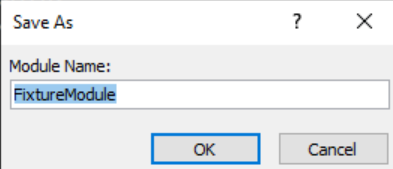
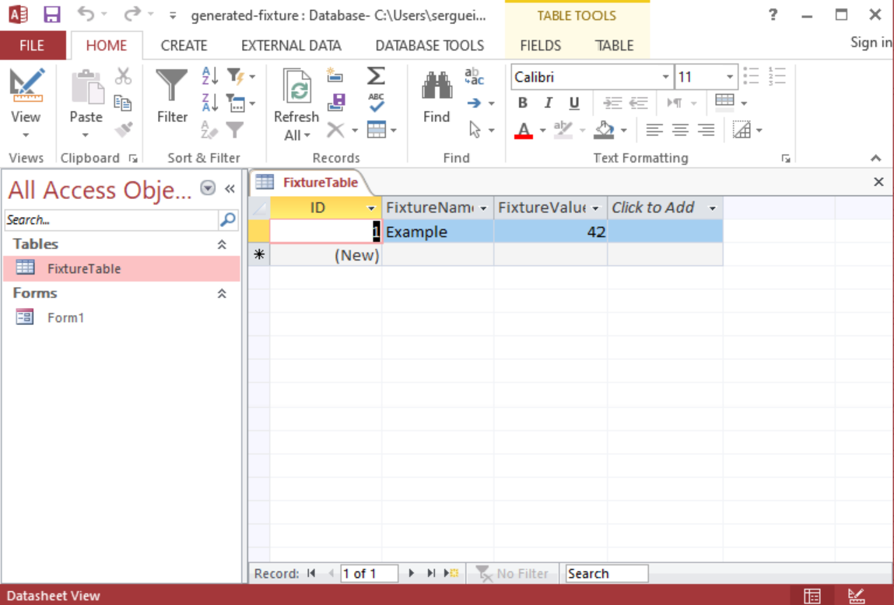

### Info

demo of the scenario [Inspect application objects and VBA](https://github.com/EvotecIT/OfficeIMO/tree/master/OfficeIMO.Access#inspect-application-objects-and-vba)
supported by [EvitectIT/OfficeIMO](https://github.com/EvotecIT/OfficeIMO)

### Background

The [OfficeIMO](https://officeimo.com/) – Free cross-platform Microsoft Word .NET library

Assemblies for COM-free .NET app for creating, reading, editing, converting, rendering, and extracting Office, Visio, CHM, PDF, and other formants also including email, OneNote

### Usage

```sh
docker pull mcr.microsoft.com/dotnet/sdk:8.0-alpine
docker pull mcr.microsoft.com/dotnet/runtime:8.0-alpine
```
```sh
export IMAGE=test
docker build -f Dockerfile -t $IMAGE .
```
```text
Step 1/12 : FROM mcr.microsoft.com/dotnet/sdk:8.0-alpine AS build
 ---> 5e56dd94b4c2
Step 2/12 : WORKDIR /source
 ---> Running in 2714571de2f4
Removing intermediate container 2714571de2f4
 ---> a8e4428b0bf3
Step 3/12 : ARG PROJECT=AccessVBAInspect
 ---> Running in f28058550fc5
Removing intermediate container f28058550fc5
 ---> 1af4c139ac0d
Step 4/12 : COPY example/${PROJECT}/${PROJECT}.csproj ./${PROJECT}/${PROJECT}.csproj
 ---> b3763578e817
Step 5/12 : RUN dotnet restore ./${PROJECT}/${PROJECT}.csproj --runtime linux-musl-x64
 ---> Running in d164acb0de3d
  Determining projects to restore...
  Restored /source/AccessVBAInspect/AccessVBAInspect.csproj (in 50.38 sec).
Removing intermediate container d164acb0de3d
 ---> e4b2bffbcd9c
Step 6/12 : COPY example ./
 ---> 68f83cfab6ea
Step 7/12 : WORKDIR /source/${PROJECT}
 ---> Running in db8261d14ce9
Removing intermediate container db8261d14ce9
 ---> 44d2e4d30cfa
Step 8/12 : RUN dotnet build -c Release -o /app
 ---> Running in bfcdf2b98eb5
  Determining projects to restore...
  All projects are up-to-date for restore.
  AccessVBAInspect -> /app/AccessVBAInspect.dll

Build succeeded.
    0 Warning(s)
    0 Error(s)

Time Elapsed 00:00:14.12
Removing intermediate container bfcdf2b98eb5
 ---> 11b5a10d645c
Step 9/12 : RUN dotnet publish --no-self-contained --runtime linux-musl-x64   --configuration Release --output /app/linux-musl-x64   --no-restore
 ---> Running in 96a6513f2989
  AccessVBAInspect -> /source/AccessVBAInspect/bin/Release/net8.0/linux-musl-x64/AccessVBAInspect.dll
  AccessVBAInspect -> /app/linux-musl-x64/
Removing intermediate container 96a6513f2989
 ---> 3c5e71831670
Step 10/12 : FROM mcr.microsoft.com/dotnet/runtime:8.0-alpine AS publish
 ---> 3fa529c25dbf
Step 11/12 : WORKDIR /app
 ---> Running in bf72f0ebf538
Removing intermediate container bf72f0ebf538
 ---> 0a4c21842cc4
Step 12/12 : COPY --from=build /app .
 ---> 46f28d9ce673
Successfully built 46f28d9ce673
Successfully tagged test:latest
```
* if you like to use upstream project fixture
```sh
git clone --depth 1 https://github.com/EvotecIT/OfficeIMO ../OfficeIMO
find ../OfficeIMO/ -iname '*.accdb'
cp ../OfficeIMO/OfficeIMO.Access.Tests/Fixtures/Application/objects-ace12.accdb application.accdb
```
```sh
export IMAGE=test
export WORKDIR=$(pwd)
docker run -it -w /data -v ${WORKDIR}:/data $IMAGE /app/AccessVBAInspect
```

```sh
export IMAGE=test
export WORKDIR=$(echo ${USERPROFILE}| sed 's|\\|/|g;s|c:|/c|i')/data
export WORKDIR=/c/Users/${USERNAME}/data
cp application.accdb ${WORKDIR}
docker run -it -w /data -v ${WORKDIR}:/data $IMAGE /app/AccessVBAInspect
```
```text
FixtureForm:
Forms/0/Blob: 915 bytes
Forms/0/TypeInfo: 48 bytes
Forms/0/BlobDelta: 0 bytes
Forms/0/PropData: 22 bytes
Attribute VB_Name = "FixtureModule"
Option Compare Database
Option Explicit
Public Function FixtureValue() As Long
    FixtureValue = 42
End Function

stdole: *\G{00020430-0000-0000-C000-000000000046}#2.0#0#C:\Windows\System32\stdole2.tlb#OLE Automation
DAO: *\G{4AC9E1DA-5BAD-4AC7-86E3-24F4CDCECA28}#c.0#0#C:\Program Files\Common Files\Microsoft Shared\OFFICE16\ACEDAO.DLL#Microsoft Office 16.0 Access database engine Object Library
```


### Fixtures

|Fixture|Contents|Extraction target|
|-------|--------|-----------------|
|`basic.accdb`|One table, one form|Object inventory|
|`vba.accdb`|Standard module, functions|VBA source|
|`references.accdb`|VBA project references|GUIDs, versions, paths|
|`controls.accdb`|Form with textbox, button, label|Control metadata|
|`queries.accdb`|Select, parameter, action queries|Query definitions|
|`relationships.accdb`|Two related tables|Relationship metadata|

# this can run from Powershell ISE
```powershell
$databasePath = Join-Path $env:TEMP 'generated-fixture.accdb'

if (Test-Path $databasePath) {
    Remove-Item $databasePath -Force
}

$access = New-Object -ComObject Access.Application

try {
    $access.Visible = $false

    # Create an Access 2007+ database (.accdb)
    # 12 = acNewDatabaseFormatAccess2007
    $access.NewCurrentDatabase($databasePath, 12)

    # Create a table using DAO
    $db = $access.CurrentDb()

    $db.Execute(
        'CREATE TABLE FixtureTable (
            ID COUNTER CONSTRAINT PK_FixtureTable PRIMARY KEY,
            FixtureName TEXT(80),
            FixtureValue LONG
        )',
        128
    )

    $db.Execute(
        "INSERT INTO FixtureTable (FixtureName, FixtureValue)
         VALUES ('Example', 42)",
        128
    )

    # Create a form
    $form = $access.CreateForm()
    $formName = $form.Name

    # 109 = acTextBox, 0 = acDetail
    $control = $access.CreateControl(
        $formName, 109, 0, $null, '', 1000, 1000, 3000, 300
    )

    $control.Name = 'txtFixture'
    $control.ControlSource = 'FixtureName'

    $access.DoCmd.Save(2, $formName)
    $access.DoCmd.Close(2, $formName, 1)

    # Create a standard VBA module
    # 1 = vbext_ct_StdModule
    $project = $access.VBE.ActiveVBProject
    $module = $project.VBComponents.Add(1)

    $module.Name = 'FixtureModule'

    $vbaSource = @'
Option Compare Database
Option Explicit

Public Function FixtureValue() As Long
    FixtureValue = 42
End Function

Public Function FixtureDescription() As String
    FixtureDescription = "Generated by PowerShell COM automation"
End Function
'@

    $module.CodeModule.AddFromString($vbaSource)

    $access.CloseCurrentDatabase()

    Write-Host "Created: $databasePath"
}
finally {
    $access.Quit()
    [void][Runtime.InteropServices.Marshal]::FinalReleaseComObject( $access )
}

```

alternatively run as

```powershell
. .\generate_fixture.ps1
```

```
export IMAGE=test
export WORKDIR=$(echo ${USERPROFILE}| sed 's|\\|/|g;s|c:|/c|i')/data
export WORKDIR=/c/Users/${USERNAME}/data
cp ~/Downloads/generated-fixture.accdb ${WORKDIR}/application.accdb
docker run -it -w /data -v ${WORKDIR}:/data $IMAGE /app/AccessVBAInspect
```
```text
export IMAGE=test
export WORKDIR=$(echo ${USERPROFILE}| sed 's|\\|/|g;s|c:|/c|i')/data
export WORKDIR=/c/Users/${USERNAME}/data
cp application.accdb ${WORKDIR}
docker run -it -w /data -v ${WORKDIR}:/data $IMAGE /app/AccessVBAInspect

```
```text
Created: C:\Users\sergueik\AppData\Local\Temp\generated-fixture.accdb
```
when run this pops the confirmation from Access applicaton:


litreally offering

```text
Save As
Module Name:
FixtureModule
```

and refusing to close until confirmed. Confirm the dialog. The notes below apply to when the dialog is not confirmed but `msaccess.exe` is forcibly closed

the file is locked

```cmd
pushd %TEMP%
copy generated-fixture.accdb e:\
The process cannot access the file because it is being used by another process.
        0 fimle(s) copied.

```

killing the Access makes file possible to copy, and opening  it again confirms it is still featuring FixtureTable and Form1

but the file is probably corrupt:


```sh
 docker run -it -w  /source/AccessVBAInspect -v /c/Users/$USERNAME/data:/source/AccessVBAInspect test /app/AccessVBAInspect
```
```text
Unhandled exception. System.IO.InvalidDataException: Native Access table row count disagrees with its owned live records.
   at OfficeIMO.Access.AccessNativeRowCursor.ReadCore(CancellationToken cancellation) in /_/OfficeIMO.Access/Native/AccessNativeRowCursor.cs:line 46
   at OfficeIMO.Access.AccessNativeRowCursor.Read(CancellationToken cancellation) in /_/OfficeIMO.Access/Native/AccessNativeRowCursor.cs:line 31
   at OfficeIMO.Access.AccessNativeDatabase.ReadAceStorage(AccessNativeTable table, Dictionary`2 streams, CancellationToken cancellation) in /_/OfficeIMO.Access/Native/AccessNativeDatabase.ApplicationStorage.cs:line 21
   at OfficeIMO.Access.AccessNativeDatabase.ReadApplicationStorage(CancellationToken cancellation) in /_/OfficeIMO.Access/Native/AccessNativeDatabase.ApplicationStorage.cs:line 11
   at OfficeIMO.Access.AccessNativeDatabase.LoadApplicationObjects(CancellationToken cancellation) in /_/OfficeIMO.Access/Native/AccessNativeDatabase.Application.cs:line 17
   at OfficeIMO.Access.AccessNativeDatabase.LoadCatalog(CancellationToken cancellation) in /_/OfficeIMO.Access/Native/AccessNativeDatabase.Catalog.cs:line 71
   at OfficeIMO.Access.AccessDocument.FromBytes(Byte[] bytes, AccessLoadOptions options, CancellationToken cancellationToken, String path) in /_/OfficeIMO.Access/AccessDocument.Lifecycle.cs:line 54
   at OfficeIMO.Access.AccessDocument.Load(String path, AccessLoadOptions options, CancellationToken cancellationToken) in /_/OfficeIMO.Access/AccessDocument.Lifecycle.cs:line 64
   at PdfDocGenerator.CLI.Program.Main(String[] args) in /source/AccessVBAInspect/Program.cs:line 7

```
after repair and compact in Access the error disappears
```
docker run -it -w  /source/AccessVBAInspect -v /c/Users/$USERNAME/data:/source/AccessVBAInspect test /app/AccessVBAInspect
```
```text
Form1:
Forms/0/Blob: 1616 bytes
Forms/0/TypeInfo: 68 bytes
Forms/0/BlobDelta: 0 bytes
Forms/0/PropData: 13 bytes
stdole: *\G{00020430-0000-0000-C000-000000000046}#2.0#0#C:\Windows\System32\stdole2.tlb#OLE Automation
DAO: *\G{4AC9E1DA-5BAD-4AC7-86E3-24F4CDCECA28}#c.0#0#C:\Program Files\Common Files\Microsoft Shared\OFFICE15\ACEDAO.DLL#Microsoft Office 15.0 Access database engine Object Library
```
### Troubleshooting


NOTE: specific to __Docker Toolbox__ - may need to improve the VM setting

```text
Step 4/9 : RUN dotnet restore "./PdfDocGenerator.CLI/PdfDocGenerator.CLI.csproj"
 ---> Running in 1fa2c527bcf8
Failed to create CoreCLR, HRESULT: 0x80070008
The command '/bin/sh -c dotnet restore "./PdfDocGenerator.CLI/PdfDocGenerator.CLI.csproj"' returned a non-zero code: 137
```
```text
Inspecting error code: 2147942408
Not enough memory resources are available to process this command. (Exception from HRESULT: 0x80070008)
```
```sh
docker-machine ssh
   ( '>')
  /) TC (\   Core is distributed with ABSOLUTELY NO WARRANTY.
 (/-_--_-\)           www.tinycorelinux.net

docker@default:~$ free
```
```text
              total        used        free      shared  buff/cache   available
Mem:        4039664       74056     3654428      281428      311180     3637052
Swap:       1949948           0     1949948
```

```sh
docker-machine inspect default |jq '.Driver'
```
```json
{
  "IPAddress": "192.168.99.104",
  "MachineName": "default",
  "SSHUser": "docker",
  "SSHPort": 54563,
  "SSHKeyPath": "C:\\Users\\kouzm\\.docker\\machine\\machines\\default\\id_rsa",
  "StorePath": "C:\\Users\\kouzm\\.docker\\machine",
  "SwarmMaster": false,
  "SwarmHost": "tcp://0.0.0.0:3376",
  "SwarmDiscovery": "",
  "VBoxManager": {},
  "HostInterfaces": {},
  "CPU": 1,
  "Memory": 1024,
  "DiskSize": 20000,
  "NatNicType": "82540EM",
  "Boot2DockerURL": "",
  "Boot2DockerImportVM": "",
  "HostDNSResolver": false,
  "HostOnlyCIDR": "192.168.99.1/24",
  "HostOnlyNicType": "82540EM",
  "HostOnlyPromiscMode": "deny",
  "UIType": "headless",
  "HostOnlyNoDHCP": false,
  "NoShare": false,
  "DNSProxy": true,
  "NoVTXCheck": false,
  "ShareFolder": ""
}
```
```
docker info
```
```text
Client:
 Debug Mode: false

Server:
 Containers: 6
  Running: 0
  Paused: 0
  Stopped: 6
 Images: 19
 Server Version: 19.03.12
 Storage Driver: overlay2
  Backing Filesystem: extfs
  Supports d_type: true
  Native Overlay Diff: true
 Logging Driver: json-file
 Cgroup Driver: cgroupfs
 Plugins:
  Volume: local
  Network: bridge host ipvlan macvlan null overlay
  Log: awslogs fluentd gcplogs gelf journald json-file local logentries splunk syslog
 Swarm: inactive
 Runtimes: runc
 Default Runtime: runc
 Init Binary: docker-init
 containerd version: 7ad184331fa3e55e52b890ea95e65ba581ae3429
 runc version: dc9208a3303feef5b3839f4323d9beb36df0a9dd
 init version: fec3683
 Security Options:
  seccomp
   Profile: default
 Kernel Version: 4.19.130-boot2docker
 Operating System: Boot2Docker 19.03.12 (TCL 10.1)
 OSType: linux
 Architecture: x86_64
 CPUs: 1
 Total Memory: 3.853GiB
 Name: default
 ID: EYST:QABS:GR5M:ZEKG:GFGY:JKM5:CRNQ:UM26:KIO6:SCM2:C5QH:TDD7
 Docker Root Dir: /mnt/sda1/var/lib/docker
 Debug Mode: false
 No Proxy: 192.168.99.100,192.168.99.103,192.168.99.104,192.168.99.102,192.168.99.101,192.168.99.105,192.168.99.106
 Registry: https://index.docker.io/v1/
 Labels:
  provider=virtualbox
 Experimental: false
 Insecure Registries:
  127.0.0.0/8
 Live Restore Enabled: false
 Product License: Community Engine
```
```
docker stats --no-stream
```
```text
CONTAINER ID        NAME                CPU %               MEM USAGE / LIMIT   MEM %               NET I/O             BLOCK I/O           PIDS
```


```sh
docker-machine stop default
```
```
pushd /c/Program\ Files/Oracle/VirtualBox/
VBoxManage modifyvm default --memory 4096 --cpus 2
```

```
./VBoxManage.exe showvminfo default | grep -iE '(Memory size|cpus)'
```
```text
Memory size:     4096MB
Number of CPUs:  2
```
```sh
docker-machine start default
```
```
docker-machine inspect default |jq '.Driver.Memory'
```
still
```
1024
```
edit `~/.docker/machine/machines/default/config.json`.

switch to `mcr.microsoft.com/dotnet/sdk:8.0-alpine`

```sh
docker build -t test -f Dockerfile  .
```
```text
Step 1/9 : FROM  mcr.microsoft.com/dotnet/sdk:8.0-alpine  AS build
 ---> 5e56dd94b4c2
Step 2/9 : WORKDIR /source
 ---> Running in 17e5ec5e698f
Removing intermediate container 17e5ec5e698f
 ---> 9233d35169ef
Step 3/9 : COPY ["example/AccessVBAInspect/AccessVBAInspect.csproj", "./AccessVBAInspect/AccessVBAInspect.csproj"]
 ---> e5c40f051519
Step 4/9 : RUN dotnet restore "./AccessVBAInspect/AccessVBAInspect.csproj"
 ---> Running in 869d059557af
  Determining projects to restore...
  Restored /source/AccessVBAInspect/AccessVBAInspect.csproj (in 36.77 sec).
Removing intermediate container 869d059557af
 ---> 2ca6c7a61baa
Step 5/9 : COPY example ./
 ---> 0e412aaff6c3
Step 6/9 : WORKDIR "/source/AccessVBAInspect"
 ---> Running in 7826b6110563
Removing intermediate container 7826b6110563
 ---> b2e7b46feb3c
Step 7/9 : RUN dotnet build -c Release -o /app
 ---> Running in 5f344fb2689c
  Determining projects to restore...
  All projects are up-to-date for restore.
  AccessVBAInspect -> /app/AccessVBAInspect.dll

Build succeeded.
    0 Warning(s)
    0 Error(s)

Time Elapsed 00:00:12.88
Removing intermediate container 5f344fb2689c
 ---> 990db17bd361
Step 8/9 : FROM build AS publish
 ---> 990db17bd361
Step 9/9 : RUN dotnet publish -c Release -o /app
 ---> Running in dd50eddef08e
  Determining projects to restore...
  All projects are up-to-date for restore.
  AccessVBAInspect -> /source/AccessVBAInspect/bin/Release/net8.0/AccessVBAInspect.dll
  AccessVBAInspect -> /app/
Removing intermediate container dd50eddef08e
 ---> 6f9bc87c65d9
Successfully built 6f9bc87c65d9
```
---

### Author
[Serguei Kouzmine](kouzmine_serguei@yahoo.com)


