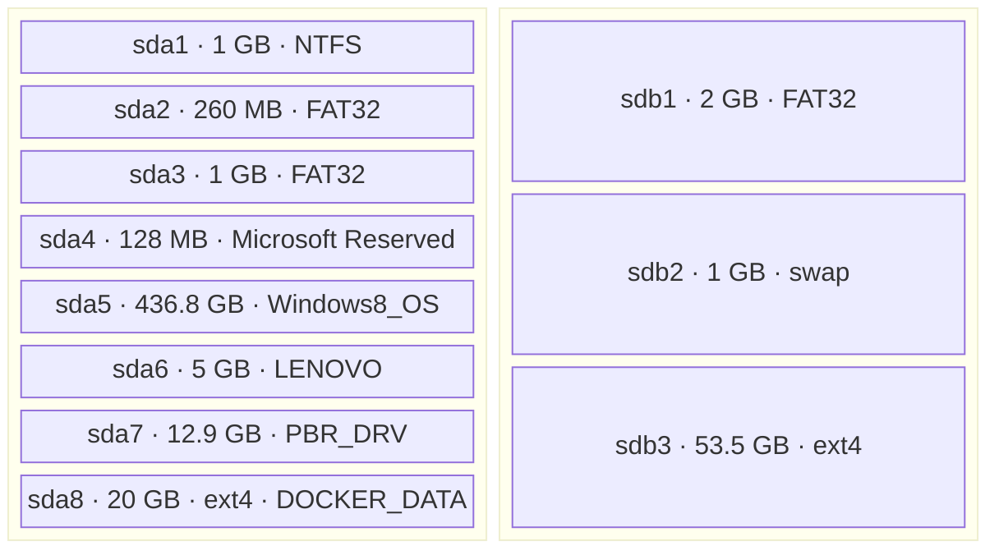
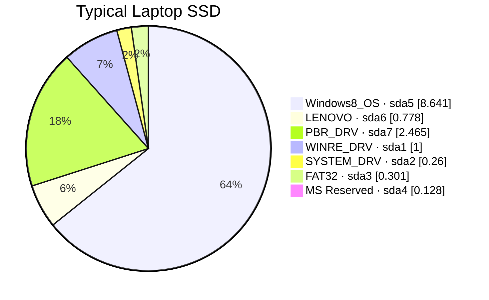
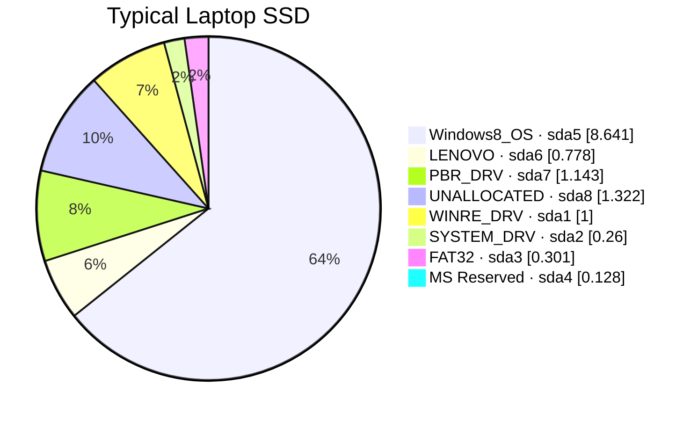
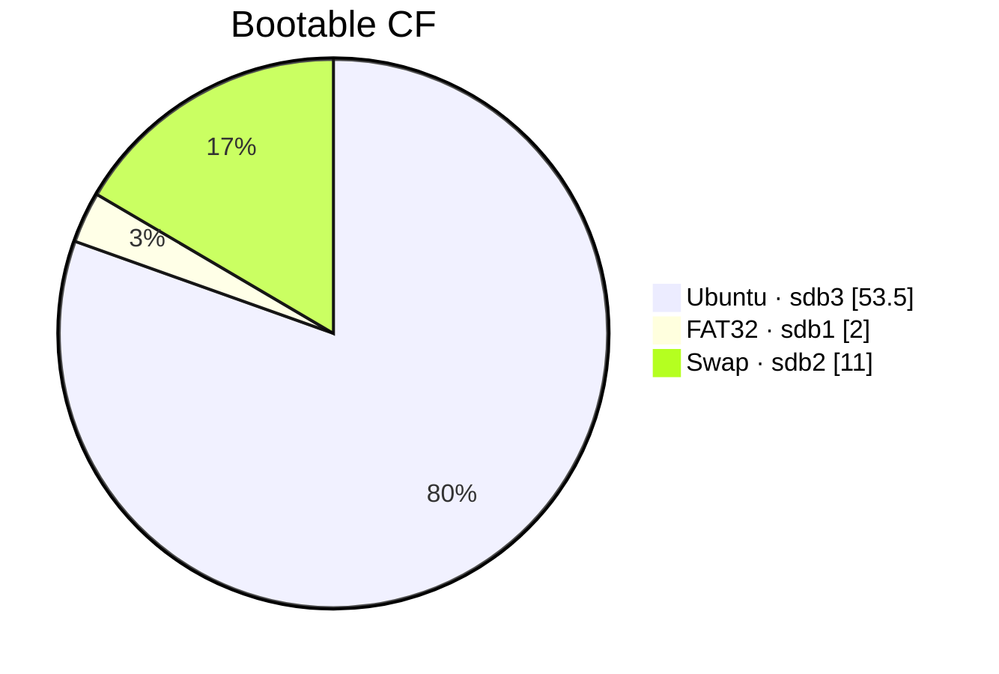
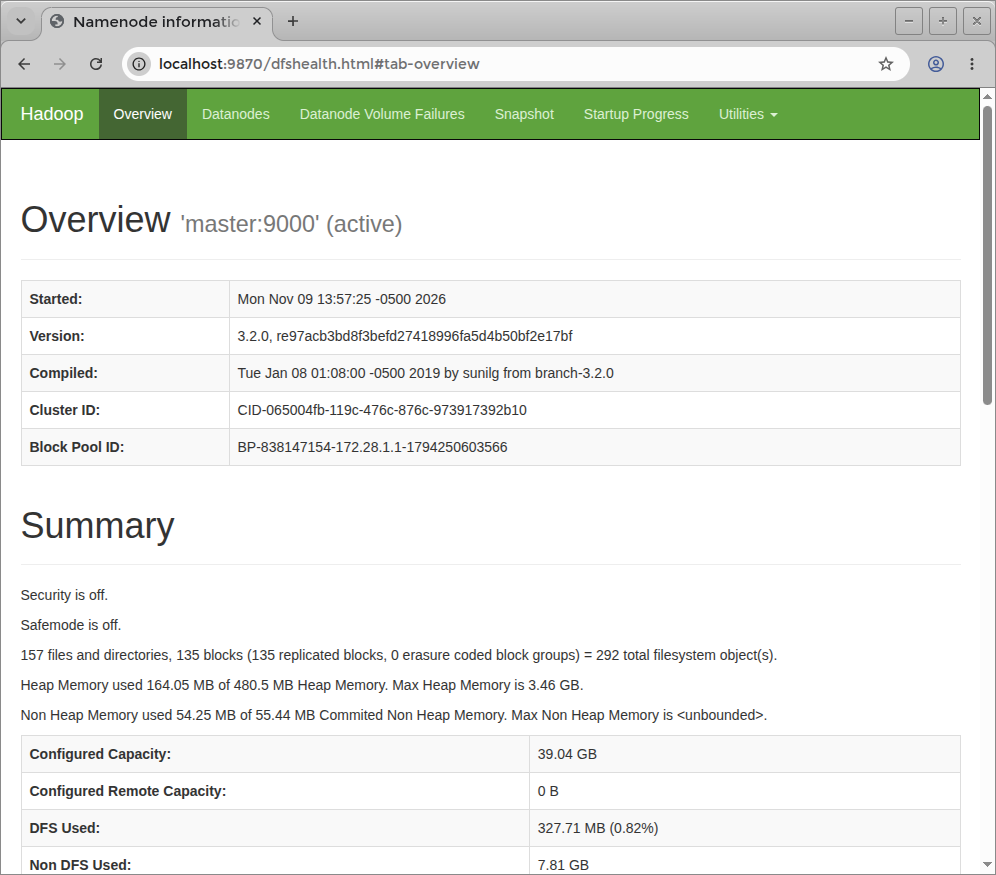
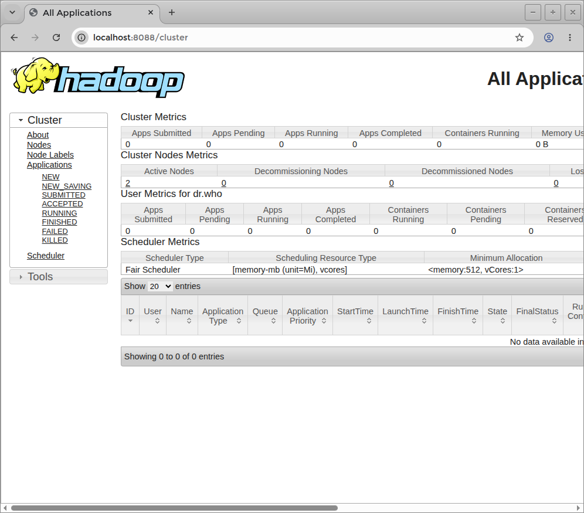

  ### Setup

```
lsblk -o NAME,SIZE,MODEL,FSTYPE,UUID,MOUNTPOINTS
```
```text
lsblk: unknown column: MOUNTPOINTS
```
```
lsblk -o NAME,SIZE,MODEL,FSTYPE,UUID
```
```

NAME     SIZE MODEL            FSTYPE UUID
sda      477G SAMSUNG MZ7TE512
├─sda1  1000M                  ntfs   A8BC3F8DBC3F54D2
├─sda2   260M                  vfat   4841-54E2
├─sda3  1000M                  vfat   5E42-9783
├─sda4   128M
├─sda5 436.8G                  ntfs   E80445210444F3DA
├─sda6    25G                  ntfs   B0444ED6444E9ECA
└─sda7  12.9G                  ntfs   78BA463BBA45F662
sdb     58.6G Cruzer Fit
├─sdb1     2G                  vfat   4494-CFA6
├─sdb2     1G                  swap   ff0f0548-b1de-4da7-870a-61c7ee7d13db
└─sdb3  53.5G                  ext4   df6307c6-7f8e-4b3c-9d29-3058848f4da3
```




> Important: the resulting sectors no longer represent actual capacity percentages (logarythimic scale was used)
> They represent logarithmically compressed capacity weights. 



* Recovering space from an existing Windows installation can be unexpectedly difficult.
* Recovering space from vendor-provided auxiliary partitions may be a more practical candidate, subject to understanding their recovery purpose.

For example, a decade-old Windows installation can contain an immovable file that prevents `diskpart` from shrinking a volume,
even when substantial available free space is reported. 
Defragmentation does not necessarily resolve this: files such as system metadata, shadow-copy data, and other filesystem 
structures can constrain the shrink boundary

```sh
ls /media/sergueik/LRS_ESP/
```
```text
Boot/                      OneKey/
bootmgr                    System Volume Information/
bootmgr.efi                Version.txt
EFI/
```
```sh
ls /media/sergueik/Windows8_OS/
```
```text
Boot                      Intel                 '$Recycle.Bin'
 bootmgr                   java                  'System Volume Information'
 BOOTNXT                   Minikube               temp
 bootsqm.dat               PerfLogs               tools
 developer                 ProgramData            Users
'Documents and Settings'  'Program Files'        'Virtual Machines'
 HashiCorp                'Program Files (x86)'   Windows
 hiberfil.sys              Recovery               windows-version.txt
```
```sh
sudo mount /dev/sda7  /media/sergueik/UNKNOWN2
sudo mount /dev/sda6  /media/sergueik/UNKNOWN1
```
```sh
ls /media/sergueik/UNKNOWN1 /media/sergueik/UNKNOWN2
```
```text
/media/sergueik/UNKNOWN1:
Applications   pagefile.sys   'System Volume Information'
Drivers       '$RECYCLE.BIN'
```
```text
/media/sergueik/UNKNOWN2:
OKRBackup   onekey  'System Volume Information'
```

```sh
df  -h /media/sergueik/UNKNOWN?
```
```text
Filesystem      Size  Used Avail Use% Mounted on
/dev/sda6        25G  4.7G   21G  19% /media/sergueik/UNKNOWN1
/dev/sda7        13G  9.1G  3.8G  71% /media/sergueik/UNKNOWN2
```

* Schrinked lenovo disk to approx 5 G  creating ~ 20 G  unallocated space

```
lsblk -o NAME,SIZE,MODEL,FSTYPE,UUID
```
```text
NAME     SIZE MODEL            FSTYPE UUID
sda      477G SAMSUNG MZ7TE512
├─sda1  1000M                  ntfs   A8BC3F8DBC3F54D2
├─sda2   260M                  vfat   4841-54E2
├─sda3  1000M                  vfat   5E42-9783
├─sda4   128M
├─sda5 436.8G                  ntfs   E80445210444F3DA
├─sda6     5G                  ntfs   B0444ED6444E9ECA
└─sda7  12.9G                  ntfs   78BA463BBA45F662
sdb     58.6G Cruzer Fit
├─sdb1     2G                  vfat   4494-CFA6
├─sdb2     1G                  swap   ff0f0548-b1de-4da7-870a-61c7ee7d13db
└─sdb3  53.5G                  ext4   df6307c6-7f8e-4b3c-9d29-3058848f4da3
```

```sh
sudo parted /dev/sda unit MiB print free
```
```text
Model: ATA SAMSUNG MZ7TE512 (scsi)
Disk /dev/sda: 488386MiB
Sector size (logical/physical): 512B/512B
Partition Table: gpt
Disk Flags:

Number  Start      End        Size       File system  Name                          Flags
        0.02MiB    1.00MiB    0.98MiB    Free Space
 1      1.00MiB    1001MiB    1000MiB    ntfs         Basic data partition          hidden, diag
 2      1001MiB    1261MiB    260MiB     fat32        EFI system partition          boot, hidden, esp
 3      1261MiB    2261MiB    1000MiB    fat32        Basic data partition          hidden
 4      2261MiB    2389MiB    128MiB                  Microsoft reserved partition  msftres
 5      2389MiB    449636MiB  447247MiB  ntfs         Basic data partition          msftdata
        449636MiB  449637MiB  1.00MiB    Free Space
 6      449637MiB  454757MiB  5120MiB    ntfs         Basic data partition          msftdata
        454757MiB  475237MiB  20480MiB   Free Space
 7      475237MiB  488386MiB  13149MiB   ntfs         Basic data partition          hidden, diag
        488386MiB  488386MiB  0.32MiB    Free Space
```

Create new partition on unallocated space
label DOCKER_PARTITION, keep the defaults (ext4)

```sh
lsblk -o NAME,SIZE,MODEL,FSTYPE,UUID
```
```text
sda      477G SAMSUNG MZ7TE512
├─sda1  1000M                  ntfs   A8BC3F8DBC3F54D2
├─sda2   260M                  vfat   4841-54E2
├─sda3  1000M                  vfat   5E42-9783
├─sda4   128M
├─sda5 436.8G                  ntfs   E80445210444F3DA
├─sda6     5G                  ntfs   B0444ED6444E9ECA
├─sda7  12.9G                  ntfs   78BA463BBA45F662
└─sda8    20G                  ext4   0b180fc0-24e7-45dd-9630-00021add73bf
sdb     58.6G Cruzer Fit
├─sdb1     2G                  vfat   4494-CFA6
├─sdb2     1G                  swap   ff0f0548-b1de-4da7-870a-61c7ee7d13db
└─sdb3  53.5G                  ext4   df6307c6-7f8e-4b3c-9d29-3058848f4da3
```
```sh
sudo mkdir -p /data/docker
```
insert in `/etc/fstab`:
```text
UUID=0b180fc0-24e7-45dd-9630-00021add73bf /data/docker ext4 defaults,noatime,nofail 0 2
```
```sh
sudo mount -a 
```
```sh
df -h /data/docker
```
```text
Filesystem      Size  Used Avail Use% Mounted on
/dev/sda8        20G   24K   19G   1% /data/docker
```

check docker version

```text
Client:
 Version:           20.10.21
 API version:       1.41
 Go version:        go1.18.1
 Git commit:        20.10.21-0ubuntu1~18.04.3
 Built:             Thu Apr 27 05:50:21 2023
 OS/Arch:           linux/amd64
 Context:           default
 Experimental:      true

Server:
 Engine:
  Version:          20.10.21
  API version:      1.41 (minimum version 1.12)
  Go version:       go1.18.1
  Git commit:       20.10.21-0ubuntu1~18.04.3
  Built:            Thu Apr 27 05:36:22 2023
  OS/Arch:          linux/amd64
  Experimental:     false
 containerd:
  Version:          1.6.12-0ubuntu1~18.04.1
  GitCommit:
 runc:
  Version:          1.1.4-0ubuntu1~18.04.2
  GitCommit:
 docker-init:
  Version:          0.19.0
  GitCommit:
```
```sh
ls -a /etc/docker/
```
```text
.  ..  key.json
```
```sh
ls -a ~sergueik/.docker/
```
```text
.  ..  .buildNodeID  buildx
```

```sh
docker ps
```
```text
              COMMAND                  CREATED       STATUS       PORTS                                                NAMES
ff285934790c   kindest/node:v1.29.2   "/usr/local/bin/entr…"   2 weeks ago   Up 2 hours   127.0.0.1:36977->6443/tcp, 0.0.0.0:8443->30443/tcp   argocd-cluster-control-plane
```
```sh
docker stop ff28
```
```text
ff28
```
```sh
docker container ls -a
```
```text
CONTAINER ID   IMAGE                  COMMAND                  CREATED       STATUS                        PORTS     NAMES
ff285934790c   kindest/node:v1.29.2   "/usr/local/bin/entr…"   2 weeks ago   Exited (137) 34 seconds ago             argocd-cluster-control-plane
```
```sh
docker image ls
```
```text
REPOSITORY            TAG       IMAGE ID       CREATED       SIZE
kindest/node          <none>    09c50567d34e   2 years ago   956MB
testcontainers/ryuk   0.3.3     64f4b02dc986   5 years ago   12MB
```

this means

__Docker__ installation is relatively straightforward, and the version is old enough and 
don't have the newer containerd image-store complication.


- Docker Engine 20.10.21.
- containerd 1.6.12.
- Ubuntu 18.04 packaging.
- A conventional Docker installation with no existing daemon.json.
- One kind cluster container, now stopped.
- Approximately 968 MB of Docker images.


#### Shrinking the Windows Disk

On Windows, open token elevated Command Prompt and use commands:


```cmd
diskpart
```
```text
Copyright (C) 1999-2013 Microsoft Corporation.
On computer: LENOVO-PC

DISKPART> list volume

  Volume ###  Ltr  Label        Fs     Type        Size     Status     Info
  ----------  ---  -----------  -----  ----------  -------  ---------  --------
  Volume 0     C   Windows8_OS  NTFS   Partition    436 GB  Healthy    Boot
  Volume 1     D   LENOVO       NTFS   Partition   5120 MB  Healthy
  Volume 2         WINRE_DRV    NTFS   Partition   1000 MB  Healthy    Hidden
  Volume 3         SYSTEM_DRV   FAT32  Partition    260 MB  Healthy    System
  Volume 4         PBR_DRV      NTFS   Partition     12 GB  Healthy    Hidden
  Volume 5     E                       Removable   2048 MB  Unusable

DISKPART> select volume 0

Volume 0 is the selected volume.

DISKPART> shrink querymax

The maximum number of reclaimable bytes is: 2318 MB

DISKPART> exit
```
The expected space to reclaim was much higher, to find out what is the cause one iis advised to examine events in __Event Viewer__:

  * select __Windows Logs__ → __Application__
  * flter by __Source__: `Microsoft-Windows-Defrag`
  * filter Event __ID__: `259`


The event may identify the exact unmovable file and its cluster location.

But there was no Event 259. only 258. But  was an:
```txt
Event 26228

Chkdsk was executed in verify mode on a volume snapshot.  

Checking file system on \Device\HarddiskVolume5
Volume label is Windows8_OS.

Examining 1 corruption record ...

Record 1 of 1: Corrupt File "<0x3a,0x3e7>" ... no corruption found.

1 corruption record processed in 0.1 seconds.

Windows has examined the list of previously identified potential issues and found no problems.
No further action is required.
```

so i simply rebooted with chkdisk scheduled (the __Properties__/__Tools__/__Check__ did report the repair is necessary) and inspected the __Event Log__ afterwards:  

```text

event 1001

Checking file system on C:
The type of the file system is NTFS.
Volume label is Windows8_OS.


One of your disks needs to be checked for consistency. You
may cancel the disk check, but it is strongly recommended
that you continue.
Windows will now check the disk.                         

Stage 1: Examining basic file system structure ...
  693504 file records processed.                                                         File verification completed.
  8627 large file records processed.                                      0 bad file records processed.                                      
Stage 2: Examining file name linkage ...
The first free byte, 0x28, and bytes available, 0xe8, for
root index $I30 in file 0x19de5 are not equal.
...
The first free byte, 0x28, and bytes available, 0xb0, for
root index $I30 in file 0x5ef19 are not equal.
  873680 index entries processed.                                                        Index verification completed.
  0 unindexed files scanned.          
  0 unindexed files recovered.                                       
Stage 3: Examining security descriptors ...
Cleaning up 342 unused index entries from index $SII of file 0x9.
Cleaning up 342 unused index entries from index $SDH of file 0x9.
Cleaning up 342 unused security descriptors.
Security descriptor verification completed.
  90089 data files processed.                                            CHKDSK is verifying Usn Journal...
  34082096 USN bytes processed.                                                            Usn Journal verification completed.

Windows has made corrections to the file system.
No further action is required.

 457980927 KB total disk space.
 160005316 KB in 344015 files.
    250672 KB in 90090 indexes.
         0 KB in bad sectors.
    817771 KB in use by the system.
     65536 KB occupied by the log file.
 296907168 KB available on disk.

      4096 bytes in each allocation unit.
 114495231 total allocation units on disk.
  74226792 allocation units available on disk.

Internal Info:
00 95 0a 00 bf 9f 06 00 5c 82 0b 00 00 00 00 00  ........\.......
20 02 00 00 32 00 00 00 00 00 00 00 00 00 00 00   ...2...........

Windows has finished checking your disk.
Please wait while your computer restarts.


```
and now re-run
```cmd
diskpart
```
```
DISKPART> list volume

  Volume ###  Ltr  Label        Fs     Type        Size     Status     Info
  ----------  ---  -----------  -----  ----------  -------  ---------  --------
  Volume 0     C   Windows8_OS  NTFS   Partition    436 GB  Healthy    Boot
  Volume 1     D   LENOVO       NTFS   Partition   5120 MB  Healthy
  Volume 2         WINRE_DRV    NTFS   Partition   1000 MB  Healthy    Hidden
  Volume 3         SYSTEM_DRV   FAT32  Partition    260 MB  Healthy    System
  Volume 4         PBR_DRV      NTFS   Partition     12 GB  Healthy    Hidden
  Volume 5     E                       Removable   2048 MB  Unusable

DISKPART> select  volume 0

Volume 0 is the selected volume.

DISKPART> shrink querymax

The maximum number of reclaimable bytes is:  283 GB (289904 MB)
exit
```
this looks very promising alredy, but for documentation purpose, located the evenr `259`:

```text
Event 259

A volume shrink analysis was initiated on volume Windows8_OS (C:). This event log entry details information about the last unmovable file that could limit the maximum number of reclaimable bytes.
 
 Diagnostic details:
 - The last unmovable file appears to be: \Windows\System32\wdi\LogFiles\BootCKCL.etl::$DATA
 - The last cluster of the file is: 0x10bd740
 - Shrink potential target (LCN address): 0x2666cd3
 - The NTFS file flags are: ----D
 - Shrink phase: <analysis>
 
 To find more details about this file please use the "fsutil volume querycluster \\?\Volume{b1b74bcb-3cb9-4ab4-8afc-2d1e07b55a3e} 0x10bd740" command.
 
``` 
and
perfomed the command advised:
```cmd 
fsutil volume querycluster \\?\Volume{b1b74bcb-3cb9-4ab4-8afc-2d1e07b55a3e} 0x10bd740
```
```text
Cluster 0x00000000010bd740 used by ----D \Windows\System32\wdi\LogFiles\BootCKCL
.etl::$DATA
```

The
CHKDSK repaired NTFS metadata, and the reported shrink limit changed from approximately 2.3 GB to 283 GB. That is a remarkable difference, but it should be presented as a successful case, not a universal remedy.

> NOTE: this event can be compared to a Penn & Teller stage: the trick is demonstrated, the result is real, but the audience _isn't_ being given a universally reproducible illusion

> It looks like magic when resurrection of an `200 GB` of disk space reduced to those three lines. But there is no guarantee that another machine will have the same filesystem inconsistency, the same immovable file, or the same response to repair

#### Unix Machine Steps
```sh
docker info 2> /dev/null| grep -E 'Storage Driver|Docker Root Dir'
```
```text
Storage Driver: overlay2
Docker Root Dir: /var/lib/docker
```

it is easer to move the blank Docker configuration - no images, no volumes:

```sh
docker ps -a
```
```text
CONTAINER ID   IMAGE     COMMAND   CREATED   STATUS    PORTS     NAMES
```
```sh
docker volume ls
```
```text
DRIVER    VOLUME NAME

```
```sh
sudo du -sh /var/lib/docker /var/lib/containerd
```
```text
3.1M    /var/lib/docker
608K    /var/lib/containerd
```
```
sudo mount -a
findmnt /data/docker
df -h /data/docker
```

```text
TARGET       SOURCE    FSTYPE OPTIONS
/data/docker /dev/sda8 ext4   rw,noatime,data=ordered
Filesystem      Size  Used Avail Use% Mounted on
/dev/sda8        20G   24K   19G   1% /data/docker
```
```sh
sudo mkdir -p /etc/docker
sudo vi /etc/docker/daemon.json
```
```json
{
  "data-root": "/data/docker"
}
```
```
sudo mkdir -p /etc/systemd/system/docker.service.d
```
```
sudo vi /etc/systemd/system/docker.service.d/storage.conf
```
```text
[Unit]
RequiresMountsFor=/data/docker
```

```sh
sudo systemctl daemon-reload
```
```
sudo systemctl stop docker
```

```
sudo sudo mv /var/lib/docker /var/lib/docker.OLD
```

```
sudo systemctl start docker
```
```sh
docker info | grep -E 'Storage Driver|Docker Root Dir'
```
```text
WARNING: No swap limit support
 Storage Driver: overlay2
 Docker Root Dir: /data/docker
```
> NOTE: containerd can have separate runtime state under /var/lib/containerd
```sh
sudo ls /var/lib/containerd/
```
```text
io.containerd.content.v1.content   io.containerd.snapshotter.v1.btrfs
io.containerd.metadata.v1.bolt     io.containerd.snapshotter.v1.native
io.containerd.runtime.v1.linux     io.containerd.snapshotter.v1.overlayfs
io.containerd.runtime.v2.task      tmpmounts
io.containerd.snapshotter.v1.aufs
```

```
sudo du -sh !$
```
```text
sudo du -sh /var/lib/containerd/
608K    /var/lib/containerd/
```
```sh
docker pull alpine
```
```sh
sudo find /data/docker/
```
(output truncated):
```
/data/docker/
/data/docker/runtimes
/data/docker/image
/data/docker/image/overlay2
/data/docker/image/overlay2/imagedb
/data/docker/image/overlay2/imagedb/metadata
/data/docker/image/overlay2/imagedb/metadata/sha256
/data/docker/image/overlay2/imagedb/content
/data/docker/image/overlay2/imagedb/content/sha256
/data/docker/image/overlay2/imagedb/content/sha256/3ea06e4cb95e726ea6c6cc4377570ac4c4050d78710004cbd631ca809daf7e8e
/data/docker/image/overlay2/distribution
/data/docker/image/overlay2/distribution/v2metadata-by-diffid
/data/docker/image/overlay2/distribution/v2metadata-by-diffid/sha256
/data/docker/image/overlay2/distribution/v2metadata-by-diffid/sha256/75f1d9657d880da5f75298e8f40e9928bb6e260c50d26f97af196845307e3064
/data/docker/image/overlay2/distribution/diffid-by-digest
/data/docker/image/overlay2/distribution/diffid-by-digest/sha256
/data/docker/image/overlay2/distribution/diffid-by-digest/sha256/881fc932939efef04ca120ad44bbd2c0917851eb247aa4995428afb1e80ede17
/data/docker/image/overlay2/layerdb
/data/docker/image/overlay2/layerdb/tmp
/data/docker/image/overlay2/layerdb/sha256
/data/docker/image/overlay2/layerdb/sha256/75f1d9657d880da5f75298e8f40e9928bb6e260c50d26f97af196845307e3064
/data/docker/image/overlay2/layerdb/sha256/75f1d9657d880da5f75298e8f40e9928bb6e260c50d26f97af196845307e3064/cache-id
/data/docker/image/overlay2/layerdb/sha256/75f1d9657d880da5f75298e8f40e9928bb6e260c50d26f97af196845307e3064/tar-split.json.gz
/data/docker/image/overlay2/layerdb/sha256/75f1d9657d880da5f75298e8f40e9928bb6e260c50d26f97af196845307e3064/size
/data/docker/image/overlay2/layerdb/sha256/75f1d9657d880da5f75298e8f40e9928bb6e260c50d26f97af196845307e3064/diff
/data/docker/image/overlay2/repositories.json
/data/docker/overlay2
/data/docker/overlay2/l
/data/docker/overlay2/l/REIVC7AMZZ7OAKAS3NVAIFTQ4C
/data/docker/overlay2/9aa1e0e95b851603dfc86b04fd1ca75de4d32b52867352495442b09f8724fbf7
...
/data/docker/overlay2/9aa1e0e95b851603dfc86b04fd1ca75de4d32b52867352495442b09f8724fbf7/diff/mnt
/data/docker/swarm
/data/docker/volumes
/data/docker/volumes/backingFsBlockDev
/data/docker/volumes/metadata.db
/data/docker/buildkit
/data/docker/buildkit/snapshots.db
/data/docker/buildkit/containerdmeta.db
/data/docker/buildkit/cache.db
/data/docker/buildkit/content
/data/docker/buildkit/content/ingest
/data/docker/buildkit/metadata_v2.db
/data/docker/buildkit/executor
/data/docker/containers
/data/docker/tmp
/data/docker/lost+found
/data/docker/trust
/data/docker/plugins
/data/docker/plugins/storage
/data/docker/plugins/storage/ingest
/data/docker/plugins/tmp
/data/docker/network
/data/docker/network/files
/data/docker/network/files/local-kv.db
```
run the container
```sh
docker run -d --name storage-test alpine sleep 300
```
the hash is returned
``` 
2dbe4ddd76962ccc2670145da4f6ae49c8c5d3a5bd5ac66b8c29c48c82c9dcf0
```
```sh
docker inspect --format='{{.GraphDriver.Data.UpperDir}}' storage-test
```
```text
/data/docker/overlay2/961cfc9cb04900c6ab9a0f45402b81a3a7091e921119757976dbceee9034d928/diff
```

confirm configuration survives reboot

```sh
sudo  shutdown -r now
```
monitor the computer to boot successfully
```
docker ps -a
```
```text
CONTAINER ID   IMAGE     COMMAND       CREATED         STATUS                       PORTS     NAMES
2dbe4ddd7696   alpine    "sleep 300"   7 minutes ago   Exited (137) 4 minutes ago             storage-test
```

```sh
docker info | grep -E 'Storage Driver|Docker Root Dir'
```
```text
WARNING: No swap limit support
 Storage Driver: overlay2
 Docker Root Dir: /data/docker
```
```sh
findmnt /data/docker
```
```text
TARGET       SOURCE    FSTYPE OPTIONS
/data/docker /dev/sda8 ext4   rw,noatime,data=ordered

```
```sh
df -h /data/docker
```
```text
Filesystem      Size  Used Avail Use% Mounted on
/dev/sda8        20G  9.2M   19G   1% /data/docker
```


### Usage

This is a replica of [Hadoop, Hive, Spark, Zeppelin and Livy: all in one Docker-compose file.](https://github.com/panovvv/bigdata-docker-compose)
```sh
sudo cp -r  data/* /data/data/
```
> NOTE run as current user
```sh
docker pull panovvv/livy:2.5.2; 
docker pull panovvv/zeppelin-bigdata:2.5.2; 
docker pull panovvv/hadoop-hive-spark:2.5.2; 
docker pull postgres:11.5
docker image is
```
```sh
sudo docker-compose -f docker-compose.yaml.NEW up --build 2>&1 | tee a.log 
```
```text
...
 Container basic-pocket-hadoop-hivemetastore-1  Creating
 Container basic-pocket-hadoop-hivemetastore-1  Created
 Container basic-pocket-hadoop-worker2-1  Creating
 Container basic-pocket-hadoop-master-1  Creating
 Container basic-pocket-hadoop-worker1-1  Creating
 Container basic-pocket-hadoop-worker2-1  Created
 Container basic-pocket-hadoop-worker1-1  Created
 Container basic-pocket-hadoop-master-1  Created
 Container basic-pocket-hadoop-livy-1  Creating
 Container basic-pocket-hadoop-livy-1  Created
 Container basic-pocket-hadoop-zeppelin-1  Creating
 Container basic-pocket-hadoop-zeppelin-1  Created
Attaching to basic-pocket-hadoop-hivemetastore-1, basic-pocket-hadoop-livy-1, basic-pocket-hadoop-master-1, basic-pocket-hadoop-worker1-1, basic-pocket-hadoop-worker2-1, basic-pocket-hadoop-zeppelin-1
basic-pocket-hadoop-hivemetastore-1  | The files belonging to this database system will be owned by user "postgres".
basic-pocket-hadoop-hivemetastore-1  | This user must also own the server process.
basic-pocket-hadoop-hivemetastore-1  | 
basic-pocket-hadoop-hivemetastore-1  | The database cluster will be initialized with locale "en_US.utf8".
basic-pocket-hadoop-hivemetastore-1  | The default database encoding has accordingly been set to "UTF8".
basic-pocket-hadoop-hivemetastore-1  | The default text search configuration will be set to "english".
basic-pocket-hadoop-hivemetastore-1  | 
basic-pocket-hadoop-hivemetastore-1  | Data page checksums are disabled.
basic-pocket-hadoop-hivemetastore-1  | 
basic-pocket-hadoop-hivemetastore-1  | fixing permissions on existing directory /var/lib/postgresql/data ... ok
basic-pocket-hadoop-hivemetastore-1  | creating subdirectories ... ok
basic-pocket-hadoop-hivemetastore-1  | selecting default max_connections ... 100
basic-pocket-hadoop-hivemetastore-1  | selecting default shared_buffers ... 128MB
basic-pocket-hadoop-hivemetastore-1  | selecting default timezone ... Etc/UTC
basic-pocket-hadoop-hivemetastore-1  | selecting dynamic shared memory implementation ... posix
basic-pocket-hadoop-hivemetastore-1  | creating configuration files ... ok
basic-pocket-hadoop-hivemetastore-1  | running bootstrap script ... ok
basic-pocket-hadoop-hivemetastore-1  | performing post-bootstrap initialization ... ok
basic-pocket-hadoop-worker1-1        | Starting Hadoop data node...
basic-pocket-hadoop-hivemetastore-1  | syncing data to disk ... ok
basic-pocket-hadoop-hivemetastore-1  | 
basic-pocket-hadoop-hivemetastore-1  | Success. You can now start the database server using:
basic-pocket-hadoop-hivemetastore-1  | 
basic-pocket-hadoop-hivemetastore-1  |     pg_ctl -D /var/lib/postgresql/data -l logfile start
basic-pocket-hadoop-hivemetastore-1  | 
basic-pocket-hadoop-hivemetastore-1  | 
basic-pocket-hadoop-hivemetastore-1  | WARNING: enabling "trust" authentication for local connections
basic-pocket-hadoop-hivemetastore-1  | You can change this by editing pg_hba.conf or using the option -A, or
basic-pocket-hadoop-hivemetastore-1  | --auth-local and --auth-host, the next time you run initdb.
basic-pocket-hadoop-hivemetastore-1  | waiting for server to start....2026-11-09 18:56:30.213 UTC [44] LOG:  listening on Unix socket "/var/run/postgresql/.s.PGSQL.5432"
basic-pocket-hadoop-hivemetastore-1  | 2026-11-09 18:56:30.257 UTC [45] LOG:  database system was shut down at 2026-11-09 18:56:29 UTC
basic-pocket-hadoop-hivemetastore-1  | 2026-11-09 18:56:30.269 UTC [44] LOG:  database system is ready to accept connections
basic-pocket-hadoop-hivemetastore-1  |  done
basic-pocket-hadoop-hivemetastore-1  | server started
basic-pocket-hadoop-hivemetastore-1  | 
basic-pocket-hadoop-hivemetastore-1  | /usr/local/bin/docker-entrypoint.sh: running /docker-entrypoint-initdb.d/init.sql
basic-pocket-hadoop-hivemetastore-1  | CREATE DATABASE
basic-pocket-hadoop-hivemetastore-1  | 
basic-pocket-hadoop-hivemetastore-1  | 
basic-pocket-hadoop-hivemetastore-1  | 2026-11-09 18:56:30.727 UTC [44] LOG:  received fast shutdown request
basic-pocket-hadoop-hivemetastore-1  | waiting for server to shut down...2026-11-09 18:56:30.732 UTC [44] LOG:  aborting any active transactions
basic-pocket-hadoop-hivemetastore-1  | .2026-11-09 18:56:30.742 UTC [44] LOG:  background worker "logical replication launcher" (PID 51) exited with exit code 1
basic-pocket-hadoop-hivemetastore-1  | 2026-11-09 18:56:30.768 UTC [46] LOG:  shutting down
basic-pocket-hadoop-hivemetastore-1  | 2026-11-09 18:56:30.822 UTC [44] LOG:  database system is shut down
basic-pocket-hadoop-hivemetastore-1  |  done
basic-pocket-hadoop-hivemetastore-1  | server stopped
basic-pocket-hadoop-hivemetastore-1  | 
basic-pocket-hadoop-hivemetastore-1  | PostgreSQL init process complete; ready for start up.
basic-pocket-hadoop-hivemetastore-1  | 
basic-pocket-hadoop-hivemetastore-1  | 2026-11-09 18:56:30.862 UTC [1] LOG:  listening on IPv4 address "0.0.0.0", port 5432
basic-pocket-hadoop-hivemetastore-1  | 2026-11-09 18:56:30.863 UTC [1] LOG:  listening on IPv6 address "::", port 5432
basic-pocket-hadoop-hivemetastore-1  | 2026-11-09 18:56:30.884 UTC [1] LOG:  listening on Unix socket "/var/run/postgresql/.s.PGSQL.5432"
basic-pocket-hadoop-hivemetastore-1  | 2026-11-09 18:56:30.927 UTC [62] LOG:  database system was shut down at 2026-11-09 18:56:30 UTC
basic-pocket-hadoop-hivemetastore-1  | 2026-11-09 18:56:30.953 UTC [1] LOG:  database system is ready to accept connections
basic-pocket-hadoop-worker2-1        | Replacing default datanode UI port 9864 with 9865
basic-pocket-hadoop-worker2-1        | Starting Hadoop data node...
basic-pocket-hadoop-master-1         | Starting Hadoop name node...
basic-pocket-hadoop-master-1         | SLF4J: Class path contains multiple SLF4J bindings.
basic-pocket-hadoop-master-1         | SLF4J: Found binding in [jar:file:/usr/hadoop/share/hadoop/common/lib/slf4j-log4j12-1.7.25.jar!/org/slf4j/impl/StaticLoggerBinder.class]
basic-pocket-hadoop-master-1         | SLF4J: Found binding in [jar:file:/usr/hive/lib/log4j-slf4j-impl-2.10.0.jar!/org/slf4j/impl/StaticLoggerBinder.class]
basic-pocket-hadoop-master-1         | SLF4J: See http://www.slf4j.org/codes.html#multiple_bindings for an explanation.
basic-pocket-hadoop-worker1-1        | Starting Spark slave node...
basic-pocket-hadoop-worker1-1        | All initializations finished!
basic-pocket-hadoop-worker1-1        | Process "scripts/watchdir /usr/hadoop/logs" started
basic-pocket-hadoop-worker1-1        | Process "scripts/watchdir /usr/spark/logs" started
basic-pocket-hadoop-worker1-1        | Parallel processes have started
basic-pocket-hadoop-worker1-1        | [usage] scripts/watchdir dir-to-monitor
basic-pocket-hadoop-worker1-1        | 
basic-pocket-hadoop-worker1-1        | ** hadoop-root-nodemanager-worker1.out **:
basic-pocket-hadoop-worker1-1        | [...]  (-i) 63646
basic-pocket-hadoop-worker1-1        | max locked memory       (kbytes, -l) 65536
basic-pocket-hadoop-worker1-1        | max memory size         (kbytes, -m) unlimited
basic-pocket-hadoop-worker1-1        | open files                      (-n) 1048576
basic-pocket-hadoop-worker1-1        | pipe size            (512 bytes, -p) 8
basic-pocket-hadoop-worker1-1        | POSIX message queues     (bytes, -q) 819200
basic-pocket-hadoop-worker1-1        | real-time priority              (-r) 0
basic-pocket-hadoop-worker1-1        | stack size              (kbytes, -s) 8192
basic-pocket-hadoop-worker1-1        | cpu time               (seconds, -t) unlimited
basic-pocket-hadoop-worker1-1        | max user processes              (-u) unlimited
basic-pocket-hadoop-worker1-1        | virtual memory          (kbytes, -v) unlimited
basic-pocket-hadoop-worker1-1        | file locks                      (-x) unlimited
basic-pocket-hadoop-worker1-1        | 
basic-pocket-hadoop-worker1-1        | ** hadoop-root-datanode-worker1.out **:
basic-pocket-hadoop-worker1-1        | [...]  (-i) 63646
basic-pocket-hadoop-worker1-1        | max locked memory       (kbytes, -l) 65536
basic-pocket-hadoop-worker1-1        | max memory size         (kbytes, -m) unlimited
basic-pocket-hadoop-worker1-1        | open files                      (-n) 1048576
basic-pocket-hadoop-worker1-1        | pipe size            (512 bytes, -p) 8
basic-pocket-hadoop-worker1-1        | POSIX message queues     (bytes, -q) 819200
basic-pocket-hadoop-worker1-1        | real-time priority              (-r) 0
basic-pocket-hadoop-worker1-1        | stack size              (kbytes, -s) 8192
basic-pocket-hadoop-worker1-1        | cpu time               (seconds, -t) unlimited
basic-pocket-hadoop-worker1-1        | max user processes              (-u) unlimited
basic-pocket-hadoop-worker1-1        | virtual memory          (kbytes, -v) unlimited
basic-pocket-hadoop-worker1-1        | file locks                      (-x) unlimited
basic-pocket-hadoop-worker1-1        | starting org.apache.spark.deploy.worker.Worker, logging to /usr/spark/logs/spark--org.apache.spark.deploy.worker.Worker-1-worker1.out
basic-pocket-hadoop-master-1         | SLF4J: Actual binding is of type [org.slf4j.impl.Log4jLoggerFactory]
basic-pocket-hadoop-master-1         | 2026-11-09 18:56:36,338 INFO namenode.NameNode: STARTUP_MSG: 
basic-pocket-hadoop-master-1         | /************************************************************
basic-pocket-hadoop-master-1         | STARTUP_MSG: Starting NameNode
basic-pocket-hadoop-master-1         | STARTUP_MSG:   host = master/172.28.1.1
basic-pocket-hadoop-master-1         | STARTUP_MSG:   args = [-format]
basic-pocket-hadoop-master-1         | STARTUP_MSG:   version = 3.2.0
basic-pocket-hadoop-master-1         | STARTUP_MSG:   classpath = /usr/hadoop/etc/hadoop:/usr/hadoop/share/hadoop/common/lib/dnsjava-2.1.7.jar:/usr/hadoop/share/hadoop/common/lib/jetty-xml-9.3.24.v20180605.jar:/usr/hadoop/share/hadoop/common/lib/jetty-util-9.3.24.v20180605.jar:/usr/hadoop/share/hadoop/common/lib/re2j-1.1.jar:/usr/hadoop/share/hadoop/common/lib/hadoop-annotations-3.2.0.jar:/usr/hadoop/share/hadoop/common/lib/accessors-smart-1.2.jar:/usr/hadoop/share/hadoop/common/lib/jsch-0.1.54.jar:/usr/hadoop/share/hadoop/common/lib/token-provider-1.0.1.jar:/usr/hadoop/share/hadoop/common/lib/jackson-annotations-2.9.5.jar:/usr/hadoop/share/hadoop/common/lib/jetty-io-9.3.24.v20180605.jar:/usr/hadoop/share/hadoop/common/lib/netty-3.10.5.Final.jar:/usr/hadoop/share/hadoop/common/lib/commons-codec-1.11.jar:/usr/hadoop/share/hadoop/common/lib/avro-1.7.7.jar:/usr/hadoop/share/hadoop/common/lib/jetty-http-9.3.24.v20180605.jar:/usr/hadoop/share/hadoop/common/lib/hadoop-auth-3.2.0.jar:/usr/hadoop/share/hadoop/common/lib/jackson-mapper-asl-1.9.13.jar:/usr/hadoop/share/hadoop/common/lib/nimbus-jose-jwt-4.41.1.jar:/usr/hadoop/share/hadoop/common/lib/jersey-json-1.19.jar:/usr/hadoop/share/hadoop/common/lib/jersey-core-1.19.jar:/usr/hadoop/share/hadoop/common/lib/guava-11.0.2.jar:/usr/hadoop/share/hadoop/common/lib/audience-annotations-0.5.0.jar:/usr/hadoop/share/hadoop/common/lib/xz-1.0.jar:/usr/hadoop/share/hadoop/common/lib/jaxb-api-2.2.11.jar:/usr/hadoop/share/hadoop/common/lib/gson-2.2.4.jar:/usr/hadoop/share/hadoop/common/lib/jetty-webapp-9.3.24.v20180605.jar:/usr/hadoop/share/hadoop/common/lib/kerby-asn1-1.0.1.jar:/usr/hadoop/share/hadoop/common/lib/htrace-core4-4.1.0-incubating.jar:/usr/hadoop/share/hadoop/common/lib/kerby-pkix-1.0.1.jar:/usr/hadoop/share/hadoop/common/lib/jsr305-3.0.0.jar:/usr/hadoop/share/hadoop/common/lib/commons-io-2.5.jar:/usr/hadoop/share/hadoop/common/lib/metrics-core-3.2.4.jar:/usr/hadoop/share/hadoop/common/lib/kerb-client-1.0.1.jar:/usr/hadoop/share/hadoop/common/lib/asm-5.0.4.jar:/usr/hadoop/share/hadoop/common/lib/slf4j-api-1.7.25.jar:/usr/hadoop/share/hadoop/common/lib/jsr311-api-1.1.1.jar:/usr/hadoop/share/hadoop/common/lib/kerb-identity-1.0.1.jar:/usr/hadoop/share/hadoop/common/lib/jackson-core-asl-1.9.13.jar:/usr/hadoop/share/hadoop/common/lib/commons-logging-1.1.3.jar:/usr/hadoop/share/hadoop/common/lib/commons-net-3.6.jar:/usr/hadoop/share/hadoop/common/lib/commons-cli-1.2.jar:/usr/hadoop/share/hadoop/common/lib/kerby-xdr-1.0.1.jar:/usr/hadoop/share/hadoop/common/lib/json-smart-2.3.jar:/usr/hadoop/share/hadoop/common/lib/jersey-servlet-1.19.jar:/usr/hadoop/share/hadoop/common/lib/kerb-core-1.0.1.jar:/usr/hadoop/share/hadoop/common/lib/commons-lang3-3.7.jar:/usr/hadoop/share/hadoop/common/lib/commons-configuration2-2.1.1.jar:/usr/hadoop/share/hadoop/common/lib/curator-framework-2.12.0.jar:/usr/hadoop/share/hadoop/common/lib/curator-recipes-2.12.0.jar:/usr/hadoop/share/hadoop/common/lib/jsp-api-2.1.jar:/usr/hadoop/share/hadoop/common/lib/slf4j-log4j12-1.7.25.jar:/usr/hadoop/share/hadoop/common/lib/kerby-config-1.0.1.jar:/usr/hadoop/share/hadoop/common/lib/log4j-1.2.17.jar:/usr/hadoop/share/hadoop/common/lib/httpcore-4.4.4.jar:/usr/hadoop/share/hadoop/common/lib/zookeeper-3.4.13.jar:/usr/hadoop/share/hadoop/common/lib/protobuf-java-2.5.0.jar:/usr/hadoop/share/hadoop/common/lib/jetty-servlet-9.3.24.v20180605.jar:/usr/hadoop/share/hadoop/common/lib/commons-math3-3.1.1.jar:/usr/hadoop/share/hadoop/common/lib/woodstox-core-5.0.3.jar:/usr/hadoop/share/hadoop/common/lib/commons-collections-3.2.2.jar:/usr/hadoop/share/hadoop/common/lib/kerb-common-1.0.1.jar:/usr/hadoop/share/hadoop/common/lib/jetty-server-9.3.24.v20180605.jar:/usr/hadoop/share/hadoop/common/lib/jackson-xc-1.9.13.jar:/usr/hadoop/share/hadoop/common/lib/kerb-crypto-1.0.1.jar:/usr/hadoop/share/hadoop/common/lib/javax.servlet-api-3.1.0.jar:/usr/hadoop/share/hadoop/common/lib/jcip-annotations-1.0-1.jar:/usr/hadoop/share/hadoop/common/lib/paranamer-2.3.jar:/usr/hadoop/share/hadoop/common/lib/jettison-1.1.jar:/usr/hadoop/share/hadoop/common/lib/kerb-simplekdc-1.0.1.jar:/usr/hadoop/share/hadoop/common/lib/jaxb-impl-2.2.3-1.jar:/usr/hadoop/share/hadoop/common/lib/commons-text-1.4.jar:/usr/hadoop/share/hadoop/common/lib/httpclient-4.5.2.jar:/usr/hadoop/share/hadoop/common/lib/kerby-util-1.0.1.jar:/usr/hadoop/share/hadoop/common/lib/jul-to-slf4j-1.7.25.jar:/usr/hadoop/share/hadoop/common/lib/jackson-jaxrs-1.9.13.jar:/usr/hadoop/share/hadoop/common/lib/curator-client-2.12.0.jar:/usr/hadoop/share/hadoop/common/lib/jackson-core-2.9.5.jar:/usr/hadoop/share/hadoop/common/lib/kerb-admin-1.0.1.jar:/usr/hadoop/share/hadoop/common/lib/jackson-databind-2.9.5.jar:/usr/hadoop/share/hadoop/common/lib/commons-compress-1.4.1.jar:/usr/hadoop/share/hadoop/common/lib/kerb-server-1.0.1.jar:/usr/hadoop/share/hadoop/common/lib/jersey-server-1.19.jar:/usr/hadoop/share/hadoop/common/lib/commons-beanutils-1.9.3.jar:/usr/hadoop/share/hadoop/common/lib/kerb-util-1.0.1.jar:/usr/hadoop/share/hadoop/common/lib/jetty-security-9.3.24.v20180605.jar:/usr/hadoop/share/hadoop/common/lib/snappy-java-1.0.5.jar:/usr/hadoop/share/hadoop/common/lib/stax2-api-3.1.4.jar:/usr/hadoop/share/hadoop/common/hadoop-common-3.2.0.jar:/usr/hadoop/share/hadoop/common/hadoop-kms-3.2.0.jar:/usr/hadoop/share/hadoop/common/hadoop-nfs-3.2.0.jar:/usr/hadoop/share/hadoop/common/hadoop-common-3.2.0-tests.jar:/usr/hadoop/share/hadoop/hdfs:/usr/hadoop/share/hadoop/hdfs/lib/dnsjava-2.1.7.jar:/usr/hadoop/share/hadoop/hdfs/lib/jetty-xml-9.3.24.v20180605.jar:/usr/hadoop/share/hadoop/hdfs/lib/jetty-util-9.3.24.v20180605.jar:/usr/hadoop/share/hadoop/hdfs/lib/netty-all-4.0.52.Final.jar:/usr/hadoop/share/hadoop/hdfs/lib/re2j-1.1.jar:/usr/hadoop/share/hadoop/hdfs/lib/hadoop-annotations-3.2.0.jar:/usr/hadoop/share/hadoop/hdfs/lib/accessors-smart-1.2.jar:/usr/hadoop/share/hadoop/hdfs/lib/jsch-0.1.54.jar:/usr/hadoop/share/hadoop/hdfs/lib/leveldbjni-all-1.8.jar:/usr/hadoop/share/hadoop/hdfs/lib/token-provider-1.0.1.jar:/usr/hadoop/share/hadoop/hdfs/lib/jackson-annotations-2.9.5.jar:/usr/hadoop/share/hadoop/hdfs/lib/jetty-io-9.3.24.v20180605.jar:/usr/hadoop/share/hadoop/hdfs/lib/netty-3.10.5.Final.jar:/usr/hadoop/share/hadoop/hdfs/lib/jetty-util-ajax-9.3.24.v20180605.jar:/usr/hadoop/share/hadoop/hdfs/lib/commons-codec-1.11.jar:/usr/hadoop/share/hadoop/hdfs/lib/avro-1.7.7.jar:/usr/hadoop/share/hadoop/hdfs/lib/jetty-http-9.3.24.v20180605.jar:/usr/hadoop/share/hadoop/hdfs/lib/hadoop-auth-3.2.0.jar:/usr/hadoop/share/hadoop/hdfs/lib/jackson-mapper-asl-1.9.13.jar:/usr/hadoop/share/hadoop/hdfs/lib/nimbus-jose-jwt-4.41.1.jar:/usr/hadoop/share/hadoop/hdfs/lib/jersey-json-1.19.jar:/usr/hadoop/share/hadoop/hdfs/lib/jersey-core-1.19.jar:/usr/hadoop/share/hadoop/hdfs/lib/guava-11.0.2.jar:/usr/hadoop/share/hadoop/hdfs/lib/audience-annotations-0.5.0.jar:/usr/hadoop/share/hadoop/hdfs/lib/xz-1.0.jar:/usr/hadoop/share/hadoop/hdfs/lib/jaxb-api-2.2.11.jar:/usr/hadoop/share/hadoop/hdfs/lib/gson-2.2.4.jar:/usr/hadoop/share/hadoop/hdfs/lib/jetty-webapp-9.3.24.v20180605.jar:/usr/hadoop/share/hadoop/hdfs/lib/kerby-asn1-1.0.1.jar:/usr/hadoop/share/hadoop/hdfs/lib/htrace-core4-4.1.0-incubating.jar:/usr/hadoop/share/hadoop/hdfs/lib/json-simple-1.1.1.jar:/usr/hadoop/share/hadoop/hdfs/lib/kerby-pkix-1.0.1.jar:/usr/hadoop/share/hadoop/hdfs/lib/jsr305-3.0.0.jar:/usr/hadoop/share/hadoop/hdfs/lib/commons-io-2.5.jar:/usr/hadoop/share/hadoop/hdfs/lib/kerb-client-1.0.1.jar:/usr/hadoop/share/hadoop/hdfs/lib/asm-5.0.4.jar:/usr/hadoop/share/hadoop/hdfs/lib/jsr311-api-1.1.1.jar:/usr/hadoop/share/hadoop/hdfs/lib/kerb-identity-1.0.1.jar:/usr/hadoop/share/hadoop/hdfs/lib/jackson-core-asl-1.9.13.jar:/usr/hadoop/share/hadoop/hdfs/lib/commons-logging-1.1.3.jar:/usr/hadoop/share/hadoop/hdfs/lib/commons-net-3.6.jar:/usr/hadoop/share/hadoop/hdfs/lib/commons-cli-1.2.jar:/usr/hadoop/share/hadoop/hdfs/lib/kerby-xdr-1.0.1.jar:/usr/hadoop/share/hadoop/hdfs/lib/json-smart-2.3.jar:/usr/hadoop/share/hadoop/hdfs/lib/jersey-servlet-1.19.jar:/usr/hadoop/share/hadoop/hdfs/lib/kerb-core-1.0.1.jar:/usr/hadoop/share/hadoop/hdfs/lib/commons-lang3-3.7.jar:/usr/hadoop/share/hadoop/hdfs/lib/commons-configuration2-2.1.1.jar:/usr/hadoop/share/hadoop/hdfs/lib/curator-framework-2.12.0.jar:/usr/hadoop/share/hadoop/hdfs/lib/curator-recipes-2.12.0.jar:/usr/hadoop/share/hadoop/hdfs/lib/kerby-config-1.0.1.jar:/usr/hadoop/share/hadoop/hdfs/lib/log4j-1.2.17.jar:/usr/hadoop/share/hadoop/hdfs/lib/httpcore-4.4.4.jar:/usr/hadoop/share/hadoop/hdfs/lib/zookeeper-3.4.13.jar:/usr/hadoop/share/hadoop/hdfs/lib/protobuf-java-2.5.0.jar:/usr/hadoop/share/hadoop/hdfs/lib/jetty-servlet-9.3.24.v20180605.jar:/usr/hadoop/share/hadoop/hdfs/lib/commons-math3-3.1.1.jar:/usr/hadoop/share/hadoop/hdfs/lib/commons-daemon-1.0.13.jar:/usr/hadoop/share/hadoop/hdfs/lib/woodstox-core-5.0.3.jar:/usr/hadoop/share/hadoop/hdfs/lib/commons-collections-3.2.2.jar:/usr/hadoop/share/hadoop/hdfs/lib/kerb-common-1.0.1.jar:/usr/hadoop/share/hadoop/hdfs/lib/jetty-server-9.3.24.v20180605.jar:/usr/hadoop/share/hadoop/hdfs/lib/jackson-xc-1.9.13.jar:/usr/hadoop/share/hadoop/hdfs/lib/kerb-crypto-1.0.1.jar:/usr/hadoop/share/hadoop/hdfs/lib/okhttp-2.7.5.jar:/usr/hadoop/share/hadoop/hdfs/lib/javax.servlet-api-3.1.0.jar:/usr/hadoop/share/hadoop/hdfs/lib/jcip-annotations-1.0-1.jar:/usr/hadoop/share/hadoop/hdfs/lib/paranamer-2.3.jar:/usr/hadoop/share/hadoop/hdfs/lib/jettison-1.1.jar:/usr/hadoop/share/hadoop/hdfs/lib/kerb-simplekdc-1.0.1.jar:/usr/hadoop/share/hadoop/hdfs/lib/jaxb-impl-2.2.3-1.jar:/usr/hadoop/share/hadoop/hdfs/lib/commons-text-1.4.jar:/usr/hadoop/share/hadoop/hdfs/lib/httpclient-4.5.2.jar:/usr/hadoop/share/hadoop/hdfs/lib/kerby-util-1.0.1.jar:/usr/hadoop/share/hadoop/hdfs/lib/jackson-jaxrs-1.9.13.jar:/usr/hadoop/share/hadoop/hdfs/lib/okio-1.6.0.jar:/usr/hadoop/share/hadoop/hdfs/lib/curator-client-2.12.0.jar:/usr/hadoop/share/hadoop/hdfs/lib/jackson-core-2.9.5.jar:/usr/hadoop/share/hadoop/hdfs/lib/kerb-admin-1.0.1.jar:/usr/hadoop/share/hadoop/hdfs/lib/jackson-databind-2.9.5.jar:/usr/hadoop/share/hadoop/hdfs/lib/commons-compress-1.4.1.jar:/usr/hadoop/share/hadoop/hdfs/lib/kerb-server-1.0.1.jar:/usr/hadoop/share/hadoop/hdfs/lib/jersey-server-1.19.jar:/usr/hadoop/share/hadoop/hdfs/lib/commons-beanutils-1.9.3.jar:/usr/hadoop/share/hadoop/hdfs/lib/kerb-util-1.0.1.jar:/usr/hadoop/share/hadoop/hdfs/lib/jetty-security-9.3.24.v20180605.jar:/usr/hadoop/share/hadoop/hdfs/lib/snappy-java-1.0.5.jar:/usr/hadoop/share/hadoop/hdfs/lib/stax2-api-3.1.4.jar:/usr/hadoop/share/hadoop/hdfs/hadoop-hdfs-native-client-3.2.0-tests.jar:/usr/hadoop/share/hadoop/hdfs/hadoop-hdfs-3.2.0-tests.jar:/usr/hadoop/share/hadoop/hdfs/hadoop-hdfs-rbf-3.2.0.jar:/usr/hadoop/share/hadoop/hdfs/hadoop-hdfs-httpfs-3.2.0.jar:/usr/hadoop/share/hadoop/hdfs/hadoop-hdfs-3.2.0.jar:/usr/hadoop/share/hadoop/hdfs/hadoop-hdfs-nfs-3.2.0.jar:/usr/hadoop/share/hadoop/hdfs/hadoop-hdfs-client-3.2.0.jar:/usr/hadoop/share/hadoop/hdfs/hadoop-hdfs-client-3.2.0-tests.jar:/usr/hadoop/share/hadoop/hdfs/hadoop-hdfs-rbf-3.2.0-tests.jar:/usr/hadoop/share/hadoop/hdfs/hadoop-hdfs-native-client-3.2.0.jar:/usr/hadoop/share/hadoop/mapreduce/lib/hamcrest-core-1.3.jar:/usr/hadoop/share/hadoop/mapreduce/lib/junit-4.11.jar:/usr/hadoop/share/hadoop/mapreduce/hadoop-mapreduce-client-shuffle-3.2.0.jar:/usr/hadoop/share/hadoop/mapreduce/hadoop-mapreduce-client-jobclient-3.2.0-tests.jar:/usr/hadoop/share/hadoop/mapreduce/hadoop-mapreduce-client-hs-3.2.0.jar:/usr/hadoop/share/hadoop/mapreduce/hadoop-mapreduce-client-common-3.2.0.jar:/usr/hadoop/share/hadoop/mapreduce/hadoop-mapreduce-client-jobclient-3.2.0.jar:/usr/hadoop/share/hadoop/mapreduce/hadoop-mapreduce-client-hs-plugins-3.2.0.jar:/usr/hadoop/share/hadoop/mapreduce/hadoop-mapreduce-client-core-3.2.0.jar:/usr/hadoop/share/hadoop/mapreduce/hadoop-mapreduce-client-nativetask-3.2.0.jar:/usr/hadoop/share/hadoop/mapreduce/hadoop-mapreduce-client-app-3.2.0.jar:/usr/hadoop/share/hadoop/mapreduce/hadoop-mapreduce-examples-3.2.0.jar:/usr/hadoop/share/hadoop/mapreduce/hadoop-mapreduce-client-uploader-3.2.0.jar:/usr/hadoop/share/hadoop/yarn:/usr/hadoop/share/hadoop/yarn/lib/fst-2.50.jar:/usr/hadoop/share/hadoop/yarn/lib/json-io-2.5.1.jar:/usr/hadoop/share/hadoop/yarn/lib/guice-servlet-4.0.jar:/usr/hadoop/share/hadoop/yarn/lib/ehcache-3.3.1.jar:/usr/hadoop/share/hadoop/yarn/lib/objenesis-1.0.jar:/usr/hadoop/share/hadoop/yarn/lib/aopalliance-1.0.jar:/usr/hadoop/share/hadoop/yarn/lib/metrics-core-3.2.4.jar:/usr/hadoop/share/hadoop/yarn/lib/jackson-jaxrs-base-2.9.5.jar:/usr/hadoop/share/hadoop/yarn/lib/geronimo-jcache_1.0_spec-1.0-alpha-1.jar:/usr/hadoop/share/hadoop/yarn/lib/jersey-guice-1.19.jar:/usr/hadoop/share/hadoop/yarn/lib/jackson-module-jaxb-annotations-2.9.5.jar:/usr/hadoop/share/hadoop/yarn/lib/swagger-annotations-1.5.4.jar:/usr/hadoop/share/hadoop/yarn/lib/jackson-jaxrs-json-provider-2.9.5.jar:/usr/hadoop/share/hadoop/yarn/lib/HikariCP-java7-2.4.12.jar:/usr/hadoop/share/hadoop/yarn/lib/java-util-1.9.0.jar:/usr/hadoop/share/hadoop/yarn/lib/mssql-jdbc-6.2.1.jre7.jar:/usr/hadoop/share/hadoop/yarn/lib/guice-4.0.jar:/usr/hadoop/share/hadoop/yarn/lib/snakeyaml-1.16.jar:/usr/hadoop/share/hadoop/yarn/lib/javax.inject-1.jar:/usr/hadoop/share/hadoop/yarn/lib/jersey-client-1.19.jar:/usr/hadoop/share/hadoop/yarn/hadoop-yarn-server-nodemanager-3.2.0.jar:/usr/hadoop/share/hadoop/yarn/hadoop-yarn-server-resourcemanager-3.2.0.jar:/usr/hadoop/share/hadoop/yarn/hadoop-yarn-server-applicationhistoryservice-3.2.0.jar:/usr/hadoop/share/hadoop/yarn/hadoop-yarn-submarine-3.2.0.jar:/usr/hadoop/share/hadoop/yarn/hadoop-yarn-client-3.2.0.jar:/usr/hadoop/share/hadoop/yarn/hadoop-yarn-server-web-proxy-3.2.0.jar:/usr/hadoop/share/hadoop/yarn/hadoop-yarn-common-3.2.0.jar:/usr/hadoop/share/hadoop/yarn/hadoop-yarn-server-sharedcachemanager-3.2.0.jar:/usr/hadoop/share/hadoop/yarn/hadoop-yarn-services-core-3.2.0.jar:/usr/hadoop/share/hadoop/yarn/hadoop-yarn-server-tests-3.2.0.jar:/usr/hadoop/share/hadoop/yarn/hadoop-yarn-api-3.2.0.jar:/usr/hadoop/share/hadoop/yarn/hadoop-yarn-server-common-3.2.0.jar:/usr/hadoop/share/hadoop/yarn/hadoop-yarn-server-timeline-pluginstorage-3.2.0.jar:/usr/hadoop/share/hadoop/yarn/hadoop-yarn-server-router-3.2.0.jar:/usr/hadoop/share/hadoop/yarn/hadoop-yarn-applications-unmanaged-am-launcher-3.2.0.jar:/usr/hadoop/share/hadoop/yarn/hadoop-yarn-applications-distributedshell-3.2.0.jar:/usr/hadoop/share/hadoop/yarn/hadoop-yarn-registry-3.2.0.jar:/usr/hadoop/share/hadoop/yarn/hadoop-yarn-services-api-3.2.0.jar:/usr/hadoop/share/hadoop/tools/lib/aliyun-sdk-oss-2.8.3.jar:/usr/hadoop/share/hadoop/tools/lib/aws-java-sdk-bundle-1.11.375.jar:/usr/hadoop/share/hadoop/tools/lib/azure-data-lake-store-sdk-2.2.9.jar:/usr/hadoop/share/hadoop/tools/lib/azure-keyvault-core-1.0.0.jar:/usr/hadoop/share/hadoop/tools/lib/azure-storage-7.0.0.jar:/usr/hadoop/share/hadoop/tools/lib/hadoop-aliyun-3.2.0.jar:/usr/hadoop/share/hadoop/tools/lib/hadoop-archive-logs-3.2.0.jar:/usr/hadoop/share/hadoop/tools/lib/hadoop-archives-3.2.0.jar:/usr/hadoop/share/hadoop/tools/lib/hadoop-aws-3.2.0.jar:/usr/hadoop/share/hadoop/tools/lib/hadoop-azure-3.2.0.jar:/usr/hadoop/share/hadoop/tools/lib/hadoop-azure-datalake-3.2.0.jar:/usr/hadoop/share/hadoop/tools/lib/hadoop-datajoin-3.2.0.jar:/usr/hadoop/share/hadoop/tools/lib/hadoop-distcp-3.2.0.jar:/usr/hadoop/share/hadoop/tools/lib/hadoop-extras-3.2.0.jar:/usr/hadoop/share/hadoop/tools/lib/hadoop-fs2img-3.2.0.jar:/usr/hadoop/share/hadoop/tools/lib/hadoop-gridmix-3.2.0.jar:/usr/hadoop/share/hadoop/tools/lib/hadoop-kafka-3.2.0.jar:/usr/hadoop/share/hadoop/tools/lib/hadoop-openstack-3.2.0.jar:/usr/hadoop/share/hadoop/tools/lib/hadoop-resourceestimator-3.2.0.jar:/usr/hadoop/share/hadoop/tools/lib/hadoop-rumen-3.2.0.jar:/usr/hadoop/share/hadoop/tools/lib/hadoop-sls-3.2.0.jar:/usr/hadoop/share/hadoop/tools/lib/hadoop-streaming-3.2.0.jar:/usr/hadoop/share/hadoop/tools/lib/jdom-1.1.jar:/usr/hadoop/share/hadoop/tools/lib/kafka-clients-0.8.2.1.jar:/usr/hadoop/share/hadoop/tools/lib/lz4-1.2.0.jar:/usr/hadoop/share/hadoop/tools/lib/ojalgo-43.0.jar:/usr/hadoop/share/hadoop/tools/lib/wildfly-openssl-1.0.4.Final.jar:/usr/hive/lib/HikariCP-2.6.1.jar:/usr/hive/lib/ST4-4.0.4.jar:/usr/hive/lib/accumulo-core-1.7.3.jar:/usr/hive/lib/accumulo-fate-1.7.3.jar:/usr/hive/lib/accumulo-start-1.7.3.jar:/usr/hive/lib/accumulo-trace-1.7.3.jar:/usr/hive/lib/aircompressor-0.10.jar:/usr/hive/lib/ant-1.9.1.jar:/usr/hive/lib/ant-launcher-1.9.1.jar:/usr/hive/lib/antlr-runtime-3.5.2.jar:/usr/hive/lib/antlr4-runtime-4.5.jar:/usr/hive/lib/aopalliance-repackaged-2.5.0-b32.jar:/usr/hive/lib/apache-curator-2.12.0.pom:/usr/hive/lib/apache-jsp-9.3.20.v20170531.jar:/usr/hive/lib/apache-jstl-9.3.20.v20170531.jar:/usr/hive/lib/arrow-format-0.8.0.jar:/usr/hive/lib/arrow-memory-0.8.0.jar:/usr/hive/lib/arrow-vector-0.8.0.jar:/usr/hive/lib/asm-5.0.1.jar:/usr/hive/lib/asm-commons-5.0.1.jar:/usr/hive/lib/asm-tree-5.0.1.jar:/usr/hive/lib/audience-annotations-0.5.0.jar:/usr/hive/lib/avatica-1.11.0.jar:/usr/hive/lib/avro-1.7.7.jar:/usr/hive/lib/bonecp-0.8.0.RELEASE.jar:/usr/hive/lib/calcite-core-1.16.0.jar:/usr/hive/lib/calcite-druid-1.16.0.jar:/usr/hive/lib/calcite-linq4j-1.16.0.jar:/usr/hive/lib/commons-cli-1.2.jar:/usr/hive/lib/commons-codec-1.7.jar:/usr/hive/lib/commons-collections4-4.1.jar:/usr/hive/lib/commons-compiler-2.7.6.jar:/usr/hive/lib/commons-compress-1.9.jar:/usr/hive/lib/commons-crypto-1.0.0.jar:/usr/hive/lib/commons-dbcp-1.4.jar:/usr/hive/lib/commons-io-2.4.jar:/usr/hive/lib/commons-lang-2.6.jar:/usr/hive/lib/commons-lang3-3.2.jar:/usr/hive/lib/commons-logging-1.0.4.jar:/usr/hive/lib/commons-math-2.1.jar:/usr/hive/lib/commons-math3-3.6.1.jar:/usr/hive/lib/commons-pool-1.5.4.jar:/usr/hive/lib/commons-vfs2-2.1.jar:/usr/hive/lib/curator-client-2.12.0.jar:/usr/hive/lib/curator-framework-2.12.0.jar:/usr/hive/lib/curator-recipes-2.12.0.jar:/usr/hive/lib/datanucleus-api-jdo-4.2.4.jar:/usr/hive/lib/datanucleus-core-4.1.17.jar:/usr/hive/lib/datanucleus-rdbms-4.1.19.jar:/usr/hive/lib/derby-10.14.1.0.jar:/usr/hive/lib/disruptor-3.3.6.jar:/usr/hive/lib/dropwizard-metrics-hadoop-metrics2-reporter-0.1.2.jar:/usr/hive/lib/druid-hdfs-storage-0.12.0.jar:/usr/hive/lib/ecj-4.4.2.jar:/usr/hive/lib/esri-geometry-api-2.0.0.jar:/usr/hive/lib/findbugs-annotations-1.3.9-1.jar:/usr/hive/lib/flatbuffers-1.2.0-3f79e055.jar:/usr/hive/lib/groovy-all-2.4.11.jar:/usr/hive/lib/gson-2.2.4.jar:/usr/hive/lib/guava-19.0.jar:/usr/hive/lib/hbase-client-2.0.0-alpha4.jar:/usr/hive/lib/hbase-common-2.0.0-alpha4-tests.jar:/usr/hive/lib/hbase-common-2.0.0-alpha4.jar:/usr/hive/lib/hbase-hadoop-compat-2.0.0-alpha4.jar:/usr/hive/lib/hbase-hadoop2-compat-2.0.0-alpha4-tests.jar:/usr/hive/lib/hbase-hadoop2-compat-2.0.0-alpha4.jar:/usr/hive/lib/hbase-http-2.0.0-alpha4.jar:/usr/hive/lib/hbase-mapreduce-2.0.0-alpha4.jar:/usr/hive/lib/hbase-metrics-2.0.0-alpha4.jar:/usr/hive/lib/hbase-metrics-api-2.0.0-alpha4.jar:/usr/hive/lib/hbase-prefix-tree-2.0.0-alpha4.jar:/usr/hive/lib/hbase-procedure-2.0.0-alpha4.jar:/usr/hive/lib/hbase-protocol-2.0.0-alpha4.jar:/usr/hive/lib/hbase-protocol-shaded-2.0.0-alpha4.jar:/usr/hive/lib/hbase-replication-2.0.0-alpha4.jar:/usr/hive/lib/hbase-server-2.0.0-alpha4.jar:/usr/hive/lib/hbase-shaded-miscellaneous-1.0.1.jar:/usr/hive/lib/hbase-shaded-netty-1.0.1.jar:/usr/hive/lib/hbase-shaded-protobuf-1.0.1.jar:/usr/hive/lib/hive-accumulo-handler-3.1.2.jar:/usr/hive/lib/hive-beeline-3.1.2.jar:/usr/hive/lib/hive-classification-3.1.2.jar:/usr/hive/lib/hive-cli-3.1.2.jar:/usr/hive/lib/hive-common-3.1.2.jar:/usr/hive/lib/hive-contrib-3.1.2.jar:/usr/hive/lib/hive-druid-handler-3.1.2.jar:/usr/hive/lib/hive-exec-3.1.2.jar:/usr/hive/lib/hive-hbase-handler-3.1.2.jar:/usr/hive/lib/hive-hcatalog-core-3.1.2.jar:/usr/hive/lib/hive-hcatalog-server-extensions-3.1.2.jar:/usr/hive/lib/hive-hplsql-3.1.2.jar:/usr/hive/lib/hive-jdbc-3.1.2.jar:/usr/hive/lib/hive-jdbc-handler-3.1.2.jar:/usr/hive/lib/hive-kryo-registrator-3.1.2.jar:/usr/hive/lib/hive-llap-client-3.1.2.jar:/usr/hive/lib/hive-llap-common-3.1.2-tests.jar:/usr/hive/lib/hive-llap-common-3.1.2.jar:/usr/hive/lib/hive-llap-ext-client-3.1.2.jar:/usr/hive/lib/hive-llap-server-3.1.2.jar:/usr/hive/lib/hive-llap-tez-3.1.2.jar:/usr/hive/lib/hive-metastore-3.1.2.jar:/usr/hive/lib/hive-serde-3.1.2.jar:/usr/hive/lib/hive-service-3.1.2.jar:/usr/hive/lib/hive-service-rpc-3.1.2.jar:/usr/hive/lib/hive-shims-0.23-3.1.2.jar:/usr/hive/lib/hive-shims-3.1.2.jar:/usr/hive/lib/hive-shims-common-3.1.2.jar:/usr/hive/lib/hive-shims-scheduler-3.1.2.jar:/usr/hive/lib/hive-standalone-metastore-3.1.2.jar:/usr/hive/lib/hive-storage-api-2.7.0.jar:/usr/hive/lib/hive-streaming-3.1.2.jar:/usr/hive/lib/hive-testutils-3.1.2.jar:/usr/hive/lib/hive-upgrade-acid-3.1.2.jar:/usr/hive/lib/hive-vector-code-gen-3.1.2.jar:/usr/hive/lib/hk2-api-2.5.0-b32.jar:/usr/hive/lib/hk2-locator-2.5.0-b32.jar:/usr/hive/lib/hk2-utils-2.5.0-b32.jar:/usr/hive/lib/hppc-0.7.2.jar:/usr/hive/lib/htrace-core-3.2.0-incubating.jar:/usr/hive/lib/httpclient-4.5.2.jar:/usr/hive/lib/httpcore-4.4.4.jar:/usr/hive/lib/ivy-2.4.0.jar:/usr/hive/lib/jackson-annotations-2.9.5.jar:/usr/hive/lib/jackson-core-2.9.5.jar:/usr/hive/lib/jackson-core-asl-1.9.13.jar:/usr/hive/lib/jackson-databind-2.9.5.jar:/usr/hive/lib/jackson-dataformat-smile-2.9.5.jar:/usr/hive/lib/jackson-mapper-asl-1.9.13.jar:/usr/hive/lib/jamon-runtime-2.3.1.jar:/usr/hive/lib/janino-2.7.6.jar:/usr/hive/lib/javassist-3.20.0-GA.jar:/usr/hive/lib/javax.annotation-api-1.2.jar:/usr/hive/lib/javax.inject-2.5.0-b32.jar:/usr/hive/lib/javax.jdo-3.2.0-m3.jar:/usr/hive/lib/javax.servlet-api-3.1.0.jar:/usr/hive/lib/javax.servlet.jsp-2.3.2.jar:/usr/hive/lib/javax.servlet.jsp-api-2.3.1.jar:/usr/hive/lib/javax.ws.rs-api-2.0.1.jar:/usr/hive/lib/javolution-5.5.1.jar:/usr/hive/lib/jaxb-api-2.2.11.jar:/usr/hive/lib/jcodings-1.0.18.jar:/usr/hive/lib/jcommander-1.32.jar:/usr/hive/lib/jdo-api-3.0.1.jar:/usr/hive/lib/jersey-client-2.25.1.jar:/usr/hive/lib/jersey-common-2.25.1.jar:/usr/hive/lib/jersey-container-servlet-core-2.25.1.jar:/usr/hive/lib/jersey-guava-2.25.1.jar:/usr/hive/lib/jersey-media-jaxb-2.25.1.jar:/usr/hive/lib/jersey-server-2.25.1.jar:/usr/hive/lib/jettison-1.1.jar:/usr/hive/lib/jetty-annotations-9.3.20.v20170531.jar:/usr/hive/lib/jetty-client-9.3.20.v20170531.jar:/usr/hive/lib/jetty-http-9.3.20.v20170531.jar:/usr/hive/lib/jetty-io-9.3.20.v20170531.jar:/usr/hive/lib/jetty-jaas-9.3.20.v20170531.jar:/usr/hive/lib/jetty-jndi-9.3.20.v20170531.jar:/usr/hive/lib/jetty-plus-9.3.20.v20170531.jar:/usr/hive/lib/jetty-rewrite-9.3.20.v20170531.jar:/usr/hive/lib/jetty-runner-9.3.20.v20170531.jar:/usr/hive/lib/jetty-schemas-3.1.jar:/usr/hive/lib/jetty-security-9.3.20.v20170531.jar:/usr/hive/lib/jetty-server-9.3.20.v20170531.jar:/usr/hive/lib/jetty-servlet-9.3.20.v20170531.jar:/usr/hive/lib/jetty-util-9.3.20.v20170531.jar:/usr/hive/lib/jetty-webapp-9.3.20.v20170531.jar:/usr/hive/lib/jetty-xml-9.3.20.v20170531.jar:/usr/hive/lib/jline-2.12.jar:/usr/hive/lib/joda-time-2.9.9.jar:/usr/hive/lib/joni-2.1.11.jar:/usr/hive/lib/jpam-1.1.jar:/usr/hive/lib/json-1.8.jar:/usr/hive/lib/jsr305-3.0.0.jar:/usr/hive/lib/jta-1.1.jar:/usr/hive/lib/libfb303-0.9.3.jar:/usr/hive/lib/libthrift-0.9.3.jar:/usr/hive/lib/log4j-1.2-api-2.10.0.jar:/usr/hive/lib/log4j-api-2.10.0.jar:/usr/hive/lib/log4j-core-2.10.0.jar:/usr/hive/lib/log4j-slf4j-impl-2.10.0.jar:/usr/hive/lib/log4j-web-2.10.0.jar:/usr/hive/lib/memory-0.9.0.jar:/usr/hive/lib/metrics-core-3.1.0.jar:/usr/hive/lib/metrics-json-3.1.0.jar:/usr/hive/lib/metrics-jvm-3.1.0.jar:/usr/hive/lib/mysql-metadata-storage-0.12.0.jar:/usr/hive/lib/netty-3.10.5.Final.jar:/usr/hive/lib/netty-all-4.1.17.Final.jar:/usr/hive/lib/netty-buffer-4.1.17.Final.jar:/usr/hive/lib/netty-common-4.1.17.Final.jar:/usr/hive/lib/opencsv-2.3.jar:/usr/hive/lib/orc-core-1.5.6.jar:/usr/hive/lib/orc-shims-1.5.6.jar:/usr/hive/lib/org.abego.treelayout.core-1.0.1.jar:/usr/hive/lib/osgi-resource-locator-1.0.1.jar:/usr/hive/lib/paranamer-2.3.jar:/usr/hive/lib/parquet-hadoop-bundle-1.10.0.jar:/usr/hive/lib/php:/usr/hive/lib/postgresql-9.4.1208.jre7.jar:/usr/hive/lib/postgresql-metadata-storage-0.12.0.jar:/usr/hive/lib/protobuf-java-2.5.0.jar:/usr/hive/lib/py:/usr/hive/lib/sketches-core-0.9.0.jar:/usr/hive/lib/snappy-java-1.1.4.jar:/usr/hive/lib/sqlline-1.3.0.jar:/usr/hive/lib/stax-api-1.0.1.jar:/usr/hive/lib/super-csv-2.2.0.jar:/usr/hive/lib/taglibs-standard-impl-1.2.5.jar:/usr/hive/lib/taglibs-standard-spec-1.2.5.jar:/usr/hive/lib/tempus-fugit-1.1.jar:/usr/hive/lib/transaction-api-1.1.jar:/usr/hive/lib/validation-api-1.1.0.Final.jar:/usr/hive/lib/velocity-1.5.jar:/usr/hive/lib/websocket-api-9.3.20.v20170531.jar:/usr/hive/lib/websocket-client-9.3.20.v20170531.jar:/usr/hive/lib/websocket-common-9.3.20.v20170531.jar:/usr/hive/lib/websocket-server-9.3.20.v20170531.jar:/usr/hive/lib/websocket-servlet-9.3.20.v20170531.jar:/usr/hive/lib/zookeeper-3.4.6.jar
basic-pocket-hadoop-master-1         | STARTUP_MSG:   build = https://github.com/apache/hadoop.git -r e97acb3bd8f3befd27418996fa5d4b50bf2e17bf; compiled by 'sunilg' on 2019-01-08T06:08Z
basic-pocket-hadoop-master-1         | STARTUP_MSG:   java = 1.8.0_252
basic-pocket-hadoop-master-1         | ************************************************************/
basic-pocket-hadoop-master-1         | 2026-11-09 18:56:36,407 INFO namenode.NameNode: registered UNIX signal handlers for [TERM, HUP, INT]
basic-pocket-hadoop-master-1         | 2026-11-09 18:56:37,272 INFO namenode.NameNode: createNameNode [-format]
basic-pocket-hadoop-worker2-1        | Starting Spark slave node...
basic-pocket-hadoop-worker2-1        | All initializations finished!
basic-pocket-hadoop-worker2-1        | Process "scripts/watchdir /usr/hadoop/logs" started
basic-pocket-hadoop-worker2-1        | Process "scripts/watchdir /usr/spark/logs" started
basic-pocket-hadoop-worker2-1        | Parallel processes have started
basic-pocket-hadoop-worker2-1        | [usage] scripts/watchdir dir-to-monitor
basic-pocket-hadoop-worker1-1        | 
basic-pocket-hadoop-worker1-1        | ** hadoop-root-datanode-worker1.log **:
basic-pocket-hadoop-worker1-1        | [...]er.datanode.DataNode: Starting DataNode with maxLockedMemory = 0
basic-pocket-hadoop-worker1-1        | 2026-11-09 18:56:34,702 INFO org.apache.hadoop.hdfs.server.datanode.DataNode: Opened streaming server at /0.0.0.0:9866
basic-pocket-hadoop-worker1-1        | 2026-11-09 18:56:34,723 INFO org.apache.hadoop.hdfs.server.datanode.DataNode: Balancing bandwidth is 10485760 bytes/s
basic-pocket-hadoop-worker1-1        | 2026-11-09 18:56:34,724 INFO org.apache.hadoop.hdfs.server.datanode.DataNode: Number threads for balancing is 50
basic-pocket-hadoop-worker1-1        | 2026-11-09 18:56:35,076 INFO org.eclipse.jetty.util.log: Logging initialized @4761ms
basic-pocket-hadoop-worker1-1        | 
basic-pocket-hadoop-worker1-1        | ** fairscheduler-statedump.log **:
basic-pocket-hadoop-worker1-1        | 
basic-pocket-hadoop-worker1-1        | ** SecurityAuth-root.audit **:
basic-pocket-hadoop-worker1-1        | 
basic-pocket-hadoop-worker1-1        | ** hadoop-root-datanode-worker1.log **:
basic-pocket-hadoop-worker1-1        | 2026-11-09 18:56:37,059 INFO org.apache.hadoop.security.authentication.server.AuthenticationFilter: Unable to initialize FileSignerSecretProvider, falling back to use random secrets.
basic-pocket-hadoop-worker1-1        | 2026-11-09 18:56:37,163 INFO org.apache.hadoop.http.HttpRequestLog: Http request log for http.requests.datanode is not defined
basic-pocket-hadoop-worker1-1        | 
basic-pocket-hadoop-worker1-1        | ** hadoop-root-nodemanager-worker1.out **:
basic-pocket-hadoop-worker1-1        | SLF4J: Class path contains multiple SLF4J bindings.
basic-pocket-hadoop-worker1-1        | SLF4J: Found binding in [jar:file:/usr/hadoop/share/hadoop/common/lib/slf4j-log4j12-1.7.25.jar!/org/slf4j/impl/StaticLoggerBinder.class]
basic-pocket-hadoop-worker1-1        | SLF4J: Found binding in [jar:file:/usr/hive/lib/log4j-slf4j-impl-2.10.0.jar!/org/slf4j/impl/StaticLoggerBinder.class]
basic-pocket-hadoop-worker1-1        | SLF4J: See http://www.slf4j.org/codes.html#multiple_bindings for an explanation.
basic-pocket-hadoop-worker1-1        | 
basic-pocket-hadoop-worker1-1        | ** hadoop-root-datanode-worker1.log **:
basic-pocket-hadoop-worker1-1        | 2026-11-09 18:56:37,395 INFO org.apache.hadoop.http.HttpServer2: Added global filter 'safety' (class=org.apache.hadoop.http.HttpServer2$QuotingInputFilter)
basic-pocket-hadoop-worker1-1        | 2026-11-09 18:56:37,437 INFO org.apache.hadoop.http.HttpServer2: Added filter static_user_filter (class=org.apache.hadoop.http.lib.StaticUserWebFilter$StaticUserFilter) to context datanode
basic-pocket-hadoop-worker1-1        | 2026-11-09 18:56:37,437 INFO org.apache.hadoop.http.HttpServer2: Added filter static_user_filter (class=org.apache.hadoop.http.lib.StaticUserWebFilter$StaticUserFilter) to context logs
basic-pocket-hadoop-worker1-1        | 2026-11-09 18:56:37,437 INFO org.apache.hadoop.http.HttpServer2: Added filter static_user_filter (class=org.apache.hadoop.http.lib.StaticUserWebFilter$StaticUserFilter) to context static
basic-pocket-hadoop-worker1-1        | 2026-11-09 18:56:37,653 INFO org.apache.hadoop.http.HttpServer2: Jetty bound to port 36415
basic-pocket-hadoop-worker1-1        | 2026-11-09 18:56:37,655 INFO org.eclipse.jetty.server.Server: jetty-9.3.24.v20180605, build timestamp: 2018-06-05T17:11:56Z, git hash: 84205aa28f11a4f31f2a3b86d1bba2cc8ab69827
basic-pocket-hadoop-worker2-1        | 
basic-pocket-hadoop-worker2-1        | ** hadoop-root-nodemanager-worker2.out **:
basic-pocket-hadoop-worker2-1        | [...]  (-i) 63646
basic-pocket-hadoop-worker2-1        | max locked memory       (kbytes, -l) 65536
basic-pocket-hadoop-worker2-1        | max memory size         (kbytes, -m) unlimited
basic-pocket-hadoop-worker2-1        | open files                      (-n) 1048576
basic-pocket-hadoop-worker2-1        | pipe size            (512 bytes, -p) 8
basic-pocket-hadoop-worker2-1        | POSIX message queues     (bytes, -q) 819200
basic-pocket-hadoop-worker2-1        | real-time priority              (-r) 0
basic-pocket-hadoop-worker2-1        | stack size              (kbytes, -s) 8192
basic-pocket-hadoop-worker2-1        | cpu time               (seconds, -t) unlimited
basic-pocket-hadoop-worker2-1        | max user processes              (-u) unlimited
basic-pocket-hadoop-worker2-1        | virtual memory          (kbytes, -v) unlimited
basic-pocket-hadoop-worker2-1        | file locks                      (-x) unlimited
basic-pocket-hadoop-worker2-1        | 
basic-pocket-hadoop-worker2-1        | ** hadoop-root-datanode-worker2.out **:
basic-pocket-hadoop-worker2-1        | [...]  (-i) 63646
basic-pocket-hadoop-worker2-1        | max locked memory       (kbytes, -l) 65536
basic-pocket-hadoop-worker2-1        | max memory size         (kbytes, -m) unlimited
basic-pocket-hadoop-worker2-1        | open files                      (-n) 1048576
basic-pocket-hadoop-worker2-1        | pipe size            (512 bytes, -p) 8
basic-pocket-hadoop-worker2-1        | POSIX message queues     (bytes, -q) 819200
basic-pocket-hadoop-worker2-1        | real-time priority              (-r) 0
basic-pocket-hadoop-worker2-1        | stack size              (kbytes, -s) 8192
basic-pocket-hadoop-worker2-1        | cpu time               (seconds, -t) unlimited
basic-pocket-hadoop-worker2-1        | max user processes              (-u) unlimited
basic-pocket-hadoop-worker2-1        | virtual memory          (kbytes, -v) unlimited
basic-pocket-hadoop-worker2-1        | file locks                      (-x) unlimited
basic-pocket-hadoop-worker2-1        | starting org.apache.spark.deploy.worker.Worker, logging to /usr/spark/logs/spark--org.apache.spark.deploy.worker.Worker-1-worker2.out
basic-pocket-hadoop-livy-1           | 2026-11-09 18:56:38,215 INFO server.AccessManager: AccessControlManager acls disabled;users with view permission: ;users with modify permission: ;users with super permission: ;other allowed users: *
basic-pocket-hadoop-master-1         | 2026-11-09 18:56:38,605 WARN util.NativeCodeLoader: Unable to load native-hadoop library for your platform... using builtin-java classes where applicable
basic-pocket-hadoop-zeppelin-1       | 
basic-pocket-hadoop-master-1         | 2026-11-09 18:56:41,496 INFO common.Util: Assuming 'file' scheme for path /dfs/name in configuration.
basic-pocket-hadoop-master-1         | 2026-11-09 18:56:41,506 INFO common.Util: Assuming 'file' scheme for path /dfs/name in configuration.
basic-pocket-hadoop-zeppelin-1       | ** zeppelin.log **:
basic-pocket-hadoop-zeppelin-1       | Pid dir doesn't exist, create /usr/zeppelin/run
basic-pocket-hadoop-zeppelin-1       | Zeppelin start [  OK  ]
basic-pocket-hadoop-zeppelin-1       | 
basic-pocket-hadoop-zeppelin-1       | ** zeppelin--zeppelin.out **:
basic-pocket-hadoop-zeppelin-1       | [...]pl-1.2.5.jar:/usr/hive/lib/taglibs-standard-spec-1.2.5.jar:/usr/hive/lib/tempus-fugit-1.1.jar:/usr/hive/lib/transaction-api-1.1.jar:/usr/hive/lib/validation-api-1.1.0.Final.jar:/usr/hive/lib/velocity-1.5.jar:/usr/hive/lib/websocket-api-9.3.20.v20170531.jar:/usr/hive/lib/websocket-client-9.3.20.v20170531.jar:/usr/hive/lib/websocket-common-9.3.20.v20170531.jar:/usr/hive/lib/websocket-server-9.3.20.v20170531.jar:/usr/hive/lib/websocket-servlet-9.3.20.v20170531.jar:/usr/hive/lib/zookeeper-3.4.6.jar
basic-pocket-hadoop-zeppelin-1       | SLF4J: Class path contains multiple SLF4J bindings.
basic-pocket-hadoop-zeppelin-1       | SLF4J: Found binding in [jar:file:/usr/zeppelin/lib/slf4j-log4j12-1.7.30.jar!/org/slf4j/impl/StaticLoggerBinder.class]
basic-pocket-hadoop-zeppelin-1       | SLF4J: Found binding in [jar:file:/usr/hadoop/share/hadoop/common/lib/slf4j-log4j12-1.7.25.jar!/org/slf4j/impl/StaticLoggerBinder.class]
basic-pocket-hadoop-zeppelin-1       | SLF4J: Found binding in [jar:file:/usr/hive/lib/log4j-slf4j-impl-2.10.0.jar!/org/slf4j/impl/StaticLoggerBinder.class]
basic-pocket-hadoop-zeppelin-1       | SLF4J: See http://www.slf4j.org/codes.html#multiple_bindings for an explanation.
basic-pocket-hadoop-master-1         | Formatting using clusterid: CID-065004fb-119c-476c-876c-973917392b10
basic-pocket-hadoop-worker1-1        | 2026-11-09 18:56:38,279 INFO org.eclipse.jetty.server.handler.ContextHandler: Started o.e.j.s.ServletContextHandler@413f69cc{/logs,file:///usr/hadoop/logs/,AVAILABLE}
basic-pocket-hadoop-worker1-1        | 2026-11-09 18:56:38,295 INFO org.eclipse.jetty.server.handler.ContextHandler: Started o.e.j.s.ServletContextHandler@1b75c2e3{/static,file:///usr/hadoop/share/hadoop/hdfs/webapps/static/,AVAILABLE}
basic-pocket-hadoop-worker1-1        | 
basic-pocket-hadoop-worker1-1        | ** hadoop-root-nodemanager-worker1.out **:
basic-pocket-hadoop-worker1-1        | SLF4J: Actual binding is of type [org.slf4j.impl.Log4jLoggerFactory]
basic-pocket-hadoop-worker1-1        | 
basic-pocket-hadoop-worker1-1        | ** hadoop-root-nodemanager-worker1.log **:
basic-pocket-hadoop-worker1-1        | 
basic-pocket-hadoop-worker1-1        | ** hadoop-root-datanode-worker1.log **:
basic-pocket-hadoop-worker1-1        | 2026-11-09 18:56:40,006 INFO org.eclipse.jetty.server.handler.ContextHandler: Started o.e.j.w.WebAppContext@648c94da{/,file:///usr/hadoop/share/hadoop/hdfs/webapps/datanode/,AVAILABLE}{/datanode}
basic-pocket-hadoop-worker1-1        | 2026-11-09 18:56:40,181 INFO org.eclipse.jetty.server.AbstractConnector: Started ServerConnector@4b3a9b36{HTTP/1.1,[http/1.1]}{localhost:36415}
basic-pocket-hadoop-worker1-1        | 2026-11-09 18:56:40,181 INFO org.eclipse.jetty.server.Server: Started @9890ms
basic-pocket-hadoop-worker1-1        | 
basic-pocket-hadoop-worker1-1        | ** hadoop-root-nodemanager-worker1.log **:
basic-pocket-hadoop-worker1-1        | 2026-11-09 18:56:41,298 INFO org.apache.hadoop.yarn.server.nodemanager.NodeManager: STARTUP_MSG: 
basic-pocket-hadoop-worker1-1        | /************************************************************
basic-pocket-hadoop-worker1-1        | STARTUP_MSG: Starting NodeManager
basic-pocket-hadoop-worker1-1        | STARTUP_MSG:   host = worker1/172.28.1.2
basic-pocket-hadoop-worker1-1        | STARTUP_MSG:   args = []
basic-pocket-hadoop-worker1-1        | STARTUP_MSG:   version = 3.2.0
basic-pocket-hadoop-worker1-1        | STARTUP_MSG:   classpath = /usr/hadoop/etc/hadoop:/usr/hadoop/share/hadoop/common/lib/dnsjava-2.1.7.jar:/usr/hadoop/share/hadoop/common/lib/jetty-xml-9.3.24.v20180605.jar:/usr/hadoop/share/hadoop/common/lib/jetty-util-9.3.24.v20180605.jar:/usr/hadoop/share/hadoop/common/lib/re2j-1.1.jar:/usr/hadoop/share/hadoop/common/lib/hadoop-annotations-3.2.0.jar:/usr/hadoop/share/hadoop/common/lib/accessors-smart-1.2.jar:/usr/hadoop/share/hadoop/common/lib/jsch-0.1.54.jar:/usr/hadoop/share/hadoop/common/lib/token-provider-1.0.1.jar:/usr/hadoop/share/hadoop/common/lib/jackson-annotations-2.9.5.jar:/usr/hadoop/share/hadoop/common/lib/jetty-io-9.3.24.v20180605.jar:/usr/hadoop/share/hadoop/common/lib/netty-3.10.5.Final.jar:/usr/hadoop/share/hadoop/common/lib/commons-codec-1.11.jar:/usr/hadoop/share/hadoop/common/lib/avro-1.7.7.jar:/usr/hadoop/share/hadoop/common/lib/jetty-http-9.3.24.v20180605.jar:/usr/hadoop/share/hadoop/common/lib/hadoop-auth-3.2.0.jar:/usr/hadoop/share/hadoop/common/lib/jackson-mapper-asl-1.9.13.jar:/usr/hadoop/share/hadoop/common/lib/nimbus-jose-jwt-4.41.1.jar:/usr/hadoop/share/hadoop/common/lib/jersey-json-1.19.jar:/usr/hadoop/share/hadoop/common/lib/jersey-core-1.19.jar:/usr/hadoop/share/hadoop/common/lib/guava-11.0.2.jar:/usr/hadoop/share/hadoop/common/lib/audience-annotations-0.5.0.jar:/usr/hadoop/share/hadoop/common/lib/xz-1.0.jar:/usr/hadoop/share/hadoop/common/lib/jaxb-api-2.2.11.jar:/usr/hadoop/share/hadoop/common/lib/gson-2.2.4.jar:/usr/hadoop/share/hadoop/common/lib/jetty-webapp-9.3.24.v20180605.jar:/usr/hadoop/share/hadoop/common/lib/kerby-asn1-1.0.1.jar:/usr/hadoop/share/hadoop/common/lib/htrace-core4-4.1.0-incubating.jar:/usr/hadoop/share/hadoop/common/lib/kerby-pkix-1.0.1.jar:/usr/hadoop/share/hadoop/common/lib/jsr305-3.0.0.jar:/usr/hadoop/share/hadoop/common/lib/commons-io-2.5.jar:/usr/hadoop/share/hadoop/common/lib/metrics-core-3.2.4.jar:/usr/hadoop/share/hadoop/common/lib/kerb-client-1.0.1.jar:/usr/hadoop/share/hadoop/common/lib/asm-5.0.4.jar:/usr/hadoop/share/hadoop/common/lib/slf4j-api-1.7.25.jar:/usr/hadoop/share/hadoop/common/lib/jsr311-api-1.1.1.jar:/usr/hadoop/share/hadoop/common/lib/kerb-identity-1.0.1.jar:/usr/hadoop/share/hadoop/common/lib/jackson-core-asl-1.9.13.jar:/usr/hadoop/share/hadoop/common/lib/commons-logging-1.1.3.jar:/usr/hadoop/share/hadoop/common/lib/commons-net-3.6.jar:/usr/hadoop/share/hadoop/common/lib/commons-cli-1.2.jar:/usr/hadoop/share/hadoop/common/lib/kerby-xdr-1.0.1.jar:/usr/hadoop/share/hadoop/common/lib/json-smart-2.3.jar:/usr/hadoop/share/hadoop/common/lib/jersey-servlet-1.19.jar:/usr/hadoop/share/hadoop/common/lib/kerb-core-1.0.1.jar:/usr/hadoop/share/hadoop/common/lib/commons-lang3-3.7.jar:/usr/hadoop/share/hadoop/common/lib/commons-configuration2-2.1.1.jar:/usr/hadoop/share/hadoop/common/lib/curator-framework-2.12.0.jar:/usr/hadoop/share/hadoop/common/lib/curator-recipes-2.12.0.jar:/usr/hadoop/share/hadoop/common/lib/jsp-api-2.1.jar:/usr/hadoop/share/hadoop/common/lib/slf4j-log4j12-1.7.25.jar:/usr/hadoop/share/hadoop/common/lib/kerby-config-1.0.1.jar:/usr/hadoop/share/hadoop/common/lib/log4j-1.2.17.jar:/usr/hadoop/share/hadoop/common/lib/httpcore-4.4.4.jar:/usr/hadoop/share/hadoop/common/lib/zookeeper-3.4.13.jar:/usr/hadoop/share/hadoop/common/lib/protobuf-java-2.5.0.jar:/usr/hadoop/share/hadoop/common/lib/jetty-servlet-9.3.24.v20180605.jar:/usr/hadoop/share/hadoop/common/lib/commons-math3-3.1.1.jar:/usr/hadoop/share/hadoop/common/lib/woodstox-core-5.0.3.jar:/usr/hadoop/share/hadoop/common/lib/commons-collections-3.2.2.jar:/usr/hadoop/share/hadoop/common/lib/kerb-common-1.0.1.jar:/usr/hadoop/share/hadoop/common/lib/jetty-server-9.3.24.v20180605.jar:/usr/hadoop/share/hadoop/common/lib/jackson-xc-1.9.13.jar:/usr/hadoop/share/hadoop/common/lib/kerb-crypto-1.0.1.jar:/usr/hadoop/share/hadoop/common/lib/javax.servlet-api-3.1.0.jar:/usr/hadoop/share/hadoop/common/lib/jcip-annotations-1.0-1.jar:/usr/hadoop/share/hadoop/common/lib/paranamer-2.3.jar:/usr/hadoop/share/hadoop/common/lib/jettison-1.1.jar:/usr/hadoop/share/hadoop/common/lib/kerb-simplekdc-1.0.1.jar:/usr/hadoop/share/hadoop/common/lib/jaxb-impl-2.2.3-1.jar:/usr/hadoop/share/hadoop/common/lib/commons-text-1.4.jar:/usr/hadoop/share/hadoop/common/lib/httpclient-4.5.2.jar:/usr/hadoop/share/hadoop/common/lib/kerby-util-1.0.1.jar:/usr/hadoop/share/hadoop/common/lib/jul-to-slf4j-1.7.25.jar:/usr/hadoop/share/hadoop/common/lib/jackson-jaxrs-1.9.13.jar:/usr/hadoop/share/hadoop/common/lib/curator-client-2.12.0.jar:/usr/hadoop/share/hadoop/common/lib/jackson-core-2.9.5.jar:/usr/hadoop/share/hadoop/common/lib/kerb-admin-1.0.1.jar:/usr/hadoop/share/hadoop/common/lib/jackson-databind-2.9.5.jar:/usr/hadoop/share/hadoop/common/lib/commons-compress-1.4.1.jar:/usr/hadoop/share/hadoop/common/lib/kerb-server-1.0.1.jar:/usr/hadoop/share/hadoop/common/lib/jersey-server-1.19.jar:/usr/hadoop/share/hadoop/common/lib/commons-beanutils-1.9.3.jar:/usr/hadoop/share/hadoop/common/lib/kerb-util-1.0.1.jar:/usr/hadoop/share/hadoop/common/lib/jetty-security-9.3.24.v20180605.jar:/usr/hadoop/share/hadoop/common/lib/snappy-java-1.0.5.jar:/usr/hadoop/share/hadoop/common/lib/stax2-api-3.1.4.jar:/usr/hadoop/share/hadoop/common/hadoop-common-3.2.0.jar:/usr/hadoop/share/hadoop/common/hadoop-kms-3.2.0.jar:/usr/hadoop/share/hadoop/common/hadoop-nfs-3.2.0.jar:/usr/hadoop/share/hadoop/common/hadoop-common-3.2.0-tests.jar:/usr/hadoop/share/hadoop/hdfs:/usr/hadoop/share/hadoop/hdfs/lib/dnsjava-2.1.7.jar:/usr/hadoop/share/hadoop/hdfs/lib/jetty-xml-9.3.24.v20180605.jar:/usr/hadoop/share/hadoop/hdfs/lib/jetty-util-9.3.24.v20180605.jar:/usr/hadoop/share/hadoop/hdfs/lib/netty-all-4.0.52.Final.jar:/usr/hadoop/share/hadoop/hdfs/lib/re2j-1.1.jar:/usr/hadoop/share/hadoop/hdfs/lib/hadoop-annotations-3.2.0.jar:/usr/hadoop/share/hadoop/hdfs/lib/accessors-smart-1.2.jar:/usr/hadoop/share/hadoop/hdfs/lib/jsch-0.1.54.jar:/usr/hadoop/share/hadoop/hdfs/lib/leveldbjni-all-1.8.jar:/usr/hadoop/share/hadoop/hdfs/lib/token-provider-1.0.1.jar:/usr/hadoop/share/hadoop/hdfs/lib/jackson-annotations-2.9.5.jar:/usr/hadoop/share/hadoop/hdfs/lib/jetty-io-9.3.24.v20180605.jar:/usr/hadoop/share/hadoop/hdfs/lib/netty-3.10.5.Final.jar:/usr/hadoop/share/hadoop/hdfs/lib/jetty-util-ajax-9.3.24.v20180605.jar:/usr/hadoop/share/hadoop/hdfs/lib/commons-codec-1.11.jar:/usr/hadoop/share/hadoop/hdfs/lib/avro-1.7.7.jar:/usr/hadoop/share/hadoop/hdfs/lib/jetty-http-9.3.24.v20180605.jar:/usr/hadoop/share/hadoop/hdfs/lib/hadoop-auth-3.2.0.jar:/usr/hadoop/share/hadoop/hdfs/lib/jackson-mapper-asl-1.9.13.jar:/usr/hadoop/share/hadoop/hdfs/lib/nimbus-jose-jwt-4.41.1.jar:/usr/hadoop/share/hadoop/hdfs/lib/jersey-json-1.19.jar:/usr/hadoop/share/hadoop/hdfs/lib/jersey-core-1.19.jar:/usr/hadoop/share/hadoop/hdfs/lib/guava-11.0.2.jar:/usr/hadoop/share/hadoop/hdfs/lib/audience-annotations-0.5.0.jar:/usr/hadoop/share/hadoop/hdfs/lib/xz-1.0.jar:/usr/hadoop/share/hadoop/hdfs/lib/jaxb-api-2.2.11.jar:/usr/hadoop/share/hadoop/hdfs/lib/gson-2.2.4.jar:/usr/hadoop/share/hadoop/hdfs/lib/jetty-webapp-9.3.24.v20180605.jar:/usr/hadoop/share/hadoop/hdfs/lib/kerby-asn1-1.0.1.jar:/usr/hadoop/share/hadoop/hdfs/lib/htrace-core4-4.1.0-incubating.jar:/usr/hadoop/share/hadoop/hdfs/lib/json-simple-1.1.1.jar:/usr/hadoop/share/hadoop/hdfs/lib/kerby-pkix-1.0.1.jar:/usr/hadoop/share/hadoop/hdfs/lib/jsr305-3.0.0.jar:/usr/hadoop/share/hadoop/hdfs/lib/commons-io-2.5.jar:/usr/hadoop/share/hadoop/hdfs/lib/kerb-client-1.0.1.jar:/usr/hadoop/share/hadoop/hdfs/lib/asm-5.0.4.jar:/usr/hadoop/share/hadoop/hdfs/lib/jsr311-api-1.1.1.jar:/usr/hadoop/share/hadoop/hdfs/lib/kerb-identity-1.0.1.jar:/usr/hadoop/share/hadoop/hdfs/lib/jackson-core-asl-1.9.13.jar:/usr/hadoop/share/hadoop/hdfs/lib/commons-logging-1.1.3.jar:/usr/hadoop/share/hadoop/hdfs/lib/commons-net-3.6.jar:/usr/hadoop/share/hadoop/hdfs/lib/commons-cli-1.2.jar:/usr/hadoop/share/hadoop/hdfs/lib/kerby-xdr-1.0.1.jar:/usr/hadoop/share/hadoop/hdfs/lib/json-smart-2.3.jar:/usr/hadoop/share/hadoop/hdfs/lib/jersey-servlet-1.19.jar:/usr/hadoop/share/hadoop/hdfs/lib/kerb-core-1.0.1.jar:/usr/hadoop/share/hadoop/hdfs/lib/commons-lang3-3.7.jar:/usr/hadoop/share/hadoop/hdfs/lib/commons-configuration2-2.1.1.jar:/usr/hadoop/share/hadoop/hdfs/lib/curator-framework-2.12.0.jar:/usr/hadoop/share/hadoop/hdfs/lib/curator-recipes-2.12.0.jar:/usr/hadoop/share/hadoop/hdfs/lib/kerby-config-1.0.1.jar:/usr/hadoop/share/hadoop/hdfs/lib/log4j-1.2.17.jar:/usr/hadoop/share/hadoop/hdfs/lib/httpcore-4.4.4.jar:/usr/hadoop/share/hadoop/hdfs/lib/zookeeper-3.4.13.jar:/usr/hadoop/share/hadoop/hdfs/lib/protobuf-java-2.5.0.jar:/usr/hadoop/share/hadoop/hdfs/lib/jetty-servlet-9.3.24.v20180605.jar:/usr/hadoop/share/hadoop/hdfs/lib/commons-math3-3.1.1.jar:/usr/hadoop/share/hadoop/hdfs/lib/commons-daemon-1.0.13.jar:/usr/hadoop/share/hadoop/hdfs/lib/woodstox-core-5.0.3.jar:/usr/hadoop/share/hadoop/hdfs/lib/commons-collections-3.2.2.jar:/usr/hadoop/share/hadoop/hdfs/lib/kerb-common-1.0.1.jar:/usr/hadoop/share/hadoop/hdfs/lib/jetty-server-9.3.24.v20180605.jar:/usr/hadoop/share/hadoop/hdfs/lib/jackson-xc-1.9.13.jar:/usr/hadoop/share/hadoop/hdfs/lib/kerb-crypto-1.0.1.jar:/usr/hadoop/share/hadoop/hdfs/lib/okhttp-2.7.5.jar:/usr/hadoop/share/hadoop/hdfs/lib/javax.servlet-api-3.1.0.jar:/usr/hadoop/share/hadoop/hdfs/lib/jcip-annotations-1.0-1.jar:/usr/hadoop/share/hadoop/hdfs/lib/paranamer-2.3.jar:/usr/hadoop/share/hadoop/hdfs/lib/jettison-1.1.jar:/usr/hadoop/share/hadoop/hdfs/lib/kerb-simplekdc-1.0.1.jar:/usr/hadoop/share/hadoop/hdfs/lib/jaxb-impl-2.2.3-1.jar:/usr/hadoop/share/hadoop/hdfs/lib/commons-text-1.4.jar:/usr/hadoop/share/hadoop/hdfs/lib/httpclient-4.5.2.jar:/usr/hadoop/share/hadoop/hdfs/lib/kerby-util-1.0.1.jar:/usr/hadoop/share/hadoop/hdfs/lib/jackson-jaxrs-1.9.13.jar:/usr/hadoop/share/hadoop/hdfs/lib/okio-1.6.0.jar:/usr/hadoop/share/hadoop/hdfs/lib/curator-client-2.12.0.jar:/usr/hadoop/share/hadoop/hdfs/lib/jackson-core-2.9.5.jar:/usr/hadoop/share/hadoop/hdfs/lib/kerb-admin-1.0.1.jar:/usr/hadoop/share/hadoop/hdfs/lib/jackson-databind-2.9.5.jar:/usr/hadoop/share/hadoop/hdfs/lib/commons-compress-1.4.1.jar:/usr/hadoop/share/hadoop/hdfs/lib/kerb-server-1.0.1.jar:/usr/hadoop/share/hadoop/hdfs/lib/jersey-server-1.19.jar:/usr/hadoop/share/hadoop/hdfs/lib/commons-beanutils-1.9.3.jar:/usr/hadoop/share/hadoop/hdfs/lib/kerb-util-1.0.1.jar:/usr/hadoop/share/hadoop/hdfs/lib/jetty-security-9.3.24.v20180605.jar:/usr/hadoop/share/hadoop/hdfs/lib/snappy-java-1.0.5.jar:/usr/hadoop/share/hadoop/hdfs/lib/stax2-api-3.1.4.jar:/usr/hadoop/share/hadoop/hdfs/hadoop-hdfs-native-client-3.2.0-tests.jar:/usr/hadoop/share/hadoop/hdfs/hadoop-hdfs-3.2.0-tests.jar:/usr/hadoop/share/hadoop/hdfs/hadoop-hdfs-rbf-3.2.0.jar:/usr/hadoop/share/hadoop/hdfs/hadoop-hdfs-httpfs-3.2.0.jar:/usr/hadoop/share/hadoop/hdfs/hadoop-hdfs-3.2.0.jar:/usr/hadoop/share/hadoop/hdfs/hadoop-hdfs-nfs-3.2.0.jar:/usr/hadoop/share/hadoop/hdfs/hadoop-hdfs-client-3.2.0.jar:/usr/hadoop/share/hadoop/hdfs/hadoop-hdfs-client-3.2.0-tests.jar:/usr/hadoop/share/hadoop/hdfs/hadoop-hdfs-rbf-3.2.0-tests.jar:/usr/hadoop/share/hadoop/hdfs/hadoop-hdfs-native-client-3.2.0.jar:/usr/hadoop/share/hadoop/mapreduce/lib/hamcrest-core-1.3.jar:/usr/hadoop/share/hadoop/mapreduce/lib/junit-4.11.jar:/usr/hadoop/share/hadoop/mapreduce/hadoop-mapreduce-client-shuffle-3.2.0.jar:/usr/hadoop/share/hadoop/mapreduce/hadoop-mapreduce-client-jobclient-3.2.0-tests.jar:/usr/hadoop/share/hadoop/mapreduce/hadoop-mapreduce-client-hs-3.2.0.jar:/usr/hadoop/share/hadoop/mapreduce/hadoop-mapreduce-client-common-3.2.0.jar:/usr/hadoop/share/hadoop/mapreduce/hadoop-mapreduce-client-jobclient-3.2.0.jar:/usr/hadoop/share/hadoop/mapreduce/hadoop-mapreduce-client-hs-plugins-3.2.0.jar:/usr/hadoop/share/hadoop/mapreduce/hadoop-mapreduce-client-core-3.2.0.jar:/usr/hadoop/share/hadoop/mapreduce/hadoop-mapreduce-client-nativetask-3.2.0.jar:/usr/hadoop/share/hadoop/mapreduce/hadoop-mapreduce-client-app-3.2.0.jar:/usr/hadoop/share/hadoop/mapreduce/hadoop-mapreduce-examples-3.2.0.jar:/usr/hadoop/share/hadoop/mapreduce/hadoop-mapreduce-client-uploader-3.2.0.jar:/usr/hadoop/share/hadoop/yarn:/usr/hadoop/share/hadoop/yarn/lib/fst-2.50.jar:/usr/hadoop/share/hadoop/yarn/lib/json-io-2.5.1.jar:/usr/hadoop/share/hadoop/yarn/lib/guice-servlet-4.0.jar:/usr/hadoop/share/hadoop/yarn/lib/ehcache-3.3.1.jar:/usr/hadoop/share/hadoop/yarn/lib/objenesis-1.0.jar:/usr/hadoop/share/hadoop/yarn/lib/aopalliance-1.0.jar:/usr/hadoop/share/hadoop/yarn/lib/metrics-core-3.2.4.jar:/usr/hadoop/share/hadoop/yarn/lib/jackson-jaxrs-base-2.9.5.jar:/usr/hadoop/share/hadoop/yarn/lib/geronimo-jcache_1.0_spec-1.0-alpha-1.jar:/usr/hadoop/share/hadoop/yarn/lib/jersey-guice-1.19.jar:/usr/hadoop/share/hadoop/yarn/lib/jackson-module-jaxb-annotations-2.9.5.jar:/usr/hadoop/share/hadoop/yarn/lib/swagger-annotations-1.5.4.jar:/usr/hadoop/share/hadoop/yarn/lib/jackson-jaxrs-json-provider-2.9.5.jar:/usr/hadoop/share/hadoop/yarn/lib/HikariCP-java7-2.4.12.jar:/usr/hadoop/share/hadoop/yarn/lib/java-util-1.9.0.jar:/usr/hadoop/share/hadoop/yarn/lib/mssql-jdbc-6.2.1.jre7.jar:/usr/hadoop/share/hadoop/yarn/lib/guice-4.0.jar:/usr/hadoop/share/hadoop/yarn/lib/snakeyaml-1.16.jar:/usr/hadoop/share/hadoop/yarn/lib/javax.inject-1.jar:/usr/hadoop/share/hadoop/yarn/lib/jersey-client-1.19.jar:/usr/hadoop/share/hadoop/yarn/hadoop-yarn-server-nodemanager-3.2.0.jar:/usr/hadoop/share/hadoop/yarn/hadoop-yarn-server-resourcemanager-3.2.0.jar:/usr/hadoop/share/hadoop/yarn/hadoop-yarn-server-applicationhistoryservice-3.2.0.jar:/usr/hadoop/share/hadoop/yarn/hadoop-yarn-submarine-3.2.0.jar:/usr/hadoop/share/hadoop/yarn/hadoop-yarn-client-3.2.0.jar:/usr/hadoop/share/hadoop/yarn/hadoop-yarn-server-web-proxy-3.2.0.jar:/usr/hadoop/share/hadoop/yarn/hadoop-yarn-common-3.2.0.jar:/usr/hadoop/share/hadoop/yarn/hadoop-yarn-server-sharedcachemanager-3.2.0.jar:/usr/hadoop/share/hadoop/yarn/hadoop-yarn-services-core-3.2.0.jar:/usr/hadoop/share/hadoop/yarn/hadoop-yarn-server-tests-3.2.0.jar:/usr/hadoop/share/hadoop/yarn/hadoop-yarn-api-3.2.0.jar:/usr/hadoop/share/hadoop/yarn/hadoop-yarn-server-common-3.2.0.jar:/usr/hadoop/share/hadoop/yarn/hadoop-yarn-server-timeline-pluginstorage-3.2.0.jar:/usr/hadoop/share/hadoop/yarn/hadoop-yarn-server-router-3.2.0.jar:/usr/hadoop/share/hadoop/yarn/hadoop-yarn-applications-unmanaged-am-launcher-3.2.0.jar:/usr/hadoop/share/hadoop/yarn/hadoop-yarn-applications-distributedshell-3.2.0.jar:/usr/hadoop/share/hadoop/yarn/hadoop-yarn-registry-3.2.0.jar:/usr/hadoop/share/hadoop/yarn/hadoop-yarn-services-api-3.2.0.jar:/usr/hadoop/share/hadoop/yarn/timelineservice/hadoop-yarn-server-timelineservice-hbase-common-3.2.0.jar:/usr/hadoop/share/hadoop/yarn/timelineservice/hadoop-yarn-server-timelineservice-hbase-coprocessor-3.2.0.jar:/usr/hadoop/share/hadoop/yarn/timelineservice/hadoop-yarn-server-timelineservice-hbase-client-3.2.0.jar:/usr/hadoop/share/hadoop/yarn/timelineservice/hadoop-yarn-server-timelineservice-3.2.0.jar:/usr/hadoop/share/hadoop/yarn/timelineservice/lib/jcodings-1.0.13.jar:/usr/hadoop/share/hadoop/yarn/timelineservice/lib/commons-lang-2.6.jar:/usr/hadoop/share/hadoop/yarn/timelineservice/lib/hbase-client-1.2.6.jar:/usr/hadoop/share/hadoop/yarn/timelineservice/lib/hbase-common-1.2.6.jar:/usr/hadoop/share/hadoop/yarn/timelineservice/lib/htrace-core-3.1.0-incubating.jar:/usr/hadoop/share/hadoop/yarn/timelineservice/lib/hbase-annotations-1.2.6.jar:/usr/hadoop/share/hadoop/yarn/timelineservice/lib/hbase-protocol-1.2.6.jar:/usr/hadoop/share/hadoop/yarn/timelineservice/lib/commons-csv-1.0.jar:/usr/hadoop/share/hadoop/yarn/timelineservice/lib/joni-2.1.2.jar:/usr/hadoop/share/hadoop/yarn/timelineservice/lib/metrics-core-2.2.0.jar:/usr/hadoop/share/hadoop/tools/lib/aliyun-sdk-oss-2.8.3.jar:/usr/hadoop/share/hadoop/tools/lib/aws-java-sdk-bundle-1.11.375.jar:/usr/hadoop/share/hadoop/tools/lib/azure-data-lake-store-sdk-2.2.9.jar:/usr/hadoop/share/hadoop/tools/lib/azure-keyvault-core-1.0.0.jar:/usr/hadoop/share/hadoop/tools/lib/azure-storage-7.0.0.jar:/usr/hadoop/share/hadoop/tools/lib/hadoop-aliyun-3.2.0.jar:/usr/hadoop/share/hadoop/tools/lib/hadoop-archive-logs-3.2.0.jar:/usr/hadoop/share/hadoop/tools/lib/hadoop-archives-3.2.0.jar:/usr/hadoop/share/hadoop/tools/lib/hadoop-aws-3.2.0.jar:/usr/hadoop/share/hadoop/tools/lib/hadoop-azure-3.2.0.jar:/usr/hadoop/share/hadoop/tools/lib/hadoop-azure-datalake-3.2.0.jar:/usr/hadoop/share/hadoop/tools/lib/hadoop-datajoin-3.2.0.jar:/usr/hadoop/share/hadoop/tools/lib/hadoop-distcp-3.2.0.jar:/usr/hadoop/share/hadoop/tools/lib/hadoop-extras-3.2.0.jar:/usr/hadoop/share/hadoop/tools/lib/hadoop-fs2img-3.2.0.jar:/usr/hadoop/share/hadoop/tools/lib/hadoop-gridmix-3.2.0.jar:/usr/hadoop/share/hadoop/tools/lib/hadoop-kafka-3.2.0.jar:/usr/hadoop/share/hadoop/tools/lib/hadoop-openstack-3.2.0.jar:/usr/hadoop/share/hadoop/tools/lib/hadoop-resourceestimator-3.2.0.jar:/usr/hadoop/share/hadoop/tools/lib/hadoop-rumen-3.2.0.jar:/usr/hadoop/share/hadoop/tools/lib/hadoop-sls-3.2.0.jar:/usr/hadoop/share/hadoop/tools/lib/hadoop-streaming-3.2.0.jar:/usr/hadoop/share/hadoop/tools/lib/jdom-1.1.jar:/usr/hadoop/share/hadoop/tools/lib/kafka-clients-0.8.2.1.jar:/usr/hadoop/share/hadoop/tools/lib/lz4-1.2.0.jar:/usr/hadoop/share/hadoop/tools/lib/ojalgo-43.0.jar:/usr/hadoop/share/hadoop/tools/lib/wildfly-openssl-1.0.4.Final.jar:/usr/hive/lib/HikariCP-2.6.1.jar:/usr/hive/lib/ST4-4.0.4.jar:/usr/hive/lib/accumulo-core-1.7.3.jar:/usr/hive/lib/accumulo-fate-1.7.3.jar:/usr/hive/lib/accumulo-start-1.7.3.jar:/usr/hive/lib/accumulo-trace-1.7.3.jar:/usr/hive/lib/aircompressor-0.10.jar:/usr/hive/lib/ant-1.9.1.jar:/usr/hive/lib/ant-launcher-1.9.1.jar:/usr/hive/lib/antlr-runtime-3.5.2.jar:/usr/hive/lib/antlr4-runtime-4.5.jar:/usr/hive/lib/aopalliance-repackaged-2.5.0-b32.jar:/usr/hive/lib/apache-curator-2.12.0.pom:/usr/hive/lib/apache-jsp-9.3.20.v20170531.jar:/usr/hive/lib/apache-jstl-9.3.20.v20170531.jar:/usr/hive/lib/arrow-format-0.8.0.jar:/usr/hive/lib/arrow-memory-0.8.0.jar:/usr/hive/lib/arrow-vector-0.8.0.jar:/usr/hive/lib/asm-5.0.1.jar:/usr/hive/lib/asm-commons-5.0.1.jar:/usr/hive/lib/asm-tree-5.0.1.jar:/usr/hive/lib/audience-annotations-0.5.0.jar:/usr/hive/lib/avatica-1.11.0.jar:/usr/hive/lib/avro-1.7.7.jar:/usr/hive/lib/bonecp-0.8.0.RELEASE.jar:/usr/hive/lib/calcite-core-1.16.0.jar:/usr/hive/lib/calcite-druid-1.16.0.jar:/usr/hive/lib/calcite-linq4j-1.16.0.jar:/usr/hive/lib/commons-cli-1.2.jar:/usr/hive/lib/commons-codec-1.7.jar:/usr/hive/lib/commons-collections4-4.1.jar:/usr/hive/lib/commons-compiler-2.7.6.jar:/usr/hive/lib/commons-compress-1.9.jar:/usr/hive/lib/commons-crypto-1.0.0.jar:/usr/hive/lib/commons-dbcp-1.4.jar:/usr/hive/lib/commons-io-2.4.jar:/usr/hive/lib/commons-lang-2.6.jar:/usr/hive/lib/commons-lang3-3.2.jar:/usr/hive/lib/commons-logging-1.0.4.jar:/usr/hive/lib/commons-math-2.1.jar:/usr/hive/lib/commons-math3-3.6.1.jar:/usr/hive/lib/commons-pool-1.5.4.jar:/usr/hive/lib/commons-vfs2-2.1.jar:/usr/hive/lib/curator-client-2.12.0.jar:/usr/hive/lib/curator-framework-2.12.0.jar:/usr/hive/lib/curator-recipes-2.12.0.jar:/usr/hive/lib/datanucleus-api-jdo-4.2.4.jar:/usr/hive/lib/datanucleus-core-4.1.17.jar:/usr/hive/lib/datanucleus-rdbms-4.1.19.jar:/usr/hive/lib/derby-10.14.1.0.jar:/usr/hive/lib/disruptor-3.3.6.jar:/usr/hive/lib/dropwizard-metrics-hadoop-metrics2-reporter-0.1.2.jar:/usr/hive/lib/druid-hdfs-storage-0.12.0.jar:/usr/hive/lib/ecj-4.4.2.jar:/usr/hive/lib/esri-geometry-api-2.0.0.jar:/usr/hive/lib/findbugs-annotations-1.3.9-1.jar:/usr/hive/lib/flatbuffers-1.2.0-3f79e055.jar:/usr/hive/lib/groovy-all-2.4.11.jar:/usr/hive/lib/gson-2.2.4.jar:/usr/hive/lib/guava-19.0.jar:/usr/hive/lib/hbase-client-2.0.0-alpha4.jar:/usr/hive/lib/hbase-common-2.0.0-alpha4-tests.jar:/usr/hive/lib/hbase-common-2.0.0-alpha4.jar:/usr/hive/lib/hbase-hadoop-compat-2.0.0-alpha4.jar:/usr/hive/lib/hbase-hadoop2-compat-2.0.0-alpha4-tests.jar:/usr/hive/lib/hbase-hadoop2-compat-2.0.0-alpha4.jar:/usr/hive/lib/hbase-http-2.0.0-alpha4.jar:/usr/hive/lib/hbase-mapreduce-2.0.0-alpha4.jar:/usr/hive/lib/hbase-metrics-2.0.0-alpha4.jar:/usr/hive/lib/hbase-metrics-api-2.0.0-alpha4.jar:/usr/hive/lib/hbase-prefix-tree-2.0.0-alpha4.jar:/usr/hive/lib/hbase-procedure-2.0.0-alpha4.jar:/usr/hive/lib/hbase-protocol-2.0.0-alpha4.jar:/usr/hive/lib/hbase-protocol-shaded-2.0.0-alpha4.jar:/usr/hive/lib/hbase-replication-2.0.0-alpha4.jar:/usr/hive/lib/hbase-server-2.0.0-alpha4.jar:/usr/hive/lib/hbase-shaded-miscellaneous-1.0.1.jar:/usr/hive/lib/hbase-shaded-netty-1.0.1.jar:/usr/hive/lib/hbase-shaded-protobuf-1.0.1.jar:/usr/hive/lib/hive-accumulo-handler-3.1.2.jar:/usr/hive/lib/hive-beeline-3.1.2.jar:/usr/hive/lib/hive-classification-3.1.2.jar:/usr/hive/lib/hive-cli-3.1.2.jar:/usr/hive/lib/hive-common-3.1.2.jar:/usr/hive/lib/hive-contrib-3.1.2.jar:/usr/hive/lib/hive-druid-handler-3.1.2.jar:/usr/hive/lib/hive-exec-3.1.2.jar:/usr/hive/lib/hive-hbase-handler-3.1.2.jar:/usr/hive/lib/hive-hcatalog-core-3.1.2.jar:/usr/hive/lib/hive-hcatalog-server-extensions-3.1.2.jar:/usr/hive/lib/hive-hplsql-3.1.2.jar:/usr/hive/lib/hive-jdbc-3.1.2.jar:/usr/hive/lib/hive-jdbc-handler-3.1.2.jar:/usr/hive/lib/hive-kryo-registrator-3.1.2.jar:/usr/hive/lib/hive-llap-client-3.1.2.jar:/usr/hive/lib/hive-llap-common-3.1.2-tests.jar:/usr/hive/lib/hive-llap-common-3.1.2.jar:/usr/hive/lib/hive-llap-ext-client-3.1.2.jar:/usr/hive/lib/hive-llap-server-3.1.2.jar:/usr/hive/lib/hive-llap-tez-3.1.2.jar:/usr/hive/lib/hive-metastore-3.1.2.jar:/usr/hive/lib/hive-serde-3.1.2.jar:/usr/hive/lib/hive-service-3.1.2.jar:/usr/hive/lib/hive-service-rpc-3.1.2.jar:/usr/hive/lib/hive-shims-0.23-3.1.2.jar:/usr/hive/lib/hive-shims-3.1.2.jar:/usr/hive/lib/hive-shims-common-3.1.2.jar:/usr/hive/lib/hive-shims-scheduler-3.1.2.jar:/usr/hive/lib/hive-standalone-metastore-3.1.2.jar:/usr/hive/lib/hive-storage-api-2.7.0.jar:/usr/hive/lib/hive-streaming-3.1.2.jar:/usr/hive/lib/hive-testutils-3.1.2.jar:/usr/hive/lib/hive-upgrade-acid-3.1.2.jar:/usr/hive/lib/hive-vector-code-gen-3.1.2.jar:/usr/hive/lib/hk2-api-2.5.0-b32.jar:/usr/hive/lib/hk2-locator-2.5.0-b32.jar:/usr/hive/lib/hk2-utils-2.5.0-b32.jar:/usr/hive/lib/hppc-0.7.2.jar:/usr/hive/lib/htrace-core-3.2.0-incubating.jar:/usr/hive/lib/httpclient-4.5.2.jar:/usr/hive/lib/httpcore-4.4.4.jar:/usr/hive/lib/ivy-2.4.0.jar:/usr/hive/lib/jackson-annotations-2.9.5.jar:/usr/hive/lib/jackson-core-2.9.5.jar:/usr/hive/lib/jackson-core-asl-1.9.13.jar:/usr/hive/lib/jackson-databind-2.9.5.jar:/usr/hive/lib/jackson-dataformat-smile-2.9.5.jar:/usr/hive/lib/jackson-mapper-asl-1.9.13.jar:/usr/hive/lib/jamon-runtime-2.3.1.jar:/usr/hive/lib/janino-2.7.6.jar:/usr/hive/lib/javassist-3.20.0-GA.jar:/usr/hive/lib/javax.annotation-api-1.2.jar:/usr/hive/lib/javax.inject-2.5.0-b32.jar:/usr/hive/lib/javax.jdo-3.2.0-m3.jar:/usr/hive/lib/javax.servlet-api-3.1.0.jar:/usr/hive/lib/javax.servlet.jsp-2.3.2.jar:/usr/hive/lib/javax.servlet.jsp-api-2.3.1.jar:/usr/hive/lib/javax.ws.rs-api-2.0.1.jar:/usr/hive/lib/javolution-5.5.1.jar:/usr/hive/lib/jaxb-api-2.2.11.jar:/usr/hive/lib/jcodings-1.0.18.jar:/usr/hive/lib/jcommander-1.32.jar:/usr/hive/lib/jdo-api-3.0.1.jar:/usr/hive/lib/jersey-client-2.25.1.jar:/usr/hive/lib/jersey-common-2.25.1.jar:/usr/hive/lib/jersey-container-servlet-core-2.25.1.jar:/usr/hive/lib/jersey-guava-2.25.1.jar:/usr/hive/lib/jersey-media-jaxb-2.25.1.jar:/usr/hive/lib/jersey-server-2.25.1.jar:/usr/hive/lib/jettison-1.1.jar:/usr/hive/lib/jetty-annotations-9.3.20.v20170531.jar:/usr/hive/lib/jetty-client-9.3.20.v20170531.jar:/usr/hive/lib/jetty-http-9.3.20.v20170531.jar:/usr/hive/lib/jetty-io-9.3.20.v20170531.jar:/usr/hive/lib/jetty-jaas-9.3.20.v20170531.jar:/usr/hive/lib/jetty-jndi-9.3.20.v20170531.jar:/usr/hive/lib/jetty-plus-9.3.20.v20170531.jar:/usr/hive/lib/jetty-rewrite-9.3.20.v20170531.jar:/usr/hive/lib/jetty-runner-9.3.20.v20170531.jar:/usr/hive/lib/jetty-schemas-3.1.jar:/usr/hive/lib/jetty-security-9.3.20.v20170531.jar:/usr/hive/lib/jetty-server-9.3.20.v20170531.jar:/usr/hive/lib/jetty-servlet-9.3.20.v20170531.jar:/usr/hive/lib/jetty-util-9.3.20.v20170531.jar:/usr/hive/lib/jetty-webapp-9.3.20.v20170531.jar:/usr/hive/lib/jetty-xml-9.3.20.v20170531.jar:/usr/hive/lib/jline-2.12.jar:/usr/hive/lib/joda-time-2.9.9.jar:/usr/hive/lib/joni-2.1.11.jar:/usr/hive/lib/jpam-1.1.jar:/usr/hive/lib/json-1.8.jar:/usr/hive/lib/jsr305-3.0.0.jar:/usr/hive/lib/jta-1.1.jar:/usr/hive/lib/libfb303-0.9.3.jar:/usr/hive/lib/libthrift-0.9.3.jar:/usr/hive/lib/log4j-1.2-api-2.10.0.jar:/usr/hive/lib/log4j-api-2.10.0.jar:/usr/hive/lib/log4j-core-2.10.0.jar:/usr/hive/lib/log4j-slf4j-impl-2.10.0.jar:/usr/hive/lib/log4j-web-2.10.0.jar:/usr/hive/lib/memory-0.9.0.jar:/usr/hive/lib/metrics-core-3.1.0.jar:/usr/hive/lib/metrics-json-3.1.0.jar:/usr/hive/lib/metrics-jvm-3.1.0.jar:/usr/hive/lib/mysql-metadata-storage-0.12.0.jar:/usr/hive/lib/netty-3.10.5.Final.jar:/usr/hive/lib/netty-all-4.1.17.Final.jar:/usr/hive/lib/netty-buffer-4.1.17.Final.jar:/usr/hive/lib/netty-common-4.1.17.Final.jar:/usr/hive/lib/opencsv-2.3.jar:/usr/hive/lib/orc-core-1.5.6.jar:/usr/hive/lib/orc-shims-1.5.6.jar:/usr/hive/lib/org.abego.treelayout.core-1.0.1.jar:/usr/hive/lib/osgi-resource-locator-1.0.1.jar:/usr/hive/lib/paranamer-2.3.jar:/usr/hive/lib/parquet-hadoop-bundle-1.10.0.jar:/usr/hive/lib/php:/usr/hive/lib/postgresql-9.4.1208.jre7.jar:/usr/hive/lib/postgresql-metadata-storage-0.12.0.jar:/usr/hive/lib/protobuf-java-2.5.0.jar:/usr/hive/lib/py:/usr/hive/lib/sketches-core-0.9.0.jar:/usr/hive/lib/snappy-java-1.1.4.jar:/usr/hive/lib/sqlline-1.3.0.jar:/usr/hive/lib/stax-api-1.0.1.jar:/usr/hive/lib/super-csv-2.2.0.jar:/usr/hive/lib/taglibs-standard-impl-1.2.5.jar:/usr/hive/lib/taglibs-standard-spec-1.2.5.jar:/usr/hive/lib/tempus-fugit-1.1.jar:/usr/hive/lib/transaction-api-1.1.jar:/usr/hive/lib/validation-api-1.1.0.Final.jar:/usr/hive/lib/velocity-1.5.jar:/usr/hive/lib/websocket-api-9.3.20.v20170531.jar:/usr/hive/lib/websocket-client-9.3.20.v20170531.jar:/usr/hive/lib/websocket-common-9.3.20.v20170531.jar:/usr/hive/lib/websocket-server-9.3.20.v20170531.jar:/usr/hive/lib/websocket-servlet-9.3.20.v20170531.jar:/usr/hive/lib/zookeeper-3.4.6.jar
basic-pocket-hadoop-worker1-1        | STARTUP_MSG:   build = https://github.com/apache/hadoop.git -r e97acb3bd8f3befd27418996fa5d4b50bf2e17bf; compiled by 'sunilg' on 2019-01-08T06:08Z
basic-pocket-hadoop-worker1-1        | STARTUP_MSG:   java = 1.8.0_252
basic-pocket-hadoop-worker1-1        | ************************************************************/
basic-pocket-hadoop-worker1-1        | 2026-11-09 18:56:41,541 INFO org.apache.hadoop.yarn.server.nodemanager.NodeManager: registered UNIX signal handlers for [TERM, HUP, INT]
basic-pocket-hadoop-master-1         | 2026-11-09 18:56:41,819 INFO namenode.FSEditLog: Edit logging is async:true
basic-pocket-hadoop-worker2-1        | 
basic-pocket-hadoop-worker2-1        | ** hadoop-root-datanode-worker2.log **:
basic-pocket-hadoop-worker2-1        | [...]ache/hadoop.git -r e97acb3bd8f3befd27418996fa5d4b50bf2e17bf; compiled by 'sunilg' on 2019-01-08T06:08Z
basic-pocket-hadoop-worker2-1        | STARTUP_MSG:   java = 1.8.0_252
basic-pocket-hadoop-worker2-1        | ************************************************************/
basic-pocket-hadoop-worker2-1        | 2026-11-09 18:56:33,911 INFO org.apache.hadoop.hdfs.server.datanode.DataNode: registered UNIX signal handlers for [TERM, HUP, INT]
basic-pocket-hadoop-worker2-1        | 2026-11-09 18:56:36,460 WARN org.apache.hadoop.util.NativeCodeLoader: Unable to load native-hadoop library for your platform... using builtin-java classes where applicable
basic-pocket-hadoop-worker2-1        | 
basic-pocket-hadoop-worker2-1        | ** fairscheduler-statedump.log **:
basic-pocket-hadoop-worker2-1        | 
basic-pocket-hadoop-worker2-1        | ** SecurityAuth-root.audit **:
basic-pocket-hadoop-worker2-1        | 
basic-pocket-hadoop-worker2-1        | ** hadoop-root-datanode-worker2.log **:
basic-pocket-hadoop-worker2-1        | 2026-11-09 18:56:39,346 INFO org.apache.hadoop.hdfs.server.datanode.checker.ThrottledAsyncChecker: Scheduling a check for [DISK]file:/dfs/data
basic-pocket-hadoop-worker2-1        | 2026-11-09 18:56:40,663 INFO org.apache.hadoop.metrics2.impl.MetricsConfig: Loaded properties from hadoop-metrics2.properties
basic-pocket-hadoop-worker2-1        | 
basic-pocket-hadoop-worker2-1        | ** hadoop-root-nodemanager-worker2.out **:
basic-pocket-hadoop-worker2-1        | SLF4J: Class path contains multiple SLF4J bindings.
basic-pocket-hadoop-worker2-1        | SLF4J: Found binding in [jar:file:/usr/hadoop/share/hadoop/common/lib/slf4j-log4j12-1.7.25.jar!/org/slf4j/impl/StaticLoggerBinder.class]
basic-pocket-hadoop-worker2-1        | SLF4J: Found binding in [jar:file:/usr/hive/lib/log4j-slf4j-impl-2.10.0.jar!/org/slf4j/impl/StaticLoggerBinder.class]
basic-pocket-hadoop-worker2-1        | SLF4J: See http://www.slf4j.org/codes.html#multiple_bindings for an explanation.
basic-pocket-hadoop-master-1         | 2026-11-09 18:56:41,922 INFO namenode.FSNamesystem: KeyProvider: null
basic-pocket-hadoop-master-1         | 2026-11-09 18:56:41,929 INFO namenode.FSNamesystem: fsLock is fair: true
basic-pocket-hadoop-master-1         | 2026-11-09 18:56:41,944 INFO namenode.FSNamesystem: Detailed lock hold time metrics enabled: false
basic-pocket-hadoop-master-1         | 2026-11-09 18:56:42,009 INFO namenode.FSNamesystem: fsOwner             = root (auth:SIMPLE)
basic-pocket-hadoop-master-1         | 2026-11-09 18:56:42,009 INFO namenode.FSNamesystem: supergroup          = supergroup
basic-pocket-hadoop-master-1         | 2026-11-09 18:56:42,009 INFO namenode.FSNamesystem: isPermissionEnabled = true
basic-pocket-hadoop-master-1         | 2026-11-09 18:56:42,009 INFO namenode.FSNamesystem: HA Enabled: false
basic-pocket-hadoop-master-1         | 2026-11-09 18:56:42,245 INFO common.Util: dfs.datanode.fileio.profiling.sampling.percentage set to 0. Disabling file IO profiling
basic-pocket-hadoop-master-1         | 2026-11-09 18:56:42,326 INFO blockmanagement.DatanodeManager: dfs.block.invalidate.limit: configured=1000, counted=60, effected=1000
basic-pocket-hadoop-master-1         | 2026-11-09 18:56:42,326 INFO blockmanagement.DatanodeManager: dfs.namenode.datanode.registration.ip-hostname-check=true
basic-pocket-hadoop-master-1         | 2026-11-09 18:56:42,340 INFO blockmanagement.BlockManager: dfs.namenode.startup.delay.block.deletion.sec is set to 000:00:00:00.000
basic-pocket-hadoop-master-1         | 2026-11-09 18:56:42,350 INFO blockmanagement.BlockManager: The block deletion will start around 2026 Nov 09 18:56:42
basic-pocket-hadoop-master-1         | 2026-11-09 18:56:42,363 INFO util.GSet: Computing capacity for map BlocksMap
basic-pocket-hadoop-master-1         | 2026-11-09 18:56:42,363 INFO util.GSet: VM type       = 64-bit
basic-pocket-hadoop-master-1         | 2026-11-09 18:56:42,373 INFO util.GSet: 2.0% max memory 3.5 GB = 70.9 MB
basic-pocket-hadoop-master-1         | 2026-11-09 18:56:42,376 INFO util.GSet: capacity      = 2^23 = 8388608 entries
basic-pocket-hadoop-master-1         | 2026-11-09 18:56:42,453 INFO blockmanagement.BlockManager: Storage policy satisfier is disabled
basic-pocket-hadoop-master-1         | 2026-11-09 18:56:42,453 INFO blockmanagement.BlockManager: dfs.block.access.token.enable = false
basic-pocket-hadoop-master-1         | 2026-11-09 18:56:42,535 INFO Configuration.deprecation: No unit for dfs.namenode.safemode.extension(30000) assuming MILLISECONDS
basic-pocket-hadoop-master-1         | 2026-11-09 18:56:42,538 INFO blockmanagement.BlockManagerSafeMode: dfs.namenode.safemode.threshold-pct = 0.9990000128746033
basic-pocket-hadoop-master-1         | 2026-11-09 18:56:42,540 INFO blockmanagement.BlockManagerSafeMode: dfs.namenode.safemode.min.datanodes = 0
basic-pocket-hadoop-master-1         | 2026-11-09 18:56:42,547 INFO blockmanagement.BlockManagerSafeMode: dfs.namenode.safemode.extension = 30000
basic-pocket-hadoop-master-1         | 2026-11-09 18:56:42,550 INFO blockmanagement.BlockManager: defaultReplication         = 2
basic-pocket-hadoop-master-1         | 2026-11-09 18:56:42,552 INFO blockmanagement.BlockManager: maxReplication             = 512
basic-pocket-hadoop-master-1         | 2026-11-09 18:56:42,553 INFO blockmanagement.BlockManager: minReplication             = 1
basic-pocket-hadoop-master-1         | 2026-11-09 18:56:42,563 INFO blockmanagement.BlockManager: maxReplicationStreams      = 2
basic-pocket-hadoop-master-1         | 2026-11-09 18:56:42,566 INFO blockmanagement.BlockManager: redundancyRecheckInterval  = 3000ms
basic-pocket-hadoop-master-1         | 2026-11-09 18:56:42,568 INFO blockmanagement.BlockManager: encryptDataTransfer        = false
basic-pocket-hadoop-master-1         | 2026-11-09 18:56:42,569 INFO blockmanagement.BlockManager: maxNumBlocksToLog          = 1000
basic-pocket-hadoop-master-1         | 2026-11-09 18:56:42,772 INFO namenode.FSDirectory: GLOBAL serial map: bits=29 maxEntries=536870911
basic-pocket-hadoop-master-1         | 2026-11-09 18:56:42,772 INFO namenode.FSDirectory: USER serial map: bits=24 maxEntries=16777215
basic-pocket-hadoop-master-1         | 2026-11-09 18:56:42,772 INFO namenode.FSDirectory: GROUP serial map: bits=24 maxEntries=16777215
basic-pocket-hadoop-master-1         | 2026-11-09 18:56:42,773 INFO namenode.FSDirectory: XATTR serial map: bits=24 maxEntries=16777215
basic-pocket-hadoop-master-1         | 2026-11-09 18:56:42,841 INFO util.GSet: Computing capacity for map INodeMap
basic-pocket-hadoop-master-1         | 2026-11-09 18:56:42,841 INFO util.GSet: VM type       = 64-bit
basic-pocket-hadoop-master-1         | 2026-11-09 18:56:42,841 INFO util.GSet: 1.0% max memory 3.5 GB = 35.5 MB
basic-pocket-hadoop-master-1         | 2026-11-09 18:56:42,841 INFO util.GSet: capacity      = 2^22 = 4194304 entries
basic-pocket-hadoop-master-1         | 2026-11-09 18:56:42,849 INFO namenode.FSDirectory: ACLs enabled? false
basic-pocket-hadoop-master-1         | 2026-11-09 18:56:42,849 INFO namenode.FSDirectory: POSIX ACL inheritance enabled? true
basic-pocket-hadoop-master-1         | 2026-11-09 18:56:42,849 INFO namenode.FSDirectory: XAttrs enabled? true
basic-pocket-hadoop-master-1         | 2026-11-09 18:56:42,849 INFO namenode.NameNode: Caching file names occurring more than 10 times
basic-pocket-hadoop-master-1         | 2026-11-09 18:56:42,864 INFO snapshot.SnapshotManager: Loaded config captureOpenFiles: false, skipCaptureAccessTimeOnlyChange: false, snapshotDiffAllowSnapRootDescendant: true, maxSnapshotLimit: 65536
basic-pocket-hadoop-master-1         | 2026-11-09 18:56:43,117 INFO snapshot.SnapshotManager: SkipList is disabled
basic-pocket-hadoop-master-1         | 2026-11-09 18:56:43,200 INFO util.GSet: Computing capacity for map cachedBlocks
basic-pocket-hadoop-master-1         | 2026-11-09 18:56:43,201 INFO util.GSet: VM type       = 64-bit
basic-pocket-hadoop-master-1         | 2026-11-09 18:56:43,227 INFO util.GSet: 0.25% max memory 3.5 GB = 8.9 MB
basic-pocket-hadoop-master-1         | 2026-11-09 18:56:43,228 INFO util.GSet: capacity      = 2^20 = 1048576 entries
basic-pocket-hadoop-master-1         | 2026-11-09 18:56:43,343 INFO metrics.TopMetrics: NNTop conf: dfs.namenode.top.window.num.buckets = 10
basic-pocket-hadoop-master-1         | 2026-11-09 18:56:43,343 INFO metrics.TopMetrics: NNTop conf: dfs.namenode.top.num.users = 10
basic-pocket-hadoop-master-1         | 2026-11-09 18:56:43,354 INFO metrics.TopMetrics: NNTop conf: dfs.namenode.top.windows.minutes = 1,5,25
basic-pocket-hadoop-master-1         | 2026-11-09 18:56:43,406 INFO namenode.FSNamesystem: Retry cache on namenode is enabled
basic-pocket-hadoop-master-1         | 2026-11-09 18:56:43,418 INFO namenode.FSNamesystem: Retry cache will use 0.03 of total heap and retry cache entry expiry time is 600000 millis
basic-pocket-hadoop-master-1         | 2026-11-09 18:56:43,432 INFO util.GSet: Computing capacity for map NameNodeRetryCache
basic-pocket-hadoop-master-1         | 2026-11-09 18:56:43,434 INFO util.GSet: VM type       = 64-bit
basic-pocket-hadoop-master-1         | 2026-11-09 18:56:43,437 INFO util.GSet: 0.029999999329447746% max memory 3.5 GB = 1.1 MB
basic-pocket-hadoop-master-1         | 2026-11-09 18:56:43,443 INFO util.GSet: capacity      = 2^17 = 131072 entries
basic-pocket-hadoop-master-1         | 2026-11-09 18:56:43,617 INFO namenode.FSImage: Allocated new BlockPoolId: BP-838147154-172.28.1.1-1794250603566
basic-pocket-hadoop-master-1         | 2026-11-09 18:56:43,766 INFO common.Storage: Storage directory /dfs/name has been successfully formatted.
basic-pocket-hadoop-master-1         | 2026-11-09 18:56:43,911 INFO namenode.FSImageFormatProtobuf: Saving image file /dfs/name/current/fsimage.ckpt_0000000000000000000 using no compression
basic-pocket-hadoop-master-1         | 2026-11-09 18:56:44,313 INFO namenode.FSImageFormatProtobuf: Image file /dfs/name/current/fsimage.ckpt_0000000000000000000 of size 399 bytes saved in 0 seconds .
basic-pocket-hadoop-master-1         | 2026-11-09 18:56:44,431 INFO namenode.NNStorageRetentionManager: Going to retain 1 images with txid >= 0
basic-pocket-hadoop-master-1         | 2026-11-09 18:56:44,499 INFO namenode.NameNode: SHUTDOWN_MSG: 
basic-pocket-hadoop-master-1         | /************************************************************
basic-pocket-hadoop-master-1         | SHUTDOWN_MSG: Shutting down NameNode at master/172.28.1.1
basic-pocket-hadoop-master-1         | ************************************************************/
basic-pocket-hadoop-zeppelin-1       | SLF4J: Actual binding is of type [org.slf4j.impl.Log4jLoggerFactory]
basic-pocket-hadoop-zeppelin-1       | 
basic-pocket-hadoop-zeppelin-1       | ** zeppelin--zeppelin.log **:
basic-pocket-hadoop-zeppelin-1       |  WARN [2026-11-09 18:56:42,626] ({main} ZeppelinConfiguration.java[create]:168) - Failed to load configuration, proceeding with a default
basic-pocket-hadoop-zeppelin-1       |  INFO [2026-11-09 18:56:43,115] ({main} ZeppelinConfiguration.java[create]:180) - Server Host: 0.0.0.0
basic-pocket-hadoop-zeppelin-1       |  INFO [2026-11-09 18:56:43,115] ({main} ZeppelinConfiguration.java[create]:182) - Server Port: 8890
basic-pocket-hadoop-zeppelin-1       |  INFO [2026-11-09 18:56:43,115] ({main} ZeppelinConfiguration.java[create]:186) - Context Path: /
basic-pocket-hadoop-zeppelin-1       |  INFO [2026-11-09 18:56:43,116] ({main} ZeppelinConfiguration.java[create]:187) - Zeppelin Version: 0.9.0
basic-pocket-hadoop-zeppelin-1       |  INFO [2026-11-09 18:56:43,293] ({main} Log.java[initialized]:169) - Logging initialized @5664ms to org.eclipse.jetty.util.log.Slf4jLog
basic-pocket-hadoop-zeppelin-1       |  WARN [2026-11-09 18:56:46,024] ({main} ZeppelinConfiguration.java[getConfigFSDir]:694) - zeppelin.config.fs.dir is not specified, fall back to local conf directory zeppelin.conf.dir
basic-pocket-hadoop-zeppelin-1       |  WARN [2026-11-09 18:56:46,025] ({main} ZeppelinConfiguration.java[getConfigFSDir]:694) - zeppelin.config.fs.dir is not specified, fall back to local conf directory zeppelin.conf.dir
basic-pocket-hadoop-zeppelin-1       |  WARN [2026-11-09 18:56:46,025] ({main} ZeppelinConfiguration.java[getConfigFSDir]:694) - zeppelin.config.fs.dir is not specified, fall back to local conf directory zeppelin.conf.dir
basic-pocket-hadoop-worker2-1        | 
basic-pocket-hadoop-worker2-1        | ** hadoop-root-datanode-worker2.log **:
basic-pocket-hadoop-worker2-1        | 2026-11-09 18:56:41,895 INFO org.apache.hadoop.metrics2.impl.MetricsSystemImpl: Scheduled Metric snapshot period at 10 second(s).
basic-pocket-hadoop-worker2-1        | 2026-11-09 18:56:41,895 INFO org.apache.hadoop.metrics2.impl.MetricsSystemImpl: DataNode metrics system started
basic-pocket-hadoop-worker2-1        | 
basic-pocket-hadoop-worker2-1        | ** hadoop-root-nodemanager-worker2.out **:
basic-pocket-hadoop-worker2-1        | SLF4J: Actual binding is of type [org.slf4j.impl.Log4jLoggerFactory]
basic-pocket-hadoop-worker2-1        | 
basic-pocket-hadoop-worker2-1        | ** hadoop-root-nodemanager-worker2.log **:
basic-pocket-hadoop-worker2-1        | 2026-11-09 18:56:46,223 INFO org.apache.hadoop.yarn.server.nodemanager.NodeManager: STARTUP_MSG: 
basic-pocket-hadoop-worker2-1        | /************************************************************
basic-pocket-hadoop-worker2-1        | STARTUP_MSG: Starting NodeManager
basic-pocket-hadoop-worker2-1        | STARTUP_MSG:   host = worker2/172.28.1.3
basic-pocket-hadoop-worker2-1        | STARTUP_MSG:   args = []
basic-pocket-hadoop-worker2-1        | STARTUP_MSG:   version = 3.2.0
basic-pocket-hadoop-worker2-1        | STARTUP_MSG:   classpath = /usr/hadoop/etc/hadoop:/usr/hadoop/share/hadoop/common/lib/dnsjava-2.1.7.jar:/usr/hadoop/share/hadoop/common/lib/jetty-xml-9.3.24.v20180605.jar:/usr/hadoop/share/hadoop/common/lib/jetty-util-9.3.24.v20180605.jar:/usr/hadoop/share/hadoop/common/lib/re2j-1.1.jar:/usr/hadoop/share/hadoop/common/lib/hadoop-annotations-3.2.0.jar:/usr/hadoop/share/hadoop/common/lib/accessors-smart-1.2.jar:/usr/hadoop/share/hadoop/common/lib/jsch-0.1.54.jar:/usr/hadoop/share/hadoop/common/lib/token-provider-1.0.1.jar:/usr/hadoop/share/hadoop/common/lib/jackson-annotations-2.9.5.jar:/usr/hadoop/share/hadoop/common/lib/jetty-io-9.3.24.v20180605.jar:/usr/hadoop/share/hadoop/common/lib/netty-3.10.5.Final.jar:/usr/hadoop/share/hadoop/common/lib/commons-codec-1.11.jar:/usr/hadoop/share/hadoop/common/lib/avro-1.7.7.jar:/usr/hadoop/share/hadoop/common/lib/jetty-http-9.3.24.v20180605.jar:/usr/hadoop/share/hadoop/common/lib/hadoop-auth-3.2.0.jar:/usr/hadoop/share/hadoop/common/lib/jackson-mapper-asl-1.9.13.jar:/usr/hadoop/share/hadoop/common/lib/nimbus-jose-jwt-4.41.1.jar:/usr/hadoop/share/hadoop/common/lib/jersey-json-1.19.jar:/usr/hadoop/share/hadoop/common/lib/jersey-core-1.19.jar:/usr/hadoop/share/hadoop/common/lib/guava-11.0.2.jar:/usr/hadoop/share/hadoop/common/lib/audience-annotations-0.5.0.jar:/usr/hadoop/share/hadoop/common/lib/xz-1.0.jar:/usr/hadoop/share/hadoop/common/lib/jaxb-api-2.2.11.jar:/usr/hadoop/share/hadoop/common/lib/gson-2.2.4.jar:/usr/hadoop/share/hadoop/common/lib/jetty-webapp-9.3.24.v20180605.jar:/usr/hadoop/share/hadoop/common/lib/kerby-asn1-1.0.1.jar:/usr/hadoop/share/hadoop/common/lib/htrace-core4-4.1.0-incubating.jar:/usr/hadoop/share/hadoop/common/lib/kerby-pkix-1.0.1.jar:/usr/hadoop/share/hadoop/common/lib/jsr305-3.0.0.jar:/usr/hadoop/share/hadoop/common/lib/commons-io-2.5.jar:/usr/hadoop/share/hadoop/common/lib/metrics-core-3.2.4.jar:/usr/hadoop/share/hadoop/common/lib/kerb-client-1.0.1.jar:/usr/hadoop/share/hadoop/common/lib/asm-5.0.4.jar:/usr/hadoop/share/hadoop/common/lib/slf4j-api-1.7.25.jar:/usr/hadoop/share/hadoop/common/lib/jsr311-api-1.1.1.jar:/usr/hadoop/share/hadoop/common/lib/kerb-identity-1.0.1.jar:/usr/hadoop/share/hadoop/common/lib/jackson-core-asl-1.9.13.jar:/usr/hadoop/share/hadoop/common/lib/commons-logging-1.1.3.jar:/usr/hadoop/share/hadoop/common/lib/commons-net-3.6.jar:/usr/hadoop/share/hadoop/common/lib/commons-cli-1.2.jar:/usr/hadoop/share/hadoop/common/lib/kerby-xdr-1.0.1.jar:/usr/hadoop/share/hadoop/common/lib/json-smart-2.3.jar:/usr/hadoop/share/hadoop/common/lib/jersey-servlet-1.19.jar:/usr/hadoop/share/hadoop/common/lib/kerb-core-1.0.1.jar:/usr/hadoop/share/hadoop/common/lib/commons-lang3-3.7.jar:/usr/hadoop/share/hadoop/common/lib/commons-configuration2-2.1.1.jar:/usr/hadoop/share/hadoop/common/lib/curator-framework-2.12.0.jar:/usr/hadoop/share/hadoop/common/lib/curator-recipes-2.12.0.jar:/usr/hadoop/share/hadoop/common/lib/jsp-api-2.1.jar:/usr/hadoop/share/hadoop/common/lib/slf4j-log4j12-1.7.25.jar:/usr/hadoop/share/hadoop/common/lib/kerby-config-1.0.1.jar:/usr/hadoop/share/hadoop/common/lib/log4j-1.2.17.jar:/usr/hadoop/share/hadoop/common/lib/httpcore-4.4.4.jar:/usr/hadoop/share/hadoop/common/lib/zookeeper-3.4.13.jar:/usr/hadoop/share/hadoop/common/lib/protobuf-java-2.5.0.jar:/usr/hadoop/share/hadoop/common/lib/jetty-servlet-9.3.24.v20180605.jar:/usr/hadoop/share/hadoop/common/lib/commons-math3-3.1.1.jar:/usr/hadoop/share/hadoop/common/lib/woodstox-core-5.0.3.jar:/usr/hadoop/share/hadoop/common/lib/commons-collections-3.2.2.jar:/usr/hadoop/share/hadoop/common/lib/kerb-common-1.0.1.jar:/usr/hadoop/share/hadoop/common/lib/jetty-server-9.3.24.v20180605.jar:/usr/hadoop/share/hadoop/common/lib/jackson-xc-1.9.13.jar:/usr/hadoop/share/hadoop/common/lib/kerb-crypto-1.0.1.jar:/usr/hadoop/share/hadoop/common/lib/javax.servlet-api-3.1.0.jar:/usr/hadoop/share/hadoop/common/lib/jcip-annotations-1.0-1.jar:/usr/hadoop/share/hadoop/common/lib/paranamer-2.3.jar:/usr/hadoop/share/hadoop/common/lib/jettison-1.1.jar:/usr/hadoop/share/hadoop/common/lib/kerb-simplekdc-1.0.1.jar:/usr/hadoop/share/hadoop/common/lib/jaxb-impl-2.2.3-1.jar:/usr/hadoop/share/hadoop/common/lib/commons-text-1.4.jar:/usr/hadoop/share/hadoop/common/lib/httpclient-4.5.2.jar:/usr/hadoop/share/hadoop/common/lib/kerby-util-1.0.1.jar:/usr/hadoop/share/hadoop/common/lib/jul-to-slf4j-1.7.25.jar:/usr/hadoop/share/hadoop/common/lib/jackson-jaxrs-1.9.13.jar:/usr/hadoop/share/hadoop/common/lib/curator-client-2.12.0.jar:/usr/hadoop/share/hadoop/common/lib/jackson-core-2.9.5.jar:/usr/hadoop/share/hadoop/common/lib/kerb-admin-1.0.1.jar:/usr/hadoop/share/hadoop/common/lib/jackson-databind-2.9.5.jar:/usr/hadoop/share/hadoop/common/lib/commons-compress-1.4.1.jar:/usr/hadoop/share/hadoop/common/lib/kerb-server-1.0.1.jar:/usr/hadoop/share/hadoop/common/lib/jersey-server-1.19.jar:/usr/hadoop/share/hadoop/common/lib/commons-beanutils-1.9.3.jar:/usr/hadoop/share/hadoop/common/lib/kerb-util-1.0.1.jar:/usr/hadoop/share/hadoop/common/lib/jetty-security-9.3.24.v20180605.jar:/usr/hadoop/share/hadoop/common/lib/snappy-java-1.0.5.jar:/usr/hadoop/share/hadoop/common/lib/stax2-api-3.1.4.jar:/usr/hadoop/share/hadoop/common/hadoop-common-3.2.0.jar:/usr/hadoop/share/hadoop/common/hadoop-kms-3.2.0.jar:/usr/hadoop/share/hadoop/common/hadoop-nfs-3.2.0.jar:/usr/hadoop/share/hadoop/common/hadoop-common-3.2.0-tests.jar:/usr/hadoop/share/hadoop/hdfs:/usr/hadoop/share/hadoop/hdfs/lib/dnsjava-2.1.7.jar:/usr/hadoop/share/hadoop/hdfs/lib/jetty-xml-9.3.24.v20180605.jar:/usr/hadoop/share/hadoop/hdfs/lib/jetty-util-9.3.24.v20180605.jar:/usr/hadoop/share/hadoop/hdfs/lib/netty-all-4.0.52.Final.jar:/usr/hadoop/share/hadoop/hdfs/lib/re2j-1.1.jar:/usr/hadoop/share/hadoop/hdfs/lib/hadoop-annotations-3.2.0.jar:/usr/hadoop/share/hadoop/hdfs/lib/accessors-smart-1.2.jar:/usr/hadoop/share/hadoop/hdfs/lib/jsch-0.1.54.jar:/usr/hadoop/share/hadoop/hdfs/lib/leveldbjni-all-1.8.jar:/usr/hadoop/share/hadoop/hdfs/lib/token-provider-1.0.1.jar:/usr/hadoop/share/hadoop/hdfs/lib/jackson-annotations-2.9.5.jar:/usr/hadoop/share/hadoop/hdfs/lib/jetty-io-9.3.24.v20180605.jar:/usr/hadoop/share/hadoop/hdfs/lib/netty-3.10.5.Final.jar:/usr/hadoop/share/hadoop/hdfs/lib/jetty-util-ajax-9.3.24.v20180605.jar:/usr/hadoop/share/hadoop/hdfs/lib/commons-codec-1.11.jar:/usr/hadoop/share/hadoop/hdfs/lib/avro-1.7.7.jar:/usr/hadoop/share/hadoop/hdfs/lib/jetty-http-9.3.24.v20180605.jar:/usr/hadoop/share/hadoop/hdfs/lib/hadoop-auth-3.2.0.jar:/usr/hadoop/share/hadoop/hdfs/lib/jackson-mapper-asl-1.9.13.jar:/usr/hadoop/share/hadoop/hdfs/lib/nimbus-jose-jwt-4.41.1.jar:/usr/hadoop/share/hadoop/hdfs/lib/jersey-json-1.19.jar:/usr/hadoop/share/hadoop/hdfs/lib/jersey-core-1.19.jar:/usr/hadoop/share/hadoop/hdfs/lib/guava-11.0.2.jar:/usr/hadoop/share/hadoop/hdfs/lib/audience-annotations-0.5.0.jar:/usr/hadoop/share/hadoop/hdfs/lib/xz-1.0.jar:/usr/hadoop/share/hadoop/hdfs/lib/jaxb-api-2.2.11.jar:/usr/hadoop/share/hadoop/hdfs/lib/gson-2.2.4.jar:/usr/hadoop/share/hadoop/hdfs/lib/jetty-webapp-9.3.24.v20180605.jar:/usr/hadoop/share/hadoop/hdfs/lib/kerby-asn1-1.0.1.jar:/usr/hadoop/share/hadoop/hdfs/lib/htrace-core4-4.1.0-incubating.jar:/usr/hadoop/share/hadoop/hdfs/lib/json-simple-1.1.1.jar:/usr/hadoop/share/hadoop/hdfs/lib/kerby-pkix-1.0.1.jar:/usr/hadoop/share/hadoop/hdfs/lib/jsr305-3.0.0.jar:/usr/hadoop/share/hadoop/hdfs/lib/commons-io-2.5.jar:/usr/hadoop/share/hadoop/hdfs/lib/kerb-client-1.0.1.jar:/usr/hadoop/share/hadoop/hdfs/lib/asm-5.0.4.jar:/usr/hadoop/share/hadoop/hdfs/lib/jsr311-api-1.1.1.jar:/usr/hadoop/share/hadoop/hdfs/lib/kerb-identity-1.0.1.jar:/usr/hadoop/share/hadoop/hdfs/lib/jackson-core-asl-1.9.13.jar:/usr/hadoop/share/hadoop/hdfs/lib/commons-logging-1.1.3.jar:/usr/hadoop/share/hadoop/hdfs/lib/commons-net-3.6.jar:/usr/hadoop/share/hadoop/hdfs/lib/commons-cli-1.2.jar:/usr/hadoop/share/hadoop/hdfs/lib/kerby-xdr-1.0.1.jar:/usr/hadoop/share/hadoop/hdfs/lib/json-smart-2.3.jar:/usr/hadoop/share/hadoop/hdfs/lib/jersey-servlet-1.19.jar:/usr/hadoop/share/hadoop/hdfs/lib/kerb-core-1.0.1.jar:/usr/hadoop/share/hadoop/hdfs/lib/commons-lang3-3.7.jar:/usr/hadoop/share/hadoop/hdfs/lib/commons-configuration2-2.1.1.jar:/usr/hadoop/share/hadoop/hdfs/lib/curator-framework-2.12.0.jar:/usr/hadoop/share/hadoop/hdfs/lib/curator-recipes-2.12.0.jar:/usr/hadoop/share/hadoop/hdfs/lib/kerby-config-1.0.1.jar:/usr/hadoop/share/hadoop/hdfs/lib/log4j-1.2.17.jar:/usr/hadoop/share/hadoop/hdfs/lib/httpcore-4.4.4.jar:/usr/hadoop/share/hadoop/hdfs/lib/zookeeper-3.4.13.jar:/usr/hadoop/share/hadoop/hdfs/lib/protobuf-java-2.5.0.jar:/usr/hadoop/share/hadoop/hdfs/lib/jetty-servlet-9.3.24.v20180605.jar:/usr/hadoop/share/hadoop/hdfs/lib/commons-math3-3.1.1.jar:/usr/hadoop/share/hadoop/hdfs/lib/commons-daemon-1.0.13.jar:/usr/hadoop/share/hadoop/hdfs/lib/woodstox-core-5.0.3.jar:/usr/hadoop/share/hadoop/hdfs/lib/commons-collections-3.2.2.jar:/usr/hadoop/share/hadoop/hdfs/lib/kerb-common-1.0.1.jar:/usr/hadoop/share/hadoop/hdfs/lib/jetty-server-9.3.24.v20180605.jar:/usr/hadoop/share/hadoop/hdfs/lib/jackson-xc-1.9.13.jar:/usr/hadoop/share/hadoop/hdfs/lib/kerb-crypto-1.0.1.jar:/usr/hadoop/share/hadoop/hdfs/lib/okhttp-2.7.5.jar:/usr/hadoop/share/hadoop/hdfs/lib/javax.servlet-api-3.1.0.jar:/usr/hadoop/share/hadoop/hdfs/lib/jcip-annotations-1.0-1.jar:/usr/hadoop/share/hadoop/hdfs/lib/paranamer-2.3.jar:/usr/hadoop/share/hadoop/hdfs/lib/jettison-1.1.jar:/usr/hadoop/share/hadoop/hdfs/lib/kerb-simplekdc-1.0.1.jar:/usr/hadoop/share/hadoop/hdfs/lib/jaxb-impl-2.2.3-1.jar:/usr/hadoop/share/hadoop/hdfs/lib/commons-text-1.4.jar:/usr/hadoop/share/hadoop/hdfs/lib/httpclient-4.5.2.jar:/usr/hadoop/share/hadoop/hdfs/lib/kerby-util-1.0.1.jar:/usr/hadoop/share/hadoop/hdfs/lib/jackson-jaxrs-1.9.13.jar:/usr/hadoop/share/hadoop/hdfs/lib/okio-1.6.0.jar:/usr/hadoop/share/hadoop/hdfs/lib/curator-client-2.12.0.jar:/usr/hadoop/share/hadoop/hdfs/lib/jackson-core-2.9.5.jar:/usr/hadoop/share/hadoop/hdfs/lib/kerb-admin-1.0.1.jar:/usr/hadoop/share/hadoop/hdfs/lib/jackson-databind-2.9.5.jar:/usr/hadoop/share/hadoop/hdfs/lib/commons-compress-1.4.1.jar:/usr/hadoop/share/hadoop/hdfs/lib/kerb-server-1.0.1.jar:/usr/hadoop/share/hadoop/hdfs/lib/jersey-server-1.19.jar:/usr/hadoop/share/hadoop/hdfs/lib/commons-beanutils-1.9.3.jar:/usr/hadoop/share/hadoop/hdfs/lib/kerb-util-1.0.1.jar:/usr/hadoop/share/hadoop/hdfs/lib/jetty-security-9.3.24.v20180605.jar:/usr/hadoop/share/hadoop/hdfs/lib/snappy-java-1.0.5.jar:/usr/hadoop/share/hadoop/hdfs/lib/stax2-api-3.1.4.jar:/usr/hadoop/share/hadoop/hdfs/hadoop-hdfs-native-client-3.2.0-tests.jar:/usr/hadoop/share/hadoop/hdfs/hadoop-hdfs-3.2.0-tests.jar:/usr/hadoop/share/hadoop/hdfs/hadoop-hdfs-rbf-3.2.0.jar:/usr/hadoop/share/hadoop/hdfs/hadoop-hdfs-httpfs-3.2.0.jar:/usr/hadoop/share/hadoop/hdfs/hadoop-hdfs-3.2.0.jar:/usr/hadoop/share/hadoop/hdfs/hadoop-hdfs-nfs-3.2.0.jar:/usr/hadoop/share/hadoop/hdfs/hadoop-hdfs-client-3.2.0.jar:/usr/hadoop/share/hadoop/hdfs/hadoop-hdfs-client-3.2.0-tests.jar:/usr/hadoop/share/hadoop/hdfs/hadoop-hdfs-rbf-3.2.0-tests.jar:/usr/hadoop/share/hadoop/hdfs/hadoop-hdfs-native-client-3.2.0.jar:/usr/hadoop/share/hadoop/mapreduce/lib/hamcrest-core-1.3.jar:/usr/hadoop/share/hadoop/mapreduce/lib/junit-4.11.jar:/usr/hadoop/share/hadoop/mapreduce/hadoop-mapreduce-client-shuffle-3.2.0.jar:/usr/hadoop/share/hadoop/mapreduce/hadoop-mapreduce-client-jobclient-3.2.0-tests.jar:/usr/hadoop/share/hadoop/mapreduce/hadoop-mapreduce-client-hs-3.2.0.jar:/usr/hadoop/share/hadoop/mapreduce/hadoop-mapreduce-client-common-3.2.0.jar:/usr/hadoop/share/hadoop/mapreduce/hadoop-mapreduce-client-jobclient-3.2.0.jar:/usr/hadoop/share/hadoop/mapreduce/hadoop-mapreduce-client-hs-plugins-3.2.0.jar:/usr/hadoop/share/hadoop/mapreduce/hadoop-mapreduce-client-core-3.2.0.jar:/usr/hadoop/share/hadoop/mapreduce/hadoop-mapreduce-client-nativetask-3.2.0.jar:/usr/hadoop/share/hadoop/mapreduce/hadoop-mapreduce-client-app-3.2.0.jar:/usr/hadoop/share/hadoop/mapreduce/hadoop-mapreduce-examples-3.2.0.jar:/usr/hadoop/share/hadoop/mapreduce/hadoop-mapreduce-client-uploader-3.2.0.jar:/usr/hadoop/share/hadoop/yarn:/usr/hadoop/share/hadoop/yarn/lib/fst-2.50.jar:/usr/hadoop/share/hadoop/yarn/lib/json-io-2.5.1.jar:/usr/hadoop/share/hadoop/yarn/lib/guice-servlet-4.0.jar:/usr/hadoop/share/hadoop/yarn/lib/ehcache-3.3.1.jar:/usr/hadoop/share/hadoop/yarn/lib/objenesis-1.0.jar:/usr/hadoop/share/hadoop/yarn/lib/aopalliance-1.0.jar:/usr/hadoop/share/hadoop/yarn/lib/metrics-core-3.2.4.jar:/usr/hadoop/share/hadoop/yarn/lib/jackson-jaxrs-base-2.9.5.jar:/usr/hadoop/share/hadoop/yarn/lib/geronimo-jcache_1.0_spec-1.0-alpha-1.jar:/usr/hadoop/share/hadoop/yarn/lib/jersey-guice-1.19.jar:/usr/hadoop/share/hadoop/yarn/lib/jackson-module-jaxb-annotations-2.9.5.jar:/usr/hadoop/share/hadoop/yarn/lib/swagger-annotations-1.5.4.jar:/usr/hadoop/share/hadoop/yarn/lib/jackson-jaxrs-json-provider-2.9.5.jar:/usr/hadoop/share/hadoop/yarn/lib/HikariCP-java7-2.4.12.jar:/usr/hadoop/share/hadoop/yarn/lib/java-util-1.9.0.jar:/usr/hadoop/share/hadoop/yarn/lib/mssql-jdbc-6.2.1.jre7.jar:/usr/hadoop/share/hadoop/yarn/lib/guice-4.0.jar:/usr/hadoop/share/hadoop/yarn/lib/snakeyaml-1.16.jar:/usr/hadoop/share/hadoop/yarn/lib/javax.inject-1.jar:/usr/hadoop/share/hadoop/yarn/lib/jersey-client-1.19.jar:/usr/hadoop/share/hadoop/yarn/hadoop-yarn-server-nodemanager-3.2.0.jar:/usr/hadoop/share/hadoop/yarn/hadoop-yarn-server-resourcemanager-3.2.0.jar:/usr/hadoop/share/hadoop/yarn/hadoop-yarn-server-applicationhistoryservice-3.2.0.jar:/usr/hadoop/share/hadoop/yarn/hadoop-yarn-submarine-3.2.0.jar:/usr/hadoop/share/hadoop/yarn/hadoop-yarn-client-3.2.0.jar:/usr/hadoop/share/hadoop/yarn/hadoop-yarn-server-web-proxy-3.2.0.jar:/usr/hadoop/share/hadoop/yarn/hadoop-yarn-common-3.2.0.jar:/usr/hadoop/share/hadoop/yarn/hadoop-yarn-server-sharedcachemanager-3.2.0.jar:/usr/hadoop/share/hadoop/yarn/hadoop-yarn-services-core-3.2.0.jar:/usr/hadoop/share/hadoop/yarn/hadoop-yarn-server-tests-3.2.0.jar:/usr/hadoop/share/hadoop/yarn/hadoop-yarn-api-3.2.0.jar:/usr/hadoop/share/hadoop/yarn/hadoop-yarn-server-common-3.2.0.jar:/usr/hadoop/share/hadoop/yarn/hadoop-yarn-server-timeline-pluginstorage-3.2.0.jar:/usr/hadoop/share/hadoop/yarn/hadoop-yarn-server-router-3.2.0.jar:/usr/hadoop/share/hadoop/yarn/hadoop-yarn-applications-unmanaged-am-launcher-3.2.0.jar:/usr/hadoop/share/hadoop/yarn/hadoop-yarn-applications-distributedshell-3.2.0.jar:/usr/hadoop/share/hadoop/yarn/hadoop-yarn-registry-3.2.0.jar:/usr/hadoop/share/hadoop/yarn/hadoop-yarn-services-api-3.2.0.jar:/usr/hadoop/share/hadoop/yarn/timelineservice/hadoop-yarn-server-timelineservice-hbase-common-3.2.0.jar:/usr/hadoop/share/hadoop/yarn/timelineservice/hadoop-yarn-server-timelineservice-hbase-coprocessor-3.2.0.jar:/usr/hadoop/share/hadoop/yarn/timelineservice/hadoop-yarn-server-timelineservice-hbase-client-3.2.0.jar:/usr/hadoop/share/hadoop/yarn/timelineservice/hadoop-yarn-server-timelineservice-3.2.0.jar:/usr/hadoop/share/hadoop/yarn/timelineservice/lib/jcodings-1.0.13.jar:/usr/hadoop/share/hadoop/yarn/timelineservice/lib/commons-lang-2.6.jar:/usr/hadoop/share/hadoop/yarn/timelineservice/lib/hbase-client-1.2.6.jar:/usr/hadoop/share/hadoop/yarn/timelineservice/lib/hbase-common-1.2.6.jar:/usr/hadoop/share/hadoop/yarn/timelineservice/lib/htrace-core-3.1.0-incubating.jar:/usr/hadoop/share/hadoop/yarn/timelineservice/lib/hbase-annotations-1.2.6.jar:/usr/hadoop/share/hadoop/yarn/timelineservice/lib/hbase-protocol-1.2.6.jar:/usr/hadoop/share/hadoop/yarn/timelineservice/lib/commons-csv-1.0.jar:/usr/hadoop/share/hadoop/yarn/timelineservice/lib/joni-2.1.2.jar:/usr/hadoop/share/hadoop/yarn/timelineservice/lib/metrics-core-2.2.0.jar:/usr/hadoop/share/hadoop/tools/lib/aliyun-sdk-oss-2.8.3.jar:/usr/hadoop/share/hadoop/tools/lib/aws-java-sdk-bundle-1.11.375.jar:/usr/hadoop/share/hadoop/tools/lib/azure-data-lake-store-sdk-2.2.9.jar:/usr/hadoop/share/hadoop/tools/lib/azure-keyvault-core-1.0.0.jar:/usr/hadoop/share/hadoop/tools/lib/azure-storage-7.0.0.jar:/usr/hadoop/share/hadoop/tools/lib/hadoop-aliyun-3.2.0.jar:/usr/hadoop/share/hadoop/tools/lib/hadoop-archive-logs-3.2.0.jar:/usr/hadoop/share/hadoop/tools/lib/hadoop-archives-3.2.0.jar:/usr/hadoop/share/hadoop/tools/lib/hadoop-aws-3.2.0.jar:/usr/hadoop/share/hadoop/tools/lib/hadoop-azure-3.2.0.jar:/usr/hadoop/share/hadoop/tools/lib/hadoop-azure-datalake-3.2.0.jar:/usr/hadoop/share/hadoop/tools/lib/hadoop-datajoin-3.2.0.jar:/usr/hadoop/share/hadoop/tools/lib/hadoop-distcp-3.2.0.jar:/usr/hadoop/share/hadoop/tools/lib/hadoop-extras-3.2.0.jar:/usr/hadoop/share/hadoop/tools/lib/hadoop-fs2img-3.2.0.jar:/usr/hadoop/share/hadoop/tools/lib/hadoop-gridmix-3.2.0.jar:/usr/hadoop/share/hadoop/tools/lib/hadoop-kafka-3.2.0.jar:/usr/hadoop/share/hadoop/tools/lib/hadoop-openstack-3.2.0.jar:/usr/hadoop/share/hadoop/tools/lib/hadoop-resourceestimator-3.2.0.jar:/usr/hadoop/share/hadoop/tools/lib/hadoop-rumen-3.2.0.jar:/usr/hadoop/share/hadoop/tools/lib/hadoop-sls-3.2.0.jar:/usr/hadoop/share/hadoop/tools/lib/hadoop-streaming-3.2.0.jar:/usr/hadoop/share/hadoop/tools/lib/jdom-1.1.jar:/usr/hadoop/share/hadoop/tools/lib/kafka-clients-0.8.2.1.jar:/usr/hadoop/share/hadoop/tools/lib/lz4-1.2.0.jar:/usr/hadoop/share/hadoop/tools/lib/ojalgo-43.0.jar:/usr/hadoop/share/hadoop/tools/lib/wildfly-openssl-1.0.4.Final.jar:/usr/hive/lib/HikariCP-2.6.1.jar:/usr/hive/lib/ST4-4.0.4.jar:/usr/hive/lib/accumulo-core-1.7.3.jar:/usr/hive/lib/accumulo-fate-1.7.3.jar:/usr/hive/lib/accumulo-start-1.7.3.jar:/usr/hive/lib/accumulo-trace-1.7.3.jar:/usr/hive/lib/aircompressor-0.10.jar:/usr/hive/lib/ant-1.9.1.jar:/usr/hive/lib/ant-launcher-1.9.1.jar:/usr/hive/lib/antlr-runtime-3.5.2.jar:/usr/hive/lib/antlr4-runtime-4.5.jar:/usr/hive/lib/aopalliance-repackaged-2.5.0-b32.jar:/usr/hive/lib/apache-curator-2.12.0.pom:/usr/hive/lib/apache-jsp-9.3.20.v20170531.jar:/usr/hive/lib/apache-jstl-9.3.20.v20170531.jar:/usr/hive/lib/arrow-format-0.8.0.jar:/usr/hive/lib/arrow-memory-0.8.0.jar:/usr/hive/lib/arrow-vector-0.8.0.jar:/usr/hive/lib/asm-5.0.1.jar:/usr/hive/lib/asm-commons-5.0.1.jar:/usr/hive/lib/asm-tree-5.0.1.jar:/usr/hive/lib/audience-annotations-0.5.0.jar:/usr/hive/lib/avatica-1.11.0.jar:/usr/hive/lib/avro-1.7.7.jar:/usr/hive/lib/bonecp-0.8.0.RELEASE.jar:/usr/hive/lib/calcite-core-1.16.0.jar:/usr/hive/lib/calcite-druid-1.16.0.jar:/usr/hive/lib/calcite-linq4j-1.16.0.jar:/usr/hive/lib/commons-cli-1.2.jar:/usr/hive/lib/commons-codec-1.7.jar:/usr/hive/lib/commons-collections4-4.1.jar:/usr/hive/lib/commons-compiler-2.7.6.jar:/usr/hive/lib/commons-compress-1.9.jar:/usr/hive/lib/commons-crypto-1.0.0.jar:/usr/hive/lib/commons-dbcp-1.4.jar:/usr/hive/lib/commons-io-2.4.jar:/usr/hive/lib/commons-lang-2.6.jar:/usr/hive/lib/commons-lang3-3.2.jar:/usr/hive/lib/commons-logging-1.0.4.jar:/usr/hive/lib/commons-math-2.1.jar:/usr/hive/lib/commons-math3-3.6.1.jar:/usr/hive/lib/commons-pool-1.5.4.jar:/usr/hive/lib/commons-vfs2-2.1.jar:/usr/hive/lib/curator-client-2.12.0.jar:/usr/hive/lib/curator-framework-2.12.0.jar:/usr/hive/lib/curator-recipes-2.12.0.jar:/usr/hive/lib/datanucleus-api-jdo-4.2.4.jar:/usr/hive/lib/datanucleus-core-4.1.17.jar:/usr/hive/lib/datanucleus-rdbms-4.1.19.jar:/usr/hive/lib/derby-10.14.1.0.jar:/usr/hive/lib/disruptor-3.3.6.jar:/usr/hive/lib/dropwizard-metrics-hadoop-metrics2-reporter-0.1.2.jar:/usr/hive/lib/druid-hdfs-storage-0.12.0.jar:/usr/hive/lib/ecj-4.4.2.jar:/usr/hive/lib/esri-geometry-api-2.0.0.jar:/usr/hive/lib/findbugs-annotations-1.3.9-1.jar:/usr/hive/lib/flatbuffers-1.2.0-3f79e055.jar:/usr/hive/lib/groovy-all-2.4.11.jar:/usr/hive/lib/gson-2.2.4.jar:/usr/hive/lib/guava-19.0.jar:/usr/hive/lib/hbase-client-2.0.0-alpha4.jar:/usr/hive/lib/hbase-common-2.0.0-alpha4-tests.jar:/usr/hive/lib/hbase-common-2.0.0-alpha4.jar:/usr/hive/lib/hbase-hadoop-compat-2.0.0-alpha4.jar:/usr/hive/lib/hbase-hadoop2-compat-2.0.0-alpha4-tests.jar:/usr/hive/lib/hbase-hadoop2-compat-2.0.0-alpha4.jar:/usr/hive/lib/hbase-http-2.0.0-alpha4.jar:/usr/hive/lib/hbase-mapreduce-2.0.0-alpha4.jar:/usr/hive/lib/hbase-metrics-2.0.0-alpha4.jar:/usr/hive/lib/hbase-metrics-api-2.0.0-alpha4.jar:/usr/hive/lib/hbase-prefix-tree-2.0.0-alpha4.jar:/usr/hive/lib/hbase-procedure-2.0.0-alpha4.jar:/usr/hive/lib/hbase-protocol-2.0.0-alpha4.jar:/usr/hive/lib/hbase-protocol-shaded-2.0.0-alpha4.jar:/usr/hive/lib/hbase-replication-2.0.0-alpha4.jar:/usr/hive/lib/hbase-server-2.0.0-alpha4.jar:/usr/hive/lib/hbase-shaded-miscellaneous-1.0.1.jar:/usr/hive/lib/hbase-shaded-netty-1.0.1.jar:/usr/hive/lib/hbase-shaded-protobuf-1.0.1.jar:/usr/hive/lib/hive-accumulo-handler-3.1.2.jar:/usr/hive/lib/hive-beeline-3.1.2.jar:/usr/hive/lib/hive-classification-3.1.2.jar:/usr/hive/lib/hive-cli-3.1.2.jar:/usr/hive/lib/hive-common-3.1.2.jar:/usr/hive/lib/hive-contrib-3.1.2.jar:/usr/hive/lib/hive-druid-handler-3.1.2.jar:/usr/hive/lib/hive-exec-3.1.2.jar:/usr/hive/lib/hive-hbase-handler-3.1.2.jar:/usr/hive/lib/hive-hcatalog-core-3.1.2.jar:/usr/hive/lib/hive-hcatalog-server-extensions-3.1.2.jar:/usr/hive/lib/hive-hplsql-3.1.2.jar:/usr/hive/lib/hive-jdbc-3.1.2.jar:/usr/hive/lib/hive-jdbc-handler-3.1.2.jar:/usr/hive/lib/hive-kryo-registrator-3.1.2.jar:/usr/hive/lib/hive-llap-client-3.1.2.jar:/usr/hive/lib/hive-llap-common-3.1.2-tests.jar:/usr/hive/lib/hive-llap-common-3.1.2.jar:/usr/hive/lib/hive-llap-ext-client-3.1.2.jar:/usr/hive/lib/hive-llap-server-3.1.2.jar:/usr/hive/lib/hive-llap-tez-3.1.2.jar:/usr/hive/lib/hive-metastore-3.1.2.jar:/usr/hive/lib/hive-serde-3.1.2.jar:/usr/hive/lib/hive-service-3.1.2.jar:/usr/hive/lib/hive-service-rpc-3.1.2.jar:/usr/hive/lib/hive-shims-0.23-3.1.2.jar:/usr/hive/lib/hive-shims-3.1.2.jar:/usr/hive/lib/hive-shims-common-3.1.2.jar:/usr/hive/lib/hive-shims-scheduler-3.1.2.jar:/usr/hive/lib/hive-standalone-metastore-3.1.2.jar:/usr/hive/lib/hive-storage-api-2.7.0.jar:/usr/hive/lib/hive-streaming-3.1.2.jar:/usr/hive/lib/hive-testutils-3.1.2.jar:/usr/hive/lib/hive-upgrade-acid-3.1.2.jar:/usr/hive/lib/hive-vector-code-gen-3.1.2.jar:/usr/hive/lib/hk2-api-2.5.0-b32.jar:/usr/hive/lib/hk2-locator-2.5.0-b32.jar:/usr/hive/lib/hk2-utils-2.5.0-b32.jar:/usr/hive/lib/hppc-0.7.2.jar:/usr/hive/lib/htrace-core-3.2.0-incubating.jar:/usr/hive/lib/httpclient-4.5.2.jar:/usr/hive/lib/httpcore-4.4.4.jar:/usr/hive/lib/ivy-2.4.0.jar:/usr/hive/lib/jackson-annotations-2.9.5.jar:/usr/hive/lib/jackson-core-2.9.5.jar:/usr/hive/lib/jackson-core-asl-1.9.13.jar:/usr/hive/lib/jackson-databind-2.9.5.jar:/usr/hive/lib/jackson-dataformat-smile-2.9.5.jar:/usr/hive/lib/jackson-mapper-asl-1.9.13.jar:/usr/hive/lib/jamon-runtime-2.3.1.jar:/usr/hive/lib/janino-2.7.6.jar:/usr/hive/lib/javassist-3.20.0-GA.jar:/usr/hive/lib/javax.annotation-api-1.2.jar:/usr/hive/lib/javax.inject-2.5.0-b32.jar:/usr/hive/lib/javax.jdo-3.2.0-m3.jar:/usr/hive/lib/javax.servlet-api-3.1.0.jar:/usr/hive/lib/javax.servlet.jsp-2.3.2.jar:/usr/hive/lib/javax.servlet.jsp-api-2.3.1.jar:/usr/hive/lib/javax.ws.rs-api-2.0.1.jar:/usr/hive/lib/javolution-5.5.1.jar:/usr/hive/lib/jaxb-api-2.2.11.jar:/usr/hive/lib/jcodings-1.0.18.jar:/usr/hive/lib/jcommander-1.32.jar:/usr/hive/lib/jdo-api-3.0.1.jar:/usr/hive/lib/jersey-client-2.25.1.jar:/usr/hive/lib/jersey-common-2.25.1.jar:/usr/hive/lib/jersey-container-servlet-core-2.25.1.jar:/usr/hive/lib/jersey-guava-2.25.1.jar:/usr/hive/lib/jersey-media-jaxb-2.25.1.jar:/usr/hive/lib/jersey-server-2.25.1.jar:/usr/hive/lib/jettison-1.1.jar:/usr/hive/lib/jetty-annotations-9.3.20.v20170531.jar:/usr/hive/lib/jetty-client-9.3.20.v20170531.jar:/usr/hive/lib/jetty-http-9.3.20.v20170531.jar:/usr/hive/lib/jetty-io-9.3.20.v20170531.jar:/usr/hive/lib/jetty-jaas-9.3.20.v20170531.jar:/usr/hive/lib/jetty-jndi-9.3.20.v20170531.jar:/usr/hive/lib/jetty-plus-9.3.20.v20170531.jar:/usr/hive/lib/jetty-rewrite-9.3.20.v20170531.jar:/usr/hive/lib/jetty-runner-9.3.20.v20170531.jar:/usr/hive/lib/jetty-schemas-3.1.jar:/usr/hive/lib/jetty-security-9.3.20.v20170531.jar:/usr/hive/lib/jetty-server-9.3.20.v20170531.jar:/usr/hive/lib/jetty-servlet-9.3.20.v20170531.jar:/usr/hive/lib/jetty-util-9.3.20.v20170531.jar:/usr/hive/lib/jetty-webapp-9.3.20.v20170531.jar:/usr/hive/lib/jetty-xml-9.3.20.v20170531.jar:/usr/hive/lib/jline-2.12.jar:/usr/hive/lib/joda-time-2.9.9.jar:/usr/hive/lib/joni-2.1.11.jar:/usr/hive/lib/jpam-1.1.jar:/usr/hive/lib/json-1.8.jar:/usr/hive/lib/jsr305-3.0.0.jar:/usr/hive/lib/jta-1.1.jar:/usr/hive/lib/libfb303-0.9.3.jar:/usr/hive/lib/libthrift-0.9.3.jar:/usr/hive/lib/log4j-1.2-api-2.10.0.jar:/usr/hive/lib/log4j-api-2.10.0.jar:/usr/hive/lib/log4j-core-2.10.0.jar:/usr/hive/lib/log4j-slf4j-impl-2.10.0.jar:/usr/hive/lib/log4j-web-2.10.0.jar:/usr/hive/lib/memory-0.9.0.jar:/usr/hive/lib/metrics-core-3.1.0.jar:/usr/hive/lib/metrics-json-3.1.0.jar:/usr/hive/lib/metrics-jvm-3.1.0.jar:/usr/hive/lib/mysql-metadata-storage-0.12.0.jar:/usr/hive/lib/netty-3.10.5.Final.jar:/usr/hive/lib/netty-all-4.1.17.Final.jar:/usr/hive/lib/netty-buffer-4.1.17.Final.jar:/usr/hive/lib/netty-common-4.1.17.Final.jar:/usr/hive/lib/opencsv-2.3.jar:/usr/hive/lib/orc-core-1.5.6.jar:/usr/hive/lib/orc-shims-1.5.6.jar:/usr/hive/lib/org.abego.treelayout.core-1.0.1.jar:/usr/hive/lib/osgi-resource-locator-1.0.1.jar:/usr/hive/lib/paranamer-2.3.jar:/usr/hive/lib/parquet-hadoop-bundle-1.10.0.jar:/usr/hive/lib/php:/usr/hive/lib/postgresql-9.4.1208.jre7.jar:/usr/hive/lib/postgresql-metadata-storage-0.12.0.jar:/usr/hive/lib/protobuf-java-2.5.0.jar:/usr/hive/lib/py:/usr/hive/lib/sketches-core-0.9.0.jar:/usr/hive/lib/snappy-java-1.1.4.jar:/usr/hive/lib/sqlline-1.3.0.jar:/usr/hive/lib/stax-api-1.0.1.jar:/usr/hive/lib/super-csv-2.2.0.jar:/usr/hive/lib/taglibs-standard-impl-1.2.5.jar:/usr/hive/lib/taglibs-standard-spec-1.2.5.jar:/usr/hive/lib/tempus-fugit-1.1.jar:/usr/hive/lib/transaction-api-1.1.jar:/usr/hive/lib/validation-api-1.1.0.Final.jar:/usr/hive/lib/velocity-1.5.jar:/usr/hive/lib/websocket-api-9.3.20.v20170531.jar:/usr/hive/lib/websocket-client-9.3.20.v20170531.jar:/usr/hive/lib/websocket-common-9.3.20.v20170531.jar:/usr/hive/lib/websocket-server-9.3.20.v20170531.jar:/usr/hive/lib/websocket-servlet-9.3.20.v20170531.jar:/usr/hive/lib/zookeeper-3.4.6.jar
basic-pocket-hadoop-worker2-1        | STARTUP_MSG:   build = https://github.com/apache/hadoop.git -r e97acb3bd8f3befd27418996fa5d4b50bf2e17bf; compiled by 'sunilg' on 2019-01-08T06:08Z
basic-pocket-hadoop-worker2-1        | STARTUP_MSG:   java = 1.8.0_252
basic-pocket-hadoop-worker2-1        | ************************************************************/
basic-pocket-hadoop-livy-1           | 2026-11-09 18:56:46,545 INFO utils.LineBufferedStream: Welcome to
basic-pocket-hadoop-livy-1           | 2026-11-09 18:56:46,547 INFO utils.LineBufferedStream:       ____              __
basic-pocket-hadoop-livy-1           | 2026-11-09 18:56:46,547 INFO utils.LineBufferedStream:      / __/__  ___ _____/ /__
basic-pocket-hadoop-livy-1           | 2026-11-09 18:56:46,548 INFO utils.LineBufferedStream:     _\ \/ _ \/ _ `/ __/  '_/
basic-pocket-hadoop-livy-1           | 2026-11-09 18:56:46,548 INFO utils.LineBufferedStream:    /___/ .__/\_,_/_/ /_/\_\   version 2.4.5
basic-pocket-hadoop-livy-1           | 2026-11-09 18:56:46,549 INFO utils.LineBufferedStream:       /_/
basic-pocket-hadoop-livy-1           | 2026-11-09 18:56:46,550 INFO utils.LineBufferedStream:                         
basic-pocket-hadoop-livy-1           | 2026-11-09 18:56:46,551 INFO utils.LineBufferedStream: Using Scala version 2.11.12, OpenJDK 64-Bit Server VM, 1.8.0_252
basic-pocket-hadoop-livy-1           | 2026-11-09 18:56:46,554 INFO utils.LineBufferedStream: Branch HEAD
basic-pocket-hadoop-livy-1           | 2026-11-09 18:56:46,579 INFO utils.LineBufferedStream: Compiled by user centos on 2020-02-02T20:01:52Z
basic-pocket-hadoop-livy-1           | 2026-11-09 18:56:46,589 INFO utils.LineBufferedStream: Revision cee4ecbb16917fa85f02c635925e2687400aa56b
basic-pocket-hadoop-livy-1           | 2026-11-09 18:56:46,624 INFO utils.LineBufferedStream: Url https://gitbox.apache.org/repos/asf/spark.git
basic-pocket-hadoop-livy-1           | 2026-11-09 18:56:46,625 INFO utils.LineBufferedStream: Type --help for more information.
basic-pocket-hadoop-worker2-1        | 2026-11-09 18:56:46,654 INFO org.apache.hadoop.yarn.server.nodemanager.NodeManager: registered UNIX signal handlers for [TERM, HUP, INT]
basic-pocket-hadoop-worker2-1        | 
basic-pocket-hadoop-worker2-1        | ** hadoop-root-datanode-worker2.log **:
basic-pocket-hadoop-worker2-1        | 2026-11-09 18:56:47,365 INFO org.apache.hadoop.hdfs.server.common.Util: dfs.datanode.fileio.profiling.sampling.percentage set to 0. Disabling file IO profiling
basic-pocket-hadoop-worker2-1        | 2026-11-09 18:56:47,388 INFO org.apache.hadoop.hdfs.server.datanode.BlockScanner: Initialized block scanner with targetBytesPerSec 1048576
basic-pocket-hadoop-worker2-1        | 2026-11-09 18:56:47,489 INFO org.apache.hadoop.hdfs.server.datanode.DataNode: Configured hostname is worker2
basic-pocket-hadoop-worker2-1        | 2026-11-09 18:56:47,490 INFO org.apache.hadoop.hdfs.server.common.Util: dfs.datanode.fileio.profiling.sampling.percentage set to 0. Disabling file IO profiling
basic-pocket-hadoop-worker2-1        | 2026-11-09 18:56:47,669 INFO org.apache.hadoop.hdfs.server.datanode.DataNode: Starting DataNode with maxLockedMemory = 0
basic-pocket-hadoop-worker2-1        | 2026-11-09 18:56:48,287 INFO org.apache.hadoop.hdfs.server.datanode.DataNode: Opened streaming server at /0.0.0.0:9866
basic-pocket-hadoop-worker2-1        | 2026-11-09 18:56:48,354 INFO org.apache.hadoop.hdfs.server.datanode.DataNode: Balancing bandwidth is 10485760 bytes/s
basic-pocket-hadoop-worker2-1        | 2026-11-09 18:56:48,355 INFO org.apache.hadoop.hdfs.server.datanode.DataNode: Number threads for balancing is 50
basic-pocket-hadoop-livy-1           | 2026-11-09 18:56:48,614 WARN util.NativeCodeLoader: Unable to load native-hadoop library for your platform... using builtin-java classes where applicable
basic-pocket-hadoop-worker1-1        | 
basic-pocket-hadoop-worker1-1        | ** hadoop-root-datanode-worker1.log **:
basic-pocket-hadoop-worker1-1        | 2026-11-09 18:56:42,755 INFO org.apache.hadoop.hdfs.server.datanode.web.DatanodeHttpServer: Listening HTTP traffic on /0.0.0.0:9864
basic-pocket-hadoop-worker1-1        | 2026-11-09 18:56:42,950 INFO org.apache.hadoop.util.JvmPauseMonitor: Starting JVM pause monitor
basic-pocket-hadoop-worker1-1        | 2026-11-09 18:56:42,973 INFO org.apache.hadoop.hdfs.server.datanode.DataNode: dnUserName = root
basic-pocket-hadoop-worker1-1        | 2026-11-09 18:56:42,973 INFO org.apache.hadoop.hdfs.server.datanode.DataNode: supergroup = supergroup
basic-pocket-hadoop-worker1-1        | 
basic-pocket-hadoop-worker1-1        | ** hadoop-root-nodemanager-worker1.log **:
basic-pocket-hadoop-worker1-1        | 2026-11-09 18:56:47,153 WARN org.apache.hadoop.util.NativeCodeLoader: Unable to load native-hadoop library for your platform... using builtin-java classes where applicable
basic-pocket-hadoop-worker1-1        | 
basic-pocket-hadoop-worker1-1        | ** hadoop-root-datanode-worker1.log **:
basic-pocket-hadoop-worker1-1        | 2026-11-09 18:56:48,996 INFO org.apache.hadoop.ipc.CallQueueManager: Using callQueue: class java.util.concurrent.LinkedBlockingQueue, queueCapacity: 1000, scheduler: class org.apache.hadoop.ipc.DefaultRpcScheduler, ipcBackoff: false.
basic-pocket-hadoop-worker1-1        | 2026-11-09 18:56:49,336 INFO org.apache.hadoop.ipc.Server: Starting Socket Reader #1 for port 9867
basic-pocket-hadoop-zeppelin-1       |  WARN [2026-11-09 18:56:46,264] ({main} LocalConfigStorage.java[loadCredentials]:88) - Credential file /usr/zeppelin/conf/credentials.json is not existed
basic-pocket-hadoop-zeppelin-1       |  INFO [2026-11-09 18:56:46,660] ({ImmediateThread-1794250606010} PluginManager.java[loadNotebookRepo]:78) - Loading NotebookRepo Plugin: org.apache.zeppelin.notebook.repo.GitNotebookRepo
basic-pocket-hadoop-zeppelin-1       |  INFO [2026-11-09 18:56:48,006] ({ImmediateThread-1794250606010} VFSNotebookRepo.java[setNotebookDirectory]:69) - Using notebookDir: /zeppelin_notebooks
basic-pocket-hadoop-zeppelin-1       |  INFO [2026-11-09 18:56:48,591] ({main} ZeppelinServer.java[setupWebAppContext]:575) - warPath is: /usr/zeppelin/zeppelin-web-0.9.0.war
basic-pocket-hadoop-zeppelin-1       |  INFO [2026-11-09 18:56:48,622] ({main} ZeppelinServer.java[setupWebAppContext]:588) - ZeppelinServer Webapp path: /usr/zeppelin/webapps
basic-pocket-hadoop-zeppelin-1       |  INFO [2026-11-09 18:56:49,308] ({main} ZeppelinServer.java[setupWebAppContext]:575) - warPath is: /usr/zeppelin/zeppelin-web-angular-0.9.0.war
basic-pocket-hadoop-zeppelin-1       |  INFO [2026-11-09 18:56:49,309] ({main} ZeppelinServer.java[setupWebAppContext]:588) - ZeppelinServer Webapp path: /usr/zeppelin/webapps/next
basic-pocket-hadoop-zeppelin-1       |  INFO [2026-11-09 18:56:50,035] ({main} NotebookServer.java[<init>]:157) - NotebookServer instantiated: org.apache.zeppelin.socket.NotebookServer@1205bd62
basic-pocket-hadoop-zeppelin-1       |  INFO [2026-11-09 18:56:50,060] ({main} NotebookServer.java[setServiceLocator]:162) - Injected ServiceLocator: ServiceLocatorImpl(shared-locator,0,293508253)
basic-pocket-hadoop-zeppelin-1       |  INFO [2026-11-09 18:56:50,061] ({main} NotebookServer.java[setNotebookService]:175) - Injected NotebookServiceProvider
basic-pocket-hadoop-zeppelin-1       |  INFO [2026-11-09 18:56:50,062] ({main} NotebookServer.java[setAuthorizationServiceProvider]:182) - Injected NotebookAuthorizationServiceProvider
basic-pocket-hadoop-zeppelin-1       |  INFO [2026-11-09 18:56:50,063] ({main} NotebookServer.java[setConnectionManagerProvider]:188) - Injected ConnectionManagerProvider
basic-pocket-hadoop-zeppelin-1       |  INFO [2026-11-09 18:56:50,065] ({main} NotebookServer.java[setNotebook]:168) - Injected NotebookProvider
basic-pocket-hadoop-zeppelin-1       |  INFO [2026-11-09 18:56:50,096] ({main} ZeppelinServer.java[setupClusterManagerServer]:465) - Cluster mode is disabled
basic-pocket-hadoop-zeppelin-1       |  INFO [2026-11-09 18:56:50,096] ({main} ZeppelinServer.java[main]:249) - Starting zeppelin server
basic-pocket-hadoop-zeppelin-1       |  INFO [2026-11-09 18:56:50,110] ({main} Server.java[doStart]:360) - jetty-9.4.31.v20200723; built: 2020-07-23T17:57:36.812Z; git: 450ba27947e13e66baa8cd1ce7e85a4461cacc1d; jvm 1.8.0_252-b09
basic-pocket-hadoop-livy-1           | 2026-11-09 18:56:50,697 INFO client.RMProxy: Connecting to ResourceManager at master/172.28.1.1:8032
basic-pocket-hadoop-worker2-1        | 2026-11-09 18:56:49,182 INFO org.eclipse.jetty.util.log: Logging initialized @17536ms
basic-pocket-hadoop-worker2-1        | 2026-11-09 18:56:51,548 INFO org.apache.hadoop.security.authentication.server.AuthenticationFilter: Unable to initialize FileSignerSecretProvider, falling back to use random secrets.
basic-pocket-hadoop-worker2-1        | 2026-11-09 18:56:51,614 INFO org.apache.hadoop.http.HttpRequestLog: Http request log for http.requests.datanode is not defined
basic-pocket-hadoop-worker2-1        | 2026-11-09 18:56:51,866 INFO org.apache.hadoop.http.HttpServer2: Added global filter 'safety' (class=org.apache.hadoop.http.HttpServer2$QuotingInputFilter)
basic-pocket-hadoop-worker2-1        | 2026-11-09 18:56:52,002 INFO org.apache.hadoop.http.HttpServer2: Added filter static_user_filter (class=org.apache.hadoop.http.lib.StaticUserWebFilter$StaticUserFilter) to context datanode
basic-pocket-hadoop-worker2-1        | 2026-11-09 18:56:52,003 INFO org.apache.hadoop.http.HttpServer2: Added filter static_user_filter (class=org.apache.hadoop.http.lib.StaticUserWebFilter$StaticUserFilter) to context logs
basic-pocket-hadoop-worker2-1        | 2026-11-09 18:56:52,004 INFO org.apache.hadoop.http.HttpServer2: Added filter static_user_filter (class=org.apache.hadoop.http.lib.StaticUserWebFilter$StaticUserFilter) to context static
basic-pocket-hadoop-livy-1           | 2026-11-09 18:56:52,924 INFO recovery.StateStore$: Using BlackholeStateStore for recovery.
basic-pocket-hadoop-livy-1           | 2026-11-09 18:56:53,024 INFO sessions.BatchSessionManager: Recovered 0 batch sessions. Next session id: 0
basic-pocket-hadoop-livy-1           | 2026-11-09 18:56:53,033 INFO sessions.InteractiveSessionManager: Recovered 0 interactive sessions. Next session id: 0
basic-pocket-hadoop-livy-1           | 2026-11-09 18:56:53,134 INFO sessions.InteractiveSessionManager: Heartbeat watchdog thread started.
basic-pocket-hadoop-livy-1           | 2026-11-09 18:56:53,318 INFO util.log: Logging initialized @18850ms
basic-pocket-hadoop-worker1-1        | 
basic-pocket-hadoop-worker1-1        | ** hadoop-root-nodemanager-worker1.log **:
basic-pocket-hadoop-worker1-1        | 2026-11-09 18:56:52,671 INFO org.apache.hadoop.yarn.server.nodemanager.NodeManager: Node Manager health check script is not available or doesn't have execute permission, so not starting the node health script runner.
basic-pocket-hadoop-worker1-1        | 2026-11-09 18:56:53,958 INFO org.apache.hadoop.yarn.event.AsyncDispatcher: Registering class org.apache.hadoop.yarn.server.nodemanager.containermanager.container.ContainerEventType for class org.apache.hadoop.yarn.server.nodemanager.containermanager.ContainerManagerImpl$ContainerEventDispatcher
basic-pocket-hadoop-worker1-1        | 2026-11-09 18:56:53,986 INFO org.apache.hadoop.yarn.event.AsyncDispatcher: Registering class org.apache.hadoop.yarn.server.nodemanager.containermanager.application.ApplicationEventType for class org.apache.hadoop.yarn.server.nodemanager.containermanager.ContainerManagerImpl$ApplicationEventDispatcher
basic-pocket-hadoop-worker1-1        | 2026-11-09 18:56:53,996 INFO org.apache.hadoop.yarn.event.AsyncDispatcher: Registering class org.apache.hadoop.yarn.server.nodemanager.containermanager.localizer.event.LocalizationEventType for class org.apache.hadoop.yarn.server.nodemanager.containermanager.ContainerManagerImpl$LocalizationEventHandlerWrapper
basic-pocket-hadoop-livy-1           | 2026-11-09 18:56:54,168 INFO server.Server: jetty-9.3.24.v20180605, build timestamp: 2018-06-05T17:11:56Z, git hash: 84205aa28f11a4f31f2a3b86d1bba2cc8ab69827
basic-pocket-hadoop-worker1-1        | 2026-11-09 18:56:53,996 INFO org.apache.hadoop.yarn.event.AsyncDispatcher: Registering class org.apache.hadoop.yarn.server.nodemanager.containermanager.AuxServicesEventType for class org.apache.hadoop.yarn.server.nodemanager.containermanager.AuxServices
basic-pocket-hadoop-worker1-1        | 2026-11-09 18:56:54,043 INFO org.apache.hadoop.yarn.event.AsyncDispatcher: Registering class org.apache.hadoop.yarn.server.nodemanager.containermanager.monitor.ContainersMonitorEventType for class org.apache.hadoop.yarn.server.nodemanager.containermanager.monitor.ContainersMonitorImpl
basic-pocket-hadoop-worker1-1        | 2026-11-09 18:56:54,047 INFO org.apache.hadoop.yarn.event.AsyncDispatcher: Registering class org.apache.hadoop.yarn.server.nodemanager.containermanager.launcher.ContainersLauncherEventType for class org.apache.hadoop.yarn.server.nodemanager.containermanager.launcher.ContainersLauncher
basic-pocket-hadoop-worker1-1        | 2026-11-09 18:56:54,096 INFO org.apache.hadoop.yarn.event.AsyncDispatcher: Registering class org.apache.hadoop.yarn.server.nodemanager.containermanager.scheduler.ContainerSchedulerEventType for class org.apache.hadoop.yarn.server.nodemanager.containermanager.scheduler.ContainerScheduler
basic-pocket-hadoop-worker1-1        | 2026-11-09 18:56:54,165 INFO org.apache.hadoop.yarn.server.nodemanager.logaggregation.tracker.NMLogAggregationStatusTracker: the rolling interval seconds for the NodeManager Cached Log aggregation status is 600
basic-pocket-hadoop-worker1-1        | 2026-11-09 18:56:54,436 INFO org.apache.hadoop.yarn.event.AsyncDispatcher: Registering class org.apache.hadoop.yarn.server.nodemanager.ContainerManagerEventType for class org.apache.hadoop.yarn.server.nodemanager.containermanager.ContainerManagerImpl
basic-pocket-hadoop-worker1-1        | 2026-11-09 18:56:54,439 INFO org.apache.hadoop.yarn.event.AsyncDispatcher: Registering class org.apache.hadoop.yarn.server.nodemanager.NodeManagerEventType for class org.apache.hadoop.yarn.server.nodemanager.NodeManager
basic-pocket-hadoop-livy-1           | 2026-11-09 18:56:54,939 INFO handler.ContextHandler: Started o.e.j.s.ServletContextHandler@f667fe{/,file:///src/main/org/apache/livy/server,AVAILABLE}
basic-pocket-hadoop-livy-1           | 2026-11-09 18:56:55,123 INFO server.AbstractNCSARequestLog: Opened /usr/livy/logs/2026_11_09.request.log
basic-pocket-hadoop-livy-1           | 2026-11-09 18:56:55,254 INFO server.AbstractConnector: Started ServerConnector@75d0911a{HTTP/1.1,[http/1.1]}{0.0.0.0:8998}
basic-pocket-hadoop-livy-1           | 2026-11-09 18:56:55,254 INFO server.Server: Started @20788ms
basic-pocket-hadoop-livy-1           | 2026-11-09 18:56:55,264 INFO server.WebServer: Starting server on http://livy:8998
basic-pocket-hadoop-worker2-1        | 2026-11-09 18:56:52,482 INFO org.apache.hadoop.http.HttpServer2: Jetty bound to port 34641
basic-pocket-hadoop-worker2-1        | 2026-11-09 18:56:52,516 INFO org.eclipse.jetty.server.Server: jetty-9.3.24.v20180605, build timestamp: 2018-06-05T17:11:56Z, git hash: 84205aa28f11a4f31f2a3b86d1bba2cc8ab69827
basic-pocket-hadoop-worker2-1        | 2026-11-09 18:56:53,384 INFO org.eclipse.jetty.server.handler.ContextHandler: Started o.e.j.s.ServletContextHandler@413f69cc{/logs,file:///usr/hadoop/logs/,AVAILABLE}
basic-pocket-hadoop-worker2-1        | 2026-11-09 18:56:53,413 INFO org.eclipse.jetty.server.handler.ContextHandler: Started o.e.j.s.ServletContextHandler@1b75c2e3{/static,file:///usr/hadoop/share/hadoop/hdfs/webapps/static/,AVAILABLE}
basic-pocket-hadoop-worker2-1        | 
basic-pocket-hadoop-worker2-1        | ** hadoop-root-nodemanager-worker2.log **:
basic-pocket-hadoop-worker2-1        | 2026-11-09 18:56:53,806 WARN org.apache.hadoop.util.NativeCodeLoader: Unable to load native-hadoop library for your platform... using builtin-java classes where applicable
basic-pocket-hadoop-worker2-1        | 
basic-pocket-hadoop-worker2-1        | ** hadoop-root-datanode-worker2.log **:
basic-pocket-hadoop-worker2-1        | 2026-11-09 18:56:56,912 INFO org.eclipse.jetty.server.handler.ContextHandler: Started o.e.j.w.WebAppContext@648c94da{/,file:///usr/hadoop/share/hadoop/hdfs/webapps/datanode/,AVAILABLE}{/datanode}
basic-pocket-hadoop-worker2-1        | 2026-11-09 18:56:57,144 INFO org.eclipse.jetty.server.AbstractConnector: Started ServerConnector@47f9738{HTTP/1.1,[http/1.1]}{localhost:34641}
basic-pocket-hadoop-worker2-1        | 2026-11-09 18:56:57,144 INFO org.eclipse.jetty.server.Server: Started @25498ms
basic-pocket-hadoop-worker1-1        | 
basic-pocket-hadoop-worker1-1        | ** hadoop-root-datanode-worker1.log **:
basic-pocket-hadoop-worker1-1        | 2026-11-09 18:56:54,927 INFO org.apache.hadoop.hdfs.server.datanode.DataNode: Opened IPC server at /0.0.0.0:9867
basic-pocket-hadoop-worker1-1        | 2026-11-09 18:56:55,486 INFO org.apache.hadoop.hdfs.server.datanode.DataNode: Refresh request received for nameservices: null
basic-pocket-hadoop-worker1-1        | 2026-11-09 18:56:55,746 INFO org.apache.hadoop.hdfs.server.datanode.DataNode: Starting BPOfferServices for nameservices: <default>
basic-pocket-hadoop-worker1-1        | 2026-11-09 18:56:55,910 INFO org.apache.hadoop.hdfs.server.datanode.DataNode: Block pool <registering> (Datanode Uuid unassigned) service to master/172.28.1.1:9000 starting to offer service
basic-pocket-hadoop-worker1-1        | 
basic-pocket-hadoop-worker1-1        | ** hadoop-root-nodemanager-worker1.log **:
basic-pocket-hadoop-worker1-1        | 2026-11-09 18:56:55,743 INFO org.apache.hadoop.metrics2.impl.MetricsConfig: Loaded properties from hadoop-metrics2.properties
basic-pocket-hadoop-worker1-1        | 
basic-pocket-hadoop-worker1-1        | ** hadoop-root-datanode-worker1.log **:
basic-pocket-hadoop-worker1-1        | 2026-11-09 18:56:56,173 INFO org.apache.hadoop.ipc.Server: IPC Server Responder: starting
basic-pocket-hadoop-worker1-1        | 2026-11-09 18:56:56,180 INFO org.apache.hadoop.ipc.Server: IPC Server listener on 9867: starting
basic-pocket-hadoop-worker1-1        | 
basic-pocket-hadoop-worker1-1        | ** hadoop-root-nodemanager-worker1.log **:
basic-pocket-hadoop-worker1-1        | 2026-11-09 18:56:57,250 INFO org.apache.hadoop.metrics2.impl.MetricsSystemImpl: Scheduled Metric snapshot period at 10 second(s).
basic-pocket-hadoop-worker1-1        | 2026-11-09 18:56:57,250 INFO org.apache.hadoop.metrics2.impl.MetricsSystemImpl: NodeManager metrics system started
basic-pocket-hadoop-worker1-1        | 2026-11-09 18:56:57,578 INFO org.apache.hadoop.yarn.server.nodemanager.DirectoryCollection: Disk Validator 'basic' is loaded.
basic-pocket-hadoop-worker1-1        | 2026-11-09 18:56:57,813 INFO org.apache.hadoop.yarn.server.nodemanager.DirectoryCollection: Disk Validator 'basic' is loaded.
basic-pocket-hadoop-worker1-1        | 2026-11-09 18:56:58,396 INFO org.apache.hadoop.yarn.server.nodemanager.NodeResourceMonitorImpl:  Using ResourceCalculatorPlugin : org.apache.hadoop.yarn.util.ResourceCalculatorPlugin@769a1df5
basic-pocket-hadoop-worker1-1        | 2026-11-09 18:56:58,400 INFO org.apache.hadoop.yarn.event.AsyncDispatcher: Registering class org.apache.hadoop.yarn.server.nodemanager.containermanager.loghandler.event.LogHandlerEventType for class org.apache.hadoop.yarn.server.nodemanager.containermanager.loghandler.NonAggregatingLogHandler
basic-pocket-hadoop-worker1-1        | 2026-11-09 18:56:58,402 INFO org.apache.hadoop.yarn.event.AsyncDispatcher: Registering class org.apache.hadoop.yarn.server.nodemanager.containermanager.localizer.sharedcache.SharedCacheUploadEventType for class org.apache.hadoop.yarn.server.nodemanager.containermanager.localizer.sharedcache.SharedCacheUploadService
basic-pocket-hadoop-worker1-1        | 2026-11-09 18:56:58,402 INFO org.apache.hadoop.yarn.server.nodemanager.containermanager.ContainerManagerImpl: AMRMProxyService is disabled
basic-pocket-hadoop-worker1-1        | 2026-11-09 18:56:58,402 INFO org.apache.hadoop.yarn.server.nodemanager.containermanager.localizer.ResourceLocalizationService: per directory file limit = 8192
basic-pocket-hadoop-worker1-1        | 
basic-pocket-hadoop-worker1-1        | ** hadoop-root-datanode-worker1.log **:
basic-pocket-hadoop-worker1-1        | 2026-11-09 18:56:58,907 INFO org.apache.hadoop.ipc.Client: Retrying connect to server: master/172.28.1.1:9000. Already tried 0 time(s); retry policy is RetryUpToMaximumCountWithFixedSleep(maxRetries=10, sleepTime=1000 MILLISECONDS)
basic-pocket-hadoop-worker1-1        | 
basic-pocket-hadoop-worker1-1        | ** hadoop-root-nodemanager-worker1.log **:
basic-pocket-hadoop-worker1-1        | 2026-11-09 18:56:58,984 INFO org.apache.hadoop.yarn.event.AsyncDispatcher: Registering class org.apache.hadoop.yarn.server.nodemanager.containermanager.localizer.event.LocalizerEventType for class org.apache.hadoop.yarn.server.nodemanager.containermanager.localizer.ResourceLocalizationService$LocalizerTracker
basic-pocket-hadoop-worker1-1        | 2026-11-09 18:56:59,085 INFO org.apache.hadoop.yarn.server.nodemanager.containermanager.linux.resources.ResourceHandlerModule: Using traffic control bandwidth handler
basic-pocket-hadoop-worker1-1        | 2026-11-09 18:56:59,291 INFO org.apache.hadoop.yarn.server.nodemanager.containermanager.AuxServices: Adding auxiliary service mapreduce_shuffle, "mapreduce_shuffle"
basic-pocket-hadoop-worker1-1        | 
basic-pocket-hadoop-worker1-1        | ** hadoop-root-datanode-worker1.log **:
basic-pocket-hadoop-worker1-1        | 2026-11-09 18:56:59,910 INFO org.apache.hadoop.ipc.Client: Retrying connect to server: master/172.28.1.1:9000. Already tried 1 time(s); retry policy is RetryUpToMaximumCountWithFixedSleep(maxRetries=10, sleepTime=1000 MILLISECONDS)
basic-pocket-hadoop-worker1-1        | 
basic-pocket-hadoop-worker1-1        | ** hadoop-root-nodemanager-worker1.log **:
basic-pocket-hadoop-worker1-1        | 2026-11-09 18:56:59,691 INFO org.apache.hadoop.yarn.server.nodemanager.containermanager.monitor.ContainersMonitorImpl:  Using ResourceCalculatorPlugin : org.apache.hadoop.yarn.util.ResourceCalculatorPlugin@43599640
basic-pocket-hadoop-worker1-1        | 2026-11-09 18:56:59,692 INFO org.apache.hadoop.yarn.server.nodemanager.containermanager.monitor.ContainersMonitorImpl:  Using ResourceCalculatorProcessTree : null
basic-pocket-hadoop-worker1-1        | 2026-11-09 18:56:59,720 INFO org.apache.hadoop.yarn.server.nodemanager.containermanager.monitor.ContainersMonitorImpl: Physical memory check enabled: true
basic-pocket-hadoop-worker1-1        | 2026-11-09 18:56:59,720 INFO org.apache.hadoop.yarn.server.nodemanager.containermanager.monitor.ContainersMonitorImpl: Virtual memory check enabled: false
basic-pocket-hadoop-worker1-1        | 2026-11-09 18:56:59,720 INFO org.apache.hadoop.yarn.server.nodemanager.containermanager.monitor.ContainersMonitorImpl: Elastic memory control enabled: false
basic-pocket-hadoop-worker1-1        | 2026-11-09 18:56:59,720 INFO org.apache.hadoop.yarn.server.nodemanager.containermanager.monitor.ContainersMonitorImpl: Strict memory control enabled: true
basic-pocket-hadoop-worker1-1        | 2026-11-09 18:56:59,720 INFO org.apache.hadoop.yarn.server.nodemanager.containermanager.monitor.ContainersMonitorImpl: ContainersMonitor enabled: true
basic-pocket-hadoop-worker1-1        | 2026-11-09 18:56:59,739 INFO org.apache.hadoop.yarn.server.nodemanager.containermanager.ContainerManagerImpl: Not a recoverable state store. Nothing to recover.
basic-pocket-hadoop-worker1-1        | 2026-11-09 18:57:00,029 INFO org.apache.hadoop.conf.Configuration: resource-types.xml not found
basic-pocket-hadoop-worker1-1        | 2026-11-09 18:57:00,030 INFO org.apache.hadoop.yarn.util.resource.ResourceUtils: Unable to find 'resource-types.xml'.
basic-pocket-hadoop-worker2-1        | 2026-11-09 18:56:59,390 INFO org.apache.hadoop.hdfs.server.datanode.web.DatanodeHttpServer: Listening HTTP traffic on /0.0.0.0:9865
basic-pocket-hadoop-worker2-1        | 2026-11-09 18:56:59,639 INFO org.apache.hadoop.util.JvmPauseMonitor: Starting JVM pause monitor
basic-pocket-hadoop-worker2-1        | 2026-11-09 18:56:59,665 INFO org.apache.hadoop.hdfs.server.datanode.DataNode: dnUserName = root
basic-pocket-hadoop-worker2-1        | 2026-11-09 18:56:59,665 INFO org.apache.hadoop.hdfs.server.datanode.DataNode: supergroup = supergroup
basic-pocket-hadoop-worker2-1        | 
basic-pocket-hadoop-worker2-1        | ** hadoop-root-nodemanager-worker2.log **:
basic-pocket-hadoop-worker2-1        | 2026-11-09 18:56:59,994 INFO org.apache.hadoop.yarn.server.nodemanager.NodeManager: Node Manager health check script is not available or doesn't have execute permission, so not starting the node health script runner.
basic-pocket-hadoop-worker2-1        | 2026-11-09 18:57:00,765 INFO org.apache.hadoop.yarn.event.AsyncDispatcher: Registering class org.apache.hadoop.yarn.server.nodemanager.containermanager.container.ContainerEventType for class org.apache.hadoop.yarn.server.nodemanager.containermanager.ContainerManagerImpl$ContainerEventDispatcher
basic-pocket-hadoop-worker2-1        | 2026-11-09 18:57:00,788 INFO org.apache.hadoop.yarn.event.AsyncDispatcher: Registering class org.apache.hadoop.yarn.server.nodemanager.containermanager.application.ApplicationEventType for class org.apache.hadoop.yarn.server.nodemanager.containermanager.ContainerManagerImpl$ApplicationEventDispatcher
basic-pocket-hadoop-worker2-1        | 2026-11-09 18:57:00,801 INFO org.apache.hadoop.yarn.event.AsyncDispatcher: Registering class org.apache.hadoop.yarn.server.nodemanager.containermanager.localizer.event.LocalizationEventType for class org.apache.hadoop.yarn.server.nodemanager.containermanager.ContainerManagerImpl$LocalizationEventHandlerWrapper
basic-pocket-hadoop-worker2-1        | 2026-11-09 18:57:00,812 INFO org.apache.hadoop.yarn.event.AsyncDispatcher: Registering class org.apache.hadoop.yarn.server.nodemanager.containermanager.AuxServicesEventType for class org.apache.hadoop.yarn.server.nodemanager.containermanager.AuxServices
basic-pocket-hadoop-worker2-1        | 2026-11-09 18:57:00,839 INFO org.apache.hadoop.yarn.event.AsyncDispatcher: Registering class org.apache.hadoop.yarn.server.nodemanager.containermanager.monitor.ContainersMonitorEventType for class org.apache.hadoop.yarn.server.nodemanager.containermanager.monitor.ContainersMonitorImpl
basic-pocket-hadoop-worker2-1        | 2026-11-09 18:57:00,843 INFO org.apache.hadoop.yarn.event.AsyncDispatcher: Registering class org.apache.hadoop.yarn.server.nodemanager.containermanager.launcher.ContainersLauncherEventType for class org.apache.hadoop.yarn.server.nodemanager.containermanager.launcher.ContainersLauncher
basic-pocket-hadoop-worker2-1        | 2026-11-09 18:57:00,844 INFO org.apache.hadoop.yarn.event.AsyncDispatcher: Registering class org.apache.hadoop.yarn.server.nodemanager.containermanager.scheduler.ContainerSchedulerEventType for class org.apache.hadoop.yarn.server.nodemanager.containermanager.scheduler.ContainerScheduler
basic-pocket-hadoop-worker2-1        | 2026-11-09 18:57:00,884 INFO org.apache.hadoop.yarn.server.nodemanager.logaggregation.tracker.NMLogAggregationStatusTracker: the rolling interval seconds for the NodeManager Cached Log aggregation status is 600
basic-pocket-hadoop-worker2-1        | 2026-11-09 18:57:01,052 INFO org.apache.hadoop.yarn.event.AsyncDispatcher: Registering class org.apache.hadoop.yarn.server.nodemanager.ContainerManagerEventType for class org.apache.hadoop.yarn.server.nodemanager.containermanager.ContainerManagerImpl
basic-pocket-hadoop-worker2-1        | 2026-11-09 18:57:01,053 INFO org.apache.hadoop.yarn.event.AsyncDispatcher: Registering class org.apache.hadoop.yarn.server.nodemanager.NodeManagerEventType for class org.apache.hadoop.yarn.server.nodemanager.NodeManager
basic-pocket-hadoop-worker1-1        | 2026-11-09 18:57:00,150 INFO org.apache.hadoop.conf.Configuration: node-resources.xml not found
basic-pocket-hadoop-worker1-1        | 2026-11-09 18:57:00,196 INFO org.apache.hadoop.yarn.util.resource.ResourceUtils: Unable to find 'node-resources.xml'.
basic-pocket-hadoop-worker1-1        | 2026-11-09 18:57:00,277 INFO org.apache.hadoop.yarn.server.nodemanager.NodeStatusUpdaterImpl: Nodemanager resources is set to: <memory:8192, vCores:8>
basic-pocket-hadoop-worker1-1        | 2026-11-09 18:57:00,361 INFO org.apache.hadoop.yarn.server.nodemanager.NodeStatusUpdaterImpl: Initialized nodemanager with : physical-memory=8192 virtual-memory=17204 virtual-cores=8
basic-pocket-hadoop-worker1-1        | 
basic-pocket-hadoop-worker1-1        | ** hadoop-root-datanode-worker1.log **:
basic-pocket-hadoop-worker1-1        | 2026-11-09 18:57:00,911 INFO org.apache.hadoop.ipc.Client: Retrying connect to server: master/172.28.1.1:9000. Already tried 2 time(s); retry policy is RetryUpToMaximumCountWithFixedSleep(maxRetries=10, sleepTime=1000 MILLISECONDS)
basic-pocket-hadoop-worker1-1        | 2026-11-09 18:57:01,914 INFO org.apache.hadoop.ipc.Client: Retrying connect to server: master/172.28.1.1:9000. Already tried 3 time(s); retry policy is RetryUpToMaximumCountWithFixedSleep(maxRetries=10, sleepTime=1000 MILLISECONDS)
basic-pocket-hadoop-worker2-1        | 2026-11-09 18:57:01,961 INFO org.apache.hadoop.metrics2.impl.MetricsConfig: Loaded properties from hadoop-metrics2.properties
basic-pocket-hadoop-worker2-1        | 2026-11-09 18:57:03,094 INFO org.apache.hadoop.metrics2.impl.MetricsSystemImpl: Scheduled Metric snapshot period at 10 second(s).
basic-pocket-hadoop-worker2-1        | 2026-11-09 18:57:03,094 INFO org.apache.hadoop.metrics2.impl.MetricsSystemImpl: NodeManager metrics system started
basic-pocket-hadoop-worker2-1        | 2026-11-09 18:57:03,278 INFO org.apache.hadoop.yarn.server.nodemanager.DirectoryCollection: Disk Validator 'basic' is loaded.
basic-pocket-hadoop-worker2-1        | 2026-11-09 18:57:03,333 INFO org.apache.hadoop.yarn.server.nodemanager.DirectoryCollection: Disk Validator 'basic' is loaded.
basic-pocket-hadoop-worker2-1        | 2026-11-09 18:57:04,120 INFO org.apache.hadoop.yarn.server.nodemanager.NodeResourceMonitorImpl:  Using ResourceCalculatorPlugin : org.apache.hadoop.yarn.util.ResourceCalculatorPlugin@769a1df5
basic-pocket-hadoop-worker2-1        | 2026-11-09 18:57:04,129 INFO org.apache.hadoop.yarn.event.AsyncDispatcher: Registering class org.apache.hadoop.yarn.server.nodemanager.containermanager.loghandler.event.LogHandlerEventType for class org.apache.hadoop.yarn.server.nodemanager.containermanager.loghandler.NonAggregatingLogHandler
basic-pocket-hadoop-worker2-1        | 2026-11-09 18:57:04,143 INFO org.apache.hadoop.yarn.event.AsyncDispatcher: Registering class org.apache.hadoop.yarn.server.nodemanager.containermanager.localizer.sharedcache.SharedCacheUploadEventType for class org.apache.hadoop.yarn.server.nodemanager.containermanager.localizer.sharedcache.SharedCacheUploadService
basic-pocket-hadoop-worker2-1        | 2026-11-09 18:57:04,144 INFO org.apache.hadoop.yarn.server.nodemanager.containermanager.ContainerManagerImpl: AMRMProxyService is disabled
basic-pocket-hadoop-worker2-1        | 2026-11-09 18:57:04,145 INFO org.apache.hadoop.yarn.server.nodemanager.containermanager.localizer.ResourceLocalizationService: per directory file limit = 8192
basic-pocket-hadoop-master-1         | Configuring Hive...
basic-pocket-hadoop-worker2-1        | 2026-11-09 18:57:04,930 INFO org.apache.hadoop.yarn.event.AsyncDispatcher: Registering class org.apache.hadoop.yarn.server.nodemanager.containermanager.localizer.event.LocalizerEventType for class org.apache.hadoop.yarn.server.nodemanager.containermanager.localizer.ResourceLocalizationService$LocalizerTracker
basic-pocket-hadoop-worker2-1        | 2026-11-09 18:57:04,968 INFO org.apache.hadoop.yarn.server.nodemanager.containermanager.linux.resources.ResourceHandlerModule: Using traffic control bandwidth handler
basic-pocket-hadoop-worker2-1        | 
basic-pocket-hadoop-worker2-1        | ** hadoop-root-datanode-worker2.log **:
basic-pocket-hadoop-worker2-1        | 2026-11-09 18:57:05,424 INFO org.apache.hadoop.ipc.CallQueueManager: Using callQueue: class java.util.concurrent.LinkedBlockingQueue, queueCapacity: 1000, scheduler: class org.apache.hadoop.ipc.DefaultRpcScheduler, ipcBackoff: false.
basic-pocket-hadoop-worker2-1        | 2026-11-09 18:57:05,678 INFO org.apache.hadoop.ipc.Server: Starting Socket Reader #1 for port 9867
basic-pocket-hadoop-worker2-1        | 
basic-pocket-hadoop-worker2-1        | ** hadoop-root-nodemanager-worker2.log **:
basic-pocket-hadoop-worker2-1        | 2026-11-09 18:57:05,394 INFO org.apache.hadoop.yarn.server.nodemanager.containermanager.AuxServices: Adding auxiliary service mapreduce_shuffle, "mapreduce_shuffle"
basic-pocket-hadoop-worker2-1        | 2026-11-09 18:57:05,896 INFO org.apache.hadoop.yarn.server.nodemanager.containermanager.monitor.ContainersMonitorImpl:  Using ResourceCalculatorPlugin : org.apache.hadoop.yarn.util.ResourceCalculatorPlugin@43599640
basic-pocket-hadoop-worker2-1        | 2026-11-09 18:57:05,897 INFO org.apache.hadoop.yarn.server.nodemanager.containermanager.monitor.ContainersMonitorImpl:  Using ResourceCalculatorProcessTree : null
basic-pocket-hadoop-worker2-1        | 2026-11-09 18:57:05,898 INFO org.apache.hadoop.yarn.server.nodemanager.containermanager.monitor.ContainersMonitorImpl: Physical memory check enabled: true
basic-pocket-hadoop-worker2-1        | 2026-11-09 18:57:05,899 INFO org.apache.hadoop.yarn.server.nodemanager.containermanager.monitor.ContainersMonitorImpl: Virtual memory check enabled: false
basic-pocket-hadoop-worker2-1        | 2026-11-09 18:57:05,899 INFO org.apache.hadoop.yarn.server.nodemanager.containermanager.monitor.ContainersMonitorImpl: Elastic memory control enabled: false
basic-pocket-hadoop-worker2-1        | 2026-11-09 18:57:05,899 INFO org.apache.hadoop.yarn.server.nodemanager.containermanager.monitor.ContainersMonitorImpl: Strict memory control enabled: true
basic-pocket-hadoop-worker2-1        | 2026-11-09 18:57:05,899 INFO org.apache.hadoop.yarn.server.nodemanager.containermanager.monitor.ContainersMonitorImpl: ContainersMonitor enabled: true
basic-pocket-hadoop-worker2-1        | 2026-11-09 18:57:05,940 INFO org.apache.hadoop.yarn.server.nodemanager.containermanager.ContainerManagerImpl: Not a recoverable state store. Nothing to recover.
basic-pocket-hadoop-worker1-1        | 2026-11-09 18:57:02,919 INFO org.apache.hadoop.ipc.Client: Retrying connect to server: master/172.28.1.1:9000. Already tried 4 time(s); retry policy is RetryUpToMaximumCountWithFixedSleep(maxRetries=10, sleepTime=1000 MILLISECONDS)
basic-pocket-hadoop-worker1-1        | 2026-11-09 18:57:03,923 INFO org.apache.hadoop.ipc.Client: Retrying connect to server: master/172.28.1.1:9000. Already tried 5 time(s); retry policy is RetryUpToMaximumCountWithFixedSleep(maxRetries=10, sleepTime=1000 MILLISECONDS)
basic-pocket-hadoop-worker1-1        | 2026-11-09 18:57:04,926 INFO org.apache.hadoop.ipc.Client: Retrying connect to server: master/172.28.1.1:9000. Already tried 6 time(s); retry policy is RetryUpToMaximumCountWithFixedSleep(maxRetries=10, sleepTime=1000 MILLISECONDS)
basic-pocket-hadoop-worker1-1        | 2026-11-09 18:57:05,931 INFO org.apache.hadoop.ipc.Client: Retrying connect to server: master/172.28.1.1:9000. Already tried 7 time(s); retry policy is RetryUpToMaximumCountWithFixedSleep(maxRetries=10, sleepTime=1000 MILLISECONDS)
basic-pocket-hadoop-worker1-1        | 
basic-pocket-hadoop-worker1-1        | ** hadoop-root-nodemanager-worker1.log **:
basic-pocket-hadoop-worker1-1        | 2026-11-09 18:57:06,564 INFO org.apache.hadoop.ipc.CallQueueManager: Using callQueue: class java.util.concurrent.LinkedBlockingQueue, queueCapacity: 2000, scheduler: class org.apache.hadoop.ipc.DefaultRpcScheduler, ipcBackoff: false.
basic-pocket-hadoop-zeppelin-1       |  INFO [2026-11-09 18:56:50,197] ({ImmediateThread-1794250606010} GitNotebookRepo.java[init]:77) - Opening a git repo at '/zeppelin_notebooks'
basic-pocket-hadoop-zeppelin-1       |  INFO [2026-11-09 18:56:52,252] ({main} DefaultSessionIdManager.java[doStart]:334) - DefaultSessionIdManager workerName=node0
basic-pocket-hadoop-zeppelin-1       |  INFO [2026-11-09 18:56:52,275] ({main} DefaultSessionIdManager.java[doStart]:339) - No SessionScavenger set, using defaults
basic-pocket-hadoop-zeppelin-1       |  INFO [2026-11-09 18:56:52,308] ({main} HouseKeeper.java[startScavenging]:140) - node0 Scavenging every 660000ms
basic-pocket-hadoop-zeppelin-1       |  INFO [2026-11-09 18:57:05,041] ({main} ContextHandler.java[doStart]:860) - Started o.e.j.w.WebAppContext@3cfdd820{zeppelin-web,/,jar:file:///usr/zeppelin/zeppelin-web-0.9.0.war!/,AVAILABLE}{/usr/zeppelin/zeppelin-web-0.9.0.war}
basic-pocket-hadoop-zeppelin-1       |  INFO [2026-11-09 18:57:08,704] ({main} ContextHandler.java[doStart]:860) - Started o.e.j.w.WebAppContext@74f6c5d8{zeppelin-web-angular,/next,jar:file:///usr/zeppelin/zeppelin-web-angular-0.9.0.war!/,AVAILABLE}{/usr/zeppelin/zeppelin-web-angular-0.9.0.war}
basic-pocket-hadoop-zeppelin-1       |  INFO [2026-11-09 18:57:08,796] ({main} AbstractConnector.java[doStart]:331) - Started ServerConnector@2a798d51{HTTP/1.1, (http/1.1)}{0.0.0.0:8890}
basic-pocket-hadoop-zeppelin-1       |  INFO [2026-11-09 18:57:08,796] ({main} Server.java[doStart]:400) - Started @31224ms
basic-pocket-hadoop-worker2-1        | 2026-11-09 18:57:06,331 INFO org.apache.hadoop.conf.Configuration: resource-types.xml not found
basic-pocket-hadoop-worker2-1        | 2026-11-09 18:57:06,358 INFO org.apache.hadoop.yarn.util.resource.ResourceUtils: Unable to find 'resource-types.xml'.
basic-pocket-hadoop-worker2-1        | 2026-11-09 18:57:06,426 INFO org.apache.hadoop.conf.Configuration: node-resources.xml not found
basic-pocket-hadoop-worker2-1        | 2026-11-09 18:57:06,448 INFO org.apache.hadoop.yarn.util.resource.ResourceUtils: Unable to find 'node-resources.xml'.
basic-pocket-hadoop-worker2-1        | 2026-11-09 18:57:06,557 INFO org.apache.hadoop.yarn.server.nodemanager.NodeStatusUpdaterImpl: Nodemanager resources is set to: <memory:8192, vCores:8>
basic-pocket-hadoop-worker2-1        | 2026-11-09 18:57:06,647 INFO org.apache.hadoop.yarn.server.nodemanager.NodeStatusUpdaterImpl: Initialized nodemanager with : physical-memory=8192 virtual-memory=17204 virtual-cores=8
basic-pocket-hadoop-worker2-1        | 
basic-pocket-hadoop-worker2-1        | ** hadoop-root-datanode-worker2.log **:
basic-pocket-hadoop-worker2-1        | 2026-11-09 18:57:08,418 INFO org.apache.hadoop.hdfs.server.datanode.DataNode: Opened IPC server at /0.0.0.0:9867
basic-pocket-hadoop-worker2-1        | 2026-11-09 18:57:08,657 INFO org.apache.hadoop.hdfs.server.datanode.DataNode: Refresh request received for nameservices: null
basic-pocket-hadoop-worker2-1        | 2026-11-09 18:57:08,809 INFO org.apache.hadoop.hdfs.server.datanode.DataNode: Starting BPOfferServices for nameservices: <default>
basic-pocket-hadoop-worker1-1        | 
basic-pocket-hadoop-worker1-1        | ** hadoop-root-datanode-worker1.log **:
basic-pocket-hadoop-worker1-1        | 2026-11-09 18:57:06,935 INFO org.apache.hadoop.ipc.Client: Retrying connect to server: master/172.28.1.1:9000. Already tried 8 time(s); retry policy is RetryUpToMaximumCountWithFixedSleep(maxRetries=10, sleepTime=1000 MILLISECONDS)
basic-pocket-hadoop-worker1-1        | 
basic-pocket-hadoop-worker1-1        | ** hadoop-root-nodemanager-worker1.log **:
basic-pocket-hadoop-worker1-1        | 2026-11-09 18:57:06,815 INFO org.apache.hadoop.ipc.Server: Starting Socket Reader #1 for port 41815
basic-pocket-hadoop-worker1-1        | 
basic-pocket-hadoop-worker1-1        | ** hadoop-root-datanode-worker1.log **:
basic-pocket-hadoop-worker1-1        | 2026-11-09 18:57:07,939 INFO org.apache.hadoop.ipc.Client: Retrying connect to server: master/172.28.1.1:9000. Already tried 9 time(s); retry policy is RetryUpToMaximumCountWithFixedSleep(maxRetries=10, sleepTime=1000 MILLISECONDS)
basic-pocket-hadoop-worker1-1        | 2026-11-09 18:57:07,941 WARN org.apache.hadoop.hdfs.server.datanode.DataNode: Problem connecting to server: master/172.28.1.1:9000
basic-pocket-hadoop-worker1-1        | 
basic-pocket-hadoop-worker1-1        | ** hadoop-root-nodemanager-worker1.log **:
basic-pocket-hadoop-worker1-1        | 2026-11-09 18:57:09,801 INFO org.apache.hadoop.yarn.factories.impl.pb.RpcServerFactoryPBImpl: Adding protocol org.apache.hadoop.yarn.api.ContainerManagementProtocolPB to the server
basic-pocket-hadoop-worker1-1        | 2026-11-09 18:57:09,817 INFO org.apache.hadoop.ipc.Server: IPC Server Responder: starting
basic-pocket-hadoop-worker2-1        | 2026-11-09 18:57:08,911 INFO org.apache.hadoop.hdfs.server.datanode.DataNode: Block pool <registering> (Datanode Uuid unassigned) service to master/172.28.1.1:9000 starting to offer service
basic-pocket-hadoop-worker2-1        | 2026-11-09 18:57:09,071 INFO org.apache.hadoop.ipc.Server: IPC Server listener on 9867: starting
basic-pocket-hadoop-worker2-1        | 2026-11-09 18:57:09,071 INFO org.apache.hadoop.ipc.Server: IPC Server Responder: starting
basic-pocket-hadoop-worker2-1        | 2026-11-09 18:57:10,686 INFO org.apache.hadoop.ipc.Client: Retrying connect to server: master/172.28.1.1:9000. Already tried 0 time(s); retry policy is RetryUpToMaximumCountWithFixedSleep(maxRetries=10, sleepTime=1000 MILLISECONDS)
basic-pocket-hadoop-worker2-1        | 2026-11-09 18:57:11,691 INFO org.apache.hadoop.ipc.Client: Retrying connect to server: master/172.28.1.1:9000. Already tried 1 time(s); retry policy is RetryUpToMaximumCountWithFixedSleep(maxRetries=10, sleepTime=1000 MILLISECONDS)
basic-pocket-hadoop-worker2-1        | 2026-11-09 18:57:12,694 INFO org.apache.hadoop.ipc.Client: Retrying connect to server: master/172.28.1.1:9000. Already tried 2 time(s); retry policy is RetryUpToMaximumCountWithFixedSleep(maxRetries=10, sleepTime=1000 MILLISECONDS)
basic-pocket-hadoop-worker2-1        | 
basic-pocket-hadoop-worker2-1        | ** hadoop-root-nodemanager-worker2.log **:
basic-pocket-hadoop-worker2-1        | 2026-11-09 18:57:12,668 INFO org.apache.hadoop.ipc.CallQueueManager: Using callQueue: class java.util.concurrent.LinkedBlockingQueue, queueCapacity: 2000, scheduler: class org.apache.hadoop.ipc.DefaultRpcScheduler, ipcBackoff: false.
basic-pocket-hadoop-worker2-1        | 2026-11-09 18:57:12,790 INFO org.apache.hadoop.ipc.Server: Starting Socket Reader #1 for port 42687
basic-pocket-hadoop-worker2-1        | 
basic-pocket-hadoop-worker2-1        | ** hadoop-root-datanode-worker2.log **:
basic-pocket-hadoop-worker2-1        | 2026-11-09 18:57:13,698 INFO org.apache.hadoop.ipc.Client: Retrying connect to server: master/172.28.1.1:9000. Already tried 3 time(s); retry policy is RetryUpToMaximumCountWithFixedSleep(maxRetries=10, sleepTime=1000 MILLISECONDS)
basic-pocket-hadoop-worker2-1        | 
basic-pocket-hadoop-worker2-1        | ** hadoop-root-nodemanager-worker2.log **:
basic-pocket-hadoop-worker2-1        | 2026-11-09 18:57:14,217 INFO org.apache.hadoop.yarn.factories.impl.pb.RpcServerFactoryPBImpl: Adding protocol org.apache.hadoop.yarn.api.ContainerManagementProtocolPB to the server
basic-pocket-hadoop-worker2-1        | 2026-11-09 18:57:14,223 INFO org.apache.hadoop.ipc.Server: IPC Server Responder: starting
basic-pocket-hadoop-worker2-1        | 2026-11-09 18:57:14,340 INFO org.apache.hadoop.ipc.Server: IPC Server listener on 42687: starting
basic-pocket-hadoop-worker2-1        | 2026-11-09 18:57:14,366 INFO org.apache.hadoop.yarn.server.nodemanager.security.NMContainerTokenSecretManager: Updating node address : worker2:42687
basic-pocket-hadoop-master-1         | SLF4J: Class path contains multiple SLF4J bindings.
basic-pocket-hadoop-master-1         | SLF4J: Found binding in [jar:file:/usr/hive/lib/log4j-slf4j-impl-2.10.0.jar!/org/slf4j/impl/StaticLoggerBinder.class]
basic-pocket-hadoop-master-1         | SLF4J: Found binding in [jar:file:/usr/hadoop/share/hadoop/common/lib/slf4j-log4j12-1.7.25.jar!/org/slf4j/impl/StaticLoggerBinder.class]
basic-pocket-hadoop-master-1         | SLF4J: See http://www.slf4j.org/codes.html#multiple_bindings for an explanation.
basic-pocket-hadoop-master-1         | SLF4J: Actual binding is of type [org.apache.logging.slf4j.Log4jLoggerFactory]
basic-pocket-hadoop-worker1-1        | 2026-11-09 18:57:09,848 INFO org.apache.hadoop.ipc.Server: IPC Server listener on 41815: starting
basic-pocket-hadoop-worker1-1        | 2026-11-09 18:57:09,997 INFO org.apache.hadoop.yarn.server.nodemanager.security.NMContainerTokenSecretManager: Updating node address : worker1:41815
basic-pocket-hadoop-worker1-1        | 
basic-pocket-hadoop-worker1-1        | ** hadoop-root-datanode-worker1.log **:
basic-pocket-hadoop-worker1-1        | 2026-11-09 18:57:13,944 INFO org.apache.hadoop.ipc.Client: Retrying connect to server: master/172.28.1.1:9000. Already tried 0 time(s); retry policy is RetryUpToMaximumCountWithFixedSleep(maxRetries=10, sleepTime=1000 MILLISECONDS)
basic-pocket-hadoop-worker1-1        | 2026-11-09 18:57:14,944 INFO org.apache.hadoop.ipc.Client: Retrying connect to server: master/172.28.1.1:9000. Already tried 1 time(s); retry policy is RetryUpToMaximumCountWithFixedSleep(maxRetries=10, sleepTime=1000 MILLISECONDS)
basic-pocket-hadoop-worker1-1        | 
basic-pocket-hadoop-worker1-1        | ** hadoop-root-nodemanager-worker1.log **:
basic-pocket-hadoop-worker1-1        | 2026-11-09 18:57:15,026 INFO org.apache.hadoop.ipc.CallQueueManager: Using callQueue: class java.util.concurrent.LinkedBlockingQueue, queueCapacity: 500, scheduler: class org.apache.hadoop.ipc.DefaultRpcScheduler, ipcBackoff: false.
basic-pocket-hadoop-worker1-1        | 2026-11-09 18:57:15,027 INFO org.apache.hadoop.ipc.Server: Starting Socket Reader #1 for port 8040
basic-pocket-hadoop-worker1-1        | 2026-11-09 18:57:15,047 INFO org.apache.hadoop.yarn.factories.impl.pb.RpcServerFactoryPBImpl: Adding protocol org.apache.hadoop.yarn.server.nodemanager.api.LocalizationProtocolPB to the server
basic-pocket-hadoop-worker1-1        | 2026-11-09 18:57:15,052 INFO org.apache.hadoop.ipc.Server: IPC Server Responder: starting
basic-pocket-hadoop-worker1-1        | 2026-11-09 18:57:15,098 INFO org.apache.hadoop.yarn.server.nodemanager.containermanager.localizer.ResourceLocalizationService: Localizer started on port 8040
basic-pocket-hadoop-worker1-1        | 2026-11-09 18:57:15,117 INFO org.apache.hadoop.ipc.Server: IPC Server listener on 8040: starting
basic-pocket-hadoop-worker1-1        | 2026-11-09 18:57:15,286 INFO org.apache.hadoop.mapred.IndexCache: IndexCache created with max memory = 10485760
basic-pocket-hadoop-zeppelin-1       |  INFO [2026-11-09 18:57:13,796] ({main} ZeppelinServer.java[main]:263) - Done, zeppelin server started
basic-pocket-hadoop-zeppelin-1       |  WARN [2026-11-09 18:57:13,830] ({main} VFSNotebookRepo.java[listFolder]:107) - Skip hidden folder: /zeppelin_notebooks/.git
basic-pocket-hadoop-zeppelin-1       |  WARN [2026-11-09 18:57:13,832] ({main} LocalConfigStorage.java[loadNotebookAuthorization]:77) - NotebookAuthorization file /usr/zeppelin/conf/notebook-authorization.json is not existed
basic-pocket-hadoop-zeppelin-1       |  INFO [2026-11-09 18:57:15,187] ({Thread-12} RemoteInterpreterEventServer.java[run]:105) - InterpreterEventServer is starting at 172.28.1.5:35339
basic-pocket-hadoop-zeppelin-1       |  INFO [2026-11-09 18:57:15,648] ({main} RemoteInterpreterEventServer.java[start]:133) - RemoteInterpreterEventServer is started
basic-pocket-hadoop-zeppelin-1       |  INFO [2026-11-09 18:57:15,659] ({main} InterpreterSettingManager.java[<init>]:197) - Using RecoveryStorage: org.apache.zeppelin.interpreter.recovery.NullRecoveryStorage
basic-pocket-hadoop-zeppelin-1       |  INFO [2026-11-09 18:57:15,783] ({main} InterpreterSettingManager.java[registerInterpreterSetting]:540) - Register InterpreterSettingTemplate: jupyter
basic-pocket-hadoop-zeppelin-1       |  INFO [2026-11-09 18:57:15,823] ({main} InterpreterSettingManager.java[registerInterpreterSetting]:540) - Register InterpreterSettingTemplate: python
basic-pocket-hadoop-zeppelin-1       |  INFO [2026-11-09 18:57:15,839] ({main} InterpreterSettingManager.java[registerInterpreterSetting]:540) - Register InterpreterSettingTemplate: geode
basic-pocket-hadoop-worker1-1        | 2026-11-09 18:57:15,338 INFO org.apache.hadoop.mapred.ShuffleHandler: mapreduce_shuffle listening on port 13562
basic-pocket-hadoop-worker1-1        | 2026-11-09 18:57:15,348 INFO org.apache.hadoop.yarn.server.nodemanager.containermanager.ContainerManagerImpl: ContainerManager started at worker1/172.28.1.2:41815
basic-pocket-hadoop-worker1-1        | 2026-11-09 18:57:15,348 INFO org.apache.hadoop.yarn.server.nodemanager.containermanager.ContainerManagerImpl: ContainerManager bound to 0.0.0.0/0.0.0.0:0
basic-pocket-hadoop-worker1-1        | 2026-11-09 18:57:15,348 WARN org.apache.hadoop.yarn.server.nodemanager.logaggregation.tracker.NMLogAggregationStatusTracker: Log Aggregation is disabled.So is the LogAggregationStatusTracker.
basic-pocket-hadoop-worker1-1        | 2026-11-09 18:57:15,385 INFO org.apache.hadoop.yarn.server.nodemanager.webapp.WebServer: Instantiating NMWebApp at 0.0.0.0:8042
basic-pocket-hadoop-worker1-1        | 2026-11-09 18:57:15,572 INFO org.eclipse.jetty.util.log: Logging initialized @42452ms
basic-pocket-hadoop-worker1-1        | 
basic-pocket-hadoop-worker1-1        | ** hadoop-root-datanode-worker1.log **:
basic-pocket-hadoop-worker1-1        | 2026-11-09 18:57:15,945 INFO org.apache.hadoop.ipc.Client: Retrying connect to server: master/172.28.1.1:9000. Already tried 2 time(s); retry policy is RetryUpToMaximumCountWithFixedSleep(maxRetries=10, sleepTime=1000 MILLISECONDS)
basic-pocket-hadoop-zeppelin-1       | 
basic-pocket-hadoop-zeppelin-1       | ** zeppelin--zeppelin.log truncated **
basic-pocket-hadoop-zeppelin-1       | [...]zeppelin.interpreter.recovery.NullRecoveryStorage
basic-pocket-hadoop-zeppelin-1       |  INFO [2026-11-09 18:57:15,783] ({main} InterpreterSettingManager.java[registerInterpreterSetting]:540) - Register InterpreterSettingTemplate: jupyter
basic-pocket-hadoop-zeppelin-1       |  INFO [2026-11-09 18:57:15,823] ({main} InterpreterSettingManager.java[registerInterpreterSetting]:540) - Register InterpreterSettingTemplate: python
basic-pocket-hadoop-zeppelin-1       |  INFO [2026-11-09 18:57:15,839] ({main} InterpreterSettingManager.java[registerInterpreterSetting]:540) - Register InterpreterSettingTemplate: geode
basic-pocket-hadoop-zeppelin-1       |  INFO [2026-11-09 18:57:15,871] ({main} InterpreterSettingManager.java[registerInterpreterSetting]:540) - Register InterpreterSettingTemplate: file
basic-pocket-hadoop-zeppelin-1       |  INFO [2026-11-09 18:57:15,889] ({main} InterpreterSettingManager.java[registerInterpreterSetting]:540) - Register InterpreterSettingTemplate: sh
basic-pocket-hadoop-zeppelin-1       |  INFO [2026-11-09 18:57:15,904] ({main} InterpreterSettingManager.java[registerInterpreterSetting]:540) - Register InterpreterSettingTemplate: sparql
basic-pocket-hadoop-zeppelin-1       |  INFO [2026-11-09 18:57:15,905] ({main} InterpreterSettingManager.java[registerInterpreterSetting]:540) - Register InterpreterSettingTemplate: beam
basic-pocket-hadoop-zeppelin-1       |  INFO [2026-11-09 18:57:15,926] ({main} InterpreterSettingManager.java[registerInterpreterSetting]:540) - Register InterpreterSettingTemplate: ksql
basic-pocket-hadoop-zeppelin-1       |  INFO [2026-11-09 18:57:15,942] ({main} InterpreterSettingManager.java[registerInterpreterSetting]:540) - Register InterpreterSettingTemplate: scalding
basic-pocket-hadoop-zeppelin-1       |  INFO [2026-11-09 18:57:15,954] ({main} InterpreterSettingManager.java[registerInterpreterSetting]:540) - Register InterpreterSettingTemplate: influxdb
basic-pocket-hadoop-zeppelin-1       |  INFO [2026-11-09 18:57:15,962] ({main} InterpreterSettingManager.java[registerInterpreterSetting]:540) - Register InterpreterSettingTemplate: r
basic-pocket-hadoop-zeppelin-1       |  INFO [2026-11-09 18:57:15,975] ({main} InterpreterSettingManager.java[registerInterpreterSetting]:540) - Register InterpreterSettingTemplate: submarine
basic-pocket-hadoop-zeppelin-1       |  INFO [2026-11-09 18:57:15,976] ({main} InterpreterSettingManager.java[registerInterpreterSetting]:540) - Register InterpreterSettingTemplate: java
basic-pocket-hadoop-zeppelin-1       |  INFO [2026-11-09 18:57:15,977] ({main} InterpreterSettingManager.java[registerInterpreterSetting]:540) - Register InterpreterSettingTemplate: mongodb
basic-pocket-hadoop-zeppelin-1       |  INFO [2026-11-09 18:57:15,984] ({main} InterpreterSettingManager.java[registerInterpreterSetting]:540) - Register InterpreterSettingTemplate: livy
basic-pocket-hadoop-zeppelin-1       |  INFO [2026-11-09 18:57:15,985] ({main} InterpreterSettingManager.java[registerInterpreterSetting]:540) - Register InterpreterSettingTemplate: hazelcastjet
basic-pocket-hadoop-zeppelin-1       |  INFO [2026-11-09 18:57:15,987] ({main} InterpreterSettingManager.java[registerInterpreterSetting]:540) - Register InterpreterSettingTemplate: jdbc
basic-pocket-hadoop-zeppelin-1       |  INFO [2026-11-09 18:57:16,022] ({main} InterpreterSettingManager.java[registerInterpreterSetting]:540) - Register InterpreterSettingTemplate: spark
basic-pocket-hadoop-zeppelin-1       |  INFO [2026-11-09 18:57:16,032] ({main} InterpreterSettingManager.java[registerInterpreterSetting]:540) - Register InterpreterSettingTemplate: md
basic-pocket-hadoop-zeppelin-1       |  INFO [2026-11-09 18:57:16,033] ({main} InterpreterSettingManager.java[registerInterpreterSetting]:540) - Register InterpreterSettingTemplate: kotlin
basic-pocket-hadoop-zeppelin-1       |  INFO [2026-11-09 18:57:16,034] ({main} LocalConfigStorage.java[loadInterpreterSettings]:63) - Load Interpreter Setting from file: /usr/zeppelin/conf/interpreter.json
basic-pocket-hadoop-zeppelin-1       |  WARN [2026-11-09 18:57:16,257] ({main} InterpreterSettingManager.java[loadFromFile]:281) - No InterpreterSetting Template found for InterpreterSetting: ignite, but it is found in interpreter.json, it would be skipped.
basic-pocket-hadoop-zeppelin-1       |  INFO [2026-11-09 18:57:16,259] ({main} InterpreterSettingManager.java[loadFromFile]:294) - Create interpreter setting python from interpreter.json
basic-pocket-hadoop-zeppelin-1       |  WARN [2026-11-09 18:57:16,260] ({main} InterpreterSettingManager.java[loadFromFile]:281) - No InterpreterSetting Template found for InterpreterSetting: sap, but it is found in interpreter.json, it would be skipped.
basic-pocket-hadoop-zeppelin-1       |  INFO [2026-11-09 18:57:16,260] ({main} InterpreterSettingManager.java[loadFromFile]:294) - Create interpreter setting jdbc from interpreter.json
basic-pocket-hadoop-zeppelin-1       |  WARN [2026-11-09 18:57:16,261] ({main} InterpreterSettingManager.java[loadFromFile]:281) - No InterpreterSetting Template found for InterpreterSetting: lens, but it is found in interpreter.json, it would be skipped.
basic-pocket-hadoop-zeppelin-1       |  WARN [2026-11-09 18:57:16,261] ({main} InterpreterSettingManager.java[loadFromFile]:281) - No InterpreterSetting Template found for InterpreterSetting: pig, but it is found in interpreter.json, it would be skipped.
basic-pocket-hadoop-zeppelin-1       |  WARN [2026-11-09 18:57:16,261] ({main} InterpreterSettingManager.java[loadFromFile]:281) - No InterpreterSetting Template found for InterpreterSetting: flink, but it is found in interpreter.json, it would be skipped.
basic-pocket-hadoop-zeppelin-1       |  WARN [2026-11-09 18:57:16,262] ({main} InterpreterSettingManager.java[loadFromFile]:281) - No InterpreterSetting Template found for InterpreterSetting: angular, but it is found in interpreter.json, it would be skipped.
basic-pocket-hadoop-zeppelin-1       |  INFO [2026-11-09 18:57:16,282] ({main} InterpreterSettingManager.java[loadFromFile]:294) - Create interpreter setting livy from interpreter.json
basic-pocket-hadoop-zeppelin-1       |  WARN [2026-11-09 18:57:16,283] ({main} InterpreterSettingManager.java[loadFromFile]:281) - No InterpreterSetting Template found for InterpreterSetting: groovy, but it is found in interpreter.json, it would be skipped.
basic-pocket-hadoop-zeppelin-1       |  WARN [2026-11-09 18:57:16,283] ({main} InterpreterSettingManager.java[loadFromFile]:281) - No InterpreterSetting Template found for InterpreterSetting: neo4j, but it is found in interpreter.json, it would be skipped.
basic-pocket-hadoop-zeppelin-1       |  INFO [2026-11-09 18:57:16,283] ({main} InterpreterSettingManager.java[loadFromFile]:294) - Create interpreter setting file from interpreter.json
basic-pocket-hadoop-zeppelin-1       |  WARN [2026-11-09 18:57:16,284] ({main} InterpreterSettingManager.java[loadFromFile]:281) - No InterpreterSetting Template found for InterpreterSetting: elasticsearch, but it is found in interpreter.json, it would be skipped.
basic-pocket-hadoop-zeppelin-1       |  WARN [2026-11-09 18:57:16,284] ({main} InterpreterSettingManager.java[loadFromFile]:281) - No InterpreterSetting Template found for InterpreterSetting: cassandra, but it is found in interpreter.json, it would be skipped.
basic-pocket-hadoop-zeppelin-1       |  INFO [2026-11-09 18:57:16,284] ({main} InterpreterSettingManager.java[loadFromFile]:294) - Create interpreter setting sh from interpreter.json
basic-pocket-hadoop-zeppelin-1       |  INFO [2026-11-09 18:57:16,285] ({main} InterpreterSettingManager.java[loadFromFile]:294) - Create interpreter setting spark from interpreter.json
basic-pocket-hadoop-zeppelin-1       |  INFO [2026-11-09 18:57:16,286] ({main} InterpreterSettingManager.java[loadFromFile]:294) - Create interpreter setting md from interpreter.json
basic-pocket-hadoop-zeppelin-1       |  WARN [2026-11-09 18:57:16,286] ({main} InterpreterSettingManager.java[loadFromFile]:281) - No InterpreterSetting Template found for InterpreterSetting: alluxio, but it is found in interpreter.json, it would be skipped.
basic-pocket-hadoop-zeppelin-1       |  WARN [2026-11-09 18:57:16,286] ({main} InterpreterSettingManager.java[loadFromFile]:281) - No InterpreterSetting Template found for InterpreterSetting: bigquery, but it is found in interpreter.json, it would be skipped.
basic-pocket-hadoop-zeppelin-1       |  WARN [2026-11-09 18:57:16,286] ({main} InterpreterSettingManager.java[loadFromFile]:281) - No InterpreterSetting Template found for InterpreterSetting: hbase, but it is found in interpreter.json, it would be skipped.
basic-pocket-hadoop-zeppelin-1       |  WARN [2026-11-09 18:57:16,287] ({main} InterpreterSettingManager.java[loadFromFile]:281) - No InterpreterSetting Template found for InterpreterSetting: kylin, but it is found in interpreter.json, it would be skipped.
basic-pocket-hadoop-zeppelin-1       |  INFO [2026-11-09 18:57:16,311] ({main} InterpreterSettingManager.java[loadFromFile]:304) - Create interpreter setting: beam from interpreter setting template
basic-pocket-hadoop-zeppelin-1       |  INFO [2026-11-09 18:57:16,328] ({main} InterpreterSettingManager.java[loadFromFile]:304) - Create interpreter setting: kotlin from interpreter setting template
basic-pocket-hadoop-zeppelin-1       |  INFO [2026-11-09 18:57:16,329] ({main} InterpreterSettingManager.java[loadFromFile]:304) - Create interpreter setting: geode from interpreter setting template
basic-pocket-hadoop-zeppelin-1       |  INFO [2026-11-09 18:57:16,329] ({main} InterpreterSettingManager.java[loadFromFile]:304) - Create interpreter setting: influxdb from interpreter setting template
basic-pocket-hadoop-zeppelin-1       |  INFO [2026-11-09 18:57:16,331] ({main} InterpreterSettingManager.java[loadFromFile]:304) - Create interpreter setting: scalding from interpreter setting template
basic-pocket-hadoop-zeppelin-1       |  INFO [2026-11-09 18:57:16,334] ({main} InterpreterSettingManager.java[loadFromFile]:304) - Create interpreter setting: ksql from interpreter setting template
basic-pocket-hadoop-zeppelin-1       |  INFO [2026-11-09 18:57:16,334] ({main} InterpreterSettingManager.java[loadFromFile]:304) - Create interpreter setting: r from interpreter setting template
basic-pocket-hadoop-zeppelin-1       |  INFO [2026-11-09 18:57:16,351] ({main} InterpreterSettingManager.java[loadFromFile]:304) - Create interpreter setting: jupyter from interpreter setting template
basic-pocket-hadoop-zeppelin-1       |  INFO [2026-11-09 18:57:16,366] ({main} InterpreterSettingManager.java[loadFromFile]:304) - Create interpreter setting: java from interpreter setting template
basic-pocket-hadoop-zeppelin-1       |  INFO [2026-11-09 18:57:16,366] ({main} InterpreterSettingManager.java[loadFromFile]:304) - Create interpreter setting: submarine from interpreter setting template
basic-pocket-hadoop-zeppelin-1       | 
basic-pocket-hadoop-zeppelin-1       | ** zeppelin--zeppelin.log truncated **
basic-pocket-hadoop-zeppelin-1       | [...] template
basic-pocket-hadoop-zeppelin-1       |  INFO [2026-11-09 18:57:16,366] ({main} InterpreterSettingManager.java[loadFromFile]:304) - Create interpreter setting: java from interpreter setting template
basic-pocket-hadoop-zeppelin-1       |  INFO [2026-11-09 18:57:16,366] ({main} InterpreterSettingManager.java[loadFromFile]:304) - Create interpreter setting: submarine from interpreter setting template
basic-pocket-hadoop-zeppelin-1       |  INFO [2026-11-09 18:57:16,368] ({main} InterpreterSettingManager.java[loadFromFile]:304) - Create interpreter setting: hazelcastjet from interpreter setting template
basic-pocket-hadoop-zeppelin-1       | 
basic-pocket-hadoop-zeppelin-1       | ** zeppelin--zeppelin.log truncated **
basic-pocket-hadoop-zeppelin-1       | [...] template
basic-pocket-hadoop-zeppelin-1       |  INFO [2026-11-09 18:57:16,366] ({main} InterpreterSettingManager.java[loadFromFile]:304) - Create interpreter setting: java from interpreter setting template
basic-pocket-hadoop-zeppelin-1       |  INFO [2026-11-09 18:57:16,366] ({main} InterpreterSettingManager.java[loadFromFile]:304) - Create interpreter setting: submarine from interpreter setting template
basic-pocket-hadoop-zeppelin-1       |  INFO [2026-11-09 18:57:16,368] ({main} InterpreterSettingManager.java[loadFromFile]:304) - Create interpreter setting: hazelcastjet from interpreter setting template
basic-pocket-hadoop-worker1-1        | 
basic-pocket-hadoop-worker1-1        | ** hadoop-root-nodemanager-worker1.log **:
basic-pocket-hadoop-worker1-1        | 2026-11-09 18:57:16,379 INFO org.apache.hadoop.security.authentication.server.AuthenticationFilter: Unable to initialize FileSignerSecretProvider, falling back to use random secrets.
basic-pocket-hadoop-worker1-1        | 2026-11-09 18:57:16,414 INFO org.apache.hadoop.http.HttpRequestLog: Http request log for http.requests.nodemanager is not defined
basic-pocket-hadoop-worker1-1        | 2026-11-09 18:57:16,471 INFO org.apache.hadoop.http.HttpServer2: Added global filter 'safety' (class=org.apache.hadoop.http.HttpServer2$QuotingInputFilter)
basic-pocket-hadoop-worker1-1        | 2026-11-09 18:57:16,483 INFO org.apache.hadoop.http.HttpServer2: Added filter static_user_filter (class=org.apache.hadoop.http.lib.StaticUserWebFilter$StaticUserFilter) to context node
basic-pocket-hadoop-worker1-1        | 2026-11-09 18:57:16,492 INFO org.apache.hadoop.http.HttpServer2: Added filter static_user_filter (class=org.apache.hadoop.http.lib.StaticUserWebFilter$StaticUserFilter) to context logs
basic-pocket-hadoop-worker1-1        | 2026-11-09 18:57:16,492 INFO org.apache.hadoop.http.HttpServer2: Added filter static_user_filter (class=org.apache.hadoop.http.lib.StaticUserWebFilter$StaticUserFilter) to context static
basic-pocket-hadoop-worker1-1        | 2026-11-09 18:57:16,493 INFO org.apache.hadoop.http.HttpServer2: Added filter authentication (class=org.apache.hadoop.security.authentication.server.AuthenticationFilter) to context node
basic-pocket-hadoop-worker1-1        | 2026-11-09 18:57:16,494 INFO org.apache.hadoop.http.HttpServer2: Added filter authentication (class=org.apache.hadoop.security.authentication.server.AuthenticationFilter) to context logs
basic-pocket-hadoop-worker1-1        | 2026-11-09 18:57:16,494 INFO org.apache.hadoop.http.HttpServer2: Added filter authentication (class=org.apache.hadoop.security.authentication.server.AuthenticationFilter) to context static
basic-pocket-hadoop-worker1-1        | 2026-11-09 18:57:16,514 INFO org.apache.hadoop.http.HttpServer2: adding path spec: /node/*
basic-pocket-hadoop-worker1-1        | 2026-11-09 18:57:16,527 INFO org.apache.hadoop.http.HttpServer2: adding path spec: /ws/*
basic-pocket-hadoop-worker1-1        | 
basic-pocket-hadoop-worker1-1        | ** hadoop-root-datanode-worker1.log **:
basic-pocket-hadoop-worker1-1        | 2026-11-09 18:57:16,958 INFO org.apache.hadoop.ipc.Client: Retrying connect to server: master/172.28.1.1:9000. Already tried 3 time(s); retry policy is RetryUpToMaximumCountWithFixedSleep(maxRetries=10, sleepTime=1000 MILLISECONDS)
basic-pocket-hadoop-worker1-1        | 2026-11-09 18:57:17,961 INFO org.apache.hadoop.ipc.Client: Retrying connect to server: master/172.28.1.1:9000. Already tried 4 time(s); retry policy is RetryUpToMaximumCountWithFixedSleep(maxRetries=10, sleepTime=1000 MILLISECONDS)
basic-pocket-hadoop-worker1-1        | 
basic-pocket-hadoop-worker1-1        | ** hadoop-root-nodemanager-worker1.log **:
basic-pocket-hadoop-worker1-1        | 2026-11-09 18:57:18,396 INFO org.apache.hadoop.yarn.webapp.WebApps: Registered webapp guice modules
basic-pocket-hadoop-worker1-1        | 2026-11-09 18:57:18,399 INFO org.apache.hadoop.http.HttpServer2: Jetty bound to port 8042
basic-pocket-hadoop-worker1-1        | 2026-11-09 18:57:18,401 INFO org.eclipse.jetty.server.Server: jetty-9.3.24.v20180605, build timestamp: 2018-06-05T17:11:56Z, git hash: 84205aa28f11a4f31f2a3b86d1bba2cc8ab69827
basic-pocket-hadoop-worker1-1        | 2026-11-09 18:57:18,730 INFO org.apache.hadoop.security.authentication.server.AuthenticationFilter: Unable to initialize FileSignerSecretProvider, falling back to use random secrets.
basic-pocket-hadoop-worker1-1        | 2026-11-09 18:57:18,750 INFO org.eclipse.jetty.server.handler.ContextHandler: Started o.e.j.s.ServletContextHandler@1643d68f{/logs,file:///usr/hadoop/logs/,AVAILABLE}
basic-pocket-hadoop-worker1-1        | 2026-11-09 18:57:18,790 INFO org.eclipse.jetty.server.handler.ContextHandler: Started o.e.j.s.ServletContextHandler@4052274f{/static,jar:file:/usr/hadoop/share/hadoop/yarn/hadoop-yarn-common-3.2.0.jar!/webapps/static,AVAILABLE}
basic-pocket-hadoop-worker2-1        | 
basic-pocket-hadoop-worker2-1        | ** hadoop-root-datanode-worker2.log **:
basic-pocket-hadoop-worker2-1        | 2026-11-09 18:57:14,699 INFO org.apache.hadoop.ipc.Client: Retrying connect to server: master/172.28.1.1:9000. Already tried 4 time(s); retry policy is RetryUpToMaximumCountWithFixedSleep(maxRetries=10, sleepTime=1000 MILLISECONDS)
basic-pocket-hadoop-worker2-1        | 2026-11-09 18:57:15,701 INFO org.apache.hadoop.ipc.Client: Retrying connect to server: master/172.28.1.1:9000. Already tried 5 time(s); retry policy is RetryUpToMaximumCountWithFixedSleep(maxRetries=10, sleepTime=1000 MILLISECONDS)
basic-pocket-hadoop-worker2-1        | 2026-11-09 18:57:16,705 INFO org.apache.hadoop.ipc.Client: Retrying connect to server: master/172.28.1.1:9000. Already tried 6 time(s); retry policy is RetryUpToMaximumCountWithFixedSleep(maxRetries=10, sleepTime=1000 MILLISECONDS)
basic-pocket-hadoop-worker2-1        | 2026-11-09 18:57:17,708 INFO org.apache.hadoop.ipc.Client: Retrying connect to server: master/172.28.1.1:9000. Already tried 7 time(s); retry policy is RetryUpToMaximumCountWithFixedSleep(maxRetries=10, sleepTime=1000 MILLISECONDS)
basic-pocket-hadoop-worker2-1        | 2026-11-09 18:57:18,711 INFO org.apache.hadoop.ipc.Client: Retrying connect to server: master/172.28.1.1:9000. Already tried 8 time(s); retry policy is RetryUpToMaximumCountWithFixedSleep(maxRetries=10, sleepTime=1000 MILLISECONDS)
basic-pocket-hadoop-worker2-1        | 
basic-pocket-hadoop-worker2-1        | ** hadoop-root-nodemanager-worker2.log **:
basic-pocket-hadoop-worker2-1        | 2026-11-09 18:57:19,395 INFO org.apache.hadoop.ipc.CallQueueManager: Using callQueue: class java.util.concurrent.LinkedBlockingQueue, queueCapacity: 500, scheduler: class org.apache.hadoop.ipc.DefaultRpcScheduler, ipcBackoff: false.
basic-pocket-hadoop-worker2-1        | 2026-11-09 18:57:19,397 INFO org.apache.hadoop.ipc.Server: Starting Socket Reader #1 for port 8040
basic-pocket-hadoop-worker2-1        | 2026-11-09 18:57:19,425 INFO org.apache.hadoop.yarn.factories.impl.pb.RpcServerFactoryPBImpl: Adding protocol org.apache.hadoop.yarn.server.nodemanager.api.LocalizationProtocolPB to the server
basic-pocket-hadoop-worker2-1        | 
basic-pocket-hadoop-worker2-1        | ** hadoop-root-datanode-worker2.log **:
basic-pocket-hadoop-worker2-1        | 2026-11-09 18:57:19,714 INFO org.apache.hadoop.ipc.Client: Retrying connect to server: master/172.28.1.1:9000. Already tried 9 time(s); retry policy is RetryUpToMaximumCountWithFixedSleep(maxRetries=10, sleepTime=1000 MILLISECONDS)
basic-pocket-hadoop-worker2-1        | 2026-11-09 18:57:19,737 WARN org.apache.hadoop.hdfs.server.datanode.DataNode: Problem connecting to server: master/172.28.1.1:9000
basic-pocket-hadoop-worker2-1        | 
basic-pocket-hadoop-worker2-1        | ** hadoop-root-nodemanager-worker2.log **:
basic-pocket-hadoop-worker2-1        | 2026-11-09 18:57:19,439 INFO org.apache.hadoop.ipc.Server: IPC Server listener on 8040: starting
basic-pocket-hadoop-worker2-1        | 2026-11-09 18:57:19,445 INFO org.apache.hadoop.ipc.Server: IPC Server Responder: starting
basic-pocket-hadoop-worker2-1        | 2026-11-09 18:57:19,478 INFO org.apache.hadoop.yarn.server.nodemanager.containermanager.localizer.ResourceLocalizationService: Localizer started on port 8040
basic-pocket-hadoop-worker2-1        | 2026-11-09 18:57:19,745 INFO org.apache.hadoop.mapred.IndexCache: IndexCache created with max memory = 10485760
basic-pocket-hadoop-worker2-1        | 2026-11-09 18:57:19,811 INFO org.apache.hadoop.mapred.ShuffleHandler: mapreduce_shuffle listening on port 13562
basic-pocket-hadoop-worker2-1        | 2026-11-09 18:57:19,828 INFO org.apache.hadoop.yarn.server.nodemanager.containermanager.ContainerManagerImpl: ContainerManager started at worker2/172.28.1.3:42687
basic-pocket-hadoop-worker2-1        | 2026-11-09 18:57:19,828 INFO org.apache.hadoop.yarn.server.nodemanager.containermanager.ContainerManagerImpl: ContainerManager bound to 0.0.0.0/0.0.0.0:0
basic-pocket-hadoop-worker2-1        | 2026-11-09 18:57:19,844 WARN org.apache.hadoop.yarn.server.nodemanager.logaggregation.tracker.NMLogAggregationStatusTracker: Log Aggregation is disabled.So is the LogAggregationStatusTracker.
basic-pocket-hadoop-worker2-1        | 2026-11-09 18:57:19,854 INFO org.apache.hadoop.yarn.server.nodemanager.webapp.WebServer: Instantiating NMWebApp at 0.0.0.0:8042
basic-pocket-hadoop-worker1-1        | 
basic-pocket-hadoop-worker1-1        | ** hadoop-root-datanode-worker1.log **:
basic-pocket-hadoop-worker1-1        | 2026-11-09 18:57:18,967 INFO org.apache.hadoop.ipc.Client: Retrying connect to server: master/172.28.1.1:9000. Already tried 5 time(s); retry policy is RetryUpToMaximumCountWithFixedSleep(maxRetries=10, sleepTime=1000 MILLISECONDS)
basic-pocket-hadoop-worker1-1        | 2026-11-09 18:57:19,971 INFO org.apache.hadoop.ipc.Client: Retrying connect to server: master/172.28.1.1:9000. Already tried 6 time(s); retry policy is RetryUpToMaximumCountWithFixedSleep(maxRetries=10, sleepTime=1000 MILLISECONDS)
basic-pocket-hadoop-worker1-1        | 
basic-pocket-hadoop-worker1-1        | ** hadoop-root-nodemanager-worker1.out **:
basic-pocket-hadoop-worker1-1        | Nov 09, 2026 6:57:20 PM com.sun.jersey.guice.spi.container.GuiceComponentProviderFactory register
basic-pocket-hadoop-worker1-1        | INFO: Registering org.apache.hadoop.yarn.server.nodemanager.webapp.NMWebServices as a root resource class
basic-pocket-hadoop-worker1-1        | Nov 09, 2026 6:57:20 PM com.sun.jersey.guice.spi.container.GuiceComponentProviderFactory register
basic-pocket-hadoop-worker1-1        | INFO: Registering org.apache.hadoop.yarn.webapp.GenericExceptionHandler as a provider class
basic-pocket-hadoop-worker1-1        | Nov 09, 2026 6:57:20 PM com.sun.jersey.guice.spi.container.GuiceComponentProviderFactory register
basic-pocket-hadoop-worker1-1        | INFO: Registering org.apache.hadoop.yarn.server.nodemanager.webapp.JAXBContextResolver as a provider class
basic-pocket-hadoop-worker1-1        | Nov 09, 2026 6:57:20 PM com.sun.jersey.server.impl.application.WebApplicationImpl _initiate
basic-pocket-hadoop-worker1-1        | INFO: Initiating Jersey application, version 'Jersey: 1.19 02/11/2015 03:25 AM'
basic-pocket-hadoop-worker2-1        | 2026-11-09 18:57:20,067 INFO org.eclipse.jetty.util.log: Logging initialized @44416ms
basic-pocket-hadoop-worker2-1        | 2026-11-09 18:57:21,005 INFO org.apache.hadoop.security.authentication.server.AuthenticationFilter: Unable to initialize FileSignerSecretProvider, falling back to use random secrets.
basic-pocket-hadoop-worker2-1        | 2026-11-09 18:57:21,047 INFO org.apache.hadoop.http.HttpRequestLog: Http request log for http.requests.nodemanager is not defined
basic-pocket-hadoop-worker2-1        | 2026-11-09 18:57:21,107 INFO org.apache.hadoop.http.HttpServer2: Added global filter 'safety' (class=org.apache.hadoop.http.HttpServer2$QuotingInputFilter)
basic-pocket-hadoop-worker2-1        | 2026-11-09 18:57:21,109 INFO org.apache.hadoop.http.HttpServer2: Added filter static_user_filter (class=org.apache.hadoop.http.lib.StaticUserWebFilter$StaticUserFilter) to context node
basic-pocket-hadoop-worker2-1        | 2026-11-09 18:57:21,109 INFO org.apache.hadoop.http.HttpServer2: Added filter static_user_filter (class=org.apache.hadoop.http.lib.StaticUserWebFilter$StaticUserFilter) to context logs
basic-pocket-hadoop-worker2-1        | 2026-11-09 18:57:21,109 INFO org.apache.hadoop.http.HttpServer2: Added filter static_user_filter (class=org.apache.hadoop.http.lib.StaticUserWebFilter$StaticUserFilter) to context static
basic-pocket-hadoop-worker2-1        | 2026-11-09 18:57:21,110 INFO org.apache.hadoop.http.HttpServer2: Added filter authentication (class=org.apache.hadoop.security.authentication.server.AuthenticationFilter) to context node
basic-pocket-hadoop-worker2-1        | 2026-11-09 18:57:21,110 INFO org.apache.hadoop.http.HttpServer2: Added filter authentication (class=org.apache.hadoop.security.authentication.server.AuthenticationFilter) to context logs
basic-pocket-hadoop-worker2-1        | 2026-11-09 18:57:21,111 INFO org.apache.hadoop.http.HttpServer2: Added filter authentication (class=org.apache.hadoop.security.authentication.server.AuthenticationFilter) to context static
basic-pocket-hadoop-worker2-1        | 2026-11-09 18:57:21,163 INFO org.apache.hadoop.http.HttpServer2: adding path spec: /node/*
basic-pocket-hadoop-worker2-1        | 2026-11-09 18:57:21,164 INFO org.apache.hadoop.http.HttpServer2: adding path spec: /ws/*
basic-pocket-hadoop-worker1-1        | 
basic-pocket-hadoop-worker1-1        | ** hadoop-root-datanode-worker1.log **:
basic-pocket-hadoop-worker1-1        | 2026-11-09 18:57:20,972 INFO org.apache.hadoop.ipc.Client: Retrying connect to server: master/172.28.1.1:9000. Already tried 7 time(s); retry policy is RetryUpToMaximumCountWithFixedSleep(maxRetries=10, sleepTime=1000 MILLISECONDS)
basic-pocket-hadoop-worker1-1        | 
basic-pocket-hadoop-worker1-1        | ** hadoop-root-nodemanager-worker1.out **:
basic-pocket-hadoop-worker1-1        | Nov 09, 2026 6:57:21 PM com.sun.jersey.guice.spi.container.GuiceComponentProviderFactory getComponentProvider
basic-pocket-hadoop-worker1-1        | INFO: Binding org.apache.hadoop.yarn.server.nodemanager.webapp.JAXBContextResolver to GuiceManagedComponentProvider with the scope "Singleton"
basic-pocket-hadoop-worker1-1        | 
basic-pocket-hadoop-worker1-1        | ** hadoop-root-datanode-worker1.log **:
basic-pocket-hadoop-worker1-1        | 2026-11-09 18:57:21,975 INFO org.apache.hadoop.ipc.Client: Retrying connect to server: master/172.28.1.1:9000. Already tried 8 time(s); retry policy is RetryUpToMaximumCountWithFixedSleep(maxRetries=10, sleepTime=1000 MILLISECONDS)
basic-pocket-hadoop-worker1-1        | 
basic-pocket-hadoop-worker1-1        | ** hadoop-root-nodemanager-worker1.out **:
basic-pocket-hadoop-worker1-1        | Nov 09, 2026 6:57:22 PM com.sun.jersey.guice.spi.container.GuiceComponentProviderFactory getComponentProvider
basic-pocket-hadoop-worker1-1        | INFO: Binding org.apache.hadoop.yarn.webapp.GenericExceptionHandler to GuiceManagedComponentProvider with the scope "Singleton"
basic-pocket-hadoop-worker2-1        | 2026-11-09 18:57:23,578 INFO org.apache.hadoop.yarn.webapp.WebApps: Registered webapp guice modules
basic-pocket-hadoop-worker2-1        | 2026-11-09 18:57:23,581 INFO org.apache.hadoop.http.HttpServer2: Jetty bound to port 8042
basic-pocket-hadoop-worker2-1        | 2026-11-09 18:57:23,583 INFO org.eclipse.jetty.server.Server: jetty-9.3.24.v20180605, build timestamp: 2018-06-05T17:11:56Z, git hash: 84205aa28f11a4f31f2a3b86d1bba2cc8ab69827
basic-pocket-hadoop-worker2-1        | 2026-11-09 18:57:23,837 INFO org.apache.hadoop.security.authentication.server.AuthenticationFilter: Unable to initialize FileSignerSecretProvider, falling back to use random secrets.
basic-pocket-hadoop-worker2-1        | 2026-11-09 18:57:23,853 INFO org.eclipse.jetty.server.handler.ContextHandler: Started o.e.j.s.ServletContextHandler@1643d68f{/logs,file:///usr/hadoop/logs/,AVAILABLE}
basic-pocket-hadoop-worker2-1        | 2026-11-09 18:57:23,868 INFO org.eclipse.jetty.server.handler.ContextHandler: Started o.e.j.s.ServletContextHandler@4052274f{/static,jar:file:/usr/hadoop/share/hadoop/yarn/hadoop-yarn-common-3.2.0.jar!/webapps/static,AVAILABLE}
basic-pocket-hadoop-worker2-1        | 
basic-pocket-hadoop-worker2-1        | ** hadoop-root-nodemanager-worker2.out **:
basic-pocket-hadoop-worker2-1        | Nov 09, 2026 6:57:25 PM com.sun.jersey.guice.spi.container.GuiceComponentProviderFactory register
basic-pocket-hadoop-worker2-1        | INFO: Registering org.apache.hadoop.yarn.server.nodemanager.webapp.NMWebServices as a root resource class
basic-pocket-hadoop-worker2-1        | Nov 09, 2026 6:57:25 PM com.sun.jersey.guice.spi.container.GuiceComponentProviderFactory register
basic-pocket-hadoop-worker2-1        | INFO: Registering org.apache.hadoop.yarn.webapp.GenericExceptionHandler as a provider class
basic-pocket-hadoop-worker2-1        | Nov 09, 2026 6:57:25 PM com.sun.jersey.guice.spi.container.GuiceComponentProviderFactory register
basic-pocket-hadoop-worker2-1        | INFO: Registering org.apache.hadoop.yarn.server.nodemanager.webapp.JAXBContextResolver as a provider class
basic-pocket-hadoop-worker2-1        | Nov 09, 2026 6:57:25 PM com.sun.jersey.server.impl.application.WebApplicationImpl _initiate
basic-pocket-hadoop-worker2-1        | INFO: Initiating Jersey application, version 'Jersey: 1.19 02/11/2015 03:25 AM'
basic-pocket-hadoop-worker1-1        | 
basic-pocket-hadoop-worker1-1        | ** hadoop-root-datanode-worker1.log **:
basic-pocket-hadoop-worker1-1        | 2026-11-09 18:57:22,977 INFO org.apache.hadoop.ipc.Client: Retrying connect to server: master/172.28.1.1:9000. Already tried 9 time(s); retry policy is RetryUpToMaximumCountWithFixedSleep(maxRetries=10, sleepTime=1000 MILLISECONDS)
basic-pocket-hadoop-worker1-1        | 2026-11-09 18:57:22,979 WARN org.apache.hadoop.hdfs.server.datanode.DataNode: Problem connecting to server: master/172.28.1.1:9000
basic-pocket-hadoop-worker1-1        | 
basic-pocket-hadoop-worker1-1        | ** hadoop-root-nodemanager-worker1.out **:
basic-pocket-hadoop-worker1-1        | Nov 09, 2026 6:57:25 PM com.sun.jersey.guice.spi.container.GuiceComponentProviderFactory getComponentProvider
basic-pocket-hadoop-worker1-1        | INFO: Binding org.apache.hadoop.yarn.server.nodemanager.webapp.NMWebServices to GuiceManagedComponentProvider with the scope "Singleton"
basic-pocket-hadoop-worker1-1        | 
basic-pocket-hadoop-worker1-1        | ** hadoop-root-nodemanager-worker1.log **:
basic-pocket-hadoop-worker1-1        | 2026-11-09 18:57:25,905 INFO org.eclipse.jetty.server.handler.ContextHandler: Started o.e.j.w.WebAppContext@60859f5a{/,file:///tmp/jetty-0.0.0.0-8042-node-_-any-351695342169222703.dir/webapp/,AVAILABLE}{/node}
basic-pocket-hadoop-worker1-1        | 2026-11-09 18:57:25,938 INFO org.eclipse.jetty.server.AbstractConnector: Started ServerConnector@6ab2d545{HTTP/1.1,[http/1.1]}{0.0.0.0:8042}
basic-pocket-hadoop-worker1-1        | 2026-11-09 18:57:25,938 INFO org.eclipse.jetty.server.Server: Started @52819ms
basic-pocket-hadoop-worker1-1        | 2026-11-09 18:57:25,939 INFO org.apache.hadoop.yarn.webapp.WebApps: Web app node started at 8042
basic-pocket-hadoop-worker1-1        | 2026-11-09 18:57:25,943 INFO org.apache.hadoop.yarn.server.nodemanager.NodeStatusUpdaterImpl: Node ID assigned is : worker1:41815
basic-pocket-hadoop-worker2-1        | Nov 09, 2026 6:57:25 PM com.sun.jersey.guice.spi.container.GuiceComponentProviderFactory getComponentProvider
basic-pocket-hadoop-worker2-1        | INFO: Binding org.apache.hadoop.yarn.server.nodemanager.webapp.JAXBContextResolver to GuiceManagedComponentProvider with the scope "Singleton"
basic-pocket-hadoop-worker2-1        | 
basic-pocket-hadoop-worker2-1        | ** hadoop-root-datanode-worker2.log **:
basic-pocket-hadoop-worker2-1        | 2026-11-09 18:57:25,743 INFO org.apache.hadoop.ipc.Client: Retrying connect to server: master/172.28.1.1:9000. Already tried 0 time(s); retry policy is RetryUpToMaximumCountWithFixedSleep(maxRetries=10, sleepTime=1000 MILLISECONDS)
basic-pocket-hadoop-worker2-1        | 
basic-pocket-hadoop-worker2-1        | ** hadoop-root-nodemanager-worker2.out **:
basic-pocket-hadoop-worker2-1        | Nov 09, 2026 6:57:26 PM com.sun.jersey.guice.spi.container.GuiceComponentProviderFactory getComponentProvider
basic-pocket-hadoop-worker2-1        | INFO: Binding org.apache.hadoop.yarn.webapp.GenericExceptionHandler to GuiceManagedComponentProvider with the scope "Singleton"
basic-pocket-hadoop-worker2-1        | 
basic-pocket-hadoop-worker2-1        | ** hadoop-root-datanode-worker2.log **:
basic-pocket-hadoop-worker2-1        | 2026-11-09 18:57:26,746 INFO org.apache.hadoop.ipc.Client: Retrying connect to server: master/172.28.1.1:9000. Already tried 1 time(s); retry policy is RetryUpToMaximumCountWithFixedSleep(maxRetries=10, sleepTime=1000 MILLISECONDS)
basic-pocket-hadoop-worker1-1        | 2026-11-09 18:57:25,981 INFO org.apache.hadoop.util.JvmPauseMonitor: Starting JVM pause monitor
basic-pocket-hadoop-worker1-1        | 2026-11-09 18:57:25,987 INFO org.apache.hadoop.yarn.client.RMProxy: Connecting to ResourceManager at master/172.28.1.1:8031
basic-pocket-hadoop-worker1-1        | 2026-11-09 18:57:26,322 INFO org.apache.hadoop.yarn.server.nodemanager.NodeStatusUpdaterImpl: Sending out 0 NM container statuses: []
basic-pocket-hadoop-worker1-1        | 2026-11-09 18:57:26,387 INFO org.apache.hadoop.yarn.server.nodemanager.NodeStatusUpdaterImpl: Registering with RM using containers :[]
basic-pocket-hadoop-worker1-1        | 2026-11-09 18:57:27,740 INFO org.apache.hadoop.ipc.Client: Retrying connect to server: master/172.28.1.1:8031. Already tried 0 time(s); retry policy is RetryUpToMaximumCountWithFixedSleep(maxRetries=10, sleepTime=1000 MILLISECONDS)
basic-pocket-hadoop-worker1-1        | 
basic-pocket-hadoop-worker1-1        | ** hadoop-root-datanode-worker1.log **:
basic-pocket-hadoop-worker1-1        | 2026-11-09 18:57:28,984 INFO org.apache.hadoop.ipc.Client: Retrying connect to server: master/172.28.1.1:9000. Already tried 0 time(s); retry policy is RetryUpToMaximumCountWithFixedSleep(maxRetries=10, sleepTime=1000 MILLISECONDS)
basic-pocket-hadoop-worker1-1        | 
basic-pocket-hadoop-worker2-1        | 2026-11-09 18:57:27,747 INFO org.apache.hadoop.ipc.Client: Retrying connect to server: master/172.28.1.1:9000. Already tried 2 time(s); retry policy is RetryUpToMaximumCountWithFixedSleep(maxRetries=10, sleepTime=1000 MILLISECONDS)
basic-pocket-hadoop-worker2-1        | 2026-11-09 18:57:28,749 INFO org.apache.hadoop.ipc.Client: Retrying connect to server: master/172.28.1.1:9000. Already tried 3 time(s); retry policy is RetryUpToMaximumCountWithFixedSleep(maxRetries=10, sleepTime=1000 MILLISECONDS)
basic-pocket-hadoop-worker2-1        | 2026-11-09 18:57:29,750 INFO org.apache.hadoop.ipc.Client: Retrying connect to server: master/172.28.1.1:9000. Already tried 4 time(s); retry policy is RetryUpToMaximumCountWithFixedSleep(maxRetries=10, sleepTime=1000 MILLISECONDS)
basic-pocket-hadoop-worker2-1        | 
basic-pocket-hadoop-worker2-1        | ** hadoop-root-nodemanager-worker2.out **:
basic-pocket-hadoop-worker2-1        | Nov 09, 2026 6:57:30 PM com.sun.jersey.guice.spi.container.GuiceComponentProviderFactory getComponentProvider
basic-pocket-hadoop-worker2-1        | INFO: Binding org.apache.hadoop.yarn.server.nodemanager.webapp.NMWebServices to GuiceManagedComponentProvider with the scope "Singleton"
basic-pocket-hadoop-worker2-1        | 
basic-pocket-hadoop-worker1-1        | ** hadoop-root-nodemanager-worker1.log **:
basic-pocket-hadoop-worker1-1        | 2026-11-09 18:57:28,741 INFO org.apache.hadoop.ipc.Client: Retrying connect to server: master/172.28.1.1:8031. Already tried 1 time(s); retry policy is RetryUpToMaximumCountWithFixedSleep(maxRetries=10, sleepTime=1000 MILLISECONDS)
basic-pocket-hadoop-worker1-1        | 
basic-pocket-hadoop-worker1-1        | ** hadoop-root-datanode-worker1.log **:
basic-pocket-hadoop-worker1-1        | 2026-11-09 18:57:29,987 INFO org.apache.hadoop.ipc.Client: Retrying connect to server: master/172.28.1.1:9000. Already tried 1 time(s); retry policy is RetryUpToMaximumCountWithFixedSleep(maxRetries=10, sleepTime=1000 MILLISECONDS)
basic-pocket-hadoop-worker1-1        | 
basic-pocket-hadoop-worker1-1        | ** hadoop-root-nodemanager-worker1.log **:
basic-pocket-hadoop-worker1-1        | 2026-11-09 18:57:29,744 INFO org.apache.hadoop.ipc.Client: Retrying connect to server: master/172.28.1.1:8031. Already tried 2 time(s); retry policy is RetryUpToMaximumCountWithFixedSleep(maxRetries=10, sleepTime=1000 MILLISECONDS)
basic-pocket-hadoop-worker1-1        | 
basic-pocket-hadoop-worker1-1        | ** hadoop-root-datanode-worker1.log **:
basic-pocket-hadoop-worker1-1        | 2026-11-09 18:57:30,990 INFO org.apache.hadoop.ipc.Client: Retrying connect to server: master/172.28.1.1:9000. Already tried 2 time(s); retry policy is RetryUpToMaximumCountWithFixedSleep(maxRetries=10, sleepTime=1000 MILLISECONDS)
basic-pocket-hadoop-worker2-1        | ** hadoop-root-nodemanager-worker2.log **:
basic-pocket-hadoop-worker2-1        | 2026-11-09 18:57:30,504 INFO org.eclipse.jetty.server.handler.ContextHandler: Started o.e.j.w.WebAppContext@60859f5a{/,file:///tmp/jetty-0.0.0.0-8042-node-_-any-7447533361758875339.dir/webapp/,AVAILABLE}{/node}
basic-pocket-hadoop-worker2-1        | 2026-11-09 18:57:30,525 INFO org.eclipse.jetty.server.AbstractConnector: Started ServerConnector@3cbf1ba4{HTTP/1.1,[http/1.1]}{0.0.0.0:8042}
basic-pocket-hadoop-worker2-1        | 2026-11-09 18:57:30,526 INFO org.eclipse.jetty.server.Server: Started @54876ms
basic-pocket-hadoop-worker2-1        | 2026-11-09 18:57:30,530 INFO org.apache.hadoop.yarn.webapp.WebApps: Web app node started at 8042
basic-pocket-hadoop-worker2-1        | 
basic-pocket-hadoop-worker2-1        | ** hadoop-root-datanode-worker2.log **:
basic-pocket-hadoop-worker2-1        | 2026-11-09 18:57:30,755 INFO org.apache.hadoop.ipc.Client: Retrying connect to server: master/172.28.1.1:9000. Already tried 5 time(s); retry policy is RetryUpToMaximumCountWithFixedSleep(maxRetries=10, sleepTime=1000 MILLISECONDS)
basic-pocket-hadoop-worker2-1        | 
basic-pocket-hadoop-worker2-1        | ** hadoop-root-nodemanager-worker2.log **:
basic-pocket-hadoop-worker2-1        | 2026-11-09 18:57:30,555 INFO org.apache.hadoop.yarn.server.nodemanager.NodeStatusUpdaterImpl: Node ID assigned is : worker2:42687
basic-pocket-hadoop-worker2-1        | 2026-11-09 18:57:30,571 INFO org.apache.hadoop.util.JvmPauseMonitor: Starting JVM pause monitor
basic-pocket-hadoop-worker2-1        | 2026-11-09 18:57:30,624 INFO org.apache.hadoop.yarn.client.RMProxy: Connecting to ResourceManager at master/172.28.1.1:8031
basic-pocket-hadoop-worker2-1        | 2026-11-09 18:57:30,850 INFO org.apache.hadoop.yarn.server.nodemanager.NodeStatusUpdaterImpl: Sending out 0 NM container statuses: []
basic-pocket-hadoop-worker2-1        | 2026-11-09 18:57:30,892 INFO org.apache.hadoop.yarn.server.nodemanager.NodeStatusUpdaterImpl: Registering with RM using containers :[]
basic-pocket-hadoop-worker1-1        | 
basic-pocket-hadoop-worker1-1        | ** hadoop-root-nodemanager-worker1.log **:
basic-pocket-hadoop-worker1-1        | 2026-11-09 18:57:30,747 INFO org.apache.hadoop.ipc.Client: Retrying connect to server: master/172.28.1.1:8031. Already tried 3 time(s); retry policy is RetryUpToMaximumCountWithFixedSleep(maxRetries=10, sleepTime=1000 MILLISECONDS)
basic-pocket-hadoop-worker1-1        | 
...
```
(truncated). It is unclear if `sudo` is necessary

it is massive:

```sh
docker image ls 
```
```text
REPOSITORY                  TAG       IMAGE ID       CREATED       SIZE
alpine                      latest    3ea06e4cb95e   3 days ago    8.43MB
panovvv/livy                2.5.2     0feffad7f496   5 years ago   1.68GB
panovvv/zeppelin-bigdata    2.5.2     4a95a387824b   5 years ago   3.38GB
panovvv/hadoop-hive-spark   2.5.2     19da667a8074   5 years ago   1.58GB
postgres                    11.5      5f1485c70c9a   7 years ago   293MB
```
but immediaely boot is unhealthy
```sh
docker-compose -f docker-compose.yml ps
```
```text
NAME                                  IMAGE                             COMMAND                  SERVICE             CREATED              STATUS                                 PORTS
basic-pocket-hadoop-hivemetastore-1   postgres:11.5                     "docker-entrypoint.s…"   hivemetastore       About a minute ago   Up About a minute (healthy)            5432/tcp
basic-pocket-hadoop-livy-1            panovvv/livy:2.5.2                "/entrypoint.sh"         livy                About a minute ago   Up About a minute (health: starting)   0/tcp, 0.0.0.0:8998->8998/tcp, :::8998->8998/tcp
basic-pocket-hadoop-master-1          panovvv/hadoop-hive-spark:2.5.2   "/entrypoint.sh"         master              About a minute ago   Up About a minute (health: starting)   0.0.0.0:4040-4043->4040-4043/tcp, :::4040-4043->4040-4043/tcp, 0.0.0.0:8080->8080/tcp, :::8080->8080/tcp, 0.0.0.0:8088->8088/tcp, :::8088->8088/tcp, 0.0.0.0:9868->9868/tcp, :::9868->9868/tcp, 0.0.0.0:9870->9870/tcp, :::9870->9870/tcp, 0.0.0.0:10000->10000/tcp, :::10000->10000/tcp, 0/tcp, 0.0.0.0:18080->18080/tcp, :::18080->18080/tcp
basic-pocket-hadoop-worker1-1         panovvv/hadoop-hive-spark:2.5.2   "/entrypoint.sh"         worker1             About a minute ago   Up About a minute (health: starting)   0.0.0.0:8081->8081/tcp, :::8081->8081/tcp, 0/tcp, 0.0.0.0:9864->9864/tcp, :::9864->9864/tcp
basic-pocket-hadoop-worker2-1         panovvv/hadoop-hive-spark:2.5.2   "/entrypoint.sh"         worker2             About a minute ago   Up About a minute (health: starting)   0.0.0.0:8082->8082/tcp, :::8082->8082/tcp, 0/tcp, 0.0.0.0:9865->9865/tcp, :::9865->9865/tcp
basic-pocket-hadoop-zeppelin-1        panovvv/zeppelin-bigdata:2.5.2    "/entrypoint.sh"         zeppelin            About a minute ago   Up About a minute (health: starting)   0.0.0.0:8890->8890/tcp, :::8890->8890/tcp

```
later
```text
NAME                                  IMAGE                             COMMAND                  SERVICE             CREATED             STATUS                     PORTS
basic-pocket-hadoop-hivemetastore-1   postgres:11.5                     "docker-entrypoint.s…"   hivemetastore       2 minutes ago       Up 2 minutes (healthy)     5432/tcp
basic-pocket-hadoop-livy-1            panovvv/livy:2.5.2                "/entrypoint.sh"         livy                2 minutes ago       Up 2 minutes (unhealthy)   0/tcp, 0.0.0.0:8998->8998/tcp, :::8998->8998/tcp
basic-pocket-hadoop-master-1          panovvv/hadoop-hive-spark:2.5.2   "/entrypoint.sh"         master              2 minutes ago       Up 2 minutes (unhealthy)   0.0.0.0:4040-4043->4040-4043/tcp, :::4040-4043->4040-4043/tcp, 0.0.0.0:8080->8080/tcp, :::8080->8080/tcp, 0.0.0.0:8088->8088/tcp, :::8088->8088/tcp, 0.0.0.0:9868->9868/tcp, :::9868->9868/tcp, 0.0.0.0:9870->9870/tcp, :::9870->9870/tcp, 0.0.0.0:10000->10000/tcp, :::10000->10000/tcp, 0/tcp, 0.0.0.0:18080->18080/tcp, :::18080->18080/tcp
basic-pocket-hadoop-worker1-1         panovvv/hadoop-hive-spark:2.5.2   "/entrypoint.sh"         worker1             2 minutes ago       Up 2 minutes (unhealthy)   0.0.0.0:8081->8081/tcp, :::8081->8081/tcp, 0/tcp, 0.0.0.0:9864->9864/tcp, :::9864->9864/tcp
basic-pocket-hadoop-worker2-1         panovvv/hadoop-hive-spark:2.5.2   "/entrypoint.sh"         worker2             2 minutes ago       Up 2 minutes (unhealthy)   0.0.0.0:8082->8082/tcp, :::8082->8082/tcp, 0/tcp, 0.0.0.0:9865->9865/tcp, :::9865->9865/tcp
basic-pocket-hadoop-zeppelin-1        panovvv/zeppelin-bigdata:2.5.2    "/entrypoint.sh"         zeppelin            2 minutes ago       Up 2 minutes (unhealthy)   0.0.0.0:8890->8890/tcp, :::8890->8890/tcp
```
```sh
sudo du -hs /data/*
```
```text
4.0K	/data/data
14G	/data/docker
4.0K	/data/livy_batches
60K	/data/zeppelin_notebooks
```
```sh
docker ps
```
```text
CONTAINER ID   IMAGE                             COMMAND                  CREATED         STATUS                     PORTS                                                                                                                                                                                                                                                                                                                                            NAMES
0956155e0efb   panovvv/zeppelin-bigdata:2.5.2    "/entrypoint.sh"         7 minutes ago   Up 7 minutes (unhealthy)   0.0.0.0:8890->8890/tcp, :::8890->8890/tcp                                                                                                                                                                                                                                                                                                        basic-pocket-hadoop-zeppelin-1
0dfa4271e68e   panovvv/livy:2.5.2                "/entrypoint.sh"         7 minutes ago   Up 7 minutes (unhealthy)   0/tcp, 0.0.0.0:8998->8998/tcp, :::8998->8998/tcp                                                                                                                                                                                                                                                                                                 basic-pocket-hadoop-livy-1
d752a40945e6   panovvv/hadoop-hive-spark:2.5.2   "/entrypoint.sh"         7 minutes ago   Up 7 minutes (unhealthy)   0.0.0.0:8082->8082/tcp, :::8082->8082/tcp, 0/tcp, 0.0.0.0:9865->9865/tcp, :::9865->9865/tcp                                                                                                                                                                                                                                                      basic-pocket-hadoop-worker2-1
4e38dd3cf538   panovvv/hadoop-hive-spark:2.5.2   "/entrypoint.sh"         7 minutes ago   Up 7 minutes (unhealthy)   0.0.0.0:8081->8081/tcp, :::8081->8081/tcp, 0/tcp, 0.0.0.0:9864->9864/tcp, :::9864->9864/tcp                                                                                                                                                                                                                                                      basic-pocket-hadoop-worker1-1
a49fa9ee2c69   panovvv/hadoop-hive-spark:2.5.2   "/entrypoint.sh"         7 minutes ago   Up 7 minutes (unhealthy)   0.0.0.0:4040-4043->4040-4043/tcp, :::4040-4043->4040-4043/tcp, 0.0.0.0:8080->8080/tcp, :::8080->8080/tcp, 0.0.0.0:8088->8088/tcp, :::8088->8088/tcp, 0.0.0.0:9868->9868/tcp, :::9868->9868/tcp, 0.0.0.0:9870->9870/tcp, :::9870->9870/tcp, 0.0.0.0:10000->10000/tcp, :::10000->10000/tcp, 0/tcp, 0.0.0.0:18080->18080/tcp, :::18080->18080/tcp   basic-pocket-hadoop-master-1
3c07b34b2f04   postgres:11.5                     "docker-entrypoint.s…"   7 minutes ago   Up 7 minutes (healthy)     5432/tcp                                                                                                                                                                                                                                                                                                                                         basic-pocket-hadoop-hivemetastore-1
```

inspecting docker container logs is a work in progess.
```sh
docker ps -q |awk '{print $1}' | xargs -IX docker logs X 
```
```sh
(docker ps -q |awk '{print $1}' | xargs -IX docker logs X ) 2>&1 | grep ERROR
```
(there isn't any ERROR messages in docker container logs)

### Using

Hadoop nodes on [localhost:9870](http://localhost:9870)
 

Zeppelin on [localhost:8890](http://localhost:8890)


Yarm on [localhost:8088](http://localhost:8088)


### Cleanup

```sh
sudo docker-compose -f docker-compose.yml stop 
```
```text
✔ Container basic-pocket-hadoop-zeppelin-1       Stopped                 10.5s 
 ✔ Container basic-pocket-hadoop-livy-1           Stopped                 10.4s 
 ✔ Container basic-pocket-hadoop-master-1         Stopped                 10.8s 
 ✔ Container basic-pocket-hadoop-worker2-1        Stopped                 10.5s 
 ✔ Container basic-pocket-hadoop-worker1-1        Stopped                 10.6s 
 ✔ Container basic-pocket-hadoop-hivemetastore-1  Stopped                  0.4s
```
```sh
docker-compose -f docker-compose.yml rm -f
Going to remove basic-pocket-hadoop-zeppelin-1, basic-pocket-hadoop-livy-1, basic-pocket-hadoop-worker1-1, basic-pocket-hadoop-worker2-1, basic-pocket-hadoop-master-1, basic-pocket-hadoop-hivemetastore-1
[+] Running 6/0
 ✔ Container basic-pocket-hadoop-hivemetastore-1  Removed                  0.0s 
 ✔ Container basic-pocket-hadoop-livy-1           Removed                  0.0s 
 ✔ Container basic-pocket-hadoop-zeppelin-1       Removed                  0.0s 
 ✔ Container basic-pocket-hadoop-worker2-1        Removed                  0.1s 
 ✔ Container basic-pocket-hadoop-master-1         Removed                  0.0s 
 ✔ Container basic-pocket-hadoop-worker1-1        Removed                  0.1s
```
```sh
docker image rm panovvv/livy:2.5.2 panovvv/zeppelin-bigdata:2.5.2 panovvv/hadoop-hive-spark:2.5.2 postgres:11.5
```

```sh
df -h /data/docker/
```
```text
Filesystem      Size  Used Avail Use% Mounted on
/dev/sda8        20G  109M   19G   1% /data/docker
```

```sh
curl -skLo ~/Downloads/cloudera-quickstart-vm-5.13.0-0-virtualbox.zip https://downloads.cloudera.com/demo_vm/virtualbox/cloudera-quickstart-vm-5.13.0-0-virtualbox.zip
```


### Background

Cloudera traditionally offered a pre-configured Cloudera QuickStart VM (a single-node Apache Hadoop environment packaged for VirtualBox, VMware, or KVM), though Cloudera officially stopped providing direct public downloads
The [Cloudera Quickstart Docker Image](https://hub.docker.com/r/cloudera/quickstart/)
is single-node deployment of Cloudera's 100% open-source distribution including 
[Apache Hadoop](https://en.wikipedia.org/wiki/Apache_Hadoop), 
and [Cloudera Manager](). They are ideal environments for learning about Hadoop, trying out new ideas, testing and demoing your application. 


### TODO 

The Gamer's Disappointment Redemption Project
Turning Lenovo Y40/Y70 gaming disappointments into portable big-data laboratories.

Repository: pocket-hadoop

### See Also

  * [Base Docker image with just essentials: Hadoop, Hive and Spark](https://github.com/panovvv/hadoop-hive-spark-docker)
  * [Hadoop, Hive, Spark, Zeppelin and Livy: all in one Docker-compose file.](https://github.com/panovvv/bigdata-docker-compose)
  * [Hadoop tutorial for university in Cloudera Quickstart VM](https://github.com/andfanilo/cloudera-quickstartvm-tutorial)
  * [Geolocation data from Cloudera](https://www.cloudera.com/content/dam/www/marketing/tutorials/getting-started-with-hdp-sandbox/assets/datasets/Geolocation.zip)
  * [Cloudera Manager Guide](https://docs.cloudera.com/cdp-private-cloud-base/7.1.7/installation/cm-installation.pdf)
  * [Cludera Hue Documentation - Get Started with Hue](https://docs-archive.cloudera.com/documentation/enterprise/5-13-x/topics/hue.html)

---
### Author
[Serguei Kouzmine](kouzmine_serguei@yahoo.com)
