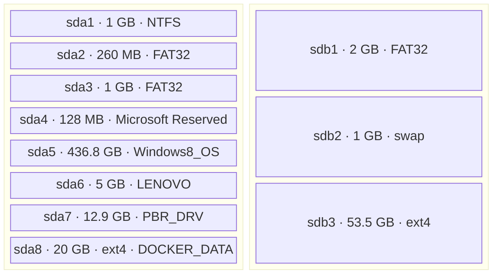
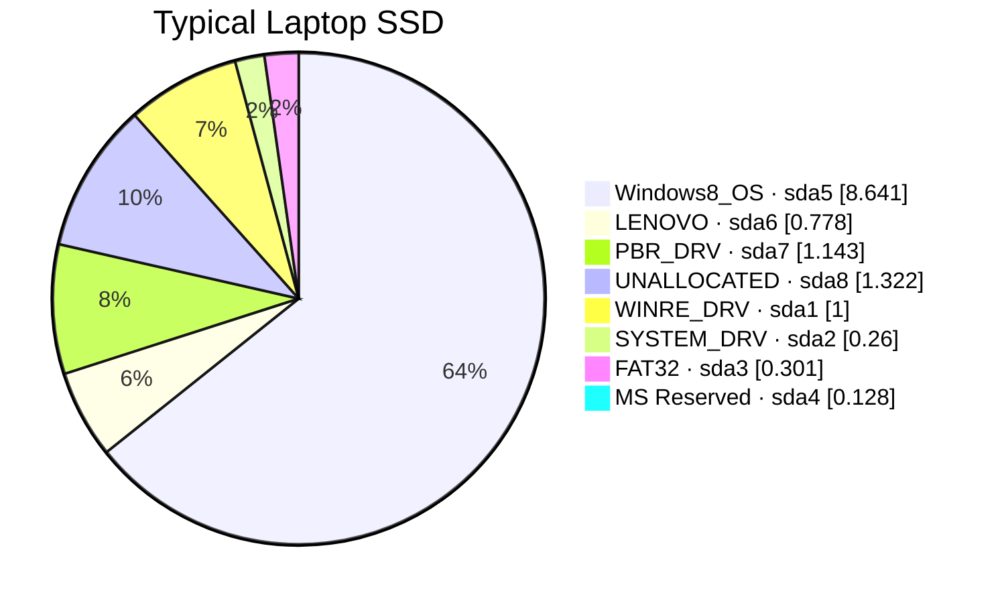
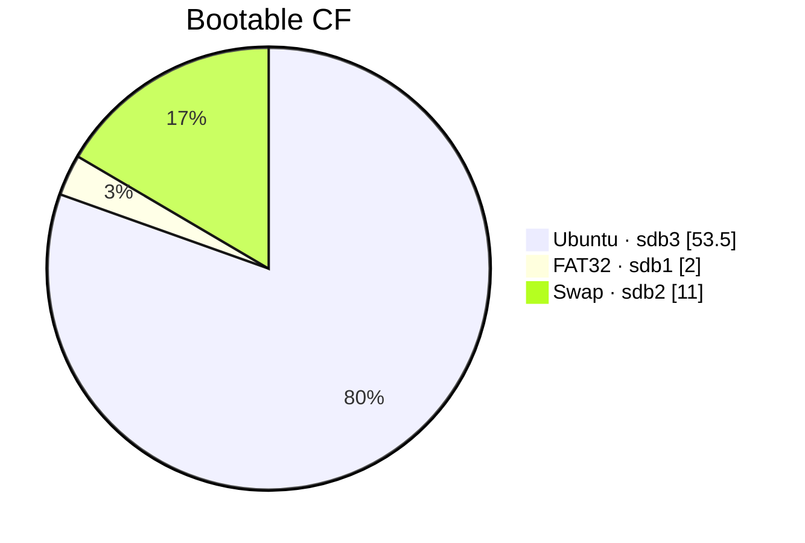

### Setup

```
lsblk -o NAME,SIZE,MODEL,FSTYPE,UUID,MOUNTPOINTS
```
```text
lsblk: unknown column: MOUNTPOINTS
```
```
lsblk -o NAME,SIZE,MODEL,FSTYPE,UUID
```
```

NAME     SIZE MODEL            FSTYPE UUID
sda      477G SAMSUNG MZ7TE512
├─sda1  1000M                  ntfs   A8BC3F8DBC3F54D2
├─sda2   260M                  vfat   4841-54E2
├─sda3  1000M                  vfat   5E42-9783
├─sda4   128M
├─sda5 436.8G                  ntfs   E80445210444F3DA
├─sda6    25G                  ntfs   B0444ED6444E9ECA
└─sda7  12.9G                  ntfs   78BA463BBA45F662
sdb     58.6G Cruzer Fit
├─sdb1     2G                  vfat   4494-CFA6
├─sdb2     1G                  swap   ff0f0548-b1de-4da7-870a-61c7ee7d13db
└─sdb3  53.5G                  ext4   df6307c6-7f8e-4b3c-9d29-3058848f4da3
```


```
 pie showData
   title Typical Laptop SSD 
    "Windows8_OS · sda5" : 8.641
    "LENOVO · sda6" : 0.778
    "PBR_DRV · sda7" : 2.465
    "WINRE_DRV · sda1" : 1
    "SYSTEM_DRV · sda2" : 0.26
    "FAT32 · sda3" :  0.301
    "MS Reserved · sda4" : 0.128

```

> Important: the resulting sectors no longer represent actual capacity percentages (logarythimic scale was used)
> They represent logarithmically compressed capacity weights. 



* Recovering space from an existing Windows installation can be unexpectedly difficult.
* Recovering space from vendor-provided auxiliary partitions may be a more practical candidate, subject to understanding their recovery purpose.

For example, a decade-old Windows installation can contain an immovable file that prevents `diskpart` from shrinking a volume,
even when substantial available free space is reported. 
Defragmentation does not necessarily resolve this: files such as system metadata, shadow-copy data, and other filesystem 
structures can constrain the shrink boundary

```sh
ls /media/sergueik/LRS_ESP/
```
```text
Boot/                      OneKey/
bootmgr                    System Volume Information/
bootmgr.efi                Version.txt
EFI/
```
```sh
ls /media/sergueik/Windows8_OS/
```
```text
Boot                      Minikube               Ruby24-x64
bootmgr                   Minikube.SAVED         swapfile.sys
BOOTNXT                   opscode               'System Volume Information'
developer                 PerfLogs               temp
'Documents and Settings'   ProgramData            tools
HashiCorp                'Program Files'         Users
hiberfil.sys             'Program Files (x86)'  'Virtual Machines'
Intel                     Recovery               Windows
java                     '$Recycle.Bin'          windows-version.txt
```
```sh
sudo mount /dev/sda7  /media/sergueik/UNKNOWN2
sudo mount /dev/sda6  /media/sergueik/UNKNOWN1
```
```sh
ls /media/sergueik/UNKNOWN1 /media/sergueik/UNKNOWN2
```
```text
/media/sergueik/UNKNOWN1:
Applications   pagefile.sys   'System Volume Information'
Drivers       '$RECYCLE.BIN'
```
```text
/media/sergueik/UNKNOWN2:
OKRBackup   onekey  'System Volume Information'
```

```sh
df  -h /media/sergueik/UNKNOWN?
```
```text
Filesystem      Size  Used Avail Use% Mounted on
/dev/sda6        25G  4.7G   21G  19% /media/sergueik/UNKNOWN1
/dev/sda7        13G  9.1G  3.8G  71% /media/sergueik/UNKNOWN2
```

* Schrinked lenovo disk to approx 5 G  creating ~ 20 G  unallocated space

```
lsblk -o NAME,SIZE,MODEL,FSTYPE,UUID
```
```text
NAME     SIZE MODEL            FSTYPE UUID
sda      477G SAMSUNG MZ7TE512
├─sda1  1000M                  ntfs   A8BC3F8DBC3F54D2
├─sda2   260M                  vfat   4841-54E2
├─sda3  1000M                  vfat   5E42-9783
├─sda4   128M
├─sda5 436.8G                  ntfs   E80445210444F3DA
├─sda6     5G                  ntfs   B0444ED6444E9ECA
└─sda7  12.9G                  ntfs   78BA463BBA45F662
sdb     58.6G Cruzer Fit
├─sdb1     2G                  vfat   4494-CFA6
├─sdb2     1G                  swap   ff0f0548-b1de-4da7-870a-61c7ee7d13db
└─sdb3  53.5G                  ext4   df6307c6-7f8e-4b3c-9d29-3058848f4da3
```

```sh
sudo parted /dev/sda unit MiB print free
```
```text
Model: ATA SAMSUNG MZ7TE512 (scsi)
Disk /dev/sda: 488386MiB
Sector size (logical/physical): 512B/512B
Partition Table: gpt
Disk Flags:

Number  Start      End        Size       File system  Name                          Flags
        0.02MiB    1.00MiB    0.98MiB    Free Space
 1      1.00MiB    1001MiB    1000MiB    ntfs         Basic data partition          hidden, diag
 2      1001MiB    1261MiB    260MiB     fat32        EFI system partition          boot, hidden, esp
 3      1261MiB    2261MiB    1000MiB    fat32        Basic data partition          hidden
 4      2261MiB    2389MiB    128MiB                  Microsoft reserved partition  msftres
 5      2389MiB    449636MiB  447247MiB  ntfs         Basic data partition          msftdata
        449636MiB  449637MiB  1.00MiB    Free Space
 6      449637MiB  454757MiB  5120MiB    ntfs         Basic data partition          msftdata
        454757MiB  475237MiB  20480MiB   Free Space
 7      475237MiB  488386MiB  13149MiB   ntfs         Basic data partition          hidden, diag
        488386MiB  488386MiB  0.32MiB    Free Space
```

Create new partition on unallocated space
label DOCKER_PARTITION, keep the defaults (ext4)

```sh
lsblk -o NAME,SIZE,MODEL,FSTYPE,UUID
```
```text
sda      477G SAMSUNG MZ7TE512
├─sda1  1000M                  ntfs   A8BC3F8DBC3F54D2
├─sda2   260M                  vfat   4841-54E2
├─sda3  1000M                  vfat   5E42-9783
├─sda4   128M
├─sda5 436.8G                  ntfs   E80445210444F3DA
├─sda6     5G                  ntfs   B0444ED6444E9ECA
├─sda7  12.9G                  ntfs   78BA463BBA45F662
└─sda8    20G                  ext4   0b180fc0-24e7-45dd-9630-00021add73bf
sdb     58.6G Cruzer Fit
├─sdb1     2G                  vfat   4494-CFA6
├─sdb2     1G                  swap   ff0f0548-b1de-4da7-870a-61c7ee7d13db
└─sdb3  53.5G                  ext4   df6307c6-7f8e-4b3c-9d29-3058848f4da3
```
```sh
sudo mkdir -p /data/docker
```
insert in `/etc/fstab`:
```text
UUID=0b180fc0-24e7-45dd-9630-00021add73bf /data/docker ext4 defaults,noatime,nofail 0 2
```
```sh
sudo mount -a 
```
```sh
df -h /data/docker
```
```text
Filesystem      Size  Used Avail Use% Mounted on
/dev/sda8        20G   24K   19G   1% /data/docker
```

check docker version

```text
Client:
 Version:           20.10.21
 API version:       1.41
 Go version:        go1.18.1
 Git commit:        20.10.21-0ubuntu1~18.04.3
 Built:             Thu Apr 27 05:50:21 2023
 OS/Arch:           linux/amd64
 Context:           default
 Experimental:      true

Server:
 Engine:
  Version:          20.10.21
  API version:      1.41 (minimum version 1.12)
  Go version:       go1.18.1
  Git commit:       20.10.21-0ubuntu1~18.04.3
  Built:            Thu Apr 27 05:36:22 2023
  OS/Arch:          linux/amd64
  Experimental:     false
 containerd:
  Version:          1.6.12-0ubuntu1~18.04.1
  GitCommit:
 runc:
  Version:          1.1.4-0ubuntu1~18.04.2
  GitCommit:
 docker-init:
  Version:          0.19.0
  GitCommit:
```
```
ls -a /etc/docker/
```
```
.  ..  key.json
```
```
ls -a ~sergueik/.docker/
```
```text
.  ..  .buildNodeID  buildx
```

```sh
docker ps
```
```text
              COMMAND                  CREATED       STATUS       PORTS                                                NAMES
ff285934790c   kindest/node:v1.29.2   "/usr/local/bin/entr…"   2 weeks ago   Up 2 hours   127.0.0.1:36977->6443/tcp, 0.0.0.0:8443->30443/tcp   argocd-cluster-control-plane
```
```sh
docker stop ff28
```
```text
ff28
```
```sh
 docker container ls -a
```
```text
CONTAINER ID   IMAGE                  COMMAND                  CREATED       STATUS                        PORTS     NAMES
ff285934790c   kindest/node:v1.29.2   "/usr/local/bin/entr…"   2 weeks ago   Exited (137) 34 seconds ago             argocd-cluster-control-plane
```
```sh
docker image ls
```
```text
REPOSITORY            TAG       IMAGE ID       CREATED       SIZE
kindest/node          <none>    09c50567d34e   2 years ago   956MB
testcontainers/ryuk   0.3.3     64f4b02dc986   5 years ago   12MB
```

this means

__Docker__ installation is relatively straightforward, and the version is old enough and 
don't have the newer containerd image-store complication.


- Docker Engine 20.10.21.
- containerd 1.6.12.
- Ubuntu 18.04 packaging.
- A conventional Docker installation with no existing daemon.json.
- One kind cluster container, now stopped.
- Approximately 968 MB of Docker images.


#### Shrinking the Windows Disk

On Windows, open token elevated Command Prompt and use commands:


```cmd
diskpart
```
```text
Copyright (C) 1999-2013 Microsoft Corporation.
On computer: LENOVO-PC

DISKPART> list volume

  Volume ###  Ltr  Label        Fs     Type        Size     Status     Info
  ----------  ---  -----------  -----  ----------  -------  ---------  --------
  Volume 0     C   Windows8_OS  NTFS   Partition    436 GB  Healthy    Boot
  Volume 1     D   LENOVO       NTFS   Partition   5120 MB  Healthy
  Volume 2         WINRE_DRV    NTFS   Partition   1000 MB  Healthy    Hidden
  Volume 3         SYSTEM_DRV   FAT32  Partition    260 MB  Healthy    System
  Volume 4         PBR_DRV      NTFS   Partition     12 GB  Healthy    Hidden
  Volume 5     E                       Removable   2048 MB  Unusable

DISKPART> select volume 0

Volume 0 is the selected volume.

DISKPART> shrink querymax

The maximum number of reclaimable bytes is: 2318 MB

DISKPART> exit
```
The expected space to reclaim was much higher, to find out what is the cause one iis advised to examine events in __Event Viewer__:

  * select __Windows Logs__ → __Application__
  * flter by __Source__: `Microsoft-Windows-Defrag`
  * filter Event __ID__: `259`


The event may identify the exact unmovable file and its cluster location.

But there was no Event 259. only 258. But  was an:
```txt
Event 26228

Chkdsk was executed in verify mode on a volume snapshot.  

Checking file system on \Device\HarddiskVolume5
Volume label is Windows8_OS.

Examining 1 corruption record ...

Record 1 of 1: Corrupt File "<0x3a,0x3e7>" ... no corruption found.

1 corruption record processed in 0.1 seconds.

Windows has examined the list of previously identified potential issues and found no problems.
No further action is required.
```

so i simply rebooted with chkdisk scheduled (the __Properties__/__Tools__/__Check__ did report the repair is necessary) and inspected the __Event Log__ afterwards:  

```text

event 1001

Checking file system on C:
The type of the file system is NTFS.
Volume label is Windows8_OS.


One of your disks needs to be checked for consistency. You
may cancel the disk check, but it is strongly recommended
that you continue.
Windows will now check the disk.                         

Stage 1: Examining basic file system structure ...
  693504 file records processed.                                                         File verification completed.
  8627 large file records processed.                                      0 bad file records processed.                                      
Stage 2: Examining file name linkage ...
The first free byte, 0x28, and bytes available, 0xe8, for
root index $I30 in file 0x19de5 are not equal.
...
The first free byte, 0x28, and bytes available, 0xb0, for
root index $I30 in file 0x5ef19 are not equal.
  873680 index entries processed.                                                        Index verification completed.
  0 unindexed files scanned.          
  0 unindexed files recovered.                                       
Stage 3: Examining security descriptors ...
Cleaning up 342 unused index entries from index $SII of file 0x9.
Cleaning up 342 unused index entries from index $SDH of file 0x9.
Cleaning up 342 unused security descriptors.
Security descriptor verification completed.
  90089 data files processed.                                            CHKDSK is verifying Usn Journal...
  34082096 USN bytes processed.                                                            Usn Journal verification completed.

Windows has made corrections to the file system.
No further action is required.

 457980927 KB total disk space.
 160005316 KB in 344015 files.
    250672 KB in 90090 indexes.
         0 KB in bad sectors.
    817771 KB in use by the system.
     65536 KB occupied by the log file.
 296907168 KB available on disk.

      4096 bytes in each allocation unit.
 114495231 total allocation units on disk.
  74226792 allocation units available on disk.

Internal Info:
00 95 0a 00 bf 9f 06 00 5c 82 0b 00 00 00 00 00  ........\.......
20 02 00 00 32 00 00 00 00 00 00 00 00 00 00 00   ...2...........

Windows has finished checking your disk.
Please wait while your computer restarts.


```
and now re-run
```cmd
diskpart
```
```
DISKPART> list volume

  Volume ###  Ltr  Label        Fs     Type        Size     Status     Info
  ----------  ---  -----------  -----  ----------  -------  ---------  --------
  Volume 0     C   Windows8_OS  NTFS   Partition    436 GB  Healthy    Boot
  Volume 1     D   LENOVO       NTFS   Partition   5120 MB  Healthy
  Volume 2         WINRE_DRV    NTFS   Partition   1000 MB  Healthy    Hidden
  Volume 3         SYSTEM_DRV   FAT32  Partition    260 MB  Healthy    System
  Volume 4         PBR_DRV      NTFS   Partition     12 GB  Healthy    Hidden
  Volume 5     E                       Removable   2048 MB  Unusable

DISKPART> select  volume 0

Volume 0 is the selected volume.

DISKPART> shrink querymax

The maximum number of reclaimable bytes is:  283 GB (289904 MB)
exit
```
this looks very promising alredy, but for documentation purpose, located the evenr `259`:

```text
Event 259

A volume shrink analysis was initiated on volume Windows8_OS (C:). This event log entry details information about the last unmovable file that could limit the maximum number of reclaimable bytes.
 
 Diagnostic details:
 - The last unmovable file appears to be: \Windows\System32\wdi\LogFiles\BootCKCL.etl::$DATA
 - The last cluster of the file is: 0x10bd740
 - Shrink potential target (LCN address): 0x2666cd3
 - The NTFS file flags are: ----D
 - Shrink phase: <analysis>
 
 To find more details about this file please use the "fsutil volume querycluster \\?\Volume{b1b74bcb-3cb9-4ab4-8afc-2d1e07b55a3e} 0x10bd740" command.
 
``` 
and
perfomed the command advised:
```cmd 
fsutil volume querycluster \\?\Volume{b1b74bcb-3cb9-4ab4-8afc-2d1e07b55a3e} 0x10bd740
```
```text
Cluster 0x00000000010bd740 used by ----D \Windows\System32\wdi\LogFiles\BootCKCL
.etl::$DATA
```

The
CHKDSK repaired NTFS metadata, and the reported shrink limit changed from approximately 2.3 GB to 283 GB. That is a remarkable difference, but it should be presented as a successful case, not a universal remedy.

> NOTE: this event can be compared to a Penn & Teller stage: the trick is demonstrated, the result is real, but the audience _isn't_ being given a universally reproducible illusion

> It looks like magic when resurrection of an `200 GB` of disk space reduced to those three lines. But there is no guarantee that another machine will have the same filesystem inconsistency, the same immovable file, or the same response to repair

#### Unix Machine Steps
```sh
docker info | grep -E 'Storage Driver|Docker Root Dir'
```
```text
WARNING: No swap limit support
 Storage Driver: overlay2
 Docker Root Dir: /var/lib/docker
```

it is easer to move the blank Docker configuration - no images, no volumes:

```sh
docker ps -a
```
```text
CONTAINER ID   IMAGE     COMMAND   CREATED   STATUS    PORTS     NAMES
```
```sh
docker volume ls
```
```text
DRIVER    VOLUME NAME

```
```sh
sudo du -sh /var/lib/docker /var/lib/containerd
```
```text
3.1M    /var/lib/docker
608K    /var/lib/containerd
```
```
sudo mount -a
findmnt /data/docker
df -h /data/docker
```

```text
TARGET       SOURCE    FSTYPE OPTIONS
/data/docker /dev/sda8 ext4   rw,noatime,data=ordered
Filesystem      Size  Used Avail Use% Mounted on
/dev/sda8        20G   24K   19G   1% /data/docker
```
```sh
sudo mkdir -p /etc/docker
sudo vi /etc/docker/daemon.json
```
```json
{
  "data-root": "/data/docker"
}
```
```
sudo mkdir -p /etc/systemd/system/docker.service.d
```
```
sudo vi /etc/systemd/system/docker.service.d/storage.conf
```
```text
[Unit]
RequiresMountsFor=/data/docker
```

```sh
sudo systemctl daemon-reload
```
```
sudo systemctl stop docker
```

```
sudo sudo mv /var/lib/docker /var/lib/docker.OLD
```

```
sudo systemctl start docker
```
```sh
docker info | grep -E 'Storage Driver|Docker Root Dir'
```
```text
WARNING: No swap limit support
 Storage Driver: overlay2
 Docker Root Dir: /data/docker
```
> NOTE: containerd can have separate runtime state under /var/lib/containerd
```sh
sudo ls /var/lib/containerd/
```
```text
io.containerd.content.v1.content   io.containerd.snapshotter.v1.btrfs
io.containerd.metadata.v1.bolt     io.containerd.snapshotter.v1.native
io.containerd.runtime.v1.linux     io.containerd.snapshotter.v1.overlayfs
io.containerd.runtime.v2.task      tmpmounts
io.containerd.snapshotter.v1.aufs
```

```
sudo du -sh !$
```
```text
sudo du -sh /var/lib/containerd/
608K    /var/lib/containerd/
```
```sh
docker pull alpine
```
```sh
sudo find /data/docker/
```
(output truncated):
```
/data/docker/
/data/docker/runtimes
/data/docker/image
/data/docker/image/overlay2
/data/docker/image/overlay2/imagedb
/data/docker/image/overlay2/imagedb/metadata
/data/docker/image/overlay2/imagedb/metadata/sha256
/data/docker/image/overlay2/imagedb/content
/data/docker/image/overlay2/imagedb/content/sha256
/data/docker/image/overlay2/imagedb/content/sha256/3ea06e4cb95e726ea6c6cc4377570ac4c4050d78710004cbd631ca809daf7e8e
/data/docker/image/overlay2/distribution
/data/docker/image/overlay2/distribution/v2metadata-by-diffid
/data/docker/image/overlay2/distribution/v2metadata-by-diffid/sha256
/data/docker/image/overlay2/distribution/v2metadata-by-diffid/sha256/75f1d9657d880da5f75298e8f40e9928bb6e260c50d26f97af196845307e3064
/data/docker/image/overlay2/distribution/diffid-by-digest
/data/docker/image/overlay2/distribution/diffid-by-digest/sha256
/data/docker/image/overlay2/distribution/diffid-by-digest/sha256/881fc932939efef04ca120ad44bbd2c0917851eb247aa4995428afb1e80ede17
/data/docker/image/overlay2/layerdb
/data/docker/image/overlay2/layerdb/tmp
/data/docker/image/overlay2/layerdb/sha256
/data/docker/image/overlay2/layerdb/sha256/75f1d9657d880da5f75298e8f40e9928bb6e260c50d26f97af196845307e3064
/data/docker/image/overlay2/layerdb/sha256/75f1d9657d880da5f75298e8f40e9928bb6e260c50d26f97af196845307e3064/cache-id
/data/docker/image/overlay2/layerdb/sha256/75f1d9657d880da5f75298e8f40e9928bb6e260c50d26f97af196845307e3064/tar-split.json.gz
/data/docker/image/overlay2/layerdb/sha256/75f1d9657d880da5f75298e8f40e9928bb6e260c50d26f97af196845307e3064/size
/data/docker/image/overlay2/layerdb/sha256/75f1d9657d880da5f75298e8f40e9928bb6e260c50d26f97af196845307e3064/diff
/data/docker/image/overlay2/repositories.json
/data/docker/overlay2
/data/docker/overlay2/l
/data/docker/overlay2/l/REIVC7AMZZ7OAKAS3NVAIFTQ4C
/data/docker/overlay2/9aa1e0e95b851603dfc86b04fd1ca75de4d32b52867352495442b09f8724fbf7
...
/data/docker/overlay2/9aa1e0e95b851603dfc86b04fd1ca75de4d32b52867352495442b09f8724fbf7/diff/mnt
/data/docker/swarm
/data/docker/volumes
/data/docker/volumes/backingFsBlockDev
/data/docker/volumes/metadata.db
/data/docker/buildkit
/data/docker/buildkit/snapshots.db
/data/docker/buildkit/containerdmeta.db
/data/docker/buildkit/cache.db
/data/docker/buildkit/content
/data/docker/buildkit/content/ingest
/data/docker/buildkit/metadata_v2.db
/data/docker/buildkit/executor
/data/docker/containers
/data/docker/tmp
/data/docker/lost+found
/data/docker/trust
/data/docker/plugins
/data/docker/plugins/storage
/data/docker/plugins/storage/ingest
/data/docker/plugins/tmp
/data/docker/network
/data/docker/network/files
/data/docker/network/files/local-kv.db
```
run the container
```sh
docker run -d --name storage-test alpine sleep 300
```
the hash is returned
``` 
2dbe4ddd76962ccc2670145da4f6ae49c8c5d3a5bd5ac66b8c29c48c82c9dcf0
```
```sh
docker inspect --format='{{.GraphDriver.Data.UpperDir}}' storage-test
```
```text
/data/docker/overlay2/961cfc9cb04900c6ab9a0f45402b81a3a7091e921119757976dbceee9034d928/diff
```

confirm configuration survives reboot

```sh
sudo  shutdown -r now
```
monitor the computer to boot successfully
```
docker ps -a
```
```text
CONTAINER ID   IMAGE     COMMAND       CREATED         STATUS                       PORTS     NAMES
2dbe4ddd7696   alpine    "sleep 300"   7 minutes ago   Exited (137) 4 minutes ago             storage-test
```

```sh
docker info | grep -E 'Storage Driver|Docker Root Dir'
```
```text
WARNING: No swap limit support
 Storage Driver: overlay2
 Docker Root Dir: /data/docker
```
```sh
findmnt /data/docker
```
```text
TARGET       SOURCE    FSTYPE OPTIONS
/data/docker /dev/sda8 ext4   rw,noatime,data=ordered

```
```sh
df -h /data/docker
```
```text
Filesystem      Size  Used Avail Use% Mounted on
/dev/sda8        20G  9.2M   19G   1% /data/docker
```
### TODO 

Hadoop on a Gamer Disappointer Device
  
The Gamer's Disappointment Redemption Project
Turning Lenovo Y40/Y70 gaming disappointments into portable big-data laboratories.

Repository: pocket-hadoop
