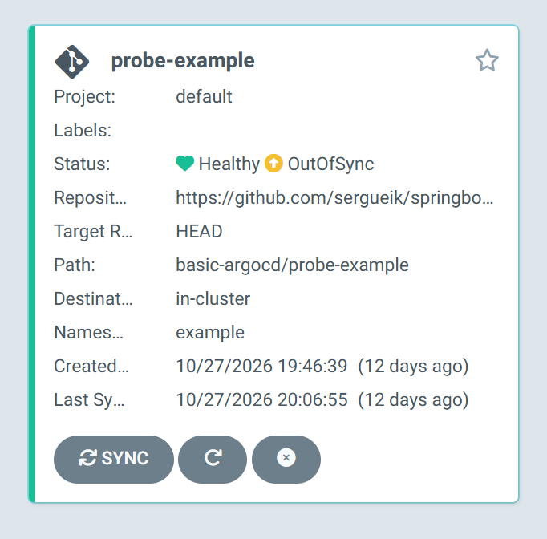
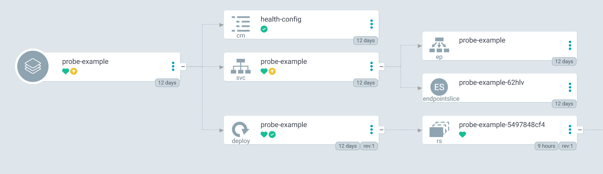
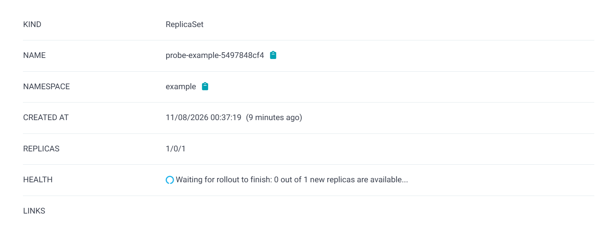

###  Info
Bare minimal controllable HTTP application for Minikube/Argo CD learning exercise whose liveness and readiness probe responses are set through container environment variables


### Usage

```sh
mvn clean package
```

```cmd
java -cp target\example.status-server.jar example.App 
```
```cmd
java -jar target\example.status-server.jar -live up -ready down
```

```sh
curl http://localhost:8080/api/alive | jq '.'
```
```json
{
  "status": "error",
  "error": "Not Found"
}
```

```sh
curl -s http://localhost:8080/api/live | jq '.'
```
```json
{
  "status": "UP"
}
```
```sh
curl -s http://localhost:8080/api/ready | jq '.'
```
```json
{
  "status": "DOWN"
}
```
```sh
IMAGE=alpine/java:11-jre
IMAGE=openjdk:8u191-jre-alpine3.9
docker pull $IMAGE
```

```sh
NAME=status-server
docker build -f Dockerfile -t $NAME .
```

```text
Sending build context to Docker daemon  46.08kB
Step 1/5 : FROM openjdk:8u191-jre-alpine3.9
 ---> b76bbdb2809f
Step 2/5 : ARG app_jar="example.status-server.jar"
 ---> Using cache
 ---> c22a4d90a8e1
Step 3/5 : ADD "target/${app_jar}" app.jar
 ---> c495743ce9bd
Step 4/5 : EXPOSE 8080
 ---> Running in 4c510a43cd4f
Removing intermediate container 4c510a43cd4f
 ---> 3ace6227287d
Step 5/5 : ENTRYPOINT java -cp app.jar example.App -ready ${READY:up}  -live ${LIVE:up}
 ---> Running in ff7bc3fc12dd
Removing intermediate container ff7bc3fc12dd
 ---> abc30bcd6fbf
Successfully built abc30bcd6fbf
Successfully tagged status-server:latest
```
```sh
docker run --name $NAME -d -e LIVE=up -e READY=down -p 8081:8080 $NAME
```

```sh
docker logs $NAME
```
```text
Server started on port 8080
```
```sh
curl -I http://$(docker-machine ip):8081/api/live
```
```text
HTTP/1.1 200 OK
Date: Sat, 24 Oct 2026 13:42:48 GMT
```
```sh
curl -I http://$(docker-machine ip):8081/api/ready
```
```
HTTP/1.1 503 Service Unavailable
Date: Sat, 24 Oct 2026 13:38:54 GMT
```
crash application

```sh
curl -I http://$(docker-machine ip):8081/api/failure/oom
```

after some time get
```text
curl: (52) Empty reply from server
```
```sh
docker container ls -a
```
```text
1474f82f890e        status-server   "/bin/sh -c 'java -c…"   3 minutes ago Exited (0) 49 seconds ago status-server
```
```sh
docker logs $NAME
```
```text
Exception in thread "Thread-2" java.lang.OutOfMemoryError: Java heap space
  at example.App$2.handle(App.java:131)
  at com.sun.net.httpserver.Filter$Chain.doFilter(Filter.java:79)
  at sun.net.httpserver.AuthFilter.doFilter(AuthFilter.java:83)
  at com.sun.net.httpserver.Filter$Chain.doFilter(Filter.java:82)
  at sun.net.httpserver.ServerImpl$Exchange$LinkHandler.handle(ServerImpl.java:675)
  at com.sun.net.httpserver.Filter$Chain.doFilter(Filter.java:79)
  at sun.net.httpserver.ServerImpl$Exchange.run(ServerImpl.java:647)
  at sun.net.httpserver.ServerImpl$DefaultExecutor.execute(ServerImpl.java:158)
  at sun.net.httpserver.ServerImpl$Dispatcher.handle(ServerImpl.java:431)
  at sun.net.httpserver.ServerImpl$Dispatcher.run(ServerImpl.java:396)
  at java.lang.Thread.run(Thread.java:748)
```
```sh
docker stop $NAME
docker container prune -f
```

### Note

Replace base image with [bellsoft](https://hub.docker.com/r/bellsoft/liberica-openjre-alpine). This yields a small nice present

```sh
docker pull bellsoft/liberica-openjre-alpine:8
```
```text
8: Pulling from bellsoft/liberica-openjre-alpine
55afa1ecc21d: Pull complete
44af7b7a294c: Pull complete
29a9756cd656: Pull complete
Digest: sha256:a537e3794dde32a8899f0db1a0e045db4e1634a351bf35d3a0c9d8fed7faa4f2
Status: Downloaded newer image for bellsoft/liberica-openjre-alpine:8
docker.io/bellsoft/liberica-openjre-alpine:8
```
```sh
NAME=status-server
docker build -f Dockerfile -t $NAME .
```

```sh
docker run --name $NAME -d -e LIVE=up -e READY=down -p 8081:8080 $NAME
```
```text
34e4ae4f6d17b0856219b3c8e050aaa7dc93ef02d06b0b6772524e1bf2400523
```
```sh
curl -I http://$(docker-machine ip):8081/api/ready
```
```text
curl: (7) Failed to connect to 192.168.99.106 port 8081 after 2004 ms: Could not connect to server
```
```sh
docker container ls
```
```text
CONTAINER ID        IMAGE               COMMAND             CREATED             STATUS              PORTS               NAMES
```
docker logs 34e4
```
Error occurred during initialization of VM
Cannot create VM thread. Out of system resources.
```
this is not caused by the code:
```sh
docker run --rm bellsoft/liberica-openjre-alpine:8 java -version
```
```text
Error occurred during initialization of VM
Cannot create VM thread. Out of system resources.
```
### TODO

Suppress
```text
WARNING: sendResponseHeaders: being invoked with a content length for a HEAD request
```


### Next Steps

To [load](https://minikube.sigs.k8s.io/docs/commands/image) the image into [Minikube](https://minikube.sigs.k8s.io/docs/) one first
[save](https://docs.docker.com/reference/cli/docker/image/save/)
a portable file `.tar` archive

```sh
docker save --output ${NAME}.tar $NAME 
```
> NOTE: __Docker Toolbox__ will store the archive on Windows side 
```cmd
set NAME=status-server
dir %NAME%.tar
```

```text
-rw-r--r-- 1 kouzm 197609 86188544 Nov  7 23:51 status-server.tar
```

```sh
docker container prune -f
docker image prune -f
docker image rm status-server openjdk:8u191-jre-alpine3.9
docker-machine stop
```
```powershell.exe
$env:MINIKUBE_IN_STYLE='true'
minikube.exe start --driver=virtualbox
```

```text
😄  minikube v1.20.0 on Microsoft Windows 10 Pro 10.0.26200 Build 26200
    ▪ MINIKUBE_IN_STYLE=true
✨  Using the virtualbox driver based on existing profile
👍  Starting control plane node minikube in cluster minikube
🏃  Updating the running virtualbox "minikube" VM ...
🌐  Found network options:
    ▪ NO_PROXY=192.168.99.100,192.168.99.103,192.168.99.104,192.168.99.102,192.168.99.101,192.168.99.105,192.168.99.106
    ▪ no_proxy=192.168.99.100,192.168.99.103,192.168.99.104,192.168.99.102,192.168.99.101,192.168.99.105,192.168.99.106
🐳  Preparing Kubernetes v1.20.2 on Docker 20.10.6 ...
    ▪ env NO_PROXY=192.168.99.100,192.168.99.103,192.168.99.104,192.168.99.102,192.168.99.101,192.168.99.105,192.168.99.106
🔎  Verifying Kubernetes components...
    ▪ Using image gcr.io/k8s-minikube/storage-provisioner:v5
🌟  Enabled addons: storage-provisioner, default-storageclass
💡  kubectl not found. If you need it, try: 'minikube kubectl -- get pods -A'
🏄  Done! kubectl is now configured to use "minikube" cluster and "default" namespace by default
```
```cmd
minikube.exe image load -v 4 status-server.tar
```
the load operation itself is silent - no output
```cmd
minikube.exe image ls
```
prints among other images

```text
docker.io/library/status-server:latest
```

```cmd
minikube.exe status
```
```text
minikube
type: Control Plane
host: Running
kubelet: Running
apiserver: Running
kubeconfig: Configured
```
if developer host is low on memory, Virtual Box may pause the VMs leading to:
```cmd
minikube.exe status
```

```text
minikube
type: Control Plane
host: Paused
kubelet: Paused
apiserver: Paused
kubeconfig: Paused
```

Stop Docker Toolbox, start Minikube again

The entry  we will be using is known as `docker.io/library/status-server:latest`

```cmd
minikube.exe  kubectl -- --namespace example apply -f example.yaml
```
```text
deployment.apps/probe-example created
configmap/health-config unchanged
service/probe-example unchanged
```

```cmd
minikube.exe kubectl -- --namespace example get pod
```
```text
NAME                             READY   STATUS         RESTARTS   AGE
probe-example-64684f9c8d-m4vwv   0/1     ErrImagePull   0          13s
```

```cmd
minikube.exe kubectl -- --namespace example get pod
```
```text
NAME                             READY   STATUS             RESTARTS   AGE
probe-example-64684f9c8d-m4vwv   0/1     ImagePullBackOff   0          75s
```

```cmd
minikube.exe kubectl -- --namespace example describe pod probe-example-64684f9c8d-m4vwv
```
```text
Name:         probe-example-64684f9c8d-m4vwv
Namespace:    example
Priority:     0
Node:         minikube/192.168.99.104
Start Time:   Sat, 24 Oct 2026 16:24:38 -0400
Labels:       app=app
              pod-template-hash=64684f9c8d
Annotations:  <none>
Status:       Pending
IP:           172.17.0.11
IPs:
  IP:           172.17.0.11
Controlled By:  ReplicaSet/probe-example-64684f9c8d
Containers:
  app-container:
    Container ID:
    Image:          docker.io/library/status-server:latest
    Image ID:
    Port:           8080/TCP
    Host Port:      0/TCP
    State:          Waiting
      Reason:       ImagePullBackOff
    Ready:          False
    Restart Count:  0
    Liveness:       http-get http://:8080/app/live delay=10s timeout=3s period=5s #success=1 #failure=3
    Readiness:      http-get http://:8080/app/ready delay=0s timeout=1s period=5s #success=1 #failure=3
    Startup:        http-get http://:8080/ delay=0s timeout=1s period=10s #success=1 #failure=30
    Environment:
      APP_READYNESS:  <set to the key 'APP_READYNESS' of config map 'health-config'>  Optional: false
      APP_LIVENESS:   <set to the key 'APP_LIVENESS' of config map 'health-config'>   Optional: false
    Mounts:
      /var/run/secrets/kubernetes.io/serviceaccount from default-token-lj4dv (ro)
Conditions:
  Type              Status
  Initialized       True
  Ready             False
  ContainersReady   False
  PodScheduled      True
Volumes:
  default-token-lj4dv:
    Type:        Secret (a volume populated by a Secret)
    SecretName:  default-token-lj4dv
    Optional:    false
QoS Class:       BestEffort
Node-Selectors:  <none>
Tolerations:     node.kubernetes.io/not-ready:NoExecute op=Exists for 300s
                 node.kubernetes.io/unreachable:NoExecute op=Exists for 300s
Events:
  Type     Reason     Age                   From               Message
  ----     ------     ----                  ----               -------
  Normal   Scheduled  3m40s                 default-scheduler  Successfully assigned example/probe-example-64684f9c8d-m4vwv to minikube
  Normal   Pulling    2m9s (x4 over 3m37s)  kubelet            Pulling image "docker.io/library/status-server:latest"
  Warning  Failed     2m8s (x4 over 3m36s)  kubelet            Failed to pull image "docker.io/library/status-server:latest": rpc error: code = Unknown desc = Error response from daemon: pull access denied for status-server, repository does not exist or may require 'docker login': denied: requested access to the resource is denied
  Warning  Failed     2m8s (x4 over 3m36s)  kubelet            Error: ErrImagePull
  Normal   BackOff    115s (x6 over 3m35s)  kubelet            Back-off pulling image "docker.io/library/status-server:latest"
  Warning  Failed     100s (x7 over 3m35s)  kubelet            Error: ImagePullBackOff

```

The error is
```text
Error response from daemon: pull access denied for status-server,
repository does not exist or may require 'docker login'
```

add 
```yaml
image: docker.io/library/status-server:latest
imagePullPolicy: IfNotPresent
```

```
minikube.exe kubectl -- --namespace example get pods -w
```
> NOTE don't have to keep `w` 
```text
NAME                             READY   STATUS                       RESTARTS   AGE
probe-example-64684f9c8d-m4vwv   0/1     ImagePullBackOff             0          8m19s
probe-example-fd944f89d-g2r74    0/1     CreateContainerConfigError   0          14s

```

```cmd
minikube.exe ssh -- docker images status-server
```
```text
REPOSITORY      TAG       IMAGE ID       CREATED       SIZE
status-server   latest    c2fa2f5dd60d   7 hours ago   155MB
```

```
minikube.exe kubectl -- --namespace example describe pod probe-example-7d444dc7f8-tnn9v
```
```text
Name:         probe-example-7d444dc7f8-tnn9v
Namespace:    example
Priority:     0
Node:         minikube/192.168.99.104
Start Time:   Sat, 24 Oct 2026 16:54:24 -0400
Labels:       app=app
              pod-template-hash=7d444dc7f8
Annotations:  <none>
Status:       Pending
IP:           172.17.0.11
IPs:
  IP:           172.17.0.11
Controlled By:  ReplicaSet/probe-example-7d444dc7f8
Containers:
  app-container:
    Container ID:
    Image:          docker.io/library/status-server:latest
    Image ID:
    Port:           8080/TCP
    Host Port:      0/TCP
    State:          Waiting
      Reason:       CreateContainerConfigError
    Ready:          False
    Restart Count:  0
    Liveness:       http-get http://:8080/app/live delay=10s timeout=3s period=5s #success=1 #failure=3
    Readiness:      http-get http://:8080/app/ready delay=0s timeout=1s period=5s #success=1 #failure=3
    Startup:        http-get http://:8080/ delay=0s timeout=1s period=10s #success=1 #failure=30
    Environment:
      READY:  <set to the key 'APP_READYNESS' of config map 'health-config'>  Optional: false
      LIVE:   <set to the key 'APP_LIVENESS' of config map 'health-config'>   Optional: false
    Mounts:
      /var/run/secrets/kubernetes.io/serviceaccount from default-token-lj4dv (ro)
Conditions:
  Type              Status
  Initialized       True
  Ready             False
  ContainersReady   False
  PodScheduled      True
Volumes:
  default-token-lj4dv:
    Type:        Secret (a volume populated by a Secret)
    SecretName:  default-token-lj4dv
    Optional:    false
QoS Class:       BestEffort
Node-Selectors:  <none>
Tolerations:     node.kubernetes.io/not-ready:NoExecute op=Exists for 300s
                 node.kubernetes.io/unreachable:NoExecute op=Exists for 300s
Events:
  Type     Reason     Age                   From               Message
  ----     ------     ----                  ----               -------
  Normal   Scheduled  2m20s                 default-scheduler  Successfully assigned example/probe-example-7d444dc7f8-tnn9v to minikube
  Normal   Pulled     18s (x12 over 2m19s)  kubelet            Container image "docker.io/library/status-server:latest" already present on machine
  Warning  Failed     4s (x13 over 2m19s)   kubelet            Error: couldn't find key APP_LIVENESS in ConfigMap example/health-config

```
update config to not use `binaryData` for env.
```cmd
minikube.exe kubectl -- --namespace example get pods
```
```text
NAME                             READY   STATUS    RESTARTS   AGE
probe-example-7d444dc7f8-tnn9v   1/1     Running   0          5m26s
```

change config:
```yaml
---
apiVersion: v1
kind: ConfigMap
metadata:
  name: health-config
data:
  APP_READYNESS: "down" 
  APP_LIVENESS: "up"
```

```cmd
minikube.exe kubectl -- --namespace example delete deployment probe-example
```
```text
deployment.apps "probe-example" deleted
```
```cmd
minikube.exe kubectl -- --namespace example apply -f  example.yaml
```
```text
deployment.apps/probe-example created
configmap/health-config unchanged
service/probe-example unchanged
```
```cmd
minikube.exe kubectl -- --namespace example get pod
```
```text
NAME                             READY   STATUS    RESTARTS   AGE
probe-example-5497848cf4-6jllb   0/1     Running   0          10s
```
restore configuration and redeploy. NOTE: will have to recreate deployment

```cmd
minikube.exe kubectl -- --namespace example delete deployment probe-example
minikube.exe kubectl -- --namespace example apply -f  example.yaml
```
observe
```cmd
minikube.exe kubectl -- --namespace example get pod
```
```text
NAME                             READY   STATUS        RESTARTS   AGE
probe-example-5497848cf4-4gvbg   1/1     Running       0          12s
probe-example-5497848cf4-6jllb   0/1     Terminating   0          33m
```

However, deletion and recreation are not strictly necessary just to change the application configuration.
For a normal configuration update, you can edit the ConfigMap and [restart](https://kubernetes.io/docs/reference/kubectl/generated/kubectl_rollout/kubectl_rollout_restart/) the Deployment:
```cmd
minikube.exe kubectl -- --namespace example apply -f example.yaml
minikube.exe kubectl -- --namespace example rollout restart deployment/probe-example
minikube.exe kubectl -- --namespace example rollout status deployment/probe-example
```

_restart_ is important when configuration is injected through environment variables because existing processes do not automatically receive updated environment values.
In __restore the configuration and redeploy__ example Kubernetes deletes and recreates the Deployment. 
Kubernetes creates a replacement Pod, while the previous Pod may remain in Terminating state briefly as cleanup completes


### Connect to ArgoCDn

```cmd
minikube.exe kubectl -- get all --namespace argocd
minikube.exe kubectl -- port-forward svc/argocd-server --namespace argocd 8080:443
```
open in the browser `https://localhost:8080/`

```cmd
minikube.exe kubectl -- get all --namespace example
```
```text
NAME                                 READY   STATUS    RESTARTS   AGE
pod/probe-example-5497848cf4-fcspm   1/1     Running   0          51s

NAME                    TYPE        CLUSTER-IP     EXTERNAL-IP   PORT(S)    AGE
service/probe-example   ClusterIP   10.104.179.6   <none>        9090/TCP   11d

NAME                            READY   UP-TO-DATE   AVAILABLE   AGE
deployment.apps/probe-example   1/1     1            1           11d

NAME                                       DESIRED   CURRENT   READY   AGE
replicaset.apps/probe-example-5497848cf4   1         1         1       51s

```

```cmd
minikube.exe kubectl -- -n example get pod probe-example-5497848cf4-fcspm -o jsonpath="{.status.conditions}" |jq "."

```

```json
[
  {
    "lastProbeTime": null,
    "lastTransitionTime": "2026-11-08T05:37:19Z",
    "status": "True",
    "type": "Initialized"
  },
  {
    "lastProbeTime": null,
    "lastTransitionTime": "2026-11-08T05:37:35Z",
    "status": "True",
    "type": "Ready"
  },
  {
    "lastProbeTime": null,
    "lastTransitionTime": "2026-11-08T05:37:35Z",
    "status": "True",
    "type": "ContainersReady"
  },
  {
    "lastProbeTime": null,
    "lastTransitionTime": "2026-11-08T05:37:19Z",
    "status": "True",
    "type": "PodScheduled"
  }
]
```
attempt forward open port to probe-example service
```  cmd
minikube.exe kubectl -- -n example port-forward service/probe-example 8081:9090 --v=6
```
```text
I1108 00:27:39.951619   23952 loader.go:379] Config loaded from file:  C:\Users\kouzm/.kube/config
I1108 00:27:39.955417   23952 cert_rotation.go:137] Starting client certificate rotation controller
I1108 00:27:39.992239   23952 round_trippers.go:445] GET https://192.168.99.102:8443/api/v1/namespaces/example/services/probe-example 200 OK in 21 milliseconds
I1108 00:27:39.999625   23952 round_trippers.go:445] GET https://192.168.99.102:8443/api/v1/namespaces/example/pods?labelSelector=app%3Dprobe-example 200 OK in 5 milliseconds
I1108 00:27:40.006257   23952 round_trippers.go:445] GET https://192.168.99.102:8443/api/v1/namespaces/example/pods?labelSelector=app%3Dprobe-example&resourceVersion=70029&watch=true 200 OK in 3 milliseconds
F1108 00:28:40.011767   23952 helpers.go:115] error: timed out waiting for the condition
goroutine 1 [running]:
k8s.io/kubernetes/vendor/k8s.io/klog/v2.stacks(0xc0000cc001, 0xc00027c000, 0x59, 0x206)
        /workspace/src/k8s.io/kubernetes/_output/dockerized/go/src/k8s.io/kubernetes/vendor/k8s.io/klog/v2/klog.go:1026 +0xbf
k8s.io/kubernetes/vendor/k8s.io/klog/v2.(*loggingT).output(0x33dfb80, 0xc000000003, 0x0, 0x0, 0xc000a63f10, 0x31bea9e, 0xa, 0x73, 0xd0ee00)
        /workspace/src/k8s.io/kubernetes/_output/dockerized/go/src/k8s.io/kubernetes/vendor/k8s.io/klog/v2/klog.go:975 +0x19e
k8s.io/kubernetes/vendor/k8s.io/klog/v2.(*loggingT).printDepth(0x33dfb80, 0xc000000003, 0x0, 0x0, 0x0, 0x0, 0x2, 0xc000088e70, 0x1, 0x1)
        /workspace/src/k8s.io/kubernetes/_output/dockerized/go/src/k8s.io/kubernetes/vendor/k8s.io/klog/v2/klog.go:732 +0x185
k8s.io/kubernetes/vendor/k8s.io/klog/v2.FatalDepth(...)
        /workspace/src/k8s.io/kubernetes/_output/dockerized/go/src/k8s.io/kubernetes/vendor/k8s.io/klog/v2/klog.go:1488
k8s.io/kubernetes/vendor/k8s.io/kubectl/pkg/cmd/util.fatal(0xc000bb2000, 0x2a, 0x1)
        /workspace/src/k8s.io/kubernetes/_output/dockerized/go/src/k8s.io/kubernetes/vendor/k8s.io/kubectl/pkg/cmd/util/helpers.go:93 +0x27a
k8s.io/kubernetes/vendor/k8s.io/kubectl/pkg/cmd/util.checkErr(0x2642c80, 0xc0002f61c0, 0x250d228)
        /workspace/src/k8s.io/kubernetes/_output/dockerized/go/src/k8s.io/kubernetes/vendor/k8s.io/kubectl/pkg/cmd/util/helpers.go:188 +0x965
k8s.io/kubernetes/vendor/k8s.io/kubectl/pkg/cmd/util.CheckErr(...)
        /workspace/src/k8s.io/kubernetes/_output/dockerized/go/src/k8s.io/kubernetes/vendor/k8s.io/kubectl/pkg/cmd/util/helpers.go:115
k8s.io/kubernetes/vendor/k8s.io/kubectl/pkg/cmd/portforward.NewCmdPortForward.func1(0xc00042a840, 0xc000339960, 0x2, 0x7)
        /workspace/src/k8s.io/kubernetes/_output/dockerized/go/src/k8s.io/kubernetes/vendor/k8s.io/kubectl/pkg/cmd/portforward/portforward.go:114 +0x26a
k8s.io/kubernetes/vendor/github.com/spf13/cobra.(*Command).execute(0xc00042a840, 0xc000491e00, 0x7, 0x8, 0xc00042a840, 0xc000491e00)
        /workspace/src/k8s.io/kubernetes/_output/dockerized/go/src/k8s.io/kubernetes/vendor/github.com/spf13/cobra/command.go:854 +0x2c2
k8s.io/kubernetes/vendor/github.com/spf13/cobra.(*Command).ExecuteC(0xc0000fcb00, 0xc0000d8000, 0xc0000d6000, 0x9)
        /workspace/src/k8s.io/kubernetes/_output/dockerized/go/src/k8s.io/kubernetes/vendor/github.com/spf13/cobra/command.go:958 +0x375
k8s.io/kubernetes/vendor/github.com/spf13/cobra.(*Command).Execute(...)
        /workspace/src/k8s.io/kubernetes/_output/dockerized/go/src/k8s.io/kubernetes/vendor/github.com/spf13/cobra/command.go:895
main.main()
        _output/dockerized/go/src/k8s.io/kubernetes/cmd/kubectl/kubectl.go:49 +0x234

goroutine 19 [chan receive]:
k8s.io/kubernetes/vendor/k8s.io/klog/v2.(*loggingT).flushDaemon(0x33dfb80)
        /workspace/src/k8s.io/kubernetes/_output/dockerized/go/src/k8s.io/kubernetes/vendor/k8s.io/klog/v2/klog.go:1169 +0x92
created by k8s.io/kubernetes/vendor/k8s.io/klog/v2.init.0
        /workspace/src/k8s.io/kubernetes/_output/dockerized/go/src/k8s.io/kubernetes/vendor/k8s.io/klog/v2/klog.go:417 +0xe5

goroutine 23 [select]:
k8s.io/kubernetes/vendor/k8s.io/apimachinery/pkg/util/wait.BackoffUntil(0x250d148, 0x26440c0, 0xc000888000, 0x1, 0xc000086b40)
        /workspace/src/k8s.io/kubernetes/_output/dockerized/go/src/k8s.io/kubernetes/vendor/k8s.io/apimachinery/pkg/util/wait/wait.go:167 +0x149
k8s.io/kubernetes/vendor/k8s.io/apimachinery/pkg/util/wait.JitterUntil(0x250d148, 0x12a05f200, 0x0, 0x1, 0xc000086b40)
        /workspace/src/k8s.io/kubernetes/_output/dockerized/go/src/k8s.io/kubernetes/vendor/k8s.io/apimachinery/pkg/util/wait/wait.go:133 +0x9f
k8s.io/kubernetes/vendor/k8s.io/apimachinery/pkg/util/wait.Until(0x250d148, 0x12a05f200, 0xc000086b40)
        /workspace/src/k8s.io/kubernetes/_output/dockerized/go/src/k8s.io/kubernetes/vendor/k8s.io/apimachinery/pkg/util/wait/wait.go:90 +0x54
created by k8s.io/kubernetes/vendor/k8s.io/kubectl/pkg/util/logs.InitLogs
        /workspace/src/k8s.io/kubernetes/_output/dockerized/go/src/k8s.io/kubernetes/vendor/k8s.io/kubectl/pkg/util/logs/logs.go:51 +0x9e

goroutine 24 [chan receive]:
k8s.io/kubernetes/vendor/k8s.io/client-go/util/workqueue.(*Type).updateUnfinishedWorkLoop(0xc0002f3c20)
        /workspace/src/k8s.io/kubernetes/_output/dockerized/go/src/k8s.io/kubernetes/vendor/k8s.io/client-go/util/workqueue/queue.go:198 +0xb3
created by k8s.io/kubernetes/vendor/k8s.io/client-go/util/workqueue.newQueue
        /workspace/src/k8s.io/kubernetes/_output/dockerized/go/src/k8s.io/kubernetes/vendor/k8s.io/client-go/util/workqueue/queue.go:58 +0x139

goroutine 25 [select]:
k8s.io/kubernetes/vendor/k8s.io/client-go/util/workqueue.(*delayingType).waitingLoop(0xc0002f3d40)
        /workspace/src/k8s.io/kubernetes/_output/dockerized/go/src/k8s.io/kubernetes/vendor/k8s.io/client-go/util/workqueue/delaying_queue.go:231 +0x40e
created by k8s.io/kubernetes/vendor/k8s.io/client-go/util/workqueue.newDelayingQueue
        /workspace/src/k8s.io/kubernetes/_output/dockerized/go/src/k8s.io/kubernetes/vendor/k8s.io/client-go/util/workqueue/delaying_queue.go:68 +0x18d

goroutine 26 [chan receive, 1 minutes]:
k8s.io/kubernetes/vendor/k8s.io/client-go/transport.(*dynamicClientCert).Run(0xc000051740, 0xc000086b40)
        /workspace/src/k8s.io/kubernetes/_output/dockerized/go/src/k8s.io/kubernetes/vendor/k8s.io/client-go/transport/cert_rotation.go:147 +0x28f
created by k8s.io/kubernetes/vendor/k8s.io/client-go/transport.(*tlsTransportCache).get
        /workspace/src/k8s.io/kubernetes/_output/dockerized/go/src/k8s.io/kubernetes/vendor/k8s.io/client-go/transport/cache.go:104 +0x547

goroutine 50 [sync.Cond.Wait, 1 minutes]:
runtime.goparkunlock(...)
        /usr/local/go/src/runtime/proc.go:312
sync.runtime_notifyListWait(0xc000051710, 0xc000000000)
        /usr/local/go/src/runtime/sema.go:513 +0x117
sync.(*Cond).Wait(0xc000051700)
        /usr/local/go/src/sync/cond.go:56 +0xa5
k8s.io/kubernetes/vendor/k8s.io/client-go/util/workqueue.(*Type).Get(0xc0002f3c20, 0x0, 0x0, 0x21a9e00)
        /workspace/src/k8s.io/kubernetes/_output/dockerized/go/src/k8s.io/kubernetes/vendor/k8s.io/client-go/util/workqueue/queue.go:145 +0x90
k8s.io/kubernetes/vendor/k8s.io/client-go/transport.(*dynamicClientCert).processNextWorkItem(0xc000051740, 0x2030000)
...
```
(truncated)

#### Troubleshooting

```cmd
minikube.exe kubectl -- -n example get svc probe-example -o json|jq "."
```
```json
{
  "apiVersion": "v1",
  "kind": "Service",
  "metadata": {
    "annotations": {
      "kubectl.kubernetes.io/last-applied-configuration": "{\"apiVersion\":\"v1\",\"kind\":\"Service\",\"metadata\":{\"annotations\":{},\"labels\":{\"app.kubernetes.io/instance\":\"probe-example\"},\"name\":\"probe-example\",\"namespace\":\"example\"},\"spec\":{\"ports\":[{\"port\":9090,\"targetPort\":8080}],\"selector\":{\"app\":\"probe-example\"}}}\n"
    },
    "creationTimestamp": "2026-10-27T23:46:49Z",
    "labels": {
      "app.kubernetes.io/instance": "probe-example"
    },
    "managedFields": [
      {
        "apiVersion": "v1",
        "fieldsType": "FieldsV1",
        "fieldsV1": {
          "f:metadata": {
            "f:annotations": {
              ".": {},
              "f:kubectl.kubernetes.io/last-applied-configuration": {}
            },
            "f:labels": {
              ".": {},
              "f:app.kubernetes.io/instance": {}
            }
          },
          "f:spec": {
            "f:ports": {
              ".": {},
              "k:{\"port\":9090,\"protocol\":\"TCP\"}": {
                ".": {},
                "f:port": {},
                "f:protocol": {},
                "f:targetPort": {}
              }
            },
            "f:selector": {
              ".": {},
              "f:app": {}
            },
            "f:sessionAffinity": {},
            "f:type": {}
          }
        },
        "manager": "argocd-controller",
        "operation": "Update",
        "time": "2026-10-27T23:46:49Z"
      }
    ],
    "name": "probe-example",
    "namespace": "example",
    "resourceVersion": "40967",
    "uid": "eebe05b6-850e-4be0-b463-a31b36f3aadc"
  },
  "spec": {
    "clusterIP": "10.104.179.6",
    "clusterIPs": [
      "10.104.179.6"
    ],
    "ports": [
      {
        "port": 9090,
        "protocol": "TCP",
        "targetPort": 8080
      }
    ],
    "selector": {
      "app": "probe-example"
    },
    "sessionAffinity": "None",
    "type": "ClusterIP"
  },
  "status": {
    "loadBalancer": {}
  }
}
```
```cmd
minikube.exe kubectl -- -n example get svc probe-example -o json|jq -cr ".metadata.annotations.""kubectl.kubernetes.io/last-applied-configuration""" | jq "."
```
```json
{
  "apiVersion": "v1",
  "kind": "Service",
  "metadata": {
    "annotations": {},
    "labels": {
      "app.kubernetes.io/instance": "probe-example"
    },
    "name": "probe-example",
    "namespace": "example"
  },
  "spec": {
    "ports": [
      {
        "port": 9090,
        "targetPort": 8080
      }
    ],
    "selector": {
      "app": "probe-example"
    }
  }
}
```
check is labels match

```cmd
minikube.exe kubectl -- -n example get pods --show-labels
```
```text
NAME                             READY   STATUS    RESTARTS   AGE   LABELS
probe-example-5497848cf4-fcspm   1/1     Running   3          21m   app=app,pod-template-hash=5497848cf4
```

Kubernetes Services select Pods by matching all selector key/value pairs. Your Service currently selects zero Pods.

Consequently, the Service has no usable backend endpoint, which explains why port-forwarding through the Service cannot establish a connection.

```cmd
minikube.exe kubectl -- -n example get endpoints probe-example -o yaml
```
```yaml
apiVersion: v1
kind: Endpoints
metadata:
  annotations:
    endpoints.kubernetes.io/last-change-trigger-time: "2026-10-27T23:46:49Z"
  creationTimestamp: "2026-10-27T23:46:49Z"
  labels:
    app.kubernetes.io/instance: probe-example
  managedFields:
  - apiVersion: v1
    fieldsType: FieldsV1
    fieldsV1:
      f:metadata:
        f:annotations:
          .: {}
          f:endpoints.kubernetes.io/last-change-trigger-time: {}
        f:labels:
          .: {}
          f:app.kubernetes.io/instance: {}
    manager: kube-controller-manager
    operation: Update
    time: "2026-10-27T23:46:49Z"
  name: probe-example
  namespace: example
  resourceVersion: "40968"
  uid: 1a591716-d850-423c-b77a-4930f46e1cbd

```

```cmd
minikube.exe kubectl -- -n example get endpointslices -l kubernetes.io/service-name=probe-example
```
```text
NAME                  ADDRESSTYPE   PORTS     ENDPOINTS   AGE
probe-example-62hlv   IPv4          <unset>   <unset>     11d
```

The resource exists, but it has no subsets section.

That means Kubernetes has not associated any backend Pod IP addresses with this Service.
One has to mosify the deployment in git - __ArgoCD__ will revert manual changes done through `kubectl`.

First, save the current resources:
```cmd
minikube.exe kubectl -- -n example get deployment probe-example -o yaml > deployment-before.yaml
```
```cmd
minikube.exe kubectl -- -n example get service probe-example -o yaml > service-before.yaml
```

Then patch the Deployment's Pod template label to match the Service selector:
```cmd
minikube.exe kubectl -- -n example patch deployment probe-example --type strategic --patch "{\"spec\":{\"template\":{\"metadata\":{\"labels\":{\"app\":\"probe-example\"}}}}}"
```

> NOTE: the command will not work in Powershell:
```text
Error from server (BadRequest): invalid character '\\' looking for beginning of object key string
Error from server (NotFound): deployments.apps "spec\\:{\\template\\:{\\metadata\\:{\\labels\\:{\\app\\:\\probe-example\\}}}}}" not found
```
if run in CMD with explicit escaping double quotes

```cmd
minikube.exe kubectl -- -n example patch deployment probe-example --type strategic --patch "{\""spec\"":{\""template\"":{\""metadata\"":{\""labels\"":{\""app\"":\""probe-example\""}}}}}"
```
the error becomes
```text
The Deployment "probe-example" is invalid: spec.template.metadata.labels: Invalid value: `map[string]string{"app":"probe-example"}`:
`selector` does not match template `labels`
```
```cmd
minikube.exe kubectl --  --namespace example get deployment  -l app
```
```text
NAME            READY   UP-TO-DATE   AVAILABLE   AGE
probe-example   1/1     1            1           11d
```
```cmd
minikube.exe kubectl --  --namespace example get deployment  -l app=probe-example
```
```text
NAME            READY   UP-TO-DATE   AVAILABLE   AGE
probe-example   1/1     1            1           11d
```

Deployment has two separate label-related structures:

- `spec.selector.matchLabels` — identifies which Pods belong to the Deployment.
- `spec.template.metadata.labels` — labels assigned to newly created Pods.

The Deployment selector is immutable after creation, and its requirements must match the Pod template labels.

Your proposed change modifies only the second structure.

Therefore, changing `app=app` to `app=probe-example` is not a valid patch to this existing Deployment.

Take 2: Change the Service selector temporarily from `probe-example` to `app`:

```yaml
spec:
  selector:
    app: app
```
save as `service.change.yaml`

```cmd
minikube.exe kubectl -- -n example patch service probe-example --type merge --patch-file service-change.yaml
```
```text
The request is invalid: patch: Invalid value: "{\"apiVersion\":\"apps/v1\",\"kind\":\"Deployment\",\"metadata\":{\"annotations\":{\"deployment.kubernetes.io/revision\":\"1\",\"kubectl.kubernetes.io/last-applied-configuration\":\"{\\\"apiVersion\\\":\\\"apps/v1\\\",\\\"kind\\\":\\\"Deployment\\\",\\\"metadata\\\":{\\\"annotations\\\":{},\\\"labels\\\":{\\\"app\\\":\\\"probe-example\\\",\\\"app.kubernetes.io/instance\\\":\\\"probe-example\\\"},\\\"name\\\":\\\"probe-example\\\",\\\"namespace\\\":\\\"example\\\"},\\\"spec\\\":{\\\"replicas\\\":1,\\\"selector\\\":{\\\"matchLabels\\\":{\\\"app\\\":\\\"app\\\"}},\\\"template\\\":{\\\"metadata\\\":{\\\"labels\\\":{\\\"app\\\":\\\"app\\\"}},\\\"spec\\\":{\\\"containers\\\":[{\\\"env\\\":[{\\\"name\\\":\\\"READY\\\",\\\"valueFrom\\\":{\\\"configMapKeyRef\\\":{\\\"key\\\":\\\"APP_READYNESS\\\",\\\"name\\\":\\\"health-config\\\"}}},{\\\"name\\\":\\\"LIVE\\\",\\\"valueFrom\\\":{\\\"configMapKeyRef\\\":{\\\"key\\\":\\\"APP_LIVENESS\\\",\\\"name\\\":\\\"health-config\\\"}}}],\\\"image\\\":\\\"docker.io/library/status-server:latest\\\",\\\"imagePullPolicy\\\":\\\"IfNotPresent\\\",\\\"livenessProbe\\\":{\\\"failureThreshold\\\":3,\\\"httpGet\\\":{\\\"path\\\":\\\"/api/live\\\",\\\"port\\\":8080},\\\"initialDelaySeconds\\\":10,\\\"periodSeconds\\\":5,\\\"timeoutSeconds\\\":3},\\\"name\\\":\\\"app-container\\\",\\\"ports\\\":[{\\\"containerPort\\\":8080}],\\\"readinessProbe\\\":{\\\"httpGet\\\":{\\\"path\\\":\\\"/api/ready\\\",\\\"port\\\":8080},\\\"periodSeconds\\\":5},\\\"startupProbe\\\":{\\\"failureThreshold\\\":30,\\\"httpGet\\\":{\\\"path\\\":\\\"/\\\",\\\"port\\\":8080},\\\"periodSeconds\\\":10}}]}}}}\\n\"},\"creationTimestamp\":\"2026-10-27T23:46:49Z\",\"generation\":1,\"labels\":{\"app\":\"probe-example\",\"app.kubernetes.io/instance\":\"probe-example\"},\"managedFields\":[{\"apiVersion\":\"apps/v1\",\"fieldsType\":\"FieldsV1\",\"fieldsV1\":{\"f:metadata\":{\"f:annotations\":{\".\":{},\"f:kubectl.kubernetes.io/last-applied-configuration\":{}},\"f:labels\":{\".\":{},\"f:app\":{},\"f:app.kubernetes.io/instance\":{}}},\"f:spec\":{\"f:progressDeadlineSeconds\":{},\"f:replicas\":{},\"f:revisionHistoryLimit\":{},\"f:selector\":{},\"f:strategy\":{\"f:rollingUpdate\":{\".\":{},\"f:maxSurge\":{},\"f:maxUnavailable\":{}},\"f:type\":{}},\"f:template\":{\"f:metadata\":{\"f:labels\":{\".\":{},\"f:app\":{}}},\"f:spec\":{\"f:containers\":{\"k:{\\\"name\\\":\\\"app-container\\\"}\":{\".\":{},\"f:env\":{\".\":{},\"k:{\\\"name\\\":\\\"LIVE\\\"}\":{\".\":{},\"f:name\":{},\"f:valueFrom\":{\".\":{},\"f:configMapKeyRef\":{\".\":{},\"f:key\":{},\"f:name\":{}}}},\"k:{\\\"name\\\":\\\"READY\\\"}\":{\".\":{},\"f:name\":{},\"f:valueFrom\":{\".\":{},\"f:configMapKeyRef\":{\".\":{},\"f:key\":{},\"f:name\":{}}}}},\"f:image\":{},\"f:imagePullPolicy\":{},\"f:livenessProbe\":{\".\":{},\"f:failureThreshold\":{},\"f:httpGet\":{\".\":{},\"f:path\":{},\"f:port\":{},\"f:scheme\":{}},\"f:initialDelaySeconds\":{},\"f:periodSeconds\":{},\"f:successThreshold\":{},\"f:timeoutSeconds\":{}},\"f:name\":{},\"f:ports\":{\".\":{},\"k:{\\\"containerPort\\\":8080,\\\"protocol\\\":\\\"TCP\\\"}\":{\".\":{},\"f:containerPort\":{},\"f:protocol\":{}}},\"f:readinessProbe\":{\".\":{},\"f:failureThreshold\":{},\"f:httpGet\":{\".\":{},\"f:path\":{},\"f:port\":{},\"f:scheme\":{}},\"f:periodSeconds\":{},\"f:successThreshold\":{},\"f:timeoutSeconds\":{}},\"f:resources\":{},\"f:startupProbe\":{\".\":{},\"f:failureThreshold\":{},\"f:httpGet\":{\".\":{},\"f:path\":{},\"f:port\":{},\"f:scheme\":{}},\"f:periodSeconds\":{},\"f:successThreshold\":{},\"f:timeoutSeconds\":{}},\"f:terminationMessagePath\":{},\"f:terminationMessagePolicy\":{}}},\"f:dnsPolicy\":{},\"f:restartPolicy\":{},\"f:schedulerName\":{},\"f:securityContext\":{},\"f:terminationGracePeriodSeconds\":{}}}}},\"manager\":\"argocd-controller\",\"operation\":\"Update\",\"time\":\"2026-10-27T23:46:49Z\"},{\"apiVersion\":\"apps/v1\",\"fieldsType\":\"FieldsV1\",\"fieldsV1\":{\"f:metadata\":{\"f:annotations\":{\"f:deployment.kubernetes.io/revision\":{}}},\"f:status\":{\"f:availableReplicas\":{},\"f:conditions\":{\".\":{},\"k:{\\\"type\\\":\\\"Available\\\"}\":{\".\":{},\"f:lastTransitionTime\":{},\"f:lastUpdateTime\":{},\"f:message\":{},\"f:reason\":{},\"f:status\":{},\"f:type\":{}},\"k:{\\\"type\\\":\\\"Progressing\\\"}\":{\".\":{},\"f:lastTransitionTime\":{},\"f:lastUpdateTime\":{},\"f:message\":{},\"f:reason\":{},\"f:status\":{},\"f:type\":{}}},\"f:observedGeneration\":{},\"f:readyReplicas\":{},\"f:replicas\":{},\"f:updatedReplicas\":{}}},\"manager\":\"kube-controller-manager\",\"operation\":\"Update\",\"time\":\"2026-11-08T14:32:04Z\"}],\"name\":\"probe-example\",\"namespace\":\"example\",\"resourceVersion\":\"73174\",\"uid\":\"89e7164e-f3c1-4d0e-9188-27b55075b180\"},\"spec\":{\"clusterIP\":\"10.104.179.6\",\"clusterIPs\":[\"10.104.179.6\"],\"ports\":[{\"protocol\":\"TCP\",\"port\":9090,\"targetPort\":8080}],\"progressDeadlineSeconds\":600,\"replicas\":1,\"revisionHistoryLimit\":10,\"selector\":{\"app\":\"probe-example\",\"matchLabels\":{\"app\":\"app\"}},\"sessionAffinity\":\"None\",\"strategy\":{\"rollingUpdate\":{\"maxSurge\":\"25%\",\"maxUnavailable\":\"25%\"},\"type\":\"RollingUpdate\"},\"template\":{\"metadata\":{\"labels\":{\"app\":\"app\"}},\"spec\":{\"containers\":[{\"env\":[{\"name\":\"READY\",\"valueFrom\":{\"configMapKeyRef\":{\"key\":\"APP_READYNESS\",\"name\":\"health-config\"}}},{\"name\":\"LIVE\",\"valueFrom\":{\"configMapKeyRef\":{\"key\":\"APP_LIVENESS\",\"name\":\"health-config\"}}}],\"image\":\"docker.io/library/status-server:latest\",\"imagePullPolicy\":\"IfNotPresent\",\"livenessProbe\":{\"failureThreshold\":3,\"httpGet\":{\"path\":\"/api/live\",\"port\":8080,\"scheme\":\"HTTP\"},\"initialDelaySeconds\":10,\"periodSeconds\":5,\"successThreshold\":1,\"timeoutSeconds\":3},\"name\":\"app-container\",\"ports\":[{\"containerPort\":8080,\"protocol\":\"TCP\"}],\"readinessProbe\":{\"failureThreshold\":3,\"httpGet\":{\"path\":\"/api/ready\",\"port\":8080,\"scheme\":\"HTTP\"},\"periodSeconds\":5,\"successThreshold\":1,\"timeoutSeconds\":1},\"resources\":{},\"startupProbe\":{\"failureThreshold\":30,\"httpGet\":{\"path\":\"/\",\"port\":8080,\"scheme\":\"HTTP\"},\"periodSeconds\":10,\"successThreshold\":1,\"timeoutSeconds\":1},\"terminationMessagePath\":\"/dev/termination-log\",\"terminationMessagePolicy\":\"File\"}],\"dnsPolicy\":\"ClusterFirst\",\"restartPolicy\":\"Always\",\"schedulerName\":\"default-scheduler\",\"securityContext\":{},\"terminationGracePeriodSeconds\":30}},\"type\":\"ClusterIP\"},\"status\":{\"availableReplicas\":1,\"conditions\":[{\"lastTransitionTime\":\"2026-10-27T23:46:49Z\",\"lastUpdateTime\":\"2026-11-08T05:37:35Z\",\"message\":\"ReplicaSet \\\"probe-example-5497848cf4\\\" has successfully progressed.\",\"reason\":\"NewReplicaSetAvailable\",\"status\":\"True\",\"type\":\"Progressing\"},{\"lastTransitionTime\":\"2026-11-08T14:32:04Z\",\"lastUpdateTime\":\"2026-11-08T14:32:04Z\",\"message\":\"Deployment has minimum availability.\",\"reason\":\"MinimumReplicasAvailable\",\"status\":\"True\",\"type\":\"Available\"}],\"loadBalancer\":{},\"observedGeneration\":1,\"readyReplicas\":1,\"replicas\":1,\"updatedReplicas\":1}}": converting (v1.Deployment) to (core.Service): unknown conversion
```
now one can port forward:
```
minikube.exe kubectl -- -n example port-forward service/probe-example 8081:9090 --v=6
```
```text
I1108 10:03:25.456040    7756 loader.go:379] Config loaded from file:  C:\Users\kouzm/.kube/config
I1108 10:03:25.459232    7756 cert_rotation.go:137] Starting client certificate rotation controller
I1108 10:03:25.480873    7756 round_trippers.go:445] GET https://192.168.99.102:8443/api/v1/namespaces/example/services/probe-example 200 OK in 10 milliseconds
I1108 10:03:25.489912    7756 round_trippers.go:445] GET https://192.168.99.102:8443/api/v1/namespaces/example/pods?labelSelector=app%3Dapp 200 OK in 3 milliseconds
I1108 10:03:25.512229    7756 round_trippers.go:445] GET https://192.168.99.102:8443/api/v1/namespaces/example/pods/probe-example-5497848cf4-fcspm 200 OK in 2 milliseconds
I1108 10:03:25.554507    7756 round_trippers.go:445] POST https://192.168.99.102:8443/api/v1/namespaces/example/pods/probe-example-5497848cf4-fcspm/portforward 101 Switching Protocols in 37 milliseconds
Forwarding from 127.0.0.1:8081 -> 8080
Forwarding from [::1]:8081 -> 8080
```
This should trigger a __Deployment__ rollout because Pod-template labels changed.

The important lines are:

```text
GET .../services/probe-example 200 OK
GET .../pods?labelSelector=app%3Dapp 200 OK
GET .../pods/probe-example-5497848cf4-fcspm 200 OK
POST .../pods/.../portforward 101 Switching Protocols
```

And finally:

```text
Forwarding from 127.0.0.1:8081 -> 8080
Forwarding from [::1]:8081 -> 8080
```
and the ArgoCD will rank the application out-of-sync:






- auto sync is not enabled (intentionally)

#### After ArgoCD Reconsile
rerunning port forward does not fail immediately, fails if attempted to reach the pod through published port `http://localhost:8081/`:
```cmd
^C
```
```cmd
minikube.exe kubectl -- -n example port-forward service/probe-example 8081:9090 --v=6
```
```text
I1108 10:11:27.680794    5992 loader.go:379] Config loaded from file:  C:\Users\kouzm/.kube/config
I1108 10:11:27.681856    5992 cert_rotation.go:137] Starting client certificate rotation controller
I1108 10:11:27.695552    5992 round_trippers.go:445] GET https://192.168.99.102:8443/api?timeout=32s 200 OK in 12 milliseconds
I1108 10:11:27.698740    5992 round_trippers.go:445] GET https://192.168.99.102:8443/apis?timeout=32s 200 OK in 0 milliseconds
I1108 10:11:27.706517    5992 round_trippers.go:445] GET https://192.168.99.102:8443/apis/certificates.k8s.io/v1beta1?timeout=32s 200 OK in 2 milliseconds
```

and later

```text
I1108 10:12:21.331156   21560 round_trippers.go:445] GET https://192.168.99.102:8443/api/v1/namespaces/example/pods?labelSelector=app%3Dprobe-example&resourceVersion=74922&watch=true 200 OK in 2 milliseconds
F1108 10:13:21.333735   21560 helpers.go:115] error: timed out waiting for the condition
goroutine 1 [running]:
k8s.io/kubernetes/vendor/k8s.io/klog/v2.stacks(0xc000006001, 0xc000b28000, 0x59, 0x206)
        /workspace/src/k8s.io/kubernetes/_output/dockerized/go/src/k8s.io/kubernetes/vendor/k8s.io/klog/v2/klog.go:1026 +0xbf
k8s.io/kubernetes/vendor/k8s.io/klog/v2.(*loggingT).output(0x29bfb80, 0xc000000003, 0x0, 0x0, 0xc0006af420, 0x279ea9e, 0xa, 0x73, 0x2eee00)
        /workspace/src/k8s.io/kubernetes/_output/dockerized/go/src/k8s.io/kubernetes/vendor/k8s.io/klog/v2/klog.go:975 +0x19e
k8s.io/kubernetes/vendor/k8s.io/klog/v2.(*loggingT).printDepth(0x29bfb80, 0xc000000003, 0x0, 0x0, 0x0, 0x0, 0x2, 0xc0007d4af0, 0x1, 0x1)
        /workspace/src/k8s.io/kubernetes/_output/dockerized/go/src/k8s.io/kubernetes/vendor/k8s.io/klog/v2/klog.go:732 +0x185
k8s.io/kubernetes/vendor/k8s.io/klog/v2.FatalDepth(...)

```
(stack trace truncated)


The decisive line in log

Before synchronization:

```text
GET .../pods?labelSelector=app%3Dapp 200 OK
GET .../pods/probe-example-5497848cf4-fcspm 200 OK
POST .../pods/.../portforward 101 Switching Protocols
```
After synchronization:
```text
GET .../pods?labelSelector=app%3Dprobe-example&resourceVersion=74922&watch=true 200 OK
```

|Before sync|After sync|
|-----------|----------|
|`app=app`|`app=probe-example`|
|Pod found|No matching Pod established|
|Port-forward connected|Waiting for a suitable Pod|

This is consistent with ArgoCD restoring the original Service selector.

2. Why the command appears to start successfully

This is an important distinction
```
Forwarding from 127.0.0.1:8081 -> 8080
```

means `kubectl` has established its local forwarding listener.
It does not necessarily mean that the remote application backend is reachable.

When you use:
```cmd
minikube.exe kubectl -- -n example port-forward service/probe-example 8081:9090 --v=6
```

`kubectl` must resolve the Service to a Pod. If no matching Pod exists, it can wait for one.

log ends with:
```text
F1108 ... error: timed out waiting for the condition
```

That is consistent with the Service having no matching Pod

```cmd
minikube.exe kubectl -- -n example get service probe-example -o json | jq ".spec.selector"
```
```json
{
  "app": "probe-example"
}
```

```cmd
minikube.exe kubectl -- -n example get pods --show-labels
```
```text
NAME                             READY   STATUS    RESTARTS   AGE   LABELS
probe-example-5497848cf4-fcspm   1/1     Running   5          9h    app=app,pod-template-hash=5497848cf4
```

```cmd
minikube.exe kubectl -- -n example get endpointslices -l kubernetes.io/service-name=probe-example
```
```text
NAME                  ADDRESSTYPE   PORTS     ENDPOINTS   AGE
probe-example-62hlv   IPv4          <unset>   <unset>     11d
```

have now demonstrated three independent Kubernetes/GitOps behaviors:

|Component|Behavior|
|---------|--------|
|Kubernetes Service controller|Recalculates endpoints when selectors change|
|kubectl|Resolves Service port-forwarding through matching Pods|
|ArgoCD|Restores the desired Service configuration during sync|

And there is a useful operational consequence:

*A successful ArgoCD synchronization can restore configuration consistency while inevitably reintroducing an application connectivity problem*

__Desired state restored__: Service selector is `app=probe-example`.
__Workload still running__: Pod is 1/1 Running, with label `app=app`.
__Connectivity lost__: EndpointSlice has _no_ addresses and _no_ ports.

NOTE: one can also in watch mode:

```cmd
minikube.exe kubectl -- -n example get pods --show-labels -w
```

And inspect __ArgoCD__.

Expected sequence:
1. Kubernetes accepts your manual change.
2. The Deployment creates replacement Pods.
3. The Service begins acquiring endpoints.
4. ArgoCD detects that live state differs from Git.
5. ArgoCD reports OutOfSync.
6. If automated self-healing is enabled, ArgoCD restores the Git-defined Deployment.


> NOTE: YAML is not helpful 
```cmd
minikube.exe kubectl -- -n example get svc probe-example -o yaml
```
```yaml
apiVersion: v1
kind: Service
metadata:
  annotations:
    kubectl.kubernetes.io/last-applied-configuration: |
      {"apiVersion":"v1","kind":"Service","metadata":{"annotations":{},"labels":{"app.kubernetes.io/instance":"probe-example"},"name":"probe-example","namespace":"example"},"spec":{"ports":[{"port":9090,"targetPort":8080}],"selector":{"app":"probe-example"}}}
  creationTimestamp: "2026-10-27T23:46:49Z"
  labels:
    app.kubernetes.io/instance: probe-example
  managedFields:
  - apiVersion: v1
    fieldsType: FieldsV1
    fieldsV1:
      f:metadata:
        f:annotations:
          .: {}
          f:kubectl.kubernetes.io/last-applied-configuration: {}
        f:labels:
          .: {}
          f:app.kubernetes.io/instance: {}
      f:spec:
        f:ports:
          .: {}
          k:{"port":9090,"protocol":"TCP"}:
            .: {}
            f:port: {}
            f:protocol: {}
            f:targetPort: {}
        f:selector:
          .: {}
          f:app: {}
        f:sessionAffinity: {}
        f:type: {}
    manager: argocd-controller
    operation: Update
    time: "2026-10-27T23:46:49Z"
  name: probe-example
  namespace: example
  resourceVersion: "40967"
  uid: eebe05b6-850e-4be0-b463-a31b36f3aadc
spec:
  clusterIP: 10.104.179.6
  clusterIPs:
  - 10.104.179.6
  ports:
  - port: 9090
    protocol: TCP
    targetPort: 8080
  selector:
    app: probe-example
  sessionAffinity: None
  type: ClusterIP
status:
  loadBalancer: {}

```


connect directly to pod
```cmd
minikube.exe kubectl -- -n example port-forward pod/probe-example-5497848cf4-fcspm 8081:8080
```
```text
Forwarding from 127.0.0.1:8081 -> 8080
Forwarding from [::1]:8081 -> 8080
``` 

crash container (will take a minute - takes in 2 MB chunks)

```sh
curl -I http://localhost:8081/api/failure/oom
```
```text
curl: (52) Empty reply from server
```

observe on ArgoCD pod page:



```text
Waiting for rollout to finish: 0 out of 1 new replicas are available...
```

That is consistent with your deliberately induced container failure and Kubernetes replacing or restarting the unhealthy workload

> NOTE: there are two reconciliation mechanisms:


__Kubernetes self-healing__: A Deployment's ReplicaSet recreates a deleted or crashed Pod
__Argo CD self-healing__: Argo CD detects live-state drift from Git/Helm desired state and reapplies the desired configuration

To trigger __Argo__ self-healing, need to enable automated sync with self-heal, then delete the Deployment itself directly

#### Kind

The other popular framework for running local Kubernetes clusters using Docker container primarily for testing, __Kubernetes in Docker__ ([kind](https://kind.sigs.k8s.io/)) 
also supports loading a locally built __Docker__ image directly into its __Kubernetes__ nodes.
One does not need to publish work in progress image e.g. `status-server:latest` image to __Docker Hub__ or another registry

The [equivalent](https://kind.sigs.k8s.io/docs/user/quick-start/#loading-an-image-into-your-cluster) of Minikube workflow is very similar:

```sh
docker save --output status-server.tar status-server
```
```cmd
kind load image-archive status-server.tar --name my-cluster
```
### Trubleshooting Notepad Graphical Subsystem Error

```cmd
ver
```
```text
Microsoft Windows [Version 10.0.26200.9457]
```

```text
Faulting application name: Notepad.exe, version: 11.2607.14.0, time stamp: 0x6a7ce775
Faulting module name: dwmcorei.dll, version: 10.0.27200.1054, time stamp: 0x8a84d4fe
Exception code: 0x8898008d
Fault offset: 0x000000000006fbb8
Faulting process id: 0x5684
Faulting application start time: 0x1DD63F3974F1882
Faulting application path: C:\Program Files\WindowsApps\Microsoft.WindowsNotepad_11.2607.14.0_x64__8wekyb3d8bbwe\Notepad\Notepad.exe
Faulting module path: C:\Program Files\WindowsApps\Microsoft.WindowsAppRuntime.2_2.5.1.0_x64__8wekyb3d8bbwe\dwmcorei.dll
Report Id: 00b14aa3-f35a-4846-b5b6-13e76d246807
Faulting package full name: Microsoft.WindowsNotepad_11.2607.14.0_x64__8wekyb3d8bbwe
Faulting package-relative application ID: App
```
---
### Author
[Serguei Kouzmine](kouzmine_serguei@yahoo.com)
