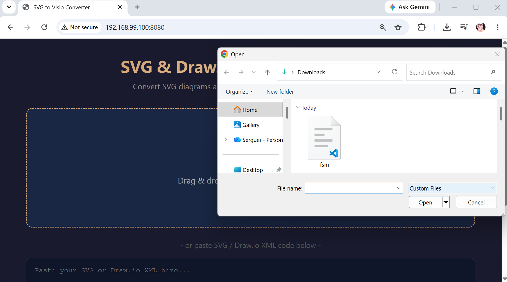
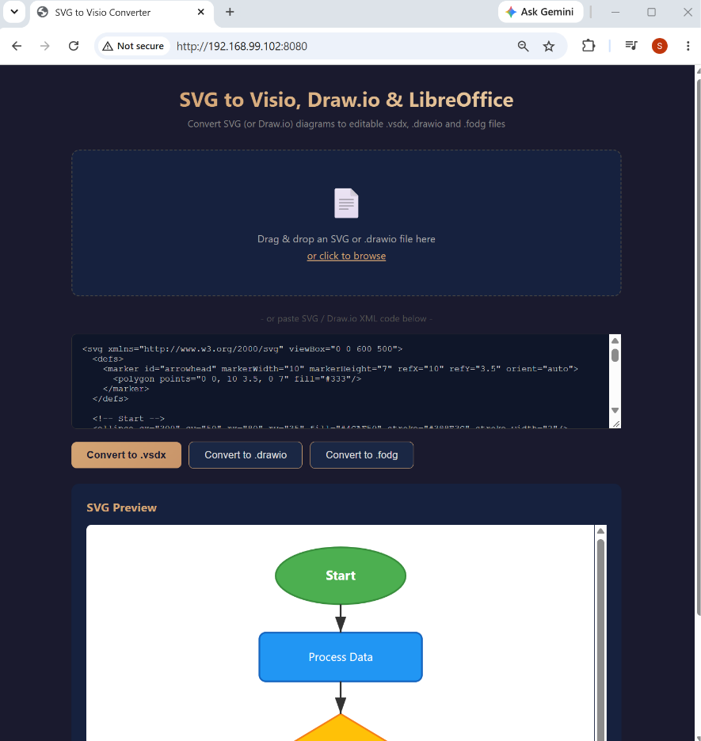
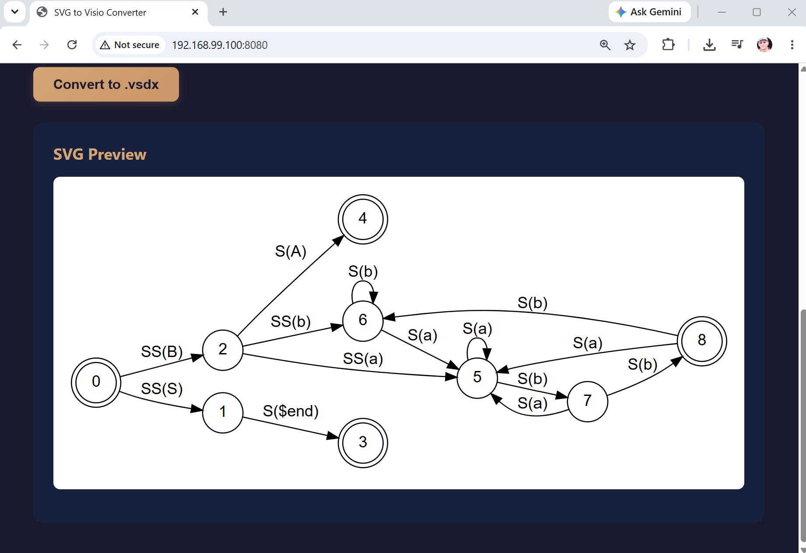
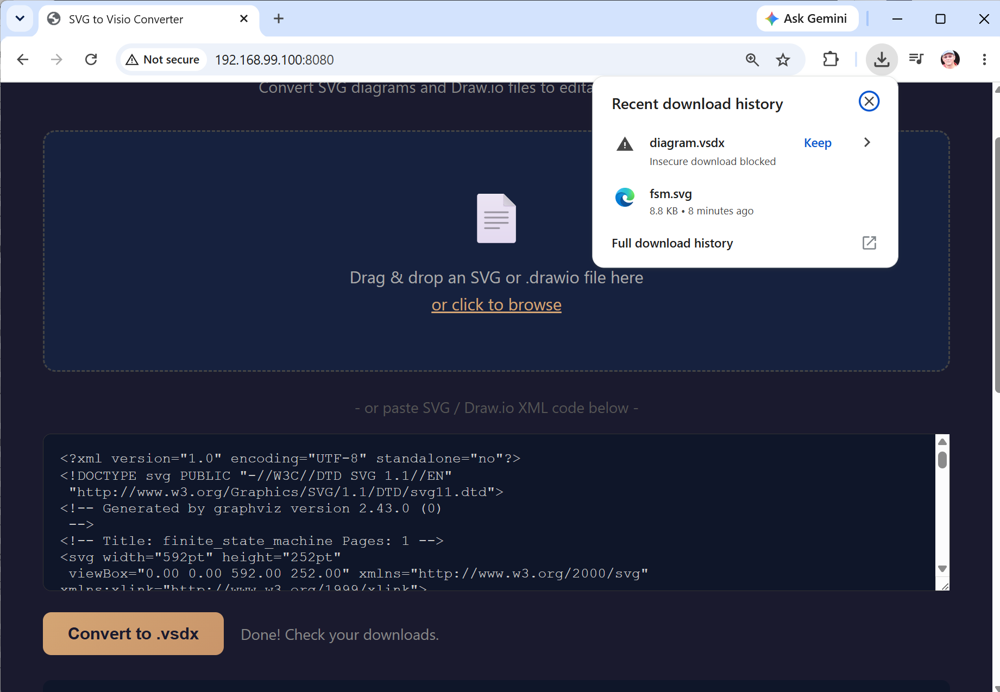
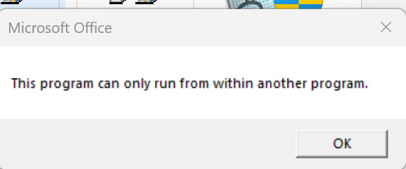
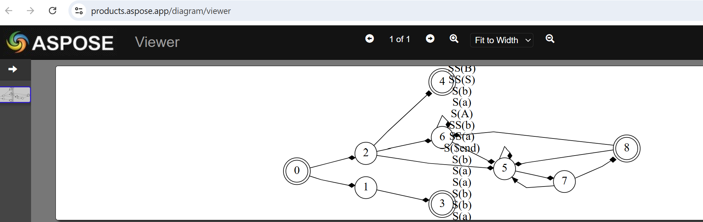

### Info

Replica of [McMarius11/svgtovisio](https://github.com/McMarius11/svgtovisio) the standalone statically browser-hosted __Scalable Vector Graphics__ [SVG](https://en.wikipedia.org/wiki/SVG) and [Draw.io](https://en.wikipedia.org/wiki/Diagrams.net) graph drawing application officially rebranded as [diagrams.net](https://app.diagrams.net) into modern [Visio](https://en.wikipedia.org/wiki/Microsoft_Visio) Converter useful for creating __Visio__ resources _without_ the __Visio__ itself (or the properyly initialized [Microsoft Visio Viewer](https://learn.microsoft.com/en-us/answers/questions/4767940/when-i-start-the-microsoft-ofiice-visio-viwever-th) [Viewer Bootstrap Application](https://github.com/sergueik/springboot_study/tree/master/basic-vpreview))


Unlike Visio and real [Workflow Foundation]() derived tools like [UIPath](https://en.wikipedia.org/wiki/UiPath) or [Blue Prism](https://en.wikipedia.org/wiki/Blue_Prism) and the like the __SVG__ fundamentally does not store relationships between shapes, connectors, and their labels.

### Usage

```sh
docker pull node:22.12.0-alpine
docker pull nginx:1.30.3-alpine3.23
```
```sh
IMAGE=svg2visio
docker build -t $IMAGE -f Dockerfile .
```
```text
Sending build context to Docker daemon  1.871MB
Step 1/15 : FROM node:22.12.0-alpine AS builder
 ---> 3448d7ddbc59
Step 2/15 : WORKDIR /app
 ---> Using cache
 ---> 19b679f74235
Step 3/15 : COPY package*.json /app/
 ---> 5a46abda3e05
Step 4/15 : ARG NPM_REGISTRY
 ---> Running in 2863f20e6c18
Removing intermediate container 2863f20e6c18
 ---> ee0ca52cdb16
Step 5/15 : RUN if [ -n "$NPM_REGISTRY" ]; then npm config set registry "$NPM_REGISTRY"; fi
 ---> Running in 6b874cf585e9
Removing intermediate container 6b874cf585e9
 ---> 49524438420d
Step 6/15 : RUN npm install || { cat /root/.npm/_logs/*.log; exit 1; }
 ---> Running in 2bb5fbff2383
npm warn EBADENGINE Unsupported engine {
npm warn EBADENGINE   package: 'jsdom@29.0.1',
npm warn EBADENGINE   required: { node: '^20.19.0 || ^22.13.0 || >=24.0.0' },
npm warn EBADENGINE   current: { node: 'v22.12.0', npm: '10.9.0' }
npm warn EBADENGINE }
npm warn deprecated eslint@9.39.5: This version is no longer supported. Please see https://eslint.org/version-support for other options.

added 141 packages, and audited 142 packages in 8s

32 packages are looking for funding
  run `npm fund` for details

3 high severity vulnerabilities

To address all issues, run:
  npm audit fix

Run `npm audit` for details.
npm notice
npm notice New major version of npm available! 10.9.0 -> 12.2.2
npm notice Changelog: https://github.com/npm/cli/releases/tag/v12.2.2
npm notice To update run: npm install -g npm@12.2.2
npm notice
Removing intermediate container 2bb5fbff2383
 ---> 523c40613993
Step 7/15 : COPY app.js build.js index.html *-parser.js vsdx-builder.js test.js test-samples/ ./
 ---> bc577621b089
Step 8/15 : RUN node build.js
 ---> Running in 23adf0fba88c
Inlined: jszip.min.js (95.3 KB)
Inlined: pako.min.js (45.8 KB)
WARNING: scene-model.js not found
WARNING: scene-layout.js not found
WARNING: svg-transform.js not found
WARNING: svg-style.js not found
Inlined: svg-parser.js (25.8 KB)
Inlined: drawio-parser.js (15.9 KB)
Inlined: vsdx-builder.js (59.6 KB)
WARNING: drawio-builder.js not found
WARNING: odg-builder.js not found
Inlined: app.js (15.9 KB)

Built: dist/index.html (265.8 KB)
Removing intermediate container 23adf0fba88c
 ---> a17c5f5cc7cd
Step 9/15 : FROM nginx:1.30.3-alpine3.23
 ---> d0701bd41f82
Step 10/15 : WORKDIR /usr/share/nginx/html
 ---> Using cache
 ---> 78841bda93ca
Step 11/15 : COPY --from=builder /app/dist/index.html ./
 ---> 259a00140f64
Step 12/15 : COPY --from=builder /app/*js ./
 ---> a2d0be3d1620
Step 13/15 : RUN  touch .nojekyll
 ---> Running in bc684039ce2d
Removing intermediate container bc684039ce2d
 ---> 38fbf4af22c9
Step 14/15 : EXPOSE 80
 ---> Running in 08a2f40bd547
Removing intermediate container 08a2f40bd547
 ---> 5b12acefaf7a
Step 15/15 : CMD ["nginx", "-g", "daemon off;"]
 ---> Running in 50e912f717d1
Removing intermediate container 50e912f717d1
 ---> c8c972700501
Successfully built c8c972700501
Successfully tagged svg2visio:latest
```
```sh
NAME=svg2visio
docker run --name $NAME -d -p 8080:80 $IMAGE
```


### Background

Convert [SVG](https://en.wikipedia.org/wiki/SVG) diagrams and [Draw.io](https://en.wikipedia.org/wiki/Diagrams.net) files to editable legacy [Visio](https://en.wikipedia.org/wiki/Microsoft_Visio) `.vsdx` files - a well documented [DatadiagramML](https://github.com/slebok/zoo/blob/master/zoo/markup/graphical/datadiagramml/xform/README.txt) [XML schema](https://en.wikipedia.org/wiki/XML_schema) honoring successor of the original Visio's `VSD` proprietary binary-file format that is still the default here and there.

```
NAME=svg2visio
docker run --name $NAME -d -p 8080:80 $IMAGE
```
> Note

 * Download the __Graphviz__ binaries from [Graphviz](https://graphviz.org/download/)

```sh
curl -skLo ~/Downloads/graphviz-installer.exe https://gitlab.com/api/v4/projects/4207231/packages/generic/graphviz-releases/15.1.1/windows_10_cmake_Release_graphviz-install-15.1.1-win64.exe
```
and install it

* Pick any of __Graph Visualization Software__ [Graphviz](https://en.wikipedia.org/wiki/Graphviz) [Gallery](https://graphviz.org/Gallery) examples e.g. [Finite Automaton](https://graphviz.org/Gallery/directed/fsm.html) and convert it to __SVG__ remotely through [PlayGround](https://magjac.com/graphviz-visual-editor) or locally using static [rendering app](https://github.com/sergueik/springboot_study/tree/master/basic-graphviz-plain-viz)

```sh
curl -skLo ~/Downloads/fsm.svg https://graphviz.org/Gallery/directed/fsm.svg
```
* convert to VISIO using the static page form:



the older verson was slightly less flexible:



The app simply downloads the result



Use MS [Free Visio Viewer](https://www.microsoft.com/en-us/microsoft-365/visio/free-visio-viewer)

> CAUTION! Desktop app requires some kind of installation. Consider the risks!
> NOTE:  the default page contains *no* download link. The real download is available on [old page](https://www.microsoft.com/en-us/microsoft-365/blog/2012/11/28/download-the-free-microsoft-visio-viewer) [link](https://www.microsoft.com/en-us/download/details.aspx?id=35811)

```cmd
curl -skLo ~/Downloads/visioviewer64bit.exe https://download.microsoft.com/download/a/6/8/a682a83b-4866-4f88-ae83-61388629a891/visioviewer64bit.exe
```
```text
write-host (get-item -path  "C:\Program Files\Microsoft Office\Office15\VPREVIEW.EXE" | select-object -property * | format-list |out-string)


PSPath            : Microsoft.PowerShell.Core\FileSystem::C:\Program Files\Microsoft Office\Office15\VPREVIEW.EXE
PSParentPath      : Microsoft.PowerShell.Core\FileSystem::C:\Program Files\Microsoft Office\Office15
PSChildName       : VPREVIEW.EXE
PSDrive           : C
PSProvider        : Microsoft.PowerShell.Core\FileSystem
PSIsContainer     : False
Mode              : -a----
VersionInfo       : File:             C:\Program Files\Microsoft Office\Office15\VPREVIEW.EXE
                    InternalName:     VPREVIEW.EXE
                    OriginalFilename: VPREVIEW.EXE
                    FileVersion:      15.0.4420.1017
                    FileDescription:  Microsoft Office Visio Previewer
                    Product:          Microsoft Office 2013
                    ProductVersion:   15.0.4420.1017
                    Debug:            False
                    Patched:          False
                    PreRelease:       False
                    PrivateBuild:     False
                    SpecialBuild:     False
                    Language:         Language Neutral

BaseName          : VPREVIEW
Target            : {}
LinkType          :
Name              : VPREVIEW.EXE
Length            : 694928
DirectoryName     : C:\Program Files\Microsoft Office\Office15
Directory         : C:\Program Files\Microsoft Office\Office15
IsReadOnly        : False
Exists            : True
FullName          : C:\Program Files\Microsoft Office\Office15\VPREVIEW.EXE
Extension         : .EXE
CreationTime      : 10/1/2012 8:35:08 PM
CreationTimeUtc   : 10/2/2012 12:35:08 AM
LastAccessTime    : 8/29/2026 9:53:57 AM
LastAccessTimeUtc : 8/29/2026 1:53:57 PM
LastWriteTime     : 10/1/2012 8:35:08 PM
LastWriteTimeUtc  : 10/2/2012 12:35:08 AM
Attributes        : Archive
```


turns out the `VPREVIEW.EXE` isn't really a conventional standalone viewer application.

The line "You betcha" is featured in the surreal final musical sequence of the 2014 dark comedy The Voices, occurring in an afterlife scene as Jerry reunites with his victims.


It's essentially the executable/component that __Office__ / __IE__ uses to provide __Visio__ *preview*
functionality, and it expects to be invoked exclusively through its Office integration/host mechanism.


blind dump registry
```cmd
reg.exe query HKCR /s | findstr /ic:"Visio Viewer"
```
```text
    (Default)    REG_SZ    Visio Viewer CAD Drawing
    (Default)    REG_SZ    Visio Viewer DWG Display
    (Default)    REG_SZ    Visio Viewer DWG Display Creator
    (Default)    REG_SZ    Visio Viewer CAD Drawing
    ProductName    REG_SZ    Microsoft Visio Viewer 2013
    DiskPrompt    REG_SZ    Microsoft Visio Viewer 2013
    (Default)    REG_SZ    Microsoft Visio Viewer 15.0 Type Library
    (Default)    REG_SZ    Visio Viewer DWG Display
    (Default)    REG_SZ    Visio Viewer DWG Display
    (Default)    REG_SZ    Visio Viewer DWG Display Creator
    (Default)    REG_SZ    Visio Viewer DWG Display Creator
    (Default)    REG_SZ    Visio Viewer CAD Drawing
    (Default)    REG_SZ    Visio Viewer DWG Display
    (Default)    REG_SZ    Visio Viewer DWG Display Creator
    (Default)    REG_SZ    Microsoft Visio Viewer 15.0 Type Library
```
targeted registry peek

```powershell
HKEY_CLASSES_ROOT\Typelib\{BA35B84E-A623-471B-8B09-6D72DD072F25}\1.5
Microsoft Visio Viewer 15.0 Type Library
```
```powershell
$p = 'SOFTWARE\Classes\CLSID\{F8CF7A98-2C45-4c8d-9151-2D716989DDAB}\InprocServer32'
get-itemproperty -path "HKLM:\${p}" -name '(default)'|select-object -expandproperty '(default)'
```
```text
C:\PROGRA~1\MICROS~4\Office15\VVIEWER.DLL
```
```powershell
get-itemproperty -path 'HKLM:\SOFTWARE\Classes\WOW6432Node\CLSID\{F8CF7A98-2C45-4c8d-9151-2D716989DDAB}\InprocServer32' -name '(default)'|select-object -expandproperty '(default)'
```
```text
C:\PROGRA~1\MICROS~4\Office15\VVIEWER.DLL
```

```powershell
$p = 'SOFTWARE\Classes\CLSID\{F8CF7A98-2C45-4c8d-9151-2D716989DDAB}\VersionIndependentProgID'
get-itemproperty -path "HKLM:\${p}" -name '(default)'|select-object -expandproperty '(default)'
```
```text
VisioViewer.Viewer
```

> NOTE: the following will fail
> ```powershell
> $p = 'SOFTWARE\Classes\CLSID\{F8CF7A98-2C45-4c8d-9151-2D716989DDAB}'
> get-itemproperty -path "HKLM:\${p}" -name 'ProgID'|select-object -expandproperty 'ProgID'
> ```
> ```text
> Property ProgID does not exist at path ...
> ```

```powershell
p = 'SOFTWARE\Classes\Typelib\{BA35B84E-A623-471B-8B09-6D72DD072F25}\1.5\0\win32'
get-itemproperty -path "HKLM:\${p}" -name '(default)'|select-object -expandproperty '(default)'
```
```text
C:\PROGRA~1\MICROS~4\Office15\VVIEWER.DLL
```

```powershell
$p = 'SOFTWARE\Classes\CLSID\{21E17C2F-AD3A-4b89-841F-09CFE02D16B7}\LocalServer32'
get-itemproperty -path "HKLM:\${p}" -name '(default)'|select-object -expandproperty '(default)'
```
```text
C:\PROGRA~1\MICROS~4\Office15\VPREVIEW.EXE
```
```powershell
$p = 'SOFTWARE\Microsoft\Internet Explorer\Main\FeatureControl\FEATURE_ADDON_MANAGEMENT'
get-itemproperty -path "HKLM:\${p}" -name 'VPREVIEW.EXE'|select-object -expandproperty 'VPREVIEW.EXE'
```
```text
1
```

```powershell
$p = 'HKEY_LOCAL_MACHINE\SOFTWARE\Microsoft\Internet Explorer\Main\FeatureControl\FEATURE_HTTP_USERNAME_PASSWORD_DISABLE'
$p  = $p -replace 'HKEY_LOCAL_MACHINE\\', ''
get-itemproperty -path "HKLM:\${p}" -name 'VPREVIEW.EXE'|select-object -expandproperty 'VPREVIEW.EXE'
```
```text
1
```

```powershell
$p = 'HKEY_LOCAL_MACHINE\SOFTWARE\Microsoft\Internet Explorer\Main\FeatureControl\FEATURE_LOCALMACHINE_LOCKDOWN'
$p  = $p -replace 'HKEY_LOCAL_MACHINE\\', ''
get-itemproperty -path "HKLM:\${p}" -name 'VPREVIEW.EXE'|select-object -expandproperty 'VPREVIEW.EXE'
```
```text
1
```

```powershell
$p = 'HKEY_LOCAL_MACHINE\SOFTWARE\Microsoft\Internet Explorer\Main\FeatureControl\FEATURE_RESTRICT_ACTIVEXINSTALL'
$p  = $p -replace 'HKEY_LOCAL_MACHINE\\', ''
get-itemproperty -path "HKLM:\${p}" -name 'VPREVIEW.EXE'|select-object -expandproperty 'VPREVIEW.EXE'
```
```text
1
```
...more of the kind found under IE's own small *feature registry*, skipped



> NOTE: aprose is server side

### Cleanup

```sh
IMAGE=svg2visio
NAME=$IMAGE
docker stop $NAME
docker container prune -f
docker image prune -f
docker image rm $IMAGE node:22.12.0-alpine nginx:1.30.3-alpine3.23
```
### NOTE

**QA in the era of agentic development**

As agentic coding makes implementation increasingly cheap, QA value shifts from code-level verification toward **product-level semantic understanding**: architecture awareness, knowledge of the product’s failure history, recognition of business-critical behavior, and the ability to identify risks that are not explicit in the current specification.

This makes QA not less relevant, but potentially **more strategic**: the QA function becomes a source of accumulated product knowledge and an adversarial semantic layer around increasingly autonomous software development.


Agentic development makes implementation increasingly cheap, shifting the value of QA toward the semantic layer: understanding product architecture, reconstructing intent behind requirements and failures, and recognizing risks from accumulated product history.

QA therefore becomes both **an independent adversarial layer and a keeper of product wisdom**—preserving what is learned by digging from a visible symptom through its apparent cause to the actual RCA, and applying that knowledge to future changes.

In this sense, QA plays for software failures a role somewhat analogous to semantic transcription for speech: **not merely recording what happened, but reconstructing what was actually meant or caused.**


Transcribe reconstructs intent behind imperfect speech; QA reconstructs causality behind imperfect software behavior.

A test failure is often just the surface manifestation. The real QA value begins when someone refuses to stop at:

Test failed.”

and keeps asking:

  * Why?
  * Why really?
  * Why did the system allow this?
  * Why didn't we see it earlier?
  * What does this tell us about the product?

That last answer is the thing worth __keeping__.

### See Also


  * [live](https://McMarius11.github.io/svgtovisio)
  * [related reddit discussion](https://www.reddit.com/r/drawio/comments/1r9j05c/free_tool_to_convert_between_visio_and_drawio/)
  * https://dreampuf.github.io/GraphvizOnline/?engine=dot#digraph
  * https://learn.microsoft.com/en-us/dotnet/api/system.windows.forms.axhost.-ctor?view=netframework-4.5#system-windows-forms-axhost-ctor(system-string)
  * __Google Transcribe__  latest speech-to-text model designed for precise and intelligent real-time transcription.
    + [release new feature info](https://habr.com/ru/news/1075046/) (in Russian)
 - the model able to understand not only the words, but also what the person meant to convey
   + [original](https://blog.google/innovation-and-ai/models-and-research/gemini-models/gemini-3-5-transcribe/)
---

### Author
[Serguei Kouzmine](kouzmine_serguei@yahoo.com)
