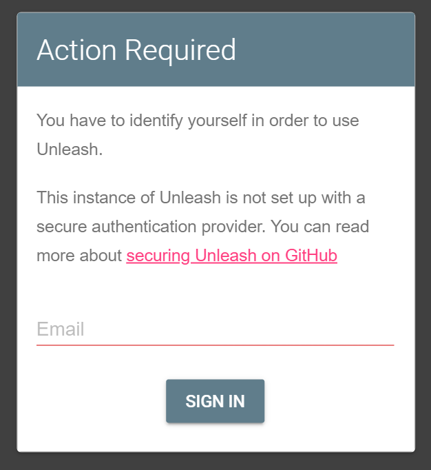
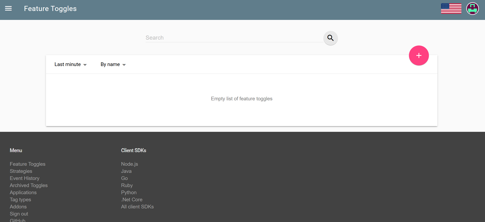
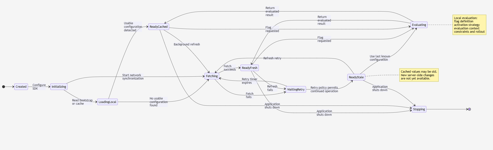
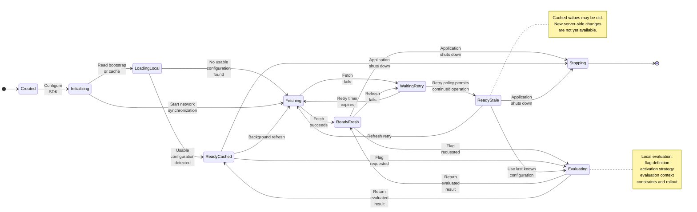
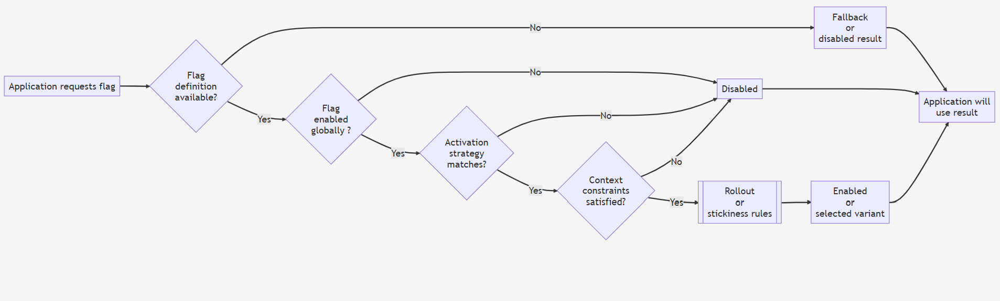
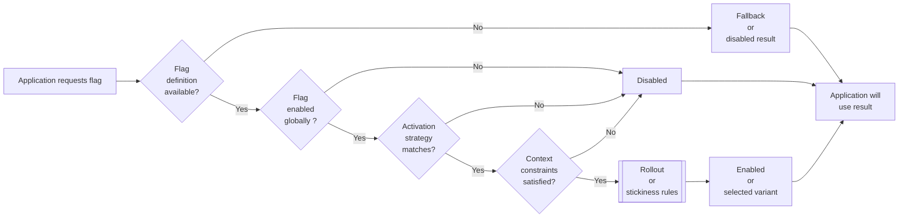

### Info

Replica of  the [demo project](https://github.com/findinpath/unleash-demo)
[Java Spring Boot Feature Flag Unleash Examples](https://docs.getunleash.io/guides/feature-flag-examples-spring-boot) from [Featur Flag Tutorial](https://docs.getunleash.io/guides/implement-feature-flags-in-spring-boot)

### Usage
```sh
docker pull postgres:12.1-alpine
docker pull unleashorg/unleash-server:3.11.0
```
```sh
docker-compose up --build -d
```
```sh
 docker-compose ps
```
```text
NAME                      COMMAND                  SERVICE             STATUS              PORTS
docker-postgres-1         "docker-entrypoint.s…"   postgres            running (healthy)   0.0.0.0:5432->5432/tcp
docker-unleash-server-1   "docker-entrypoint.s…"   unleash-server      running             0.0.0.0:4242->4242/tcp
```
```sh
docker-compose logs unleash-server
```

will be blank if the application stack is healthy

```
docker-machine ip
```
```
192.168.99.100
```
open http://192.168.99.100:4242





on



and create several feature toggles:
|feature toggle| strategy| details |
|--------------|---------|---------|
|`blueHeader`  |default on/off |   |
|`qotd`| `userWithId` |Add `bob` as a user `ID`|
|`specialGreeting` |custom made `deviceClass` |First create `deviceClass` strategy <br>with the parameter `device` of type `list`.<br/> When configuring the strategy for <br/>the `specialGreeting` feature toggle, enter <br/>`Desktop` and `Tablet` values in <br/>the preffered values for the device parameter|

```sh
curl -s http://192.168.99.100:4242/api/client/features | jq
```
```json
{
  "version": 1,
  "features": [
    {
      "name": "blueHeader",
      "type": "experiment",
      "enabled": true,
      "stale": false,
      "strategies": [
        {
          "name": "default",
          "parameters": {}
        }
      ],
      "variants": []
    }
  ]
}
```

> NOTE: after all features added the JSON will look like below:
```JSON
{
  "version": 1,
  "features": [
    {
      "name": "blueHeader",
      "description": "",
      "enabled": true,
      "strategies": [
        {
          "name": "default"
        }
      ],
      "variants": null,
      "createdAt": "2020-09-30T21:20:46.154Z"
    },
    {
      "name": "qotd",
      "description": "Quote of the day",
      "enabled": true,
      "strategies": [
        {
          "name": "userWithId",
          "parameters": {
            "userIds": "bob,john"
          }
        }
      ],
      "variants": null,
      "createdAt": "2020-09-30T21:34:37.612Z"
    },
    {
      "name": "specialGreeting",
      "description": "",
      "enabled": true,
      "strategies": [
        {
          "name": "deviceClass",
          "parameters": {
            "device": "Desktop,Tablet"
          }
        }
      ],
      "variants": null,
      "createdAt": "2020-10-01T20:03:16.114Z"
    }
  ]
}

```
the JSON might look slighly different if the different version of the unleash server is use
* App outside of Docker

update the `unleash.endpoint` from `localhost` to ip address of Docker machine:

```sh
sed -i 's|endpoint: http://localhost|endpoint: http://192.168.99.100|' src/main/resources/application.yml
```
```sh
mvn -Dskiptest clean package
```

```cmd
java -jar target\com.findinpath.findinpath.jar
```
visit the application landing page `http://localhost:8080/index`, login
### Background

[Unleash Documentation](https://docs.getunleash.io/) 


### State Machine - Unleash/Generic Feature Manager Client:
```code
stateDiagram-v2
    direction TB

    [*] --> Created

    Created --> Initializing: Configure SDK
    Initializing --> LoadingLocal: Read bootstrap or cache
    LoadingLocal --> ReadyCached: Usable configuration found
    LoadingLocal --> Fetching: No usable configuration

    Initializing --> Fetching: Start network synchronization
    Fetching --> ReadyFresh: Fetch succeeds
    Fetching --> WaitingRetry: Fetch fails

    ReadyCached --> Fetching: Background refresh
    ReadyFresh --> Evaluating: Flag requested
    ReadyCached --> Evaluating: Flag requested
    Evaluating --> ReadyFresh: Return evaluated result
    Evaluating --> ReadyCached: Return evaluated result

    ReadyFresh --> WaitingRetry: Refresh fails
    WaitingRetry --> ReadyStale: Retry policy permits continued operation
    WaitingRetry --> Fetching: Retry timer expires

    ReadyStale --> Evaluating: Use last known configuration
    ReadyStale --> Fetching: Refresh retry

    ReadyFresh --> Stopping: Application shuts down
    ReadyCached --> Stopping: Application shuts down
    ReadyStale --> Stopping: Application shuts down
    Stopping --> [*]

    note right of Evaluating
      Local evaluation:
      flag definition
      activation strategy
      evaluation context
      constraints and rollout
    end note

    note right of ReadyStale
      Cached values may be old.
      New server-side changes
      are not yet available.
    end note

```




```code

flowchart LR
    A["Application requests flag"] --> B{"Flag<br/>definition<br/>available?"}
    B -- No --> C["Fallback<br/>or <br/>disabled result"]
    B -- Yes --> D{"Flag<br/>enabled<br/>globally ?"}
    D -- No --> E["Disabled"]
    D -- Yes --> F{"Activation<br/>strategy<br/>matches?"}
    F -- No --> E
    F -- Yes --> G{"Context<br/>constraints<br/>satisfied?"}
    G -- No --> E
    G -- Yes --> H[["Rollout <br/>or<br/>stickiness rules"]]
    H --> I["Enabled<br/>or<br/>selected variant"]
    C --> J["Application will<br/>use result"]
    E --> J
    I --> J
```




The definition:

> __Feature Toggles__ _decouple_ deployment of code from release of new features


__Feature Management__ is not strictly a successor to __Blue-Green Deployment__ [BG](https://en.wikipedia.org/wiki/Blue%E2%80%93green_deployment)). It is a *more* granular, complementary control mechanism that can reduce the need to use deployment topology as the only means of controlling feature exposure

#### Archtecutral Requirement

Feature-management decisions must be explainable, traceable, and auditable across the entire path from flag configuration to application behavior.

#### Dashboard Protection

The __Unleash__ / generic  __Future Manager Server__ administration dashboard is not merely a convenient screen for changing a Boolean: 
It is a privileged control plane exposed through a web application. That makes its own identity, authorization, and governance requirements an architectural concern, distinct from the SDK's runtime behavior.

The risk is easy to obscure in executive language. A requirement such as 

> *centralized feature lifecycle management with enterprise-grade security

sounds adequate, but does not explicitly establish who may change a production flag, who may authorize a rollout, or who can alter the targeting rules.

#### Feature Management Control-Plane Security

The feature-management administration interface shall be treated as a privileged production control plane, not merely as an application configuration dashboard.

The solution must provide enterprise-integrated authentication and granular role-based access control (RBAC), with appropriate separation of duties across flag creation, configuration, approval, rollout, and production administration. Authorization must apply to the underlying management APIs as well as the web interface; hiding or disabling UI controls is not an authorization boundary.

The implementation must support auditable attribution of configuration changes, controlled access to production environments, and traceability from a change request through approval and deployment to its resulting application behavior. Administrative access, credentials, and management-plane connectivity must be governed independently of the application SDK's runtime permissions.

The vendor must document the supported authorization model, role granularity, environment isolation, audit capabilities, integration with enterprise identity and privileged-access controls, and any licensing or deployment limitations affecting these capabilities.

The architectural review should therefore examine the actual control plane and its security obligations, rather than accepting the profitability proposition as evidence that the proposed design is complete.


### Troubleshooting

* package and run without fixing the route to unleash server:
```cmd
java -jar  target\example.findinpath.jar

```
```txt
2026-10-12 16:27:09.189  WARN 36208 --- [sh-api-executor] no.finn.unleash.event.UnleashSubscriber  : Could not post to Unleash API

no.finn.unleash.UnleashException: Could not post to Unleash API
        at no.finn.unleash.metric.UnleashMetricsSender.post(UnleashMetricsSender.java:107) ~[unleash-client-java-3.3.1.jar!/:3.3.1]
        at no.finn.unleash.metric.UnleashMetricsSender.registerClient(UnleashMetricsSender.java:63) ~[unleash-client-java-3.3.1.jar!/:3.3.1]
        at no.finn.unleash.metric.UnleashMetricServiceImpl.register(UnleashMetricServiceImpl.java:38) ~[unleash-client-java-3.3.1.jar!/:3.3.1]
        at no.finn.unleash.DefaultUnleash.<init>(DefaultUnleash.java:63) ~[unleash-client-java-3.3.1.jar!/:3.3.1]
        at no.finn.unleash.DefaultUnleash.<init>(DefaultUnleash.java:53) ~[unleash-client-java-3.3.1.jar!/:3.3.1]
        at example.config.UnleashConfiguration.unleash(UnleashConfiguration.java:30) ~[classes!/:0.2.0-SNAPSHOT]
        at example.config.UnleashConfiguration$$EnhancerBySpringCGLIB$$af6bc6b3.CGLIB$unleash$1(<generated>) ~[classes!/:0.2.0-SNAPSHOT]
        at example.config.UnleashConfiguration$$EnhancerBySpringCGLIB$$af6bc6b3$$FastClassBySpringCGLIB$$c0941794.invoke(<generated>) ~[classes!/:0.2.0-SNAPSHOT]
        at org.springframework.cglib.proxy.MethodProxy.invokeSuper(MethodProxy.java:244) ~[spring-core-5.2.9.RELEASE.jar!/:5.2.9.RELEASE]
        at org.springframework.context.annotation.ConfigurationClassEnhancer$BeanMethodInterceptor.intercept(ConfigurationClassEnhancer.java:331) ~[spring-context-5.2.9.RELEASE.jar!/:5.2.9.RELEASE]
        at example.config.UnleashConfiguration$$EnhancerBySpringCGLIB$$af6bc6b3.unleash(<generated>) ~[classes!/:0.2.0-SNAPSHOT]
        at java.base/jdk.internal.reflect.NativeMethodAccessorImpl.invoke0(Native Method) ~[na:na]
        at java.base/jdk.internal.reflect.NativeMethodAccessorImpl.invoke(NativeMethodAccessorImpl.java:62) ~[na:na]
        at java.base/jdk.internal.reflect.DelegatingMethodAccessorImpl.invoke(DelegatingMethodAccessorImpl.java:43) ~[na:na]
        at java.base/java.lang.reflect.Method.invoke(Method.java:566) ~[na:na]
        at org.springframework.beans.factory.support.SimpleInstantiationStrategy.instantiate(SimpleInstantiationStrategy.java:154) ~[spring-beans-5.2.9.RELEASE.jar!/:5.2.9.RELEASE]
        at org.springframework.beans.factory.support.ConstructorResolver.instantiate(ConstructorResolver.java:650) ~[spring-beans-5.2.9.RELEASE.jar!/:5.2.9.RELEASE]
        at org.springframework.beans.factory.support.ConstructorResolver.instantiateUsingFactoryMethod(ConstructorResolver.java:635) ~[spring-beans-5.2.9.RELEASE.jar!/:5.2.9.RELEASE]
        at org.springframework.beans.factory.support.AbstractAutowireCapableBeanFactory.instantiateUsingFactoryMethod(AbstractAutowireCapableBeanFactory.java:1336) ~[spring-beans-5.2.9.RELEASE.jar!/:5.2.9.RELEASE]
        at org.springframework.beans.factory.support.AbstractAutowireCapableBeanFactory.createBeanInstance(AbstractAutowireCapableBeanFactory.java:1176) ~[spring-beans-5.2.9.RELEASE.jar!/:5.2.9.RELEASE]
        at org.springframework.beans.factory.support.AbstractAutowireCapableBeanFactory.doCreateBean(AbstractAutowireCapableBeanFactory.java:556) ~[spring-beans-5.2.9.RELEASE.jar!/:5.2.9.RELEASE]
        at org.springframework.beans.factory.support.AbstractAutowireCapableBeanFactory.createBean(AbstractAutowireCapableBeanFactory.java:516) ~[spring-beans-5.2.9.RELEASE.jar!/:5.2.9.RELEASE]
        at org.springframework.beans.factory.support.AbstractBeanFactory.lambda$doGetBean$0(AbstractBeanFactory.java:324) ~[spring-beans-5.2.9.RELEASE.jar!/:5.2.9.RELEASE]
        at org.springframework.beans.factory.support.DefaultSingletonBeanRegistry.getSingleton(DefaultSingletonBeanRegistry.java:234) ~[spring-beans-5.2.9.RELEASE.jar!/:5.2.9.RELEASE]
        at org.springframework.beans.factory.support.AbstractBeanFactory.doGetBean(AbstractBeanFactory.java:322) ~[spring-beans-5.2.9.RELEASE.jar!/:5.2.9.RELEASE]
        at org.springframework.beans.factory.support.AbstractBeanFactory.getBean(AbstractBeanFactory.java:202) ~[spring-beans-5.2.9.RELEASE.jar!/:5.2.9.RELEASE]
        at org.springframework.beans.factory.config.DependencyDescriptor.resolveCandidate(DependencyDescriptor.java:276) ~[spring-beans-5.2.9.RELEASE.jar!/:5.2.9.RELEASE]
        at org.springframework.beans.factory.support.DefaultListableBeanFactory.doResolveDependency(DefaultListableBeanFactory.java:1307) ~[spring-beans-5.2.9.RELEASE.jar!/:5.2.9.RELEASE]
        at org.springframework.beans.factory.support.DefaultListableBeanFactory.resolveDependency(DefaultListableBeanFactory.java:1227) ~[spring-beans-5.2.9.RELEASE.jar!/:5.2.9.RELEASE]
        at org.springframework.beans.factory.support.ConstructorResolver.resolveAutowiredArgument(ConstructorResolver.java:884) ~[spring-beans-5.2.9.RELEASE.jar!/:5.2.9.RELEASE]
        at org.springframework.beans.factory.support.ConstructorResolver.createArgumentArray(ConstructorResolver.java:788) ~[spring-beans-5.2.9.RELEASE.jar!/:5.2.9.RELEASE]
        at org.springframework.beans.factory.support.ConstructorResolver.autowireConstructor(ConstructorResolver.java:227) ~[spring-beans-5.2.9.RELEASE.jar!/:5.2.9.RELEASE]
        at org.springframework.beans.factory.support.AbstractAutowireCapableBeanFactory.autowireConstructor(AbstractAutowireCapableBeanFactory.java:1356) ~[spring-beans-5.2.9.RELEASE.jar!/:5.2.9.RELEASE]
        at org.springframework.beans.factory.support.AbstractAutowireCapableBeanFactory.createBeanInstance(AbstractAutowireCapableBeanFactory.java:1203) ~[spring-beans-5.2.9.RELEASE.jar!/:5.2.9.RELEASE]
        at org.springframework.beans.factory.support.AbstractAutowireCapableBeanFactory.doCreateBean(AbstractAutowireCapableBeanFactory.java:556) ~[spring-beans-5.2.9.RELEASE.jar!/:5.2.9.RELEASE]
        at org.springframework.beans.factory.support.AbstractAutowireCapableBeanFactory.createBean(AbstractAutowireCapableBeanFactory.java:516) ~[spring-beans-5.2.9.RELEASE.jar!/:5.2.9.RELEASE]
        at org.springframework.beans.factory.support.AbstractBeanFactory.lambda$doGetBean$0(AbstractBeanFactory.java:324) ~[spring-beans-5.2.9.RELEASE.jar!/:5.2.9.RELEASE]
        at org.springframework.beans.factory.support.DefaultSingletonBeanRegistry.getSingleton(DefaultSingletonBeanRegistry.java:234) ~[spring-beans-5.2.9.RELEASE.jar!/:5.2.9.RELEASE]
        at org.springframework.beans.factory.support.AbstractBeanFactory.doGetBean(AbstractBeanFactory.java:322) ~[spring-beans-5.2.9.RELEASE.jar!/:5.2.9.RELEASE]
        at org.springframework.beans.factory.support.AbstractBeanFactory.getBean(AbstractBeanFactory.java:202) ~[spring-beans-5.2.9.RELEASE.jar!/:5.2.9.RELEASE]
        at org.springframework.beans.factory.support.DefaultListableBeanFactory.preInstantiateSingletons(DefaultListableBeanFactory.java:897) ~[spring-beans-5.2.9.RELEASE.jar!/:5.2.9.RELEASE]
        at org.springframework.context.support.AbstractApplicationContext.finishBeanFactoryInitialization(AbstractApplicationContext.java:879) ~[spring-context-5.2.9.RELEASE.jar!/:5.2.9.RELEASE]
        at org.springframework.context.support.AbstractApplicationContext.refresh(AbstractApplicationContext.java:551) ~[spring-context-5.2.9.RELEASE.jar!/:5.2.9.RELEASE]
        at org.springframework.boot.web.servlet.context.ServletWebServerApplicationContext.refresh(ServletWebServerApplicationContext.java:143) ~[spring-boot-2.3.4.RELEASE.jar!/:2.3.4.RELEASE]
        at org.springframework.boot.SpringApplication.refresh(SpringApplication.java:758) ~[spring-boot-2.3.4.RELEASE.jar!/:2.3.4.RELEASE]
        at org.springframework.boot.SpringApplication.refresh(SpringApplication.java:750) ~[spring-boot-2.3.4.RELEASE.jar!/:2.3.4.RELEASE]
        at org.springframework.boot.SpringApplication.refreshContext(SpringApplication.java:397) ~[spring-boot-2.3.4.RELEASE.jar!/:2.3.4.RELEASE]
        at org.springframework.boot.SpringApplication.run(SpringApplication.java:315) ~[spring-boot-2.3.4.RELEASE.jar!/:2.3.4.RELEASE]
        at org.springframework.boot.SpringApplication.run(SpringApplication.java:1237) ~[spring-boot-2.3.4.RELEASE.jar!/:2.3.4.RELEASE]
        at org.springframework.boot.SpringApplication.run(SpringApplication.java:1226) ~[spring-boot-2.3.4.RELEASE.jar!/:2.3.4.RELEASE]
        at example.Application.main(Application.java:10) ~[classes!/:0.2.0-SNAPSHOT]
        at java.base/jdk.internal.reflect.NativeMethodAccessorImpl.invoke0(Native Method) ~[na:na]
        at java.base/jdk.internal.reflect.NativeMethodAccessorImpl.invoke(NativeMethodAccessorImpl.java:62) ~[na:na]
        at java.base/jdk.internal.reflect.DelegatingMethodAccessorImpl.invoke(DelegatingMethodAccessorImpl.java:43) ~[na:na]
        at java.base/java.lang.reflect.Method.invoke(Method.java:566) ~[na:na]
        at org.springframework.boot.loader.MainMethodRunner.run(MainMethodRunner.java:49) ~[example.findinpath.jar:0.2.0-SNAPSHOT]
        at org.springframework.boot.loader.Launcher.launch(Launcher.java:107) ~[example.findinpath.jar:0.2.0-SNAPSHOT]
        at org.springframework.boot.loader.Launcher.launch(Launcher.java:58) ~[example.findinpath.jar:0.2.0-SNAPSHOT]
        at org.springframework.boot.loader.JarLauncher.main(JarLauncher.java:88) ~[example.findinpath.jar:0.2.0-SNAPSHOT]
Caused by: java.net.SocketTimeoutException: connect timed out
        at java.base/java.net.PlainSocketImpl.waitForConnect(Native Method) ~[na:na]
        at java.base/java.net.PlainSocketImpl.socketConnect(PlainSocketImpl.java:107) ~[na:na]
        at java.base/java.net.AbstractPlainSocketImpl.doConnect(AbstractPlainSocketImpl.java:399) ~[na:na]
        at java.base/java.net.AbstractPlainSocketImpl.connectToAddress(AbstractPlainSocketImpl.java:242) ~[na:na]
        at java.base/java.net.AbstractPlainSocketImpl.connect(AbstractPlainSocketImpl.java:224) ~[na:na]
        at java.base/java.net.Socket.connect(Socket.java:609) ~[na:na]
        at java.base/sun.net.NetworkClient.doConnect(NetworkClient.java:177) ~[na:na]
        at java.base/sun.net.www.http.HttpClient.openServer(HttpClient.java:474) ~[na:na]
        at java.base/sun.net.www.http.HttpClient.openServer(HttpClient.java:569) ~[na:na]
        at java.base/sun.net.www.http.HttpClient.<init>(HttpClient.java:242) ~[na:na]
        at java.base/sun.net.www.http.HttpClient.New(HttpClient.java:341) ~[na:na]
        at java.base/sun.net.www.http.HttpClient.New(HttpClient.java:362) ~[na:na]
        at java.base/sun.net.www.protocol.http.HttpURLConnection.getNewHttpClient(HttpURLConnection.java:1253) ~[na:na]
        at java.base/sun.net.www.protocol.http.HttpURLConnection.plainConnect0(HttpURLConnection.java:1187) ~[na:na]
        at java.base/sun.net.www.protocol.http.HttpURLConnection.plainConnect(HttpURLConnection.java:1081) ~[na:na]
        at java.base/sun.net.www.protocol.http.HttpURLConnection.connect(HttpURLConnection.java:1015) ~[na:na]
        at java.base/sun.net.www.protocol.http.HttpURLConnection.getOutputStream0(HttpURLConnection.java:1367) ~[na:na]
        at java.base/sun.net.www.protocol.http.HttpURLConnection.getOutputStream(HttpURLConnection.java:1342) ~[na:na]
        at no.finn.unleash.metric.UnleashMetricsSender.post(UnleashMetricsSender.java:97) ~[unleash-client-java-3.3.1.jar!/:3.3.1]
        ... 58 common frames omitted

2026-10-12 16:27:10.170  WARN 36208 --- [sh-api-executor] no.finn.unleash.event.UnleashSubscriber  : Could not fetch toggles
2026-10-12 16:23:43.962  WARN 26544 --- [sh-api-executor] no.finn.unleash.event.UnleashSubscriber  : Could not post to Unleash API
```

```txt
Caused by: java.net.SocketTimeoutException: connect timed out
```
in general, the success of the curl probe:
```sh
curl -sk http://192.168.99.100:4242/api/ | jq '.'
```
```json
{
  "name": "unleash-server",
  "version": "3.11.0",
  "uri": "/api",
  "links": {
    "admin": {
      "uri": "/api/admin",
      "links": {
        "feature-toggles": {
          "uri": "/api/admin/features"
        },
        "feature-archive": {
          "uri": "/api/admin/archive"
        },
        "strategies": {
          "uri": "/api/admin/strategies"
        },
        "events": {
          "uri": "/api/admin/events"
        },
        "metrics": {
          "uri": "/api/admin/metrics"
        },
        "state": {
          "uri": "/api/admin/state"
        },
        "context": {
          "uri": "/api/admin/context"
        },
        "tags": {
          "uri": "/api/admin/tags"
        },
        "tag-types": {
          "uri": "/api/admin/tag-types"
        }
      }
    },
    "client": {
      "uri": "/api/client",
      "links": {
        "feature-toggles": {
          "uri": "/api/client/features"
        },
        "register": {
          "uri": "/api/client/register"
        },
        "metrics": {
          "uri": "/api/client/metrics"
        }
      }
    }
  }
}
```
### Distorted Perpsective

Exactly — and that changes how I would evaluate the Harness article.

Harness is not writing a neutral history of conditional statements in programming languages. It is a vendor selling software-delivery capabilities, including feature flags and controlled releases. In that context, a title like “A Brief History of Feature Toggles: How the Software Tool Has Evolved” invites readers to understand the history of a product category that Harness itself wants to sell.

The crucial distinction is between the history of a programming technique and the history of the commercial problem that a vendor's product solves.

A conditional statement is not a feature-management platform. A configuration switch is not necessarily a release-control system. And a runtime flag is not automatically a remotely managed, targeted rollout.

The vendor's own industry's history undermines the simplistic timeline
There is a particularly useful contemporary source here: __LaunchDarkly__'s own 2015 retrospective says __Flickr__ was discussing feature flags as an engineering practice in 2009, __Facebook__ was popularizing dark launches in 2009, and __Etsy__ was discussing their use in 2011. __LaunchDarkly__ itself started in 2014 to make this sort of capability available without every company building its own infrastructure.

That gives us a more relevant timeline for the thing Harness actually sells:

| Milestone |What the evidence supports |
|-----------|---------------------------|
|1970s| __Harness__ asserts that feature toggles existed. Its article does not provide a concrete, dated example establishing what the toggle did |
|2009 | Documented industry discussion of feature flags and dark launches at __Flickr__ and __Facebook__|
|2014| __LaunchDarkly__ begins building a commercial service around centrally managed feature flags|
|2010s onward| Feature management becomes a distinct product category encompassing targeted rollout, experimentation and release control|

The qualification is important: these are documented milestones, not proof that nobody implemented similar systems earlier.

My criticism of Harness would therefore be sharper than simply saying its history is wrong. Its article makes an unsubstantiated leap from a broad, old programming concept to a modern software-delivery capability, while presenting that leap as the history of the tool.

A vendor can legitimately explain how an old technique evolved into a product. What it should not do is use the antiquity of the underlying technique to imply that the modern product category has an equally long history.

And there's an irony here: the most revealing history may be the one the article largely skips — why organizations that could already write a Boolean condition in their code eventually started paying vendors to manage those conditions centrally.

That is the commercially relevant story. It concerns deployment frequency, independent release control, targeting, governance, experimentation, and the operational burden of maintaining homegrown infrastructure - not the invention of if.

### Lessons Learned

#### __Windows Vista__ and the __Airbus A380__: *Building for Runways* That Don't Exist

There is a funny similarity between hardware and software, specifically __Windows Vista__ and the __Airbus A380__. Both ran into a similar problem: they were designed around assumptions about an operating environment that the market was not prepared to provide.

The A380 had a limited secondary market and could not operate at every airport without suitable infrastructure. Vista was designed for the PC of the future, but vendors tried to install it on their existing inventory of aging, underpowered machines.

The irony goes deeper, though. In both cases, the critical flaw was hiding in a part of the problem that the designers apparently had not even included in their task list.

Airbus engineers do not build airport runways. They can design an aircraft around particular runway and airport requirements, but they cannot assume that airports will rebuild their infrastructure to accommodate it.

Likewise, the Windows Vista team did not manufacture PCs. Someone needed to visit an actual computer shop and see what was on the shelves before designing an operating system around the capabilities of the next generation of hardware. The reality was an inventory of machines with limited memory, weak graphics capabilities, and drivers that were not ready for the new platform.

In both cases, a seemingly mundane observation from outside the design team could have been a showstopper: a finding serious enough to halt the project, force a fundamental redesign, or at least change the deployment strategy.

The missing questions were deceptively simple:

- **Airbus:** Who is going to build the runways and upgrade the airports needed to operate this aircraft?
- **Microsoft:** What hardware are PC vendors actually shipping to customers who will be expected to run this operating system?

Neither question was fundamentally about engineering the product itself. Both were about the ecosystem required to make the product viable.

The A380 was not going to build its own runways. Vista was not going to magically upgrade the computers on which vendors installed it.

And that is the broader lesson: a technically ambitious product can be undermined by a dependency that its designers treat as somebody else's problem.

Sometimes the most important engineering requirement is the one nobody put on the requirements list.

#### Sligthly Different varianat

## Windows Vista and the Airbus A380: Building for Runways That Don't Exist

There is a funny similarity between hardware and software, specifically Windows Vista and the Airbus A380. Both ran into a similar problem: they were designed around assumptions about an operating environment that the market was not prepared to provide.

The A380 had a limited secondary market and could not operate at every airport without suitable infrastructure. Vista was designed for the PC of the future, but vendors tried to install it on their existing inventory of aging, underpowered machines.

The irony goes deeper, though. In both cases, the critical flaw was hiding in a part of the problem that the designers apparently had not even included in their task list.

Airbus engineers do not build airport runways. They can design an aircraft around particular runway and airport requirements, but they cannot assume that airports will rebuild their infrastructure to accommodate it.

Likewise, the Windows Vista team did not manufacture PCs. Someone needed to visit an actual computer shop and see what was on the shelves before designing an operating system around the capabilities of the next generation of hardware. The reality was an inventory of machines with limited memory, weak graphics capabilities, and drivers that were not ready for the new platform.

In both cases, a seemingly mundane observation from outside the design team could have been a showstopper: a finding serious enough to halt the project, force a fundamental redesign, or at least change the deployment strategy.

The missing questions were deceptively simple:

- **Airbus:** Who is going to build the runways and upgrade the airports needed to operate this aircraft?
- **Microsoft:** What hardware are PC vendors actually shipping to customers who will be expected to run this operating system?

Neither question was fundamentally about engineering the product itself. Both were about the ecosystem required to make the product viable.

The A380 was not going to build its own runways. Vista was not going to magically upgrade the computers on which vendors installed it.

And there is one final similarity worth noting: both were enormous undertakings, involving extraordinary engineering effort and vast investments. Their respective makers had every reason to remember the experience as a lesson in what happens when a product's ambitions outrun the ecosystem that must support it.

One can almost imagine both organizations signing the same pledge in fresh blood: **never again will we build something this enormous without first checking whether the world around it is ready.**

Sometimes the most important engineering requirement is the one nobody put on the requirements list. And sometimes the most expensive lesson is the one an organization promises itself it will never have to learn twice.

### See Also
  * [Feature Flags with Spring](https://www.baeldung.com/spring-feature-flags)
  * [implement FF with Unleash](https://www.baeldung.com/java-unleash-feature-flags)

  * [guide to configure feature toggling with FF4J on a Springboot Project](https://github.com/jeandlv/ff4j-feature-toggling)

  * https://learn.microsoft.com/en-us/azure/azure-app-configuration/feature-management-overview
  * [FM Fundamentals](https://learn.microsoft.com/en-us/azure/azure-app-configuration/concept-feature-management)
    + [switch](https://learn.microsoft.com/en-us/azure/azure-app-configuration/concept-feature-management#switch-onoff)
    + [rollout](https://learn.microsoft.com/en-us/azure/azure-app-configuration/concept-feature-management#rollout)
    + [experiment](https://learn.microsoft.com/en-us/azure/azure-app-configuration/concept-feature-management#experiment)

  *  apparently a false answer: [the evolution of feature toggles in software development](https://www.harness.io/blog/a-brief-history-of-feature-toggles-how-the-software-tool-has-evolved)

---
### Author
[Serguei Kouzmine](kouzmine_serguei@yahoo.com)

