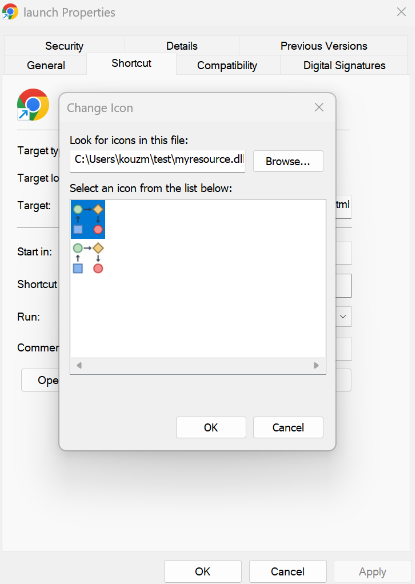

#### Using MinGW / GCC (Easiest & Completely Free)

If you use MinGW-w64, you can build the DLL using windres (the GNU Windows resource compiler) and ld (the GNU linker).

Create your resource script: Save a file named `myresource.rc` containing your `assets.rc`
```rc
// Example: Embedding an icon and a string table
101 ICON "app_icon.ico"

STRINGTABLE
BEGIN
    1 "Welcome to the application!"
    2 "An error has occurred."
END
```

Compile the resource script into a COFF object
```
windres -i myresource.rc -o myresource.o
```

Link it into a resource-only DLL
```
ld --dll -o myresource.dll myresource.o
```
> NOTE: the unfortunate `ICON` statement in a Windows Resource (`.rc`) file is *native*, and the value source  file *must* be in the standard `.ico` binary format.
> Failure to take this into account e.g. using  another format like `.png`, `.bmp`, or `.jpg` in right hand side in the `ICON` statement,
> leads to the Windows Resource Compiler (`rc.exe`) compilation error, such as:
> ```
> RC2175: icon file is not in 3.00 format.
> ```
> This happens because the compiler explicitly expects an `icon directory` header followed by individual `icon image`
> components to split them into `RT_ICON` structures.
> In other words *it happens*.

The alternarive solution is to convert subject image to Windows Bitmap format (.bmp),
and use the BITMAP statement:
```rc
IDB_MY_BITMAP BITMAP "assets/image.bmp"
```

### Usage

```sh
docker build -f Dockerfile  -t test .
```

```text
Sending build context to Docker daemon  6.144kB
Step 1/4 : FROM ubuntu:18.04
18.04: Pulling from library/ubuntu
7c457f213c76: Pull complete
Digest: sha256:152dc042452c496007f07ca9127571cb9c29697f42acbfad72324b2bb2e43c98
Status: Downloaded newer image for ubuntu:18.04
 ---> f9a80a55f492
Step 2/4 : RUN apt-get update &&     apt-get install -y mingw-w64 make &&     rm -rf /var/lib/apt/lists/*
 ---> Running in 6ff29fb809e2
Get:1 http://security.ubuntu.com/ubuntu bionic-security InRelease [102 kB]
Get:2 http://archive.ubuntu.com/ubuntu bionic InRelease [242 kB]
Get:3 http://security.ubuntu.com/ubuntu bionic-security/restricted amd64 Packages [1658 kB]
Get:4 http://archive.ubuntu.com/ubuntu bionic-updates InRelease [102 kB]
Get:5 http://security.ubuntu.com/ubuntu bionic-security/multiverse amd64 Packages [23.5 kB]
Get:6 http://security.ubuntu.com/ubuntu bionic-security/universe amd64 Packages [1622 kB]
Get:7 http://archive.ubuntu.com/ubuntu bionic-backports InRelease [102 kB]
Get:8 http://security.ubuntu.com/ubuntu bionic-security/main amd64 Packages [3328 kB]
Get:9 http://archive.ubuntu.com/ubuntu bionic/main amd64 Packages [1344 kB]
Get:10 http://archive.ubuntu.com/ubuntu bionic/multiverse amd64 Packages [186 kB]
Get:11 http://archive.ubuntu.com/ubuntu bionic/restricted amd64 Packages [13.5 kB]
Get:12 http://archive.ubuntu.com/ubuntu bionic/universe amd64 Packages [11.3 MB]
Get:13 http://archive.ubuntu.com/ubuntu bionic-updates/universe amd64 Packages [2389 kB]
Get:14 http://archive.ubuntu.com/ubuntu bionic-updates/main amd64 Packages [3735 kB]
Get:15 http://archive.ubuntu.com/ubuntu bionic-updates/restricted amd64 Packages [1697 kB]
Get:16 http://archive.ubuntu.com/ubuntu bionic-updates/multiverse amd64 Packages [30.5 kB]
Get:17 http://archive.ubuntu.com/ubuntu bionic-backports/universe amd64 Packages [20.5 kB]
Get:18 http://archive.ubuntu.com/ubuntu bionic-backports/main amd64 Packages [63.4 kB]
Fetched 28.0 MB in 9s (3170 kB/s)
Reading package lists...
Reading package lists...
Building dependency tree...
Reading state information...
The following additional packages will be installed:
  binutils-common binutils-mingw-w64-i686 binutils-mingw-w64-x86-64
  g++-mingw-w64 g++-mingw-w64-i686 g++-mingw-w64-x86-64 gcc-mingw-w64
  gcc-mingw-w64-base gcc-mingw-w64-i686 gcc-mingw-w64-x86-64 libisl19 libmpc3
  libmpfr6 mingw-w64-common mingw-w64-i686-dev mingw-w64-x86-64-dev
Suggested packages:
  gcc-7-locales make-doc wine wine64
The following NEW packages will be installed:
  binutils-common binutils-mingw-w64-i686 binutils-mingw-w64-x86-64
  g++-mingw-w64 g++-mingw-w64-i686 g++-mingw-w64-x86-64 gcc-mingw-w64
  gcc-mingw-w64-base gcc-mingw-w64-i686 gcc-mingw-w64-x86-64 libisl19 libmpc3
  libmpfr6 make mingw-w64 mingw-w64-common mingw-w64-i686-dev
  mingw-w64-x86-64-dev
0 upgraded, 18 newly installed, 0 to remove and 1 not upgraded.
Need to get 129 MB of archives.
After this operation, 747 MB of additional disk space will be used.
Get:1 http://archive.ubuntu.com/ubuntu bionic-updates/main amd64 binutils-common amd64 2.30-21ubuntu1~18.04.9 [197 kB]
Get:2 http://archive.ubuntu.com/ubuntu bionic/main amd64 libisl19 amd64 0.19-1 [551 kB]
Get:3 http://archive.ubuntu.com/ubuntu bionic/main amd64 libmpfr6 amd64 4.0.1-1 [243 kB]
Get:4 http://archive.ubuntu.com/ubuntu bionic/main amd64 make amd64 4.1-9.1ubuntu1 [154 kB]
Get:5 http://archive.ubuntu.com/ubuntu bionic/universe amd64 binutils-mingw-w64-i686 amd64 2.30-7ubuntu1+8ubuntu1 [2324 kB]
Get:6 http://archive.ubuntu.com/ubuntu bionic/universe amd64 binutils-mingw-w64-x86-64 amd64 2.30-7ubuntu1+8ubuntu1 [2677 kB]
Get:7 http://archive.ubuntu.com/ubuntu bionic/universe amd64 mingw-w64-common all 5.0.3-1 [4756 kB]
Get:8 http://archive.ubuntu.com/ubuntu bionic/universe amd64 mingw-w64-i686-dev all 5.0.3-1 [2212 kB]
Get:9 http://archive.ubuntu.com/ubuntu bionic/universe amd64 gcc-mingw-w64-base amd64 7.3.0-11ubuntu1+20.2build1 [172 kB]
Get:10 http://archive.ubuntu.com/ubuntu bionic/main amd64 libmpc3 amd64 1.1.0-1 [40.8 kB]
Get:11 http://archive.ubuntu.com/ubuntu bionic/universe amd64 gcc-mingw-w64-i686 amd64 7.3.0-11ubuntu1+20.2build1 [33.2 MB]
Get:12 http://archive.ubuntu.com/ubuntu bionic/universe amd64 g++-mingw-w64-i686 amd64 7.3.0-11ubuntu1+20.2build1 [22.1 MB]
Get:13 http://archive.ubuntu.com/ubuntu bionic/universe amd64 mingw-w64-x86-64-dev all 5.0.3-1 [3333 kB]
Get:14 http://archive.ubuntu.com/ubuntu bionic/universe amd64 gcc-mingw-w64-x86-64 amd64 7.3.0-11ubuntu1+20.2build1 [33.3 MB]
Get:15 http://archive.ubuntu.com/ubuntu bionic/universe amd64 g++-mingw-w64-x86-64 amd64 7.3.0-11ubuntu1+20.2build1 [23.0 MB]
Get:16 http://archive.ubuntu.com/ubuntu bionic/universe amd64 g++-mingw-w64 all 7.3.0-11ubuntu1+20.2build1 [172 kB]
Get:17 http://archive.ubuntu.com/ubuntu bionic/universe amd64 gcc-mingw-w64 all 7.3.0-11ubuntu1+20.2build1 [172 kB]
Get:18 http://archive.ubuntu.com/ubuntu bionic/universe amd64 mingw-w64 all 5.0.3-1 [9076 B]
debconf: delaying package configuration, since apt-utils is not installed
Fetched 129 MB in 7s (18.8 MB/s)
Selecting previously unselected package binutils-common:amd64.
(Reading database ... 4050 files and directories currently installed.)
Preparing to unpack .../00-binutils-common_2.30-21ubuntu1~18.04.9_amd64.deb ...
Unpacking binutils-common:amd64 (2.30-21ubuntu1~18.04.9) ...
Selecting previously unselected package libisl19:amd64.
Preparing to unpack .../01-libisl19_0.19-1_amd64.deb ...
Unpacking libisl19:amd64 (0.19-1) ...
Selecting previously unselected package libmpfr6:amd64.
Preparing to unpack .../02-libmpfr6_4.0.1-1_amd64.deb ...
Unpacking libmpfr6:amd64 (4.0.1-1) ...
Selecting previously unselected package make.
Preparing to unpack .../03-make_4.1-9.1ubuntu1_amd64.deb ...
Unpacking make (4.1-9.1ubuntu1) ...
Selecting previously unselected package binutils-mingw-w64-i686.
Preparing to unpack .../04-binutils-mingw-w64-i686_2.30-7ubuntu1+8ubuntu1_amd64.deb ...
Unpacking binutils-mingw-w64-i686 (2.30-7ubuntu1+8ubuntu1) ...
Selecting previously unselected package binutils-mingw-w64-x86-64.
Preparing to unpack .../05-binutils-mingw-w64-x86-64_2.30-7ubuntu1+8ubuntu1_amd64.deb ...
Unpacking binutils-mingw-w64-x86-64 (2.30-7ubuntu1+8ubuntu1) ...
Selecting previously unselected package mingw-w64-common.
Preparing to unpack .../06-mingw-w64-common_5.0.3-1_all.deb ...
Unpacking mingw-w64-common (5.0.3-1) ...
Selecting previously unselected package mingw-w64-i686-dev.
Preparing to unpack .../07-mingw-w64-i686-dev_5.0.3-1_all.deb ...
Unpacking mingw-w64-i686-dev (5.0.3-1) ...
Selecting previously unselected package gcc-mingw-w64-base.
Preparing to unpack .../08-gcc-mingw-w64-base_7.3.0-11ubuntu1+20.2build1_amd64.deb ...
Unpacking gcc-mingw-w64-base (7.3.0-11ubuntu1+20.2build1) ...
Selecting previously unselected package libmpc3:amd64.
Preparing to unpack .../09-libmpc3_1.1.0-1_amd64.deb ...
Unpacking libmpc3:amd64 (1.1.0-1) ...
Selecting previously unselected package gcc-mingw-w64-i686.
Preparing to unpack .../10-gcc-mingw-w64-i686_7.3.0-11ubuntu1+20.2build1_amd64.deb ...
Unpacking gcc-mingw-w64-i686 (7.3.0-11ubuntu1+20.2build1) ...
Selecting previously unselected package g++-mingw-w64-i686.
Preparing to unpack .../11-g++-mingw-w64-i686_7.3.0-11ubuntu1+20.2build1_amd64.deb ...
Unpacking g++-mingw-w64-i686 (7.3.0-11ubuntu1+20.2build1) ...
Selecting previously unselected package mingw-w64-x86-64-dev.
Preparing to unpack .../12-mingw-w64-x86-64-dev_5.0.3-1_all.deb ...
Unpacking mingw-w64-x86-64-dev (5.0.3-1) ...
Selecting previously unselected package gcc-mingw-w64-x86-64.
Preparing to unpack .../13-gcc-mingw-w64-x86-64_7.3.0-11ubuntu1+20.2build1_amd64.deb ...
Unpacking gcc-mingw-w64-x86-64 (7.3.0-11ubuntu1+20.2build1) ...
Selecting previously unselected package g++-mingw-w64-x86-64.
Preparing to unpack .../14-g++-mingw-w64-x86-64_7.3.0-11ubuntu1+20.2build1_amd64.deb ...
Unpacking g++-mingw-w64-x86-64 (7.3.0-11ubuntu1+20.2build1) ...
Selecting previously unselected package g++-mingw-w64.
Preparing to unpack .../15-g++-mingw-w64_7.3.0-11ubuntu1+20.2build1_all.deb ...
Unpacking g++-mingw-w64 (7.3.0-11ubuntu1+20.2build1) ...
Selecting previously unselected package gcc-mingw-w64.
Preparing to unpack .../16-gcc-mingw-w64_7.3.0-11ubuntu1+20.2build1_all.deb ...
Unpacking gcc-mingw-w64 (7.3.0-11ubuntu1+20.2build1) ...
Selecting previously unselected package mingw-w64.
Preparing to unpack .../17-mingw-w64_5.0.3-1_all.deb ...
Unpacking mingw-w64 (5.0.3-1) ...
Setting up make (4.1-9.1ubuntu1) ...
Setting up libmpfr6:amd64 (4.0.1-1) ...
Setting up gcc-mingw-w64-base (7.3.0-11ubuntu1+20.2build1) ...
Setting up binutils-common:amd64 (2.30-21ubuntu1~18.04.9) ...
Setting up libmpc3:amd64 (1.1.0-1) ...
Setting up mingw-w64-common (5.0.3-1) ...
Setting up mingw-w64-i686-dev (5.0.3-1) ...
Setting up libisl19:amd64 (0.19-1) ...
Setting up binutils-mingw-w64-x86-64 (2.30-7ubuntu1+8ubuntu1) ...
Setting up binutils-mingw-w64-i686 (2.30-7ubuntu1+8ubuntu1) ...
Setting up gcc-mingw-w64-i686 (7.3.0-11ubuntu1+20.2build1) ...
update-alternatives: using /usr/bin/i686-w64-mingw32-gcc-posix to provide /usr/bin/i686-w64-mingw32-gcc (i686-w64-mingw32-gcc) in auto mode
update-alternatives: warning: skip creation of /usr/bin/i686-w64-mingw32-gcc-7 because associated file /usr/bin/i686-w64-mingw32-gcc-7.2-posix (of link group i686-w64-mingw32-gcc) doesn't exist
update-alternatives: using /usr/bin/i686-w64-mingw32-gcc-win32 to provide /usr/bin/i686-w64-mingw32-gcc (i686-w64-mingw32-gcc) in auto mode
update-alternatives: warning: skip creation of /usr/bin/i686-w64-mingw32-gcc-7 because associated file /usr/bin/i686-w64-mingw32-gcc-7.2-win32 (of link group i686-w64-mingw32-gcc) doesn't exist
Setting up mingw-w64-x86-64-dev (5.0.3-1) ...
Setting up g++-mingw-w64-i686 (7.3.0-11ubuntu1+20.2build1) ...
update-alternatives: using /usr/bin/i686-w64-mingw32-g++-posix to provide /usr/bin/i686-w64-mingw32-g++ (i686-w64-mingw32-g++) in auto mode
update-alternatives: using /usr/bin/i686-w64-mingw32-g++-win32 to provide /usr/bin/i686-w64-mingw32-g++ (i686-w64-mingw32-g++) in auto mode
Setting up gcc-mingw-w64-x86-64 (7.3.0-11ubuntu1+20.2build1) ...
update-alternatives: using /usr/bin/x86_64-w64-mingw32-gcc-posix to provide /usr/bin/x86_64-w64-mingw32-gcc (x86_64-w64-mingw32-gcc) in auto mode
update-alternatives: warning: skip creation of /usr/bin/x86_64-w64-mingw32-gcc-7 because associated file /usr/bin/x86_64-w64-mingw32-gcc-7.2-posix (of link group x86_64-w64-mingw32-gcc) doesn't exist
update-alternatives: using /usr/bin/x86_64-w64-mingw32-gcc-win32 to provide /usr/bin/x86_64-w64-mingw32-gcc (x86_64-w64-mingw32-gcc) in auto mode
update-alternatives: warning: skip creation of /usr/bin/x86_64-w64-mingw32-gcc-7 because associated file /usr/bin/x86_64-w64-mingw32-gcc-7.2-win32 (of link group x86_64-w64-mingw32-gcc) doesn't exist
Setting up gcc-mingw-w64 (7.3.0-11ubuntu1+20.2build1) ...
Setting up g++-mingw-w64-x86-64 (7.3.0-11ubuntu1+20.2build1) ...
update-alternatives: using /usr/bin/x86_64-w64-mingw32-g++-posix to provide /usr/bin/x86_64-w64-mingw32-g++ (x86_64-w64-mingw32-g++) in auto mode
update-alternatives: using /usr/bin/x86_64-w64-mingw32-g++-win32 to provide /usr/bin/x86_64-w64-mingw32-g++ (x86_64-w64-mingw32-g++) in auto mode
Setting up g++-mingw-w64 (7.3.0-11ubuntu1+20.2build1) ...
Setting up mingw-w64 (5.0.3-1) ...
Processing triggers for libc-bin (2.27-3ubuntu1.6) ...
Removing intermediate container 6ff29fb809e2
 ---> 4bacf6661781
Step 3/4 : RUN x86_64-w64-mingw32-windres --version
 ---> Running in 6553ffd4f881
GNU windres (GNU Binutils) 2.30
Copyright (C) 2018 Free Software Foundation, Inc.
This program is free software; you may redistribute it under the terms of
the GNU General Public License version 3 or (at your option) any later version.
This program has absolutely no warranty.
Removing intermediate container 6553ffd4f881
 ---> 29987975ab55
Step 4/4 : WORKDIR /app
 ---> Running in c318644b6ab1
Removing intermediate container c318644b6ab1
 ---> af985ff45d94
Successfully built af985ff45d94
Successfully tagged test:latest
```
```
Step 1/4 : FROM alpine:3.15
 ---> 32b91e3161c8
Step 2/4 : RUN apk update     && apk add --update --no-cache mingw-w64-gcc make imagemagick     && rm -rf /var/cache/*     && mkdir /var/cache/apk
 ---> Running in c893701188ef
fetch https://dl-cdn.alpinelinux.org/alpine/v3.15/main/x86_64/APKINDEX.tar.gz
fetch https://dl-cdn.alpinelinux.org/alpine/v3.15/community/x86_64/APKINDEX.tar.gz
v3.15.11-31-g2a2ec278a7b [https://dl-cdn.alpinelinux.org/alpine/v3.15/main]
v3.15.11-31-g2a2ec278a7b [https://dl-cdn.alpinelinux.org/alpine/v3.15/community]
OK: 15857 distinct packages available
fetch https://dl-cdn.alpinelinux.org/alpine/v3.15/main/x86_64/APKINDEX.tar.gz
fetch https://dl-cdn.alpinelinux.org/alpine/v3.15/community/x86_64/APKINDEX.tar.gz
(1/68) Installing libxau (1.0.9-r0)
(2/68) Installing libmd (1.0.3-r0)
(3/68) Installing libbsd (0.11.3-r1)
(4/68) Installing libxdmcp (1.1.3-r0)
(5/68) Installing libxcb (1.14-r2)
(6/68) Installing libx11 (1.7.3.1-r1)
(7/68) Installing libxext (1.3.4-r0)
(8/68) Installing libbz2 (1.0.8-r1)
(9/68) Installing expat (2.5.0-r0)
(10/68) Installing brotli-libs (1.0.9-r5)
(11/68) Installing libpng (1.6.37-r1)
(12/68) Installing freetype (2.11.1-r2)
(13/68) Installing libuuid (2.37.4-r0)
(14/68) Installing fontconfig (2.13.1-r4)
(15/68) Installing lcms2 (2.12-r1)
(16/68) Installing libltdl (2.4.6-r7)
(17/68) Installing xz-libs (5.2.5-r1)
(18/68) Installing libxml2 (2.9.14-r2)
(19/68) Installing imagemagick-libs (7.1.0.16-r0)
(20/68) Installing libxrender (0.9.10-r3)
(21/68) Installing pixman (0.40.0-r4)
(22/68) Installing cairo (1.16.0-r5)
(23/68) Installing libffi (3.4.2-r1)
(24/68) Installing libintl (0.21-r0)
(25/68) Installing libblkid (2.37.4-r0)
(26/68) Installing libmount (2.37.4-r0)
(27/68) Installing pcre (8.45-r1)
(28/68) Installing glib (2.70.5-r0)
(29/68) Installing dbus-libs (1.12.26-r0)
(30/68) Installing avahi-libs (0.8-r5)
(31/68) Installing gmp (6.2.1-r1)
(32/68) Installing nettle (3.7.3-r0)
(33/68) Installing p11-kit (0.24.0-r1)
(34/68) Installing libtasn1 (4.18.0-r1)
(35/68) Installing libunistring (0.9.10-r1)
(36/68) Installing gnutls (3.7.1-r2)
(37/68) Installing cups-libs (2.3.3-r8)
(38/68) Installing libgcc (10.3.1_git20211027-r0)
(39/68) Installing jbig2dec (0.19-r0)
(40/68) Installing libjpeg-turbo (2.1.2-r0)
(41/68) Installing libstdc++ (10.3.1_git20211027-r0)
(42/68) Installing libwebp (1.2.2-r2)
(43/68) Installing zstd-libs (1.5.0-r0)
(44/68) Installing tiff (4.4.0-r4)
(45/68) Installing ghostscript (9.55.0-r2)
(46/68) Installing aom-libs (3.2.0-r0)
(47/68) Installing libde265 (1.0.12-r0)
(48/68) Installing x265-libs (3.5-r0)
(49/68) Installing libheif (1.12.0-r2)
(50/68) Installing cairo-gobject (1.16.0-r5)
(51/68) Installing pkgconf (1.8.1-r0)
(52/68) Installing shared-mime-info (2.1-r2)
(53/68) Installing gdk-pixbuf (2.42.8-r0)
(54/68) Installing libxft (2.3.4-r0)
(55/68) Installing fribidi (1.0.11-r0)
(56/68) Installing graphite2 (1.3.14-r0)
(57/68) Installing harfbuzz (3.0.0-r2)
(58/68) Installing pango (1.48.10-r0)
(59/68) Installing librsvg (2.50.7-r1)
(60/68) Installing imagemagick (7.1.0.16-r0)
(61/68) Installing make (4.3-r0)
(62/68) Installing mingw-w64-binutils (2.37-r1)
(63/68) Installing mingw-w64-winpthreads (9.0.0-r0)
(64/68) Installing mingw-w64-headers (9.0.0-r0)
(65/68) Installing mingw-w64-crt (9.0.0-r0)
(66/68) Installing mpfr4 (4.1.0-r0)
(67/68) Installing mpc1 (1.2.1-r0)
(68/68) Installing mingw-w64-gcc (11.2.0-r0)
Executing busybox-1.34.1-r7.trigger
Executing fontconfig-2.13.1-r4.trigger
Executing shared-mime-info-2.1-r2.trigger
Executing gdk-pixbuf-2.42.8-r0.trigger
OK: 469 MiB in 82 packages
Removing intermediate container c893701188ef
 ---> 949cff2ce7a8
Step 3/4 : RUN x86_64-w64-mingw32-windres --version
 ---> Running in 7395f6f0b4cf
GNU windres (GNU Binutils) 2.37
Copyright (C) 2021 Free Software Foundation, Inc.
This program is free software; you may redistribute it under the terms of
the GNU General Public License version 3 or (at your option) any later version.
This program has absolutely no warranty.
Removing intermediate container 7395f6f0b4cf
 ---> c6256e257dc9
Step 4/4 : WORKDIR /app
 ---> Running in 05652fd0a580
Removing intermediate container 05652fd0a580
 ---> c0166fdaa80e
Successfully built c0166fdaa80e
Successfully tagged test2:latest
```
```text
REPOSITORY                                                             TAG                 IMAGE ID            CREATED             SIZE
test                                                                   latest              61b542c1d4e4        15 minutes ago      926MB
test2                                                                  latest              c0166fdaa80e        2 seconds ago       481MB

```
```sh
rm -fr ~/test
mkdir ~/test
cp *rc *bmp *ico ~/test
```
```sh
docker run --rm -it -w /tmp -v ~/test:/tmp test2 sh
```
```sh
convert icon1.bmp  -define icon:auto-resize=256,48,32,16 generated_icon1.ico
/usr/bin/x86_64-w64-mingw32-windres myresource.rc  -o myresource.o
/usr/x86_64-w64-mingw32/bin/ld --dll -o myresource.dll myresource.o
exit
```
```sh
ls ~/test
```
```text
icon1.bmp  icon1.ico  myresource.dll*  myresource.o  myresource.rc
```

Open or create a `.lnk` file and click __Change Icon__ button, select the `myresource.dll` as source



### Troubleshooting

Occasionally, if when the command run from __Git Bash__, not the one started by __Docker Toolbox__

```sh
docker run --rm -it -w /tmp -v ~/test:/tmp test sh
```
```text
C:\Program Files\Docker Toolbox\docker.exe: Error response from daemon: the working directory 'C:/Users/kouzm/AppData/Local/Temp' is invalid, it needs to be an absolute path.
See 'C:\Program Files\Docker Toolbox\docker.exe run --help'
```
### Limitations

There is an important Windows limitation:

A pure resource dll cannot simply declare a `BITMAP` resource and have the Windows shell explorer __Change Icon__ dialog recognize it as an *icon*.

### See Also

  * [Image](https://hub.docker.com/r/mwaeckerlin/mingw) and [source](https://github.com/mwaeckerlin/mingw) of `mwaeckerlin/mingw` -  `Dockerfile` with advanced set of bash build scripts for cross compiling Windows targets in a Ubuntu Docker Container. The image is likely capable of all sorts of much more interesing stuff than `winres` execution is a possible far overkill

---
### Author
[Serguei Kouzmine](kouzmine_serguei@yahoo.com)